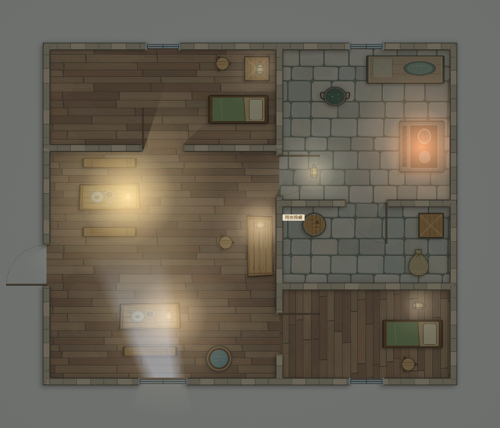
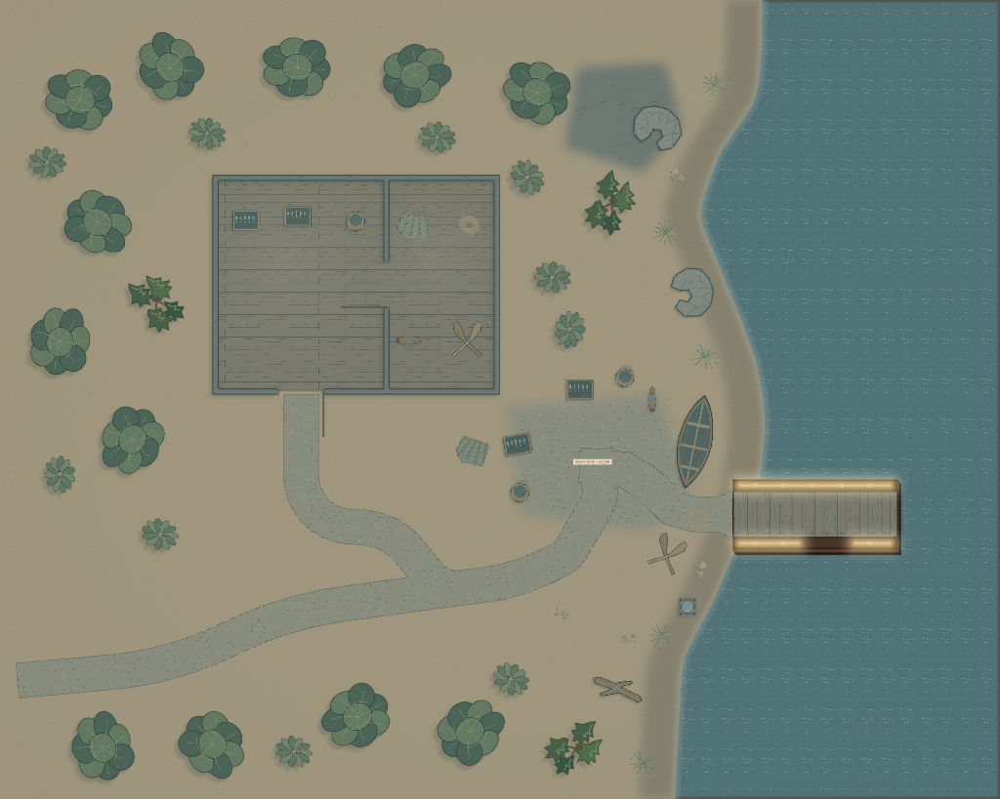

# 织境 · Sceneweave

**把故事画成可以探索的地方。**

织境是一款面向桌面角色扮演（TRPG）的二维地图编辑器，可以直接在浏览器中使用。画出旅店的房间、海岸的道路和高差，再为同一张地图布置家具、光影和只给主持人看的线索。

**[在线体验](https://wojisama.github.io/sceneweave/)** · [图文教程](https://wojisama.github.io/sceneweave/#tutorial) · [版本发布](https://github.com/WoJiSama/sceneweave/releases)

| 余烬酒馆与旅舍 | 潮湾渔获补给站 |
| :---: | :---: |
|  |  |

## 做第一张跑团地图

1. **打开样板。** 在首页「从样板开始」选一幅场景，打开详情后点「用此样板创建副本」。想从空白开始，可以跟着[林边驿站图文教程](https://wojisama.github.io/sceneweave/#tutorial/first-map/create)画房间、开门窗和摆家具。
2. **编辑并切换视角。** 拖动一件家具，或用「注记」添加一条仅主持人可见的线索。点画布上方的「玩家」，核对玩家会看到的画面。
3. **导出地图并备份。** 等顶栏显示「本地已保存」，在「导出」中按用途选择文件。

| 导出选项 | 用途 |
| --- | --- |
| **玩家地图 PNG** | 发给玩家，按玩家可见范围出图。 |
| **主持人地图 PNG · 含秘密** | 主持人上桌时查阅，可保留秘密门、线索等内容。 |
| **备份可编辑工程 · 含秘密** | `.sceneweave` 文件包含工程结构、实际素材和主持人信息。从首页「打开工程文件」导入后可以继续编辑。 |

工程自动保存在当前站点的浏览器中。换设备、浏览器或访问地址（包括端口），以及清理站点数据前，请先下载 `.sceneweave` 备份。普通导入使用完整工程 v1。旧开发版数据可参照[旧数据迁入说明](docs/architecture.md#storage)。

## 制作场景

- **绘制建筑与楼层。** 按实际尺寸绘制房间，在墙上安装门窗。逐楼层安排空间，用图层组织物件，并结合墙厚和家具占地检查通行净宽。
- **生成底图再调整。** 从室内布局、森林、岩岛或海岸开始，预览生成结果，再按需要修改道路、高差、阶梯和局部地形。
- **布置素材与氛围。** 摆放家具与植被，调整地表材质、环境光和背景。常用物件和布景可以保存到个人素材库或模板中复用。
- **从图片提取物件。** 导入地图图像并标定比例，圈选需要保留的物件，将它们拆成可以单独移动和编辑的素材。

## 本地运行

推荐使用 [.nvmrc](.nvmrc) 指定的 Node.js 24。克隆仓库后安装依赖并启动开发服务器。

```sh
git clone https://github.com/WoJiSama/sceneweave.git
cd sceneweave
npm ci
npm run dev
```

默认访问 `http://127.0.0.1:5173`。运行 `npm run build` 可在 `dist/` 下生成静态站点。

手工编辑可以直接使用。AI 辅助为可选功能，服务端配置见[本地 AI 服务](CONTRIBUTING.md#ai-service)。

## 文档与贡献

| 文档 | 可以找到什么 |
| --- | --- |
| [已完成功能](docs/completed.md) | 完整功能清单和界面入口 |
| [文档导航](docs/README.md) | 架构、素材、制作流程和检查方法 |
| [剩余事项](docs/roadmap.md) | 性能与容量、VTT 兼容和其他开发事项 |
| [运行与贡献](CONTRIBUTING.md) | 开发检查、共享工作流、CLI 与 MCP |

## 许可

原创代码与文档采用 [MIT License](LICENSE)。素材、规则和依赖适用各自的许可证，详见[素材与许可](docs/assets.md)。
