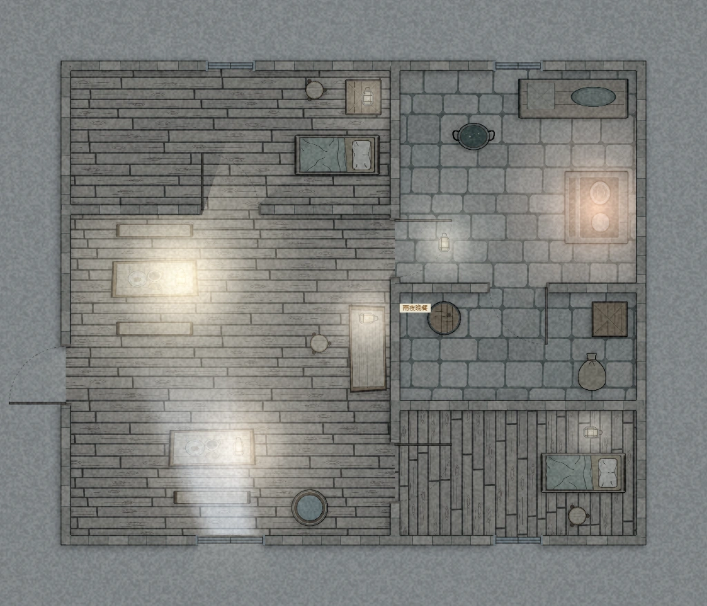
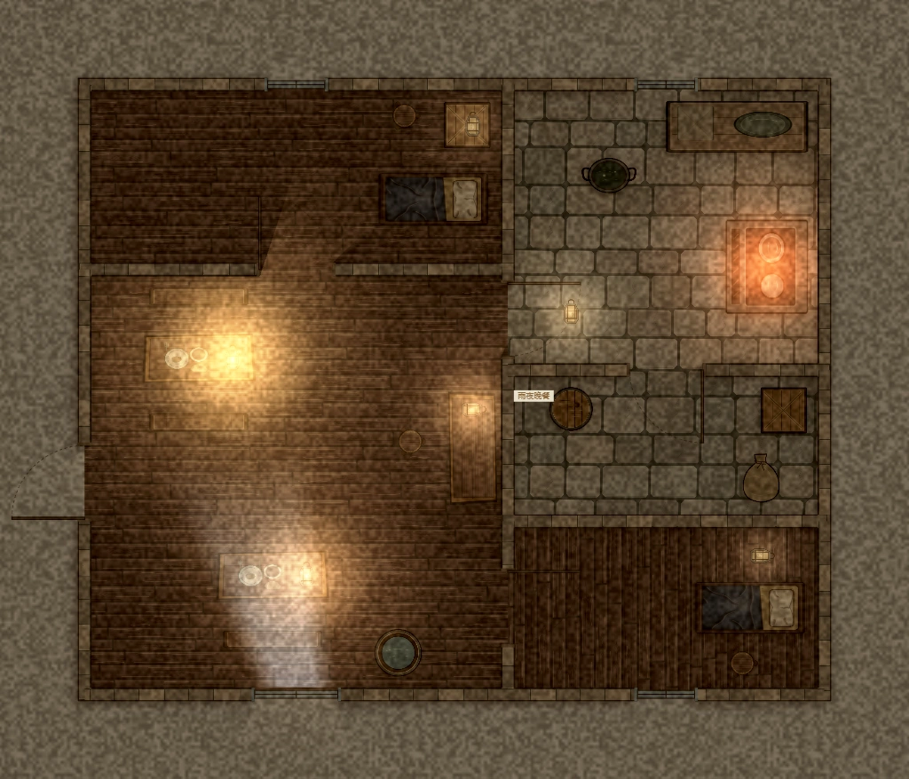
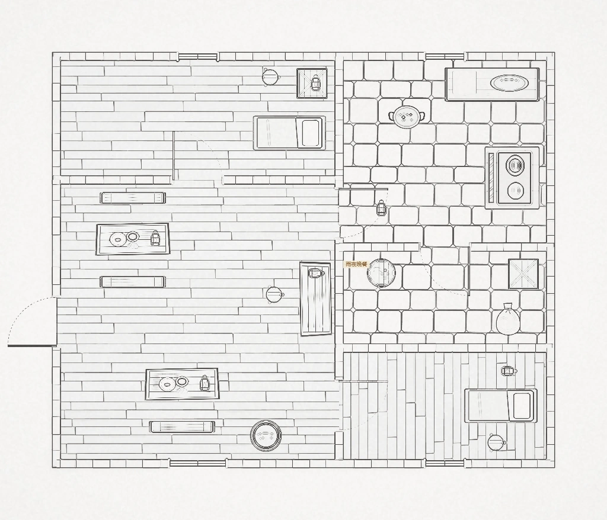
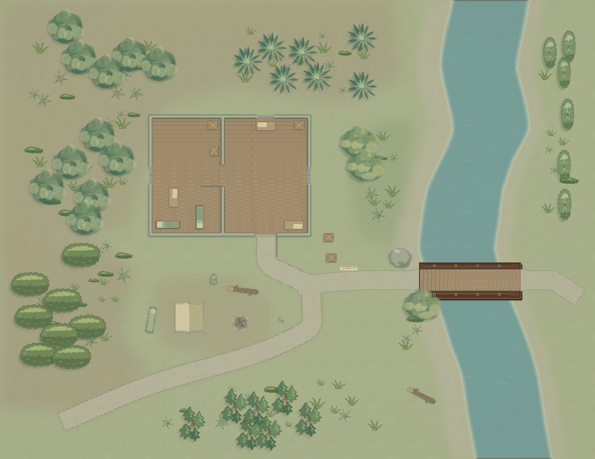
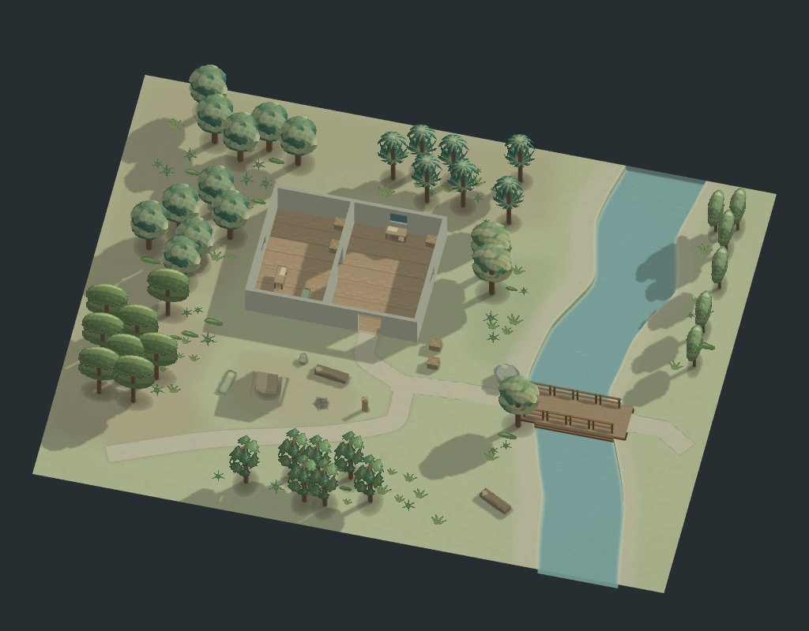

# 织境 · Sceneweave

织境是浏览器里的桌面角色扮演（TRPG）地图编辑器。在正俯视画布上画房间、道路和地形，布置家具与灯光。同一张地图可以切到 3D 斜俯视，旋转、缩放并导出当前角度。

**[在线体验](https://wojisama.github.io/sceneweave/)** · [图文教程](https://wojisama.github.io/sceneweave/#tutorial) · [版本说明](CHANGELOG.md) · [已发布版本](https://github.com/WoJiSama/sceneweave/releases)

## 在首页试一试

在**余烬酒馆与旅舍**为 A、B 两侧各选一种画风。拖动分隔线可移动对比位置，拖动任一端的圆点可绕中点旋转 360°，从任意角度对照同一处木板、石砖和灯光。 [试试画风对照](https://wojisama.github.io/sceneweave/#home-art-style)

| 原画 | 手绘 | 茶绘 | 线稿 |
| :---: | :---: | :---: | :---: |
|  |  |  |  |

在**溪岸巡林补给站**按住地图拖动即可进入 3D。左右拖动环绕木桥，上下拖动调整俯角，也可以拉近看树冠和小屋。 [试试 3D 取景](https://wojisama.github.io/sceneweave/#home-oblique)

| 溪岸巡林补给站 · 正俯视 | 溪岸巡林补给站 · 3D 斜俯视 |
| :---: | :---: |
|  |  |

## 做第一张跑团地图

1. **打开样板。** 首页「从样板开始」提供余烬酒馆与旅舍、溪岸巡林补给站、旧墓库和灰脊火口观测步道。选一张，点「打开为副本」并确认即可编辑。想从空白开始，可以跟图文教程画房间、开门窗和摆家具。 [林边驿站教程](https://wojisama.github.io/sceneweave/#tutorial/first-map/create)
2. **编辑并取景。** 移动家具、调整地形，或用「注记」留下主持人线索。点「斜俯视」转到合适的角度。 [旋转斜俯视并导出图片](https://wojisama.github.io/sceneweave/#tutorial/scene/oblique)
3. **出图并备份。** 分享前切到「玩家」，核对可见内容。等顶栏显示「本地已保存」，按用途下载图片或工程。

| 导出选项 | 用途 |
| --- | --- |
| **导出 → 玩家地图 PNG / WebP** | 正俯视地图，按玩家可见范围出图。可选择长边尺寸，多楼层可一次下载玩家地图 ZIP。 |
| **导出 → 主持人地图 PNG / WebP · 含秘密** | 正俯视地图，供主持人查看秘密门和线索。 |
| **斜俯视 → 导出当前画面** | 当前 3D 角度的 PNG，沿用打开预览时选定的玩家或主持人视图。 |
| **导出 → VTT 导出** | 供主持人导入的墙、门、灯和底图。多层工程可打包为独立场景文件。 |
| **导出 → 备份可编辑工程 · 含秘密** | `.sceneweave` 文件包含工程结构、实际素材和主持人信息。从首页「打开工程文件」导入后可以继续编辑。 |

工程自动保存在当前站点的浏览器中。首页「管理本地存储」可申请持久存储、检查占用、整理历史和回收无引用数据。换设备、浏览器或访问地址（包括端口）前，请下载并验证 `.sceneweave` 工程，以及各自面板里的个人素材库和模板库备份。

## 制作场景

- **绘制建筑与楼层。** 按实际尺寸绘制房间，在墙上安装门窗。逐楼层安排空间，用图层组织物件，并结合墙厚和家具占地检查通行净宽。
- **在画布中生成内容。** 从「生成」选择室内布局、森林、岩岛、火山或海岸，预览并加入当前楼层。「参考图地形」可提取可编辑轮廓，标记地貌、布景和完整登高路线，预览后另存并打开新工程。
- **布置素材与氛围。** 摆放家具与植被，调整灯光、地表材质和全图画风。常用物件和布景可以保存到素材库或模板中复用。
- **从图片提取物件。** 导入地图图像并标定比例，圈选需要保留的物件，将它们拆成可以单独移动和编辑的素材。

## 本地运行

推荐使用 [.nvmrc](.nvmrc) 指定的 Node.js 24。克隆仓库后安装依赖并启动开发服务器。

```sh
git clone https://github.com/WoJiSama/sceneweave.git
cd sceneweave
npm ci
npm run dev
```

默认访问 `http://127.0.0.1:5173`。运行 `npm run build` 可在 `dist/` 下生成静态站点。

手工编辑可以直接使用。AI 辅助为可选功能，服务端配置见[本地 AI 服务](CONTRIBUTING.md#ai-service)。

## 让通用助手做一张地图

安装依赖后，把参考图或文字需求发给能在仓库中运行命令的助手，请它使用 Sceneweave 的通用制图入口。助手可以先交草稿供你看图，再提供可编辑的 `map.sceneweave` 和复核过的俯视图。有高差或需要侧看时，一起导出斜俯视图。回到首页用「打开工程文件」继续编辑。 [从可运行示例开始](CONTRIBUTING.md#local-map-harness)

## 文档与贡献

| 文档 | 可以找到什么 |
| --- | --- |
| [已完成功能](docs/completed.md) | 完整功能清单和界面入口 |
| [文档导航](docs/README.md) | 架构、素材、制作流程和检查方法 |
| [剩余事项](docs/roadmap.md) | 性能与容量、VTT 兼容和其他开发事项 |
| [运行与贡献](CONTRIBUTING.md) | 开发检查、共享工作流、CLI 与 MCP |

## 许可

原创代码与文档采用 [MIT License](LICENSE)。素材、规则和依赖适用各自的许可证，详见[素材与许可](docs/assets.md)。
