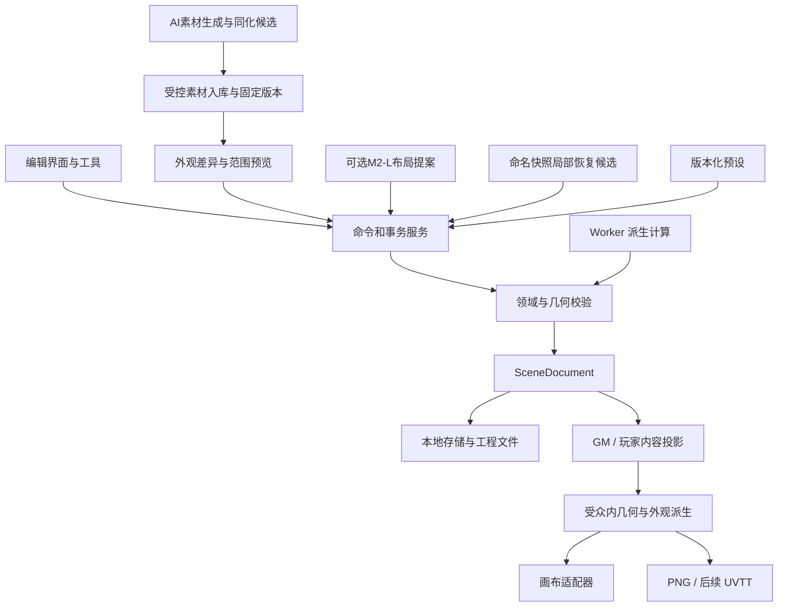

# 技术架构与模块边界

状态：B1–B5与C0/C1a–C1d首批已有交付，历史验证见17–27。大量选择优化与四组正式对照见[25](25-selection-performance.md)；C1c用户图层见[26](26-m1c-c1c-validation.md)，C1d命名/保护快照、历史备份及独立物件首批恢复见[27](27-m1c-c1d-validation.md)。适用验证和完整矩阵的限制以27为准，不据首批能力推定全部恢复或交互性能通过。下一入口为C2建筑工具及共享结构恢复扩展。参数外观、扩展局部恢复和M2素材主线、完整M1、主题P3、SCN-04及全交互性能仍待完成。更新：2026-10-22。

本文件定义技术选择及职责。对象字段以[场景文档](04-scene-document.md)为准，保存协议以[存储与导出](06-storage-and-export.md)为准，AI 协议以[AI 与生成](05-ai-and-generation.md)为准。

B1采用并列模块：`core/v2`拥有严格新版领域、依赖和隔离迁移；`io/v2`拥有受控位图、完整资源包和独立资源仓库；`editor/v2`保留完整工程。B2的 `core/v2/commands.ts` 统一有限手工事务、候选预览和撤销；`render/v2` 先做受众投影，再用同一 Canvas 2D 管线绘制预览与PNG，支持厚墙转角、真实尺度材质、零高程露台、透明物件和主题装饰阴影，不向M0降级。为保持轮廓修改前后的纹理相位，铺装先按固定世界视图采样，再按表面裁剪。

C1a由 `editor/v2/blank-project.ts` 直接构造单Floor空白文档，并从现有B2/B3清单采用18个固定单件定义及对应PNG/许可；不生成样板几何或散布结果。完整资源校验与新工程保存成功后才切换工作区。放置幽灵是会话暂态，`core/v2/commands.ts` 的有限 `addProp` 从固定定义构造完整Prop，点击采用时执行全场景校验；移动/旋转和删除继续复用既有命令、Workspace历史和保存协议。schemaVersion仍为2，没有新增持久字段或仓库格式，具体范围与支撑选择语义归04/06。

每次绘制拥有独立位图，结束/取消后关闭；C0将底图与透明选框分成两个Canvas，选择改变仅更新选框，平移/缩放复用底图栅格，工程或受众改变则重新绘制。切换时两层同步隐藏，旧绘制通过取消信号与身份token失效，不能让GM底图或选框残留到玩家预览。当前没有持久位图缓存、纹理atlas、同尺寸paintCanvas复用或Worker。M0使用Konva，v2素材预览与PNG实际使用原生Canvas2D；历史负载与选型依据见[21](21-m1b-b5-validation.md)，C0对应证据归22，不能把有限样板结果外推为通用容量。B3沿同一管线加入高程、来源边缘、朝低侧的崖面、独立世界东南阴影、显式台阶和覆盖层；先过滤受众，再解析有效地形与派生边。散布使用同步有限候选和完整Prop存档，加载/绘制不重撒。后续按实测瓶颈评估优化和其他渲染引擎，B3证据见[19](19-m1b-b3-validation.md)，B1/B2证据见[17](17-m1b-b1-validation.md)和[18](18-m1b-b2-validation.md)。

C1a待放置图片的临时预览同样逐次检查引用/记录、实际字节、CRC/hash、尺寸与单图预算，经过共享原生解码槽。预览未就绪不能采用，失败退出待放置并保留当前工程；取消、换素材或离开时释放本次位图，不建立长期缓存。相关验证见[23](23-m1c-c1a-validation.md)。

C1c的 `core/v3`、`io/v3`、`editor/v3` 与 `render/v3` 保留严格边界；显式v2领域视图只复用几何命令/面板，不进入v2渲染或IO。两版renderer共享schema无关的Canvas绘制与资源层。v3点选、框选、全选及选框范围使用同一按真实隐藏集合和层序生成的墙连接轮廓；仅当前层的选择范围不改该几何。

C1d的`core/v4`、`io/v4`和`editor/v4`实现历史信封及恢复事务；完整场景文档仍严格schemaVersion=3，新增containerVersion=4、profile=`m1-history`，使用独立`sceneweave-m1-history` IndexedDB。打开v4工程时先解析历史包，再将`toCompleteProjectV3`的`document`、`assets`、`licenses`、`licenseBindings`四项投影交给严格v3 IO与原生v3 renderer；历史身份、lineage和出生令牌不进入v3渲染视图。v3→v4迁移创建全新的sceneId/r0副本，精确保留v3原Blob/hash与v2/v1来源链；旧20份自动快照不迁移。可移植工程包不包含本地迁移原件。

大量选择改用独立订阅会话、按需属性、虚拟列表、分级提示与认证精确空间索引。手势停稳后编辑LOD绘制可见范围，完整资源/解码先于裁剪和简化；正式PNG保持完整质量。具体阈值、证据和调度代理边界见25。

## 室内与自然地形的共同目标

目标画面为二维俯视地图，用真实墙厚、材质、离散地面高度与装饰阴影表现体积。建筑与自然地形共用同一 SceneDocument、坐标、事务、资产库和导出管线；房间工具负责精确的墙门连接，地形工具负责不规则轮廓、台地、岸线及表面过渡。M1 不引入可旋转三维视角、连续地形网格或动态光照。

| 职责 | 建筑中的例子 | 自然场景中的例子 | 必须保持的边界 |
|---|---|---|---|
| 空间结构 | 斜角房间、共享厚墙、附着门窗 | 地形区域、高差边缘、坡道／台阶连接 | 材质变化不自动修改结构或通行属性 |
| 视觉外观 | 木板方向、墙顶纹理、门框、接触阴影 | 草岩沙水过渡、悬崖侧面、岸线、水纹 | 绘制顺序不代表地面高度；阴影不代表视线阻挡 |
| 物件与组合 | 钢琴、书架、餐桌组合、桌面杂物 | 树丛、石群、营火组合、区域散布 | 图片、素材定义、场景实例分别管理；占地独立于图片透明度 |
| 跑团语义 | 门状态、家具阻挡、秘密与线索 | 困难地形、不可跨越悬崖、显式跨高差连接 | 不从颜色、光照或贴图推断角色能否行动 |

同一 Floor 可以包含不同地面高度，Floor 仍表示一张编辑平面；树冠等装饰可在地面上方绘制。海水基底与岛屿可通过显式地表覆盖顺序组合，每个 XY 只解析出一个实际支撑面；该顺序不等于渲染排序或高度值。M1 不表达同一 XY 位置上两个可行走面，也不表达桥下通行、多层楼或上下层可见性。这些限制须在建模和导入时明确诊断。

## 技术决策

| 领域 | 基线选择 | 当前理由 | 需要验证或重新决策的条件 |
|---|---|---|---|
| 应用 | TypeScript 5.9.3、React 19.3.1、Vite 7.3.7 | 二维编辑器 UI 与领域模型共用语言；已锁定依赖 | 浏览器证据及后续升级兼容 |
| 画布 | M0：Konva 10.9.0、react-konva 19.3.2；v2：原生Canvas2D | M0程序符号与v2素材绘制独立，v2共用预览/PNG适配器，覆盖建筑、地形与组合的有限样板；B5观测见21 | 先区分领域校验、解码、绘图提交与编码成本；必要优化后瓶颈仍在渲染，再评估PixiJS等适配器 |
| UI 状态 | M0：Zustand 5.0.15；v2：WorkspaceV2与React会话状态 | 区分持久文档、选区、工具状态和临时视口；C0手势不提交领域事务 | 渲染订阅不能导致每次视口拖动全界面重算 |
| 结构校验 | Zod 4.6.7 + 原创几何校验；C0认证不可变快照 | 外部输入和变化事务最终状态仍完整严格校验，仅复用模块拥有的深冻结身份 | B3仅提供有限直线净宽通行与样板接入守卫；全图路径仍未实现，不能由Schema或缓存命中推定 |
| 计算 | M0/v2 主线程TypeScript；Worker尚未引入 | v2有限事务、候选与校验在主线程执行，B5分别观测支持操作的提交和显示；尚无通用布局/路径求解器 | 计算负载需要移出主线程时实现带版本与取消的协议 |
| 保存 | IndexedDB + Dexie 4.4.6；fflate 0.8.3 | M0几何仓库与v2完整资源仓库分开；同事务CAS、快照与完整ZIP | 恢复与跨标签实测见13/17，VIS-01/02往返见18/19；真实配额耗尽未测 |
| AI 网关 | 后续可选 Node.js + Hono 本机服务，尚未创建 | 隔离密钥、provider 协议和模型网络请求 | 本机 Origin/会话校验与取消是启用条件 |
| 测试与性能观测 | Vitest 4.1.12 + Playwright 1.56.1 | 领域、存储和投影单测；Chrome旅程及显式生产性能工具入口 | 历史范围见13/17–20，B5方法与结果见21；全交互、SCN-04、其他浏览器和完整资源峰值仍有缺口 |
| 工程组织 | 单仓库、单 Web 应用与可选网关 | 控制个人维护成本 | 模块独立发布确有价值时再拆包 |

M0已建立工具链，B1–B5沿用并扩展。建议使用Node.js 24.14.1，运行命令见[贡献说明](../CONTRIBUTING.md)，依赖以锁文件为准。静态前端通过[GitHub Pages工作流](../.github/workflows/deploy.yml)构建部署，Node版本读取 `.nvmrc`；当前没有AI网关、Worker、工程云同步服务或正式发行版流程。历史单元、Chrome与构建结果分别见13/17/18/19/20；B5技术负载与资源观测单独见21，不等于跨浏览器、完整场景或全交互已达标。

B5通过 `npm run build:performance` 生成显式工具构建，再由 `npm run perf:b5` 串行启动专属Chrome进程采集。默认每个样板/实例数组合三轮，每轮30次物件编辑、30次轮廓编辑和60次真实指针选择；正常构建不暴露性能API。OS进程树RSS采样目前仅适配macOS，目标CDP的JS堆与RSS分别记录；共享页、漏采瞬态和GPU分配的缺口在21说明。绘图阶段是Canvas调用提交区间，Canvas拷贝后的双rAF是显示调度近似值，不代表GPU/屏幕实际呈现完成。

C0保留B5从命令准备完成开始的可比计时，同时新增命令准备前的intent窗口，计入工程读取、室外克隆及浅水联动准备；精简模块入口与真实工作台输入/手势仍分开记录。实现变化不自动证明延迟或RSS下降，正式矩阵、构建指纹和剩余缺口统一归22。

## 数据与依赖方向

下图包含已实现模块与后续规划边界；C1d已提供命名快照和独立物件首批恢复，AI、Worker及结构/组合/地形恢复仍待后续，不能由箭头推定所有功能已开放。

领域内核不依赖 React、Konva、IndexedDB、HTTP 或具体模型。画布、存储、AI 与导出依赖领域模型；它们之间通过明确的文档与事件交互，不互相读取内部状态。绘图节点是文档的表现，可以全部重建。

已创建src/core/v2–v4、src/editor/v2–v4、src/rendering、src/render/v2–v3及src/io/v2–v4；src/performance与tools/performance只服务显式测量构建。v4模块处理历史信封，仍交由native v3渲染严格v3文档。generation、rules与ai仍是后续逻辑边界：

| 模块 | 职责 | 不承担的职责 |
|---|---|---|
| core | 实体、单位、命令、修订号、有效锁、事务、撤销、结构/几何不变量；v3用户图层与v4历史身份、独立物件恢复；外观覆盖及扩展恢复依赖仍待后续 | 画布节点、模型调用、网络密钥 |
| editor | 工具模式、会话选择集合、快捷键、视口、属性编辑、预览和反馈；C1a空白/放置、C1b选择/右键、C1c图层及C1d历史/差异/恢复入口 | 单独维护另一份持久几何，或让不同入口采用不同锁/权限规则 |
| rendering / render/v2 / render/v3 | 分别拥有M0/v2/v3受众投影、共享Canvas绘制与PNG编码；v4经四键工程投影复用native v3 renderer；M0的Konva通过editor适配 | 直接修改文档、持久化画布节点或省略保密规则 |
| generation | 素材/风格候选的本机准备与有界参数处理；可选M2-L的SceneBrief、布局候选、约束求解和确定性随机 | 修改已发布的文档、扩散到未选对象或放宽硬约束 |
| rules | 通用预设、比例尺显示、距离策略、版本快照 | 战斗结算、自动判定角色行动合法性 |
| ai | provider适配、素材生成/同化请求、候选解析、请求状态、依赖组和预算；可选布局提案单独启用 | 任意执行脚本、修改源定义、自动扩大范围或公开内容 |
| io | M0几何、v2完整资源、v3图层和v4历史独立仓库；完整容器、副本迁移、资源闭包、命名/保护历史及CAS；UVTT和新外观链仍为后续 | 以最后写入覆盖冲突、只保存seed或远端URL、输出完整GM数据给玩家 |
| performance / tools/performance | 复用产品模块的显式负载夹具、操作观测与独立资源采样 | 替代真实工坊全部操作验收、绕过候选守卫或拥有额外提交权 |

M0 使用少量文件完成边界验证，没有引入泛化插件框架。接口稳定的判断依据是两种调用方确实需要同一能力，例如手工工具和 AI 都经由 CommandBatch。

M1-A 已明确新领域/存储规范与首批素材规格，实施切片见[设计交接](16-m1a-handoff.md)，素材制作任务见[清单](15-m1a-asset-production-list.md)。M1 在这些边界内增加材质／素材目录、组合定义、地形领域操作与外观派生，不预先拆成独立服务。素材目录管理尺寸建议、分类、风格与许可；io 管理实际字节；core 保存实例引用、完整已采用结果和约束；rendering 生成纹理裁切、悬崖侧面和阴影。地形布景或散布算法只能产生待校验候选，不能绕过事务直接往画布加图。

## 四类状态

| 状态 | 示例 | 生命周期 |
|---|---|---|
| 持久文档 | 墙门、房间、比例、秘密状态、资产引用、预设快照；后续用户图层及已采用外观覆盖 | 完整保存并有格式版本；新增语义经严格契约与副本迁移 |
| 编辑会话 | 当前工具、选择集合、视口、会话操作历史、图层编辑隐藏/独显、恢复预览和当前提案 | 可重建；撤销历史首版只要求会话内有效 |
| 交互暂态 | 拖动中的候选位置、框选矩形、吸附提示 | 取消即丢弃，不递增 revision |
| 派生数据 | 房间相邻、结构/通行图、渲染缓存、预览图 | 带 sourceRevision，可失效重算 |

不得把暂态数据每个鼠标事件都写入持久文档。拖动期间渲染候选几何；释放时提交一次命令，整组成功后 revision 增加一次。无变化或取消不产生空历史。

命名快照属于独立持久历史仓库的记录，捕获完整文档、资源闭包及身份令牌；名称/保护状态不是当前地图里的实体，也不混入会话撤销栈。每场景最多32个命名与32个保护快照，历史归档最多64个显式选中项；C0内存认证仍只是运行时校验优化，不提供持久身份。自动20份快照与命名/保护历史分开管理，旧自动快照不迁移。

## 编辑事务

CommandBatch 包含 baseRevision、source、scope、operations 和操作标识。流程是：确认基线 → 在隔离候选状态计算 → 检查引用、单位、几何、锁与声明的硬约束 → 原子替换当前文档 → 记录可撤销历史 → 排入自动保存。失败返回具体对象与原因，原文档保持可继续编辑。

撤销与重做都形成新文档事务，revision单调递增；只恢复业务内容，不把修订号改回旧值。一次拖动、一次多对象操作、一次采用AI候选或一次C1d局部恢复分别是一个撤销单位。C1d的历史工作台从明确快照和1–256个独立物件ID构造范围；`appearance`、`transform`和完整`entity`模式保留各自属性边界。预览基于checkpoint/scene/revision/source snapshot身份绑定。采用前flush并校验来源，通过当前场景+元数据+来源快照CAS写保护点后再次校验，最终提交一个revision+1事务。保护失败不改当前文档；采用后保存失败保留新内存文档、撤销与保护点，并保留旧持久分支。结构、组合与地形依赖仍待C2–C4适配，不使用内部历史重放绕过锁、基线或资源校验。

C0在`core/v2/snapshots.ts`用私有WeakMap登记严格解析后、模块拥有且深冻结的文档身份。调用者自行冻结对象、复制相同字段或传入外部旧revision文档都不能跳过完整校验；普通`applyCommandsV2`继续返回独立可变候选，Workspace改用不可变快照入口。一次变化编辑仍在隔离草稿上执行严格命令、编辑锁与依赖检查，最终完整领域校验一次，随后对冻结候选执行样板守卫；revision/updatedAt通过小范围严格Schema后生成新文档头。失败、无变化和取消不消费历史或保存；撤销/重做共享已认证内容并产生当前revision+1，安全整数溢出仍拒绝。具体契约归04。

手工添加尚未连通的房间是合法草稿。连通性只有在对象声明 required 或生成请求要求时成为提交约束。算法与 UI 都必须区分结构相连和当前门状态下可通行；锁门不能触发自动打洞或开锁“修复”。

## 渲染与交互

- M0 的 React 界面与 Zustand 保存会话状态，Konva Stage 负责视口，单个批量 Shape 调用共享 Canvas 绘制器；命中与拖动由 editor 处理。拖动候选仅保存在会话中，不写入文档。按实体订阅、缓存和视口裁剪属于后续优化，是否需要以实测判断。
- v2素材工坊支持实际Canvas点击选择、属性编辑、有限结构候选与C0视口。视口倍率为适应全图的25%–800%，支持指针锚定滚轮缩放、按钮缩放、平移与适应全图；C1a空白创建与单件放置、C1b框选/多选和右键、C1c用户图层、C1d历史工作台均已实现，各自适用证据归23–27，不据此关闭完整交互验收。
- 放置预览只更新透明覆盖层与暂态位置，采用入口核对工作区基线，有限命令携带固定定义、稳定ID与明确支撑；无效边界、锁、引用或过期基线不写入工程。支撑由用户显式选择Floor、房间或地形；Floor模式不按鼠标落点自动认领房间语义。新物件只在定义指定的系统绘制带内叠到已有同带物件之上，不跨带排序，也不代表用户图层已经实现。
- 地面、墙门、物件、标注批量合成为长边1200像素的底图，透明选框使用独立Canvas；网格批量绘制，格子不建立独立交互节点。CSS视口缩放不重新解码或调用场景绘制器，高倍率清晰度受该预览栅格限制。
- 缩放与平移只改临时视口变换，不更新SceneDocument、revision、撤销历史或保存队列；命中按实际变换后的底图矩形反算世界坐标与屏幕容差。PNG继续从文档固定范围独立采样，设备像素比不改变文档尺寸。
- 画面简化、纹理缓存、视口裁剪是性能优化，不可改变导出结果或实体业务状态。
- 秘密预览调用与玩家导出相同的投影策略；不维护一套只靠 UI 隐藏的规则。
- M0 使用单层；M1 仍为一个 Floor，增加同一平面内的离散地面高度。多个 floorId 或同 XY 多可行走面的文件不能默默合并为一层。

### C1b–C3交互和图层职责（C1b/c已实现，C3计划）

C1b已将单一选择ID扩展为会话选择集合，框选、追加/移除选择和右键菜单使用与点击相同的世界命中转换。右键菜单根据命中对象及当前选择提供已支持动作，工具栏、快捷键和属性面板调用同一命令服务；批量操作先形成完整影响集合，再一次校验与提交。选择覆盖层继续只绘制编辑提示，图层列表和框选不能产生一份独立实体真值。

C1c新增的用户图层是同一Floor内可命名、排序、锁定的平面组织单元，实体唯一归属，组合/散布容器与成员保持同层；它与现有ground/object/canopy系统绘制带、地面高程及Floor分开。图层顺序只能在各系统带内生效；共享墙、支撑和注记依赖仍跨层统一解析。有效锁为实体锁或图层锁，修改影响到任一锁定依赖就拒绝整批。图层编辑隐藏/独显仅是会话状态，正式GM/player预览与PNG始终从完整文档和明确受众重新生成。

C3再开放受支持的非破坏性外观覆盖：固定源版本 → 图层外观覆盖 → 实例/成员覆盖，定义源件保留，覆盖可独立移除。渲染器消费经验证的有效外观，不能自行从目录最新版补值；改变覆盖后按当前成员计算实际影响，移层先显示外观变化。任意混合模式、像素蒙版、嵌套图层和完整PS兼容不属于这批架构承诺。对象语义、持久契约和迁移以04/06为准。

### C1d已实现、C2–C4扩展局部恢复职责

io/v4读取并验证不可变命名快照及资源；core/v4按稳定ID、出生令牌和属性组构造首批独立物件候选，editor/v4展示历史对象虚拟列表、完整ID、差异、恢复模式及玩家可见性变化。命名快照和保护点各限32份；历史归档最多64项，仅显式勾选的快照随history包携带。完整包只含当前工程。当前完整文档始终是提交基线，范围外的新编辑保留。

`appearance`恢复固定定义引用与外观字段，`transform`恢复位置和旋转，`entity`恢复或重建一件完整独立物件。首批拒绝组合/散布成员、锚定注记/路径依赖、有效实体/图层/支撑锁、非法几何/隐私、lineage/出生身份或资源身份冲突；不隐式删除较新对象。历史来源预览绑定checkpoint、scene/revision、快照ID/hash和请求。flush、来源校验、保护点CAS、二次基线检查后才采用一次revision+1可撤销事务。实现范围及适用验证见27，不据此推定完整浏览器矩阵或扩展恢复类型通过。

C2–C4分别增加共享墙/门、组合和地形/散布恢复适配。没有对应适配器的实体类型拒绝局部恢复，不按JSON片段硬贴。采用后保存失败保留新内存文档、撤销、保护点和旧持久分支；当前秘密/遮罩仍须校验。命名历史不被自动20份快照静默淘汰，完整资源闭包及历史备份规则由06定义。

### M2素材生成、同化与逐步扩围（计划）

M2主线是“单组件/材质候选 → 明确组合 → 明确选区内多个组合”的渐进外观工作流。手工参数调整与AI生成共用素材候选、规范化、许可/资源校验、固定版本、范围预览和原子采用管线。provider仅输出受支持候选；本机不把模型图片直接变成画布节点或原地覆盖源定义。离线重开以实际采用字节、固定版本、参数和完整结果为准，重新调用模型不是存档恢复步骤。

一次扩围是一次新的目标集合和baseRevision；同目录引用、空间邻近或风格相似不使对象自动加入。组合候选保留成员身份、实际占地、锁、秘密及人工覆盖；只选择部分建议时按依赖组重建候选。较旧结果、取消请求或工程切换后的返回不得采用。原AI布局/布景/注记方向保留为可选M2-L，协议和启用条件统一见05，不能与素材同化混成一个拥有全场景修改权的入口。

### M1 外观与地形派生管线

B2/B3已实现下述建筑/地形样板子集，B4核查双受众与依赖，B5观测其真实负载。道路/路径带等仍属后续；当前渲染器对未支持外观明确停止预览与导出，不以省略内容冒充成功。以下同时保留未来扩展须遵守的管线契约。

1. 固定文档 revision，并取得工程保存的素材、组合与主题版本快照。
2. 先进行受众投影：剔除秘密实体，补齐未揭示秘密门，重建公开边界；只把允许公开的几何及依赖交给下一步。
3. 从该投影计算厚墙连接、房间地板裁切、地形边缘、材质过渡、路径带和装饰阴影。玩家版本不得借用完整 GM 几何生成的岸线、阴影或纹理接缝。
4. 解析相同物理尺度的素材并按确定绘制顺序合成；选择框和工具提示属于编辑覆盖层，不进入地图 PNG。最后应用玩家不透明遮罩。
5. 画布与PNG共用投影、几何、外观参数和排序。C0交互视口只对已有预览栅格施加CSS变换，PNG按请求的输出尺度独立采样；两者都不能改变自然轮廓、散布结果或纹理的世界相位。

材质按世界毫米平铺，保存对齐原点和方向。world 对齐使相邻区域可共享相位；surface 对齐允许房间有独立木板方向，区域移动时按自身坐标系移动。调整区域边界不根据新包围盒重新拉伸纹理或重置原点。

地形边缘的位置来自已采用区域轮廓和显式相邻关系；用户编辑边缘的种类、材质和视觉宽度。改变岸线／悬崖位置通过修改来源轮廓完成，防止形成一份独立漂移的外观轮廓。墙厚与高差参与结构；描边、悬崖侧面宽度和装饰阴影仅负责画面，不能替代净空或通行计算。

缓存至少区分 sceneId、sourceRevision、受众、主题／素材版本及输出尺度；秘密状态、材质、依赖轮廓或组合内容改变时使相关缓存失效。GM 与玩家派生缓存不得混用。按素材内容 hash 共用解码结果，不代表可以共用含秘密几何的合成缓存。任何降采样预览都必须保留已采用几何，最终导出重新按预算绘制。

C0只对认证文档复用输入领域校验；每次render仍验证该受众所需资源的实际字节并经共享单槽解码，结束后关闭。墙体几何、排序和受众局部索引在一次投影/绘制中复用，不跨render保存，也不把GM索引交给玩家。未新增跨绘制ImageBitmap缓存，材质paint key变化仍释放旧画布并另建，B5撤回的同尺寸重用方案不重新启用。

两类可编辑样板要同时验证视觉与编辑依赖：改变带斜角书房的边界后，墙角、门窗和地板正确更新；改变岩岛轮廓后，岸线、悬崖和材质正确更新，人工调整过的树石不被重新随机布置。有限样板首轮见18/19，双受众与存档矩阵见20；真实素材解码、绘图提交、4K编码和可测资源观测见21，用于后续缓存策略及Worker决策。M0程序符号数据不能替代这些测量，技术检查也不能替代主题P3与用户美术签收。

## Worker 与异步结果

以下是后续Worker接入契约，M0/v2均尚未创建Worker。当前异步场景切换在完成持久化后再次核对场景/修订或工作区checkpoint，若期间有新编辑则保留当前场景；M0拖动也保存基线修订，撤销或其他修改使其失效。

Worker 任务至少携带 requestId、sceneId、baseRevision、taskKind 和任务参数版本。结果回到主线程时再次检查请求是否仍有效。取消、切换场景、文档更新或重新请求使旧任务失效，晚到结果只能被丢弃或作为显式重新检查的候选。

Worker 返回布局结果、诊断或派生结构，不拥有提交权。较长计算要提供合作式取消点；超出预算结束候选并返回诊断。不要为了等待 Worker 锁住整个编辑器。数据以可序列化文档/局部快照传递，避免将可变引用在异步链中当作稳定基线。

## 本地优先与 AI 网络边界

手工编辑、保存、工程文件和图片导出都在本地完成。首次页面加载仍需要获得应用资源；真正断网冷启动的 PWA 缓存在后续单独验证，不能把“本地数据”自动等同于“任何时刻都能离线启动”。

启用AI时才把当前明确采用的素材参考、受支持参数、目标成员及必要风格说明发送给已配置provider；M2先从单素材开始，组合/选区扩围时重新展示发送范围，不默认上传整张GM地图或快照历史。可选M2-L另行声明其所需邻接信息和场景摘要。日志不记录密钥、完整提示词或私密注记正文。网关默认只绑定回环地址，限制Origin、配对会话和预配置目标，不是开放通用代理。详细边界见[AI文档](05-ai-and-generation.md)。

项目文件不包含 API Key、provider 凭据、个人路径和客户端会话信息。默认不增加遥测、云同步或账号。将来托管多人服务需要另行设计身份、权限、数据隔离与运维，不能直接把本机代理暴露到公网。

## 验证与演进

M0验证墙门关联、事务回滚、毫米坐标、保存往返、玩家投影和程序符号负载。M1-A确定两类视觉样板及契约，M1-B完成VIS-01书房与露台、VIS-02双层岩岛的可编辑样板；M1-C/C0已实现性能与视口基础，C1a已建立空白工程和固定单件创作闭环，实际验证归23。C1b已建立选择/右键与有限原子批改，证据归24；C1c已建立用户图层，证据归26；C1d已建立命名/保护历史、显式历史备份与独立物件首批恢复，证据归27。下一入口为C2建筑绘制及共享结构恢复，再由C3/C4扩展组件外观和室外工具，C5集成；M1-D使用SCN-04海岸哨所验证室内外混合创作。具体任务与门槛以[路线图](07-roadmap.md)和[质量计划](09-quality-plan.md)为准。“双层岩岛”指一个Floor上的高低台地，不表示两层Floor。

M2以素材生成/同化为主线，原可选A1素材生成工作并入其中；单件、组合及多组合范围逐批验证透明边缘、俯视角、比例、风格、许可、非破坏性采用和局部恢复。旧布局/布景/注记改为可选M2-L，独立安排且不阻塞M3/M4。生成图片不能自动定义阻挡或保证工程可编辑。上述M2设计尚未实现；实际M0环境、结果与待测范围仍见[M0验证报告](13-m0-validation.md)，各批历史结果不因后续交付而重写。

替换M0的Konva或v2的Canvas2D适配器、从IndexedDB迁往桌面文件系统、增加UVTT或多楼层，都应保留独立文档模型并通过适配和迁移实现。B5的具体渲染决策以21为准；任何引擎替换仍需真实负载、隐私、取消和资源生命周期验证。
