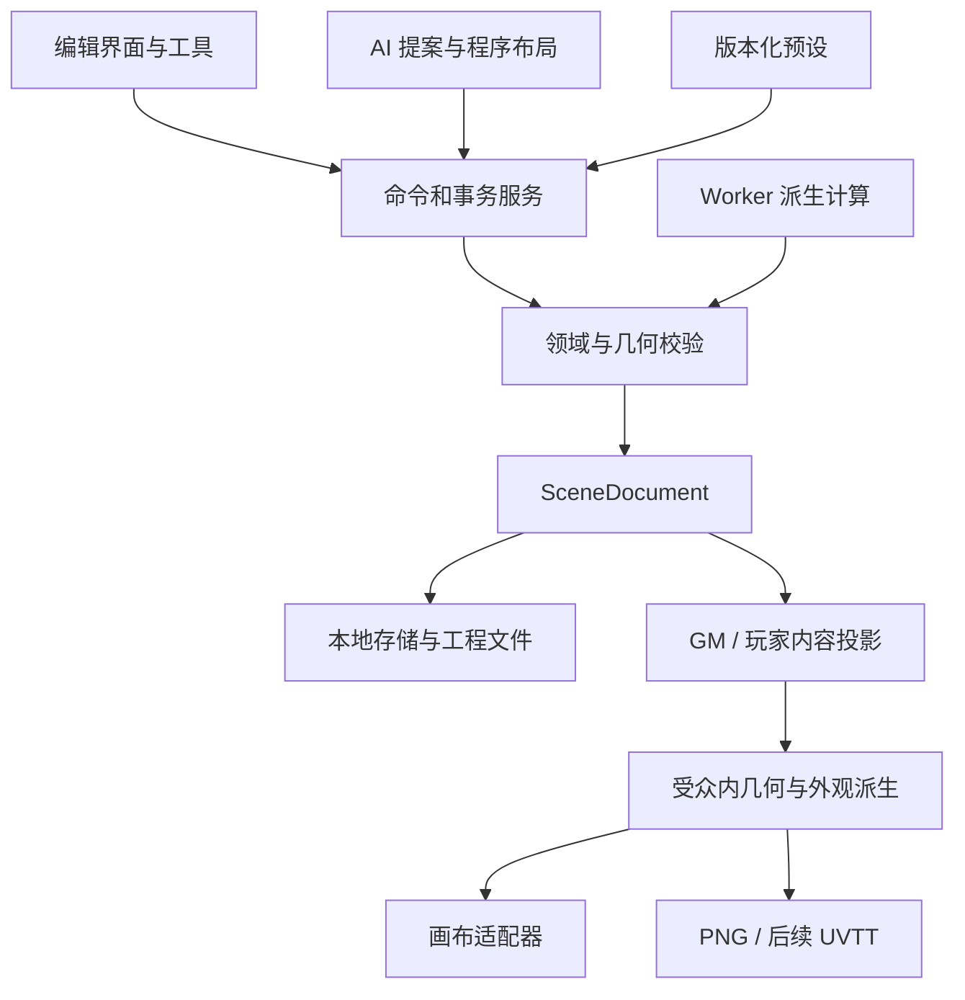

# 技术架构与模块边界

状态：M0 几何版原型首轮验证完成；M1-A 规格已形成，B1 素材工程基础已实现；完整室内／室外视觉架构与双样板仍待后续批次。最后更新：2026-10-20。

本文件定义技术选择及职责。对象字段以[场景文档](04-scene-document.md)为准，保存协议以[存储与导出](06-storage-and-export.md)为准，AI 协议以[AI 与生成](05-ai-and-generation.md)为准。

B1 当前实现采用并列模块：`core/v2` 拥有严格新版领域、依赖和隔离迁移；`io/v2` 拥有受控位图、完整资源包和独立资源仓库；`editor/v2` 的有限原子编辑与串行保存保留完整工程。独立素材工坊使用 Canvas 2D 做材质/透明物件校样预览，不向 M0 画布降级，也不把它当成已完成的 M1 渲染器。图片解码、Canvas 图案和选择边框为可丢弃派生数据；当前没有纹理 atlas 或 Worker。B2/B3 再验证建筑、地形与已有 Konva 编辑的整合；真实压力证据达到重评条件后才选择其他渲染引擎。实际验证见[17](17-m1b-b1-validation.md)。

## 室内与自然地形的共同目标

目标画面为二维俯视地图，用真实墙厚、材质、离散地面高度与装饰阴影表现体积。建筑与自然地形共用同一 SceneDocument、坐标、事务、资产库和导出管线；房间工具负责精确的墙门连接，地形工具负责不规则轮廓、台地、岸线及表面过渡。M1 不引入可旋转三维视角、连续地形网格或动态光照。

| 职责 | 建筑中的例子 | 自然场景中的例子 | 必须保持的边界 |
|---|---|---|---|
| 空间结构 | 斜角房间、共享厚墙、附着门窗 | 地形区域、高差边缘、坡道／台阶连接 | 材质变化不自动修改结构或通行属性 |
| 视觉外观 | 木板方向、墙顶纹理、门框、接触阴影 | 草岩沙水过渡、悬崖侧面、岸线、水纹 | 绘制顺序不代表地面高度；阴影不代表视线阻挡 |
| 物件与组合 | 钢琴、书架、餐桌组合、桌面杂物 | 树丛、石群、营火组合、区域散布 | 图片、素材定义、场景实例分别管理；占地独立于图片透明度 |
| 跑团语义 | 门状态、家具阻挡、秘密与线索 | 困难地形、不可跨越悬崖、显式跨高差连接 | 不从颜色、光照或贴图推断角色能否行动 |

同一 Floor 可以包含不同地面高度，Floor 仍表示一张编辑平面；树冠等装饰可在地面上方绘制。海水基底与岛屿可通过显式地表覆盖顺序组合，每个 XY 只解析出一个实际支撑面；该顺序不等于渲染排序或高度值。M1 不表达同一 XY 位置上两个可行走面，也不表达桥下通行、多层楼或上下层可见性。这些限制须在建模和导入时明确诊断。

## 技术决策

| 领域 | 基线选择 | 当前理由 | 需要验证或重新决策的条件 |
|---|---|---|---|
| 应用 | TypeScript 5.9.3、React 19.3.1、Vite 7.3.7 | 二维编辑器 UI 与领域模型共用语言；已锁定依赖 | 浏览器证据及后续升级兼容 |
| 画布 | Konva 10.9.0、react-konva 19.3.2 | 已有编辑与共享 Canvas 绘制基础；M1 继续验证纹理、边缘和组合实例 | 两类真实素材样板完成缓存/分层优化后，交互、4K 或峰值资源仍未达标，再评估 PixiJS |
| UI 状态 | Zustand 5.0.15 | 区分文档、选区、工具状态、视口和暂态操作 | 渲染订阅不能导致每次拖动全界面重算 |
| 结构校验 | Zod 4.6.7 + 原创几何校验 | 全嵌套严格结构校验与真实几何检查；未知字段拒绝 | 当前通行与占地路径仍未实现，不能由 Schema 推定 |
| 计算 | M0 主线程 TypeScript；Worker 后续引入 | 先测量程序符号负载，尚无布局/路径求解器 | 计算负载需要移出主线程时实现带版本与取消的协议 |
| 保存 | IndexedDB + Dexie 4.4.6；fflate 0.8.3 | 完整几何快照、同事务 CAS、几何 ZIP；M0 不保存外部素材 | 恢复与跨标签实测见验证报告；真实配额耗尽未测 |
| AI 网关 | 后续可选 Node.js + Hono 本机服务，尚未创建 | 隔离密钥、provider 协议和模型网络请求 | 本机 Origin/会话校验与取消是启用条件 |
| 测试 | Vitest 4.1.12 + Playwright 1.56.1 | 领域、存储和投影单测；本轮使用系统 Chrome 旅程 | 浏览器/性能的实际执行范围以13报告为准 |
| 工程组织 | 单仓库、单 Web 应用与可选网关 | 控制个人维护成本 | 模块独立发布确有价值时再拆包 |

M0 已建立 package.json、package-lock.json、源码与测试配置。当前环境使用 Node.js 24.14.1，运行命令见[贡献说明](../CONTRIBUTING.md)；依赖版本以锁文件为准。当前没有 AI 网关、Worker、云部署或正式发行。本轮单元、Chrome 浏览器与构建检查通过；性能和秘密输出的适用范围以13报告为准，不能推定真实纹理、跨浏览器或完整场景已达标。

## 数据与依赖方向

领域内核不依赖 React、Konva、IndexedDB、HTTP 或具体模型。画布、存储、AI 与导出依赖领域模型；它们之间通过明确的文档与事件交互，不互相读取内部状态。绘图节点是文档的表现，可以全部重建。

已创建 src/core、src/editor、src/rendering、src/io；generation、rules 与 ai 仍是后续逻辑边界：

| 模块 | 职责 | 不承担的职责 |
|---|---|---|
| core | 实体、单位、命令、修订号、编辑锁、事务、撤销、结构/几何不变量 | 画布节点、模型调用、网络密钥 |
| editor | 工具模式、选区、快捷键、视口、属性编辑、预览和反馈 | 单独维护另一份持久几何 |
| rendering | 受众投影、共享 Canvas 绘制器、PNG 编码；Konva 通过 editor 适配 | 直接修改文档、持久化画布节点或省略保密规则 |
| generation | SceneBrief、布局候选、约束求解、确定性随机、派生图 | 修改已发布的文档或放宽硬约束 |
| rules | 通用预设、比例尺显示、距离策略、版本快照 | 战斗结算、自动判定角色行动合法性 |
| ai | provider 适配、提案解析、请求状态、依赖组、预算 | 任意执行脚本、修改文件、自动公开内容 |
| io | M0 存储事务与几何工程导入导出；后续资产、迁移与 UVTT | 以最后写入覆盖冲突、输出完整 GM 数据给玩家 |

M0 使用少量文件完成边界验证，没有引入泛化插件框架。接口稳定的判断依据是两种调用方确实需要同一能力，例如手工工具和 AI 都经由 CommandBatch。

M1-A 已明确新领域/存储规范与首批素材规格，实施切片见[设计交接](16-m1a-handoff.md)，素材制作任务见[清单](15-m1a-asset-production-list.md)。M1 在这些边界内增加材质／素材目录、组合定义、地形领域操作与外观派生，不预先拆成独立服务。素材目录管理尺寸建议、分类、风格与许可；io 管理实际字节；core 保存实例引用、完整已采用结果和约束；rendering 生成纹理裁切、悬崖侧面和阴影。地形布景或散布算法只能产生待校验候选，不能绕过事务直接往画布加图。

## 四类状态

| 状态 | 示例 | 生命周期 |
|---|---|---|
| 持久文档 | 墙门、房间、比例、秘密状态、资产引用、预设快照 | 完整保存并有格式版本 |
| 编辑会话 | 当前工具、选区、视口、操作历史、当前提案 | 可重建；撤销历史首版只要求会话内有效 |
| 交互暂态 | 拖动中的候选位置、框选矩形、吸附提示 | 取消即丢弃，不递增 revision |
| 派生数据 | 房间相邻、结构/通行图、渲染缓存、预览图 | 带 sourceRevision，可失效重算 |

不得把暂态数据每个鼠标事件都写入持久文档。拖动期间渲染候选几何；释放时提交一次命令，整组成功后 revision 增加一次。无变化或取消不产生空历史。

## 编辑事务

CommandBatch 包含 baseRevision、source、scope、operations 和操作标识。流程是：确认基线 → 在隔离候选状态计算 → 检查引用、单位、几何、锁与声明的硬约束 → 原子替换当前文档 → 记录可撤销历史 → 排入自动保存。失败返回具体对象与原因，原文档保持可继续编辑。

撤销与重做都形成新文档事务，revision 单调递增；只恢复业务内容，不把修订号改回旧值。一次拖动、一次多对象操作、一次采用 AI 提案分别是一个撤销单位。重开工程首版恢复文档，不恢复整个会话操作栈；已保存历史快照用于恢复副本，语义不同。

手工添加尚未连通的房间是合法草稿。连通性只有在对象声明 required 或生成请求要求时成为提交约束。算法与 UI 都必须区分结构相连和当前门状态下可通行；锁门不能触发自动打洞或开锁“修复”。

## 渲染与交互

- M0 的 React 界面与 Zustand 保存会话状态，Konva Stage 负责视口，单个批量 Shape 调用共享 Canvas 绘制器；命中与拖动由 editor 处理。拖动候选仅保存在会话中，不写入文档。按实体订阅、缓存和视口裁剪属于后续优化，是否需要以实测判断。
- 地面、墙门、物件、标注按绘制顺序批量合成，选区另绘；网格批量绘制，格子不建立独立交互节点。
- 缩放与平移只改视口变换。命中结果转换为场景坐标后交给领域服务；设备像素比不改变文档尺寸。
- 画面简化、纹理缓存、视口裁剪是性能优化，不可改变导出结果或实体业务状态。
- 秘密预览调用与玩家导出相同的投影策略；不维护一套只靠 UI 隐藏的规则。
- M0 使用单层；M1 仍为一个 Floor，增加同一平面内的离散地面高度。多个 floorId 或同 XY 多可行走面的文件不能默默合并为一层。

### M1 外观与地形派生管线（待实现）

1. 固定文档 revision，并取得工程保存的素材、组合与主题版本快照。
2. 先进行受众投影：剔除秘密实体，补齐未揭示秘密门，重建公开边界；只把允许公开的几何及依赖交给下一步。
3. 从该投影计算厚墙连接、房间地板裁切、地形边缘、材质过渡、路径带和装饰阴影。玩家版本不得借用完整 GM 几何生成的岸线、阴影或纹理接缝。
4. 解析相同物理尺度的素材并按确定绘制顺序合成；选择框和工具提示属于编辑覆盖层，不进入地图 PNG。最后应用玩家不透明遮罩。
5. 画布与 PNG 共用投影、几何、外观参数和排序；缩放只改变输出采样，不能改变自然轮廓、散布结果或纹理的世界相位。

材质按世界毫米平铺，保存对齐原点和方向。world 对齐使相邻区域可共享相位；surface 对齐允许房间有独立木板方向，区域移动时按自身坐标系移动。调整区域边界不根据新包围盒重新拉伸纹理或重置原点。

地形边缘的位置来自已采用区域轮廓和显式相邻关系；用户编辑边缘的种类、材质和视觉宽度。改变岸线／悬崖位置通过修改来源轮廓完成，防止形成一份独立漂移的外观轮廓。墙厚与高差参与结构；描边、悬崖侧面宽度和装饰阴影仅负责画面，不能替代净空或通行计算。

缓存至少区分 sceneId、sourceRevision、受众、主题／素材版本及输出尺度；秘密状态、材质、依赖轮廓或组合内容改变时使相关缓存失效。GM 与玩家派生缓存不得混用。按素材内容 hash 共用解码结果，不代表可以共用含秘密几何的合成缓存。任何降采样预览都必须保留已采用几何，最终导出重新按预算绘制。

两类可编辑样板要同时验证视觉与编辑依赖：改变带斜角书房的边界后，墙角、门窗和地板正确更新；改变岩岛轮廓后，岸线、悬崖和材质正确更新，人工调整过的树石不被重新随机布置。实际素材解码、批量绘制、4K 编码和峰值资源数据用于决定缓存策略及是否引入 Worker；M0 程序符号数据不能替代这些测量。

## Worker 与异步结果

以下是后续 Worker 接入契约，M0 尚未创建 Worker。当前异步场景切换在完成持久化后再次核对 sceneId/revision，若期间有新编辑则保留当前场景；拖动也保存基线修订，撤销或其他修改使其失效。

Worker 任务至少携带 requestId、sceneId、baseRevision、taskKind 和任务参数版本。结果回到主线程时再次检查请求是否仍有效。取消、切换场景、文档更新或重新请求使旧任务失效，晚到结果只能被丢弃或作为显式重新检查的候选。

Worker 返回布局结果、诊断或派生结构，不拥有提交权。较长计算要提供合作式取消点；超出预算结束候选并返回诊断。不要为了等待 Worker 锁住整个编辑器。数据以可序列化文档/局部快照传递，避免将可变引用在异步链中当作稳定基线。

## 本地优先与 AI 网络边界

手工编辑、保存、工程文件和图片导出都在本地完成。首次页面加载仍需要获得应用资源；真正断网冷启动的 PWA 缓存在后续单独验证，不能把“本地数据”自动等同于“任何时刻都能离线启动”。

启用 AI 时才把请求所需的选区、相关邻接信息与必要场景描述发送给已配置 provider。请求界面说明发送范围；日志不记录密钥、完整提示词或私密注记正文。网关默认只绑定回环地址，限制 Origin、配对会话和预配置目标，不是开放通用代理。详细边界见[AI 文档](05-ai-and-generation.md)。

项目文件不包含 API Key、provider 凭据、个人路径和客户端会话信息。默认不增加遥测、云同步或账号。将来托管多人服务需要另行设计身份、权限、数据隔离与运维，不能直接把本机代理暴露到公网。

## 验证与演进

M0 验证墙门关联、事务回滚、毫米坐标、保存往返、玩家投影和程序符号负载。M1-A 确定两类视觉样板及契约，M1-B 完成 VIS-01 书房与露台、VIS-02 双层岩岛的可编辑样板，M1-C 扩展手工工具和组件，M1-D 使用 SCN-04 海岸哨所验证室内外混合创作；具体任务与门槛以[路线图](07-roadmap.md)和[质量计划](09-quality-plan.md)为准。“双层岩岛”指一个 Floor 上的高低台地，不表示两层 Floor。

M2 的 AI 使用已入库目录生成布局和布景；A1 为可选的新素材生成工作，独立验证透明背景、俯视角、比例、风格与许可后才允许入库。生成图片不能自动定义阻挡或保证工程可编辑。实际 M0 环境、结果与待测范围仍见[M0 验证报告](13-m0-validation.md)，不将本次设计补充记作已实现或已验证。

Konva 到 PixiJS、IndexedDB 到桌面文件系统、增加 UVTT 或多楼层都应以适配和文档迁移实现，不让 UI 存档成为锁定。复用独立模型有利于演进，但任何替换仍需要验证与实现工作。
