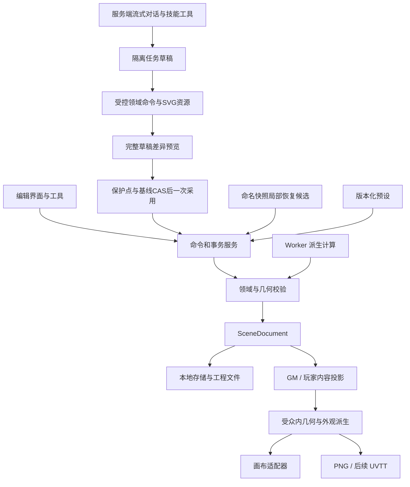

# 技术架构与模块边界

**2026-10-23架构准备已确认，未实现：** 前端继续GitHub Pages，自有服务器从首版承担流式AI任务；先统一完整v1/共享核心，再接技能、工具、草稿与SVG。当前运行仍是v6/v3，具体交接见[45](45-ai-authoring-and-unified-v1-plan.md)，新顺序见07。

状态：当前本地版本 `0.2.0-m1-d2`，完整工程为严格v6 / identity3 / appearance1，有效场景保持严格v3。B1–C3的历史验证见17–29；C4室外工具、持久室外身份与有限恢复见[31](31-m1c-c4-validation.md)，C5联合功能/性能未完成与资源复用分别见[32](32-m1c-c5-validation.md)、[33](33-c5-resource-reuse-validation.md)，M1-D海岸哨所首批见[35](35-m1d-outpost-validation.md)。剩余性能按[34](34-performance-followup.md)暂缓，完整SCN、P3、持久建筑/任意拓扑恢复、M2及完整M1仍未完成。更新：2026-10-23。

U1a首页、六仓库安全入口与连续会话已实现，本批验证归[38](38-u1a-workspace-validation.md)。U1b固定布局与本机偏好已实现，简单检查归[39](39-u1b-layout-validation.md)；U2a合同已冻结到40，U2b独立目录/组织已实现，简单检查归41，完整回归待用户通知。37/36保留准备与讨论历史，现有格式/领域/渲染/历史契约不重写。

本文件定义技术选择及职责。对象字段以[场景文档](04-scene-document.md)为准，保存协议以[存储与导出](06-storage-and-export.md)为准，AI 协议以[AI 与生成](05-ai-and-generation.md)为准。

B1采用并列模块：`core/v2`拥有严格新版领域、依赖和隔离迁移；`io/v2`拥有受控位图、完整资源包和独立资源仓库；`editor/v2`保留完整工程。B2的 `core/v2/commands.ts` 统一有限手工事务、候选预览和撤销；`render/v2` 先做受众投影，再用同一 Canvas 2D 管线绘制预览与PNG，支持厚墙转角、真实尺度材质、零高程露台、透明物件和主题装饰阴影，不向M0降级。为保持轮廓修改前后的纹理相位，铺装先按固定世界视图采样，再按表面裁剪。

C1a由 `editor/v2/blank-project.ts` 直接构造单Floor空白文档，并从现有B2/B3清单采用18个固定单件定义及对应PNG/许可；不生成样板几何或散布结果。完整资源校验与新工程保存成功后才切换工作区。放置幽灵是会话暂态，`core/v2/commands.ts` 的有限 `addProp` 从固定定义构造完整Prop，点击采用时执行全场景校验；移动/旋转和删除继续复用既有命令、Workspace历史和保存协议。schemaVersion仍为2，没有新增持久字段或仓库格式，具体范围与支撑选择语义归04/06。

每次绘制拥有独立位图，结束/取消后关闭；C0将底图与透明选框分成两个Canvas，选择改变仅更新选框，平移/缩放复用底图栅格，工程或受众改变则重新绘制。切换时两层同步隐藏，旧绘制通过取消信号与身份token失效，不能让GM底图或选框残留到玩家预览。当前没有持久位图缓存、纹理atlas、同尺寸paintCanvas复用或Worker。M0使用Konva，v2素材预览与PNG实际使用原生Canvas2D；历史负载与选型依据见[21](21-m1b-b5-validation.md)，C0对应证据归22，不能把有限样板结果外推为通用容量。B3沿同一管线加入高程、来源边缘、朝低侧的崖面、独立世界东南阴影、显式台阶和覆盖层；先过滤受众，再解析有效地形与派生边。散布使用同步有限候选和完整Prop存档，加载/绘制不重撒。后续按实测瓶颈评估优化和其他渲染引擎，B3证据见[19](19-m1b-b3-validation.md)，B1/B2证据见[17](17-m1b-b1-validation.md)和[18](18-m1b-b2-validation.md)。

C1a待放置图片的临时预览同样逐次检查引用/记录、实际字节、CRC/hash、尺寸与单图预算，经过共享原生解码槽。预览未就绪不能采用，失败退出待放置并保留当前工程；取消、换素材或离开时释放本次位图，不建立长期缓存。相关验证见[23](23-m1c-c1a-validation.md)。

C1c的 `core/v3`、`io/v3`、`editor/v3` 与 `render/v3` 保留严格边界；显式v2领域视图只复用几何命令/面板，不进入v2渲染或IO。两版renderer共享schema无关的Canvas绘制与资源层。v3点选、框选、全选及选框范围使用同一按真实隐藏集合和层序生成的墙连接轮廓；仅当前层的选择范围不改该几何。

C1d的`core/v4`、`io/v4`和`editor/v4`实现历史信封及恢复事务；完整场景文档仍严格schemaVersion=3，新增containerVersion=4、profile=`m1-history`，使用独立`sceneweave-m1-history` IndexedDB。打开v4工程时先解析历史包，再将`toCompleteProjectV3`的`document`、`assets`、`licenses`、`licenseBindings`四项投影交给严格v3 IO与原生v3 renderer；历史身份、lineage和出生令牌不进入v3渲染视图。v3→v4迁移创建全新的sceneId/r0副本，精确保留v3原Blob/hash与v2/v1来源链；旧20份自动快照不迁移。可移植工程包不包含本地迁移原件。

C2复用上述严格v3文档、v4历史信封、仓库和native v3渲染，不新增持久字段或扩大限额。`core/v3/building.ts`处理绘房、唯一共墙、合法局部拆墙、门窗及入口；`annotations.ts`和`canvas-bounds.ts`处理注记、固定遮罩与世界/导出范围。统一`commands.ts`在隔离草稿执行建筑、注记及既有几何/物件命令，按展开成本累计最多256条操作，最终完整校验一次；中间草稿不暴露为已采用场景。实体、图层、父容器和共享结构/支撑/递归锚点依赖锁共同约束整笔事务，不能同批解锁后编辑。

`editor/v4/BuildingPanel.tsx`、`BuildingInspector.tsx`与`HistoryWorkbench.tsx`提供点击/数值绘房、属性、门窗、完整影响确认和候选采用；两点量尺、网格吸附草图及未采用结果只在会话。`core/v4/structure-continuity.ts`记录不序列化的会话连续性证明，`structure-restore.ts`生成有限结构候选；`StructureHistoryPanel.tsx`显示根对象、共享写入、依赖、跨层范围和字段差异，`WorkspaceV4`沿用C1d保护点/CAS采用入口。具体连续性与恢复限制见下文和04/06/28。

大量选择改用独立订阅会话、按需属性、虚拟列表、分级提示与认证精确空间索引。手势停稳后编辑LOD绘制可见范围，完整资源/解码先于裁剪和简化；正式PNG保持完整质量。具体阈值、证据和调度代理边界见25。

## U1应用壳/单一会话与U2目录边界

当前`App`以默认首页/`#home`与`#workspace`编排共同v6会话，geometry/assets/layers/history/composition/outdoor整页入口作为兼容保留。U1a的注册表与应用壳位于`src/editor/workspace`，会话与常驻模块沿现有v6工作台；U1b固定分栏使用WorkspaceLayout与常驻slots，U2目录已按40/41实现，不重写Canvas渲染器、领域命令、历史、完整工程格式或六个原生仓库。

| 责任 | 拥有的数据与动作 | 必须遵守的边界 |
|---|---|---|
| 应用壳（U1a/b） | 首页、工程发现/打开编排、导航守卫、全局动作、分栏及焦点恢复 | 首页与只读面板不直接写实体；旧深链接/读取器保留至兼容验收后另行退役 |
| 当前编辑会话（U1a） | 唯一完整v6工程、撤销/重做、保存/错误；选择、视口、当前层、编辑隐藏、模块搜索/草稿、唯一候选、异步代次 | 面板订阅同一会话，不依靠整页卸载重建；不建立第二份持久几何或多文档并行编辑 |
| 工具与面板（U1a/b） | 指针工具、建筑/地形/素材选项、场景属性、图层/对象/历史、差异预览 | 展示与提交共用已有命令/Workspace；有效锁、依赖、256展开、保护点、玩家投影和CAS不变 |
| 布局偏好（U1b） | 独立本机的版本化宽度/折叠等界面配置 | 损坏/旧版/越界配置回到可达默认；不进入工程、revision、撤销、快照或PNG |
| 目录与个人组织（U2a/b） | 内置/我的/本工程检索、索引/缩略图、个人标签/多色/收藏及安装状态 | 固定内容不可改义；个人组织独立版本，不写当前v6/v3；采用须复制完整已验证闭包 |
| 兼容与完整IO | 六仓库原生读取、旧工程显式升级副本、真实资源/许可/来源链、保存导出和失败保护 | 工程身份包含仓库与sceneId；列表元数据不是完整工程认证，浏览不批量迁移 |

U1a先统一工程发现与安全激活，再将模块切换接到同一会话；U1b在此基础上调整固定面板。最近列表命中当前“仓库＋sceneId”时走Continue，显式重开才install/reset；旧深链接/旧原生入口同样进入离开守卫，访问另一个原生工程算真实切换，不能当作保持v6 witness的面板浏览。U2a先冻结目录/组织/备份的精确schema、身份编码、限额、并发/CAS、导入冲突与安装状态，U2b才创建相应写入和界面。准备只确定责任与行为，不预写目录版本号或声称现有读写器已支持它。开发顺序与授权边界归07/37。

### 会话转换与异步失效（U1a已实现，验证见38）

模块、素材详情及左右面板属于只读展示时，保留当前选择、视口、层、草稿、搜索、候选和保存/错误状态。草稿与已准备候选是不同状态：互斥指针工具或离开编辑页前，草稿须继续当前工具或明确取消；已准备候选须采用或明确取消，冲突入口显示具体内联原因。仅允许一个待采用候选，新选择不能隐式重定向它的冻结范围；平移/缩放及只读面板不因此获得提交权。

回首页前先处理未结束草稿/候选并保全当前成果；之后首页→继续编辑复用同一会话，不执行open/import，不清空undo或C2结构witness。真正重开、导入、另存副本或切换工程仍执行既有连续性失效规则。浏览器刷新只保证已落盘的完整内容，不新增草稿/选择/视口的磁盘格式，不从同ID、相同JSON或命名快照伪造会话证明。

目标工程的准备可以等待，但激活必须在当前分支已安全保存、目标完整校验及必要的新副本保存成功后发生。失败/取消保留旧内存、旧持久分支、可用撤销和草稿；保存失败或跨标签冲突阻止丢弃式离开，重试、完整导出、另存副本继续可用。浏览器Back/Forward、直接hash变化、关闭标签和自定义导航须覆盖同一离开策略；原生未保存提示不等于已完成异步保存。

异步准备在开始时绑定原工程、checkpoint、操作代次与请求；取消/替换后旧结果失效，相关临时资源释放。面板重新显示或组件重挂载不能给迟到结果换新基线；开始持久事务后的取消界限沿既有IO规则。恢复先保护当前、后CAS采用的顺序不变；已成功落盘的保护点可保留，不把取消候选误写为所有历史均不变。

### 个人目录与固定采用（U2准备）

目录组织记录以确切固定源身份关联标签、颜色和收藏，发布者元数据保持不可变；同ID/版本而内容不同是冲突，不按名称、最新版本或相似缩略图合并。三库范围共用查询语义，匹配规范化与保留显示文本分开；场景实例标签、当前有效颜色与目录固定源描述不是同一数据。内部保全定义/制作信息不作为用户可改字段。

索引和缩略图只供浏览，不授予资源完整或可离线采用证明。采用前检查并复制固定定义、组合成员、祖先源/实际派生、字节、许可与预算；公开的准备候选入口保持纯入库限制，场景修改仍从受控有限命令登记，不能借统一壳扩大提交权。旧空白工程的全目录预装保持到U2新采用路径与兼容/离线验收成立，工程包始终自包含。

个人库备份明确选择组织记录，并携带可离线采用所需的固定闭包；可选的仅组织清单必须区分未解析引用和缺少资源。工程备份不自动携带个人全库整理，目录删除也不修改工程、快照、祖先源或已采用但暂时无实例的根。并发与失败原子性、精确容器/schema及恢复策略由U2a依04/06定稿；U2b不得先实现无可携带合同的界面缓存。

本工程浏览不自动写个人目录；显式转存固定组合也必须保留模板visibility、成员源和参数，不能只复制prefabDefinition再按新Floor推断公开。目录名称、缩略图和组织数据仅供GM编辑；玩家输出不带这些信息。私密组合跨工程采用及库备份恢复继续验证实际私密范围与合法固定遮罩，缺少遮罩时整笔拒绝，不通过改公开绕过投影。

上述整合继续保留C5内容三元认证、资源/许可三元闭包与绑定目标的迁移原件证明边界：只复用内部独立捕获且深冻结的确切对象；外部输入、公开validate、冷载入、保存/导出、当前依赖/许可/预算与派生真实像素仍按既有合同检查。统一会话不是绕过完整校验或新增长期Bitmap缓存的理由。QA-WS-01/02/03/05的U1a适用子项已运行，实际结果归38；QA-WS-04的U1b简单布局子项见39，完整矩阵、WS-06联合旅程及QA-CAT-01至06仍待后续。

## 室内与自然地形的共同目标

目标画面为二维俯视地图，用真实墙厚、材质、离散地面高度与装饰阴影表现体积。建筑与自然地形共用同一 SceneDocument、坐标、事务、资产库和导出管线；房间工具负责精确的墙门连接，地形工具负责不规则轮廓、台地、岸线及表面过渡。M1 不引入可旋转三维视角、连续地形网格或动态光照。

| 职责 | 建筑中的例子 | 自然场景中的例子 | 必须保持的边界 |
|---|---|---|---|
| 空间结构 | 斜角房间、共享厚墙、附着门窗 | 地形区域、高差边缘、坡道／台阶连接 | 材质变化不自动修改结构或通行属性 |
| 视觉外观 | 木板方向、墙顶纹理、门框、接触阴影 | 草岩沙水过渡、悬崖侧面、岸线、水纹 | 绘制顺序不代表地面高度；阴影不代表视线阻挡 |
| 物件与组合 | 钢琴、书架、餐桌组合、桌面杂物 | 树丛、石群、营火组合、区域散布 | 图片、素材定义、场景实例分别管理；占地独立于图片透明度 |
| 跑团语义 | 门状态、家具阻挡、秘密与线索 | 困难地形、不可跨越悬崖、显式跨高差连接 | 不从颜色、光照或贴图推断角色能否行动 |

同一 Floor 可以包含不同地面高度，Floor 仍表示一张编辑平面；树冠等装饰可在地面上方绘制。海水基底与岛屿可通过显式地表覆盖顺序组合，每个 XY 只解析出一个实际支撑面；该顺序不等于渲染排序或高度值。M1 不表达同一 XY 位置上两个可行走面，也不表达桥下通行、多层楼或上下层可见性。这些限制须在建模和导入时明确诊断。

## 技术决策

| 领域 | 基线选择 | 当前理由 | 需要验证或重新决策的条件 |
|---|---|---|---|
| 应用 | TypeScript 5.9.3、React 19.3.1、Vite 7.3.7 | 二维编辑器 UI 与领域模型共用语言；已锁定依赖 | 浏览器证据及后续升级兼容 |
| 画布 | M0：Konva 10.9.0、react-konva 19.3.2；v2：原生Canvas2D | M0程序符号与v2素材绘制独立，v2共用预览/PNG适配器，覆盖建筑、地形与组合的有限样板；B5观测见21 | 先区分领域校验、解码、绘图提交与编码成本；必要优化后瓶颈仍在渲染，再评估PixiJS等适配器 |
| UI 状态 | M0：Zustand 5.0.15；v2：WorkspaceV2与React会话状态 | 区分持久文档、选区、工具状态和临时视口；C0手势不提交领域事务 | 渲染订阅不能导致每次视口拖动全界面重算 |
| 结构校验 | Zod 4.6.7 + 原创几何校验；C0认证不可变快照 | 外部输入和变化事务最终状态仍完整严格校验，仅复用模块拥有的深冻结身份 | B3仅提供有限直线净宽通行与样板接入守卫；全图路径仍未实现，不能由Schema或缓存命中推定 |
| 计算 | M0/v2 主线程TypeScript；Worker尚未引入 | v2有限事务、候选与校验在主线程执行，B5分别观测支持操作的提交和显示；尚无通用布局/路径求解器 | 计算负载需要移出主线程时实现带版本与取消的协议 |
| 保存 | IndexedDB + Dexie 4.4.6；fflate 0.8.3 | M0几何仓库与v2完整资源仓库分开；同事务CAS、快照与完整ZIP | 恢复与跨标签实测见13/17，VIS-01/02往返见18/19；真实配额耗尽未测 |
| AI任务后端（计划） | TypeScript + Node.js + Hono，自有服务器，尚未创建 | 密钥/provider、技能工具循环、隔离草稿、任务状态/取消/事件重连 | HTTPS、真实鉴权/任务归属、精确Origin、预算与实际渠道能力验证 |
| 测试与性能观测 | Vitest 4.1.12 + Playwright 1.56.1 | 领域、存储和投影单测；Chrome旅程及显式生产性能工具入口 | 历史范围见13/17–20，B5方法与结果见21；全交互、SCN-04、其他浏览器和完整资源峰值仍有缺口 |
| 工程组织 | 单仓库；现有Web应用，计划增加共享核心/任务服务边界 | 前后端复用类型、命令/校验；主工程仍浏览器本地 | 先按45收敛完整v1，具体目录在M2-0冻结 |

M0已建立工具链，B1–B5沿用并扩展。建议使用Node.js 24.14.1，运行命令见[贡献说明](../CONTRIBUTING.md)，依赖以锁文件为准。静态前端通过[GitHub Pages工作流](../.github/workflows/deploy.yml)构建部署，Node版本读取 `.nvmrc`；当前没有AI网关、Worker、工程云同步服务或正式发行版流程。历史单元、Chrome与构建结果分别见13/17/18/19/20；B5技术负载与资源观测单独见21，不等于跨浏览器、完整场景或全交互已达标。

B5通过 `npm run build:performance` 生成显式工具构建，再由 `npm run perf:b5` 串行启动专属Chrome进程采集。默认每个样板/实例数组合三轮，每轮30次物件编辑、30次轮廓编辑和60次真实指针选择；正常构建不暴露性能API。OS进程树RSS采样目前仅适配macOS，目标CDP的JS堆与RSS分别记录；共享页、漏采瞬态和GPU分配的缺口在21说明。绘图阶段是Canvas调用提交区间，Canvas拷贝后的双rAF是显示调度近似值，不代表GPU/屏幕实际呈现完成。

C0保留B5从命令准备完成开始的可比计时，同时新增命令准备前的intent窗口，计入工程读取、室外克隆及浅水联动准备；精简模块入口与真实工作台输入/手势仍分开记录。实现变化不自动证明延迟或RSS下降，正式矩阵、构建指纹和剩余缺口统一归22。

## 数据与依赖方向

下图包含已实现模块与后续规划边界；C1d提供首批独立物件恢复，C2补有限同会话建筑恢复，C3/C4已扩有限组合/源链及持久室外连续身份恢复；AI、Worker、持久建筑/任意拓扑恢复仍待后续，不能由箭头推定所有功能已开放。

领域内核不依赖 React、Konva、IndexedDB、HTTP 或具体模型。画布、存储、AI 与导出依赖领域模型；它们之间通过明确的文档与事件交互，不互相读取内部状态。绘图节点是文档的表现，可以全部重建。

已创建src/core/v2–v6、src/editor/v2–v6、src/rendering、src/render/v2–v3及src/io/v2–v6；v4–v6分别处理历史、组件与室外完整信封，均以明确有效视图交由native v3渲染。src/performance与tools/performance用于测量，B5专用构建与C5正常生产UI方法分别按21/32记录，不混用。generation、rules与ai仍是后续逻辑边界：

| 模块 | 职责 | 不承担的职责 |
|---|---|---|
| core | 实体、单位、有限命令、修订号、有效锁、事务和结构/几何不变量；v3图层/建筑、v4历史与会话结构、v5固定组合/外观源链、v6室外出生/拓扑身份及各自有限恢复 | 画布节点、模型调用、网络密钥；持久建筑/任意拓扑恢复仍待后续 |
| editor | 工具模式、选择会话、快捷键、视口、属性、预览和反馈；现有建筑/室外/素材/图层/历史入口；U1待提取统一会话/面板 | 单独维护另一份持久几何，或让不同入口采用不同锁/权限规则 |
| rendering / render/v2 / render/v3 | 分别拥有M0/v2/v3受众投影、共享Canvas绘制与PNG编码；v4–v6经显式有效视图复用native v3 renderer；M0的Konva通过editor适配 | 直接修改文档、持久化画布节点、把有效视图另存成丢字段工程或省略保密规则 |
| generation（计划） | 技能工作流、受控SVG/参数和场景候选准备；按需使用确定性几何工具 | 直接写主工程、任意执行脚本、扩大scope或放宽硬约束 |
| rules | 通用预设、比例尺显示、距离策略、版本快照 | 战斗结算、自动判定角色行动合法性 |
| ai / server（计划） | provider适配、严格工具协议、多轮任务、SQLite/制品/事件、预算和访问控制 | 任意外联/执行、改变源定义或公开权限、自动采用主工程 |
| io | M0及v2–v6六原生仓库，完整容器/副本迁移、字节/许可/源链、命名/保护历史及CAS；U2目录合同/实现见40/41，UVTT仍待后续 | 以最后写入覆盖冲突、只保存seed或远端URL、输出完整GM数据给玩家 |
| performance / tools/performance | 复用产品模块的显式负载夹具、操作观测与独立资源采样 | 替代真实工坊全部操作验收、绕过候选守卫或拥有额外提交权 |

M0 使用少量文件完成边界验证，没有引入泛化插件框架。接口稳定的判断依据是两种调用方确实需要同一能力，例如手工工具和 AI 都经由 CommandBatch。

M1-A 已明确新领域/存储规范与首批素材规格，实施切片见[设计交接](16-m1a-handoff.md)，素材制作任务见[清单](15-m1a-asset-production-list.md)。M1 在这些边界内增加材质／素材目录、组合定义、地形领域操作与外观派生，不预先拆成独立服务。素材目录管理尺寸建议、分类、风格与许可；io 管理实际字节；core 保存实例引用、完整已采用结果和约束；rendering 生成纹理裁切、悬崖侧面和阴影。地形布景或散布算法只能产生待校验候选，不能绕过事务直接往画布加图。

## 工程编辑的四类状态

| 状态 | 示例 | 生命周期 |
|---|---|---|
| 持久工程 | 严格v3墙门/地形/比例/秘密/固定引用/图层与显示设置，v6信封的identity3/appearance1 | 完整保存并有格式版本；不能以渲染视图替代完整工程，新增语义经严格契约与副本迁移 |
| 编辑会话 | 当前工具、选择集合、视口、会话操作历史、图层编辑隐藏/独显、恢复预览、结构连续性记录和当前提案 | 可重建；撤销历史与结构连续性证明仅在当前会话有效 |
| 交互暂态 | 拖动中的候选位置、框选矩形、建筑草图、两点量尺、吸附提示 | 取消即丢弃，不递增 revision |
| 派生数据 | 房间相邻、结构/通行图、渲染缓存、预览图 | 带 sourceRevision，可失效重算 |

不得把暂态数据每个鼠标事件都写入持久文档。拖动期间渲染候选几何；释放时提交一次命令，整组成功后 revision 增加一次。无变化或取消不产生空历史。

命名快照属于独立持久历史仓库的记录，捕获完整文档、资源闭包及身份令牌；名称/保护状态不是当前地图里的实体，也不混入会话撤销栈。每场景最多32个命名与32个保护快照，历史归档最多64个显式选中项；C0内存认证仍只是运行时校验优化，不提供持久身份。自动20份快照与命名/保护历史分开管理，旧自动快照不迁移。

U1b本机布局偏好与U2个人目录组织是工程外的数据，不混进上述持久工程或会话撤销：前者可以重置为默认，后者须有独立、可携带的版本化合同。不能因为它们不属于地图字段，就把个人整理误作可随时丢弃的UI缓存。

## 编辑事务

CommandBatch 包含 baseRevision、source、scope、operations 和操作标识。流程是：确认基线 → 在隔离候选状态计算 → 检查引用、单位、几何、锁与声明的硬约束 → 原子替换当前文档 → 记录可撤销历史 → 排入自动保存。失败返回具体对象与原因，原文档保持可继续编辑。

撤销与重做都形成新文档事务，revision单调递增；只恢复业务内容，不把修订号改回旧值。一次拖动、一次多对象操作、一次采用AI候选或一次局部恢复分别是一个撤销单位。C1d的历史工作台从明确快照和1–256个独立物件ID构造范围；`appearance`、`transform`和完整`entity`模式保留各自属性边界。预览基于checkpoint/scene/revision/source snapshot身份绑定。采用前flush并校验来源，通过当前场景+元数据+来源快照CAS写保护点后再次校验，最终提交一个revision+1事务。保护失败不改当前文档；采用后保存失败保留新内存文档、撤销与保护点，并保留旧持久分支。C2有限同会话结构恢复复用此流程，组合与地形依赖留C3/C4适配，不使用内部历史重放绕过锁、基线或资源校验。

C0在`core/v2/snapshots.ts`用私有WeakMap登记严格解析后、模块拥有且深冻结的文档身份。调用者自行冻结对象、复制相同字段或传入外部旧revision文档都不能跳过完整校验；普通`applyCommandsV2`继续返回独立可变候选，Workspace改用不可变快照入口。一次变化编辑仍在隔离草稿上执行严格命令、编辑锁与依赖检查，最终完整领域校验一次，随后对冻结候选执行样板守卫；revision/updatedAt通过小范围严格Schema后生成新文档头。失败、无变化和取消不消费历史或保存；撤销/重做共享已认证内容并产生当前revision+1，安全整数溢出仍拒绝。具体契约归04。

手工添加尚未连通的房间是合法草稿。连通性只有在对象声明 required 或生成请求要求时成为提交约束。算法与 UI 都必须区分结构相连和当前门状态下可通行；锁门不能触发自动打洞或开锁“修复”。

## 渲染与交互

- M0 的 React 界面与 Zustand 保存会话状态，Konva Stage 负责视口，单个批量 Shape 调用共享 Canvas 绘制器；命中与拖动由 editor 处理。拖动候选仅保存在会话中，不写入文档。按实体订阅、缓存和视口裁剪属于后续优化，是否需要以实测判断。
- v2素材工坊支持实际Canvas点击选择、属性编辑、有限结构候选与C0视口。视口倍率为适应全图的25%–800%，支持指针锚定滚轮缩放、按钮缩放、平移与适应全图；C1a空白创建与单件放置、C1b框选/多选和右键、C1c用户图层、C1d历史工作台及C2建筑/量尺均已实现，各自适用证据归23–28，不据此关闭完整交互验收。C2点击/数值工具不等于矩形拖绘、自由拖边、普通房间/墙删除或建筑整组变换已开放。
- 放置预览只更新透明覆盖层与暂态位置，采用入口核对工作区基线，有限命令携带固定定义、稳定ID与明确支撑；无效边界、锁、引用或过期基线不写入工程。支撑由用户显式选择Floor、房间或地形；Floor模式不按鼠标落点自动认领房间语义。新物件只在定义指定的系统绘制带内叠到已有同带物件之上，不跨带排序；用户图层归属及其带内顺序由独立v3契约处理。
- 地面、墙门、物件、标注批量合成为长边1200像素的底图，透明选框使用独立Canvas；网格批量绘制，格子不建立独立交互节点。CSS视口缩放不重新解码或调用场景绘制器，高倍率清晰度受该预览栅格限制。
- 缩放与平移只改临时视口变换，不更新SceneDocument、revision、撤销历史或保存队列；命中按实际变换后的底图矩形反算世界坐标与屏幕容差。PNG继续从文档固定范围独立采样，设备像素比不改变文档尺寸。
- 画面简化、纹理缓存、视口裁剪是性能优化，不可改变导出结果或实体业务状态。
- 秘密预览调用与玩家导出相同的投影策略；不维护一套只靠 UI 隐藏的规则。
- M0 使用单层；M1 仍为一个 Floor，增加同一平面内的离散地面高度。多个 floorId 或同 XY 多可行走面的文件不能默默合并为一层。

### C1b–C3交互和图层职责（C1b/c及C3有限范围已实现）

C1b已将单一选择ID扩展为会话选择集合，框选、追加/移除选择和右键菜单使用与点击相同的世界命中转换。右键菜单根据命中对象及当前选择提供已支持动作，工具栏、快捷键和属性面板调用同一命令服务；批量操作先形成完整影响集合，再一次校验与提交。选择覆盖层继续只绘制编辑提示，图层列表和框选不能产生一份独立实体真值。

C1c新增的用户图层是同一Floor内可命名、排序、锁定的平面组织单元，实体唯一归属，组合/散布容器与成员保持同层；它与现有ground/object/canopy系统绘制带、地面高程及Floor分开。图层顺序只能在各系统带内生效；共享墙、支撑和注记依赖仍跨层统一解析。有效锁为实体锁或图层锁，修改影响到任一锁定依赖就拒绝整批。图层编辑隐藏/独显仅是会话状态，正式GM/player预览与PNG始终从完整文档和明确受众重新生成。

C3已开放受支持的非破坏性外观覆盖：固定源版本 → 图层外观覆盖 → 实例/成员覆盖，定义源件保留，覆盖可独立移除。渲染器消费经验证的有效外观，不能自行从目录最新版补值；改变覆盖后按当前成员计算实际影响，移层先显示外观变化。任意混合模式、像素蒙版、嵌套图层和完整PS兼容不属于这批架构承诺。对象语义、持久契约和迁移以04/06为准。

### C1d与C2已实现的局部恢复及C3/C4扩展职责

io/v4读取并验证不可变命名快照及资源；core/v4按稳定ID、出生令牌和属性组构造首批独立物件候选，editor/v4展示历史对象虚拟列表、完整ID、差异、恢复模式及玩家可见性变化。命名快照和保护点各限32份；历史归档最多64项，仅显式勾选的快照随history包携带。完整包只含当前工程。当前完整文档始终是提交基线，范围外的新编辑保留。

`appearance`恢复固定定义引用与外观字段，`transform`恢复位置和旋转，`entity`恢复或重建一件完整独立物件。首批拒绝组合/散布成员、锚定注记/路径依赖、有效实体/图层/支撑锁、非法几何/隐私、lineage/出生身份或资源身份冲突；不隐式删除较新对象。历史来源预览绑定checkpoint、scene/revision、快照ID/hash和请求。flush、来源校验、保护点CAS、二次基线检查后才采用一次revision+1可撤销事务。实现范围及适用验证见27，不据此推定完整浏览器矩阵或扩展恢复类型通过。

C2只恢复当前与历史均存在的顶点、房间、墙、开口和注记。`geometry`恢复明确对象与必要共享顶点的位置/尺寸；`properties`包含几何，并恢复所选对象业务字段。相邻墙/房间、开口、地形支撑、物件及父容器、路径/连接、递归锚点注记只进入影响和校验闭包，不因此恢复其字段。预览必须明确确认全部扩展依赖和跨层影响；保留当前层、编辑锁、材质/资源、支撑、高程、拓扑和范围外新编辑，不重建已删除结构、不合并历史材质字节。最终通过完整v3几何、当前样板守卫和玩家投影，再沿保护点CAS流程一次采用。

严格v4的持久出生令牌只覆盖C1d物件，不能用于推断结构连续身份。C2为本次打开后建立的命名/保护快照记录内存连续性见证，绑定真实快照ID/hash、历史/当前完整文档和会话世代；运行时证明由私有WeakMap认证，普通JSON或同ID对象不能伪造。每次提交、撤销和重做推进记录；所选或必要历史结构曾删除重建、改变Floor/边界/支撑、墙方向端点、开口附着/基准端点或实体注记锚点后，撤销回相同JSON也不会恢复连续资格。坐标注记的位置变化不改变其身份。

重开、导入、另存副本或切换工程清空连续性记录；命名/保护快照仍落盘、可携带和查看，C1d适用独立物件恢复继续有效，旧结构恢复明确拒绝。记录不进入严格v3场景、v4信封、数据库、工程包或玩家输出。跨会话结构身份、拓扑恢复与删除重建恢复须新版本严格契约及完整副本迁移，C2不通过补JSON身份绕过此限制。具体范围及实际验证归28。

C3已扩有限组合/人工覆盖/表面与当前层规则恢复，具体新身份及边界见29；C4扩地形/连接/散布依赖。没有对应适配器的实体类型拒绝局部恢复，不按JSON片段硬贴。采用后保存失败保留新内存文档、撤销、保护点和旧持久分支；当前秘密/遮罩仍须校验。命名历史不被自动20份快照静默淘汰，完整资源闭包及历史备份规则由06定义。

### M2流式任务、共享核心与采用（计划）

前后端复用不依赖DOM/React的类型、领域命令及校验，分别提供存储和渲染适配器。后端拥有任务草稿/检查点，浏览器拥有主工程；模型工具只修改已授权草稿。完整工具步骤通过验证后发出有序事件供预览，文本增量和未完成参数不进入领域状态。

最终采用在浏览器完整验证基线、范围、锁、资源与依赖，成功保护点后CAS并一次提交/撤销。任务多轮不能绕过256展开预算；手工新修改使旧基线失效，首版不自动合并。任务持久化支持查询/重连，浏览器渲染步骤在客户端离线时等待；不把服务端有任务表等同于完整后台续跑。

SVG源和固定PNG进入完整资源合同，同化保留单件→组合→明确范围。首版不接生图API。具体工具、状态、隐私与预算归05；统一完整v1须覆盖个人目录的中性v6载体、身份与备份，见45/04/06。

### M1 外观与地形派生管线

B2/B3实现下述建筑/地形样板子集，B4核查双受众与依赖，B5观测其真实负载；C4已补原生道路实际带区与有限室外管线，范围见31。当前渲染器对未支持外观明确停止预览与导出，不以省略内容冒充成功。以下同时保留未来扩展须遵守的管线契约。

1. 固定文档 revision，并取得工程保存的素材、组合与主题版本快照。
2. 先进行受众投影：剔除秘密实体，补齐未揭示秘密门，重建公开边界；只把允许公开的几何及依赖交给下一步。
3. 从该投影计算厚墙连接、房间地板裁切、地形边缘、材质过渡、路径带和装饰阴影。玩家版本不得借用完整 GM 几何生成的岸线、阴影或纹理接缝。
4. 解析相同物理尺度的素材并按确定绘制顺序合成；选择框和工具提示属于编辑覆盖层，不进入地图 PNG。最后应用玩家不透明遮罩。
5. 画布与PNG共用投影、几何、外观参数和排序。C0交互视口只对已有预览栅格施加CSS变换，PNG按请求的输出尺度独立采样；两者都不能改变自然轮廓、散布结果或纹理的世界相位。

材质按世界毫米平铺，保存对齐原点和方向。world 对齐使相邻区域可共享相位；surface 对齐允许房间有独立木板方向，区域移动时按自身坐标系移动。调整区域边界不根据新包围盒重新拉伸纹理或重置原点。

地形边缘的位置来自已采用区域轮廓和显式相邻关系；用户编辑边缘的种类、材质和视觉宽度。改变岸线／悬崖位置通过修改来源轮廓完成，防止形成一份独立漂移的外观轮廓。墙厚与高差参与结构；描边、悬崖侧面宽度和装饰阴影仅负责画面，不能替代净空或通行计算。

缓存至少区分 sceneId、sourceRevision、受众、主题／素材版本及输出尺度；秘密状态、材质、依赖轮廓或组合内容改变时使相关缓存失效。GM 与玩家派生缓存不得混用。按素材内容 hash 共用解码结果，不代表可以共用含秘密几何的合成缓存。任何降采样预览都必须保留已采用几何，最终导出重新按预算绘制。

C0只对认证文档复用输入领域校验；每次render仍验证该受众所需资源的实际字节并经共享单槽解码，结束后关闭。墙体几何、排序和受众局部索引在一次投影/绘制中复用，不跨render保存，也不把GM索引交给玩家。未新增跨绘制ImageBitmap缓存，材质paint key变化仍释放旧画布并另建，B5撤回的同尺寸重用方案不重新启用。

两类可编辑样板要同时验证视觉与编辑依赖：改变带斜角书房的边界后，墙角、门窗和地板正确更新；改变岩岛轮廓后，岸线、悬崖和材质正确更新，人工调整过的树石不被重新随机布置。有限样板首轮见18/19，双受众与存档矩阵见20；真实素材解码、绘图提交、4K编码和可测资源观测见21，用于后续缓存策略及Worker决策。M0程序符号数据不能替代这些测量，技术检查也不能替代主题P3与用户美术签收。

## Worker 与异步结果

以下是后续Worker接入契约，M0/v2均尚未创建Worker。当前异步场景切换在完成持久化后再次核对场景/修订或工作区checkpoint，若期间有新编辑则保留当前场景；M0拖动也保存基线修订，撤销或其他修改使其失效。

Worker 任务至少携带 requestId、sceneId、baseRevision、taskKind 和任务参数版本。结果回到主线程时再次检查请求是否仍有效。取消、切换场景、文档更新或重新请求使旧任务失效，晚到结果只能被丢弃或作为显式重新检查的候选。

Worker 返回布局结果、诊断或派生结构，不拥有提交权。较长计算要提供合作式取消点；超出预算结束候选并返回诊断。不要为了等待 Worker 锁住整个编辑器。数据以可序列化文档/局部快照传递，避免将可变引用在异步链中当作稳定基线。

## 本地优先与 AI 网络边界

手工编辑、保存、工程文件和图片导出都在本地完成。首次页面加载仍需要获得应用资源；真正断网冷启动的 PWA 缓存在后续单独验证，不能把“本地数据”自动等同于“任何时刻都能离线启动”。

启用AI时明确展示上传到自有服务器的工作副本/资源和转给provider的必要上下文，两者分别受授权范围约束；默认不外发GM秘密和无关目录/历史。后端采用HTTPS、应用鉴权、任务归属、精确Origin白名单、预配置provider和有界预算，具体见05。前端只有后端公开地址，没有模型key。

主工程及个人目录继续本地优先，任务存储是有限的服务端工作副本和制品。SQLite＋制品文件初版按单实例管理，明确保留/过期/删除；日志不保存完整提示词、源图或私密正文。线上服务支持维护者访问控制，不引入注册、协作、主工程云同步。凭据/私密本地路径不进入工程、前端或共享日志。

## 验证与演进

M0验证墙门关联、事务回滚、毫米坐标、保存往返、玩家投影和程序符号负载。M1-A确定两类视觉样板及契约，M1-B完成VIS-01书房与露台、VIS-02双层岩岛的可编辑样板；M1-C/C0已实现性能与视口基础，C1a已建立空白工程和固定单件创作闭环，实际验证归23。C1b已建立选择/右键与有限原子批改，证据归24；C1c已建立用户图层，证据归26；C1d已建立命名/保护历史、显式历史备份与独立物件首批恢复，证据归27；C2已建立建筑绘制、共墙/门窗、量尺和有限同会话结构恢复，范围与验证归28。C3组件/参数及源链恢复见29，C4室外与有限持久恢复见31，C5联合功能与性能欠项见32/33，M1-D首批见35。U1a首页/统一入口与会话已实现，适用证据见38；U1b固定布局与简单检查归39，U2a/b已按授权实现，合同/简单结果归40/41，完整回归待通知；完整SCN-01、SCN-04和M1退出门槛继续验收，不能由这些子集推定已通过。任务与门槛以[路线图](07-roadmap.md)和[质量计划](09-quality-plan.md)为准。“双层岩岛”指一个Floor上的高低台地，不表示两层Floor。

M2按45/07实施流式对话、技能工具、隔离草稿与SVG工作流；当前均未实现。验证必须覆盖真实渠道和完整采用/离线/秘密/失败流程，不能从既有手工工具或/models访问推定。历史13及各批结果保留。

替换M0的Konva或v2的Canvas2D适配器、从IndexedDB迁往桌面文件系统、增加UVTT或多楼层，都应保留独立文档模型并通过适配和迁移实现。B5的具体渲染决策以21为准；任何引擎替换仍需真实负载、隐私、取消和资源生命周期验证。

### C3 原生有效场景与完整组件信封

`core/v5`定义严格identity2、appearance1、固定源图、有限组合/覆盖命令及恢复；`io/v5`保存完整v5信封和所选历史容器、真实图片处理、实际像素一致性、许可闭包、独立仓库CAS及确切v4原件链；`editor/v5`用异步准备/预览/采用持有完整不可变工程与一次撤销。入口按需加载，v3只作显式原生渲染/几何视图，不能用来存储或导出替代v5。

已采用的非活动派生及祖先源也由真实固定定义保持native-v3引用闭包；内部保全定义不进入普通放置目录，资产、许可与完整有效场景仍在完整包中。历史恢复先保全祖先源及确切许可，不能因撤销分支缺少该根而删图成功。来源/变体/模板固定身份冲突、悬空、循环、超预算或像素不符均拒绝。图层持续规则与固定目标批改分开，采用后重新求值并核对全部有效锁、玩家遮罩与资源。完整契约归04/06，实际证据归29。

U1a当前应用壳以`#home`/默认首页与`#workspace`编排一个v6工作台。首页往返保持同一React子树与Canvas，隐藏时忽略零尺寸视口测量并暂停编辑热键；五个模块保持挂载，各表单明确登记/取消草稿，预览复用Workspace现有凭证。六仓库注册表只读发现和完整准备分开；原生v6调用openPersisted，旧版逐级副本迁移。兼容入口通过统一离开守卫和显式close清除旧undo/结构witness；开发StrictMode的重复注册仅由实际可用控制器消费一次首页请求。没有新持久格式或长期位图缓存；实现证据见[38](38-u1a-workspace-validation.md)。

U1b的WorkspaceLayout保有固定面板树，折叠/右导航tab/窄抽屉只隐藏，不重装画布与表单。layout-preferences严格读写独立版本1的本机宽度/折叠配置。选择/平移与缩放按钮通过Portal进入工具/底栏，ResizeObserver按实际比例保持世界中心，触达既有限额时约束。UI偏好不经过工程命令或保存队列，原历史/资源/CAS保持；完整联合回归待用户通知，不能由39简单检查推定通过。

### U2a/U2b（2026-10-23）

U2新增独立src/catalog：content提取中性原生v6完整固定闭包、确切身份和append-only采用候选；repository/organization用独立Dexie v1和全局CAS存安装条目与个人整理；backup严格JSON封装有hash/CRC的完整原生v6载体；query负责规范化多维筛选。CatalogLibrary仅用于统一工作区，旧版CompositionLibrary保持。采用复用workspace.previewPrepared而非任意场景patch；库修改不调用工程保存队列。可见缩略图按assetID→资源SHA→实际Blob取图，URL回收；缓存有界且不存Bitmap。新库不演进工程格式；合同/实现边界见[40](40-u2a-catalog-contract.md)/[41](41-u2b-catalog-validation.md)。

### 内容补标与普通阶段创作（2026-10-23）

`catalog/curation`为严格只读应用索引，精确关联完整CatalogIdentity key，独立于固定定义、DB、个人组织和库备份。生成器从真实完整内置资源提取确切身份；查询只读标签合并发布者与补标，个人语义保持独立。内置提供器append-only追加新23图与两组合，原空白工厂保持34图；精修新身份保全旧固定来源，详情按需立即加载对照实图，普通列表仍懒加载。

`themed-samples`仅用于新建独立可编辑内容小样；`authoring-recipes`则从当前真实工程推导下一组普通有限命令，通过现有building/outdoor/composition/display候选和工作区采用，没有场景替换、隐藏进度、任意patch或资源跳检。选中物件换图使用独立表单守卫；C2 witness、保护点、256预算、资源和CAS边界保持。实现与简单检查见[43](43-content-m1d-validation.md)。
