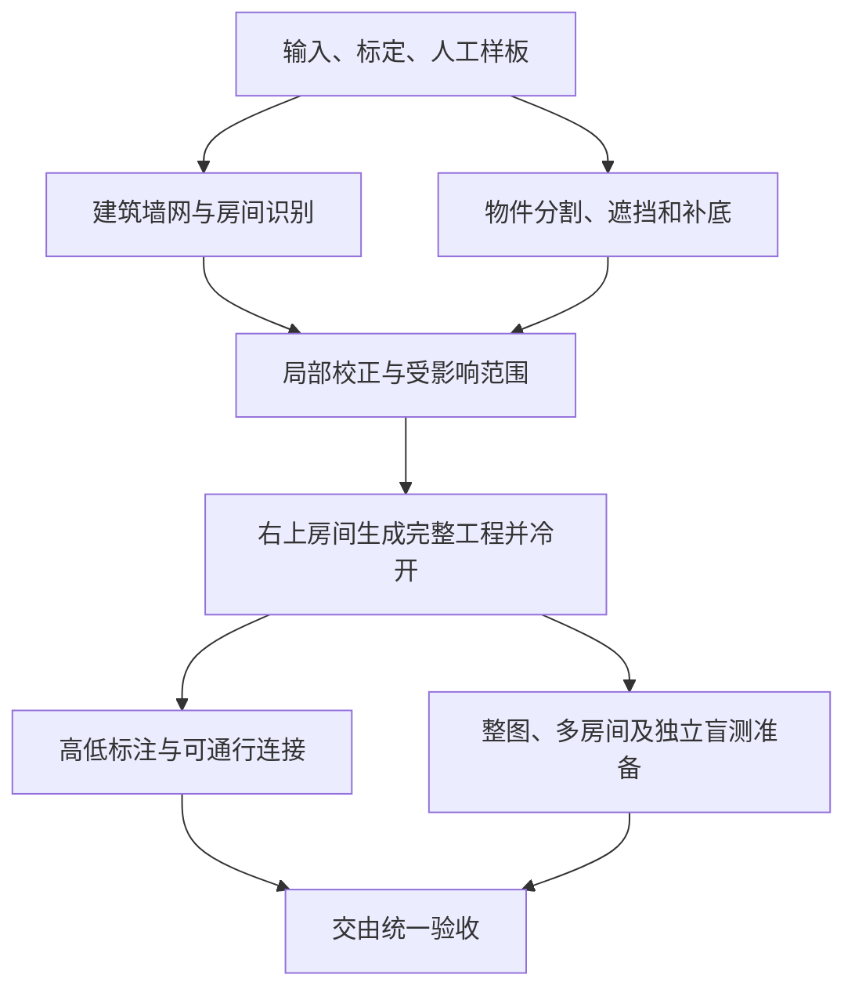

# 开发路线图

更新：2026-11-12。当前只有 **开发整改阶段 → 验收阶段**，验收完成后再进入M3真实小团。旧T/Q/M2-E编号仅用于历史追溯。

本次按用户授权整合交付剩余核心、快照/存储、SVG处理器2、验证工具及AI入口，提交标题和正文使用中英双语；范围与新自检见[整合交付记录](archive/workspace-content-validation.md#remaining-integration-delivery-20261109)。下文原实施批次的未提交状态按当时冻结理解，当前交付不替代完整验收、部署或用户P3。

## 开发整改阶段（当前）

### 性能与容量主线

2026-11-11用户选择本会话长期负责性能与容量，主题成图、图片拆解算法、空间可玩性与旧测试维护分别由其他工作线推进。以真实生成工程和拆图工程的打开、连续编辑、预览、保存、历史、重开及导出为负载，先定位剩余瓶颈，再决定去重、分块、Worker或WASM边界。

**每项优化必须交付优化前／后的同输入、同操作对照。** 同时列明测量边界、样本数、设备／构建、耗时、内存或实际分配量及输出一致性；退步、波动和缺样如实保留。未测项明确写未测，静态调用次数、名义像素存储与实际RSS分别说明，不能代替正常端到端收益。正式采样仍按09冻结和独占串行，不与其他会话的构建、测试或浏览器负载混测。

| 工作 | 当前状态与接续 |
|---|---|
| 代表性输入与首个绘制切片 | 三份实际工程已独立捕获；同轮墙几何复用、零描边且无墙阴影时省去mask／interior两张整图缓冲已实现。58项定向自检、20组真实Canvas像素配对及隔离副本正常构建通过；源码捕获时同期图片重放的类型首败与责任方修正保留。确切前后分配、失败和证据边界归[性能台账](reference/performance.md#wall-paint-capacity-20261111)，不关闭正式性能或P3 |
| 大图片／多素材输入 | 五份严格完整工程已冻结：单图16／31MP及64／128／256唯一图片（最高64M实际像素），全量准备与独立页面冷读、完整ZIP一致；正常生产五组打开／编辑／保存／4K／冷开诊断均完成。全部有同期负载，不能签收容量或收益；证据和逐组限制归[压力输入台账](reference/performance.md#image-assets-capacity-20261111) |
| 大地图完整物件输入 | 建筑／自然／混合各500／2000完整Prop，以及额外500远端物件、16条真实局部外接连接两份边界输入，共八份准备及逐包独立context冷读通过，完整ZIP SHA与长度保持。准备器旧保密范围首败和唯一工具修正保留；七份整体变换准备通过，一份外接未随动支撑按合同拒绝，未改产品保密检查。正常生产八组打开／两次编辑保存／4K／冷开及全包审计完成，共48次观察、16张实际PNG，错误0、指纹保持；均有同期负载，仅诊断，不判容量或收益。逐组耗时／RSS／heap及限制归[地图输入台账](reference/performance.md#map-capacity-inputs-20261111) |
| 保存与主线程剩余成本 | 已在当前冻结正常构建完成混合2000的两次独立Chrome主线程诊断，完整导入／2次编辑保存／双受众4K／冷开及全包审计通过，11份映射JS与正常产物逐字节一致。两次均有同期负载，只归因：重复出现完整内容检查、规范化／复制及SHA；SHA分别来自delta、内容块、当前行、编码、历史和资源，不可全部视为可删重复。已复现并修复公开采用后首笔的编码owner／世界端点断开：该笔delta额外完整SHA 2→0，后两笔原已命中。五文件84项定向覆盖（含一条默认5秒超时后30秒单独通过）、新测试类型检查及隔离正常构建通过。仅两个存储文件差异的三对正常生产UI诊断、六包及六对4K RGBA核对完成；均有并行负载，首次保存中位3566→3254.2ms，但有7944.5ms退步轮、导入／冷开及RSS上升，稳定净收益未证实。公开全验、实际块／资源／许可／CAS保持；冷开留存及全量检查仍待归因，不拼接旧占比。见[当前CPU诊断](reference/performance.md#current-production-cpu-20261111)及[本项完整对照](reference/performance.md#encoding-owner-continuity-20261111) |
| 正常生产对照 | 前后正常构建仅renderer不同，源码／产物／输入保持；四次UI校准、完整包和4对4K输出一致，但全部同期负载，仅诊断。旧前检缺陷及失败保持；正式有效配对仍0，下一新目录09。另行预先声明只容许并记录WindowServer的开发期配对，两次五分钟等待均未启动；macOS路径列截断已修正并以真实进程验证，26项负载检查和5种汇总判定通过，原正式门不变。两个授权会话均已释放；开发期下一目录03。为推进只读归因，after CPU诊断已独立完成，不充作配对收益。原值与方法归[性能台账](reference/performance.md#wall-paint-capacity-20261111)及[CPU记录](reference/performance.md#current-production-cpu-20261111)，此前秒级保存、长任务、33.4ms和缺样保持各自冻结 |

#### 性能会话跨电脑交接（2026-11-11）

用户将在换电脑前统一commit、push。本节与[性能主题](reference/performance.md)是仓库内的接续依据，**新电脑不需要也不应假定存在旧电脑的`work/`、绝对路径、IndexedDB或Codex会话记录**。下述“已验证”为旧设备指定冻结的历史事实；换电脑、更换源码／素材或重新生成输入后建立新冻结，不沿用旧设备数字签收。

**2026-11-12接续更新**：本节下文保留原macOS交接，不代表后续Windows实现停留在两项优化。当前接续先读[三个边界的产品实施](#history-boundaries-implementation-20261112)及[本轮实际结果与剩余原因](reference/performance.md#history-boundaries-implementation-20261112)，不重复实施完整历史后台审计、事务外捕获核账、编码片段／判等及本次紧凑历史改造。用户要求本部分先分析，随后授权研究及实施，均按各自冻结保留；当前已实施同次严格块解析复用、普通复制紧凑Worker及暖通用差量的精确端点／编码消费，没有全量前移记录／兼容工作。最新可携差异为`tools/performance/baselines/history-boundaries-20261112.patch`，提交时包含新的`content-materialization.test.ts`、`content-generic-delta.test.ts`和`history-audit-message.ts`；前序content-equality／replay-encoding等补丁与新增测试、其他工作线仍保全。原始输入、源码／构建冻结、包／PNG、profile及日志仍在忽略的`work/`，换电脑需重新生成输入和冻结，不沿用历史数字签收。提交／推送按用户当次授权，不沿用本节历史授权。

**同日占用整改接续**：上述三边界实施后，用户再授权[保存内存与磁盘占用整改](#storage-footprint-20261112)，完整[实测及负面结果](reference/performance.md#storage-footprint-20261112)另列。最新可携补丁为`tools/performance/baselines/storage-footprint-20261112.patch`，6份产品／测试文件正反向核对通过；保留两份受影响测试及新增`run-storage-footprint-analysis.mjs`，前序补丁不删除。内部私有块共享及解析暂存提前释放已实施；独立局部路径测量后缓冲少11.31MiB，整体峰值和部分耗时仍有退步，不判全面无退步。全库只读统计的无引用量较小，磁盘块仍不自动回收。新电脑没有原始heap／包／PNG／源码冻结，按工具重新建立实际输入和同冻结对照；这次未提交／推送／部署。

**同日逐项研究接续**：最新一轮[历史审计复核](#history-audit-followup-20261112)已完成分析和隔离对照，两个候选最终均未采用：坐标往返在不同几何负载收益不足；无Worker分步虽改善响应，普通Worker生产保存两对均退步。主工作区产品已准确恢复到该轮开始，上一段占用整改保持；`tools/performance/experiments/cooperative-audit-20261112.patch`是未采用实验，不能当最新产品基线。只有显式`cooperative-audit-prototype`scope才向隔离after正向应用，普通入口没有此能力；两份实验新增测试随patch保留。当前更值得先分析不同几何历史完整领域验证的依赖范围／证明成本，不重复已存在的块解析、metadata或暖核账缓存。

**同日分组核心研究接续**：上一段建议的有限几何复用已按用户要求先分析、隔离实现并完成对照，见[当前决定](#finite-history-geometry-20261112)及[完整证据](reference/performance.md#finite-history-geometry-20261112)。分组稳定核心／local存储已存在，本轮利用未变内容减少world历史校验；不同位置20历史的正常冷保存中位8.32→6.49秒，但双状态控制冷／暖分别+7.50%／+6.76%，故**最终未接入产品**。最新实验`tools/performance/experiments/prop-replay-20261112.patch`含3产品＋1新测试（24项），正反向逐字节通过，只供`--optimization prop-replay-prototype`显式隔离after正向应用；不是baseline，也不是普通入口能力。338项定向、两侧正常构建、8项生产故障／历史／CAS专项，以及8包／16张实际4K输出一致。3产品文件仍等于本轮开始；前序占用优化及其他工作线保持。新图捕获工具`capture-prop-replay-history.mjs`与正常UI的`--history-pattern distinct|toggle`可重新建立纯物件核心／混合组与低复用／高复用控制；原始图、源码、包、PNG、日志仍在忽略目录，新电脑不假定存在。下一项先解决控制组退步与证明／多次捕获成本，再决定是否采用，不重复已有缓存，不以背景噪声抹去退步；本轮未提交／推送／部署。

**本会话做了什么**：本线负责大地图、大图片、多素材的打开、编辑、保存与导出性能，不负责其他会话的成图／拆图算法。已实施两项产品优化：①墙几何同轮构造3→1，零描边且无有效墙阴影时省两张整图Canvas，4096×3651的名义RGBA存储少114.094MiB；58项自检、20对实际RGBA一致，但正常生产独占耗时／RSS有效配对仍为0。②公开保存完整重验后保留经完整原表示相等证明的认证编码owner与世界端点，修复采用后第一笔编辑的凭证断开，delta额外完整SHA由2→0；第二／三笔原本已复用，未新增冷开后的编码留存。84项定向覆盖完成，其中一项默认5秒超时后按30秒单独通过；独立正常构建、六份完整包及六对双受众4K像素核对通过。两项均未引入Worker、WASM或长期Bitmap缓存，公开全验、新鲜DB块／资源／许可、身份、保护与CAS保持。

同时准备过五组图片负载（16／31MP单图，64／128／256唯一图片，最高64M图片像素）和八组180m×180m地图负载（建筑／自然／混合各500／2000完整Prop及远端／外接变体），实际正常UI诊断均完成；这不是正式容量通过。两次混合2000主线程profile将热点定位到完整内容检查、JSON规范化／复制和SHA，并进一步复现了上述首次端点断开。测量工具曾修正PID0排除全机及macOS进程名截断问题，不能恢复旧错误前检为有效结果。

编码修复的混合2000三对AB／BA／AB均受并行负载干扰：首次编辑→保存中位3566→3254.2ms，暖笔1286.5→1095.1ms，但导入21834.8→25061.8ms、冷开5418.2→6106.6ms、产品RSS峰值中位1196.19→1209.27MiB；第一对首次保存3143→7944.5ms，明显退步。heap峰值中位192.45→171.52MiB。**只确认重复计算消除，稳定净收益未证实**；逐轮值、设备、采样局限和输出核对归[完整对照](reference/performance.md#encoding-owner-continuity-20261111)。墙面正式性能、整个容量矩阵与P3均未通过，不把调用次数或理论分配当提速。

**需要随用户提交带走的本线文件**（路径均相对仓库，不用旧电脑绝对路径）：

| 文件 | 本线责任与注意事项 |
|---|---|
| `src/platform/browser/render/canvas-renderer.ts`、`wall-paint-capacity.test.ts`（同目录） | 墙几何复用、按实际需要分配遮罩、失败清理与反例测试；新增测试提交前不能遗漏 |
| `src/platform/browser/storage/content-context.ts`、`content-encoding-reuse.test.ts`（同目录） | 认证端点连续性与首次／连续编辑、克隆／伪冻结／访问器／不同内容反例；新增测试提交前不能遗漏 |
| `src/platform/browser/storage/repository.ts` | 本线只把`localSource = getVerifiedProjectBundle(input)?.project`改为同时保留`localInput`，并给`prepareEncodedSnapshot`传`localInput`；同文件另有其他会话的snapshot-read修改，不归本线冒领或撤回 |
| `tools/testing/aggregate-capacity-fixtures.ts` | 容量准备器改用产品真实`propPaintEnvelope`和Floor环境；不放宽产品保密检查 |
| `docs/07-roadmap.md`、`docs/09-quality-plan.md`、`docs/reference/performance.md` | 当前状态、正式覆盖合同、历史数值及限制；这些文件也有其他工作线内容，保全其编辑 |
| `tools/performance/baselines/wall-paint-20261111.patch`、`encoding-owner-20261111.patch` | 本次交接保全的两项**正向优化差异**，无素材／凭据；在独立测量副本反向应用对应patch可重建该项改前实现，不能直接回退日常工作区 |

补丁来自原冻结前／后文件，不包含其他会话的repository修改；两份均已在隔离副本正反向应用并逐字节核对原冻结通过，当前工作树的反向`--check`也通过。它们只恢复该切片差异，**不能恢复完整1885文件历史冻结或旧构建**。新电脑先执行`git apply --reverse --check <对应patch路径>`确认兼容，再只在隔离测量副本反向应用；若上下文已经演进，检查差异并人工适配，禁止强行覆盖。墙面与编码分别配对，另一切片状态须在前后保持一致，不能将两个变化混成单一优化收益。

**明确不会随Git带走的东西**：旧`work/performance-capacity-20261111/`中的三份原工程、13份压力包、源码／dist冻结副本、正常生产配对脚本及负载guard、CPU profile／sourcemap、PNG、原始测量／失败日志、浏览器配置和本机数据库。性能主题内对它们的路径是旧机证据定位，不代表新机文件存在；历史数值已保全，但只靠仓库无法重新审计原始记录。不要取消整个`work/`的忽略或把私人参考图、个人库、密钥、浏览器数据加入公共Git。需要同一历史包／原始profile时另行从旧机安全传输；否则用仓库内素材重新生成新输入，记录新SHA和来源，并明确不与旧输入等同。

**新电脑的接续顺序**：

1. 拉取用户提交，读README、docs/README、本节、04／06快照合同及09；检查工作区和上表两个新增测试／两份patch确实存在。安装Node24（本轮24.14.1）及锁定依赖。根目录同期其他改动不是本线全部验证过的冻结。
2. 用`npm test -- --maxWorkers=1 --testTimeout=30000`定向执行`wall-paint-capacity.test.ts`、`content-encoding-reuse.test.ts`及受影响的`content-context.test.ts`、`content-blocks.test.ts`、`incremental-history.test.ts`、`src/shared/project/delta.test.ts`；随后正常`npm run build`。完整回归仍从09安排，不把构建成功当性能通过。
3. 先准备同一新输入与两份正常构建，按上述patch分别隔离墙面／编码差异。输入用当前完整v1全量验证，真实资源／许可／身份保持；已有跟踪工具`tools/performance/prepare-current-formal.mjs`、`run-current-formal.mjs`及`tools/testing/aggregate-capacity-fixtures.ts`可作重建入口，**它们不是旧`work/`配对脚本的等价替身**，先核对CLI、UI和字段再使用。新的可信UI运行器／汇总器应放可跟踪的`tools/performance/`，运行产物仍放忽略目录，避免再次只保留在旧机。
4. 每项在同一新设备、相同输入／操作做前后对照，记录源码／正常产物／输入／工具指纹及设备、负载与实际采样间隔。导入→首次编辑→暖笔→保存→GM／player 4K→完整页面重置冷开分别报告；另外补“冷开后第一笔”，它没有被本轮三对测量覆盖。包／PNG审计在产品采样停止后，逐字节／实际RGBA核对；RSS、heap、名义分配分列，非macOS需适配RSS或明确未测，不能填0。
5. 正式性能仍须独占串行；若后台干扰持续，不反复空等或改阈值冒充正式。可保留诊断，继续拆分冷开首笔没有留存编码、`prepareEncodedSnapshot → matchingEncodedSnapshot → localEncodedEndpoints`、`checkedContent`／实际块检查、完整规范化／复制／SHA成本。只有证实边界和收益后再选去重、分块、受信Worker或WASM，不凭总等待直接归因IndexedDB，也不跳过完整性／CAS。
6. 新结果写回07与性能主题，正式覆盖只归09；保存前后变慢／缺样／取消失败等事实。旧设备正式下一目录09／开发03仅是旧机防覆盖编号；新机使用新的日期和冻结，不追着寻找不存在的旧目录。

**可直接交给新会话的提示**：

> 继续Sceneweave性能与容量工作。我已在另一台电脑拉取此前会话的提交；旧电脑的gitignored work/、工程包、浏览器DB和profile都不可用。先读docs/07-roadmap.md的performance-capacity-cross-machine-handoff、docs/reference/performance.md和09，核对两项已实现优化及新增测试，不重复开发或声称旧性能已通过。墙面省临时Canvas、首次编辑编码owner连续性已经修复；每项必须给同输入正常生产前后对照，退步／RSS／heap／像素一致性都报告。用仓库中的基线patch在隔离副本重建单项前后，重新准备有许可的新输入和新设备冻结，不把旧M1诊断数字拼为新结论。优先分清公开采用后首笔、后续暖笔及冷开后首笔，以及完整JSON/SHA/实际DB块核验的成本，再按证据决定去重、Worker、WASM或分块。保持真实字节／像素／许可、玩家过滤、身份、保护、撤销和CAS；保全其他工作线和todo.md。新运行器放可跟踪tools/performance，产物留忽略目录。自主推进，不自动提交、推送或部署。

#### Windows接续与可携带对照工具（2026-11-11）

新设备已核对两项产品优化、两个新增测试与两份基线patch均已跟踪，反向预检通过；六文件94项定向自检通过。正常构建首败于架构检查器用`/`分层而未归一Windows路径，已统一其分层、测试夹具和迁入白名单的路径表示，随后正常架构／前后端类型／Vite构建通过；不改产品依赖规则。

已将独立副本／正常构建准备、单项AB／BA配对运行器、完整包与Node实际RGBA审计及工具测试纳入`tools/performance/`，不再依赖旧`work/`脚本。准备器可明确选择容量输入；前后只逆转所选产品patch，编码基线将不兼容旧接口的新增回归测试另行保全，主工作区及after测试保持。Windows诊断显式缺测RSS，只采目标页heap；原正式运行器仍默认要求macOS RSS，不降低09门槛。

本机重新准备的混合2000完整Prop输入与两份正常产物已建立新冻结，包含采用首笔／暖笔、冷开／冷开首笔及下一笔、GM／player 4K和完整包审计。运行器首轮双导航取消图标请求、随后审计漏计manifest预期revision的失败／中断分别保留，修正后新目录三对AB／BA／AB已完成：6个独立Chrome、48个观察、6份完整包及12张4K实际RGBA一致；指纹无漂移，错误0。首次保存中位2587.1→2579.3ms，冷开首笔7154.7→7066.6ms，但导入、个别轮次及heap均有退步，稳定净收益未证实；heap峰值中位253.33→285.71MiB，RSS缺测。另加冷开首笔定向用例，确证delta完整SHA首笔2次、下一笔0次；不能由该调用数解释全部7秒。下一步先归因冷开后首次保存的history／完整JSON／实际DB块成本，再决定是否留存编码，不直接引入Worker或放宽校验。具体结果归[本机性能记录](reference/performance.md#encoding-owner-windows-20261111)；不沿用旧设备分布，不授权提交、推送或部署。

#### 性能逐步耗时与实现审查（2026-11-11）

用户要求先分析完整耗时与实现，暂缓继续局部产品优化。本轮在同一混合2000本机输入完成独立76边界分段及正常代码八操作CPU采样，正常代码与隐藏map构建179文件逐字节等同；完整包及四张双受众4K实际像素核对通过，工具9项测试通过。单次诊断不与前三对正常分布混合，Windows RSS仍缺测。**主要成本已定位：冷首笔保存6278.7ms内，全库扫描4634.8ms（含历史审计2865.4ms），下一笔扫描0次；导入四轮完整资源验证10352.5ms；4K正式验证约2.4秒、绘制约1.5秒、PNG输出约3.8秒。** CPU复核冷首笔JSON模块独占样本3756.9ms、SHA1198.4ms；导入反复PNG规范解码／SVG重放，导出原生toBlob约4秒样本，不能统一归给数据库或两次额外hash。

当前接续由上一段“考虑留存编码”调整为先审查**首写全库计量／全历史审计的职责与失效范围 → 导入组合入口的确切快照／资源证明传递 → 暖保存完整表示工作 → 原生4K输出边界**。完整分析、源码调用链、每步原值、首败与缺项归[性能主题](reference/performance.md#workflow-attribution-20261111)，复现工具归[工具说明](../tools/performance/README.md#workflow-analysis)。本次只交付分析与诊断工具，未改产品、未继续新优化；后续设计须先保留实际字节／像素／许可、新鲜DB坏块拒绝、预算／保护／身份和CAS，再以同输入证明工作减少与正常UI收益。全库／历史规模曲线、多个输入和toBlob内部细分仍未测，不承诺去掉4.64秒或引入Worker／WASM的收益；既有正式门与用户P3保持，不提交、推送或部署。

#### 按逐步耗时整改四条路径（2026-11-12）

用户要求“全部完成”，据上一节归因实施四项：冷首写仍全库计量/全分支审计，复用单次审计自有的确切已验冻结前态；公开文件解包全验后，内部历史组合/新owner/激活传递确切资源证明；暖写按最多4项/20MiB批量实际读取并完整核SHA/相等；4K图片限定完整物体/阴影范围，近侧视滤镜保留整图左上计算原点，只收紧右/下边界，避免模糊舍入变化。公开全验、真实DB坏块/资源、许可、预算、身份、保护、撤销及CAS不减，不新增工程/数据库版本、长期Bitmap缓存或持久证书。

**本轮实现、必要自检及正常生产三对对照已完成；暖写与全库规模问题未关闭。** 最终11文件189项单元、原生Canvas四组透明/纯色×俯视/近侧视逐像素配对、隔离正常构建及正常生产历史/坏块/缺块/双标签CAS四项通过。Worker压缩和JSON遍历合并的退步候选已撤回；近侧视四边裁剪的实际两像素差异和中间无4K收益版本保留，最终只收紧远端边界后专项通过。选中历史测试曾因签发后替换spy正确触发重验而失败，修正测试次序后通过，未改变能力失效规则。

同一混合2000完整Prop/真实资源输入，正常三对AB/BA/AB共48操作、6份完整包和12张4K实际RGBA保持、指纹无漂移、错误0。本冻结中位导入19.45→9.53秒、冷开首笔保存9.28→5.50秒、GM/player导出9.79/9.87→4.71/4.65秒；采用暖笔1.26→0.97秒，但冷开下一笔1.33→1.31秒基本持平且第二对退步。目标页heap峰值中位256.83→216.80MiB，Windows RSS缺测，不是整体内存收益。最终分段确认导入完整图片验证4→1轮，冷首笔全库审计仍显著、暖写仍有完整表示/资源成本；完整分布、同方法分段、失败和限制只归[性能主题](reference/performance.md#workflow-remediation-20261112)。未建立全系统独占guard，低样本不能宣称稳定净收益、单项微优化各自收益或正式性能/容量通过。

隔离改前/改后只允许7产品+4测试文件不同；`tools/performance/baselines/workflow-20261112.patch`保留本轮整体正向差异，正反向文本核对通过，反向只用于独立测量副本。剩余工作明确为冷首写全库/历史规模曲线、暖写完整表示/资源新鲜性成本和其他负载的正式复验；本轮没有把审计搬到打开，也不删除校验来消除等待。未提交、推送或部署，其他工作线及`todo.md`保全。

#### 保存、主线程与容量三步接续（2026-11-12）

用户已确认三大步骤“全部完成”，本轮三步开发实施、诊断和必要自检已完成，未额外授权提交/推送/部署。最终冻结为`work/performance-three-steps-20261112/after-final`，与其他工作线隔离；本线7个产品/测试文件与根目录逐字节一致，不把其他会话后续编辑冒充已测源码。全部实测数组、失败及方法归[性能主题](reference/performance.md#three-steps-20261112)，正式条件仍归09。

| 本轮交付 | 已实现及已验证 | 结论与限制 |
|---|---|---|
| 保存规模与重复工作 | 真实Chrome/IndexedDB测1/5工程与2/20历史保存；去掉一次重复安全遍历，私有历史重建只复用最近一个已完整hash的不可变编码端点，新状态仍全领域/实际SHA校验。长历史AB/BA两对及正常生产AB/BA/AB三对、完整包/像素通过 | 长历史两对冷首写17974.5→14675.8ms、16444.9→14810.5ms，历史审计均缩短；正常UI冷首写中位5165.0→4961.4ms，但第三对退步，内存峰上升。全库/全部分支/预算/新鲜字节/CAS保持，规模问题未解决 |
| 打开/验证与页面阻塞 | 固定SVG重放移到最多2任务的Worker，仍为同一完整WASM/SHA/SVG/实际RGBA校验，空闲5秒释放；取消/超时/异常/pagehide及恢复覆盖。组件最终三对56份/14680064像素一致，正常三对另计 | 组件最长主线程阻塞约1.6–1.75秒→未观测到>50ms long task。正常导入中位9764.3→8209.6ms、冷开4845.4→3708.6ms，冷首写5424.8→5780.5ms反而退步；不是全页面无卡顿或稳定净收益 |
| 容量与连续使用 | Windows独立Working Set/私有提交/页面heap/实际间隔/后台负载观测；7份大图/多素材及建筑/自然/混合500/2000各三循环，共1001个可信UI操作、13完整包/52张实际PNG复核，39命名历史冷开可见，Worker及专属浏览器释放。257张/超64M像素两负例按预算拒绝 | 资源用例编辑保存中位184.8–474.6ms，地图555.0–1165.9ms；2000物件累积44修订后冷首写33.0–34.0秒，最长页面任务约27.1秒。Working Set最高约1.85GiB；短时循环不能排除长期泄漏，不关闭容量/正式性能门 |

最终6文件115项定向单测、11项工具测试、22模块语法、资源准备工具独立类型检查、隔离正常构建通过；同一正常dist的历史分支/所选历史包/实际双受众像素、坏块、缺块及双标签CAS四项页面回归全部通过。资源旅程首轮按钮名称错误、漏固定遮罩的安全拒绝与受影响四项新目录复验分别保留，未拼成单轮全绿。两份新可携基线`representation-worker-20261112.patch`和`history-endpoint-20261112.patch`正反向应用/字节roundtrip通过，Windows换行首败及本地检查副本修正留证。

**剩余性能整改重点**：冷首写当前在主线程完整扫描全库并逐版本重建全部历史，长历史组件约77.7%的冷首写时间在历史审计内；不能删分支、信任持久计数或把等待搬到打开后宣称工作量减少。后续需围绕完整审计的计算/调度边界另做架构整改，并从09执行独占正式p95/内存/长期使用矩阵。本轮有其他浏览器/Node负载，只交付开发诊断；没有内存下降或正式性能达标结论，其他工作线与独立`todo.md`保全。

#### 长历史首写整改与验收（2026-11-12，整改及专项验收执行完成，正式性能未通过）

用户要求完成后验收。本轮先整改最终原子事务中的完整历史审计：抽出同一严格图校验，在受控后台线程执行全部记录hash、完整版本/分支重建、固定含义及快照/活动根检查，保留实际原生事务的新鲜读取、计量、资源检查和CAS。后台只返回此次完整检查的计量结果，不增加持久证书、工程/数据库版本或跳过分支。先完成必要正确性及正常构建，再冻结同输入前后对照，分别量首写等待、页面最长阻塞和整个进程树内存；验收从09执行，未达指标时如实判定，不把后台执行称为工作量消失。工作区独立捕获与新证据归`work/performance-history-audit-20261112/`，旧失败及其他工作线保全，不提交/推送/部署。

已定位并消除同次内容／身份检查重复执行完整场景领域校验：公开入口仍先完整解析新鲜场景，只认证该解析器自己的不可变结果，身份检查消费确切引用，公开返回继续独立可变。最终开发冻结为上述证据根的`after-final/`，只叠加本线12个产品／测试文件，其余沿用`before/`，最终与根目录本线文件逐字节一致，不把其他会话后续编辑计为已验。存储／领域／资源／历史456项单元、11项工具、正常构建及正常生产7项历史／故障／CAS回归通过；详证只归[性能主题](reference/performance.md#history-audit-remediation-20261112)。

20／44／66次真实UI保留历史的六侧正常生产对照完成，冷首写15.49→12.28、31.12→26.43、41.45→34.34秒，最长页面任务10.95→0.57、24.21→0.62、32.41→0.55秒；完整包及双受众实际像素保持。同一最终冻结重新完成13份压力输入的1001操作、13包／52张4K、39次命名历史，全部空闲Worker0，最终独立输出／指纹核对通过。可携基线`tools/performance/baselines/history-audit-20261112.patch`正反向及逐字节roundtrip通过。

**正式性能仍未通过**：低样本且有其他浏览器／任务，长历史总等待仍12–34秒、页面仍有约0.6秒任务，整体内存无一致改善，短时旅程不证明长期无泄漏。下一剩余工作是完整历史重建／领域检查的实际计算与事务边界整改，再按09独占执行正式分布；不能删历史／省真实验证／信声明hash来达标。本轮专项验收执行完成，不将“技术完整性通过”改写为性能／容量达标，不提交／推送／部署。

用户要求继续归因后的[最终实现根因复核](reference/performance.md#history-audit-causes-20261112)已完成，仅新增诊断与分析，未改产品：同冻结500／2000各20笔真实历史、44同步边界和同图事务内外对照，另以未修改原始代码采CPU。2000冷首写11.01秒、审计8.66秒；主要是逐版本完整JSON遍历／复制／坐标往返／规范化与摘要，而15份差量字段套用仅0.3ms。原始CPU的JSON文件占47.5%、几何文件2.7%；保活确有约21万次空读和约7.5秒跨连接写等待，但独立对照未证实稳定保活时间罚值。后续先整改同版本重复所有权转换，再证明同次跨版本未变内容复用，最后审查短写事务与真实新鲜性核对；这是该诊断冻结时的待实施方案，后续完成状态见下节三步整改；正式性能门仍未关闭。证据归`work/performance-history-cause-20261112/`，两份可携工具及确切限制归性能主题与工具说明。

#### 长历史总耗时与短写事务整改（2026-11-12，开发与本轮专项验收完成，正式性能门未关闭）

用户授权将根因分析提出的三步全部完成并验收。已实现严格JSON一次捕获／复制、坐标实际往返完整结构比较、同次历史的有界完整未变内容复用，以及短只读捕获→无锁完整审计→最终事务全体实际行／字节比较；真实版本SHA、全部分支、资源／许可、保护／身份、预算和CAS保持。未知或改变的领域内容回退全验，公开validate不继承；捕获超限／嵌套保留原事务保活回退。并发变化仅在任何业务回调执行前最多重审两次，不重复采用或未知计费请求。

本轮证据根`work/performance-history-total-20261112/`，`before/`独立捕获开始时1992文件；候选只叠加本线13个产品／测试文件，其他会话与todo保全。旧边界断言、并发迁入安全重读、仓库关闭未中止预审及公开可变大小凭证均保留并整改。首次正常对照虽减少冷首写，却暴露最长5.364秒页面任务，未验收为成功；已按记录定期让出页面并检查取消，改用`after-responsive/`完成[09专项范围](09-quality-plan.md#history-audit-remediation-acceptance)：正常构建、62文件582单元、8项生产页面专项，13输入1001操作及完整13包／52图保持，六侧296操作／6包／12图另核对；独立产物与根本线字节一致，可携13文件补丁正反验证。20／44／66修订冷首写13.30→8.48／27.06→14.27／43.60→18.05秒，最长页面任务598→577／640→595／682→576ms；独立组件的完整场景21→1次、实际版本编码21次保持，最终写事务13.63→2.01秒，其他连接等待11.60秒→37ms。确切设备／方法、内存退步与第三轮变慢、首败及复核归[性能主题](reference/performance.md#history-total-remediation-20261112)。用户后台负载仍在，未建立独占guard；本轮技术专项通过，不关闭正式性能／容量、小时级稳定性或P3，不代表发布。本会话未执行提交／推送／部署。

#### 历史编码与同步摘要继续优化（2026-11-12，开发已实现，技术专项验收完成）

用户授权继续优化上一轮剩余耗时。本轮独立捕获开始时2000文件，证据根`work/performance-replay-encoding-20261112/`，最终`after-verified/`只叠加4个产品／测试文件，保留其他线与todo。组件实验未见通用直接JSON序列化收益，因此未采用；同步SHA减少每64字节临时数组并直接读取完整块、仅尾部填充，共享缓冲仍先复制。重放只在自身校验器签发的不可变完整非元数据引用全部一致时复用local编码片段，三元数据按原规范位置重新编码，每版本仍完整UTF8及SHA，不凭差量路径或声明hash免检。数值／特殊实体键、Unicode、分支／几何失效、摘要标准向量及offset／padding边界均补验；首轮无效图层order样例和数百万字节测试深断言超时已修正，未抬高限时，首败保留。

已按[09专项](09-quality-plan.md#history-audit-remediation-acceptance)完成同冻结正常构建、63文件590单元、8项生产页面故障／冷读／实际像素、13输入1001操作／13包／52图及六侧296操作／6包／12图，独特几何和多owner组件另验完整冷读／版本数／最终位置，补丁正反向和源码／产物字节复核通过。20／44／66修订冷首写8.19→5.81／15.03→8.76／17.76→12.07秒，最长页面任务545→446／659→472／573→486ms；独特几何1工程×20历史10.82→8.90秒、2工程×8历史10.92→8.56秒。分段SHA仍330次／64479275B而self 915→518ms，历史规范编码391→22ms；带插桩冷保存总等待仅7.01→6.81秒，完整捕获、UTF8、最终写事务及44次内存存在退步，第三轮编辑也仍变慢。确切方法、全部退步、首败与剩余原因归[性能主题](reference/performance.md#replay-encoding-20261112)。技术专项完成不关闭正式性能／容量、小时级稳定性或P3，用户后台负载仍在，无独占guard；未提交／推送／部署。

#### 保存完整内容判等继续优化（2026-11-12，开发已实现，技术专项验收完成）

用户继续授权优化。独立捕获本轮开始2015文件，证据根`work/performance-owned-json-20261112/`；最新`after-verified/`仅叠加content-context／content-blocks及两份测试4文件，保留其他会话与todo。实际2000物件检查点Node预热交替16轮，全文排序编码判等62.64ms、独立捕获后结构判等17.74ms、已拥有内容直接判等4.23ms；批量描述符捕获13.06→29.03ms、两遍精确UTF8分配6.03→8.61ms均退步，未采用。保存准备只在双方已验不可变内容上直接全量结构比较；事务中未知输入先独立严格捕获，再与本操作私有world／local结果全量比较，移除只为判等保留的world全文字符串，不归一不同原始几何。新Proxy／特殊ID／坐标／资源身份失效与既有存储回归通过；首次新增聚合测试漏出生身份的样例错误已修正并保留，没有放宽身份检查。

已按[09](09-quality-plan.md#history-audit-remediation-acceptance)完成同冻结正常构建、64文件593单元、8项生产页面专项、20／44／66六侧296操作／6包／12图、13输入1001操作／13包／52图及4组独特几何／多owner组件，原始冻结／产物／实际包及RGBA、根4文件字节与补丁正反向独立复核通过。正常UI暖写898→718／1021→734／873→843ms，但冷首写6.39→6.35／10.79→8.40／11.21→12.55秒，66时间与内存退步，20最长页面任务也退步。分段匹配224→111ms、最终写事务1.71→1.57秒，总等待仅5.49→5.41秒，约3.5秒完整历史审计未变；独特几何单工程冷／暖写退步、双工程改善，第三轮压力编辑仍变慢。确切设备／方法、退步和剩余原因归[性能主题](reference/performance.md#content-equality-20261112)。本轮只确认减少判等重复工作及部分暖写等待，稳定整体收益、正式容量／性能与小时级稳定性不判通过；未提交／推送／部署。

用户随后明确要求“完整历史捕获、物化、审计与最终事务保存”先分析再动手。本线已完成[实施前细分分析](reference/performance.md#history-save-boundary-analysis)，只在既有冻结的忽略副本增加观察，未实施新的产品优化。单组2000物件／20标题历史冷／暖保存5.11秒／0.95秒：冷核账3.47秒，6份清单物化868ms／9473次块解析；最终事务1.45秒／762ms，标题候选无UI局部回执时通用差量438／457ms（内含前后两份全验322／332ms），不能外推所有普通拖动。独立重开完整hash／23版本／168资源核对通过；首轮观察工具失败保留，不新增性能、内存或验收通过结论。候选顺序为同次跨manifest块证明复用、紧凑历史与Worker边界、事务外精确保存准备；全部为待评估方案，先区分总等待、页面响应和持锁时间，不继续直接实施。

用户接续授权三方向研究后，[隔离原型比较](reference/performance.md#history-boundary-research-results)已完成，**产品实现未改**。同图标题3轮／独特几何2轮共20次完整审计：跨版本物化9473→1589次解析，页面物化中位915→486／1076→560ms；紧凑历史普通复制边界中位3027→2479／7550→6568ms，不能当完整冷保存收益，转移未稳定更优且标题内存有退步。12笔暖通用回退保存分开证实：仅搬原计算主要缩短写事务，消费已有自有完整校验／编码才减少重复工作；真实Workspace局部路径已命中，额外准备消费0次。坏缺块／预算／别名／淘汰、真实CAS／取消和独立冷读均按研究边界核对，可携工具归`tools/performance/research-history-boundaries.mjs`及`research-history-kernel.ts`。候选顺序收窄为同次物化证明→普通复制紧凑Worker→通用回退的精确端点消费；完整记录／兼容逻辑前移尚未证明，正式性能／容量和长期内存门保持。

#### 物化、紧凑历史与通用差量实施

用户进一步授权后三项收窄方案已实施：同次有界块解析复用、普通复制紧凑历史Worker及通用差量回退的确切校验端点／编码消费；既有局部编辑不额外准备，分支父版本仍完整读取，原始捕获与最终事务逐字节确认保留。42文件445项单元、8项正常生产历史／像素／故障、前后正常构建、20／44／66修订AB／BA／AB及13输入3循环1001操作通过影响自检，19份最终包与64张PNG独立复核一致；325模块无DOM与原生Node检查通过。冷首写本组少4.5%／12.6%／17.6%，UI暖写基本持平；暖通用保存两轮AB／BA中位883→499ms、原生最终事务跨度712→312ms，分别验证总等待和事务寿命，不能外推全部UI。20修订内存退步、标题组件冷保存退步及400ms以上页面任务均保留。完整[方法、数值和限制](reference/performance.md#history-boundaries-implementation-20261112)单独登记，不将调用数或短期样本当作正式性能／容量、小时级内存或P3通过。本会话未执行Git提交／推送／部署；期间并行交付已将产品／基线与部分工具文档纳入Git，字节核对保持，最后暖事务工具、证据文档及Windows检查修正仍待当次交付授权。

#### 保存内存与磁盘占用整改（2026-11-12，开发与影响自检完成）

用户授权在保持保存／打开／编辑性能的约束下优化占用。已分解页面／Worker／块与编码闭包，冻结归`work/performance-footprint-20261112/`；最终相对开始2062文件仅叠加6份storage产品／测试文件。收敛生产者私有分块闭包，保存编码／快照不另存整份块副本，连续局部编辑共享私有未变块；页面物化结束后及后台最后一个owner物化结束后释放解析暂存，所有消费返回仍独立复制。最终原始捕获、实际块核验、完整hash、预算／许可／CAS与原缓存上限保持。267项storage／delta单元、前后正常构建和8项正常页面历史／故障／CAS检查通过；阶段一66历史耗时退步保留，最终相同退步负载两轮冷保存基本持平，暖中位约+0.5%，正常UI20／44／66冷写5.80→5.49／7.40→7.28／9.37→9.17秒。20暖写／内存及部分页面任务仍退步，不能判全面无退步。独立Prop局部路径两轮全部12笔回执保持，暖中位422→410ms、领域13→12ms；测量结束后强制GC的缓冲16.92→5.61MiB（少11.31MiB），自然idle／进程峰值未一致下降，不外推全进程。near32mp与256素材各1轮6编辑＋撤销重做／命名历史／冷开／双受众补验通过；连同6正常UI旅程共8包／16图／322可信操作独立重读一致，不替代完整13组长期门。磁盘全表／全部保留清单只读统计：无引用块占测试库逻辑量1.77%／2.88%／3.62%，当前不增加自动GC或压缩，不删历史／原件。可携6文件补丁正反向逐字节核对通过。影响范围归[09](09-quality-plan.md#history-audit-remediation-acceptance)，完整[方法、数值、负面结果](reference/performance.md#storage-footprint-20261112)分别保留，正式性能／容量及小时级内存门未关闭；未提交／推送／部署。

#### 历史审计逐项复核与无Worker响应整改（2026-11-12）

用户要求每个问题先分析再实施。本轮在含上次占用整改的2066文件新冻结重做元数据／不同几何20修订归因，旧79%不沿用：不同几何冷写8.46秒中后台计算6.20秒，完整领域／资源元数据校验3.28秒。①延后坐标往返原型在元数据同图约−8%，不同几何仅−0.5%，未达预设收益条件，不接入。②同次块解析已跨owner复用，暖核账也已复用；不新增按epoch／声明hash跳过其他owner的冷审计。③实测无Worker每owner同步整段仍卡页面约5–8秒，隔离原型将共同完整算法按摘要／重建／pin边界分步，每owner异步入口先独立捕获其全部图输入，再定期让出并检查取消；完整hash／分支／预算／原始全库字节确认及CAS保持，但最终未采用。

同图AB／BA后，无Worker最长任务两轮7726／7741→461／446ms，总审计中位8498.35→8522.1ms（+0.28%），仍有单版本长任务；不同几何Worker波动及元数据Worker三轮中位+3.3%保留。正常生产20历史AB／BA两对冷首写5200.3→5548.4及5285.3→5855.4ms，两次均退步，未满足不影响常用路径的条件；候选试接入已准确还原本轮2产品文件，上轮占用整改及其他工作线保全，本轮没有新增产品优化。候选279项storage／delta检查、前后正常构建及8项原生产专项通过；新无Worker冷保存／撤销／完整资源／第二冷开用例首败于重复同URL未重载，修正后单独通过。4完整包／8张实际4K输出一致。研究补丁`tools/performance/experiments/cooperative-audit-20261112.patch`含2产品／2测试文件，正反向和主工作区准确还原核对通过；这是未采用原型，新的`cooperative-audit-prototype`准备scope仅向隔离after正向应用。实际图、profile、原始包和源码冻结仍在忽略目录，新电脑可用`compare-history-audit.mjs`与新scope重建实验；首轮源码指纹失效、路径前检和页面用例首败均保留。完整[分析、逐轮数值与限制](reference/performance.md#history-audit-followup-20261112)及[影响复验](09-quality-plan.md#history-audit-remediation-acceptance)分别维护。下一项若继续，优先研究每个几何版本全域校验的实际依赖范围与严格证明成本，不直接实现更大缓存或跳过历史。正式性能／容量／长期内存门未关闭，未提交／推送／部署。

#### 不同几何历史与分组核心复用（2026-11-12，隔离研究）

按用户要求先核依赖再实施，另冻结2118文件，证据归`work/performance-replay-dependencies-20261112/`。已确认local磁盘表示及稳定核心本就存在，但world历史审计仍逐版本验证；候选只允许实际完整比较证明未变的身份／外观／资源／许可与其余场景，另严格核metadata、Prop位置／角度、组frame。新占地、视觉边界、支撑、外部连接带及nearSide继续实际检查；frame变化执行完整聚合验证和坐标往返。组父级／成员／Floor／锁、建筑／地形、预制／散布／簇、生成读写／全场景证明及transition影响不能借核心免检。历史合法性与执行新编辑的权限分开，不发编辑回执；完整SHA、全分支／pin、原始全库字节确认及CAS保持，缓存仍4项／16MiB。

研究与最终隔离候选验证已完成，**未采用**。首版因metadata／混合组／普通控制退步，先分析后加入实际否定筛选和惰性证明：前两次完整miss及不支持变化沿原完整路径，多个不同状态确实出现后才完整认证私有旧基线。最终338项定向检查（含24项新测试）、两侧正常构建、8项正常页面历史／坏缺块／CAS／后台故障专项通过；同图AB／BA各两轮，独立物件／32成员核心平移／核心旋转审计中位6203.95→4752.35／5806.40→4637.55／6047.35→4432.90ms，约−23.4%／−20.1%／−26.7%。metadata控制仍+4.6%，混合组全验回退−5.1%，后者不归因局部复用。真实组身份由正式分组命令创建，20修订保存与冷读的全部成员local保持；这是源模块仓库实验，不新增纯物件组整体编辑入口。

正常生产逐笔不同位置20历史及双状态往返20历史分别2对AB／BA，共8侧208可信操作、8完整包／16张双受众实际4K输出一致，源码／产物／工具指纹保持。不同位置冷保存中位8324.50→6485.95ms（−22.09%），下一暖笔658.90→656.05ms基本持平；双状态冷保存4650.25→4999.00ms（+7.50%）、暖648.25→692.05ms（+6.76%），冷开也有退步，内存峰值没有一致改善。背景负载及首版失败保留，不将退步全归噪声；未满足常用控制路径条件，3产品文件保持本轮开始字节，新测试只随未采用的`tools/performance/experiments/prop-replay-20261112.patch`保全。补丁4文件正反向逐字节及根正向预检通过；新`prop-replay-prototype`scope仅在隔离after正向应用，不新增baseline或普通产品能力。后续先研究控制退步和证明捕获成本，正式门仍从[09](09-quality-plan.md#history-audit-remediation-acceptance)执行，详细方法／逐轮值／负面结果归[性能主题](reference/performance.md#finite-history-geometry-20261112)，本轮未提交／推送／部署。

#### 控制组退步的实际路径与同构建自比（2026-11-12，研究完成，原型继续不采用）

用户授权按“先归因、再修实际额外工作、最后正常页面决定是否采用”继续。沿用上一轮独立before／prototype冻结及同一实际输入，避免同期成图／图片／视觉变化混入因果；先写`work/performance-replay-control-20261112/analysis-before-implementation.md`。隔离诊断确认双状态冷保存前后均2次完整回退、19次metadata命中、450次捕获及相同SHA调用／字节，有限尝试0；暖保存均无历史Worker／replay。不同位置历史21次完整领域校验降到3次，19次有限复用成功，逐版本完整工程hash保持。排除了控制误入新证明这一解释，没有证实可针对性整改的额外完整校验；分配／GC和调度等确切耗时原因仍未确定，未凭空改产品。

事前固定的正常同构建自比、原型双状态及不同位置20历史各2对AB／BA全部完成，12侧312可信操作、12完整包／24张双受众4K一致，另4侧插桩归因的4包／8图一致。源码／正常产物／工具指纹保持，工具及原始失败均在证据根保全。自比冷保存两对−9.89%／+7.45%；真实双状态冷−0.13%／−28.68%但暖+5.01%／+2.92%，不同位置冷−31.23%／−19.01%（两侧中位14.4719→10.9272秒，−24.49%）。背景CPU高且变化明显，自比不是无退步界限；控制冷变快不归因有限复用，暖退步不全归噪声，内存无普遍改善。**继续不采用**，主工作区3产品文件与原before逐字节相同，实验补丁及24项测试保持；本轮只新增测量能力、归因及文档，不重跑未改产品的338项。最终8项工具必要检查通过。逐轮、阶段背景、占用、限制与可携复现归[性能主题](reference/performance.md#replay-control-attribution-20261112)，补验约束归[09](09-quality-plan.md#history-audit-remediation-acceptance)。不追加轮次择优，不提交／推送／部署，正式性能／容量门未关闭。后续优先在可控负载下定位暖笔的分配／GC和调度，再判断是否继续该原型；若转向local运行时消费，须另行先分析依赖边界，不能因已有分组核心便跳过完整外部关系检查。

#### 暖保存事务、GC与页面调度归因（2026-11-12，研究完成，原型继续不采用）

用户授权继续，仍逐问题先分析后实施，不接入有限历史几何原型。先沿同一隔离before／prototype和混合2000输入执行通用保存组件AB／BA各2轮；每侧真实20笔标题历史，重开后cold／warm1／warm2共12次完整保存及24版本冷读一致。每笔同样3原生事务，暖Worker均0；暖一／二总等待中位620.15→607.95、643.20→623.60ms，写事务386.50→384.85、413.15→389.15ms，未复现系统性事务增长，不以源码组件替代正常页面结论。事前分析归`work/performance-replay-control-20261112/analysis-before-warm-transaction.md`。

正常dist显式`--diagnostic-warm`的固定同构建A/A两对、原型双状态20历史A/B两对已完成；8侧208可信操作、8完整包／16张双受众4K实际像素保持，16暖窗有效，源码／正常产物／工具指纹及页面／时钟／采样／清理核对通过。各暖窗均3原生事务、新Worker为0；采用后暖／冷后暖分别1823／1826次原生请求，逐对18类计数相同。主线程GC区间并集16.77–48.03ms，占暖笔总等待1.73%–3.52%；120ms定时器额外晚28.1–164.6ms，写事务533.4–876.1ms、占57.11%–63.48%，仍包含请求处理及调度，不能称精确CPU／磁盘／持锁时间。

A/A采用后暖两对+40.11%／−7.90%，冷后暖−25.89%／+11.24%；真实A/B采用后暖−0.64%／+15.25%，冷后暖+14.17%／−8.41%。后一对采用后暖慢159.2ms而GC少4.14ms，未证实GC是主要解释；相同请求不等于全部CPU／分配相同，自比波动不构成无退步界限，变化也不能全部归因背景。**继续不采用、不凭猜测改产品。** 普通3产品文件与before逐字节相同，测量版工具另保全`warm-measured-tools/`，原实验补丁保持。逐对边界、背景、方法与最终11项工具自检归[性能主题](reference/performance.md#warm-save-attribution-20261112)；下一研究点收窄到实际写事务的块读取／物化／核对与页面调度，先区分已有同事务缓存和必须实际重读的内容，不直接加重复缓存或减原字节检查。正式验收仍从09，其他工作线保全，不提交／推送／部署，正式性能／容量／长期内存门未关闭。

#### 最终写事务的块读取、缓存与异步编排（2026-11-13，研究完成，批次候选不采用）

用户授权继续，仍逐问题先分析后修改；独立分析归`work/performance-content-transaction-20261113/analysis-before-implementation.md`。核当前六存储模块与前轮before逐字节一致，沿用该完整冻结隔离研究，未接入有限历史几何原型。原实现两次暖保存均3事务，1582个实际块get都在最终写事务、同事务重复key为0；后续1576次读取需求命中缓存，解析0、实际私有快照匹配1次。缓存没有失效或预算淘汰证据，不能把请求总量当重复读。

隔离候选只将每块Promise链收敛成DBCore批次等待，仍逐key实际get、完整块捕获／SHA及原缓存预算／失效；新增不同清单并发、末块坏／缺、批次失败和回滚4项反例。30项相关检查、正常架构／前后端类型／构建及8项正常生产故障／历史／像素专项通过；候选组件与原实现请求／命中／完整冷读保持，但读取边界未形成明显下降。事前固定正常两对AB／BA完成，4侧104操作／4包／8张双受众4K实际RGBA一致，源码／产物／工具指纹及页面／时钟／采样／清理核对通过。采用后首笔两对+4.36%／+0.80%，暖−0.17%／+0.57%（中位+0.19%）；冷后首笔−8.03%／−16.37%、冷后暖−12.63%／−18.85%，但对应全机负载更低，不能全归因候选。页面heap峰值两对267.98→294.42／256.14→310.08MiB，进程Working Set也非普遍下降。

**批次候选不采用。** 未证实满足常用路径及内存条件，不把冷路径较快或Promise数量减少当普遍收益；普通六存储模块与原before逐字节相同。两文件及4新测试保全于`tools/performance/experiments/content-block-batch-20261113.patch`，正反向逐字节验证，准备器只在隔离after正向应用；不是已采用基线。原始诊断首败／冻结／构建／包／逐笔记录及测量工具保留在忽略work，换电脑从[工具说明](../tools/performance/README.md)重建。下一研究优先评估原生请求事件、克隆及实际资源／历史处理成本，先明确能够保留全部实际字节确认的边界，再决定是否值得实现，不继续盲加缓存或扩大同一候选轮次。详细方法、负面数据与限制归[性能主题](reference/performance.md#content-transaction-20261113)，正式补验归[09](09-quality-plan.md#history-audit-remediation-acceptance)。不提交／推送／部署，其他工作线与todo保全，正式性能／容量／长期内存及P3未关闭。

### 地图编辑、空间布局与成图收口（2026-11-12）

用户已授权“全部完成然后验收”：本线的开发整改与两份代表工程已完成，按[09本轮矩阵](09-quality-plan.md#map-completion-acceptance)执行冻结验收；通过、首败、复验与未关闭边界归[本轮主题证据](archive/workspace-content-validation.md#map-completion-20261112)。性能容量和图片拆解／修复继续由另外两条会话负责，本线冻结保留其当时编辑，不将后续并发修改自动纳入通过范围。原四项编辑修复已纳入本轮相关单测及原页面旅程复验；技术验收与用户P3、美术精修、真实模型、VTT及独占性能分别判断，未发布。

| 顺序与交付 | 当前状态与完成条件 |
|---|---|
| 植被绘制 | 已实现并定向复验；斜边交点改用同时位于真实支撑与原笔迹内的整数毫米点，再严格核对完整差集，不删除孔洞／分量或引入容差。原完整岩岛旅程完成采用、撤销／重做、保存冷开及双受众4K输出 |
| 已知产品故障 | 已实现并定向复验；旧迁入不再捏造缺失建筑身份池，保全可证身份和旧历史；390px抽屉关闭验证真实焦点并回退可见入口；AI预算收口把草稿、用量和最终状态一次保存后发布；视觉变化采用可读名称。Windows真实私有存储、同句柄同步写及SVG额外BOM拒绝另按发现范围整改 |
| 家具功能组与通路 | 已实现室内5／地形建筑4／混合4，旧算法重放保持、工程容器仍v1。主体放置先预留整椅及后方600mm，厨房保留正面600mm；有限搜索仍计预算，人工移动不受永久配对约束。固定同结构比较中椅后净空7/11→11/11、厨房操作面2/4→4/4，原5条内部通路保持；世界外入口不满足支撑的报告保留 |
| 代表性成图与可复用分布 | 保留前轮两包及家具对照，新候选通过普通目录采用和原子事务补独立木板／石板、桌面与厨房细节、作业区与静态路肩。普通森林／混合表单新增显式“疏密林地”，将单块完整矩形输入展开为两个不规则树群与灌草过渡区，保存确切zones；各role原目标守恒、区域不足拒绝，旧均匀输入和既有配方不改义。前哨新请求34树／42灌／48草，实际19／39／44，缺项保留；两条实际全宽路线通过。新候选仍保留旅店矩形长廊和重复树冠，用户P3独立 |
| 冻结与验收 | 前轮验收及首败全部保留，本轮已冻结当前完整源码并执行影响复验，结果只归主题证据；开发与两包交付完成，验收未全通过。正常构建、共享无DOM／ESM、生产生成／取消及两包编辑保存冷开有通过证据；完整普通单元首轮1项超时（原文件复跑通过），完整AI及app的256任务原5秒限时仍失败。独立诊断显示该次512次FULL提交等待主导，未证实具体系统原因，不改持久语义或门槛消除红灯。Windows源SVG／许可CRLF首败已恢复清单原字节并约束LF，不更新固定身份掩盖；整体性能与其他工作线、真实模型、VTT、跨题材精修及用户P3未由本轮关闭 |

### 以主题成图推动代码与算法整改

火山接续（2026-11-13）：从当前首页50×38m、24物件完整工程形成独立层岩／风积灰候选，三份新固定SVG／1024PNG材质随工程保全，未入内置目录；显式采用同期已有`rockRelief6`／`naturalRockSteps5`，本轮未改产品源码、schema或自动生成算法。原5地形、0／1800／−400mm高程、两条1700mm道路、两处同宽阶梯、熔岩阻挡Region及24物件逐项保持；7条指定路线、当前34.23m²真实平台内14.04m²活动面、穿熔岩／两处离阶跨崖／两处超宽阶梯／岩块负例及临时阻挡阶梯均核对。独立2157文件冻结正常构建、普通生产导入／删除／撤销重做／保存首页冷开及双受众4K实际下载通过，旧19资源文件／5源记录、新10文件／3源记录、实际RGBA与GM注记隔离保持；完整工程、各版对照与首败归[火山地表证据](archive/workspace-content-validation.md#volcano-grounding-20261113)。同冻结影响检查55项54通过／1项同期profile8阴影裁剪失败保留，另实际采用的连续岩阶8项通过；根目录该模块已有并发修改，未混入本线冻结或继承为修复。实际回看仍有均匀崖缘、偏亮直阶／矩形端头、道路回折硬角、重复熔岩笔迹及物件／地表色调分离，美术／P3未关闭。下一步核对当前各线源码与未决故障、完成整改后按09同冻结统一验收，不拼接各题材历史通过；整体Goal保持active，未替换首页或发布。

墓园接续（2026-11-13）：旧`graveyard-dressed-5`36件包和原制作目录当前本机未找到，未继承其hash／通过或改写原冻结；当前20件内容小样及旧源保持。本轮从当前完整空白v1经普通目录采用与有限命令形成独立32×26m纪念花园，11墓位、真实300mm围墙／2200mm打开门洞、5条步道（4条圆弧转弯／1条直行控制源）、两处座椅、57独立物件及3条GM注记；私有制作不是新自动墓园算法。17件基础墓葬／祭台／石盆／座椅／罐与墙门／步道在地表植被精修前后保持，16个可选细节因遮挡步道、墓盖／座椅或越界跳过。20条指定路线、6.6m²活动面、穿墙／墓／树根／过宽及关闭上锁门反例经实际包重新核查；同冻结正常构建、普通生产导入／删除墓位／撤销重做／保存首页冷开及双受众4K实际下载通过，106资源文件／21源记录与实际RGBA保持，三条GM注记隔离另验。完整工程、同结构对照、工具首败及2155文件冻结归[纪念花园证据](archive/workspace-content-validation.md#graveyard-garden-20261113)。实际目视仍有中央环路几何感、石板网格、重复狭长灌木／树冠和偏正视罐，美术／P3开放，未替换首页或发布。下一步火山真实平台／连接／熔岩边界及地表精修，再按09统一验收；长期Goal保持active。

岩岛接续（2026-11-13）：以当前首页23物件、900／2700mm双台地完整工程形成独立高差与地表候选，显式采用同期已有`rockRelief6`／`naturalRockSteps5`，本轮未新增产品画法或生成算法。新增两份独立固定细苔／低对比层岩材质及有限道路地面覆盖，全部原物件、真实地形／道路带／曲线／石阶净宽与阻水保持；5条指定路线、11.2m²活动面和水面／离阶跨崖／过宽负例核对通过。当前2155文件冻结的35项影响检查、正常构建、最终`subdued-final-7`普通生产导入／删除／撤销重做／保存首页冷开和双受众4K实际下载通过；完整冷包、旧40资源文件／13源记录、新7资源文件及实际RGBA独立核对保持。对照中未选断岩砌块环带／放大原苔纹，制作自交、取整及预算拒绝均保留，最终候选和确切冻结归[岩岛高差与地表证据](archive/workspace-content-validation.md#island-grounding-20261113)。独立材质仅在工程内，未入内置目录或替换首页。实际回看仍有均匀崖缘、偏平规整直阶、稀疏活动面与重复树冠，美术／P3未通过；不继承另一参考岩岛会话的视觉状态。下一步先核墓园门洞→访墓路线与墓位／树根占地，再精修火山平台及熔岩边界，开发收口后从09统一验收；整体Goal保持active。

整图精修接续（2026-11-13）：荒野／海岸已从当前首页完整工程形成独立门前、营地／分拣工作地面候选，分别61／54物件及全部墙门、真实道路带、曲线、阻水和植被记录保持。每图新增4条有限地表覆盖、两房地板分方向；各5条指定路线与3.36／10.08m²工作空地核查通过，真实水面仍阻挡。通用道路边线现可识别最终确证同参数、不透明、无羽化的硬覆盖与规则区域，保留洞及透明／羽化／冲突／滤镜／私密／超限边界；同一候选配对只差本线3文件，原工程双受众像素保持，候选去掉门前及分拣内部深色边线，物理带不变。49项影响检查、同冻结正常构建、2条普通生产导入／删除／撤销重做／保存首页冷开及双受众4K实际下载通过，105／81项源与资源文件及像素独立复核保持，每图1条GM注记隔离另验。工具首败、配对冻结、最终工程及同范围与局部对照归[荒野与海岸地面衔接证据](archive/workspace-content-validation.md#outdoor-grounding-20261113)。地表制作是普通编辑命令，未新增自动布景算法或替换首页；整体改善有限，分拣规整边界、轻微路面色差、外露硬边、重复树冠、周期与留白仍开放。调查所及修院墓库各保留[调查所](archive/workspace-content-validation.md#investigation-finish-20261112)／[墓库](archive/workspace-content-validation.md#ruins-finish-20261113)原交付和未决画面。下一步推进岩岛／墓园／火山精修，先核对同期崖面实现与本线边界；再从09统一验收，技术专项不关闭美术或用户P3，整体Goal保持进行中。未提交／推送／部署。

当前接续（2026-11-12）：持续Goal保持进行中；普通新建已接室内19、地形建筑19→室内19、混合19→地形建筑19＋森林2，工程仍唯一完整v1，旧2–18及原defaultMixedInput=2保持。新19为办公／接待用途增加完整桌椅单元有限候选，工作台可单侧预留真实座具并核正交几何边，接待桌先试两席；结构通路预览实际包含未兑现的完整座具，原独立回退、建议索引、人工字段及4096路线节点／任务预算保持。同输入18／19四题材共8份完整包、独立数据库冷读和16张双受众4K实际像素复核通过。调查所接待三桌保留、座位6→7，三房长边席合计9→15，总家具33→35／完整使用区与门口连接24/24→26/26；现代接待三桌保留、座位5→7，三房长边席5→11，两办公室各少1书架、总家具仍24／17/17；柜架取舍列入报告，不以计数代替美术。旅舍17件／15/15和关闭家具的遗迹实际几何及双受众画面保持，四类结构和固定资源不变。正常构建／共享层、本机HTTP14项、既有4条及新增办公／接待2条正常生产生成编辑撤销保存冷开旅程通过。扩大266项264通过／2条混合确定性仍期望18，修正后相关三文件111项通过；首轮局改4条旧版本原时限失败保留，新19独立2项通过／21未选，未改旧用例时限。完整工程、对照与首败归[办公与接待完整单元证据](archive/workspace-content-validation.md#seated-units-20261112)；前轮[餐厅／厨房](archive/workspace-content-validation.md#dining-kitchen-groups-20261112)和未采用的路线门研究保留各自冻结。接待单元仍有混向回退、办公柜架缺项，材质／细节／氛围、长廊留白及遗迹布景仍待精修；下一步将已验证单元用于完整作品，结合功能组织及真实通路继续跨题材和室外衔接。开发收口后从09统一验收，整体性能／AI256／真实模型／VTT与用户P3仍未关闭。

上一轮11的无走廊根分组、厨房转角、首组床柜后安排桌椅及使用区100mm一致保护和各自失败／取舍仍从[功能布局台账](archive/workspace-content-validation.md#functional-layout-20261112)追溯；本轮不覆写其冻结，也不把历史通过拼接为当前整体验收。

既有有限布局先核真实开放门口到床侧、座椅后方、柜前及站立操作区的600mm完整连接，后放家具须保持或实际重算完整替代路线。新9按原槽位先完成床柜单元，厨房按用途顺序接续；床候选先容纳真实完整床／柜和柜前空间，再走原独立摆位，不强制成组。旅店床柜0→2组、前哨1→3组，前哨厨房接续3→5对；实际完整使用区及门口连接分别25/25、30/30。前哨站立工作台／炉台6→5，仍有缺项；同房有限连接不等于全图可达或同时使用，不从普通柜猜测床头柜语义。

开发自检、首败及真实完整工程归[本轮成组编排证据](archive/workspace-content-validation.md#furniture-unit-layout-20261112)，前轮[座位／厨房](archive/workspace-content-validation.md#functional-furniture-20261112)、[床边组](archive/workspace-content-validation.md#bedroom-furniture-20261112)和[门口连接](archive/workspace-content-validation.md#room-furniture-circulation-20261112)保留各自冻结，不能拼接为[09整组矩阵](09-quality-plan.md#functional-furniture-acceptance)通过。当前161项影响自检通过、正常构建及共享层检查通过；完整工程回读与双受众像素保持，普通生产旅程结果归同主题证据。新10已接有限比例排序、两侧分房及端房缩短走廊，四次完整候选与部分切分如实计量；新10／9／9已同步严格配方、传输能力、普通意图与表单。新冻结影响检查179项178通过／1条旧关门超时，原时限复跑8／9／10仍各超时；不拼接前轮通过。正常构建、共享层、HTTP14项及普通生产5条旅程通过，五房间首轮预算失败经远处几何保守筛选修复且完整结果不变。旅店真实走廊31.36→16.6816平方米、完整使用区及门口路线24/24；前哨新搜索28/30、确切重放绑定的实际记录路线独立30/30。完整包冷读与双受众像素保持，证据归[房间比例与走廊](archive/workspace-content-validation.md#room-proportions-corridor-20261112)，不是整体验收。旅店仍有餐厅留白、厨房功能分散，前哨长厨房及新门位导致道路绕行明显；该轮入口接路问题现由上述新10有限整改覆盖；下一步依次推进：①继续餐厅成组摆位、厨房柜架功能聚合、床柜取舍和家具缺项，兼核完整使用关系；本轮新11的比例与桌椅改善见上方当前接续；②将通用改善应用到跨题材完整工程并精修，保留同输入前后对照、保存冷开与玩家输出；③从09执行影响范围及整体待验矩阵，再由用户进行画面审阅／P3签收。原AI256、整体回归／性能、跨题材美术和用户P3继续未关闭。

2026-11-11用户确认：本会话持续覆盖首页样板与素材库六主题，重复题材合并；**重点是通过完整作品不断优化项目代码与算法**，作品是实际检验和用户审阅载体，不以单张预排、素材数量或独立创作脚本代替通用能力。每题材分别制作现有手绘精修与写实高细节两版；当前先手绘，写实版等内置图片生成工具可用后继续，不调用图片API备用路径。材质校样保留其检查用途；固定源、旧工程、人工编辑与其他工作线保全。

| 覆盖题材 | 当前开发位置与下一步 |
|---|---|
| 近代调查／书房、现代城市、奇幻城镇／旅舍 | 室内4接入有限四向、用途／面积、授权选材、桌面优先和临时座位负载；本轮通过真实拒绝追踪证实中央椅会占住两个旧偏移位，新增按完整座具尺寸及100mm间隔的长边并排候选，保留中央／短端及整长凳沿边回退。最终7文件57项、正常构建、review-8三主题六包冷读／玩家像素核对及真实生产保存／冷开／删后冷开通过。最近桌面宽边席调查6/11→9/12、现代9/15→13/15，奇幻4/6保持；这只属有限几何改善。investigation-dressed-5为63物件／4通路，modern-dressed-3为32物件／四功能房加真廊／5通路；两份完整包及玩家像素冷读通过，目视仍有规整四房、松散功能组、空廊和同质画法，尚未精修签收。失败、长凳候选退化及中间冻结均保留；详情归[主题台账](archive/workspace-content-validation.md#theme-driven-interior-20261111) |
| 地下遗迹 | ruins-dressed-7已由真实室内4结构／门及原生命令制作5个不同面积用途房、24固定物件和6光源；完整包冷读／玩家像素核对通过，4条指定通路clear，唯一受阻为实际关闭上锁且只连主墓库的藏室门。多轮过密柱／墓盖／石像／石棺拒绝已保留，调整真实布局密度后才导出，没有缩放固定定义或放宽通路。目视分区可读，但石材笔触、墓葬疏密及暖光改善不足，仍为待精修候选；不宣称新增自动墓库布景能力 |
| 温带荒野、海岸聚落／哨所 | wilderness-dressed-3与coast-dressed-2已有独立溪岸巡林站／渔获补给站完整候选，分别46／54物件及4／6条指定畅通路线，完整包冷读／玩家RGBA0。荒野使用真实阻水溪流、七林区与普通道路路肩，海岸保留10.08m²分拣地面；空房、岸线折线、路面硬边与松散植被仍待精修。森林顺序配对精确复现原结果后，树先试排使本输入树27→39、总植被124→133，灌木49→46且一林区少树；只证明顺序效应。显式forest2树→灌→草已实现并接普通新建，旧1／混合1–3保持；正式派生seed、必要自检、正常生产与异输入成图尚待验证 |
| 岩岛、墓园、火山 | island-dressed-1／graveyard-dressed-5／volcano-dressed-1分别23／36／24可编辑物件及4／3／5条指定畅通路线，完整包冷读／玩家RGBA0。岩岛具有900／2700mm真实台地与石阶；墓园具有无顶庭院、真实门洞及11墓位；火山具有真实低陷火口、两处高差连接、熔岩阻挡Region和37.13m²活动平台。崖面平带、墓园疏密、周期纹理与火口折线仍明显，均为待精修候选 |

每次推进保留原输入、算法／素材身份、修改前后同范围成图及完整可编辑工程；必要自检与用户美术结论分开。新算法显式版本化，旧室内2／3及地形建筑1／2继续原结果；工程容器仍唯一完整v1。实际支持范围见[室内设计](reference/general-map-generation.md#d-interior-layout)，审阅和复验条件只归[09](09-quality-plan.md#theme-driven-acceptance)。奇幻dressed2已形成五个不同面积用途房、23物件／4窗／5灯、5/5指定通路的完整候选；完整包冷读与玩家像素保持，但餐厅／客房留白仍大。新增四种独立手绘表面接入普通采用，共用物化器支持显式采样尺寸，缺省512保留旧源，新批次1024；三文件20项、正常构建／1457文件0漂移及实际页面采用／撤销／重做／保存冷开／下载通过。同几何奇幻review3与遗迹review2四包落盘冷读及玩家RGBA0，五地板单事务compact5/256，墙／物件／灯／旧源／许可保持。实际回看纹理仍程序化且有周期，未签收。画廊更新四份可编辑候选、地板对照与review-8，页面独立复核另归主题台账。九题材均已有独立手绘候选；五户外在1320份src无漂移快照运行，具体冻结和首败归同一主题台账，不外推不断变化的根目录。接续森林物化顺序的新算法版本、真实新旧重放／通用入口及未参与调参输入，再继续各题材精修；桌面靠墙／真实通路导致的剩余短端和整体构图继续核对，当时未实现的座位使用空间已由本轮室内5补齐，边界与证据见地图收口；临时使用区可与空走道重叠，不承诺坐用与通行同时满足。更深层的共同美术问题为素材笔触、石材层次与画法同质，不能用滤镜或数量代替；写实版、完整验收及用户P3分别待完成。

**2026-11-12墙顶、自然轮廓与火山整改接续**：四种独立固定墙顶材质及普通方向／尺寸编辑已接入，四室内同范围工程保留原结构、家具与门窗。自然曲线提供普通草稿／预览／原子采用，岸线同步真实几何；道路按公开同高程跨可见编辑层处理接缝，荒野圆弧接头及海岸第三路真实切线汇合已落盘，旧突片消除。新火山模板保留旧算法1的64点输入，以普通单事务形成20mm容差的真实山／坑／平台／熔岩轮廓，五独立材质与24件布景统一校验，显式采用受光崖面与错列岩阶profile4；底材侧边淡化不改物理足宽。合入远端8提交并恢复全部本地编辑后，最终14文件90项、正常构建及受影响三条生产编辑／撤销／冷开旅程通过，墙顶与自然曲线另有同次整合后的生产证据。八份可编辑候选、双受众图与前后画廊从[主题证据](archive/workspace-content-validation.md#theme-visual-remediation-20261112)接续。开发实现已收口；岩岛／火山的周期地纹、环带节奏与短矩形落地，以及海岸构图规整仍列为下一美术整改点，不能用技术冷读关闭正式验收或用户P3。旧包、失败及其他工作线保全，未提交／推送／发布。

用户认可上述阶段成果，并授权八份替换首页旧模板及本次commit／push。首页八卡、同源1024缩略图／4K详情及按需完整副本已实现：打开才读取固定归档、全验并创建独立sceneId／历史身份；旧小样检查入口与旧源保留。必要自检为新增载入与边界两文件9项、共享运行时325模块、正常构建、普通生产3条及开发页9条旅程全部通过，手机390px实图已复核。上述整改与首页作为本次main提交／推送范围，确切冻结和结果归同一[主题证据](archive/workspace-content-validation.md#theme-visual-remediation-20261112)，发布身份以Git提交及既有Pages工作流为准；此阶段认可不扩大为全项目正式验收或素材P3。

### 源码审查发现项整改（2026-11-11）

按用户要求先核对另外两个会话，再修复未重叠项。图片增强会话先拥有`Workbench.tsx`/`ImageImportTool.tsx`，确认其完成后才接手草稿保护；旧测试整改会话仍另改历史夹具与浏览器导航，本轮不接管其既有测试。原审查十项已实现修复，必要自检及边界归[同主题证据](archive/workspace-content-validation.md#source-review-fixes-20261111)，正式复验输入归[09](09-quality-plan.md#source-review-regressions)。未提交、推送或部署。

| 范围 | 实现与接续 |
|---|---|
| AI异常及上传准入（R1/R8） | runner最终拒绝边界统一进入存储不可用并中止活动请求；任务/控制接口读取body前共享数量、缓冲总字节与30秒期限，取消/失败释放，不重发未知计费请求 |
| 恢复、候选及验证证明（R2/R7/R10） | 局部/结构恢复采用前复核保护点、最终保存携带guard；连续编辑继承，成功落盘后消费，失败重试保留。底图终结/关闭/基线失效释放强引用；历史读取改用共享验证器的完整适配器能力身份 |
| 共享层和输出（R4/R5/R6/R9） | 四处JSON复制改用纯共享函数，CI增加无DOM/Node共享检查；UVTT统一解析单Floor裁剪，独立区域/下钻重建自身输出范围；负斜率墙沿一致端点序合并，保留层/材质/厚度/挡光分组 |
| 图片拆解草稿（R3） | 原图/表单/标注纳入离开和刷新保护，工程保存状态区分图片草稿未采用；收起可继续，显式丢弃真正重置。准备失败/候选取消/保存失败保留，只有匹配草稿成功采用才清除，不冒充已持久化的工程 |

### 旧测试清理与回归维护（2026-11-11）

承接全系统回归，按用户本轮要求修正过时单元夹具、成本/身份断言、浏览器导航、退役格式步骤和故障注入。只维护测试与说明，不以删除/skip、放宽预算/超时或恢复旧产品UI消除真实缺陷；其他会话的产品编辑与独立`todo.md`保留。证据与执行边界归[同主题台账](archive/workspace-content-validation.md#old-test-cleanup-20261111)，入口归[测试导航](../tests/README.md)。未提交、推送或部署。

| 范围 | 当前状态与接续 |
|---|---|
| 失败单测的旧前提 | 9文件已修正；最终完整109项为105通过/4条原阈值超时，4条定向按相同阈值全部通过，31条仅因名称筛选未执行。此前108通过/1超时及独立复核证据保留，不合称一次109全绿。兼容迁入8条真实失败继续保留 |
| 浏览器旧入口与夹具 | 当前八模块/左右两栏、场景分类、完整v1/严格历史、真实取消/存储故障及当前HTTP与内部保留重放边界已迁移。61文件162项均已有执行记录，跨批逐标题最近结果151通过/11失败；不是一次整套全绿。米/英尺、手工岸线、视觉7项及双宽度反馈完整旅程已通过。11项产品红灯和各自未到达后段见台账 |
| 构建与环境 | 正常构建已有通过证据；最终根目录主工程与AI类型检查均通过。首组共享目录的HMR干扰记录不作为有效结论；后续冻结产品源码关闭HMR，产物在快照外。1496份冻结产品文件无漂移，测试与根目录一致，todo保全；不外推其他会话后续产品编辑。正式视觉/性能及P3未签收 |
| 下一接续点 | 测试迁移已收口；无效range、连续显式笔刷、地形新回执及建筑原子中间态由下方[四项整改](#map-edit-quality-fixes-20261111)接续，原冻结11项失败保持。兼容Floor合并、窄屏焦点、AI预算收尾SSE及AI视觉差异标签另行整改并复验。原测试维护轮已停止，未提交、推送或部署 |

#### 地图编辑四项缺陷整改（2026-11-11）

用户指定按植被滑杆→连续地形笔刷→新生成记录状态→建筑批量修改中间态依次完成。本线负责对应表单、地形编辑/生成生命周期和建筑事务，不接管性能容量或图片修复工作线；只做受影响开发自检，正式复验仍从09执行。

| 顺序 | 整改与文件范围 | 当前状态 |
|---|---|---|
| 植被滑杆 | `DecorationPanel`合法HTML范围与真实覆盖率传递 | 已实现；初始值、鼠标、0/100%端点和键盘步进的页面自检通过。完整岩岛布景旅程越过滑杆后被独立多边形非法拒绝，保留失败，未记完整通过 |
| 连续地形笔刷 | `terrain-generation/edit`明确笔刷授权与人工几何保护 | 已实现；21项规则及真实连续四刷/资源保全/双受众4K页面旅程通过；自动外围重生成仍拒绝人工几何，锁/依赖保持 |
| 新生成记录状态 | `terrain-generation/integrity`及工作区候选物化 | 已实现；新回执不被当作旧记录降为历史，后续修改仍失效，伪造输出仍拒绝。16项规则、外围/拓扑页面采用/冷读及拓扑撤销通过 |
| 建筑批量修改中间态 | 外观命令逐步记账、历史身份与最终原子校验 | 已实现；仅独立建筑批次使用非认证的中间身份副本，最终仍全验；公共/内部路径、穿门洞拒绝、拓扑不回退及真实接点修复/门洞保全/一次撤销通过。其他操作和混批保持原逐步全验 |

11月12日收口：受影响12文件94项通过，末次源码6文件44项复核、正常构建及Windows适配的无DOM/ESM检查通过；滑杆另过正常生产UI，最终建筑页面复验通过。1797份冻结输入无漂移，todo保全。自检与失败边界归[同主题台账](archive/workspace-content-validation.md#map-edit-quality-fixes-20261111)，正式复验归[09](09-quality-plan.md#map-edit-quality-regressions)。完整岩岛布景的独立多边形拒绝仍待查；这四项不关闭旧完整回归、性能、视觉或用户P3，未提交、推送或部署。

### 全系统回归发现项与接续（2026-11-11）

用户要求回归既有能力并查找问题，本轮保持产品和测试只读；冻结源码、首轮失败、原阈值复验及补充范围见[回归证据](archive/workspace-content-validation.md#system-regression-20261111)。单元首轮4,346项中32失败，默认浏览器358项中130失败，不能视为全绿；大量旧夹具、导航与故障注入失配尚未整改。当前根目录后续图片增强等编辑不属于该冻结，不由本次构建或回归证明。

| 发现项 | 当前状态与下一步 |
|---|---|
| 当前首页迁入补造结构连续性 | 已确证：缺少旧结构证明时，同ID删除重建被补成连续出生；未证明页面可利用。优先修复证明来源，保全原件，不凭ID或顺序推定连续性 |
| 保留兼容API多历史迁入冲突 | 已确证，8条失败归于各快照独立产生Floor身份后合并冲突；与首页迁入是不同路径，须分别整改 |
| 玩家输出对关闭阴影物件误拒绝 | 已确证：不存在的接触阴影仍扩大保密范围；修复共同表现范围与实际画法的不一致，不放宽真实私密几何检查 |
| shared边界与无DOM编译失败 | 4处直接调用平台`structuredClone`；普通浏览器构建通过，不能替代共享层检查 |
| 当前图片裁片编码上限失配 | 独立于旧冻结：8192边/3200万像素合同下合法4097×1裁片被复用编码器4096边上限拒绝，最小复现已保存；旧半透明RGB修复的另一冻结证据保留 |
| 测试、固定样板与浏览器余项 | 先修复旧入口/夹具/故障注入，再执行原未到达断言；缩略图来源过期、书房45°→135°光向合同差异及Firefox补充组3项失败各自保留。完整视觉组因重复旧导航失败停止，不记通过；P3和正式性能未据此关闭 |

建议先收口迁入证明、玩家输出误拒绝及共享边界，再按影响修复测试和复验；下方地图细节、图片导入及视觉整改继续保留各自范围。此次没有修改产品代码、提交、推送或部署。

### 当前主线：地图细节、自然衔接与创作工具（2026-11-10用户确认）

**目标与本次交付**：用户确认以道路与地表融合、地形层次、背景/植被和光影统一为下一条开发主线，参考项目研究属于主线；创作顺序导航与有限高程工具配套推进。用户随后授权开始并行实施；已接入创作顺序导航、手工道路辅助与简单整面高程；已接续门口详情接路、简单裸面内部局部台地/洼地、五套氛围配方和原色对比，并补新哨站真实门前道路、六条地表覆盖和三档树/灌/草编排。用户随后要求将可并行项一起开发，已并行实现道路入营地去线、纯材质覆盖整面高程与隔离高度场原型，并接续独立地表细化岩岛、白昼哨站和可保存的纯色/透明背景；确切范围及自检见下表和[开发证据](archive/workspace-content-validation.md#map-detail-tools-20261110)。开发自检不等于功能/视觉/性能正式验收。任务状态只在本节维护；仍只有“开发整改 → 验收”两个阶段。

这条主线消费已实现的通用生成器、当前完整v1、会话快照、素材和领域编辑能力。既有AI入口、温带荒野素材、保存/性能与验证工具工作线保留各自成果和缺口；先核对当前代码与正在运行的会话，再认领相关文件，不从旧路线重新开发已完成基础。当前参考图只用于提取关系与风格目标，不能代替真实可编辑工程或美术签收。

| 文档职责 | 唯一入口 |
|---|---|
| 产品范围与非目标 | [01细节主线](01-product.md#map-detail-scope) |
| 侧栏顺序、道路辅助、快捷键与工具会话 | [交互设计](reference/editor-and-architecture.md#detail-workflow-and-road-tools) |
| 离散高程、局部台地/洼地及连续高度场评估边界 | [地形工具](reference/terrain-generation.md#terrain-sculpting-tools) |
| 目标图特征、地表融合、背景、植被与光影 | [14视觉设计](14-visual-and-assets.md#map-detail-visual-design) |
| 参考项目、可借鉴方法、来源与复用判断 | [研究依据](reference/decisions-and-research.md#map-detail-reference-study) |
| 模型/事务与保存/输出边界 | [04](04-scene-document.md#map-detail-model-boundary)、[06](06-storage-and-export.md#map-detail-persistence-boundary) |
| 正式输入、通过条件和证据 | [09细节验收](09-quality-plan.md#map-detail-acceptance) |

#### 通用覆盖与样板配方泛化（2026-11-10用户补充）

按[01通用覆盖要求](01-product.md#map-detail-general-capability)交付：下一批工作覆盖当前完整v1中适用对象的手工/样板/生成/导入来源及正常编辑/保存/冷读/双受众输出，同一领域计算不按场景名称、presetId、固定实体ID或预排坐标特判。模型、命令、共享内核、产品入口与适用公开调用链逐项接通后才记通用完成；旧算法/固定素材保留，已有工程通过显式预览采用新结果。

上一轮7项实现的历史范围不变：岩阶/崖面profile及素材目录已有普通入口；草岩接缝、道路营地过渡和植被编排的新增配方目前主要消费确切新样板基线。前述样板自检不能外推为任意工程通用工具；本次普通工具实现与验证状态统一见下方回看接续表。

| 通用能力 | 完成口径 | 来源与实现入口 |
|---|---|---|
| 草岩边界过渡 | 从用户明确选择的真实地面/边界和完整材质参数构造候选，适用于自建、生成及导入工程；输入坐标/形状变化仍成立，不依赖岩岛ID | 普通自然地表细节plan/面板；岩岛配方保留独立风格 |
| 道路与营地过渡 | 用户选择真实道路/地块，按实际完整带区、材质、顺序和依赖构造路肩/接片；一般同Floor合法场景可用，静态采用与持续附着分别说明 | 普通道路/营地接片plan/面板；原哨站配方保留 |
| 植被群落编排 | 明确区域、素材palette、密度/间距、活动区与避让输入，经普通候选保存真实成员；支持一般场景，保留人工移动/删除/退出/锁和范围外内容 | 普通四通道群落plan/面板；哨站布局仍是一份固定配方 |

后续局部塑形、门路附着和多Floor也按同一通用口径实施，具体几何/依赖支持矩阵归04/06；未覆盖者在本节保留缺口，不以单张样板或单入口自检关闭。正式验证覆盖见[09](09-quality-plan.md#map-detail-general-coverage)。

**本次回看与接续（用户确认允许配方偏向）**：已审阅此前地图细节，提炼普通地表/路肩营地/群落候选，并衔接覆盖局部塑形、结构与关系身份、有限门路绑定及独立Floor。保留旧样板、固定素材与算法原义；不把通用化理解为删除风格或自动重画旧工程。回看范围为道路/门口、高程/局部塑形、材质/过渡、植被/素材、氛围/背景及原生渲染，图片导入等独立脏改动保持。

| 回看对象 | 结论与后续 |
|---|---|
| 道路吸附、真实带区、门前适配与接头 | 已按真实对象工作；正交外门等支持范围明确。提炼中性门前道路plan，接续结构端口与通行分离，不重造通行内核 |
| 整面高程、背景、单Floor氛围与对照 | 普通工具已可复用，锁/依赖与单Floor限制保留；多Floor沿后续链路贯通 |
| 局部塑形 | 已是一般选择工具，仍须补覆盖精确裁切/fresh嵌入身份；现有布尔工具会量化交点，须另接严格整数结果路径 |
| 岩阶/崖面画法、真实两侧草岩过渡 | 已有通用profile/过渡面板；保留风格，下一批只修明确视觉问题，不新建竞争边界模型 |
| 面内材质接缝、路肩/营地接片 | 复用既有setVisualSurface和固定源链；新增普通参数化候选，旧固定样板替换器继续保护原配方 |
| 植被 | scatter-cell-v2已通用；提炼区域/通道/palette/净空的编排层，保留森林cluster-v1和旧哨站结果。蕨叶细线来自原SVG窄叶面，另做新固定源 |

| 接续任务 | 前置与归属 | 当前状态 |
|---|---|---|
| 面内草岩覆盖通用候选及普通入口 | `natural_steps_queue`独立叶模块；主代理接面板/事务 | 已接普通面板；任意ID完整导入/候选/撤销/冷读/实际PNG自检通过 |
| 道路/营地静态覆盖通用候选及普通入口 | `cliff_queue`独立geometry/plan；主代理接精确布尔/面板 | 已接普通面板；任意ID完整导入/候选/撤销/冷读/实际PNG自检通过 |
| 多通道群落编排及普通入口 | `vegetation_assets_queue`独立plan；既有scatter算法不改 | 已接普通面板；任意ID完整导入/候选/撤销/冷读/实际PNG自检通过 |
| 带覆盖局部台地/洼地 | 主代理：精确裁切、原面/材质/来源保全、普通命令 | 已实现world覆盖精确裁切及有效固定祖先保全，17项定向检查通过 |
| 崖面去分块、草沿羽化和新蕨叶源 | rockRelief3/自然接片和独立leafy-fern-v1；主代理统一profile/固定版本/渲染 | 已接普通画法/素材入口；实际PNG与源字节自检完成，视觉/P3待09 |
| 用户参考岩岛及连续崖面共享整改 | `rockRelief5`共享纯几何、原生渲染、普通画法选择与当前完整v1；不按场景ID/坐标特判 | 原同支撑脚线、分片绘制、弧长岩层及世界像素网格已有有限技术自检，范围和冻结保留在[证据](archive/workspace-content-validation.md#reference-rock-island-20261112)。用户明确否决candidate-22成品的平面感、右上崖面重叠与短直楼梯，原“有限视觉初审通过”撤回，当前为整改中；技术通过不抵消视觉失败，正式09/P3未关闭，未提交推送部署 |
| 高度感知的岩坡与崖面体积 | 以真实上下表面高差组织崖顶、坡面/岩台、立面和坡脚，统一光向与形体纹理；保留既有固定外观原义 | **已实现整合，定向技术自检完成，视觉复验/用户P3开放**：`terrain-cliff-plan.ts`/显式`rockRelief6`按可见上下地表分段，生成共同脚线法线、高差过渡、岩肩及低地投影，并尊重顶部覆盖；candidate-repair-05在04后继续减小扇形深黑条纹、立面投影/对比并调暖色，增加种子起伏与断续岩层。2048冷读像素一致，正常构建及共享检查通过；每格1.5米保持，未知高度仍是制作估计 |
| 多高程海岸交汇的联合可见性 | 按当前受众可见的真实表面、覆盖顺序及高低关系组织崖面收口/遮挡；不同支撑不能直接强行并链 | **已实现整合，定向技术自检完成，视觉复验/用户P3开放**：高差岩面按可见表面分配高/低所有权、共法线和不相交可见面，保留顶部overlay、低地投影、足宽开口、图层/私密过滤与原支撑语义；最终独立全场景检查重叠面积0.002104mm²、私密变体玩家0变化、同格裁切0变化。数值检查不代替全图/右上局部与独立形状的实际视觉复核 |
| 绕高台曲线岩阶及通用复验 | 复用现有保存的曲线路径、弧长与完整连接带；补踏面、立面、侧边与入口/出口过渡 | **已实现整合，定向技术自检完成，视觉复验/用户P3开放**：`terraced-rock-steps.ts`/显式`naturalRockSteps5`沿真实三次曲线生成连续阶面与立面，案例已替换约2.87米直线为绕高台路线；独立检查冷PNG字节相同。05普通页面已完成树移动及楼梯踏深360→400的预览/确认/采用/撤销/重做/撤销与新页冷读，revision0→8，控点/路线/资源保持；整图比例、弯处形体和上下平台融合仍按[09](09-quality-plan.md#theme-driven-acceptance)实际复核，P3由用户签收 |
| 自然岩层与凿岩阶的画面整改 | 显式`rockRelief7`/`naturalRockSteps6`，保留旧6/5画法；共享前沿沿曲面采样、断续岩台、迎背光分色及风化阶沿 | **已实现，定向自检通过，视觉未通过**：本机`candidate-natural-09`保留每格1.5米、原台地轮廓/高程，楼梯继续向北延伸并转入顶部、踏深650mm；普通页面650→700预览/采用/撤销重做/冷开成功，旧repair-05重绘2048/4096字节0差异。当前5文件43项与三组完整独立海岸/异形岬角检查通过，确切冻结与限制归[同一证据](archive/workspace-content-validation.md#reference-rock-island-20261112)。仍有平滑崖带、规则层纹和扇形阶面，后续先解决局部体块/踏阶融合再进行09视觉复验与用户P3，不以新画法或4K产物关闭验收 |
| 普通建筑/关系持久身份、结构门口与当前通行分离 | structureTokens独立轴及中性结构端口；主代理统一生命周期 | 已实现；普通结构/旧生成端口与历史保全定向检查通过 |
| 门路持续附着首版 | 绑定/解除/人工tail保留、真实proof、有限位移同事务 | 已实现；native/锁/动态障碍/受控恢复、完整保存及生产门路旅程通过 |
| 多Floor领域/身份/范围→目标投影PNG→编辑与分层氛围 | 独立Floor、全部层玩家安全检查和显式目标输出 | 已贯通；同XY/全资源/旧单层黄金结果/按层工具、生产双受众PNG与390px自检通过 |

普通入口完成后使用非样板ID、不同形状/位置及真实资源工程检查；源码审阅、规则自检、生产UI与正式验收分别记录，不能把回看结论写成运行通过。

#### 已有基础与本轮增量

2026-11-10实施前源码基线：已有等宽道路及真实支撑、有限生成寻路和兼容道路交汇描边合并；手动画路主要按网格取点，尚无门口/端点语义吸附和Shift释放。已有每面单一真实高程、崖壁、曲线与坡道/楼梯；已有材质/树木/灌木/草簇规则、人工记录保全和有限光雾滤镜。普通预览/PNG仍填不透明底色。现有温带哨站样板使用指定道路折点和固定物件布局，修改手工工具不会自动更新样板或旧生成结果。上述为复用起点，不能外推为本轮目标画面或正式验收通过。

近期范围包括有限升降、平整、取高、显式连接和轮廓整理；局部台地/洼地需要补真实拓扑及支撑联动。连续圆滑高度场只做独立受限原型和投入判断，不作为本轮生产能力或主线交付前置；完整可旋转3D、洞穴/悬挑/同XY多可行走面、实时水流/物理光照、任意PS滤镜及通用AI扩建不在本轮。

#### 工作包、依赖与接续状态

以下名称是工作包键，不是新增阶段编号。实现完成条件用于开发自检和交接，正式验收统一归09。认领时在最后一列填写会话标识、确切文件范围和下一步；完成时写明实际自检与剩余限制，不只写“完成”。

| 工作包 | 交付与完成条件 | 前置依赖 | 认领与当前状态 |
|---|---|---|---|
| `detail-reference` 参考研究 | 按研究表把每个来源落实为可借鉴规则、适配差异、最小样例和采用/不采用理由；交互实测与文档/源码阅读分开。借鉴结果回到所属设计，不新建执行计划 | 可立即开始，按主题分批支持后续工作 | 待认领；已读部分官方资料，项目运行/源码深读及天际线版本核查待做 |
| `detail-contracts` 共同边界 | 固定手工道路合法性/提示口径、吸附与高程手势、当前v1新增持久字段及影响展开、背景保存和受众输出责任；新增字段先同步严格模型/schema/工厂/命令/I/O。确认复用现有生命周期和来源身份 | 本节确认范围；消费相应研究结论 | 本会话主代理收口`Workbench`/`AssetCanvas`/`session-guard`及编辑渲染入口；道路配置、Shift、高程/局部塑形独立草稿与确切基线/取消代次、单Floor效果和GM临时对比边界已接通；本轮新增可选`outputBackground`，严格当前v1模型/schema、工程设置命令、投影及完整保存已同步，默认保留原底色。复杂拓扑/支撑联动待后续 |
| `detail-roads` 道路辅助 | 默认吸附合法门前接入点、道路端点/道路；屏幕容差/目标提示/稳定切换；Shift临时释放；完整带区预览与障碍提示、有限绕行候选、入口和交汇融合。手工、生成器及样板分别接线；不宣称持续附着已实现 | `detail-contracts`及道路相关研究 | 本会话道路代理负责`road-snapping`、`road-route-advice`、`road-door-start`及道路/门详情面板，主代理接画布。默认门前/端点/中心线吸附、12/18px容差、Shift释放、真实带区与有限绕行已自检；本轮补详情接路、同Floor参数/首点交接，6项规则及正常生产取消/采用/单次撤销通过。门仅公开/已开/未锁正交外门，吸附不等于可通行；新哨站已从实际门前适配器接线并检查全路宽，本轮规则与生产旅程通过。道路子代理已在`path-junctions`及受众过滤后投影完成道路入同材质营地去线：只处理公开、可见、同Floor/层/高程且世界材质完全一致的无覆盖面，复杂覆盖/滤镜/遮挡或超限保留原线；相关规则、正常构建与实际双受众PNG已自检。生成器接线和持续附着仍待做 |
| `detail-navigation` 创作顺序 | 场景→生成→地形→建筑→素材与布景→氛围，AI/历史底部独立；道路显著入口与门口快捷接续；保留模块ID/草稿、选区、目录和候选的独立性，桌面/窄屏与键盘可达 | 可与领域研究并行；共用手势先与`detail-contracts`对齐 | 本会话负责`editor/workspace`、密度样式、帮助及组合根。六项创作顺序和AI/历史底部独立组、桌面及900/390px键盘/草稿自检通过；门口详情已快捷接续普通道路。新增原色对比入口的390px工具条换行与逐按钮边界自检通过 |
| `detail-elevation` 基础高程工具 | 选定整面升降、取高、已选整面平整；作用范围/当前与目标高度可见。连续滚轮合为草稿并一次采用/撤销，取消无写入；明确支持的依赖联动和拒绝原因 | `detail-contracts`、地形交互研究；共用画布事件与道路工具串行整合 | 本会话负责`terrain-elevation-tools`/`TerrainElevationTools`及会话/画布；A支持简单整面升降、取高、多面平整，冻结目标/确切基线、轮廓内滚轮归并草稿、显式预览/确认/采用/单次撤销、取消/迟到保全；本轮扩展纯`SurfaceStyle.overlays`保留世界XY、材质参数及源/身份，27项规则与真实资源Workspace冷读自检通过，正常生产覆盖层导入/审阅采用/一次撤销/冷重开同案复验通过。B有限局部结果见下一行；受管地表规则和复杂依赖自动联动未实现 |
| `detail-sculpt` 局部台地与洼地 | 在明确局部范围升降或平整，切出/合并真实地块并更新边界、高差与支撑引用；先覆盖空地及简单依赖，再按已声明矩阵扩展。建筑跨界、跨面道路、曲线/覆盖、锁和预算冲突有明确反馈；显式坡道/阶梯接入 | `detail-elevation`及拓扑/支撑合同 | 本会话高程代理负责`terrain-sculpt-tools`/`TerrainSculptTools`，主代理接冻结ids/op/document/checkpoint及画布。已实现单裸面严格内部闭环新增高优先级真实高程面+阻挡cliff，原面/身份/外观源保留；14项规则及正常生产采用/一次撤销重做/备份导入冷开通过，跨模块暂停与等待预览取消扩展通过。48点仅输入上限，实际展开仍256；复杂依赖、任意切并/重绑、自动连接及连续笔刷待做 |
| `detail-surfaces` 地表与高差融合 | 同材质道路/营地衔接、草→土→碎石过渡、崖顶/崖面/崖脚与连接收口；主次轮廓、世界尺度和固定变体统一。外观改动保持物理不变，物理变化另列真实写集 | 可先准备视觉方案；最终消费道路/地形确切几何和相应研究 | 新哨站`outpost-surfaces`已保存四条道路肩带与两块营地接片，外观/物理分离的规则自检和生产输出通过；道路与道路继续联合外缘，道路入同材质营地去线已实现并完成必要自检，真实PNG与前冻结相比每受众5566像素改变，河岸山道双受众逐像素一致。实际整图已查看；独立`detailed-island`样板已接入口：原13素材与物理地形/1500mm台阶保持，8片覆盖/草沿、3片苔岩与2片落地及崖宽/明暗采用新布局保存。6项规则和正常生产双受众原色/效果、两处原生近景、撤销/冷开/原工程保全通过。实际看图仍有规整踏步、环形崖带与整体色层问题，视觉P3待验 |
| `detail-vegetation` 背景群落 | 复用树/灌/草规则、簇与固定素材；形成主树群、林缘渐疏、低矮辅景和留白，提供可调整密度的主题预设。净空及人工移动/删除/锁保全 | 研究与`detail-surfaces`的风格/尺度约定；既有规则可先独立调研 | 新哨站`outpost-vegetation`及主题入口疏/适中/密已实现；树/灌/草三组真实成员、人工移动转manual、撤销与冷开、三档资源/当前工程保全自检通过，不在打开时重撒。植被子代理已完成`terrain-elevation-tools`纯材质覆盖支持并交主代理整合 |
| `detail-background` 空白与导出背景 | 区分编辑画布底色、保存的纯色/透明输出选择、真实地表和布景预设；预览/PNG一致、透明区域正确，玩家秘密遮罩保持不透明 | `detail-contracts`，新增字段与04/06同步后接渲染/导出 | 已完成当前v1`outputBackground`/命令/投影/表单与氛围→背景入口、候选前后摘要、CSS棋盘格及Canvas2D alpha整合。5项规则含真实资源Workspace往返通过；390px错误颜色/预览取消/采用/撤销重做/冷开及实际纯色/全空透明PNG通过，真实地表、69424个半透明像素、效果alpha与私密几何变形的玩家PNG保全已定向自检。完整跨浏览器/裁切矩阵与正式性能仍归09 |
| `detail-atmosphere` 光影与对照 | 用现有环境/点光/雾/滤镜形成中性、白昼/阴天/黄昏/月夜等明确作用域配方；同视角一键临时旁路与前后对照。临时查看不写工程，正式采用可保存/撤销 | 配方可独立准备；最终基于地表/植被样板调整 | 本会话氛围代理负责`VisualPanel`/`AtmospherePresets`与`atmosphere-presets`，主代理接编辑渲染临时旁路。五套单Floor全图配方复用真实参数/固定效果槽位，手改/私密/锁/占用拒绝覆盖，独立效果保留；6项规则及正常生产预览/取消/切换不叠加/撤销/冷读/导入通过。原色对比同视角且不改工程/正式玩家PNG已有实际hash检查；新增`sample-atmosphere`两套构造期轻环境，原固定配方保留；新哨站白昼显式下载与新岩岛已接线。8项规则及真实双受众输出/旧配方资源与当前工程保全通过；多Floor已完成源码作用域核对，领域/投影/正式输出目前均只支持单Floor，下一步须先设计贯通，不仅补UI选择 |
| `detail-integration` 默认样板与交接 | 林中哨站、岩岛两类完整可编辑代表图消费新能力；保持中性/效果、整图/近景与GM/player可比。新固定资源和算法独立身份，旧图不被打开时重写；完成相关必要自检并列剩余限制，交09统一验收 | 上述生产工作包及其影响范围收口；不等待连续高度场原型转正 | 主代理已整合真实门前哨站/三档植被、新白昼哨站与地表细化岩岛、背景入口和正式输出。当前一组4文件28项规则、正常构建及4条不同生产UI旅程通过；原轮冻结和本轮首败/中断/最小复验分别保留在台账，不拼成全量回归。实际样板全景/原生近景与完整工程已保全，正式视觉/P3待验 |
| `detail-heightfield-prototype` 连续地形评估 | 在忽略目录以固定小图演示升降/平整/平滑，评估高度/坡度查询、道路和建筑支撑、数据量、撤销与渲染成本，记录分辨率和方法；得出继续投入/暂缓的依据，不改生产工程合同 | `detail-elevation`的实际体验与研究结论；可独立原型，正式测量避开并行负载 | 地表子代理已在被忽略的`work/heightfield-prototype-20261110/`实现64/128节点网格升降/平整/平滑、按笔撤销与高度/坡度查询及有限诊断；14组规则和主代理真实指针预览/Esc取消/提交/撤销重做、坡度切换及390px页面自检通过。不修改生产schema/资源/存储；继续隔离研究，暂缓产品接入，支撑/通行/身份/CAS合同尚待设计 |

#### 十项滚动队列（2026-11-10用户确认）

下表保留此前7项实现与3项合同的首轮交付来源；表内“待实施”只描述该首轮冻结。当前通用工具、覆盖裁切、持久关系及独立Floor状态统一见上方[回看接续表](#detail-reuse-review)。

本表是上述工作包的本次细分与唯一接续状态，不新增阶段号。用户确认全部一起推进：前7项交付可调用实现，后3项先交付合同、依赖范围及实施顺序；公共模型/schema、渲染入口、样板总入口与文档由主代理收口。最多主代理+3个子代理同时运行，完成一项即接下一项；正式性能不在并行期执行。

| 工作包 | 本次交付 | 负责人/文件边界 | 状态 |
|---|---|---|---|
| 自然岩阶 | 新独立踏面计划/画笔，真实弧长与完整带区内不规则踏石，外层真实落地渐隐/支撑保持 | `natural_steps_queue`：新`render/natural-rock-steps`；主代理接`canvas-renderer`与显式profile | 已实现并整合；必要规则/生产输出自检完成，正式视觉待09 |
| 崖面层次 | 独立relief2，断续层纹/崖顶亮边/崖脚暗部，保留真实开口与旧算法 | `cliff_queue`：新`render/cliff-relief-v2`；主代理接`visual-renderer`/profile | 已实现并整合；必要规则/生产输出自检完成，正式视觉待09 |
| 草岩接缝 | 独立新地表过渡配方，草舌/裸岩缺口与不等宽草沿；物理不变 | `natural_steps_queue`：新`island-surface-transitions-v2`；主代理接新岩岛 | 已实现并整合；新岩岛保存/冷读与实际双受众PNG通过 |
| 道路/营地过渡 | 独立新版路肩/踩踏土和营地边界，不改道路通行；旧6覆盖配方保持 | `cliff_queue`：新`outpost-surfaces-v2` | 已实现并整合；三档哨站及手工编辑/撤销/冷读自检通过 |
| 固定植被变体 | 3树/2灌蕨/1草簇独立原创源/定义/标定与完整许可批次，不改旧固定源 | `vegetation_assets_queue`：新`vegetation-detail-art`/catalog | 已实现并整合；必要规则/生产输出自检完成，正式视觉待09 |
| 植被编排 | 新版主群/林缘/灌草渐变及活动空地，实际成员、人工保护与净空保持 | `vegetation_assets_queue`：新`outpost-vegetation-v2`消费新固定素材 | 已实现并整合；三档实得33/47/65成员，六变体/四组及人工状态自检通过 |
| 生成器门口接路 | 将确切门前法向适配接入显式新生成版本，完整门洞/道路带区验证，已有算法保持 | `natural_steps_queue`：mixed算法3/配方3与显式UI版本；旧1/2保留 | 已实现并整合；算法3两环境/旧1/2指纹及生产Worker/保存冷读自检通过 |
| 带覆盖局部塑形合同 | 世界XY裁切、片段新身份、来源/预算、非整数交点及不支持依赖的明确拒绝 | 主代理：04/06与地形参考，不改当前支持边界 | 合同已写，实际覆盖裁切待后续实施 |
| 持续附着合同 | 门/墙变化时同一事务随动/断开、人工保护/锁/CAS/撤销，明确依赖写集 | 主代理+崖面代理源码核对：04/06与交互参考 | 合同完成；先补持久建筑/关系身份，再实现有限绑定 |
| 多楼层合同 | 领域/目标Floor投影/受众输出先贯通，再定义环境/配方槽位与跨层依赖 | 主代理+素材代理源码核对：04/06与交互参考；保留当前单Floor拒绝 | 合同与跨模块核对完成；先领域/身份/范围再投影/输出及会话工具 |

此前切片收口为7项可调用实现+3项设计合同；不同规则104项最终通过，正常构建/290模块边界通过，四条不同生产旅程最终通过。实际失败、最小复验、源/产物保全及看图限制归[同一主题证据](archive/workspace-content-validation.md#map-detail-tools-20261110)。新样板从「文件→从样板开始」进入，哨站三档和六件目录从素材主题面板进入；新混合UI默认算法3，旧语义CLI @1和未指定request仍沿原算法2。该切片当时后3项仅合同；本次实现范围见上方回看接续表。正式视觉/P3、跨浏览器与性能仍未关闭。

**推荐顺序**：先做参考研究和共同边界；道路工具优先，导航可并行；随后完善有限高程与局部台地、地表融合和植被；补背景与氛围；最后把能力接入完整样板。研究按具体工作包提供结论，不要求把所有外部项目研究完才能写第一处代码。相对工程量：导航重排较小、整面升降小到中、局部台地中到较大、连续高度场产品化大；这些是范围判断，不是已验证工期。

#### 并行分工与共享文件

| 建议会话范围 | 优先拥有的文件/模块 | 必须协调的交界 |
|---|---|---|
| 交互与道路 | `src/editor/native-canvas`道路工具、`OutdoorToolsPanel.tsx`/`OutdoorInspector.tsx`、道路/门口辅助纯规则 | `AssetCanvas.tsx`的滚轮/Shift/工具生命周期与高程工具同一时间只由一个会话整合；实际绕行复用`src/shared/geometry/terrain-travel.ts`和生成门口规则 |
| 高程与拓扑 | `src/shared/terrain-generation`、地形命令/依赖、地形工具面板 | `src/shared/model`、严格schema、`geometry.ts`及04/06先约定一个owner；不并行各造一套支撑/高度事实 |
| 地表与素材表现 | `src/shared/visual`、`src/platform/browser/render`、主题样板及固定素材 | `canvas-renderer.ts`、`theme-pack-catalog.ts`和`wilderness-art.ts`也可能被现有素材会话修改，先核对工作区和认领；背景/滤镜合入串行 |
| 导航与布景界面 | `src/editor/workspace`、布局样式、`DecorationPanel.tsx`/`VisualPanel.tsx` | `Workbench.tsx`为共用组合根，由一个集成会话收口；领域面板只交付约定接口，不复制候选/保存控制器 |
| 研究与原型 | `docs/reference/decisions-and-research.md`相应主题、忽略的`work/`独立实验目录 | 不改变生产schema/固定资源；结论提交给对应领域owner，文档状态回填07 |

本轮按用户授权在本会话内由主代理与三个subagent并行独立文件，实际认领见工作包表；没有创建或发消息给其他用户会话。后续会话开始前仍须在本节认领并读取已有改动。并行开发只针对独立文件，模型/schema、组合根、原生画布、渲染器和公共文档同一时间一个owner。正式性能运行期间不并行浏览器、测试或构建；本计划不启动或重跑建筑500、视觉长链等既有工作。

#### 任意会话的接续方法

1. 读README、文档导航、本节与所选工作包的设计；检查Git状态及已有会话/工作树。保留无关编辑与独立`todo.md`。
2. 从表中选一个可开始的工作包，补认领会话、文件范围与下一动作；若前置合同未定，先完成所需最小合同，不自行扩大到完整3D或通用agent。
3. 先读已有实现和研究结论，再做最小可审阅交付；按[开发自检政策](#development-self-check-policy)检查实际影响，不提前跑整套09。不以取消保护/减少资源校验取得流畅度。
4. 交接在同一行回填实现范围、实际自检、证据位置、未覆盖项和准确下一动作；设计变化同步所属主题文档，正式验收输入只改09，历史证据只入对应既有台账。

可直接用于新会话的接续提示：

> 请继续 Sceneweave 的 `docs/07-roadmap.md#map-detail-mainline`。先核对 Git 与会话状态，认领其中一个已满足前置依赖的工作包并声明文件范围；沿链接读对应设计，实施到必要自检和文档回填。保留无关脏改动、固定旧素材与 `todo.md`；不要扩大到连续地形产品化或完整3D，不把自检写成正式验收/P3。

**当前接续（2026-11-11）**：普通工具、局部塑形、门路与独立Floor已进入[09定向执行](09-quality-plan.md#map-detail-acceptance)，冻结/首败/复验归[主题台账](archive/workspace-content-validation.md#map-detail-targeted-acceptance-20261110)。整合正常构建已含固定compact累计/输入条数门、兄弟锁整改及逐通道数量披露；删路和楼层保密整合复验已过。剩余森林、手工导入、哨站来源组合按2＋1完整收口，Firefox哨站同输入复验通过，旧超时根因仍未确证。已完成[自然500独占三轮](reference/performance.md#map-detail-natural-500-20261111)：即刻编辑提交与pan/wheel帧间隔子门通过，保存仍有秒级等待；其他负载与全部09未关闭。旧性能输入因旧SVG明确拒绝后，使用当前准备器独立生成并冻结新输入，保留首败，不跨输入宣称提速。

**下一开发动作**：先冻结原岩岛同输入，分别关闭支撑混合与落地覆盖做诊断对照，确定宽灰落地带的实际贡献；真实侧壁连续硬线另用显式新画法改善，保留净宽/开口和旧画法重放。草岩/路肩以新配方减少均匀宽羽化与贴片感，完成同取景双受众、原生近景和冷读复验后交用户P3。逐能力来源覆盖、跨浏览器其余项、工具专属性能及未覆盖故障矩阵继续归09，不进入M3或重跑未变化的旧冻结组。

本次分工已收口：主代理完成冻结核对、整合和自然500性能；`provenance`完成来源组合，`firefox`核验兼容证据，`visual_review`只读定位画面问题。全部自有测试/浏览器/性能进程已结束，未提交、推送或部署；固定旧素材和独立`todo.md`保持。测量期间图片导入工作线另有源码编辑，不纳入本次构建/性能结论。

本机两张用户参考图的只读副本与摘要位于被忽略的`work/detail-mainline-plan-20261110/references/`，仅供同机后续会话对照，不进入固定素材或正式证据。其他机器未携带该目录时，以[14的文字特征](14-visual-and-assets.md#map-detail-visual-design)接续；不得把参考图片当作已获再分发许可的资产。

图片item工作按“项目默认制作规范 → 共享切割与切后处理 → 独立新手试做及整房审阅”推进；工作流本体随项目，具体制作记录留在独立工作包，普通完整工程v1不放完整拆分记录。用户否决的原24-item及后续失败全部保全，导入、像素保真和冷读不授予视觉通过。正式条件只从[09](09-quality-plan.md#image-to-project-acceptance)执行，实际冻结分组与失败从[同一主题证据](archive/workspace-content-validation.md#image-item-workflow-20261112)追溯。

| 层次 | 当前已实现 | 仍未关闭的边界 |
|---|---|---|
| 项目默认工作流 | [制作总则](reference/project-creation-workflow.md)、[图片步骤](reference/image-item-workflow.md)、根约定与助手入口同源；新普通聊天／有限草稿任务加载指引，页面与MCP发现真实能力、断点和独立包恢复 | 普通聊天仍无图片执行工具；指引存在与适配器自检不等于真实远端模型遵循率 |
| 共享裁片与依赖来源 | 颜色图割、范围防错、guided局部硬笔、显式本机分割；家具可选原图RGB，遮挡柜面／地毯选前序working，输入来源与表面库变化使相关复核失效 | 二值阶梯、混合暗边／蓝边仍有缺陷；知悉源图的人工纠正不计新手稳定性 |
| 独立范围与多表面 | 裁片／移除／保护分离；显式表面库及逐件引用，首表面优先、同层读取同一修补前输入；soft／planks／patches按同一有限接口重放，墙沿／木板／毯面分别约束取证 | 未覆盖、保护／排除交叉及超预算拒绝，未放宽800万mask预算；真实隐藏木板头和自然大洞纹理仍无法保证 |
| 同组邻域解释与辅助（2026-11-12） | 已实现／定向自检：显式neighbors-soft／neighbors-planks共用可信原像素候选、邻块一致比较、实际补图冲突定位及小范围人工指引；页面和只读MCP接同一分析，工作包保全输入、冷恢复重算。新增guided实际底色观察解释：最多一个表面、八处原取色／邻方比较；常规24条满时单列剩余依据，真实琴房24条＋5处可定位／标记，检查不改修补内容；其他表面明确未查。页面追加取证排除合并保留旧范围，失败原子保全，清除独立执行 | 同源新位置4洞仅1/4数值通过，木板自然度未过。琴房18×13取证排除减轻客毯暗角，普通工程候选与工作包独立冷读通过；另冻8×8横木实验真正增加4个排除像素，仅减轻一处暗点，不替换交付。中央平补、移除阶梯／范围外原阴影、粗缝和整毯仍未过。原线不自动删除，提示不等于材质分类或视觉通过；新手稳定全链未关闭。实测从同一主题证据追溯，不与旧成功拼接 |
| 显式结构辅助与琴房持续目标（2026-11-12／13） | guided／原尺寸接缝及局部替换／1–4px过渡保持；新增显式paper:two-sided，从参考每列两端各2行分离底色差与窄墨，目标底色／细纹独立，旧缺省不变，同一严格v1／页面／MCP与预算。真实13条guide仅增此字段，18,738px变化／12,301px增亮、23件保持／范围外和alpha0、当前阶段禁止RGB依赖0、空冷读一致。另存含前轮3px过渡及143px取证排除的普通完整v1工程／工作包／23件＋地板库；当前工程实际移动／旋转／撤销、临时隐藏、保存、页面两宽度与空存储冷读通过，个人库重复0写和24条空库冷恢复通过 | 两侧底色局部减轻宽直墨带／光晕，整房仍未通过。纠正取证夹具后的同图四洞，新2/4仅数值过，V1误连真实断口、V4丢板头，V2仅窄局部最低初审；沿用专家路径，不是新手或独立异图泛化。首版误纳两毯边缘证据保留并作废，不混入有效分数。柜左扩移除及扩底色观察窗口两方向无足够收益未采用；旧失败与交付保全。地板宽暗带／补片／重复缝和接头台阶、三件主体共边／混色、净毯暗线／平补、柜后与墙角继续整改；当前分项须重核确切包与源码。无新手五类通过结论，P3开放，Goal未完成 |
| 切后优化 | contour、既有edge／去色边及只读增强候选；新增依赖原图上下文的保守边带分色，只估计已有半透明带RGB，保留alpha和核心 | 二值mask分色无变化；真实柜仅极少RGB改变，无全面可见改善。上下文分色当前只审阅，素材页缺相同上下文不能复现采用；插值／超分不称细节恢复 |
| 主体分阶段精修（用户确认） | 主体完整→覆盖估计→去混色→可选增强；旧subject-matte-v1及新subject-contour-v1共用明确方法、同网格三阶段、保护画笔、显式采用／恢复和严格v1包。新几何仅对二值不透明源内外1px局部拟合与面积补偿，原选中RGB保持，外圈沿原前景延拓并标推断；尚未去混色。实际派生进入普通工程，视觉外扩不改变原物理占地／世界中心 | 旧两冻0/10、0/8及实图0/3保持；新几何冻结独立8例完整门4/8，六个适用平滑组均有预设数值收益，细杆／孔洞重合成和JPEG一处实心描边仍未过。透明RGB清理另证8例alpha／可见RGB零变化及外背景RGB零依赖，不重写原评分。归属修正15／3／0后，真实三件轮廓更顺，沙发共边、混色与阴影仍未过整件；新颜色簇方案收益弱且压暗亮边，保留私有失败不接生产。最终279项影响单测／正常构建、七页及真实MCP／普通工程冷读通过；当前继续局部归属／可信前景和底色辅助，三件稳定后扩整房，未知补底和新手门不关闭 |
| 23项整房候选 | 新分割已完整集成为23独立item；书柜漏隙、西南柜接缝／植物重复遮挡已人工修正；两毯从移除家具后的working提取，普通工程与带23条needs-work审核的制作包分别导出 | 两毯主体已不带家具，但仍有暗线／平色补区；移毯露木板有明显补片、断缝及墙角错误。原尺寸受限裁片与技术完整均不关闭整房质量 |
| 简单辅助复做 | 新A/B由两位无旧答案操作者各做五类，保留全部候选、画笔、帮助及失败；新A的保真拒绝促成有界首差异坐标诊断 | 新组不能稳定跨类通过；保真门未放宽，不能与旧10/10裁片组拼接。新组完整链、异画风、效率和用户P3分别未通过／待验 |

#### 完整质量目标的后续顺序

先解决跨底材与大洞的自然衔接，再扩视觉签收：依次检查椅＋木板、沙发＋毯、钢琴跨两底材、两毯净层与整房；每一级都需真实换底、移转露底、采用及冷读。单底材structure保留有限小洞用途，soft／patches已在新木板／毯留出中暴露失败，数值达标的小洞不外推大洞。原有context、纹理拼接、Poisson及离线模型失败留在台账。

本机LaMa仅作为单独研究复验：同图新木板／蓝毯小洞通过数值门，沙发内移除的软毯有改善，两整毯仍失败；尚未接入产品采用与工作包，不能列为可用补底功能。后续若接，应先完成有来源、受控上下文／取证权限、范围、资源预算、取消与冻结候选采用，再用新留出验证；当前模型洞外上下文不满足程序表面库的donor／excluded隔离合同。

**完整质量目标仍未完成。** 当前可打开并继续编辑整房候选，也可从独立工作包接续；精细边缘、自然大洞补底和无经验操作者稳定通过仍须整改。新源码已做定向自检和正常构建，真实整房页面编辑、保存与冷读另有事实证据；普通聊天执行、异画风、效率及P3不借技术成功关闭。下一开发须处理木板大洞的结构与纹理一致、软毯的宽色差及可靠边缘证据，并按09重新冻结新手组；不继续从旧成功拼成整体验收通过。

### 从图片新建场景（独立工作线，2026-11-10）

页面图片拆解、原像素分层与取样补底、共用MCP tools及采用后自动保存本地item已实现。标定、房间/物件手描、颜色连通候选、严格提案导入和本地素材编辑副本接入同一流程。原人工模型补图样板保留各自开发证据，当前从原图用项目工具重拆；通用自动墙网、语义识别及高差页面仍按下表接续。操作与识别步骤见[专题设计](reference/image-to-project.md)，正式验收归[09](09-quality-plan.md#image-to-project-acceptance)，本次开发结果归[工作区台账](archive/workspace-content-validation.md#image-room-sample-20261110)。

2026-11-11按用户确认收拢编辑入口：内置/个人/导入item共用素材副本编辑页，场景实例共用同页属性、图像处理与来源许可；图片导入集中四阶段、对象清单、统计和可定位问题，单画布保留草稿。开发定向自检与当前截图见[统一编辑记录](archive/workspace-content-validation.md#unified-asset-editor-20261111)，正式验收仍归09。此项不代表真实钢琴蓝边、木纹接缝/暗带解决；下一步用已知前景/alpha与保留组合建立算法负例，再评估分割和补底改进，禁止以手工修好单张示例代替通用算法收益。

同页提供用户确认的“矢量重建／模型补画”两条独立路线，共用原件来源、许可、草稿和场景一次采用/撤销。**SVG路线不依赖图片编辑模型、服务地址或访问凭据**，缺少生图渠道仅影响模型补画。基础插值收拢并明确不增加细节；模型的上传授权、未知/已完成请求ID、透明输出拒绝和保存保护已接入。

前轮区域色阶重建虽然减少分色碎块，实际仍模糊、琴键不可辨且保留蓝边，用户视觉复查明确不合格；不以其单测/流程通过关闭视觉目标。现按用户授权推进**有限结构重绘**：视觉分析先给出闭盖琴体、左侧竖键盘、琴凳与厚边关系，再由通用结构稿编译器绘制连续曲线、重复细节、描边和色面。SVG页默认结构重绘，旧像素描摹保留对照；新 `structure-plan-v1` 保存来源hash/源框、完整稿件和逐部件观察/推断理由，允许改变alpha与轮廓，继续复用原件/许可/采用/撤销/冷读。当前视觉分析由人工/助手提供，尚非自动识别图片，不硬编码钢琴几何到生产算法。

钢琴结构稿已经三轮视觉复查，修正琴盖过长、高光胶带感、过宽厚边和琴凳图标感；连续轮廓、可辨键盘和去掉整圈混色蓝边已形成清楚候选，仍比原图更规整、偏矢量插画，不能宣称完全恢复原手绘笔触或真实键数。已完成冻结正常构建、实际页面/原场景同尺度和完整包空库冷读的开发自检，自审中发现的处理后父源重开问题已补入口与链式回归；原件、占地/位置/私密及撤销保持。独立同尺度复查通过本轮有限重绘目标，风格差异继续显式保留，结果归[双路线台账](archive/workspace-content-validation.md#asset-refinement-routes-20261111)，契约归[专题](reference/image-to-project.md#asset-refinement-routes)，正式验收仍归09。

用户认可最终钢琴结构重绘，确认“代码先修复、视觉模型再辅助”，下一开发优先建立已知前景/背景/alpha及保留组合真值，区分误选背景与边缘混色，再评估引导分割和局部混色分离；木纹先补实际采样来源与板缝结构约束。本次已按先工作流、再共享代码的顺序接入独立制作工作包、前景／背景颜色模型与图割、粗多边形背景上限、橙色待判断区和纹理补片；旧算法重放保留。新手五类分组试做与独立看图已完成，失败按组保留；第二个本机模型组仅最低裁片10/10暂过，补底0/10，全链路稳定仍未通过；结构稿／曲线／重复形元的其他类型与原场景画风融合仍另行验证。普通应用聊天的视觉工具接线、原保真裁片蓝边和木纹接缝/暗带仍待整改，结构候选的边缘收益单独报告；真实模型渠道配置后才执行一张有限补画对照，SVG继续独立迭代。跨电脑上下文、源码入口、历史自检和不随Git携带的样例/截图见[独立交接文档](reference/image-repair-handoff-20261111.md)，不依赖旧电脑忽略目录即可开展通用算法自检。

Windows新电脑已按用户本次提供的1740×1142原图重新建立右上琴房配方，使用现有共用链生成完整工程，并通过正常生产页面的上传/提案载入、采用、独立移动琴/毯、撤销重做、保存冷重开及交付文件空库导入。用户确认暂用未实测比例；当前20mm/px在工程名称与交接资料中明确标注。仅琴与琴凳组合裁片、小蓝毯独立，其他陈设仍在固定底图；移开后的毯面色块和木板接头实际可见，未修改算法或复现旧结构稿，不关闭画质/P3。当前本机交付位置与证据归[琴房样板的新输入接续](archive/workspace-content-validation.md#image-room-current-source-20261111)，不与旧输入或历史冻结混算。

随后按用户明确的“第一步抽取右上角琴房item”继续完成24项人工轮廓配方：钢琴、琴凳、棋桌与两椅、散放两椅、会客区沙发/扶手椅/圆几/茶几、四盆植物、三个柜台、书柜、壁炉旁器具、吊灯与烘焙光晕组合及两块蓝毯。正常页面采用、24项实际PNG资产对照、逐项移动、撤销重做、冷重开、个人素材库备份/空库导入均通过；完整交付和逐项透明裁片见[逐件抽取接续](archive/workspace-content-validation.md#image-room-items-20261112)。棋盘/茶具/柜面摆件按实际遮挡关系保留在所属item，不冒称细小语义识别完成。

| 工作与依赖 | 交付及开发自检 |
|---|---|
| 输入与人工样板，先做 | 已实现。工厂接收三层PNG及原图像素范围，生成8角房间、8墙、地板材质与独立琴/毯。首轮声明25mm/px，钢琴、地毯和遮挡补底由模型重绘，其他陈设保留在底板中。可编辑范围与原图差异已列入样板说明。 |
| 墙网与房间，依赖标定 | 页面已支持任意单房间闭环及两点标尺，生成原生房间、墙和可调整顶点。自动墙带/交点、多房共边和开口识别仍待实施。 |
| 物件与补底，依赖人工样板，可与墙网并行 | 已实现原像素多边形提取、颜色区域候选及donor纹理平铺，逐层显隐、合成与补底预览；孔洞、复杂边缘和取样冲突有提示。页面上传原图自行完成，固定轮廓与精细修边仍需用户。 |
| 审阅与局部重算，依赖前两类候选 | 共享基础已实现两点标定、正负笔画/手描轮廓、候选确认/排除、依赖闭包、撤销递增代次及迟到stamp检查。样板已消费相同标尺转换。页面原图/合成/补底三视图和严格配方JSON导入导出已接，MCP工具复用同一执行层。跨区域传播、完整局部墙网求解待接续。 |
| 右上房间完整交付，依赖审阅 | 样板工具已通过规范PNG导入、完整v1包落盘复读和独立冷读像素一致检查。正常页面从“打开工程文件”采用后移琴露毯、移毯露板、撤销/重做、r6保存及首页重开、旋转琴后r7保存通过。专用图片入口、采用后我的素材自动安装、固定内容幂等及有限item编辑副本已接；完整正式失败矩阵仍归09。 |
| 右上房间原图保真返工，依赖共用工具 | **已实现，开发自检通过。** 页面、程序和模型共用减色与模板拒绝、同坐标原图检查和推断区报告。房间与墙使用源外观，零描边主题跳过原生墙体的额外着色。新样板实测移琴露毯、移毯露板、保存重开与继续编辑，17件物品和1项地板材质自动入库。遮挡区仍有补底接缝及裁片边缘残留。旧矢量样板保留为拒绝案例，P3仍由用户签收。详见[可执行失败规则](reference/image-to-project.md#fidelity-failure-rules)及[样板自检证据](archive/workspace-content-validation.md#image-room-source-fidelity-20261111)。 |
| 画笔精修与磁性贴边，先于多房扩展（2026-11-11用户确认） | 已接页面磁性自由圈选、保留／排除连续画笔、一笔撤销及取消回滚、黑白棋盘换底与试移试转；精细像素蒙版贯通配方、重放、工程构建和MCP精修，保留孔洞及分离细节，物理占地独立。定向单元、正常构建、6条生产页面回归及真实stdio MCP／独立冷读已通过；原图琴／毯／盆栽换底、修边配方重载已实测，并修复磁性凹角倒折和窄窗折叠侧栏隐藏拆解弹窗。确切冻结、首败与限制见[开发证据](archive/workspace-content-validation.md#image-import-boundary-editor-20261111)。原图边缘混色不自动去色或重画，局部修边不等于完整视觉签收；视觉模型可通过共同MCP提交候选，未接内置云分割。下一步先按09审阅琴沿、毯穗、叶尖及模型真实候选质量，再扩中央大厅。 |
| 可撤销画质候选（2026-11-11用户确认全部并行完成） | **已实现，必要开发验证完成。** 三方向、同基线2/3候选、局部画笔、同尺度换底、真实场景预览/一次采用、撤销与冷开继续编辑已接。新固定资源保留原图/配方/范围，生成中允许无关编辑，旧目标冲突拒绝。正常构建、分组定向单元、2条完整生产页面旅程及实际琴房采用/冷开通过；四类素材12组局部范围外变化0。确切分轮结果与限制见[开发证据](archive/workspace-content-validation.md#image-enhancement-20261111)，范围归[画质工具](reference/image-to-project.md#image-enhancement)。该次冻结仅含三方向；新增保守去色边见下行。下一步按09审阅实际候选与异画风样本，用户P3待签；模型超分与生成式细节尚未接入，不以增强替代原图保真。 |
| 色边、纹理接缝与草稿保护接续（2026-11-11用户确认并发） | **已实现，必要开发自检完成，画质收益仍有限。** 显式 `decontaminate` 与 `aligned` 已接，原件和旧算法重放保留；R3由[源码整改](#source-review-fixes-20261111)独立完成，本轮复核。定向9文件92项、共享无DOM、正常构建和同一最终生产包8项旅程通过；真实琴房共享MCP构建/冷读、页面冷开/旋转/移琴露底完成。去色边改用规范PNG确切输入，排除Canvas半透明RGB舍入造成的假变化；真实钢琴三个候选均不变并拒绝采用，蓝边未解决，木板接缝/重复暗带仍在。8张已知素材96候选及32组局部范围外对照仅属开发观察，详见[同源证据](archive/workspace-content-validation.md#image-quality-followup-20261111)。用户进一步明确目标为持续优化算法和设计；琴房仅作诊断，不再以逐点手修样本作为交付或算法提升。已接共享顺序重放与[来源证据](reference/image-to-project.md#layer-source-evidence)，区分原图／前序推断、声明取样框交集与未测实际采样，保留旧修补RGBA；新轮证据见[算法诊断](archive/workspace-content-validation.md#image-algorithm-diagnostics-20261111)。下一步发展有明确前景／背景引导的局部选区候选与复杂木纹结构检查，用已知真值及保留组合衡量通用收益，再按09准备有授权的异画风盲测；不能凭人工精修或像素变化数关闭质量项。模型超分与生成式细节未接入，用户P3仍待签。 |
| 通用制作工作流与辅助选区整改（2026-11-12用户确认顺序） | **流程与恢复已实现／必要自检通过，完整画质仍整改。** 制作包、工程及个人库分开，普通完整v1独立使用；页面自动保存未完成笔迹／蒙版／补底分区，MCP新检查点与`--resume`恢复。共用图割、粗范围／触边诊断与显式外缘alpha，旧配方重放保持；guided-only精修和范围晚拒绝已修。23项技术候选通过普通页继续编辑与冷开，视觉仍需修改。可选本机三候选分割已接，绑定源／输入／前序层，并可无模型冷读、页面精修；首组最低裁片9/10且柜B预算无效，第二独立组最低裁片10/10且预算有效，两组补底各0/10，全链路稳定未通过。普通聊天未接图片工具，补底、异画风、效率、云模型和P3仍待。 |
| 高低与连接，依赖完整交付 | 用显式给定尺寸和高差的双面小样验证相对关系、基准标高、阻挡边及楼梯/坡道端点与净宽；接入已有领域检查，标注矛盾可定位并修正。 |
| 整图与盲测准备，依赖完整交付，可与高低并行 | 扩到中央大厅与左下餐区，验证共享墙、裁切、分组与容量；准备与调参隔离的授权图及手工对照流程。算法、固定资源或渲染变化按[09矩阵](09-quality-plan.md#image-to-project-acceptance)记录复验范围。 |

先在独立图片导入模块完成样板、草稿与识别，复用现有素材、工程和保存接口。哨站线继续负责地形塑形、自然地表、植被与通用渲染；涉及共享工作台入口、渲染器或严格模型的变更，集成前按最新工作区核对接口与文件归属。若人工样板暴露表达缺口，先更新[04](04-scene-document.md#image-to-project-model)与[06](06-storage-and-export.md#image-to-project-save)，再接公共模块。

本轮并行交付分工为纯RGBA拆层/候选与通用页面测试、通用工程/个人库与item编辑、页面标注/工具回归，主代理收口共用协议、MCP宿主和正常生产联调。下一接续并行推进自动墙带/交点、多房与附墙开口，轮廓刷修/根锚编辑及相对高低页面。已完成范围、实际测试与失败修正见同一开发台账；28项定向检查及正常构建通过，原样板的旧构建失败保留其冻结。

用户反馈画面质量后，已接续分区补底、无缝纹理衔接、显式残影清理、100%–400%近景和顶点/已拆图层精修。原图窄毯、钢琴跨毯与木板的实际范围已重新标注；原平铺提案保留重放语义。修后图、真实双材质像素回归和剩余拼接限制归[质量整改记录](archive/workspace-content-validation.md#image-import-quality-20261110)，正式视觉P3仍归09。

### AI工作线：地图语义接口、本地harness与轻量页面AI（2026-11-09用户确认）

按[产品方向](01-product.md#ai-product-direction)和[设计文档](reference/ai-entry-strategy.md)推进：暂停通用页面agent扩建，优先复用已有生成器供本地harness调用，再试做自然语言填写生成参数。完整内置AI独立成图不再作为首个可用版本前置条件；已有AI任务、草稿、审阅/采用/撤销及公开能力守卫保留。首个新建林中建筑接口、文件交接和页面参数助手已实现；开发自检与正式待验按下表区分，证据见[AI台账](archive/ai-validation.md#semantic-entry-20261109)。核心、素材、保存和UX工作线保留各自状态，不因入口调整重开已完成实现或取消其必要整改。

| 顺序 | 开发交付与依赖 | 完成标准 | 状态 |
|---|---|---|---|
| 1 | 语义能力合同与最小接口；消费既有领域注册、Workspace候选与资源端口 | 明确一个林中建筑混合样例的支持参数、缺项、资源/权限、预算、预览和完整包交接；确定CLI/SDK薄适配方式；同步05必要协商，保持未接线能力拒绝 | 已实现严格同源schema、能力/样例、确切请求独立授权和宿主注册预算，复用原意图/候选链；非法参数、取消、超时及环境误接定向自检通过 |
| 2 | 本地harness最小交付链；依赖1，复用共享生成与平台校验 | 明确授权输入→语义生成→实际资源/像素全验→独立完整工程及预览→页面打开续编可走通；已有工程提案必须绑定基线，不直接写浏览器库或覆盖当前工程；不复制领域算法 | 已实现隔离浏览器辅助CLI；实际包落盘复读、全验冷导入和PNG像素一致通过，正常页面打开→编辑→撤销→保存冷重开自检通过。当前只新建，已有工程修改未开放 |
| 3 | 页面轻量AI试点；依赖1、2验证共同能力边界 | 自然语言只形成可修改参数草稿，展示默认值/歧义/不支持项；用户确认后进入已有生成、预览及采用链；解析失败可继续用表单，无自主多轮整图制作 | 已实现普通文字任务→严格参数草稿→审阅填表；定向单测与正常生产4条确定性文字替身流程通过。窄样例真实GLM三次九项参数均正确，两个边界探针有明确提示；真人使用收益仍待09 |
| 4 | 必要诊断与双入口保全；贯穿2、3 | 新入口按实际支持范围检查参数、支撑和重叠，复用生成器诊断；补相关成功/失败自检，保留人工记录、权限、原子性、unknown和真实预算 | 严格授权/资源/预算与独占交付自检通过；已修未知创建只查最近20条的缺口，精准只读查询、owner隔离及不重发通过。原逐实体agent失败仍保留，不据新样例推定已修复 |
| 5 | 交接与使用说明；依赖2–4 | 明确开发者安装/文件往返、普通用户页面入口、当前支持范围与缺项；提供可复用输入和验证证据，交给[09入口比较](09-quality-plan.md#ai-entry-acceptance)统一评价 | 安装/样例/输出、页面位置与使用说明、开发证据和接续已收口；末次正常构建通过。三路径各三份完整交付及机器分段观察完成，受干扰计时剔除；成品非完全等价，不作提速/美术/P3通过声明 |
| 6 | 新建生成的语义确定性整改；先于扩大入口收益比较 | 将工程/实体身份与布局选择分离；明确不同新工程在相同语义参数/seed/素材下的几何重放口径，保留既有算法版本重放；覆盖家具排序、等长外墙选择及树木避让传播，不强行共用工程身份 | 已实现室内3/地形建筑2/混合2，新默认和局部家具按确切配方选版，旧完整结果hash保持。室内/森林混合/火山混合跨身份定向检查通过；实际页面与CLI独立新工程的几何、资源及2048玩家RGBA一致，完整包冷读通过，证据见[整改台账](archive/ai-validation.md#semantic-determinism-20261109)。未重发模型或补写旧比较结论 |
| 7 | 真人操作比较准备；依赖6，按09单独冻结方法 | 固定任务/三轮顺序、共同4096页面交付终点、完整人工总时长和收益判据；提供本机事件记录与导出，不能预填真人结果 | 已冻结[真人方法](09-quality-plan.md#ai-entry-human-freeze-20261109)；11月10日已独立准备包含共边修复的新生产/服务副本与记录器，5241/5242运行，旧副本/记录保留；必要工具自检完成；用户11月10日选择不亲自操作，真人9次及人工时间未测，改由第10项自动化验证，见[新准备证据](archive/ai-validation.md#ai-entry-human-refreeze-20261110)与[原准备](archive/ai-validation.md#ai-entry-human-preparation-20261109) |
| 8 | 确定性整改后的机器交付复测；依赖6，按用户选择先于真人执行 | 三路径各3个独立任务、共同正常页面保存/包/4096玩家PNG终点；九份实际交付冷读/资源/几何/像素核对，剔除受干扰计时，保留首败且unknown不重发 | 采样及后置核对完成，原严格比较未通过：九包几何/168项资源一致、下载图匹配自身包，但跨包有139像素微差；表单/页面AI/CLI无干扰计时n=3/1/3，不计算速度比。三次GLM完成、unknown/重试0；[原轮证据](archive/ai-validation.md#ai-entry-machine-refreeze-20261109)与首败保留 |
| 9 | 同外观房间共边渲染整改；依赖8暴露的像素差异 | 同一工程仅翻转相同外观房间顺序时实际2048/4096像素一致；不同外观及独立滤镜仍保留层序；九份原包与正常生产下载独立复验，不改原计时/产物 | 已修复连续同外观房间的重复共边抗锯齿混合及子路径顺序。4项浏览器检查和正常构建通过；九份原包完整冷读/资源/几何不变，修复后4096 RGBA一致，正常生产页面实际下载另验通过。模型调用/新计时0；[独立修复证据](archive/ai-validation.md#room-floor-compositing-20261109)不改变第8项原结论 |

| 10 | 用户委托的修复后自动化复测；依赖9与新冻结 | 同题三路径各3次串行交付，最多3个页面模型任务；九包/资源/几何/4096像素全验后再列有效机器统计，保留旧结论，不填真人数据 | 已完成九次正常页面交付及九包全量核对，几何/168项资源/4096 RGBA全部一致；第三轮受外部构建干扰剔除，三路径各有效n=2，中位数表单67.78s、页面AI71.12s、CLI69.95s。三次GLM成功、unknown/重试0；[独立结果](archive/ai-validation.md#ai-entry-machine-delegated-20261110)只支持本机窄样例比较，真人收益/P3未测 |

首个混合样例以现有配方能力为准，原“林中哨站”未支持要求仍列缺项。[首轮冻结观察](archive/ai-validation.md#ai-entry-comparison-20261109)只证明共同窄样例可交付及真实参数解析，未包含Codex自然语言规划、真人填表/审阅或原题营地。第6项整改、第7项真人准备、第8项机器采样及第9项独立共边修复均已收口，原机器比较不通过的结论保留。包含共边修复的新生产副本已在11月10日独立冻结，记录页为本机5241、任务服务5242，旧5231/5232与旧记录保留，见[准备证据](archive/ai-validation.md#ai-entry-human-refreeze-20261110)。用户随后选择不亲自操作，第10项已按[独立机器方法](09-quality-plan.md#ai-entry-machine-delegated-20261110)由代理完成九次交付与严格等价核对：当前窄样例三入口成品相同，页面AI未显示机器提速。真人方法与准备保留，人工时间未测，不由代理填入或复用旧耗时关闭收益门。接续保持页面填参数为实验功能，优先处理既有地图、素材和编辑工作线；进一步AI收益比较待出现新任务或明确需求再独立冻结，不追加付费样本追求有利结果。页面试点没有可重复收益时保持实验范围，更多局改/注记辅助在收益成立后再安排。新增协议/模型矩阵、复杂自主恢复、通用多轮整图与MCP包装均不作为本轮交付前置；原正式AI矩阵保留为后续能力的待验范围。

### 四项核心能力收束（2026-11-08用户授权，按1–6依次实施）

本项承接场景领域内核、通用生成器、视觉/编辑体验及保存/历史/导出的源码审视。目标是让共同生命周期、真实变化、领域事实、表现/输出与查询接口有明确所有者，新增能力主要修改所属领域和组合根。继续唯一完整v1、独立算法重放、真实资源/许可、人工保护、原子撤销和最终CAS；已有快照/容量/UX实现及旧正式失败保留，不推定本项完成即通过全部验收。合同归[04事务与领域](04-scene-document.md#core-transaction-contract)、[06存储与查询](06-storage-and-export.md#core-persistence-query-contract)及[统一架构](reference/editor-and-architecture.md#core-convergence-architecture)，正式验证归[09](09-quality-plan.md#core-convergence-acceptance)。

| 顺序 | 开发交付与真实使用方 | 完成标准 | 状态 |
|---|---|---|---|
| 1 | 明确操作/候选、事务结果、领域事实、平台端口与表现/查询合同 | 每项合同映射现有owner；独立新建/当前修改/AI授权、公开全验/内部证明与格式/算法轴不混淆 | 合同与映射已落地；实现状态按下列各项维护 |
| 2 | 统一四领域候选生命周期、活动操作会话与应用端口；保留各模块表单草稿 | 室内/森林先接入，再覆盖火山/混合；原逐领域生命周期删除；取消/迟到/基线/保存冷读失败保全由共同入口保障 | 共同生命周期、UI活动会话、存储/迁入与图片端口已接入；会话/资源/工作区、四领域真实Worker取消及建筑/森林/混合代表交付旅程开发自检通过 |
| 3 | 共同事务结果与类型化影响传播，接通Prop、地形轮廓及建筑修改 | 实际逐步写集/依赖/身份/资源/预算由受信执行器产生，预览/历史/存储相容；未知范围完整回退 | 共同receipt已接入准备、候选、预览影响、revision与delta；净无变化/合并保存/在途失败/副本保全及Prop、地形、建筑定向自检通过；Prop保留原有限证明，普通路径全验 |
| 4 | 静态领域描述、领域事实提供器、算子写域和组合执行 | 空间核心不认识题材/配方命名；森林/火山建筑共用组合原语；新增有限配方不复制核心生命周期 | 注册表/森林火山事实owner、精确写域、混合串行组合已接入；有限配方扩展、四领域执行/取消/写域及两类mixed旧算法完整结果对照自检通过 |
| 5 | 共同表现/输出能力、渲染计划与应用层意图准备 | 世界包络/受众/资源/裁剪/降级声明齐全；同一意图入口一致；建筑/自然/混合固定作品按影响范围复核 | 四领域意图准备、共同包络、编辑裁剪/资源驻留与UVTT输出分派已接入；表现/隐私/输出和建筑/森林/混合代表交付自检通过；森林局部候选原生世界边界缺口已修复并复验，固定作品视觉/P3仍待验 |
| 6 | 目录轻读、历史身份索引及变化驱动容量接线；扩展演练和旅程自检 | 目录不物化地图，历史不反复重建旧场景；总量/修改量/跨界依赖/历史长度分别观测；正式矩阵/P3移交09 | 轻量目录、按需完整容量/原件及事务fork固定家族索引已接线；目录/历史/CAS/迁入和延迟失败UI自检通过。真实选择链仅迁移确切独立Prop事务下未受影响的已算深冻几何，12项边界自检通过。元数据/清单和历史字节hash仍全量，不宣称O(K)或正式提速 |

六步实现均已接入实际调用方，必要开发自检完成。类型/依赖、无DOM共享往返、正常构建及受影响的事务/生成/表现/目录/历史检查通过；建筑完整交付、四领域真实Worker取消、森林/火山保存冷开及删除保全已实测。森林边界修复后，最终独立生产包的森林/混合两条交付均通过，覆盖保护采用、撤销/重做、冷开内容/资源一致、玩家PNG与原工程保全；[证据台账](archive/workspace-content-validation.md#core-convergence-20261109)保留首次失败、最小复验与各自冻结。CDP诊断独占窗口已明确释放，后续独立存储/目录整改与本轮冻结分开；根工作区后续并行修改不纳入已验证声明。正式矩阵/P3与发布独立；原实施冻结未含后续修改，本次授权的整合提交验证见[整合交付](archive/workspace-content-validation.md#remaining-integration-delivery-20261109)。

### 素材主题扩展与自定义导入全流程（2026-11-09用户授权）

按“场景与画风同时扩展、先形成完整主题包”推进近代调查、现代城市、奇幻城镇、地下遗迹、温带荒野、海岸聚落。统一覆盖清单与固定候选分开；不能以数量、换色或技术校验代替场景完整度、美术质量或用户P3。素材与导入合同归[14](14-visual-and-assets.md#asset-theme-expansion)，权利归[10](10-rules-assets-and-licensing.md#asset-review-and-rights)，操作与清单示例归[导入指南](reference/asset-import.md)，正式验收归[09](09-quality-plan.md#asset-expansion-acceptance)。

| 工作 | 开发状态与完成条件 |
|---|---|
| 固定包、覆盖与审核合同 | 已实现六包五轴计划及两份代表场景映射；单件审核绑定确切身份/资源/依赖，整包另绑定主题、计划hash与两份布局hash/实际实体摘要。四维审核、用户签收独立；定向校验通过，完整覆盖仍待人工核对 |
| 清单与来源读取 | 已实现严格sceneweave-assets.json及路径/许可/可选原始校验和映射；保持单图/多文件/文件夹/ZIP预算与全记录CRC。定向用例和实际ZIP清单导入通过 |
| 名称与物理语义 | 已实现名称原样保留、默认只去最后扩展名、同名共存；尺寸/根锚/占地/偏移/阻挡/绘制层/阴影及材质表面分别核对。换图自动名、手改保持、非法名和空根锚拒绝及跨工程保真已开发自检 |
| 六包真实候选与入口 | 已实现按需加载/选择采用；120份源码实际物化PNG、18个可拆组合、12份实际可编辑工程下载通过。室内/海岸样板实际导入、编辑/撤销及玩家4K输出通过；全部计划必需项仍保留待复核，目标画风与高质量成图未签收，旧62项目录不改写 |
| 个人库与审核记录 | 工程采用→我的素材→完整备份→空个人库恢复已实测，名称/语义保持；本工程只读审核、单件/整包本机持久记录及导出已接入，受控冷读及实际自定义素材审核/导出通过。清单不能授予P3，个人导入不被公共签收阻塞 |
| 新素材共同质量初筛 | 已实现独立实际像素策略，单图/批量、个人库/主题采用与既有AI素材物化共用。完全透明拒绝；低清晰度、留白/背景、裁边和材质透明/接缝提示逐件复核，绑定确切图片/名字/用途/标定，取消重建需重审；已有工程/历史不回溯拒绝。AI缺确认不建保护或claim，当前创作4仍不开放artwork；定向与生产证据见下方接续 |
| 六包第一轮看图初审 | 已核看120PNG、36材质3×3与12份实际UI导入后的场景，六包均需修改；画风差异不足、部分正视图混入俯视、客房/生活角/储藏角/废弃营地及码头用途缺项均已列出，详见[具体整改](14-visual-and-assets.md#asset-theme-first-review)。未改写固定候选或授予美术/P3 |
| 开发验证与移交 | 受影响类型/架构、正常构建、定向单测与实际生产旅程已完成，旧组合缩略图顺序误拒绝已窄修复并复验。390px审核/主题控件及复核页检查通过；各次冻结、首败与最小复验归下方证据，完整视觉/状态覆盖/跨浏览器/P3留09 |

本轮实现与必要开发自检完成，[素材证据](archive/workspace-content-validation.md#asset-expansion-20261109)绑定各自冻结，不把之后并行存储/目录修改视为已测。后续按09开展完整六包用途/状态、美术/尺度与用户P3核对；数量齐备不等于完整主题完成。性能独占已明确释放，本轮不作性能结论；素材已通过`e2b178a`独立提交推送，其范围与新验证见[提交验证](archive/workspace-content-validation.md#asset-independent-commit-20261109)，其余工作线纳入本次[整合交付](archive/workspace-content-validation.md#remaining-integration-delivery-20261109)，部署与P3未完成。

质量初筛接续的实现、定向76项检查、正常生产构建及浏览器结果独立记录在[初筛与初审台账](archive/workspace-content-validation.md#asset-quality-20261109)。后续素材整改按14逐包补用途/状态、重画视角及目标画风，再复审确切新版本；像素初筛未命中不能替代这些工作。完整故障、跨浏览器和用户P3仍由09执行。

**2026-11-10用户确认的接续顺序**：先整改温带荒野并交付林中哨站代表样板，检查实际画面、编辑/撤销、保存冷开和导出；再定位共同生成链路的预览与采用保存耗时。温带荒野固定v2已实现7材质/21物件/5组合，旧120项固定v1及其他五包保全；哨站含真实共享墙双房间、在用与废弃营地、林缘及通路，河岸山道含实际1.8m高差、崖边和坡道。定向8项及最终正常生产两样板旅程通过，实际双受众4096输出和完整包见[本轮开发记录](archive/workspace-content-validation.md#wilderness-remediation-20261110)。美术仍为候选，不以本轮开发复核授予完整六包验收/P3；性能诊断另用隔离源码副本，无模型请求、不改旧机器比较。

共同链路[单次诊断](reference/performance.md#generation-validation-diagnosis-20261110)已完成：预览/采用保存22.67/23.98秒，各6次完整资源验证；实际像素验证累计16.12/19.32秒，采用数据库资源写入0.09秒。该诊断冻结只定位重复验证，不是正式性能或优化前后对照；据此实施的内部凭证贯通及独立正常构建观察见下节，不替换原诊断或旧AI机器比较。

### 生成链路的确切快照消费整改（2026-11-10接续）

**已实现并完成必要开发自检。** 应用层通过共享校验器消费确切不可变快照；生成base不再克隆丢失证明，候选物化传入已认证baseline，物化后再次确认当前实际处理能力，保存后转换消费真实冷读签发的证明。未知/复制/换reader、坏字节/许可及更换decoder/SVG能力继续全验；传输提案仍在本机完整重放，公开save、实际数据库load、CAS和失败保全保持。未改变当前完整v1、素材、算法或预算策略。

同轮7文件52项、正常生产构建及六次实际UI交付通过；六份完整包分别独立冷导入/真实资源像素全验，限定范围几何、168资源及实际4096PNG的RGBA一致。正常生产前后各三轮的预览中位22.11→12.48秒、采用保存22.97→10.38秒，含完整包与玩家PNG下载的交付60.15→37.83秒，约减少37.1%。这是本机低样本观察，背景负载未全程排他，不作为正式性能或真人收益，也不更新旧AI速度比较。具体方法/全部样本归[性能参考](reference/performance.md#generation-certificate-observation-20261110)，首败、复验和冻结归[工作区台账](archive/workspace-content-validation.md#generation-certificate-20261110)。

本项开发收束，后续接续[当前地图细节主线](#map-detail-mainline)及既有素材整改；正式性能和完整影响矩阵留09。素材工厂、公开保存/冷读和正式导出仍有完整验证成本，需要进一步优化时另立证据，不根据本轮缩样外推其他地图或模型路径的速度。

### 验证工具整改（2026-11-10用户授权）

| 工作 | 实现、自检与后续边界 |
|---|---|
| 建筑500性能运行器草稿退出 | 已在组操作正常结束或明确拒绝后，通过普通UI取消对应表单草稿，取消前后核对revision、选择及完整工程包；未知失败不自动取消或重试。工具级回归通过，真实建筑500生产smoke待独立冻结、空闲窗口执行；不新增性能结论。见[工具证据](archive/workspace-content-validation.md#validation-tool-remediation-20261110) |
| 视觉长链分段诊断与失败保全 | 已接入阶段/操作耗时、已完成事实及超时/失败进度文件；完整facts、原断言和900秒零重试保持。工具自检与用例发现/类型检查分别记录，Firefox真实长链慢段仍待复现定位。见[视觉工具证据](archive/visual-quality-validation.md#visual-progress-tooling-20261110) |

两项只修改验证工具，不改产品、素材或算法，也不沿用另一工作线的生产验证结果；正式采样、完整视觉复验与P3保持独立。

### 开发期验证范围（2026-11-05用户确认）

A–E及其余开发完成前，每步只做**最基本的开发自检**：受影响的类型/构建检查、能直接验证本次变化的少量用例；涉及保存、迁入、权限或事务时，补对应的成功路径和关键失败保全检查。已经通过的检查不因下一步开始就重复，不在开发中逐项展开整套验收。

完整单元/AI回归、跨浏览器、真实模型、视觉与用户P3、容量/正式性能、完整迁入故障矩阵及目标VTT导入，集中留到[09统一验收](09-quality-plan.md#acceptance)。待验收项目不作为进入后续开发步骤的前置门；明确影响数据保全、权限或当前主流程的已知缺陷先修复并定向复验。严格运行时校验和原有验收标准保持，减少的是开发期重复执行范围。

本轮已经执行的完整集与失败记录如实保留；只收口已发现问题的最小复验，不追加全量复跑或专项浏览器矩阵。当前接续位置以本页[当前步骤](#current-step)为准。

### 用户体验整改（2026-11-05）

本会话聚焦页面工具与用户操作，沿用当前完整v1、原候选/确认/撤销/锁/资源许可与CAS。生成器领域能力及A–E工作由下表独立追踪，UX调整不宣称算法或正式验收完成。

| 用户任务 | 开发状态 |
| --- | --- |
| 找到工具、保留草稿 | 已实现七模块与生成/地形子任务分类、首屏开始入口、基础属性优先和高级表单折叠；只读跨分类保留房间草稿已实测 |
| 画房间与放门窗 | 已实现画布旁房间预览、点击墙面放门窗与可读影响范围；取消不改revision、采用/撤销/重做及重叠拒绝已定向自检 |
| 找素材并使用 | 已实现用途/来源分离、精简卡片、单项添加后继续放置/应用、对象名称和搜索；单项取消/采用/放置及适用材质接续候选/采用/撤销主流程已实测 |
| 尺寸与交付 | 已实现米/英尺与厘米输入、常用尺寸及明确的玩家/主持人/工程备份导出；单位往返、小数提交、拒绝回显、实际双受众4096px PNG与完整工程下载已定向自检 |
| 地形与道路表单 | 已实现取点摘要、精确坐标折叠和常用长度单位；高程/通路净宽/支撑优先，高级路线与散布参数按需展开，画布旁可预览当前绘制结果。缺失坐标或重复标点明确拒绝，合法坐标保持整数毫米；9项定向检查、采用/取消/改宽撤销和保存重开自检通过 |
| 窄窗口首屏 | 已压缩素材筛选区和工具入口，切换模块/子任务回到面板顶部且保留草稿；900/390px窗口搜索、分类和前两项素材直接可见，跨模块筛选/勾选保持，地形表单及零净宽拒绝已定向自检 |
| 新手引导与快捷键 | 已统一工程操作文案，增加顶部操作帮助、候选确认说明及保存状态图标，区分本机自动保存与下载备份；正常生产构建与新建→房间预览/采用→撤销/重做→实际下载自检通过，帮助Esc保留候选、输入框撤销守卫及390px滚动/焦点已实测 |
| 禁用原因与失败恢复 | 已补四类生成参数提示、局部重生成不适用说明、个人库读取/失败/重读反馈和独立保存恢复区；正常生产中的参数纠正、双页面冲突备份/另存副本与原工程回读已实测，个人库受控读取故障与草稿保留已定向自检，完整故障矩阵留09 |
| 对象选择与图层反馈 | 已补画布旁范围/显隐/层锁提示、对象列表状态与恢复入口、属性面板真实对象/图层锁来源；5项锁来源定向检查与正常构建通过，生产中的范围恢复、隐藏/独显叠加、依赖定位和独立解锁及390px恢复操作已自检；完整矩阵留09 |
| 候选审阅与批量操作 | 已补对象移层及图层组织摘要，独立显示移动/旋转可用原因，统一预览/立即执行文案；采用、无变化、取消与撤销/重做均有结果反馈，长摘要与固定确认区共用一套操作按钮。9项定向检查、正常构建及生产页面的移层/批量复制/取消/撤销和390px确认操作已自检；生产Chrome数值填充两份→一次采用/撤销、按钮/Esc取消保全1/1通过，见[定向自检](archive/workspace-content-validation.md#fill-copy-ux-20261106)；完整矩阵留09 |
| 首页与工程管理 | 已补工程改名的原子事务、自动保存和撤销，草稿离开守卫；首页区分读取/失败/空库，提供去空格搜索、计数、清空与同名短标识，继续会话显示真实保存状态。改名事务定向检查与正常构建通过，生产改名/撤销/重做/返回继续已自检 |
| 画布工具手感 | 已修复选择工具不退出地形笔刷和曲线拖动Esc不回滚；活动工具状态与真实模式一致。正常构建及生产笔刷→选择→点击无笔迹/无新增撤销已自检；生产Chrome曲线实拖→Esc回滚/释放捕获/松开无候选1/1通过，完整备份逐文件hash及revision/撤销保持，见[定向自检](archive/workspace-content-validation.md#curve-drag-cancel-ux-20261106)；完整拖动矩阵留09 |
| 历史与恢复 | 已区分读取/失败/真实空历史，完整恢复说明整个工程及保护点，局部差异常显对象名称/中文属性/前后值，技术数据折叠；采用/取消均反馈。生产完整恢复r1→r2、局部预览/Esc取消及采用r3→r4已自检，完整失败/过期矩阵留09 |
| 生成器页面流程 | 已补室内/森林/火山/混合/局部参数修改后需预览提示，自然/组合旧候选明确标注。混合场景运行中面板/画布/Esc取消与迟到响应1项生产自检通过。组合地貌取消保留参数并反馈未改工程，失败区滚入视口且提供显式重试；生产Chrome运行取消/迟到与受控读取失败→手动重试真实候选2/2通过，工程下载逐文件hash及revision/撤销/保存状态保持。森林参数提示、组合旧候选失效已有自检；完整各领域与故障矩阵仍留09 |
| AI对话与任务反馈 | 已补连接/查询/发送/继续/暂停/取消的操作级处理中状态、草稿回读重放/创建/备份/保护采用状态；任务连接提示区分重连、活动任务等待连接、暂停及已同步；取消说明其停止服务器后续步骤而本地读取与服务器任务分离。M21对话4/4、M22草稿采用3/3真实浏览器必要自检通过；390px发送状态完整在视口内且完成后清除；完整断流/未知结果/保护与保存失败矩阵留09 |

首轮4文件26条定向单测、类型检查与正常生产构建通过；实际浏览器完成上述主流程、生产工程回读及900/390px导出菜单可见性复查，修复旧顶部滚动样式裁切菜单的问题。随后地形/道路高级表单、坐标解析和窄窗口首屏密度已实现并定向自检，正常生产构建通过。新手旅程文案、快捷键及上述禁用/失败关键路径已整改并完成各自必要自检；入口相关旧用例已同步并枚举解析，未运行整组回归，各轮证据分别见[主题自检](archive/workspace-content-validation.md#ux-task-navigation-20261105)。对象选择/图层反馈、候选审阅/批量操作及首页→画布→历史→生成器→AI对话五项已整改并完成所列必要自检；跨视口/键盘整合自检也已完成：桌面1512×982与窄屏390×844布局用例2/2通过，含面板折叠、草稿保持、抽屉Escape关闭及焦点返回。属性面板高级外观区默认折叠，测试现按真实操作展开后检查。用户体验整改项1–6的开发自检见[主题台账](archive/workspace-content-validation.md#ux-task-navigation-20261105)；完整操作/故障/可访问性矩阵统一进入[09的UX验收](09-quality-plan.md#ux-task-navigation)，不在开发期重复执行整套验收。

#### 开发收口与剩余项（2026-11-06）

本次按当前源码、上表及已有主题证据核对：七个模块、七类生成任务与四类地形任务已有明确入口，基础制作、素材使用、候选采用/取消、保存恢复及双受众交付均有各自的定向自检。它们覆盖所列操作与当时冻结，不合并为一次完整回归，不表示全部UX开发或正式验收完成。首次收口仅核对源码/文档/既有日志；随后按用户确认依次完成下列三项实现及各自必要自检，记录不覆盖前序冻结。

| 从用户角度核对 | 当前结论 | 对应统一验收 |
| --- | --- | --- |
| 找到入口并继续原工作 | 模块/子任务、搜索/用途/来源、首页最近工程和窄屏恢复入口已整改；浏览保留草稿有定向证据 | [09的QA-UX-06/09/10/15](09-quality-plan.md#ux-task-navigation) |
| 画图、放置并理解修改结果 | 画布旁预览、点击墙面放门窗、可读影响范围、统一采用/取消与一次撤销已有实现和主流程证据；曲线Esc及数值填充已补生产实测 | [QA-UX-07/08/13/14/16](09-quality-plan.md#ux-task-navigation) |
| 知道进度、保存状态并从失败恢复 | 本机保存与下载备份分开；读取/空库/失败、锁来源、历史范围及生成/AI处理中有反馈，关键恢复路径有定向证据 | [QA-UX-11/12/13/17/18/19](09-quality-plan.md#ux-task-navigation) |
| 完成地图交付 | 玩家PNG、含秘密主持人PNG和完整工程备份入口已分开，基础旅程有实际下载证据；视觉/P3与全部保密像素仍待统一验收 | [QA-UX-10/11](09-quality-plan.md#ux-task-navigation)及09原视觉/安全矩阵 |

用户确认的三项页面细节已按1→2→3依次实施，状态分别如下：

1. **填充复制的常用单位：已实现并完成必要自检**。X/Y间距、偏移及首末坐标跟随工程米/英尺；命令仍为整数毫米。正常构建通过，生产Chrome米制与英尺2/2通过，含取消完整包hash保全、准确副本坐标及一次采用/撤销。见[单位自检](archive/workspace-content-validation.md#ux-lengths-and-delete-20261106)。
2. **局部地形编辑表单：已实现并完成必要自检**。半径、只读目标高程、范围摘要和精确范围输入跟随米/英尺，范围默认折叠且可直接框选。正常构建及生产Chrome1项（含两种单位）通过：非法值反馈、取消完整包保全、整数毫米笔画/范围、保护采用/一次撤销重做及冷开一致。见[表单自检](archive/workspace-content-validation.md#ux-lengths-and-delete-20261106)。
3. **画布删除快捷键：已实现并完成必要自检**。Delete/Backspace仅在画布焦点的可编辑选择模式进入原删除候选，采用后可一次撤销；帮助及[交互合同](reference/editor-and-architecture.md#doc-02-12-键盘与基本可用性)同步。正常构建和生产Chrome1项通过，含输入框/合成事件、帮助/菜单/弹窗、名称草稿、平移/放置、锁、重复候选及玩家视图守卫，取消完整包保全与采用/撤销。真实输入法与依赖完整矩阵仍留09，见[键盘自检](archive/workspace-content-validation.md#ux-lengths-and-delete-20261106)。

2026-11-06用户授权的①当前工程内复制粘贴、②Enter完成绘图、③键盘与窄屏限定验收已依次完成。复制粘贴采用独立物件引用与原copyProp候选，不跨工程/外部应用携带内容，复制源变化须重新复制；Enter复用原面板就绪回调，不直接采用候选。实际覆盖与证据见[限定验收记录](archive/workspace-content-validation.md#clipboard-enter-keyboard-narrow-20261106)，不外推全部键盘覆盖。

其余待验收与缺陷分开维护：全部生成领域/执行位置的失败与迟到、保存配额/CAS及恢复失败、曲线正常释放/采用与真实窗口失焦、组合/拖柄填充、跨浏览器/其他窄屏路径/辅助技术、完整玩家保密像素与用户视觉P3继续从[09](09-quality-plan.md#acceptance)统一执行。旧用例仅枚举或仍依赖DEV读取的部分，也不能外推正常生产通过。需要真实模型、VTT或性能证据的项目仍走其原验收入口。

本UX线本轮完成：复制粘贴3项边界单测、正常构建通过；同一生产包的复制粘贴1项、Enter绘图2项、Delete回归1项和三视口整合3项共7项Chrome旅程通过。1512×982、900×800、390×844覆盖Tab/Enter/Space、抽屉/帮助/菜单Esc焦点返回、候选按钮可达、无横向溢出、输入保护、保存与完整包冷读一致；补齐焦点事实、候选截图及展开长摘要后确认/按钮的键盘可达性，最终三视口复验3/3通过。[09限定验收](09-quality-plan.md#keyboard-narrow-acceptance)只关闭实际覆盖子项，整体项目验收未开始。跨浏览器、辅助技术及高差连接的接续结果和剩余范围见下文；视觉P3仍须用户签收。

用户随后授权继续依次执行①真实中文输入法、②跨浏览器、③辅助技术与放大显示，并要求界面操作只用Codex侧边栏。接续同一已验证生产冻结，隔离Chromium/Firefox/WebKit各3项覆盖已通过；macOS WebKit按钮导航按默认Option+Tab实测。隔离Chromium原生200%浏览器缩放、错误反馈/帮助/抽屉/长候选键盘可达和取消保全1/1通过，倍率已恢复100%；没有修改产品行为。真实输入法候选未能调出、VoiceOver缺少实际操作与朗读采集接口，两项仍待实测；WebKit不代替Safari应用、ARIA不代替读屏。当前范围与剩余项归[09接续验收](09-quality-plan.md#platform-input-accessibility-acceptance)，证据归[主题台账](archive/workspace-content-validation.md#platform-input-accessibility-20261106)，不把环境缺项记为通过或产品缺陷。

高差连接的限定成功与失败检查已完成。桌面台阶与390px坡道覆盖真实画布Enter预览、取消保全、确认采用、一次撤销/重做及刷新后从最近工程重开；0.9m连接支持0.8m显式路线，1m仍拒绝。[原成功记录](archive/workspace-content-validation.md#terrain-connection-ux-20261106)保留。本轮修复锁定拒绝只显示内部ID的问题，改为对象/图层名称及解除编辑锁后重试说明；基于原冻结加此UI修正的生产包，成功回归2项、桌面/390px失败恢复2项和真实双页CAS保全1项同轮5/5通过。同页旧候选拒绝另有当前工作区定向证据，不与跨页保存冲突混称。范围归[09限定验收](09-quality-plan.md#keyboard-narrow-acceptance)，证据归[失败与保护记录](archive/workspace-content-validation.md#terrain-connection-failure-ux-20261106)。曲线中断的接续结果和下一执行顺序见下文；连接全部锁/门附着/曲线失败矩阵、真实输入法、VoiceOver及整体UX/P3仍未关闭。

曲线中断回滚已补定向生产检查：1512px与390px两组通过，覆盖浏览器原生触控pointercancel、实际捕获丢失及合成window blur处理逻辑；中断后全曲线恢复、捕获释放，松手不生成候选，后续真实拖动仍可捕获/移动并用Esc回滚，revision/撤销及完整工程冷重开保持。真实窗口失焦未测成，不能以合成事件关闭；普通曲线松手提交还观察到范围拒绝，显式扩大范围后又被“局部地形物化改变了已审阅结果”拒绝，该冻结的成功预览/采用未通过，接续修复和实测见下文第1项。见[09的覆盖边界](09-quality-plan.md#keyboard-narrow-acceptance)及[本轮事实与失败记录](archive/workspace-content-validation.md#curve-interruption-ux-20261106)，该曲线中断冻结未修改产品实现。

当前工作区正常构建通过；最终生产包的曲线与三视口键盘整合复查5/5通过，填充4条使用同一dist。本UX线按用户授权依次完成1–5的开发整改和必要自检；第6项为下个接续点，各冻结及未覆盖边界见[本轮台账](archive/workspace-content-validation.md#ux-five-recovery-20261106)：

1. **曲线正常提交与提示：已整改，完成必要自检**。显式扩大范围涵盖完整曲线及边带；预览纳入物化时的合法人工保护记录和完整影响预算，保持工作线程重放与未预期差异拒绝。正常生产桌面/390px的范围拒绝→扩大→预览取消→真实拖动采用→一次撤销/重做→刷新冷重开2/2通过；真实窗口失焦仍不在本项证据内。
2. **保存失败与恢复：已整改，完成必要自检**。补空间不足的备份/释放空间说明；桌面持续配额错误与390px普通写失败两条2/2通过，覆盖显式重试/另存仍失败时双方成果保全、实际备份、解除故障后恢复与原工程/副本冷开。定向原生API注入不冒充真实磁盘耗尽或双页CAS。
3. **历史恢复失败：已整改，完成必要自检**。编辑锁拒绝显示真实对象/图层和解除说明；正常生产桌面/390px的历史读取失败重试、两种锁、保护点失败回滚/重试及一次撤销冷开2/2通过；来源删除/结构连续性另有应用层证据，完整失败矩阵仍归09。
4. **生成取消与迟到：已整改，完成必要自检**。补自然/组合及区域运行中Esc取消；四领域、自然/组合及失败重试同包9/9，区域资源准备桌面/390px2/2通过；真实旧Worker结果不能覆盖重试。Worker/服务端传输96项及直接本机4项通过，真实服务端/完整局部UI矩阵仍待09。
5. **组合与填充拖动：已整改，完成必要自检**。修复失焦遗留拖动，补地图键盘焦点及捕获清理；桌面/390px组合与成员选择、人工字段保留、真实拖柄预览/取消/采用/一次撤销重做冷开，以及各类中断恢复4/4通过。真实长摘要Tab/Enter可达、无横向溢出；真实窗口失焦/私密组合完整矩阵仍待09。
6. **交付旅程与剩余实测：交付子项已验证，其余待实测**。正常生产桌面/390px两条首页→双受众PNG→完整备份→空存储导入→刷新冷开旅程2/2通过；秘密房间/物件/暗门/注记加入前后玩家PNG字节与像素一致，遮罩内3297856像素全部不透明且颜色正确，无文本/EXIF等元数据；主持人图保留秘密，导入副本的完整内容、资源/许可/身份/外观保持。真实失焦只有隔离空白页预检成功，产品曲线/填充旅程未通过；中文输入法缺原生事件权限，VoiceOver仅启动首次向导且未取得实际朗读，两项仍待实测。用户随后明确所有页面操作只用Codex侧栏，已停止独立浏览器实测并恢复VoiceOver原关闭状态；后续不得继续弹出外部测试窗口。事实与失败边界见[接续记录](archive/workspace-content-validation.md#ux-export-native-20261106)，整体UX/视觉P3未关闭。

2026-11-06接续收口：分块提交时发现的7项迁入失败与2项正式夹具断言失败已在固定快照定向复验通过，后续修复及正式工具入口已分块提交；普通浏览器发现范围与正式视觉专用配置已分离。真实失焦、中文输入法和读屏再次只读复核后仍缺侧栏操控/原生事件与实际朗读采集能力，继续待真实实测。本次没有启动浏览器或VoiceOver，也不关闭整体UX/视觉P3；具体证据和接续条件见[本次复核](archive/workspace-content-validation.md#ux-regression-sidebar-recheck-20261106)。

用户随后授权完成剩余体验检查。本轮补做桌面/390px首页新建→真实Worker生成→手工修改→撤销重做→最近工程冷重开→双受众4K→空存储导入，修复导出菜单Esc误取消底层候选，以及全局候选/新建对话框/帮助的组合状态守卫遗漏。最终正常生产冻结的两条完整旅程和三档键盘复验同轮5/5通过；已核看七个分类及主要页面截图，准备侧栏复核页、实际工程样例和人工观察记录。后台自动化使用隔离无界面浏览器，未启动外部可见窗口。**实现、限定自动化及页面截图复核已完成；真实中文输入法、曲线/填充真实失焦、VoiceOver和用户P3仍待实际观察/签收**，下一接续为在侧栏取得这些人工事实并归档，有问题再修复对应范围。当前工具没有侧栏操控或原生朗读采集能力，不以合成事件抵扣；证据和首次失败见[全旅程复核](archive/workspace-content-validation.md#ux-full-journey-review-20261106)。

**当前UX接续（2026-11-07）**：用户决定本轮不再执行中文输入法、曲线/填充真实系统失焦和VoiceOver，均保持“未实测，本轮依用户决定不执行”，不记为通过，也不再要求用户操作。页面观感整改已覆盖七模块与六外观子工具、素材库/属性/导航、建筑地形长表单、候选/提示/弹窗及画布状态；各轮独立冻结和失败修复保留在[页面主题台账](archive/workspace-content-validation.md#ux-panel-unification-20261106)至[六项整理](archive/workspace-content-validation.md#ux-six-finish-20261106)，不合并为一次回归。

用户批准的前轮1–4项已完成，该轮UX整改收口；2026-11-07新确认的信息架构调整另见下方[实施计划](#workspace-information-architecture-plan)，不沿用前轮完成状态：

| 工作 | 实际结果 |
| --- | --- |
| 1 · 整合当前完整代码 | 以当时完整工作区冻结正常构建，将UX与存储、渲染及SVG/PNG整改放入同包；9项既有检查通过，两条复杂地图修正脚本后复验通过，侧栏原复核页更新为该包 |
| 2 · 复杂地图操作 | 桌面1512px/窄屏390px的林中建筑（2房间、42物件、地形与道路）完成跨模块草稿、素材放置、多选、移层取消/采用、一次撤销重做、历史读取及冷重开；取消/冷读完整包hash保持 |
| 3 · 操作等待反馈 | 保存四类生成结果、离开前保存、素材检查、备份及PNG显示具体操作；记录真实UI状态及驱动耗时，仅作诊断，不宣称性能门通过，数秒级保存仍由性能整改线处理 |
| 4 · 修复与分块提交 | 修复新工程沿用旧Floor导致新建图层失败；保留同工程只读导航草稿。按页面整理、本轮交互修复、测试、文档分块提交，只取UX文档内容，其他任务修改保留 |

本轮冻结、完整旅程、等待观察和首败记录归[整合自检](archive/workspace-content-validation.md#ux-integration-20261107)。侧栏继续复用原5194复核页，实际工作区为5203；没有打开外部可见浏览器。后续依据具体页面反馈处理对应问题；其余开发完成后按[09](09-quality-plan.md#acceptance)统一验收，完整功能/跨浏览器、用户P3和目标VTT真实导入仍保持独立边界。

#### 工作台信息架构调整：路线与实施计划（2026-11-07确认，2026-11-08实现）

**2026-11-09页面密度接续已实现并完成必要自检**：用户授权全工作台调整。按[密度规范](reference/editor-and-architecture.md#workspace-information-density)统一字号、控件、组内/组间距；桌面布局开关并入顶栏，图层/对象列表与右侧属性收紧，放置/建筑坐标成组，常规说明及填充复制按需展开，素材、氛围、生成、AI和历史采用同一尺度。正常生产构建通过；同一固定生产包的密度专项1项、导航/键盘/完整旅程13项分别通过，已核看桌面与窄屏实际截图，结果及并行工作区边界归[本次记录](archive/workspace-content-validation.md#workspace-information-density-20261109)。正式验收仍归09；原密度实施冻结未执行提交、推送或用户已跳过的原生检查，后续授权交付见[整合记录](archive/workspace-content-validation.md#remaining-integration-delivery-20261109)。

**本次状态：用户授权的1–8项开发整改已实现；本轮必要自检、首败与复验独立记录，正式验收/P3/发布未完成。** 最左八模块、左侧查找/组织/工具入口、画布工具条、右侧对象/工具/审阅已接入唯一工作台。原工程v1、事务与完整资源/权限/CAS合同保持；证据和实际执行范围见[本轮工作区台账](archive/workspace-content-validation.md#workspace-information-architecture-implementation)，不拼接前轮冻结。

需求归[01工作台分工](01-product.md#workspace-information-architecture-requirements)，完整设计归[交互与架构](reference/editor-and-architecture.md#workspace-information-architecture)，正式矩阵归[09](09-quality-plan.md#workspace-information-architecture-acceptance)。本节是唯一开发执行表；临时记录放被Git忽略的`work/`，不另建根目录计划或改独立`todo.md`。

**交付目标**：八个直接模块入口（场景、素材、建筑、地形、氛围、生成、AI、历史）；去掉“资源面板”总分类及右下全局导航；顶部承载文件/保存/导出，选择/平移/量尺归画布工具条；场景全局组织在左侧，对象、工具参数和修改审阅在右侧。现有能力按[归属表](reference/editor-and-architecture.md#workspace-information-architecture-placement)逐项保全；不改生成算法、持久模型/当前工程v1、资源许可、预算、锁、候选/CAS或玩家过滤语义。

以下1–8是同一项开发整改的实施切片，不是新的项目阶段。顺序为 **1 → 2 → 3 → 4 → 5 → 6 → 7 → 8 → 09统一验收**。每片完成后报告“用户现在能做什么、实际自检范围、下一片”；发现数据保护或主流程缺陷时先修本片，未开始的正式验收不阻挡后续开发。

| 顺序 | 用户可见交付 | 前置依赖 | 当前状态 |
| --- | --- | --- | --- |
| 1 · 上下文与迁移底座 | 导航、选区、素材浏览、图层、活动工具、候选各有单一职责；原页面行为保持 | 本设计与当前实现盘点 | 已实现：模块、选区、查看层/绘制层、临时详情及审阅分离 |
| 2 · 新外壳和一级入口 | 最左八模块、左模块面板、右单一详情、顶部文件菜单、独立画布工具条 | 1 | 已实现：八模块、双面板、文件菜单和横向画布工具 |
| 3 · 场景组织与全局设置 | 左侧统一图层/对象浏览，工程和地图范围不再藏在建筑；层动作明确 | 2 | 已实现：统一虚拟对象搜索、图层三动作与独立设置 |
| 4 · 创建工具与对象详情 | 创建/放置参数归右侧，注记/遮罩直接可达，活动工具与浏览模块解耦 | 1–3 | 已实现：单实例右侧参数；退出取点保留草稿 |
| 5 · 素材与外观分工 | 素材查找在左、使用目标明确；六类表面铺装、图层/实例覆盖及氛围各归其位 | 3–4 | 已实现：临时素材详情、六类铺装、显式层/实例/区域范围 |
| 6 · 生成、AI、历史与审阅 | 左侧完整任务/历史浏览，右侧统一审阅呈现，保留各自采用和取消语义 | 4–5 | 已实现：原处理器单份审阅；历史刷新票据竞争已修复 |
| 7 · 窄屏、键盘与偏好收束 | 单抽屉、可恢复详情/候选、焦点/滚动、旧偏好映射，短屏不丢入口 | 2–6已具基本窄屏可用性 | 已实现：单抽屉、焦点/滚动保留及只读旧偏好迁移 |
| 8 · 整合和旧入口退役 | 完整制作旅程使用新结构；移除重复壳层/路由，文档和测试入口同步 | 1–7 | 已实现：旧壳退役、帮助/测试/文档同步；必要自检见台账 |

**1 · 上下文与迁移底座**

- 核对每项现有入口、受众限制、表单挂载key、草稿拥有者、取消/重置事件、异步代次与采用处理器。按设计区分左模块、画布选择、目录详情/勾选、查看层/绘制层、工具会话、审阅上下文。
- 在当前`Workbench.tsx`、`session-guard.ts`和`src/editor/workspace`边界内建立导航/详情适配，仍由同一应用会话执行命令；先把作用域和返回目标描述清楚，再移动表单。当前`panelKey`与各`formReset`不得被导航key替代。
- 开发自检聚焦两条有风险的状态边界：房间选区→目录查看→返回；字段草稿/候选期间只读导航与冲突动作。完成条件是没有第二份选区或候选拥有者，测试不依赖新增持久字段；纯类型/映射不另写镜像测试。

**2 · 新外壳和一级入口**

- 调整`WorkspaceLayout.tsx`和布局CSS，增加八模块直接导航、动态面板标题、单一右详情、画布顶部工具容器。顶部文件菜单接回原新建/打开/样板/重载/备份，保持保存失败区与双受众导出可达。
- 迁移`AssetCanvas.tsx`的实际`toolControlsTarget` portal而非复制按钮；视口控制`viewControlsTarget`保持独立。初始UI偏好v2解析和v1映射在本片落地，具体映射见[设计](reference/editor-and-architecture.md#workspace-information-architecture-migration)，第7片补边界收束。
- 尚未拆分的原表单以适配slot保留，单一模块路由继续可达，先保证旧操作不失联。同步`tests/workspace-navigation-helpers.ts`，基本桌面/390px检查模块展开、工具真实模式、顶部菜单、一次关闭与焦点恢复；偏好定向检查损坏/限宽/读写失败。不因换壳运行全套领域回归。

**3 · 场景组织与全局设置**

- 组合`SceneLibrary.tsx`、`UserLayerPanel.tsx`和虚拟列表的浏览能力；图层/成员、物件/组合/散布/装饰、房间/墙门、地形/道路/连接、注记/遮罩及必要顶点均能搜索或定位。建筑/自然组保留真实所有权，关联共享墙只引用不复制。
- “查看图层”“设为绘制图层”“选择本层对象”独立；层隐藏/独显、锁、玩家秘密和Floor分别展示。单位、网格、世界/固定导出范围、完整性/资源统计及现有样板通路检查归场景设置；不扩展楼层或通路求解支持范围。
- 用一个含跨层依赖的工程定向检查对象定位、图层三动作、隐藏/范围拒绝以及图层改名或移层的预览/取消/一次撤销；检查切新工程后Floor与图层状态重置，覆盖此前已修复的旧Floor问题。

**4 · 创建工具与对象详情**

- 拆分`BuildingPanel`、`OutdoorToolsPanel`、放置/门窗/组合表单的工具选择与参数；注记/遮罩不再依赖打开建筑。保留名称、形状、坐标、墙厚、地板、显式支撑、道路净宽、高程、局部编辑及全部高级参数。
- 将`onBuildingFinishReady`/`onOutdoorFinishReady`的Enter完成能力绑定唯一工具会话，确保参数面板关闭仍能按原条件预览。解除曲线、连接及笔刷对`sidebar`值的隐式依赖，区分退出取点、取消参数草稿、取消候选；一次事件只处理一层。
- 每类共享路径取最小代表操作：房间Enter、道路或连接、门窗/注记/遮罩入口、素材/组合放置。重点复核浏览保留参数、有效锁或支撑拒绝、取消无写入、一次采用/撤销；拖动宿主变化覆盖回滚/捕获释放。其余完整几何矩阵交09。

**5 · 素材与外观分工**

- 保留`CatalogLibrary`唯一目录控制器；搜索/来源/批量勾选留左，显式详情进入右侧临时上下文并可返回；导入/管理有可见入口，完整库和个人整理不依赖画布选中。
- 表面参数归右侧，覆盖现有六类支持目标；实例与图层持续规则分开。拆`VisualPanel`的全图环境、局部效果/曲线、铺装和区域滤镜，明确区域来源；不把空选区/不适用目标回退为全图。
- 定向检查“选房间→找材质→添加并应用→右侧调铺装→取消/采用/撤销”、一条层规则与实例覆盖隔离、曲线或局部效果范围，以及目录草稿/读取失败恢复。类型和原六类支持映射不得丢项，实际像素/许可仍复用原严格校验；不通过UI重排改固定素材内容。

**6 · 生成、AI、历史与审阅**

- 生成七类型及长表单、AI对话/连接/授权留在左模块；地形局部修改与区域下钻继续接原请求。历史左侧保留完整版本/分支、命名/保护快照、已删除对象、迁移原件与所选快照备份；将`HistoryPanel.active`改按真实模块可见性控制读取。
- 右侧承接恢复配置与各类候选差异，统一标题/作用域/滚动正文/固定动作区；实际动作分别调用当前修改、新工程保存打开、AI保护采用、历史恢复的原处理器。候选/工具期间临时详情可返回，不复制提交按钮或创建另一份候选。
- 最小自检选择生成新工程、历史现存/删除目标恢复、普通候选三条代表接续，并覆盖切模块不重发、旧基线拒绝及保护失败保全。AI导航生命周期用可控接口检查请求次数/迟到处理，不发送未知收费请求，不以模拟结果声明真实模型通过。

**7 · 窄屏、键盘与偏好收束**

- 按[响应式设计](reference/editor-and-architecture.md#workspace-information-architecture-responsive)完成抽屉互斥、窄屏工具参数/详情恢复、临时详情返回、长候选固定动作和焦点返回。菜单/输入/工具/抽屉的Esc所有权统一，隐藏节点不接键盘，导航与工具条语义分开。
- 检查有效旧v1→新v2布局、损坏/未知配置、存储不可用、重置以及跨断点保留会话；不清旧偏好或工程库。模块切换保留其草稿/筛选/浏览位置，显式定位/报错才滚到对应目标。
- 开发自检覆盖1512×982、900×800、390×844及实际断点附近的一次状态往返，选择短屏长表单/长候选检查关键入口；检查现有composition/229输入守卫。真实输入法、VoiceOver、真实系统失焦按用户决定本轮不执行，仍未实测，不设置重复人工确认阻塞开发。

**8 · 整合和旧入口退役**

- 对照设计归属表逐项确认有新入口，删除旧“资源面板”总壳、右下导航、重复对象列表、过期DOM跳转和临时适配；保留需要的组件实现、用户数据及原格式退役状态。
- 根据受影响路径更新既有`u1a-workspace`、素材、建筑/地形、Enter、历史、曲线、键盘/窄屏和复杂地图测试及帮助文案；只运行本轮有意义的代表旅程与关键失败保全，不为了通过新导航而删除原领域断言。
- 以同一正常生产包串联场景选择→素材/右侧调整→候选取消/采用→撤销/重做→图层→历史→保存冷开及交付缩样；桌面/窄屏留实际截图和内容核对。页面操作只复用Codex侧栏，不打开用户外部浏览器。交付引用真实冻结和首败/复验，不拼历史通过数。
- 同步README现行入口、交互参考中被替代的现行说明、01状态引用、07每片状态和09待验范围。将开发证据写入现有工作区主题台账；正式矩阵、跨浏览器、真实AI、性能、全玩家保密、P3与VTT仍统一执行。此片完成后才能称“新布局开发完成”，不等于已验收或已发布。

**协作与变更边界**：布局/上下文由主代理整合；场景、素材/外观、任务审阅在明确接口与独占文件后可并行实现，但不让多个代理同时大改`Workbench.tsx`。开始每片前核对Git状态，保留容量、存储、SVG/PNG及正式视觉线的独立修改；编辑已有脏文件时逐段辨认本轮内容。涉及真实数据保护的改动不能只交截图；提交、推送和部署按当前任务授权，不继承旧批次授权。

**当前接续点**：1–8开发整改已完成，后续按具体页面反馈修正，并从09的新布局矩阵执行正式验收，不重新从第1片开始。容量/性能/正式视觉的独立整改仍按本页原接续执行，本计划不重排其证据或宣称全项目收口。

### 本分支统一计划：先建立通用地图生成器，再完善领域配方

适用分支：`codex/new-requirements-20261030`。2026-11-04用户确认总体方向调整为通用地图生成器：室内、森林、火山、洞穴和混合场景都应在共同生成、校验、候选、采用和保存边界内扩展；岩岛降为自然地貌配方与视觉样例。此优先级替代2026-10-30“先达到岩岛生成目标”的执行顺序，原有实现与证据继续保留。产品范围以[01](01-product.md#branch-feature-scope)为准；本页仍是唯一执行计划，只有开发整改与验收两个阶段。

**目标结果**：用户可从文字、参数、草图或已有地图开始，组合室内布局、自然地貌、洞穴、道路和内容规则，得到合法、可编辑、可重放、可继续修改的完整地图。通用层负责意图/约束、算子编排、共享空间检查、预算、资源与候选生命周期；具体领域保留适配自身问题的算法。新增火山、室内或混合题材不推倒保存、编辑、AI、导出与事务链路。总体分层、版本和迁移边界见[通用地图生成器设计](reference/general-map-generation.md)。

**实施基线**：统一SceneDocument、严格版本、候选重放、资源/许可、支撑与净空、事务/CAS/撤销、渲染/导出及现有领域实现继续复用。工作区改动按实际归属保全，不将独立任务或`todo.md`并入本项；下文区分旧计划实现状态、现行A–E优先级、开发自检和正式验收。

**开发期格式策略已调整**：用户确认最终验收前只维护当前完整能力的一套v1，功能直接演进同一严格schema，不再为开发功能累加工程版本或长期兼容旧文件；保留独立一次性本机IndexedDB迁入。目标归[04](04-scene-document.md#development-single-v1)，数据保全归[06](06-storage-and-export.md#development-single-v1-import)。B已完成盘点与整合设计；C已将旧开发版本归一为当前完整v1，完成模型、主要使用方、独立迁入及通用生成薄层的实现和本轮必要自检；正式验收仍待后续统一执行。

**岩岛视觉与地表工作状态**：连续地表规则、区域画笔、严格v8副本迁移及普通岩岛独立算法/配方7已经实现并完成相应开发自检；v6及更早生成结果重放保持原义。算法7同图确认高台植物有真实成员及支撑/净空、完整工程冷读和连接足迹不变。2026-11-05已将崖缘、草岩过渡及楼梯端部整改落到共享渲染代码，完成固定同输入前后对照；完整工程与生成结果hash不变，显示像素随渲染改进改变。正式视觉/P3尚未开始，见[同图表现自检](archive/terrain-validation.md#surface-connection-closure-20261105)。

**容量主线调整（2026-11-05）**：A–E已有成果保留，后续优先推进[层级组合与分区容量大步骤（原T2）](#t2-implementation)。先把核心/局部坐标、边界、内部证明、区块及完整存储落实，再按实际减少的工作校准普通事务档位。子步骤全部维护在同一张表，不另设开发或验收阶段。

#### 通用地图生成器基础（A–E；后续优先级见当前主线）

按以下字母顺序推进。**A/B设计与能力映射已完成，C、D1–D7、E有限混合及同图表面/楼梯表现整改已实现并完成必要开发自检。** 设计及真实模块映射见[总体设计](reference/general-map-generation.md#capability-version-map)，D1–D7按下方表维护，E合同与有限边界见[11.8](reference/general-map-generation.md#e-mixed-delivery)。C迁入自检仅使用隔离夹具，未读取真实用户库；后续继续按[最小自检策略](#development-self-check-policy)推进，完整验收保持待执行。

| 标记 | 当前工作 | 完成标准 | 状态 |
|---|---|---|---|
| **A** | **冻结通用生成器架构与实现边界（第一优先级）** | 以总体设计为基线，明确需求/约束、空间计划、有类型算子编排、领域适配、共同空间服务、内容/表现规则、完整工程候选的职责和接口；逐项列出可复用基础、领域差异、失败语义、版本边界及最小实现切片。任何尚未由用户确认的产品语义先提问，不用代码现状代替产品决定 | **已完成**：总体设计明确生成请求、算子输入/输出/所有权/版本/依赖/确定性/局部影响/预算/失败契约；规定支撑面/足迹/净空/端口/连接等跨领域接口，及职责、事务、兼容和最小实现切片。本项为设计完成；C的编排实现单列状态；见[设计基线](reference/general-map-generation.md) |
| **B** | **完成现有能力、版本和迁移映射** | 盘点普通/组合算法1–7、完整工程/身份/外观/视觉、AI操作/预算、固定素材、空间校验、候选与存储；明确直接复用/适配/算法原路/不支持边界。根据新决策取消长期旧工程兼容，定义唯一完整v1和一次性本机迁入，算法6重放和AI权限分别处理 | **已完成（静态盘点与设计）**：真实owner、输入/输出、算法矩阵、格式阈值、AI缺口、hash/全历史图/个人素材迁入边界及C实施接口已明确；见[映射](reference/general-map-generation.md#capability-version-map)。归一实现进度见C，不追改本项静态设计结论 |
| **C** | **归一完整工程v1，建立共用编排与空间协调薄层** | 先合并当前v8完整能力为唯一v1：严格模型/I/O/身份/外观、命令/投影/工厂/库/生成基底/AI能力使用方全部归一；本机数据经独立工具只读源、全图转换/重算hash、目标冷读后发布。再由统一请求形成临时强类型空间计划和算子编排，共用范围/支撑/占地/净空/端口/连接、依赖、多维预算、确定性领域重放和完整候选，沿原保护/CAS/撤销/冷读 | **已实现并完成本轮必要自检**：完整v1、独立源只读迁入、会话内编排/有限二维空间服务及原底图Worker接线已完成；正常构建、共享边界、隔离浏览器与相关用例已有证据。已发现测试问题完成定向修复；完整AI复跑、故障与跨浏览器矩阵留09，不宣称正式验收通过。 |
| **D** | **以多个领域实现验证可扩展性** | 按下方D1–D7顺序接入室内、森林/自然环境、火山三类独立领域模块/配方；参数真实影响结构，产出完整可编辑工程，明确失败/不支持边界，保留人工状态，并复用同一生成、预览、采用和保存链。有限五房间室内与forest样板只作旧配方；熔岩外观与危险/阻挡独立表达 | **已实现并完成必要自检**：D1–D7已接通三领域、受限局部重生成、公共生命周期、严格能力表及同源Worker/显式HTTP；AI新领域工具仍未开放，E沿这些接口组合。完整验收留09。详细设计见[通用地图生成器参考第11节](reference/general-map-generation.md#d-domain-design)及下方[D执行表](#d-domain-implementation) |
| **E** | **验证混合场景与端到端交付** | 接通旅馆室内、森林营地、火山及火山建筑/林中建筑混合场景的完整候选，保留硬约束、局部重生成、人工保护、资源/许可与受众过滤、取消/旧基线/预算拒绝和一次采用/撤销。开发期只做代表性主流程及保存冷读自检；完整混合场景、故障与跨端矩阵留09。完成A–E后收口仍需的岩岛视觉，开发整改全部完成后统一验收 | **已实现并完成必要自检**：独立`mixed-layout@1`与`supported-interior@1`消费真实地面/平台、厚墙外门和完整接入净宽，森林避让建筑，火山保留原路线/连接；完整v1、资源/确切许可、累计预算、子配方人工保护和共同Worker/HTTP链保持。林中主流程保存冷读/局部保护/一次撤销重做及火山混合预览有定向与生产证据，见[E记录](archive/workspace-content-validation.md#e-mixed-generation-20261105)。当前限同Floor、单建筑，不外推任意混合求解；正式矩阵留09 |

#### D 实施子项：按依赖顺序接入多领域

D的设计事实、候选方案和领域边界见[通用地图生成器参考第11节](reference/general-map-generation.md#d-domain-design)。下表是唯一实施状态表；新领域生成结果从首项起就遵守完整v1、确定性、实际预算、原子候选和人工保护。D1定义归属/身份合同，D2–D5随首份结果接入出生凭据、人工修改/删除及拓扑失效记录，不能留到D6补造。每步只做与改动直接相关的少量用例及必要类型/构建自检，跨领域全量组合和完整验收留09。

| 子项 | 工作及顺序理由 | 交付条件 | 状态 |
|---|---|---|---|
| **D1 共用接口与阶段候选** | 补齐编排器步骤实例到前序产物的精确引用、版本/基数/Floor/坐标校验；领域物化在会话私有完整文档上运行，提取新的只读空间快照供后续算子消费。后续`context.space`读取真实前序完整候选；普通算子独立检查阶段写域，旧自然全图生成只由明确兼容桥保留。先完成此项，避免建筑和植被算子建立在空白底图上 | 同一配方中前项实际物化后，后项看到新支撑/墙门/实体；改上游使下游派生失效；取消/失败不发布部分候选。旧自然协议、seed和结果hash不变 | **已实现并完成必要自检**：精确步骤/输入绑定、冻结阶段文档与回执、失效事实拒绝、阶段写域和真实墙厚/开口边界；定向41项、共享无DOM及正常构建通过。[证据](archive/workspace-content-validation.md#d1-generation-stages-20261105)；正式验收留09 |
| **D2 室内需求与有限布局** | 定义严格房间需求及邻接/分离关系，做单Floor、矩形范围、矩形房间和正交通道；使用稳定顺序的矩形分区候选＋有界回溯，BSP只作候选来源，不承诺任意图求解。室内先行，因为关系和共墙能检验生成层是否误把terrain当所有支撑 | 不同房间数量/面积/关系确实改变输出；同输入同seed重复一致；硬关系矛盾和有限搜索未找到分开诊断；实际房间经`createRoom`及完整场景验证，接入完整v1预览/新建保存；门路/家具的初次建议由D3接入 | **已实现，必要自检完成**：严格需求/有界切分→真实房间/共享墙→完整v1预览/重放/保存冷读已接通，出生/人工/删除/拓扑记录随首份结果保存。D2交付时未含门路/家具，D3按下述用户补充接入初次建议；[证据](archive/workspace-content-validation.md#d2-interior-20261105) |
| **D3 室内门路与功能布置** | 从真实物化墙段推导合法共享门/外门，再复用有限通路几何核并适配房间支撑、门口锚点和允许通行区；先通路后按用途/面积及授权固定素材安排建议家具。2026-11-05用户补充：首次自动建议，不落永久必达/必需家具规则，放不下给缺项；后续用户删改不补回。结构连通、门当前开闭、指定端点实际净宽分别核查 | 一条有门/用途家具且净空通过的实例；关闭门/家具封路反例不能报告可走；小房/缺角色素材给未完成建议仍可采用，显式坏资源/非法几何/预算失败不发布；完整预览保存冷读、手工删除后不补回及一次编辑/撤销保留 | **已实现，必要自检完成**：真实附墙门→有限全宽通路检查→按用途/净面积/固定占地的家具建议，保存完整实体和归属；缺项可采用，删除门/家具后保存重开不补回。定向、共享无DOM、正常构建及隔离Chromium主流程通过；[证据](archive/workspace-content-validation.md#d3-interior-suggestions-20261105)。正式验收留09 |
| **D4 森林空地、路线与真实植被** | 显式林区/营地空地/入口/折线路线需求；先新建平地或选定已有合法地形、保留区和路线，再调用SurfaceRule/DecorationCluster形成真实成员与固定表现；旧forestValley配方保留，不复用清空成员的岩岛后处理 | 两种空地/入口请求改变结构；树木等真实足迹在有效支撑上且不侵入指定路线/活动区；硬占地冲突拒绝，有限可选密度不足给实际缺项；历史规则成员与人工状态不被重撒 | **已实现，必要自检完成**：独立`forest-layout@1`三阶段、真实全宽路线/占地/支撑、目标与实际缺项、逐输出归属及原人工成员保全；工程面板可预览、独立保存冷读，删树重开不补回。定向、共享无DOM、正常构建及生产Chromium主流程通过；[证据](archive/workspace-content-validation.md#d4-forest-20261105)。正式验收留09 |
| **D5 火山结构与危险表现分离** | 新增独立单火口离散高程配方，明确物化低洼火口、平台、流道及合法连接；复用现有玄武岩/火山灰/熔岩固定素材及Region hazard/阻挡/移动代价，不把贴图颜色解释成危险。多火口、连续三维与喷发模拟留后续产品决定 | 参数改变真实闭环/高程；真实连接满足两端支撑和净宽；显式阻挡与危险区参与检查；仅换材质时物理/危险字段不变；不支持的复杂火山明确拒绝 | **已实现，必要自检完成**：独立`volcano-layout@1`、实际低火口/平台/火口内流道、足宽连接与路线，Region危险/阻挡/移动代价与材质独立；逐输出归属、完整资源候选/重放/独立保存冷开、手改策略与失效入口过滤均有定向证据。正常构建、共享无DOM及生产Chromium主流程通过；[证据](archive/workspace-content-validation.md#d5-volcano-20261105)。正式验收留09 |
| **D6 归属与受限局部重生成** | D2–D5从第一版记录稳定需求/输出键、算法/配方版本、资源绑定、管理字段和人工覆盖；本项接通选定房间家具、林区密度/成员、火山表面材质，以及受支持结构改变的依赖闭包。复用现有规则/身份/事务合同，不新建竞争账本；没有建筑拓扑连续性证明时拒绝结构重生 | 至少一条同拓扑火口/台地轮廓调整成功，并覆盖依赖冲突拒绝；只改授权范围内受管理字段，人工移动/删除/锁/退出和范围外新编辑保留；预览完整写集与只读依赖，保护/CAS/单事务撤销一致 | **已实现，必要自检完成**：房间受管家具摆位、林区单通道密度/成员、火山底材与同拓扑火口轮廓均有真实成功路径，人工移动/删除/退出/锁/外观及范围外内容保全；完整写集/只读依赖、普通256、私有重放、保护/CAS/一次撤销和冷开已接通。结构依赖冲突明确拒绝；[证据](archive/workspace-content-validation.md#d6-local-generation-20261105)，正式矩阵留09 |
| **D7 统一入口与领域接线** | 让参数化本地生成经过同一请求、预览、诊断、采用、保存入口；将Worker接线到精确共享领域实现，服务端若支持也只调同一实现。AI无权限随新领域自动扩大，新增工具另走05能力合同 | 三领域能力声明与实际入口一致；UI明确显示未满足/不支持项；新建保存冷读和当前工程保护/CAS路径复用；相同规范输入的声明支持范围结果一致。输出接口可供E消费端口/区域/依赖 | **已实现，必要自检完成**：公共新建/当前工程生命周期、严格领域协议和能力表、三领域同源Worker/显式HTTP及真实UI接线完成；主机全资源校验与采用前本机重放保留，D6只声明direct、AI工具为空。定向、201共享模块、正常构建与生产Chromium主流程通过；[证据](archive/workspace-content-validation.md#d7-generation-execution-20261105)，正式验收留09 |

**C 的执行顺序**：

1. 统一shared完整模型/严格schema/完整包与历史内容为当前能力v1，固定内部唯一全量组合；新建/样板/素材胶囊直接完整创建，不走逐版升级。
2. 沿B映射改完命令、身份/外观、几何/投影、生成/局部编辑、workspace/UI及AI端到端使用方；工程数字门改为实际能力检查。保留算法6领域重放，重新计算新格式工程hash，规则AI写入缺口继续拒绝。
3. 完成独立本机迁入：隔离目标存储、源只读、全版本/分支/pin/原件和个人素材保全、幂等指纹、转换后hash/双向增量/引用重建、资源全验冷读、原子ready发布；失败/取消不破坏当前和源。
4. 取得上述改造的定向自检后，建立临时请求/产物、算子注册、依赖与空间事实薄层，并接入已有领域适配器；不新增持久化第二地图模型。
5. 沿原流程接通完整候选、真实资源/许可、取消/冲突/超预算、一次采用/撤销、保存冷读和GM/player边界，取得直接相关的最小自检后进入D；完整组合与故障矩阵留09。

#### C 当前落点（2026-11-05）

- **已实现**：当前完整工程的严格解析/构造/校验路径统一到 `schemaVersion=1` 外层，并保留内部全量 identity5/appearance2/visual3/generation5；算法6领域投影重放固定哈希保持，v7作为独立自然地貌配方。普通新建、工作区、候选和 AI protocol4 使用实际能力字段，规则 AI 缺口仍拒绝。
- **已实现**：一次性本机迁入入口和首页只读预览/显式执行。源工程库与个人库只读捕获；迁入前验证历史当前/自动/命名/保护/导入图、pin、增量基线、资源/许可/绑定和个人胶囊；目标隔离命名空间；独立原件保全库；源指纹二次核对、浏览器独占发布锁、取消检查、目标全量冷读和 ready 后指针切换。失败/取消不切换当前选择，也不覆盖已有目标成果。
- **已实现**：会话内通用生成编排最小切片：请求/配方/注册算子/依赖拓扑/稳定种子/不可变产物/实际用量和预算拒绝；不新增持久地图模型。严格场景空间事实与自然领域适配已接入实际底图Worker；输出仍由原完整物化/资源/保护/CAS链处理。
- **定向自检**：隔离的fake-indexeddb/Node图片端口覆盖全分支增量/pin、旧格式1–8转换、个人胶囊精确key/组织记录、损坏绑定、取消、源变化及指针写入失败重试；这不是用户真实数据库或浏览器迁入验收。
- **开发自检已收口**：正常构建、共享无DOM、隔离Chromium迁入与Worker/HTTP、正常生产UI新建/一次采用/撤销重做/下载/冷重开均有通过证据。完整单元集通过；独立AI完整执行中的两项失败已修复并定向通过，相关复验新增的默认超时也已定向处理，未重新执行完整AI集。详细冻结、失败和测试时限归[本轮记录](archive/workspace-content-validation.md#single-v1-generation-20261105)。本轮不再扩跑验收，C可交接D；通用空间能力仍限同Floor二维查询，不代表通用三维净空或多领域布局已完成。

#### 岩岛专项旧台账（按剩余视觉范围接续）

下列条目是此前围绕岩岛参考图形成的开发台账，保留其实现状态与证据。A–E及崖缘、草岩过渡和楼梯端部的本轮实现/必要开发自检已完成，目标成图质量仍待09统一验收。任何新增代码必须证明属于通用能力或明确版本化的自然地貌配方。

1. **连续地表覆盖与过渡**：把草地、泥土、裸岩等定义为可编辑的连续覆盖区域，支持画笔/多边形增补、擦除和局部覆盖；覆盖边界沿真实表面与共享边界派生，保留材质尺度、相位、过渡宽度及崖顶/崖面/崖脚关系。先以中性输出核对草岩、干湿带、浅水和崖面接缝，再复用现有效果系统输出暖色等对照。
2. **区域规则驱动的植物布景**：在覆盖区域上建立可保存、可继续编辑的植物组成规则。树、灌木、草簇分别以“无/少/适中/多”控制，密度以树冠覆盖程度为主并显示预计数量；生成使用稳定区域网格、簇状分布、真实占地和连接/活动区净空。增减密度优先增删仍由规则管理的成员，保留人工移动、删除、锁定和退出记录；重复涂刷不得叠加两套所有权。自动生成底图和手工画区共用此规则，不另做岩岛特例。
3. **表面选择与相连坡面**：画笔默认只作用于起笔所在表面；用户显式选择“延伸到相连表面”后，才把相邻坡面纳入同一覆盖规则，并保持边界材质连续。不得从视觉阴影推断支撑或坡度，树木等完整物件必须有真实支撑，轻量草簇不得暗改通行。
4. **通用连接融合**：以真实连接、上下端支撑、宽度/高差、崖口和周边覆盖共同派生楼梯、坡道及适用桥头的视觉结果。上/下落地、两侧崖缘、接触阴影、草缘退让和植被净空必须可核对；天然岩阶、砌石梯、木梯保留各自边缘与结构表现，不能用统一模糊或缩窄掩盖结构问题。岛形及活动区不在本轮重构。
5. **风格滤镜（后置）**：沿用现有可关闭滤镜范围；暖色/冷色等先作为调色预设。手绘风增加纸感/笔触，像素风固定像素尺度和调色板，并确保编辑预览与PNG导出一致；任何滤镜不改变物理占地、支撑、通行、秘密或连接。
6. **计划内验证与收口**：每项先做非变更预览和一次采用/撤销设计，再做保存冷读、玩家/GM输出及目标岩岛近景对照；连续地表/散布/楼梯分别覆盖通用森林河谷、湖岸/丘陵和混合场景。开发自检只证明实现边界，视觉/P3仍依09统一验收。

本轮设计决策已冻结：植被密度优先表达树冠覆盖程度并显示数量；跨平地与相连坡面默认不联动，需显式延伸；地表覆盖与立体植物分字段调节；自动生成与人工选区共享持久规则和人工保护语义。严格v8连续覆盖/区域画笔合同与旧算法/配方重放均保持。2026-11-04算法6同图发现高台树/灌木规则有预计值但无实际成员；新增独立算法/配方7后，同一输入的高台树/灌木均有实际成员且通过支撑、多边形足迹和完整净空检查，旧算法6物理结果保持不变。完整包冷读/重导入hash及GM/player像素一致，连接走廊/落地融合保持。该差异及有限视觉结果见[算法7地形收口自检](archive/terrain-validation.md#terrain-v7-closure-20261104)。共享表面/楼梯表现已完成本轮实现与必要自检，目标成图和正式视觉/P3仍待09统一验收。

| 原专项顺序（保留追溯） | 工作及对参考目标的帮助 | 本分支交付与依赖 | 当前状态 |
|---|---|---|---|
| 1 · 首先，直接决定成图 | **地形构图与岸线继续精修**：主陆块有主次、凹湾/岬角、狭口及离岸碎礁，保留大片裸岩活动区 | 以现有普通/组合两条生成路径固定输入和世界尺度，定位结构场→轮廓→简化→曲线/物化的细节损失；复用既有算法版本，确需改算法时另立版本。产出原创岩岛基准候选和可复现参数，供后续材质、楼梯、布景共用 | 算法3/配方3的主次、回入凹湾与礁石已实现，必要自检完成；视觉/P3待验收 |
| 1之后的先决整改 · 优先解除成图限制 | **动态多维预算**：轮廓与布景不再共同挤入旧256混合分值 | 新底图@3/创作v3、算法4/配方4；开始前按范围/细节/本地探针选择512/1024/2048档并绑定hash，语义/几何/计算/依赖/元数据/资源独立检查，旧任务完整重放；付费请求16/工具64/300秒保持。规格归04/05 | 已实现，必要集成自检完成；正式容量/性能待验收 |
| 2 · 首先，直接决定成图 | **崖面、材质接缝与水岸层次**：崖顶/崖面/崖脚、岩层裂隙、草岩交界、干湿带、浅水与稀疏波纹 | 消费第1项真实边界/高程，完善现有transition、边带及固定材质；明确硬岩岸与软沙岸变化，接缝柔化与物理几何分别处理。复用静态环境/滤镜统一色板、线条和光向，输出中性及效果对照；不建立平行效果系统 | 算法5/配方5与岸岩表面v1及独立算法/配方7候选视觉细化已实现；2026-11-05共享renderer已修整崖缘厚度/闭合角、草岩接缝及天然岩阶端部，必要自检完成，视觉/P3待验收 |
| 3 · 优先，提供素材基础 | **素材变体与批量导入**：为树岩、灌丛、草缘和碎石建立协调但形状不同的固定素材 | 先补目标样图需要的最小原创变体，再在现有单图入口上支持文件夹/ZIP批量预览、选定项原子采用及受限外部SVG；标定图像/占地/根锚、实际源/PNG/许可。成图可先使用内置原创闭包，不被整个批量UI阻塞；批量入口仍须在本分支完成 | 12个原创固定形状变体、多文件/文件夹/ZIP批量预览与原子采用、受限外部SVG及显式普通算法5岩岛生成后布景`island-dressing@1`已实现并完成必要自检；算法1–5主体仍保持冻结，不宣称生成器已改用新树岩；参考图视觉/P3待验收 |
| 4 · 优先，连接融入地形 | **曲线/回折楼梯与组件弯曲拉伸**：踏步顺着真实路线进入台地，岩岸模块随边界变化 | 先定义新连接路径、端点支撑、宽度及适用组件变形语义，再做直行/曲线/之字回折、石砌/木梯/自然岩阶；踏面按世界弧长派生、崖口同步开合。先以楼梯及岸崖模块验证，后续完成其他适用组件的通用控制点/局部拉伸入口，不能以楼梯先行样板关闭整项R8 | 完整v5曲线/回折连接、4→5独立保全副本、三种踏面及岸/崖/草沿/道路边带/围栏的弯曲与局部拉伸已实现，必要自检完成；视觉/P3待验收 |
| 5 · 优先，形成有疏密的细节 | **轻量装饰持久模型与簇状布景**：小灌丛、草、碎石和树群有尺寸层级，活动区保持留白 | 消费第1/2/3/4项的地形、固定素材及净空；区分完整碰撞/支撑对象和轻量装饰，逐件可选择/移动/删除/撤销；保存实际实例、身份与人工记录。联动文档/身份/历史预算，接入已实现增量历史；先完成目标样图所需负载，扩容另按证据递进 | 完整v6/identity4、5→6全历史副本、固定素材簇状候选、逐件编辑及人工移动/删除/锁/退出保全已实现，必要自检完成；视觉/P3及高负载容量待验收 |
| 6 · 优先，完成受控创作和复核 | **AI分阶段操作、预算收尾、实际画面复核接线**：让AI能解释缺项并修正底图中具体问题 | 对照`codex/q4-q5-closeout`的两份独有提交，按当前协议逐项整合适用实现；先处理完整v3–v7地形/曲线/轻量实体与既有视觉工具的能力、资源及旧任务重放边界，再接阶段原子操作、完整账本、合法草稿收尾、公开PNG绑定与有限修正。依赖本机同源能力及明确图片授权；真实模型统一留09验收 | 创作4/当前3–7明确能力、原子阶段、真实预算收尾、PNG引用/有限修正及保护采用已实现，必要定向与正常生产UI自检完成；真实模型/视觉/P3待统一验收 |
| 7 · 随后，提高手工制作效率 | **子格吸附与填充柄复制**：便于石块定位、规则踏步/构件的人工排布 | 子格锚点是编辑暂态，不改变原格尺寸；拖拽填充显示实际数量/位置/影响与超限原因，支持独立物件和定义清楚的组合复制，预览后一次采用/撤销。自然植被仍用条件簇状布景，填充不自动替代它 | 已实现并完成必要自检；独立物件和组合的Chromium预览、单次采用/撤销已通过，正式验收待09统一执行，见[本项开发记录](archive/workspace-content-validation.md#fill-copy-subgrid-20261102) |
| 8 · 随后，完成建筑编辑范围 | **正交绘制、拖边、房间/墙删除、整组变换和通用拓扑修复** | 每种能力独立覆盖共享墙、邻室、附着门窗、支撑与递归注记影响；拓扑修复提供明确操作和结果预览，不能静默重挂或删对象。复用统一事务、层/实体锁与失败保全；五类能力均完成后才关闭此项 | 五类能力已实现并完成必要定向/Chromium自检；正式验收待09统一执行，见[本项开发记录](archive/workspace-content-validation.md#building-edit-20261102) |
| 9 · 随后，交付到目标VTT | **Foundry/Universal Battlemap Importer适配**：使最终地图可上桌使用 | 实现图像/比例/单位/原点/格线、墙/门/秘密、显式静态点光映射与降级说明；真实目标版本和玩家视角检查在09冻结执行，普通PNG保持可用 | 有限UVTT导出、预检、坐标/墙门灯映射与明确降级已实现，必要自检完成；真实导入未运行，见[本项开发记录](archive/workspace-content-validation.md#uvtt-export-20261102) |
| 横向保留，不占新功能首位 | **预算、保存恢复、大图与分级容量、已知缺陷** | 旧策略G256/A256/最终512继续兼容；新任务按04策略2注册档位独立多维预算，继续分段诊断、保存校验、空间索引/剔除/LOD及500/2000→更高负载检查；1万/10万以上不预先承诺。影响前述候选合法采用、资源或数据保全的阻塞就地修复，其余按证据续做；Worker/引擎变化须有瓶颈证据 | 已有实现/诊断保留，速度、默认超时和通用容量未收口 |

第1–9项与第9项的有限适配均已完成实现和必要自检；第9项真实软件导入及所有正式验收仍待09统一执行。连续地表与植被整改中，v7树冠规则领域链、v8连续覆盖及区域画笔/预计数量预览已实现；普通岩岛新增独立算法/配方7并使用独立紧凑树素材，旧算法/配方1–6保持原义。算法7同图自检覆盖高台树/灌木实际成员及其真实支撑/净空、Worker/服务端一致性、连接走廊不变、冷读/包往返和双受众像素一致。A–E完成后已基于同输入把崖缘、草岩边界和楼梯表现整改落到共享renderer并做必要自检；是否达到目标参考仍由09视觉/P3签收。算法7有独立底图能力协商，不授予严格v8 AI写入；未实现能力不得向模型宣称可用，严格格式扩展仍须同步04/06并完整保全旧副本，AI能力矩阵同步05且旧任务继续重放。

开发完成的移交物是可编辑候选、所属合同、相关定向自检及固定样图，正式通过条件统一见[09本分支映射](09-quality-plan.md#branch-feature-acceptance)。程序底图、人工精修、AI修改各自记录来源；全量回归、真实AI、用户P3、正式性能与目标VTT真实导入仍在验收阶段集中执行。验收通过后进入M3真实小团。

### 已有实现与必要自检基线

AI工具纠错进展（2026-11-09）：**已修复林中哨站任务暴露的结构读取、计划证据、房间有效支撑和入口参数提示，补齐真实墙端点及道路完整带区指导；当前创作4的provider工具目录使用无损子结构引用减少重复。** 新增20项定向检查、正常构建及生产纯UI保护采用/撤销/保存冷读通过。用户随后要求继续页面AI，新独立GLM任务已实际调用压缩目录工具，约302.911秒保护采用并保存，完整工程/PNG导出；最终仅1房间、3地形，六项需求均pending，完整同题成图未通过。15请求中14完成、最后一轮在300秒上限中断为unknown，不重发；前次测量脚本中断任务另行保全。继续整改目标为坐标对象参数的具体诊断、地形改变已有房间支撑的依赖提示及同优先级重叠诊断；本次只复测留证，未修改这些产品逻辑。合同归[05工具诊断](05-ai-and-generation.md#186-工具参数与有限诊断)，检查与限制归[AI台账](archive/ai-validation.md#authoring-recovery-20261109)，不关闭真实模型、视觉/P3或正式性能验收，也不宣称生成提速。

岸线既有进展：**固定输入定位、版本化修复与必要自检已完成，视觉/P3尚未验收**。新岩岛/沙岸使用算法2，新群岛/浅湾使用配方2；保留旧输入、已存工程与冻结算法语义，完整256预算不变。两条路径的原因见[诊断](archive/terrain-validation.md#shoreline-diagnosis-20261029)，修前/修后、真实资源/冷读与生产界面证据见[修复记录](archive/terrain-validation.md#shoreline-repair-20261029)。组合仍有多边形采样感，正式视觉结论不提前签收。

楼梯融合既有进展：**楼梯开口/收口、踏面方向、落地融合与接触明暗已修复并做定向自检，视觉/P3尚未验收**。实际连接和已存工程保持；连续/物化/过渡边带在受众过滤后按真实支撑避让，旧过渡派生结果不重算。固定近景、精修岩岛离线/双受众4K与范围核对见[修复记录](archive/terrain-validation.md#stair-cliff-repair-20261029)。

层次与布景既有进展：**已实现显式层次/布景候选并完成必要自检，视觉/P3尚未验收**。已有边带复用；新紧凑六树石保留独立形态、固定尺寸/根锚/许可，新组用版本化疏密场，当前道路/楼梯/活动区与人工记录保全。来源与场景在同一256累计预算中准备/采用，不更改旧生成器或冻结素材；规格归[素材合同](14-visual-and-assets.md#terrain-dressing-catalog)，定向证据归[地形历史](archive/terrain-validation.md#terrain-dressing-20261029)。后续按上方分支计划继续参考目标精修，已有有限AI接续保持。

程序底图与AI修改进展：**@2程序底图、创作v2接续及前后端接线已实现，必要集成自检通过，真实模型/视觉尚未验收**。Worker/服务端共用确定性算法，浏览器完整来源重放与真实资源物化；AI仅按确切底图和明确授权执行，原主工程继续保留。保护点与原工程内容/revision/metadata、目标新scene不存在在同一事务比较，冷读一致才切换为新工程r1，一次撤销到空白r2并可重做r3。失败或取消可独立采用合法底图。范围及缺来源/超预算拒绝归[05](05-ai-and-generation.md#budget-continuation-contract)，必要证据归[AI台账](archive/ai-validation.md#base-map-continuation-20261030)。

预算整改进展：**旧策略1/计数1保持，新底图@3/创作v3使用策略2/计数2，生成前固定512/1024/2048档位，独立计量语义、几何、计算、依赖、元数据与资源**。完整来源、账本、四hash与执行检查点贯穿，失败/只读预演/重放的实际工作不伪写为成功编辑。普通手工现已另接manual分档多维策略，状态见下方[横向整改表](#ordinary-transaction-budget)；付费16请求/64工具/300秒保持，严格工程版本不因运行时计价改变。语义和限额唯一归[04](04-scene-document.md#capacity-budget-evolution)，容量模块与纯元数据/真实资源样例分开记录，不把保护值写成产品容量通过。

分段诊断进展：**500/2000四组生产UI基线、独立内部计时及四种接近256的生成边界已完成开发诊断**，改动前结果与限制归[性能参考](reference/performance.md#budget-performance-diagnosis)，不覆盖旧冻结或视作正式验收。

保存恢复优化进展：**内部证明交接、同事务规范JSON复用、逐行扫描及历史刷新合并已实现，必要回归和正常生产同输入缩样完成**。事务缓存限制4Mi字符，列表/预算逐表逐行全验并在任一坏行时整体拒绝/回滚，不跨事务信任声明hash。插桩观察采样堆峰值下降；最终正常生产的2000负载保护恢复至保存约13.8–15.3秒，仍有长耗时，普通编辑保存无一致改善，单轮不构成稳定提速。实现归[06](06-storage-and-export.md)，前后原始证据及边界归[性能参考](reference/performance.md#restore-performance-optimization)。

大图交互与容量进展：**必要模块诊断已完成；500/2000/4000公开校验、真实资源、冷热命中和剔除/LOD计划通过，10000/16000分别触及总实体/JSON值保护**。现有索引/剔除/分级计划有效，没有证据支持重造Worker或更换引擎；实际绘制、面板、保存历史、v3/v4及通用高容量未由此证明，见[容量记录](reference/performance.md#interaction-capacity-20261030)。轻量装饰持久模型按上方第5项已实现有限入口，10万以上及分级实际容量仍属后续范围；历史扩容的后续实现见下节。

### 增量历史与保护点改造（已实现，必要自检完成）

目标是每次保存前一版本到当前版本的实际增量，支持向前恢复、反向撤销及回退后保留分支；保护点引用已持久化版本，减少重复完整JSON和历史扫描成本。完整基线、双向增量、定期检查点及数据保全要求以[06](06-storage-and-export.md#incremental-history-target)为准；下列工作承接保存恢复与历史扩容，功能自检归[工程台账](archive/m2-project-validation.md#incremental-history-20261030)，时延/字节与限制归[性能记录](reference/performance.md#incremental-history-performance-20261030)。

1. **版本与迁移已实现**：schema3/native30引入的版本图及严格双向差异由h的schema4/native40保留；旧完整历史副本保全为独立根，独立冷读后最终核源范围和冷读图集合才发布，不虚构旧父链。当前完整工程及严格工程版本保持。
2. **增量保存与保护引用已接通**：成功保存写实际差异，当前完整内容保留；命名/保护仅引用不可变版本。会话预算receipt结合实际行差额及事务epoch，减少暖保存的全历史扫描；CAS、配额/取消与失败保全保持。
3. **完整导航与维护已接通**：历史面板选择完整保存版本及原后续分支，恢复前保护、一次采用到更大revision；会话撤销/重做保持。所有分支保留，不裁剪时间线；维护API仅在完整引用审计后回收孤儿资源/许可。当前/所选历史包完整输出，原件v2另保全全部版本图，v1兼容读取保持。
4. **必要自检与同输入缩样完成，速度仍待优化**：定向单元、生产UI完整旅程、正常构建和共享边界已通过。检查点按重建探针设为最多3份连续增量；最终500/2000四组生产缩样完整完成，增量及保护引用确实减少重复全文，输出保持一致。保护恢复至保存约7.8–14.8秒，较旧对照两组略慢、两组略快，普通编辑保存未改善；首轮回退及后续两轮分布分别保留。扫描次数的运行期分段归因、完整迁移/故障矩阵和正式性能均留在[09统一验收](09-quality-plan.md#incremental-history-acceptance)，不因存储变小宣布提速。

后续分段已定位记录计量和冷重建中的重复责任，并完成同事务确切内容复用、严格记录单次序列化及起点校验/私有副本合并。其正常生产study-2000单组保护恢复至保存约12.86→11.60秒，保留为独立低次数观察。接续的同次源快照验证复用减少像素验证批次，但其正常生产恢复耗时未改善，原始[分段及复测](reference/performance.md#snapshot-read-optimization-20261030)保留。最新严格重建/元数据复用将同一study-2000恢复观察降至8.03秒，重建4→1、元数据读取44→30，输出一致；仅为单次开发观察，默认5秒原件用例仍有超时，不能宣称稳定或整体提速，见[本次结果与限制](reference/performance.md#restore-reconstruction-reuse-20261030)。

### 横向容量与普通事务预算

本表承接独立想法清单原T2/T5，仅保留编号用于追溯；`todo.md`保持独立。分层能力归[产品范围](01-product.md#25-分层容量目标已确认待实现)，预算唯一合同归[04](04-scene-document.md#manual-transaction-budget)，正式容量与性能归[09](09-quality-plan.md#10-真实性能测量)。

| 工作 | 开发内容与边界 | 当前状态 / 接续 |
|---|---|---|
| **普通事务预算（原T5）** | 工作台普通命令、外观/图层、填充复制、素材联合布景及有限历史恢复显式选择manual策略；256实际对象与几何、工作、依赖、变化元数据及完整资源分别计量。真实成员/墙房间联动与层→实例有效覆盖展开，承载容器/内部顶点去重；逐步候选和采用前重查，保留锁/资源/保护/CAS/一次撤销 | **已实现，必要自检完成**：200点道路可按1对象预览/采用/撤销/冷读，重复几何超限和取消/旧基线保全已有定向证据；10文件74项通过，兼容收窄后受影响3文件30项复验及正常构建、206共享模块边界通过。策略/AI账本、生成重放和完整v1保持。详见[台账](archive/workspace-content-validation.md#manual-transaction-budget-20261105)；完整边界矩阵及正式性能仍待09 |
| **通用容量与性能（原T2）：层级组合与分区容量** | **两项交付保持：①大地图操作与保存优化；②普通事务从固定256向有负载依据的分档额度扩展。** 以层级坐标、明确所有权/端口、内部证明复用、空间区块及完整基底＋实际修改实现，适用于建筑、自然和混合场景。内部细节增长而跨界影响有限时减少重复工作，收益须按负载验证 | **a–j登记的有限开发闭环及整合交接已完成。** b提供唯一local持久坐标，c的候选证明现支持确切私有执行器下归组或组外独立Prop位置/角度；完整新位置/支撑/连接、其他域/资源/锁/CAS保持。j冻结建筑/自然/混合500/2000细节及两种远端变体，正常生产8组66次操作通过；少量新增块不等于全链提速，整体预览/保存仍有秒级耗时，见[本轮观察](reference/performance.md#aggregate-integration-j-20261106)。完整Prop容量、正式性能及P3仍归09 |

#### 大步骤：层级组合与分区容量（原T2），子步骤a–j

**a–j登记的有限开发闭环与代表性整合已完成：建筑/自然组共享整体操作，组内编辑、有限拆合与独立物件/注记复制接入预览、采用、撤销及保存冷开；空间区块负责按需派生，持久化使用不可变完整内容块。JSON和完整验证仍全量，c的内部证明仍限归组独立物件位置/角度。i分别计纯核心编辑目标与完整组内影响，准备前展开请求固定档位；j提供真实复杂基底的8组开发观察、剩余瓶颈和验收冻结输入。** 设计唯一来源为[通用生成器3.8](reference/general-map-generation.md#aggregate-spatial-capacity)；a–j均属于本大步骤，不是新阶段号。开发继续使用唯一完整v1；正式矩阵统一从[09](09-quality-plan.md#aggregate-capacity-acceptance)执行。

| 子步骤 | 工作与主要责任位置 | 依赖、输入与产出 | 开发完成边界 / 必要自检 | 当前状态 |
|---|---|---|---|---|
| **a · 合同与能力模型** | 在04/06及`shared/model`明确聚合体、坐标父级、成员所有权、端口、区块与身份事件；区分组树和依赖图 | 消费3.8及现有实体/生成归属；产出严格类型、能力表、支持/拒绝范围和完整v1使用方映射，供b–i消费 | 共墙唯一、跨组引用、锁/秘密、未分组对象及非法环/重复归属可判别；坐标和持久内容只有一份权威，拆组/切割/复制的身份语义不同 | **已实现，必要自检完成**：`shared/model/aggregate.ts`与`aggregates/contracts.ts`严格运行时合同、完整场景hash绑定、唯一归属/共墙LCA/真实端点、跨组实体引用、原选择锁闭包及GM秘密分类；块引用与所有权正交，能力表和身份事件明确。使用方映射见[设计3.8.9](reference/general-map-generation.md#aggregate-consumer-map)，证据见[台账](archive/workspace-content-validation.md#aggregate-contract-20261105) |
| **b · 局部坐标与完整工程表示** | `shared/model / validation / commands`与包、数据库、增量历史边界；现有渲染/命中消费world视图 | 依赖a；产出局部↔世界转换、唯一local持久表示及严格读写适配；整数毫米平移/四分之一圈旋转 | 往返完整几何和角度无漂移；创建归属、换父级、解组保持世界几何及身份；未知/模糊表示拒绝；完整包、raw IDB、冷读和增量历史一致；旧路径继续物化world视图 | **已实现，必要开发自检完成**：model/schema/BigInt坐标服务、原子表示命令、scene/project hash及local delta、包I/O、IDB四表与checkpoint钩子；锁/旧事务/完整验证仍复用。最新定向集合7文件78项、`npm run typecheck`及214模块共享边界检查通过；嵌套坐标、编码标记及两者同时更新均原子拒绝，完整`put`与无关元数据更新保持。见[台账](archive/workspace-content-validation.md#aggregate-coordinates-20261105)。整体移动仍留d，正式验收留09 |
| **c · 边界接口、空间索引与失效** | 共享几何/依赖服务维护占地/净空/支撑、端口和反向依赖；建立私有内部证明 | 依赖a/b；输入确切成员/几何/锁/受众，输出可复用证明与旧/新位置的真实影响闭包 | 查出新位置外部障碍、跨界共墙及长距离依赖；内部变更使相关摘要失效，伪造/过期证明拒绝；玩家摘要先过滤 | **有限支持范围已实现，必要自检完成。** 共享服务、边界预备入口及多物件/建筑结构预览已接通。 持久归属/组/Floor绑定、私有捕获基线与有界闭包复用保持；前后依赖与附着上下文合并，失效旧行替换为候选真实包络，覆盖同时移动、隐式结构几何、门窗附着及拆合墙。厚墙真实转角和玩家邻墙过滤已接通；无独立包络明确保守回退。受约束候选复用由私有确切场景snapshot负责：严格认证基线与执行器真实写集绑定，只允许归组或组外独立Prop位置/角度，复用不变几何，真实新占地/显示/支撑及连接碰撞重算；其他字段/容器成员/结构变化回退全几何。依赖、其他域、资源、锁、预算/CAS保持；见[接续证据](archive/workspace-content-validation.md#aggregate-boundary-consumer-20261106)，正式矩阵归09 |
| **d · 建筑整体操作首条闭环** | `shared/commands/building`、`application/workspace`及编辑器接入选择组/进入内部/整体变换 | 依赖b/c；使用真实建筑、家具、门、支撑和道路，产出边界检查后的单一候选 | 整体移动/允许旋转可采用、撤销、保存冷开；内部相对关系保持；锁、支撑、门路冲突不半提交；完整实体仍能单独编辑 | **有限支持范围已实现，必要自检完成。** 明确创建完整连通建筑及实际随动闭包，支持组子树平移/四分之一圈旋转；root frame反算父局部、子frame保留，固定表面源派生及身份/人工状态保持。真实厚墙/门洞/miter、物理占地、完整道路带与外部门前净空检查；缺少/额外/跨组成员、后增依赖及单端外接高差连接拒绝。正常UI创建/整栋选择/内部编辑、取消/采用/撤销重做/保存冷开及完整包有定向证据；整体仍完整物化/全几何，无新快速证明或容量声明。见[台账](archive/workspace-content-validation.md#aggregate-building-transform-20261106) |
| **e · 多领域聚合适配** | 现有自然生成/散布/装饰、道路/连接适配同一公共接口 | 依赖c/d；以森林区、地形平台/火山和建筑混合关系验证，输出能力驱动的适配器 | 至少建筑与自然两类共享核心接口；跨高差支撑、道路和人工成员真实保全；不能按题材名写新的全局物理分支 | **有限支持范围已实现，必要自检完成。** 建筑/自然能力适配同一核心；显式terrain种子沿真实支撑、结构、容器与递归注记形成闭包，森林/火山/混合真实生成输入有定向证据。平移/四分之一转保留道路/高差、人工覆盖/删除/退出及固定源；不完整支撑、共享曲线半移、锁和旧来源拒绝。正常UI自然组取消/采用/撤销重做/冷开通过，见[本轮证据](archive/workspace-content-validation.md#aggregate-efgh-20261106) |
| **f · 区块索引与按需加载** | 共享空间/生成服务、browser加载/渲染/命中按稳定区块键组织 | 依赖b/c/e；产出与语义组正交的分区清单、加载状态、邻接带和新分区生成适配 | 大组跨块不复制实体；视口命中及显式选择触发所需加载；顺序无关、边缘无重复/断口；缺区块不当空白，旧算法向量保持 | **有限派生范围已实现，必要自检完成。** 稳定Floor/x/y清单与语义归属正交，跨块实体不复制，命中/显式选择按需派生精确形状，屏外物件绘制位图延迟解码；独立分区采样使用邻接带/半开归属，不改旧领域重放。6文件35项通过；JSON、首次资源验证、投影和PNG仍全量，不宣称实体卸载或冷读内存收益，见[有限合同](04-scene-document.md#aggregate-derived-loading)及[本轮证据](archive/workspace-content-validation.md#aggregate-efgh-20261106) |
| **g · 局部编辑、拆分与迁移** | 领域命令/身份/历史处理进入组内编辑、解组、有限切割/合并和复制 | 依赖d–f；产出真实写集、边界重建、成员身份及人工覆盖更新 | 未变区域复用；新容器与实际新实体分配相应身份，现存未变实体不全换ID；删除不复活、跨界引用不断链、一次撤销；只实现a登记的有限切割范围 | **有限支持范围已实现，必要自检完成。** 成员/完整子组分区拆分、同父级合并、换父级和解组保持世界几何与原成员身份；独立prop/递归注记组复制确认外部引用，保留实际字段/人工外观/秘密并分配fresh出生。aggregateTokens与其他池共用全局唯一/65536墓碑保护；退役ID不复用，真实撤销重做恢复原出生。正常UI拆合/复制及冷开通过；不含几何布尔切割或跨工程资源复制，见[合同](04-scene-document.md#aggregate-domain-editing)及[本轮证据](archive/workspace-content-validation.md#aggregate-efgh-20261106) |
| **h · 分区保存与完整历史** | `platform/browser/storage`、project IO及workspace复用完整基底/不可变内容块＋实际差异 | 依赖b/f/g；产出清单、区块/基底引用、有界重建、CAS发布和完整包 | 未变内容共享但可独立取回；小改少写有真实字节证据；缺块/坏字节/取消/配额/CAS拒绝保全；空库离线冷读、全部保留分支和玩家输出完整 | **有限内容块存储已实现，必要自检完成。** Dexie4/native40加表保留inline源记录；新清单与唯一实际块同事务发布，暖写增量计量，完整历史分支、资源/许可、local坐标及CAS保持。最终存储/工作区11文件118项通过，覆盖缺块/坏字节/配额/取消/冲突、原历史回归、空库离线包及近满库迁入；150细节样本实际内容写入55411B，对比完整工程111117B。此为字节证据，不代表全链耗时或容量达标；暂不自动块GC，见[合同](06-storage-and-export.md#aggregate-chunk-storage)及[本轮证据](archive/workspace-content-validation.md#aggregate-efgh-20261106) |
| **i · 负载预算与普通分档收口** | `shared/budget`、命令/workspace及选择/填充/恢复UI基于实际工作选档 | 依赖c–h；消费组根、成员、计算/依赖、元数据与资源观测；产出冻结manual策略、完整预览和采用计量 | 修正单命令大成员范围及小图大量新建的估算；分组不漏成员权限或把真实工作记零；超档原子拒绝；旧生成/AI公式保持，正常UI路径接通 | **有限合同已实现，必要自检完成。** 纯核心变换由真实local/归属/外观不变量证明，1核心与全部成员/子组分别准入，组内影响4096/16384/65536；组内业务/归属变更及复制按实际目标。准备前展开单命令成员及新建，预览/采用冻结同档，完整几何/锁/资源/CAS保持。12文件70项、正常生产Chrome图层/建筑两旅程、普通构建及224共享模块边界通过；2000物件几何超限仍拒绝，不宣称容量/性能达标，见[合同](04-scene-document.md#manual-transaction-budget)及[自检证据](archive/workspace-content-validation.md#aggregate-budget-i-20261106) |
| **j · 代表性整合与验收交接** | 当前正常工作区串联建筑、自然、混合与普通独立实体 | 依赖a–i；产出500/2000真实复杂场景的开发缩样、剩余瓶颈/支持范围及09冻结输入 | 固定局部影响，增加组内细节/远处区块/外部连接/修改比例分别观察；记录实际CPU、内存、逻辑内容写入量和冷读代价，输出一致；1万/10万以上逐级推进，不预报容量通过 | **开发整合与交接完成。** 真实旅舍/岩岛/林中建筑基底的500/2000细节（Prop＋Decoration）及远端＋500、远处独立＋16连接共8组，冻结正常生产UI66次操作完整通过，含整体移动/撤销重做、单件及32目标编辑、保存冷开和完整包核对。CPU/内存、新块及清单/历史行字节、失败与瓶颈已保留于[观察方法和结果](reference/performance.md#aggregate-integration-j-20261106)及[证据台账](archive/workspace-content-validation.md#aggregate-integration-j-20261106)；不能外推完整Prop容量、接到局部组的新端口或复制/拆合容量。完整回归、正式性能/P3仍留09 |

**既有T2初版交接**：此前表中T2a定位/T2b分档/T2c重复工作/T2d负载观察已合并到本表相关子项，不作为另一条并行路线。已观察到2000物件小编辑受4096保留依赖保护拦截，500物件同compact修前后完整hash一致，低样本编辑至保存下降而保存单项不稳定，见[性能原值与边界](reference/performance.md#t2-manual-capacity-20261105)。500保留/500移层及2000保留/1024移层有定向结果；初版普通选择器曾漏估单命令513–1024成员，浏览器曾阻于离线夹具导入；i已按实际请求预选并修复正常生产旅程，详见[i证据](archive/workspace-content-validation.md#aggregate-budget-i-20261106)。旧负载观察及无关UX改动保留，不将低样本性能拼接为本架构容量验收。

开发只做必要定向测试和固定样图自检。样图至少保留全景、中性图及岸角/楼梯/布景近景，便于比较前后变化；不提前开展完整Q4、P3、全量回归和正式性能。程序底图本身应达到上述视觉目标，不能把基础缺陷留给AI补救。所有任务完成后移交[验收入口](09-quality-plan.md#acceptance)，冻结属于验收准备，不另设阶段。

对应独立想法清单：R10→岸线，R11→岸水，R12→素材与细节，R13→约束生成/可编辑候选入口；不引入随机抽卡式入口或只存seed的地图。继续使用原创SVG/程序素材与本地栅格化；生图API不在本次范围。

实施前核对[地形当前支持范围](reference/terrain-generation.md#terrain-capabilities)。算法、严格版本、固定素材或公开范围改变时同步所属合同；不恢复旧工作台，不删除用户数据。受限新流程和普通事务按04各自显式策略执行，旧任务继续原公式；后续调整须有策略/重放合同及负载证据，不能以改常量或拆批代替。资源许可、保护点/CAS与失败保全继续执行。

### 当前执行位置与接续步骤（2026-11-10更新）

**当前新增主线**：用户已确认[地图细节、自然衔接与创作工具](#map-detail-mainline)，参考研究、文件分工、依赖与下一动作以该表为准；已有导航、道路辅助、有限高程与局部塑形及氛围配方的实现/必要自检；确切支持范围和下一动作以该表为准。下方既有工作线保留各自实施、失败、证据与剩余项，不从旧“下一步”或已完成基础重新开工。

**AI工作线（2026-11-10接续）**：[地图语义接口、本地harness与轻量页面AI](#ai-entry-development)1–6项已实现并完成必要开发自检；unknown精准只读恢复保全。[原观察](archive/ai-validation.md#ai-entry-comparison-20261109)及[布局确定性整改](archive/ai-validation.md#semantic-determinism-20261109)各自保留。[后续机器复测](archive/ai-validation.md#ai-entry-machine-refreeze-20261109)九次交付及核对完成：几何/资源一致，原跨包139像素微差及页面AI仅n=1使比较未通过，不列速度比。共边混合与子路径排序已修，九份原包在修复后4096重渲染RGBA一致，正常生产页面实际包/PNG下载独立核验通过，见[独立修复证据](archive/ai-validation.md#room-floor-compositing-20261109)；没有重发模型或把新图混入原计时。真人方法不变，11月10日已独立冻结包含修复的新生产/服务副本和记录工具，记录页5241/服务5242可用，旧冻结及记录保留，见[新准备证据](archive/ai-validation.md#ai-entry-human-refreeze-20261110)；用户选择不亲自执行9次真人操作，第10项独立自动化复测已完成，九份实际下载的4096 RGBA一致；各路径剔除第三轮竞争负载后n=2，表单/页面AI/CLI中位67.78/71.12/69.95秒，见[本轮结果](archive/ai-validation.md#ai-entry-machine-delegated-20261110)。人工时间仍未测；当前窄样例没有页面AI机器提速证据，保持实验范围，后续接续既有地图/素材/编辑任务。完整Codex需求到交付速度、整体收益、视觉/P3尚未通过。原通用agent整图扩建暂缓；下文既有素材、核心、UX与性能工作线继续按各自范围接续。

**素材工作线（2026-11-10接续）**：[六主题与自定义导入全流程](#asset-expansion-implementation)及共同像素初筛已实现。首轮六包均需修改的结果保留；用户确认先完成温带荒野，再定位共同预览/采用保存耗时。温带荒野固定v2的28项素材、5组合及两份36×28m真实样板已实现并完成必要开发复核，实际空库导入、冷开、移动/撤销及双受众4096导出通过，见[本轮记录](archive/workspace-content-validation.md#wilderness-remediation-20261110)。旧v1源及其他五包保持；当前共128项候选，未公开发布。其余五包按[14清单](14-visual-and-assets.md#asset-theme-first-review)继续，完整09矩阵及用户P3待验。

**生成性能工作线（2026-11-10接续）**：[确切快照消费整改](#generation-certificate-implementation)已实现，必要自检、正常生产前后各三轮及六份实际包/PNG核验完成；本机窄样例交付中位60.15→37.83秒。当前开发项收束，按上方新主线继续；正式性能、真人收益和其他地图速度仍未据此通过。

**核心收束工作线（2026-11-09接续）**：用户授权的[六步核心收束](#core-convergence-implementation)已实现，必要开发验证与文档收口完成。森林局部生成的原生世界边界缺口已窄修，最终独立构建及森林/混合两条受影响交付旅程通过；既有建筑、四领域取消、森林/火山专项和各组检查不重复运行。后续按09执行实际影响范围的统一验收；独立存储/目录整改以其自身冻结和验证接续，不将后续根目录变更视为本轮已测。正式性能、完整矩阵与P3仍按09，当前架构改动不继承旧e23a417b性能结论。

**UX工作线补充（2026-11-08）**：用户授权的[信息架构1–8项](#workspace-information-architecture-plan)已实现，正常构建及所列必要自检/复验见工作区主题台账。该工作线接续为具体页面反馈与[09新布局正式验收](09-quality-plan.md#workspace-information-architecture-acceptance)，不重复执行用户决定本轮跳过的原生输入法/失焦/读屏检查，也不据开发自检宣称P3签收。下文生成、容量、性能与视觉线的原状态继续独立有效。

**A/B设计、C归一薄层、D1–D7多领域、E有限混合及同图表面/楼梯表现整改已完成实现与必要开发自检。** 室内、森林、火山和mixed共用严格协议，默认本机Worker，可显式选择声明支持的程序化HTTP；采用前主机完整资源校验和本机重放保持。AI工具权限未扩大，旧自然/v6与旧室内算法2生成结果重放保持，不宣称任意地图或多建筑联合求解已经实现。

E在真实地面/平台上物化建筑，从实际厚墙外门核对完整接入路线连同穿门转角，植被与原火山路线/连接共同复检；组合只管理自己的地面/接入，子配方仍各自负责人工状态和受限局部修改。独立保存、冷读全验成功才切换，完整包保存实际实体而非seed；混合素材副本隔离同名不同许可正文，原固定定义不改写。定向、正常构建、共享边界及隔离生产Chrome的Worker→独立保存→局部保护采用→撤销/重做→冷开与火山混合预览证据归[E记录](archive/workspace-content-validation.md#e-mixed-generation-20261105)。这些只是必要开发自检，完整矩阵及P3未签收。

本轮沿算法7相同种子/24×18m输入建立改前基线，共享renderer以完整边界的有界转角生成较薄崖面和断续岩层，以世界弧长派生不等宽草缘；天然岩阶使用削角踏面、断续侧接触阴影和真实支撑面的上下落地，保留完整走廊开口。没有手修实体或改变算法、配方、固定素材和完整v1字段。53项定向检查、正常构建及隔离Chrome同图渲染/完整包往返通过，改前后文档、物理指纹及生成结果hash相同，见[表现自检](archive/terrain-validation.md#surface-connection-closure-20261105)。共享renderer会改变已有工程的显示像素，不承诺历史PNG逐像素相同。

本开发线的生成/同图表现、**普通事务预算（原T5）及层级组合容量大步骤a–j登记的有限开发范围已完成实现、必要自检与整合交接**。e–h的整体操作、有限拆合复制、按需派生和不可变块存储证据见[原记录](archive/workspace-content-validation.md#aggregate-efgh-20261106)；i的核心/成员分计与准备前请求选档见[预算记录](archive/workspace-content-validation.md#aggregate-budget-i-20261106)，256/512/1024目标和4096/16384/65536组内影响仍是保护额度。c已扩展至受信执行器下归组或组外独立Prop位置/角度，真实写集贯通预算、元数据、revision、历史差异及内容块；托管成员、受影响生成/过渡或不能证明的变更保守回退。结构/自然整体操作、公开资源/冷读、全内容SHA、投影和PNG仍保留完整成本，内容块暂不自动GC；本轮生产观察与边界见[根因整改](archive/workspace-content-validation.md#root-remediation-20261106)。

j已在独立冻结源码/正常构建上完成建筑、自然、混合500/2000细节与两种远端变体的8组66次正常UI操作；完整包、真实资源/许可、局部成员关系、范围外记录、一次撤销重做及冷开内容均核对通过。细节为Prop＋Decoration；2000完整Prop的独立几何超限负例保持，成功组平移不等于拆合/复制同容量。小修改新增块少，但全量验证、清单/历史和冷读仍有秒级代价，原始CPU/内存/逻辑字节及瓶颈见[开发观察](reference/performance.md#aggregate-integration-j-20261106)。**用户随后授权的正式容量、性能与视觉专项已执行，整体未通过；当前接续改为下方[专项结论与整改](#acceptance-stage)**，不沿用旧“等待启动”状态。UX独立剩余项及真实模型、完整矩阵、用户P3和目标VTT导入保持各自边界，不宣称全项目开发、验收或发布完成。

D的依赖与交付状态看[D执行表](#d-domain-implementation)，当前容量大步骤看[a–j表](#t2-implementation)；技术选择分别归[领域设计](reference/general-map-generation.md#d-domain-design)和[层级组合设计](reference/general-map-generation.md#aggregate-spatial-capacity)。唯一完整v1、独立迁入及C薄层继续复用；后续每步只做[最小开发自检](#development-self-check-policy)，A–E及剩余开发完成后才统一验收；待验收不作为进入后续开发的前置门。

原1–9项实现与历史必要自检继续保留，正式验收和真实VTT导入尚未完成。算法6领域结果重放保持；独立算法/配方7、高台实际成员与原同图证据归历史台账。本轮共享表面/楼梯表现整改已实现并完成必要自检，正式视觉/P3尚未开始。以下旧编号说明各能力的来源及历史边界，不恢复逐版升级入口。

第9项提供主持人独立预检、整数主格扩边和原范围裁切、真实PNG/UVTT/映射报告下载，以及门窗、未揭示秘密门连续墙降级、物理物件边界和显式点光映射；私密遮罩/几何、过大格数及坐标精度不足时阻止结构包并保留普通玩家PNG回退。首个候选为Foundry14.369/Importer6.1.1，门锁/开关、窗、单位和灯半径等目标差异必须按[06](06-storage-and-export.md#universal-vttm4)处理；不是无损导出或真实兼容声明。必要证据归[开发记录](archive/workspace-content-validation.md#uvtt-export-20261102)，真实目标玩家视角、门操作、三样例和重开均留09。

第6项通过[创作4合同](05-ai-and-generation.md#current-authoring-contract)明确支持完整3–7及固定资源：曲线为5–7、簇状装饰为6/7，树冠区域规则当前没有AI配方，算法工具仍按原3/4实际矩阵；旧1–3保持各自解析与重放。64条阶段配方在同一账本中以最多16条内部步骤原子预演，不扩大额度；合法草稿/A=0生成底图在预算或取消边界保全，明确缺项及未知收费。实际玩家PNG分别授权，绑定任务/代次/草稿/四hash，只读复核后须显式有限修正；最终保护/CAS及两类采用路径均保持。定向用例、真实HTTP/SQLite/Canvas/IndexedDB、动态底图和正常生产纯UI证据及失败修正归[AI台账](archive/ai-validation.md#current-authoring-20261031)。真实模型、正式画面评价/P3与性能仍统一从09验收，不自动重发未知计费。

第5项使用新完整v6及identity4保存轻量实例、实际簇成员与人工移动/删除/锁/退出记录，5→6独立副本保全全部源族、版本图、原件与资源；重开不按seed重撒。树岩保留完整Prop，小型装饰无隐含碰撞/支撑/投影职责。室外面板先明确预览/采用缺少的可复用固定素材，再独立预览/采用布景；已有素材直接复用。本项首发的普通256按来源/实例/成员/身份混合累计，当前普通入口已由上方T5显式策略替代，不改写旧证据或自动拆批/降量。完整道路/曲线楼梯及活动区净空、单件操作、人工/退出独立性、生成回执失效、完整包/冷读/双受众及正常生产UI证据归[本项记录](archive/terrain-validation.md#decoration-clusters-20261031)。当前完成的是有限模型及目标样例负载；4096实例/64簇/每簇64槽是保护值，10万以上、正式容量和视觉/P3不提前关闭。

第4项使用独立完整v5保存折线/三次控制源、完整整数毫米中心线和石砌/木梯/自然岩阶参数；普通直行旧连接保持原义。4→5通过真实源家族、全部版本图、原件及资源保全建立独立副本。室外创建/属性面板与画布控制柄共用预览/一次采用/撤销；五种适用程序边带提供通用弯曲与局部拉伸，真实绑定地形/道路、物化边缘和受影响过渡在同一候选更新并检查跨层依赖/锁。定向单元、真实浏览器、双受众像素、完整包冷读和正常生产构建UI结果归[本项地形台账](archive/terrain-validation.md#curved-connections-20261031)，视觉/P3待验收。第4项提供手工可编辑能力，旧生成算法/配方1–5不自动换成曲线；完整5/6继续拒绝旧AI1–3，新4只按第6项已声明能力授权。自动布景及AI接线的开发结果分别归第5/6项，不迁移为正式视觉签收。

第3项的十二个不同形状固定源通过独立“地形变体”范围明确采用；多文件、文件夹、ZIP和受限外部SVG先完成所选批次的真实资源/许可校验，再一次采用及撤销。图像毫米范围、占地和根锚独立标定，固定目录采用仍检查256新增记录/展开预算，与动态底图分档分别执行。算法1–5主体仍消费旧固定结果；另有明确的普通算法5岩岛生成后布景`island-dressing@1`：保全完整v6工作副本，单独采用十二个原创源，再在高台/下层主岩面上以一个候选生成两簇。它保留原树岩、地形、道路及楼梯，不会把后处理伪装为底图生成变化或自动曲线楼梯。种子`terrain-v1-0`的24×18m标准候选本轮实得高台1/14、下层14/20件，费用90/256；活动空地得到保留，但高台素材不足，整体草缘分布、崖面材质变化与楼梯融合仍未达到参考效果。固定图、取景及证据归[地形台账](archive/terrain-validation.md#island-dressing-20261102)，正式视觉/P3仍待验收。实现边界见[14](14-visual-and-assets.md#generated-island-dressing)，十二素材导入证据归[素材工作区台账](archive/workspace-content-validation.md#asset-batch-20261031)。

新生成入口默认算法5/配方5的岸岩表面v1，保留经典4选项：七个独立固定材质、连续浅水与干湿覆盖、草岩交界、既有崖面/岸纹参数和可关闭环境保持同4物理构图；自动选档至少standard，显式small超限不扩档或删细节。四类真实资源/跨端样图、近景、中性/效果、完整UI接续与双受众4K证据归[本项记录](archive/terrain-validation.md#shore-surfaces-20261030)，正式视觉/P3仍待验收。 动态预算的三档真实Worker/HTTP、资源/冷读/包与完整UI接续证据见[开发记录](archive/terrain-validation.md#dynamic-budget-20261030)，独立成功账本/实际执行检查点归[AI记录](archive/ai-validation.md#dynamic-budget-20261030)。新岩岛采用算法3的非径向主岛、回入凹湾、错位狭颈、下部活动面及两块真实礁石；新群岛采用配方3组织主次与真实弯水道。普通旧1/2、组合旧1/2保持，旧任务的其他地貌与海岸/浅湾版本保持；经典外观流程继续算法4/配方4与注册档位；默认岸岩外观使用5，当前完整工程格式保持。固定输入、修前/修后原生及中性图、真实资源/冷读与生产UI证据见[本轮记录](archive/terrain-validation.md#island-layout-20261030)。组合仍为直线多边形，普通礁石仍为有限五边形，本项不代表参考图全部视觉特征或P3已完成。下列历史/资源优化的证据继续保留，性能后续工作仍为横向事项。

**增量历史、记录计量/冷重建、同次源快照/严格重建复用及资源有界并发已实现，必要自检与同输入开发缩样已完成；并发真实重叠已证，端到端收益仍不稳定，默认超时与正式性能仍未收口。仍为开发整改阶段。** 此前[保存扫描](reference/performance.md#restore-performance-optimization)、[容量模块](reference/performance.md#interaction-capacity-20261030)和[AI接续](archive/ai-validation.md#base-map-continuation-20261030)结果保留各自冻结，不与本次增量历史分布合并。

1. **实现与保护边界**：当前完整工程＋不可变增量历史；保护点轻量引用，回退后编辑保留原支；旧表、原件及全部保留分支不删除。阈值、预算和双向重建合同归[06](06-storage-and-export.md#incremental-history-target)。
2. **必要正确性证据**：双向差异、图/检查点、迁移、CAS/配额/取消与导航定向回归通过；生产UI完成分支往返、冷重开、完整所选历史导入及双受众4K实际像素核对，见[工程台账](archive/m2-project-validation.md#incremental-history-20261030)。
3. **本轮结果**：最终同输入500/2000四组缩样完整结束，功能/保全及双受众输出一致；实际记录为每组4份完整检查点、9份增量、2个轻量引用。2000负载恢复至保存约12.9/14.8秒，500负载约8.6/7.8秒；普通编辑保存未改善，不能称总体提速。原始时延、字节及采样边界归[性能记录](reference/performance.md#incremental-history-performance-20261030)，首两轮结果保留。
4. **历史接续结果**：同次源像素和严格重建复用保持，完整链记录逐次重读、真实资源/许可、保护点、最终CAS及关闭/取消/失败保全不减；先前重建4→1及8.03秒单次观察保留于[原结果](reference/performance.md#restore-reconstruction-reuse-20261030)。后续已接入明确可重入适配器的两项有界资源并发，按像素权重限制活动任务，大图独占、按需取项，未声明适配器仍串行。真实Chrome重叠/清理、定向回归、共享边界、正常构建及生产历史旅程通过。正常生产study-2000并发恢复8.69/10.21秒，本轮同产物串行对照10.69秒；GM/player输出及存储一致，但没有优于上轮8.03秒，不能宣称稳定提速，见[本次对照与并行范围](reference/performance.md#resource-parallelism-20261030)。
5. **本次概览合并与超时收口**：面板单次刷新五路Promise.all已合并为同事务`historyOverview`读取：当前行完整内容检查1次（原3路重复）、检查点/pin/迁移原件/许可逐项校验保持，pin引用改为与同事务已严格校验版本行交叉核对，用量沿用receipt路径；同输入分段计数listSnapshots独立调用2→0、pins 21→18、检查点hash全量回退45→38，正常生产study-2000恢复至保存9.45秒仍属混合区间，不宣称提速，见[概览合并记录](reference/performance.md#history-overview-merge-20261030)。默认5秒超时收口为明确边界：三项实测超5秒的原件保全用例（单跑5.2/5.5/6.7秒）按实测加20秒显式预算，断言与工作量不变，该文件默认配置单跑28项全绿；其余用例单跑1.2–4.7秒，整组高并发争用仍偶发超时，整组维持30秒诊断预算。下载四路与Worker决策保持原判，保护/增量链/最终事务仍保留顺序。轻量装饰与交付缺口按上方分支顺序实施，相应容量保护与分级实际绘制/编辑/保存验证继续保留；4000模块及受限512不代表通用高容量或全部整改完成。

正式性能、完整Q4、用户P3和目标VTT真实导入统一按验收入口执行；本次容量/性能/视觉专项已获用户授权，范围和当前状态见下节。提交、推送与部署按用户明确授权执行，技术自检不代表线上交付已完成。

## 会话快照与保存/预览架构整改（2026-11-08）

用户已确认“先沉淀成文档,然后按照这个全部完成”。需求/信任边界归[04](04-scene-document.md#workspace-snapshot-contract)，保存合同归[06](06-storage-and-export.md#snapshot-persistence-contract)，统一设计归[架构参考](reference/editor-and-architecture.md#workspace-snapshot-architecture)，验收归[09](09-quality-plan.md#workspace-snapshot-acceptance)。本项针对11月7日已定位的重复资源全验、三次物化、必要内容FIFO抖动与checkpoint重复编码；不关闭旧正式失败或其他视觉/UX任务。

| 切片 | 文件责任与依赖 | 可观察完成条件 | 状态 |
|---|---|---|---|
| 快照/资源证明与能力 | shared/project、workspace/project、browser验证能力；消费04，产出不可伪造快照消费与在途共享 | 公开全验保持；确切未变闭包复用，能力/字节/元数据变化失效；取消无半份证明 | 已实现，定向自检通过 |
| 工作区保存/渲染接线 | Workspace消费快照、仓库saveSnapshot、editor render；消费共享证明 | 编辑主/精细预览与自动保存不重复完整源到像素验证；正式输出仍全验 | 已实现，定向自检通过 |
| 编码/存储事务/历史 | storage内容上下文、编码产物与history；消费完整快照 | 必要新旧内容不被FIFO逐出；同事务实际块读取验证与物化共用；checkpoint共用编码；坏块/CAS/配额拒绝 | 已实现，定向自检通过 |
| 目录与保存重复工作收束 | shared固定目录/编码、storage基线及delta/history；按11月9日CPU/阶段诊断推进 | 固定目录闭包复用；编码真实owner与活跃双端证明；新事务完整读块/匹配后复用解析；关闭失效、失败/双标签保全 | 已实现；最终6文件96项自检、正常构建及生产故障/CAS定向通过。混合2000独占低样本保存与画布改善；不关闭33.4ms或正式性能 |
| 预览协调与生命周期 | native AssetCanvas、preview scheduler、workspace保存状态 | 主图最新、精细图延后/取消/恢复；旧代次不覆盖；单writer与确切版本barrier保持 | 已实现，定向自检通过 |
| 集成与验证 | 受影响测试、正常生产构建、真实UI/独立测试库及同输入观察 | 正确性、完整包/冷读、双受众输出、真实耗时与内存有新证据；Worker仅按剩余瓶颈实施 | 实现及必要自检已完成；整合新布局的正常生产冻结另完成受影响正确性与六组各三轮正式复测18/18，输入无漂移、36张双受众4K核对通过。三类500即刻编辑/连续帧子项通过，混合2000帧33.4ms、内存缺样和长任务保留；见[正确性](archive/workspace-content-validation.md#workspace-snapshot-integrated-20261108)及[正式结果](reference/performance.md#workspace-snapshot-integrated-20261108)，不关闭全部09 |

当前完整工程v1、数据库schema4/native40、history v1与完整SHA保持。公开输入全验、实际数据库坏块拒绝、保护/身份/CAS和原子撤销为硬边界；不授权提交、推送或发布。

此前独占低样本观察和结果回填于2026-11-08完成。沿已冻结源码/dist及原建筑500/2000输入，用户授权协调测试/构建空闲后，两档各两次编辑的完整正常生产旅程通过；保存分别由3.33–3.55/6.58–8.83秒降至0.98–1.17/2.43–2.70秒，主画布就绪同步改善，输入包与四张双受众4K PNG逐字节保持。此为独立低样本观察，旧受干扰轮次不拼接；领域提交基本保持，2000档采样RSS增加、744–765ms长任务仍在，不宣称稳定提速、内存改善或正式性能通过。

**本次用户批准的冻结、正确性复验和六组正式复测已完成，结果于2026-11-09归档。** 新布局与快照整合冻结的18轮全部complete，失败0；三类500各90次独立即刻编辑合并p95为建筑17.2、自然18.7、混合18.5ms，逐轮及合并均通过100ms子项，500连续帧亦通过33ms子项。2000三类即刻领域p95为42.4/42.0/49.8ms，保存p95仍为2.92/3.12/3.33秒；混合2000第三轮及合并pan/wheel帧p95为33.4ms，压力评估保持该缺口。完整包/冷读、36张双受众4K和冻结复核通过；建筑500和自然500各一轮短选择阶段缺内存峰值样本，最大即刻窗口long-task仍1106ms。完整分布及限制只归[本次性能台账](reference/performance.md#workspace-snapshot-integrated-20261108)。

**11月9日按时间分布授权的目录/保存整改已实现并完成必要验证。** 隐藏目录完整元数据校验及保存反复canonical/clone/SHA、旧基线物化/历史delta已按确切可信闭包和私有编码owner收束，实际块fresh-read/hash/长度/逐字节匹配、资源/许可与最终CAS保持；失败和所有关闭路径不发布新基线。正常生产的坏块/缺块热保存与冷打开拒绝、配额/写入失败恢复及真实双标签CAS定向通过，原测试/构建首败和修正分别保留，见[开发台账](archive/workspace-content-validation.md#snapshot-remediation-20261109)。

冻结前后均已含目录优化，故本次只衡量保存整改。混合2000每流2次独占正常UI观察：即刻保存2.81–2.96→1.19–1.94秒，主画布1.93–1.97→0.71–1.37秒，完整包/冷读及两张双受众4K字节/RGBA保持；不是正式p95或稳定收益。最大窗口longtask仍327ms，采样RSS1446.8→1558.5MiB，内存改善不成立；短帧窗口未复现33.4ms，原因仍待调度证据。前三次受外部负载中断，最终baseline的后续独立建筑500又因未取消草稿超时，该组无性能结论；完整边界与时间图只归[本轮对照](reference/performance.md#snapshot-remediation-20261109)。

**下一接续**：建筑500运行器草稿退出已完成[工具整改及定向自检](#validation-tool-remediation)，先在独立冻结与空闲窗口执行正常生产smoke；再扩大当前保存冻结的样本并复核RSS及剩余必要编码/资源检查长任务，随后决定Worker边界。33.4ms单独在可复现条件保留rAF、visibility/focus、scheduler/compositor与系统状态，不将保存改善当作修复。六组正式复测与其他09范围仍须按影响独立执行，本轮不额外授权提交、推送或发布。

后续先保留[四项核心能力收束](#core-convergence-implementation)的独立开发及本次冻结边界：新共享工作区代码不继承这轮性能结论，按09复验实际影响范围；自由拖动/其他编辑、完整失败矩阵、视觉/P3、真实AI及目标VTT仍分别待验。剩余主线程热点只有取得归因证据后才决定Worker边界，不由本轮关闭全部正式门或旧冻结失败。

## 验收阶段（本轮容量、性能与视觉专项已执行，未通过）

开发整改全部完成、已知问题处理清楚后，按[质量计划的统一入口](09-quality-plan.md#acceptance)冻结输入并执行技术、真实AI、视觉/P3、性能及使用交付验收。样本、执行顺序、复验规则、目标软件真实导入和阻塞处理只在质量计划维护。

**2026-11-06用户授权的正式容量、性能和视觉验收已执行，整体未通过。** 本轮使用独立`work/formal-acceptance-20261106/workspace`源码与正常dist、真实资源/许可及冻结输入；完整正确性前置、迁入内容块审核修复、全量轮超时与定向复验分别保留在[本轮证据](archive/workspace-content-validation.md#current-formal-acceptance-20261106)，不能写成单轮全绿。

| 专项 | 本轮结论与证据 |
|---|---|
| 容量与正式性能 | 建筑/自然/混合各500/2000完整Prop、实际50×50显示网格。原六组冻结因休眠干扰及运行器累计资源序列OOM未完整结束；只修正raw落盘后的工具内存保留，既有11轮汇总深相等，原未启动mixed六轮另立冻结。两份冻结均failed，500档三类即刻领域编辑p95约948–1005ms，100ms目标未达；完成轮次的包/冷读和实际内容块复用不关闭整体容量。完整分布、采样缺口及未测矩阵归[性能台账](reference/performance.md#current-formal-acceptance-20261106) |
| 视觉技术与跨引擎 | 三引擎×室内/岩岛/海岸/混合共12项串行结束，4通过、8失败，无重试。Chromium四类真实编辑/结构修改/撤销重做/冷读/空库导入、双受众4K及秘密物件位移配对通过；Firefox/WebKit四类均被SVG重新栅格化与包内PNG像素不一致拒绝导入。最终1474个冻结文件与38个视觉输入无漂移，事实与失败见[视觉台账](archive/visual-quality-validation.md#current-formal-visual-20261106) |
| 成图与P3 | 已实际查看普通/中性全景与16个固定世界近景；岩岛崖带/楼梯高差读感、海岸折线/泡沫节奏、室内明暗层次及混合树形/道路接头仍需整改。代理复核不代用户P3签收；保密配对子项也不替代全部09秘密变形矩阵 |

本轮根因整改已落地，新的生产低样本和视觉长链复验已停止并保留实际结果；旧冻结的失败结论保持。实现、自检、生产低样本与正式门分别见[工作区证据](archive/workspace-content-validation.md#root-remediation-20261106)、[性能观察](reference/performance.md#root-remediation-20261106)及[视觉复验](archive/visual-quality-validation.md#root-remediation-20261106)。当前接续如下：

1. **已实现、三引擎SVG/冷读专项18/18通过：** SVG processor2固定WASM模块及直通RGBA8的软件PNG/派生链；原SVG、规范化源、PNG、许可和真实像素仍全验。processor1仅由独立恢复工具在原环境验证后生成新身份副本，不原地改义；确切失败室内包的工具保全、转换及canonical-only冷读已通过。五类普通图＋该恢复包在Chromium/Firefox/WebKit正常生产UI的完整导入、备份和冷重开均通过，恢复包另有双受众4K；完整视觉长链与P3仍不由该专项关闭。
2. **会话快照已实现，整合冻结六组正式复测完成，剩余门保持：** [保存/预览根因](reference/performance.md#save-render-diagnosis-20261107)的整改及必要正确性已完成；本次18/18完整轮的500即刻编辑和连续帧子项通过，混合2000帧33.4ms、秒级保存、长任务及两处内存缺样保留，详见[最新结果与接续](#workspace-snapshot-implementation)。此前低样本、受干扰轮和旧正式失败不拼接；后续核心收束的源码变化须另按影响复验，不预先决定Worker或宣布全部性能/容量通过。
3. **已实现有限接线与道路外缘整改，成图/P3未关闭：** 同层同高程同样式的可见道路只描联合外缘，模型/通行不变；新增独立current-island夹具实际消费算法7自然岩阶与高台树木，保留原四类。Chromium五类长链5/5通过；Firefox室内长链在最后近景达到900秒上限，岩岛中断，Firefox其余及WebKit未运行，结果保留且不计通过。同一固定包的聚焦SVG/冷读18项已通过，原长链失败/中断/未运行保持。室内明暗、崖面/楼梯融合、岸线节奏与整体素材层次仍须目视和用户P3，不以技术通过代签。

本次专项启动不表示全部开发退出、完整Q4/真实模型/用户P3或UVTT真实导入已收口；UX独立剩余项保持。技术自检、历史通过、正式运行结果与既有发布各自记录，未通过项保持阻塞，限制试用或延期须用户明确决定。本段保留原专项冻结结果，后续授权的提交与推送另见[整合交付](archive/workspace-content-validation.md#remaining-integration-delivery-20261109)；部署未执行。

## 维护与后续

- 当前任务只在本页维护；产品范围归[01](01-product.md)，数据归[04](04-scene-document.md)，AI归[05](05-ai-and-generation.md)，存储归[06](06-storage-and-export.md)，视觉与素材归[14](14-visual-and-assets.md)。
- 实现、测试/失败和发布证据补入[现有历史台账](archive/README.md)，保留各自冻结，不新增逐批报告或复制长状态摘要。
- 提交、推送、部署按本次任务授权执行；保留无关改动与用户独立的`todo.md`。
