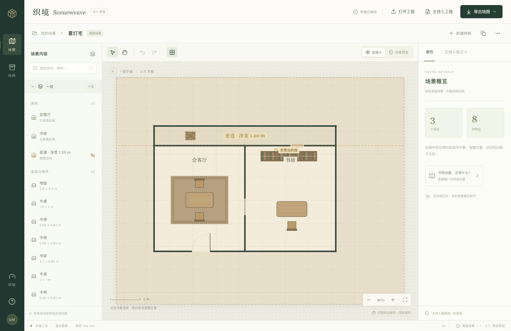

# M0 几何版原型验证报告

验证日期：2026-10-20。应用版本：`0.1.0-m0`。文档与容器版本均为 1，工程配置为 `m0-geometry`。

**几何版原型首轮验证完成。** 95 项单元测试、13 项真实 Chrome 浏览器测试及生产构建通过。当前证据支持保留 React + TypeScript + Konva、独立场景文档和 IndexedDB CAS 方案，继续开发手工编辑器。这里的通过仅覆盖下文列明的 M0 子集；完整 SCN-01/02/03、真实素材和全部里程碑退出门槛仍未通过验收。

## 1. 实际交付与代码版本

原型可以在简化「雾灯宅」中选择和拖动家具、精确编辑位置与朝向、调整共享墙和门、设置编辑锁、编辑线索与秘密、撤销重做、自动保存、恢复历史为副本、导入导出主持人工程，以及生成主持人和玩家 PNG。平移、缩放、适应画布、网格开关和玩家预览已有入口。场景包含两个公开房间、一条净宽 1200 mm 的密道和八个原创符号物件。

这不是从空白完成房屋的编辑器：没有房间新建/自由绘制、完整素材管线、家具占地路径求解、AI、Worker、PWA 离线冷启动或 UVTT。未支持的 `pathChecks`、`minPathWidthMm`、多楼层、外部素材工程会明确拒绝。

测试针对本报告所在提交的实现运行。为避免让文档提交自身成为循环版本引用，保留 [35 个实现/测试/配置文件的 SHA-256 清单](evidence/m0/implementation-files.sha256)。清单自身 SHA-256 为 `f03c46dd2f9b8cbc5727bbf7dab14feccb1bff75e0e5e785caffa1ebee482ee1`；[运行汇总](evidence/m0/validation-summary.json)记录命令结果和环境。后续源码改变后，这些结果只代表此清单对应的实现。



## 2. 环境与复现

| 项目 | 本轮实际配置 |
|---|---|
| 设备 | Apple M1，16 GiB 内存，8 个逻辑处理器 |
| 系统 | macOS 26.6.2，build 25G83 |
| Node / npm | 24.14.1 / 11.11.0 |
| 浏览器测试 | Playwright 1.56.1，系统 Chrome channel，headless，单 worker |
| 实际浏览器引擎 | `browser.version()` = **155.0.8059.84** |
| 浏览器视口 / DPR | 1512 × 982 CSS px / 1 |
| 地图画布 | 935 × 767 px；性能测试无外部纹理 |
| 主要依赖 | React 19.3.1，Konva 10.9.0，react-konva 19.3.2，Zustand 5.0.15，Zod 4.6.7，Dexie 4.4.6，fflate 0.8.3 |
| 构建 / 单测 | Vite 7.3.7，TypeScript 5.9.3，Vitest 4.1.12 |

依赖的完整解析版本以 `package-lock.json` 为准。Chrome 的缩减 UA 显示 `Macintosh; Intel Mac OS X 10_15_7`，不用于推断本机系统或 CPU；设备信息取自系统，浏览器版本取自测试引擎。

```sh
npm ci
npm test
npm run build
npx playwright install chromium
npm run test:e2e
```

默认命令使用 Playwright 对应的 Chromium。本机已有 Chrome，本轮实际使用：

```sh
SCENEWEAVE_BROWSER_CHANNEL=chrome npm run test:e2e
```

测试使用独立临时浏览器上下文，不读写用户的日常 Chrome profile。配置会在 `127.0.0.1:5173` 启动服务或在非 CI 环境复用同端口开发服务；源码不同时应先重启正确服务。E2E 覆盖开发服务，`npm run preview` 的生产构建另做了页面加载、玩家预览和控制台冒烟检查，没有声称完整生产版 E2E 已运行。

`test-results/` 与 `playwright-report/` 是本地临时结果，下次测试会刷新。[归档证据目录](evidence/m0/README.md)保存本轮原始样本和图片。

## 3. 自动化结果与覆盖范围

| 验证 | 结果 | 实际覆盖 |
|---|---|---|
| 领域内核 | 通过，35 项 | 严格结构、整数毫米、正交房间与共享墙、附着门、结构连通、间隙/开口、完整候选原子提交、间接锁、单调撤销重做 |
| 存储与工程文件 | 通过，34 项 | 完整文档往返、同事务 CAS、串行/合并保存、20 快照、注入失败回滚、冲突冻结、ZIP/JSON 负例 |
| 投影与绘制 | 通过，21 项 | 私密实体/锚点过滤、暗门补墙、秘密拆墙不改变玩家模型、独立墙、遮罩覆盖和最终绘制、PNG 分配边界 |
| 编辑器异步状态 | 通过，5 项 | 另存/打开/重载等待期间继续编辑；当前保存失败或冲突时不以历史切换覆盖成果 |
| Chrome 编辑旅程 | 通过，5 项 | 属性编辑/非法回滚/重开；一拖一事务与取消；共享墙/间接锁；实际 PNG/ZIP 下载导入；双标签冲突另存副本 |
| Chrome 存储旅程 | 通过，4 项 | 真实 IndexedDB 关闭重开与页面刷新；双标签 CAS；保存合并及 20 快照；ZIP 往返与损坏导入保留当前工程 |
| Chrome 隐私旅程 | 通过，3 项 | 4K 配对像素与元数据；导出过程中继续编辑仍保持原修订；不足遮罩无损拒绝 |
| Chrome 性能采集 | 通过，1 项 | 500/2000 原创符号物件，连续指针和滚轮，提交与持久化分开采样；数值为观察值 |
| TypeScript + Vite 生产构建 | 通过 | DEV 测试入口未出现在构建产物；拆分后的生产页面加载与玩家预览冒烟通过，未捕获 warning/error |
| `npm audit --omit=dev` | 通过 | 当次查询生产依赖漏洞数为 0；不是未来或全供应链保证 |

合计 **8 个单测文件、95 项单元测试**；**13 项浏览器测试**，统一运行耗时 **44.9 s**。构建仅出现 Zod 内部 PURE 注释位置提示，注释被移除，未阻止构建。

### 与质量计划的对应关系

下表的“通过”只针对“本轮子用例”一列，不关闭原 QA 的未来范围。主验收定义仍见 [质量计划](09-quality-plan.md)。

| QA 范围 | 本轮子用例及结果 | 仍未运行的原用例范围 |
|---|---|---|
| QA-GEO-01/02/03/05 | 通过：严格几何/引用负例、共墙移动、墙反转/拆分与门重挂、开口净宽/端间隙、required 结构连接 | 从空白绘制完整 SCN-01；家具/区域占地、转角净空和当前通行求解 |
| QA-TXN-01/02/03/04 | 通过：原子失败、过期基线、单调历史、间接编辑锁、实际拖动/Escape/撤销打断手势 | AI 选区与 scope 采用；完整绘制工具、所有失焦/设备输入组合 |
| QA-IO-01/02/03/04 | 通过：M0 完整文档和工程往返，坏导入不替换，注入事务失败回滚，历史副本，多标签冲突救援 | 真实资产工程、迁移/覆盖导入、异常断电/崩溃矩阵 |
| QA-IO-05 | 通过：注入写入错误时保留未保存内存，不以失败冒充成功 | 真实磁盘配额耗尽、存储权限拒绝、PWA 断网冷启动、资产丢失 |
| QA-SEC-01/02/03 | 通过：简化雾灯宅隐藏几何/门/注记配对、遮罩、元数据、快照稳定性 | 完整三个场景、外部位图/装饰光影、未来 AI 文本去向 |
| QA-IMPORT-01/02 | 通过：M0 ZIP 预算、重复条目/键、损坏/hash/CRC、额外条目与素材明确拒绝 | PNG/JPEG/WebP 解码、像素预算和去元数据；完整资产容器 |
| QA-PERF-01/02/03 | 通过：下文的程序符号、简化雾灯宅 4K 子负载完成并留下原始样本 | 真实纹理、完整场景、高 DPR、端到端输入显示时延、峰值资源 |
| QA-UX-01/02 | 通过：受测编辑/导入导出路径，数值编辑、快捷键、取消与对话框反馈可操作 | 全键盘遍历、辅助技术、高缩放/配色/减少动态效果矩阵 |
| QA-SCN / PLAY / PRESET / AI / UVTT | 未运行 | 完整样例创作、真实小团、三预设、AI 与 VTT 目标版本验收 |

## 4. 500 / 2000 物件实测

原始数据：[performance.json](evidence/m0/performance.json)。采集结束时间为 `2026-10-20T05:26:49.319Z`。本轮只有一次统一运行，不提供跨运行置信区间或最低配置承诺。

场景为 50 × 50 网格，格长 1524 mm，500 或 2000 个原创程序符号，无外部纹理，不用复杂房间/墙体数量代表该负载。数量为文档中的总物件数；初始适应画布，平移/缩放期间未逐帧统计视口可见数量。应用页面已加载，再装载新的负载文档，没有图片纹理的冷/热解码差异。

装载后等待两次 rAF，再在平移工具下持续按下指针，按 rAF 节奏发送 **240 次真实 Playwright 指针移动与 6 次滚轮事件**。随后单独执行 **30 次物件移动事务**，再对独立 IndexedDB 数据库执行 **20 次完整场景保存**。后两段由测试入口驱动，不代表 2000 次物件拖动的实测。

统计采用 nearest-rank p95，即排序后第 `ceil(0.95 × n)` 项；表内四舍五入至 0.1 ms，原始浮点样本保留。

| 物件数 | rAF 间隔 p95 | Canvas 绘制 p95 | 领域事务 p95 | 提交意图至保存入队 p95 | IndexedDB 保存 p95 |
|---:|---:|---:|---:|---:|---:|
| 500 | 16.7 ms | 1.7 ms | 3.9 ms | 5.6 ms | 6.3 ms |
| 2000 | 16.8 ms | 5.6 ms | 11.3 ms | 16.8 ms | 19.3 ms |

500/2000 的 rAF 间隔样本分别为 **493/502**，绘制样本各 **246**，事务各 **30**，保存各 **20**。500/2000 的装载至首次绘制观察值为 **37.9/66.4 ms**，各只有一条样本，含新建文档与首次保存等工作，不是网络冷启动时间。2000 物件保存最大值为 31.2 ms，p95 表不会替代最大值记录。

这些数值支持继续使用 Konva 的几何/符号路线。物件增多后，完整文档校验和持久化成本都增长；M1 接入真实素材和更复杂几何后，应按相同方法复测，再决定缓存、索引或 Worker 是否必要。rAF 间隔包含浏览器与自动化调度，不能单独证明硬件输入到屏幕的时延；Canvas 绘制耗时也不包含 GPU 合成和实际呈现。

JS heap 仅在负载结束时采到约 **46.7/65.2 MiB** 的点值，原始记录包含对应 total/limit。它不是浏览器完整内存或峰值内存，没有测到的峰值不填成零。未覆盖真实纹理、批量选区、数百房间/墙、移动端、高分屏和长期编辑。

负载截图：[500 物件](evidence/m0/workload-500.png)、[2000 物件](evidence/m0/workload-2000.png)。

## 5. 4K 玩家输出与秘密验证

原始记录：[privacy-and-export.json](evidence/m0/privacy-and-export.json)；实际文件：[玩家 PNG](evidence/m0/player-4k.png)。固定导出世界范围为 19000 × 15000 mm，长边 4096，对应 **4096 × 3234 px**。

配对场景改变隐藏密道范围、秘密门的 offset/width/state、私密箱子的坐标/朝向、主持人正文以及 revision（0 → 9），公开内容和固定遮罩相同。结果：

- 两份玩家投影除 sourceRevision 外一致；解码后的玩家 RGBA **差异通道数为 0**。
- 1024 长边的主持人对照图存在 **135977 个差异通道**，证明修改在 GM 输出可见。
- 玩家 PNG 全部像素 alpha=255；隐藏区内一个本会出现网格交点的位置为遮罩色 `[232,223,202,255]`。
- 本次实际 PNG 仅含 IHDR、IDAT、IEND，未包含文本/EXIF chunk、私密标记或 IEND 后尾随数据。
- 单次 4K 导出观察值为 **187.7 ms，233692 bytes**，不是 p95 或时长承诺。
- 另一测试在编码等待期间修改公开内容，完成图片仍对应捕获的 revision 7；当前场景已到 revision 8，两者互不覆盖。

绘制和导出共用过滤投影；私密记录在绘制前移除，最后再绘制不透明遮罩。原型只接受保守的**轴对齐矩形遮罩**，要求隐藏对象在导出范围内的 AABB 被其覆盖。遮罩不足时玩家预览/导出报错，当前工程不变。对 GM 家具的单独隐藏也受此约束；尚无遮罩编辑工具，在现有遮罩外设为私密可能使玩家输出被阻止。这一限制需要 M1 专门处理。

未接入外部位图与装饰阴影，不能据此证明这些未来内容不泄漏。理论上单份 4096 × 3234 RGBA 缓冲区需 **52985856 bytes（约 50.5 MiB）**；解码、临时副本和浏览器合成还会占空间，**本轮未测导出峰值内存**。

## 6. 存储、工程与资源边界

IndexedDB 保存完整 SceneDocument，比较持久化 revision 与写入在同一事务。浏览器测试已验证两个标签从同一基线编辑时，后一方不能覆盖前一方；失败分支保留内存，可另存新 sceneId。串行协调器可合并尚未启动的中间版本，最近 20 个快照指 20 次成功保存，不等于每一次手势都持久留档。会话 undo/redo 不在重开后恢复。

存储故障用例通过注入事务写入失败和延迟验证回滚、待保存状态及异步切换守卫；**没有真实填满磁盘或触发浏览器配额拒绝**。这两类证据不能混称。

| 项目 | M0 实施上限 / 行为 |
|---|---|
| 压缩工程 | 1 byte 至 5 MiB |
| 展开场景 / manifest | 10 MiB / 64 KiB |
| 条目 | 恰好 `manifest.json` 与 `scene.json` |
| JSON | 最大深度 128，最多 300000 个值；拒绝重复键、未知语义与非法几何 |
| 完整性 | 中央/本地记录预检、长度、受限流式解压、CRC、scene SHA-256 |
| 隔离导入 | 校验后预览；默认新 sceneId；坏包/取消/写入失败不替换当前场景 |
| 素材 | 不接受外部素材、额外条目或嵌套归档 |
| PNG | 长边最大 4096；总像素最大 16777216 |

负例覆盖超预算压缩输入、超预算展开声明、伪造小声明的实际膨胀、重复条目、路径/目录不一致、额外数据、截断、CRC/hash 错误、未知版本/字段、多楼层及外部资产；不是对所有预算“恰等于/略低于/略高于”的穷举容量验收。后续 20 MiB 单资产、100 MiB 工程等候选预算不属于本配置，详见 [存储与导出](06-storage-and-export.md)。

[主持人样例工程](evidence/m0/house.sceneweave)仅含原创固定样例，可导入原型复核。它有意包含 GM 秘密，玩家交付应使用玩家 PNG。运行时编辑和存储不依赖 AI；首次打开仍需可用的本地服务和应用资源，未实现 PWA 离线冷启动。

## 7. 后续门槛与下一步

本轮完成 M0 几何配置的首轮证据；未将完整 M0 或产品标记为完成，未创建发行版或部署站点。

| 后续工作 | 目的与验收方向 |
|---|---|
| M1 第一条纵向流程：创建矩形房间 → 共墙 → 放门 → 撤销 → 保存重开 | 从固定样例走向主持人可独立制作地图；复用已验证的完整文档与原子事务 |
| 素材管线与授权信息 | 静态位图实际解码、去元数据、占地分离、预算边界与真实纹理负载复测 |
| 隐藏/遮罩编辑与完整 SCN-01 | 主持人能正常设置秘密并输出玩家图；逐步解除当前矩形/AABB 限制，保留配对像素回归 |
| 通行与净宽 | 明确结构连接、当前门状态和家具/区域占地的差异，再实现空间路径验证 |
| 环境与恢复补测 | 真实存储配额/权限、峰值资源、高 DPR、辅助技术和更多桌面浏览器 |
| M2 及之后 | 手工闭环稳定后接 AI 提案；真实小团、三预设和 UVTT 按各自阶段独立验收 |
