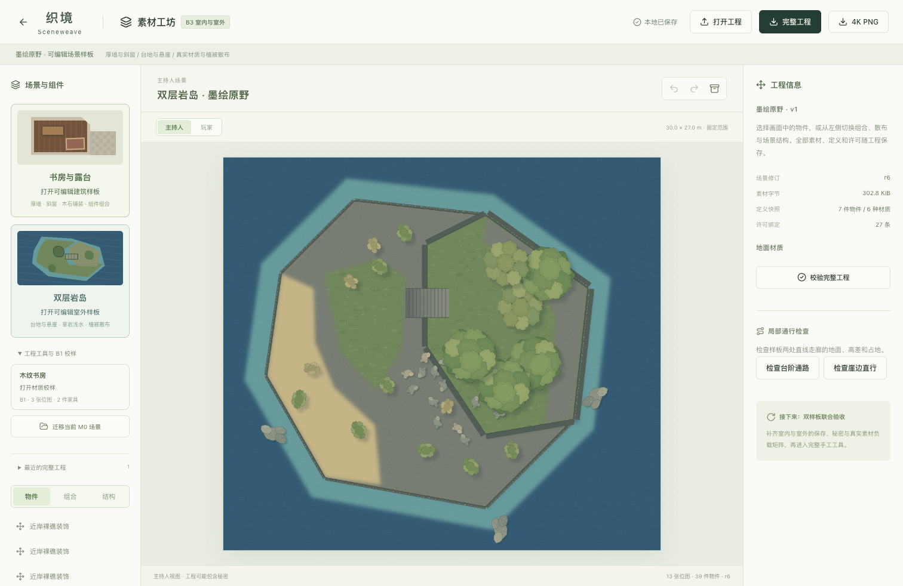

# M1-B / B3 地形样板验证记录

日期：2026-10-20。应用版本：`0.2.0-m1-b3`。开发基线：`ede943c2af5d43c3ee4d97ce8a407da56d938962`。本批交付可编辑 VIS-02「双层岩岛」的首轮实现、原创室外P2候选及验证记录。下一入口为B4双样板联合矩阵，之后B5真实负载；完整M1与正式发行尚未完成。

源码、测试、素材与工具的内容指纹见[实现清单](evidence/m1-b3/implementation-files.sha256)，实际运行与范围见[汇总](evidence/m1-b3/validation-summary.json)。[M0](13-m0-validation.md)、[B1](17-m1b-b1-validation.md)、[B2](18-m1b-b2-validation.md)报告与原始证据保留不变。

## 1. 可复现的交付

在「素材工坊」选择「双层岩岛」，保存并打开副本。可直接导入[完整工程](evidence/m1-b3/island.sceneweave)，它携带实际图片、定义、实例、地形、散布记录和MIT许可；重开不根据seed重新生成。

| 内容 | 本批实际实现 |
|---|---|
| 地形 | 30000×27000 mm固定范围；阻挡步行的海水基底、1000 mm低台地与3000 mm高台地，coveragePriority独立于高程 |
| 边缘/连接 | 8条对水海岸与4条唯一共边，来源指向真实轮廓段；2000 mm宽台阶连接(12500,10000)→(15500,10000) |
| 材质 | 草、裸岩、崖岩、沙、浅水、深水6种；显式保存草岩沙水覆盖边界、世界平铺参数与柔化宽度 |
| 布景 | 6树、12灌木、18碎石与3装饰岩礁，共39件；树冠绘制范围与600×600 mm树干占地分开，岩礁图片不创建可站立面 |
| 有限编辑 | 现有海岸/台地轮廓、高程、覆盖点、材质/铺装；现有散布组密度候选、人工移动、固定、删除并保留排除区、退出散布 |
| 渲染/输出 | 共用Canvas 2D预览/PNG，非零高程崖面、低侧外扩、独立世界东南阴影、台阶开口；同范围4096×3686像素双受众图 |
| 保存 | 独立v2资源仓库、原子事务、单调revision、历史/CAS保存、完整工程和空存储断网导入后继续编辑 |

高低共边点与显式浅水覆盖在同一候选中更新。浅水是保存的水面SurfaceStyle overlay，当前样板辅助函数根据两台地外环外扩1500 mm；加载和渲染不重算。破环、分离环或过尖转角明确拒绝。该函数只服务持久化`sceneweave-vis02@1`样板，并非通用自然轮廓笔刷。

## 2. 环境与实际检查

Apple M1、16 GiB、macOS 26.6.2（25G83）、Node.js 24.14.1、npm 11.11.0；Playwright 1.56.1使用已安装Chrome 155.0.8059.84，headless，视口1512×982，DPR=1。未模拟其他浏览器。

| 检查 | 结果 | 证据 |
|---|---|---|
| `npm test` | 299/299通过，25个文件 | [单元结果](evidence/m1-b3/unit-results.json) |
| `npm run build` | 类型/生产构建通过；2条上游Zod注释告警，主chunk约533.23 kB触发体积告警 | [汇总](evidence/m1-b3/validation-summary.json) |
| Chrome完整回归 | 39/39通过，0失败、0跳过、0 flaky；234860.890 ms | [逐项结果](evidence/m1-b3/browser-results.json) |
| 最后显示修正后回归 | 岩岛4个UI流程再次通过；输入回填修正后再跑完整39项及类型/生产构建 | [UI复核](evidence/m1-b3/ui-final-results.json) |
| 生产静态预览 | 新建、候选取消/采用/撤销、散布采用/撤销、有限通行、连接移除拒绝、重开、两受众4K、完整包、空存储断网导入及高程续编通过 | [生产冒烟](evidence/m1-b3/b3-production-smoke.json) |

相对B2增加55项单元覆盖：散布12、散布隐私10、地形命令5、有限通行9、样板守卫2、workspace集成4、样板/素材10、投影3。39个浏览器用例由30个既有回归与9个B3用例组成（素材2、UI/工程4、真实渲染3）。最后将GM属性中“可见范围”改为复用有效受众解析，避免私密支撑/域中的物件被标作公开；玩家输出未因此泄漏。该显示修正后重跑4项UI和生产构建。生产首次冒烟发现取消预览后快速重填同值可能遇到异步回填，NumberInput改为绘制前同步输入值，补正式值断言；该修正后再次运行完整299单测、39项浏览器、构建和生产流程，均通过。

既有500/2000程序符号回归也通过，但不是本批真实材质容量或性能验收。岩岛样板已恢复为按需加载的约17.95 kB独立chunk；主入口仍有体积告警，后续真实加载测量和拆分须记录，不通过提高告警阈值掩盖。

## 3. 编辑、通行与散布

| 操作/不变量 | 实际结果 | 证据 |
|---|---|---|
| 海岸X=4000→3800：取消、采用、撤销；非法X=100000 | 预览不改正式工程；采用一次revision同时保存海岸和浅水；撤销恢复；非法候选可见拒绝且无页面异常 | [地形编辑](evidence/m1-b3/b3-terrain-editing.json) |
| 高台3000→4000、灰绿裸岩覆盖点18000→17900，随后撤销 | 显式高差/覆盖变化可见，实际像素不同；撤销恢复，不暗改物件或连接 | [世界相位/恢复](evidence/m1-b3/b3-world-phase-edit-restore.json) |
| 低台地换草地，平铺宽长改3000 mm，再重开 | 材质引用、尺度/原点等实际参数精确保存；内部固定片区不因海岸改动拉伸或跳相位 | [编辑/重开](evidence/m1-b3/b3-terrain-editing.json) |
| 手移一棵树并固定，删除一灌木，再提高密度 | 树成为manual并保持实际位置/锁；删除保存deleted/null及旋转占地的保守世界AABB外扩排除区；再生成不复活 | [散布操作](evidence/m1-b3/b3-scatter-editing.json) |
| 取消/采用散布候选、撤销/重做、重开 | 取消不变；采用一个原子事务；完整成员、人工覆盖、排除和实际props往返一致 | 同上及4项workspace单测 |
| 台阶直行/崖边直行两条2000 mm走廊 | 台阶可通行；其他崖边直行指出高差阻断；切换同revision的另一工程会清除旧结果 | [有限通行](evidence/m1-b3/b3-required-passage.json) |
| 移除required台阶 | 样板守卫整笔拒绝，不消费revision/历史，不清redo，不写坏持久化原件 | 同上及样板/workspace负例 |
| 完整包及双受众4K，空存储断网导入后继续改高程 | 地形/边缘/连接/散布/物件/材质/定义/主题精确往返；副本有新sceneId，不改源工程 | [完整往返](evidence/m1-b3/b3-complete-portability.json)、[生产冒烟](evidence/m1-b3/b3-production-smoke.json) |

`checkTerrainTravelV2`检查明确输入的一条全宽直线走廊，含有效支撑、水阻挡、旋转占地、实体墙和门状态、崖边与足宽未阻挡的显式台阶/坡道；它不搜索绕路或全图可达性。`sceneweave-vis02@1`额外要求台阶≥2000 mm及两端各2000 mm接入区，预览/采用共用检查。普通草稿缺连接可保存，由局部通行查询解释无路；不能借样板结果关闭完整QA-GEO-04/05或QA-TERRAIN-02。

散布使用`scatter-cell-v1`固定网格及SHA-256子流，同步实现最多遍历250000候选格，超出明确拒绝。这是保护上限，不是已测容量。手移/外观修改保留manual与overrideFields，删除/退出保留永久抑制记录；锁、锚点、依赖和最终支撑错误均整批拒绝。缺算法版本只能继续编辑已存实例，不能重新生成。

固定测试向量：seed=`礁岸-织境`，列=-2、行=3，原点(123,-456)、cell=1600，旋转10..350，palette按key为a-shrub:1/z-tree:3。candidateKey=`3166fdff089b32a745565df6c8265347407b34cfbb8579052c3671e92dbdcb96`；density=0.3329892946460864；位置(-2711,5691) mm；旋转207.281°；选择a-shrub。纯TS同步SHA-256与Node crypto独立交叉核对，包含UTF-8和多块输入；改变采样输出须使用新算法版本。

生产构建另保存了[编辑前](evidence/m1-b3/b3-production-before-4096.png)、[海岸及高程采用后](evidence/m1-b3/b3-production-after-4096.png)、[候选界面](evidence/m1-b3/b3-coast-candidate.png)、[采用界面](evidence/m1-b3/b3-coast-height-adopted.png)。采用后为revision=2、海岸X=3800、高台4000 mm；两次撤销恢复基线实际PNG字节，之后散布采用/撤销和重开仍保持同一基线像素。

## 4. 原创素材与首轮画面检查

本批6材质、7组件共13张PNG，合计310023 bytes，保留13份SVG源、生成工具、真实hash/字节/像素/alpha包围盒与MIT，见[manifest](../assets/sceneweave-handdrawn-outdoor/manifest.json)、[来源与重建](../assets/sceneweave-handdrawn-outdoor/README.md)及[15台账](15-m1a-asset-production-list.md)。工程包含27条许可绑定（13图片、6材质、7物件定义、1主题）。B2素材未改。

来源为Sceneweave contributors原创SVG，Codex辅助编写；没有调用图像生成服务，没有拆取、描摹或嵌入参考图、外部图包、字体或商业规则内容。已安装Chrome的sRGB Canvas栅格化后写确定编码PNG，仅IHDR/sRGB/IDAT/IEND；透明像素RGB清零，组件四侧至少8源像素余量，没有烘焙投射阴影。真实Chrome逐张解码、hash/CRC/尺寸、两份manifest、实际PNG/hash及许可一致性检查通过。Chrome升级可能改变抗锯齿字节，重建后需重新核对。

实际PNG尺寸、世界映射与占地符合清单；15中的本体span是预计绘制体量，不等于alpha像素量出的精确本体尺寸，实际范围在manifest中如实保留。素材保持 **O/P2**，用户美术签收、全主题P3和混合资源尚未完成。

| 视图 | 实施代理与主代理的首轮观察 | 证据/局限 |
|---|---|---|
| 全景 | 两台地、海岸、台阶和草岩沙水层次可辨；39件布景分别保存，可选可改 | [GM 4K](evidence/m1-b3/b3-baseline-gm-4096.png)、[玩家4K](evidence/m1-b3/b3-baseline-player-4096.png)；普通样板无秘密，两图相同 |
| 西岸 | 沙地、崖侧、岸沫和浅深水连续；未见矩形图片底板 | [西岸近景](evidence/m1-b3/b3-near-west-coast-256px-per-m.png)；轮廓仍较多边形化，浅水柔化属于候选美术 |
| 共边台阶 | 共边唯一，崖面朝低侧外扩，连接开口截断崖面与其阴影 | [台阶近景](evidence/m1-b3/b3-near-stairs-256px-per-m.png)；只验证有限样板，不外推任意急角/连接交汇 |
| 树冠/灌木/石块 | 树种、灌木和石块轮廓有区别，冠层叠放与树干占地分离；装饰阴影与物理语义分开 | [树冠近景](evidence/m1-b3/b3-near-canopy-256px-per-m.png)、[素材拼图](evidence/m1-b3/b3-assets-contact.png)；植被/崖岩细节和自然过渡仍需打磨 |

近景均为4000×3000 mm固定世界框，由4096×3686整图重采样到1024×768像素，即展示256 px/m；不是源文件原像素截取。西岸原点(2000,12000)、台阶(12000,9000)、固定首棵树框(17461,5705)，具体坐标与方法保存于真实渲染记录。工作台截图为1512×982浏览器中的实际布局，不冒充14规定的1280×960纯画布验收。

## 5. 玩家秘密、失败与资源

普通岩岛与隐私QA副本分开。固定不透明矩形遮罩为(19000,7000)→(24500,12000)。S01只改变其内GM透明物件的位置/旋转/阴影和私密注记；S02只改变GM小台地的轮廓、3500→4300 mm高程与高优先级覆盖。S02的两份副本均移除物件及散布组，以隔离秘密地形的覆盖影响，不把这项隔离检查当作完整混合依赖矩阵。

先过滤受众再解析公开支撑、共边、材质和阴影；遮罩完整包住私密几何及实际装饰外扩。4096×3686解码RGBA结果如下，两个配对的GM图各不相同，详见[真实渲染记录](evidence/m1-b3/b3-real-render-privacy.json)：

| 配对 | 玩家A/B相同的像素SHA-256 |
|---|---|
| VIS-02-S01 透明物件/注记/阴影 | `378a973bda84fa484f488e5ced8e31c73449bae263350a5e2c3e5a0189ade3c3` |
| VIS-02-S02 私密台地 | `e8429c0490a624e2bf2d6100fe6c610a94a0bfc46215d0ccc9a24672c87f9e91` |

PNG没有tEXt/zTXt/iTXt/eXIf块，输出范围固定。仅GM使用的图片缺失时玩家仍能出图，GM明确失败；必需崖岩图片缺失则拒绝，取消时实际已解码1张并关闭1张，见[错误与释放](evidence/m1-b3/b3-real-image-failure-cleanup.json)。静态素材404、CRC损坏和预先取消均不会进入样板采用。

公开散布也先过滤有效受众，不能把隐藏物件当作公开候选的避让障碍，或用秘密支撑/路径/边缘决定公开布局。10项专门单测覆盖私密物件/组合/组/支撑/域、保留私密managed成员、退出固化私密状态等。最终采用仍验证完整真实几何：若候选与隐藏高优先级支撑或保留私密成员硬间距冲突，整笔拒绝，不移动/筛掉公开候选来容纳秘密。该失败保留原工程，完整B4组合矩阵仍待补充。

每次绘制核对必要字节、hash、PNG头和实际解码，成功/失败/取消后关闭本次位图与临时画布。没有持久化已解码缓存、图集或Worker。记录中的单次基线4K绘制约1085/1057.7 ms（GM/玩家），只说明本次功能完成；不构成受控冷/热统计、资源峰值或外部性能承诺。

## 6. 限制和后续

- 只有既有样板的有限数值编辑及散布再生成；没有从空白绘图、通用地形笔刷、任意新域/连接/素材放置、通用复制或完整资产管理UI。
- 道路与物件着色仍明确停止不完整预览/出图；材质着色、覆盖、非零高程及台阶/坡道已有渲染实现，坡道尚无本批独立美术签收。
- 通行只检查显式直线与样板接入区，不搜索全图路径，不验证预留区之外的全部家具碰撞，也没有角色游泳/攀爬或视线裁定。
- P2候选仍较几何化；自然岸形、崖岩细节、植被丰富度、完整混合主题与用户观感反馈继续列入美术工作。
- 完整双样板秘密/存档/失败矩阵、真实材质500/2000负载、受控冷/热加载、连续编辑资源峰值、跨浏览器、真实配额耗尽和真实小团尚未验收。没有用理论像素缓冲或单点JS堆代替峰值。
- AI、Worker、PWA断网冷启动、云部署与UVTT尚未实现。

本批只记录已执行的QA子项，不统一关闭09中的完整QA。文档链接/锚点、表格、ID、历史文件保留、源文件指纹和秘密资料扫描结果见[文档检查](evidence/m1-b3/document-checks.json)与[交付检查](evidence/m1-b3/delivery-checks.json)。下一批按[16](16-m1a-handoff.md)推进 **B4双样板联合验收**，之后B5用实际资源测量容量、响应与峰值，再据投入和测量形成滚动周排期；不编造日期承诺。
