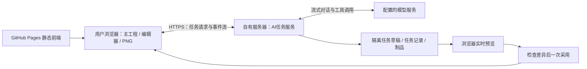

# M2 方向与实施边界：流式创作助手、统一 v1 与服务端任务

状态：2026-10-23用户确认设计，2026-10-24已实现M2-0至4的本地流程；本页保留产品方向并标明当前边界。应用版本号仍为 `0.2.0-m1-d2`，默认主界面使用新标识完整v1、原生会话及两个新仓库。M2-3场景制作与M2-4受限SVG/渐进同化已接通，M2-5仅部署脚手架与本地服务，尚未真实HTTPS部署。旧产品自动化结果见[44](44-full-regression-validation.md)，不能用来证明新能力；现行回归结果集中在[05](05-ai-and-generation.md)与[09](09-quality-plan.md)。当前状态以[07](07-roadmap.md)为准，精确AI合同和实际结果以[05](05-ai-and-generation.md)为准。

2026-10-24补充：M2-0a至e历史保留于48至[51](51-m20e-library-conversion-validation.md)；f主会话/Canvas/工作台/样板与默认工程/个人库切换已实施，旧整页入口退役，当时必要检查归[52](52-m20f-native-workspace-validation.md)。精确字段归04、容器/保全/转换归06、共享模块归03，交接归[47](47-m20-unified-v1-handoff.md)。旧六库与原文件仅在兼容边界只读发现/保全/转换，原件可核验后下载，不自动转换用户数据。M2-1本地任务/流式续答、M2-2技能/物件草稿与保护采用已扩展到M2-3有限场景工具和M2-4本机SVG/参数物化；线上HTTPS与Pages真实联通仍是M2-5未完成门槛。

## 1. 本次定下来的产品

用户可以用中文提出场景或素材要求，看到文字和制作进度流式出现。AI 在独立任务草稿内使用应用提供的技能与工具，逐步建场景、摆素材、制作或修改 SVG、检查结果并调整。用户可以中途打断和补充要求，完成后检查整体差异，再一次采用到主工程。

首版接入**对话 API**，不接生图或图像编辑 API。PNG 导出由场景/SVG 的本地渲染完成，不需要再向模型购买一次“转图片”。模型能否读取参考图、回看截图，须对实际渠道验证；流式文字、工具调用和视觉输入是三项不同能力。

原有的单组件→组合→明确范围渐进同化继续保留，作为创作助手的一组工作流。仅换风格时保留位置、占地、通行、秘密和人工记录；用户提出布局创作任务时才启用对应领域工具。原可选 M2-L 的场景/布景/文字职责并入主线，旧编号只作追踪；不再按“先接生图、以后再做对话”安排。

## 2. 部署与职责

| 部分 | 第一版承担的责任 |
|---|---|
| Pages 前端 | 首页、手工编辑、素材库、选择/图层、主工程 IndexedDB、撤销/快照、任务预览与采用、双受众 PNG |
| 自有后端 | TypeScript + Node.js + Hono；访问控制、provider 适配与密钥、技能版本、模型/工具多轮循环、取消、任务状态和事件重连 |
| 共享核心 | 无 React/DOM 依赖的完整类型、整数毫米几何、有限命令、范围/锁/依赖校验；前后端使用同一实现 |
| 任务存储 | 单服务实例，SQLite存任务/检查点/事件索引，私有文件保存原始/规范化SVG与记录；实际PNG由浏览器物化进入工程，这不是主工程云同步 |
| 浏览器适配器 | Canvas 预览、位图解码/参数物化、本地导出等浏览器能力；按任务绑定接收有限工具请求，返回可校验结果 |

浏览器只配置我们的后端地址，不持有模型 API key。自有服务器调用模型服务，不需要自部署模型或 GPU。线上后端须有 HTTPS、精确 Origin 白名单、真实鉴权及任务归属检查；CORS 不能替代鉴权。首版按维护者自用入口设计，不新增注册、团队或收费系统。现已提供Dockerfile、Compose持久卷/健康检查、Caddy HTTPS/SSE反代及分离的环境示例；尚未配置真实服务器、DNS/证书或发布HTTPS地址，以上架构图不表示线上部署已完成。

任务状态与制品可持久化、断线后可查询，**不等于首版保证关掉浏览器也能完成整个制作任务**。遇到需要浏览器渲染/解码的步骤，客户端离线时进入等待或暂停；恢复连接后核对任务代次和草稿版本再继续。服务重启保留最近有效检查点，对状态未知的模型请求不重复计费重试。完整无人值守续跑和服务端渲染以后按需要补齐。

## 3. 统一为一个新的完整 v1

这次统一的是开发中累积的产品模型和入口，保留已有建筑、室外、组件、图层、外观、历史和素材库能力。目标为一个主编辑器、一个完整工程读写格式和一个工程仓库；个人素材库仍独立管理固定内容和个人整理。

| 要统一的对象 | 准备与转换要求 |
|---|---|
| 场景/完整工程 | 使用新的格式标识区分 M0 几何 v1；新完整格式从版本 1 起步。不能只将现有 `schemaVersion`/`containerVersion` 改为 1 |
| 领域与历史 | 汇总有效 v3 场景、identity3、appearance1 与当前约束，迁入一份明确合同；不凭重编号获得持久建筑身份或任意拓扑恢复 |
| 旧工程与快照 | 盘点六库当前工程、自动/命名/保护历史、迁移原件和来源链；先可取回备份，再按独立副本转换并验证。不能悄悄只迁当前而丢旧历史 |
| 个人目录与备份 | [40](40-u2a-catalog-contract.md)保留原中性v6载体合同；e已提供新完整v1中性载体/新库/备份，保持算法1身份、内置补标、许可、私密模板与个人整理对应，见04/06/51 |
| 代码与入口 | 共享核心与原生主会话/渲染/新仓库已接通，旧读者/迁移器隔离到兼容边界；f已收敛旧整页入口，必要等价验收和原件取回收尾见52 |

现有源素材和固定版本不能随重构改义。旧历史若无法无损映射到新的可恢复身份，保留可导出、可取回的独立旧档案并明确限制；不得把“已备份”写成“可在新格式局部恢复”。数据保全完成前不删除旧 IndexedDB 或转换输入。后续真实不兼容变更仍需要版本演进，“统一 v1”不是永远免除迁移。

## 4. 技能、工具与任务草稿

技能是项目维护的工作方法，例如“制作海岸哨所”“画俯视家具 SVG”“逐件统一风格”，包含步骤、示例和检查标准。工具是应用真实提供的能力，例如读场景、找素材、绘房、放置、预览、保存 SVG。模型选择工具，任务服务执行循环；技能文件不能授予额外读写权限，安装在 Codex 中的技能不会自动成为 Sceneweave 的能力。

M2-2先开放场景/目录读取、独立物件放置与调整、透明度和草稿检查。M2-3现已按既有有限命令接入绘房、墙厚/顶点、附着门窗/入口，地形/道路/高差边/台阶坡道/用途区，固定组合/家具/散布及GM注记；工具只接受明确授权的Floor/图层/边界/既有实体与固定定义，不开放任意拓扑或秘密改写。M2-4接入受限SVG配方和配色/亮度/透明度同化，由浏览器独立物化实际资源。每个工具有严格输入、作用范围、资源限额和清晰错误；模型不直接提交任意完整工程，也不运行JavaScript、shell或下载任意URL。

任务绑定主工程基线、明确范围与可用工具；草稿有独立递增版本。流式文本可以即时显示，工具参数必须收完整并校验后才执行。成功步骤只修改隔离草稿；场景步骤重放后显示差异，SVG/样式配方须等待浏览器生成并校验真实资源，不能把服务端账本通过当成图片已完成。暂停/追加要求不丢草稿；取消后迟到结果不能复活。

最终采用重新验证主工程基线、范围、锁、完整资源和真实依赖，先成功落保护点，再按 CAS 形成一笔新事务和一个撤销单位。主工程等待期间若有新编辑，拒绝旧基线直接采用；允许保存草稿成果并在新基线上重新计算。首版不实现自动三方合并。

现有每次采用最多 256 条展开命令的边界继续保持：最终差异按完整依赖计数，多轮工具调用不能规避总采用预算。超限先缩小任务，或由用户明确安排后续独立批次；不暗中把一次采用拆成多个主工程提交。全场大制作能力因此需分阶段验证。

## 5. SVG 与导出

M2-4已将运行时**可编辑SVG源＋固定PNG结果＋不可变来源版本**接入完整v1，保留原始与规范化源及实际PNG字节/hash/处理器版本；现有静态PNG/JPEG/WebP入口继续可用。不接生图API，不从任意URL下载素材，也不以完整SVG替代语义场景。

首批采用有界静态SVG子集：明确viewBox、有限svg/g/defs、图形/路径/填色/线条及线性/径向渐变；逻辑尺寸、锚点和占地仍来自定义/实例。拒绝活动XML/DOCTYPE/实体、脚本/事件、外部资源、image/text/字体/CSS、foreignObject、动画与滤镜。源经确定性解析规范化和复杂度/字节检查，通过隔离Blob图片解码/Canvas生成真实PNG，不插入应用DOM。完整校验重读两源、核对hash/规范化/尺寸比例，再实际栅格化逐RGBA比较PNG；缺能力、损坏、取消均不产生可采用的半套工程。精确语法和保护值见04/05。

授权按单件→公开组合的存活成员→明确目标和边界的局部范围展开，也可明确允许本任务新建物件；不自动扩散到全图。仅换外观保留位置、逻辑尺寸、占地、支撑、通行、秘密及组合/散布人工记录，原素材和祖先许可不改义。源/PNG进入当前及所选历史的真实闭包、冷保存重开、普通/历史离线包、有限外观恢复和个人库中性载体；含SVG的固定内容用算法2，无SVG旧内容保持算法1身份。

场景仍用语义对象保存墙、门、地形、物件、组合和图层；把整张地图画成一幅 SVG 不能冒充可独立编辑的场景。每件 SVG 保留源文本和固定派生字节/hash/处理器版本，保存重开不依赖再次调用模型。玩家导出继续从已过滤的场景和实际像素生成；SVG 源与生成来源默认属于主持人工程，不随玩家 PNG 泄漏。

## 6. 实施顺序与完成条件

| 顺序 | 切片 | 做到什么算完成 |
|---|---|---|
| 1 | **M2-0：统一完整 v1 与共享核心** | 先冻结格式标识/身份/快照/目录转换表与支持矩阵，再实现主格式、主仓库及核心复用；真实备份/转换/重开与关键手工能力等价。同步最小 provider 能力探针，避免把能力假设带入任务引擎 |
| 2 | **M2-1：自有后端与流式连接** | 本地 Node/Hono 服务、配置/鉴权、provider 适配、文本与工具调用流解析、取消和错误；SQLite/制品存储及事件重连。实际渠道通过流式文本和至少一轮工具结果续答 |
| 3 | **M2-2：技能/工具与实时草稿** | 中文请求→读场景/找素材→多步工具→草稿预览→打断修正→一次采用/撤销；过期/锁/超限/断线和保存失败可恢复 |
| 4 | **M2-3：场景制作工具扩展** | 建筑、室外、组合/散布、GM文字按能力清单开放；用既有原创场景检查可继续手改与有限恢复，不把结构连通当全图寻路 |
| 5 | **M2-4：SVG 与渐进同化** | 新/默认/用户素材制作或派生，单件→组合→两个明确批次；源与PNG入库、离线往返、局部恢复和双受众导出；不调用生图API |
| 6 | **M2-5：部署与联合验证** | Pages＋实际HTTPS后端联通、鉴权/CORS、流式中断/重连、任务与制品生命周期、正确性/隐私/存档；按用户通知组织完整回归 |

M2-0至2本地流程已实施，M2-3场景制作与M2-4SVG/渐进同化已接通；完成条件表保留原任务范围，不能仅凭代码将实际渠道完整场景质量或线上验收一并勾完。a至e历史见48至[51](51-m20e-library-conversion-validation.md)，f当时结果见[52](52-m20f-native-workspace-validation.md)；v6原证明转换、v1–v5历史独立保全及旧算法1精确key保持。M2-5已提供可部署脚手架，真实HTTPS、Pages联通及线上生命周期旅程待验证。现行回归结果集中在[05](05-ai-and-generation.md)与[09](09-quality-plan.md)；34正式性能、人工P3、完整SCN与真实小团欠项独立保留。

## 7. 已知与待验证

- 原准备时只测/models；M2-1现已验证grok-4.5文字流、工具续答、本地中止/错误和生产链路，实际范围及token参数限制集中05第11节。M2-2另以合成工程通过一笔真实物件调整/检查，详05第12节；完整场景/视觉质量及线上HTTPS仍未验证。
- 对话模型由服务配置选择；先验证流式参数拼装、工具调用ID、结果续答、错误、取消及用量。视觉回看单测，不从模型名称推断支持；若不支持，明确提示，只使用结构/渲染诊断，用户目视审阅仍可用。
- M2-1任务/事件/连接工具schema、预算、七日保留和应用令牌已实现；M2-2草稿/采用合同扩展到M2-3场景操作及M2-4SVG/样式配方，严格schema、范围与限额已落地，详05。当前连接能力声明svg:true表示支持受限SVG流程，vision仍为unverified，不证明模型已能回看图像。
- 域名、证书和服务器部署信息仍未提供，M2-5只有本地服务与Docker/Compose/Caddy脚手架；真实HTTPS/Pages、断线重启/清理/取消联合检查待完成。测试key不写入仓库、前端、工程、日志或本页；账号/协作、主工程云同步、任意代码执行、服务端全自动渲染和生图API未纳入首版。

## 8. 资料依据与验收资料整理

[GitHub Pages 官方说明](https://docs.github.com/en/pages/getting-started-with-github-pages/what-is-github-pages)确认其静态托管职责，因此保留当前前端部署、另设任务服务是本项目的架构选择。[工具调用文档](https://docs.x.ai/developers/tools/function-calling)说明模型请求工具与应用执行工具的循环；它不证明中转渠道完整兼容。[浏览器流读取](https://developer.mozilla.org/en-US/docs/Web/API/Streams_API/Using_readable_streams)与[SVG 作为图像](https://developer.mozilla.org/en-US/docs/Web/SVG/Guides/SVG_as_an_image)提供浏览器实现依据，不替代项目自身的协议、SVG校验和实际测试。核对日期：2026-10-23。

验收资料盘点与具体去留建议单列于[46](46-validation-retention-audit.md)。后续用户明确要求清理work/与docs/evidence/，现已执行；报告保留当时的结论/失败/限制，必要B5输入移入专用测试夹具目录，原始附件不再可本地取回。本次清理不改变M2开发顺序或验收结论。
