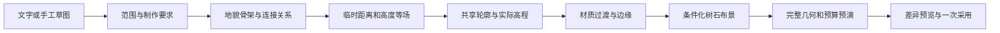

# 室外地形生成与双尺度地图设计

当前：T0–T7已有实现与历史技术证据；基础修复、T8开发基线、T9通用地貌组合、T10通用边缘/过渡、T11素材/条件布景、T12局部联动和T13代码/素材/算法冻结与技术回归已完成。真实地形AI矩阵、用户P3、UVTT真实导入和新冻结正式性能仍待M2-E。历史测试、首轮失败与复验集中见[地形历史台账](archive/terrain-validation.md)，不作为新功能通过证明。

## 下一阶段开发计划：从固定地貌样板走向通用地形系统（T8–T13）

本计划接在T0–T7之后，并在M2-E最终交付验收之前完成。目标不是再做一个“海岛生成器”，而是建立一套可组合的地貌骨架、边缘过渡、材质与布景规则，让海岛、河谷、森林、湖岸、丘陵和混合场景共用同一套稳定、可编辑的地形能力。**群岛是用来检验多陆块、海峡、水面与岸线联动的代表样例，不是系统的唯一题材。** 本段只安排工作，不代表实现、性能或审美验收已通过。

当前顺序为：**模型连接、思考程度与超时调度等基础修复及必要小规模验证 → T8–T12开发 → T13代码/素材/算法冻结与技术回归 → M2-E完整AI、视觉及交付验收 → M3**。T9–T12仍会改变地形、边缘、水面、素材和AI工具，各阶段只做相关测试与少量样图检查；完整Q4和最终视觉验收在T13冻结后集中执行。

| 阶段 | 工作与实现路径 | 可审阅交付与退出条件 |
|---|---|---|
| **T8 样片、容量与严格版本合同** | 先冻结三个中性样片：群岛海岸、森林河谷、草岩丘陵；共同确定世界尺度、轮廓误差、材质比例、光向、实体占地和视觉层级。将工作台尺寸入口开放到当前生成器已接受的范围，并逐尺寸测量网格点、候选成本、内存、生成/预览时间。新持久语义先定义完整严格版本和迁移/原件保全方案；当前256项实际展开上限继续生效，不能靠拆批、只计部分字段或假设预算扩大。 | 三类基线样片及中性图/效果图齐备；有可复现的尺寸与资源预算表；任何新增字段、渐变或材质资源都有版本、读写、冷读和失败保全设计。若容量数据不支持某档尺寸，先下调公开范围。 |
| **T9 通用地貌组合与多岛骨架** | 将主陆块、岛链、湖盆、河谷、山脊、林区、空地和活动区表达为稳定身份的显式特征；在现有有界场上组合结构场、多尺度岸线细节和局部域扭曲。表达海面/浅滩/岸带、低地/台地/高脊等真实层次，不能只叠颜色。按目标陆地占比选全局等值阈值只用于新候选；局部重生成冻结已采用阈值，避免其他区域漂移。若用户指定岛数/湖数、最小面积或海峡宽度，必须检查实际连通分量与几何，无法满足就报告冲突，不能以颜色区块冒充实体。 | 群岛、森林河谷、内湖/丘陵和混合场景在多组固定种子下都保持要求的大形、连接和活动空间；岛数/分量等硬要求要么得到真实满足，要么被明确拒绝。相同版本、输入和种子跨Node/浏览器产生相同规范化结果。 |
| **T10 通用边缘、岸线与水面过渡** | 以同一来源边界描述两侧表面类别、高差、方向及过渡宽度，统一处理海岸、浅滩、沙湿带、草岩交界、林缘、崖带、道路肩、凸凹角、窄口、河口与台阶/坡道开口。评估有界离岸/距离场，一次计算后复用于浅水色带/光晕、沿岸波纹笔触、湿润带及相关局部遮罩，再物化成可持久、可局部更新的覆盖或笔触。已有visual2/materializedEdges只覆盖现行支持子集；渐变、孔洞或额外效果若超出现有格式，须进入T8定义的新严格版本。 | 已完成开发基线：严格 v4 transition 物化、整数毫米量化、两侧材质/高程来源、墙/开口/物件遮罩、公开/GM 过滤、方端帽/miterLimit 2/bevel stroke、命中、局部 halo 刷新及 GM/player projection/Canvas 绘制已接入。定向 13 个文件 134 项、transition 6/6、视觉目录 30/30 和 TypeScript 检查通过；完整视觉与Q4仍留在M2-E。 |
| **T11 素材体系与条件布景** | 第一批视觉试制至少包含两个树种、三种岩形、一个可复用崖段和多种地表材质；这是校准样片，不是完整素材目录承诺。统一世界尺度、线重、配色、光向、根锚、物理占地、阴影与透明边缘；再扩展变体、分层点彩/裂纹/排线与地貌条件布景。效果层验证水彩基底、地表/边缘、地貌与植被、实体、环境色调/雾/滤镜的叠加次序，并复用53已有雾、光和滤镜，不另建重复效果体系。用户图层顺序、Floor、地面高程和纯绘制顺序分别处理；渲染层内按根锚/确定性次序处理遮挡。缩放和LOD不得重撒、增删实体或改物理占地。除非另行确认，继续用原创SVG/程序绘制及现有本地栅格化流程，不接生图API。源、固定派生、实际PNG、许可与来源链一起验收。 | 已完成开发基线：`src/shared/visual/scenery.ts` 在 scatter-cell-v1 上审计固定定义/图片资源/世界范围/物理占地/支撑Floor，准备克隆候选并保留 manual/deleted/detached/locked 成员与排除区，采用前复核 revision、来源和候选hash；`orderSceneryProps` 固定 ground/object/canopy、renderOrder、y、ID 次序。近侧视固定源与地影合同继续复用 appearance2。开发定向 54 项、共享无DOM 117模块、正常生产构建通过；`tests/terrain-presentation.spec.ts` Chromium 2/2 完成保存冷读与GM/player实际PNG。完整素材目录、视觉回读和P3仍待T13/M2-E。 |
| **T12 局部联动与手工/AI创作闭环** | 把地形骨架、共享边、过渡、材质和布景的读依赖/写范围显式化，定义局部计算的依赖halo与稳定身份；单次边界编辑只重算关联内容，保留手工移动、删除、退出管理、锁定、范围外对象与资源。手工和AI共用候选、差异、预算、冲突诊断、完整重放、保护点/CAS、一次采用/撤销。AI先用确定性本地夹具和必要的小规模真实渠道探针验证权限、预算和失败；完整Q4创作与局部修改留到M2-E，未知计费状态不自动重试。 | 已完成开发闭环：依赖报告覆盖过渡来源/clip/reach、同Floor结构遮罩、材质/许可、固定布景源与资源、generation5 依赖和完整 `sourceInputHashes`；局部候选只刷新 halo 内散布成员，保留范围外/手工/锁定记录并以保护凭证绑定；工作台提供 v4 预览/采用/取消，AI `terrainLocal` 与 `terrainEdit` 共用严格候选入口。定向工作区/核心/AI 21 项通过，`check:shared` 118 模块通过，类型检查通过；完整Q4、视觉回读和全量回归仍留在 M2-E。 |
| **T13 整合、回归冻结与M2-E移交** | 将尺寸、组合、边缘、素材、局部编辑和AI入口合并到统一工作台；收敛用户文档、任务/资源版本、样片与测试夹具。冻结代码、素材和算法，建立唯一指纹；执行与本轮变更对应的技术回归、类型/构建和关键生产冒烟检查。全量回归、完整Q4、视觉回读、用户P3与正式性能在冻结后统一进入M2-E，不在开发阶段提前完成。 | 已完成：`work/terrain-t13-freeze/manifest.json` 固定 572 个输入条目，`freezeSha256=2469417905a1fb5fc2c8eb600df8eb3fdf3c8ebc0d743fdf6e0e846bfae7ea6c`；29 个相关 Vitest 文件 292 项、118 个共享模块、类型/构建和正常生产冒烟 17/17 通过。已移交本文最后的 M2-E 验收入口；完整Q4、视觉回读、P3、全量回归、UVTT与正式性能仍未关闭。 |

### T8开发基线（2026-10-28完成）

三类48×36m校准夹具为群岛海岸、森林河谷、草岩丘陵，各有中性/效果完整v3工程与GM/player 2048px PNG；它们使用明确坐标和现有固定源，**不是T9通用组合算法的产物**。冻结整数毫米、135°光向、水/草/岩3200/2500/2400mm贴图尺度，固定实体原占地与支撑。群岛有3块真实独立陆地、岛间水带≥4000mm；河谷使用实际阻挡水面；丘陵有800→2600mm高差和1600mm宽实际坡道。直线多边形参考误差为0，边界采样配置20000/30mm；不外推为通用曲线误差承诺。中性/效果只切换边缘与环境，物理内容一致。

工作台开放24×18、36×20、36×36、48×36、120×90m预设及当前核心已接受的整数毫米自定义尺寸（宽24–120m、高18–90m、宽高比1–1.8）。7类地貌×8档尺寸、固定seed `terrain-v1-0`的56组开发容量检查通过；最大和不规则尺寸另有8组Node/真实Worker规范hash一致证据。单笔256上限不变，两档海岸已恰好触顶；没有放开密度，也不保证任意种子/尺寸/路线组合都能成功。超预算继续拒绝，不能拆批。

后续完整4/scene4、generation5、visual3、identity3、appearance2的首批精确合同冻结于[04](04-scene-document.md#terrain-t8-contract)，独立副本、全scope原件及冷读/失败保全归[06](06-storage-and-export.md#terrain-t8-storage)。T8未启用v4读写器；新记录、离散常色过渡与迁移将在后续阶段实施，未定义的连续渐变、带孔环和appearance3继续拒绝。当前格式/保全/候选失败安全相关40项单元、T8两项浏览器及正常构建/类型通过；数据、方法、首轮失败和复现见[地形台账](archive/terrain-validation.md#t8-20261028)。

少量样图复核已记录树石偏稀、纹理重复明显和崖带生硬，后续按T9–T11处理。该基线不关闭完整Q4、视觉回读、用户P3、正式性能或M2-E；本轮停在T8。

### T9开发结果（2026-10-29完成）

T9新增严格完整 v4/v5 组合路径：稳定特征身份、确定性多尺度场、冻结 land/elevation 阈值、真实多分量/面积/水道要求、海面/浅滩/岸带/低地/台地物化、完整依赖与身份输出回执。Worker 结果在主线程按同一纯算法重放；候选采用沿完整资源校验、一次性保存、冷读与取消/失败保全路径，v4 预算计入七类身份池、八类 appearance 记录、固定来源描述与重复快照几何，超过256整笔拒绝。组合生命周期在输出、依赖、外观或人工变更时暂停并保留冻结输入/原回执；恢复分配新拓扑身份时同样暂停受影响组合。

开发期定向验证：组合契约/字段/生命周期/要求/成本/客户端与完整事务共 71 项，旧地形/迁移相关回归 79 项，类型检查、共享边界和生产构建通过。串行 Chromium 开发检查以四类预设（群岛、森林河谷、草岩丘陵、浅湾台地）和三种固定种子运行 12 组，全部通过；实际成本 231–252/256，代表包导入哈希、隔离 IndexedDB 冷读哈希一致，四类各导出 GM/player 1024px PNG。证据保存在忽略目录 `work/terrain-t9-run3/`；这不是正式性能、完整Q4、视觉回读或用户P3结论。

### 实施约束与参考边界

- 随机性沿用本项目已有的确定性keyed流，继续下沉到稳定特征、边段和世界格用途；不能用调用顺序或数组下标决定其他岛/树/石是否移动。对已采用局部修改固定全局阈值和未受影响片区的输出。
- 场景地图和区域地图继续分开保存物理含义。陆地外观、浅水晕、树冠、阴影、滤镜、图符不能改变高程、支撑、实体占地、净宽、秘密过滤或实际通行。可通行要求必须由真实支撑、障碍、连接和完整净宽验证。
- 任何自动布景仍是具名且可编辑的成员，持久保存完整结果与人工覆盖；缩放只影响显示。局部差异写集不得遗漏关联资源、附着或玩家投影依赖。
- 外部仓库只用于独立算法研究： [civ-atlas `tectonics.ts`](https://github.com/guaner-334/civ-atlas/blob/ff42853a62f0eb0a720c8305f568768b7c371fcb/src/gen/tectonics.ts)、[civ-atlas `common.ts`](https://github.com/guaner-334/civ-atlas/blob/ff42853a62f0eb0a720c8305f568768b7c371fcb/src/render/common.ts)与[Nortantis `MapCreator.java`](https://github.com/gjhhust/nortantis/blob/2b6a6b732fc16eb43b60d6e952d53d5e8db9e5c3/src/nortantis/MapCreator.java)提供可研究的算法思路；这些仓库为AGPL-3.0，本项目为MIT。这里只吸收数学/算法思路并在本项目独立实现，不复制代码或素材，不把外部实现的视觉近似、跨设备断言或性能数据视为本项目证据。
- 本计划使用“方案/待实施”措辞。改变严格文档、生成算法、视觉派生格式、固定素材来源、资产预算或公开范围前，先更新04/06/14/15及相关实现合同；验收按[09](09-quality-plan.md)执行，性能边界按[34](reference/performance.md#doc-34)记录。

本文定义54之后的一项独立能力：让手工和AI共同使用地形生成器，制作自然、可编辑、可局部修改的室外地图。场景地图为主，区域地图为辅；区域选区可以生成独立关联场景。第1–16节保留完整目标设计；第17–20节记录实际支持范围与限制，运行结果移至历史台账，不把未执行的验收矩阵当成功能或性能结论。

设计阶段与[54：参考图质量提升](54-reference-quality-plan.md)并行，最初只新增本文。用户随后授权T0/T1，现已在54完整v2基线上集成新严格v3，并同步01–07/09/11/14/15；独立todo.md及54/34验收记录保持。正式性能运行退出后才开始本批测试与集成，54的渠道结果及v2性能数字不作为地形新功能证据。

## 1. 已确认的产品决定

| 决定 | 本轮用户确认 | 对设计的要求 |
|---|---|---|
| 地图尺度 | 尽量兼顾两种，以几十米至数百米的场景地图为主，公里级区域地图辅助 | 同一编辑产品、不同细节与语义，不能简单放大同一套素材 |
| 使用方式 | 手工与AI共用；文字描述或画大致范围，再生成和细修 | 共享确定性生成与候选采用；手工功能不依赖模型 |
| 题材 | 海岸、岛屿、河流、湖泊、森林、丘陵及混合场景 | 共用地形关系与生成步骤，配方按地貌组合 |
| 两尺度关系 | 选定区域生成关联场景，生成后各自编辑 | 保留确切来源与空间对应，不自动双向同步 |
| 冲突取舍 | 满足明确营地、路线等要求，其余区域自然生成 | 显式硬要求优先；无法满足时报告冲突，不暗中放宽 |
| 联动编辑 | 先预览变化，保留手工调整和锁定内容，冲突时提示 | 持久记录生成关系、人工覆盖与删除；范围外保持 |
| 手工工具 | 轮廓拖动及添陆、挖水、铺草、清出空地笔刷 | 同一草稿内预览，明确采用；笔画不是直接写工程 |
| 场景视觉 | 地面俯视，树略带侧面 | 地面距离不变；树根、图像、占地、遮挡分别定义 |
| 区域视觉 | 正面树、山形等地图符号 | 图符表达地貌，不代表真实单株、建筑占地或人物通行 |

以上为用户决定。后文的算法选择、格式、默认参数、阶段安排与测试矩阵由本设计提出。没有待用户回答的阻塞性产品问题；后续通过样图审阅确定具体素材品质，不在代码实现过程中重新改写上述决定。

## 2. 要解决的问题与成功体验

当前室内的直墙、板材、家具排列符合人造空间的规律。室外即使使用曲线和纹理，若大轮廓接近同心圆、过渡等宽、树石均匀重复，仍容易显得由色块与摆件组成。

本功能补充四种关系：

1. **大形有组织。** 海湾、岬角、高台、低地、河流和活动空间形成明确构图，变化有尺度和主次。
2. **地表有联系。** 湿沙与岸线、裸岩与陡坡、植被与湿润和避风区域相关；相关关系属于可编辑规则。
3. **布景有条件。** 树簇、石群、沿岸细节依地形分布，同时保留营地、路线与视觉留白。
4. **修改可持续。** 改一段岸线时预览相关过渡和自动布景；已移动的树、已删除的石头、锁定建筑保持其人工语义。

目标旅程示例：用户描述“林中河湾，东边高坡，西边留营地，两岸经浅滩往来”，或者画出河线、坡地和营地范围。系统给出有差别的可编辑候选，标明路线与地形关系。采用后，用户移动一棵树、删除几块石头；再扩大河湾，只重做相关范围，人工成果保持。若营地被新水面侵入，候选显示冲突，主工程保持原样。

成功不由素材数量或噪声复杂度决定：中性环境下地形应有自然形态和空间层次；需求对应真实实体与约束；完整工程可以离线重开和逐件修改；同一限定输入可复现，局部修改可解释。

## 3. 当前基础与新增边界

2026-10-26只读核对以下实现。表中“已有”仅指源码中存在相应路径，不外推54未完成的验收。

| 能力 | 当前基础 | 本轮设计新增 |
|---|---|---|
| 地形与高差 | `TerrainArea`简单环、离散高程、实际支撑、台阶/坡道 | 有地貌关系的生成、笔刷布尔操作、局部依赖更新 |
| 曲线与边缘 | 共享三次曲线、确定性采样、shore/cliff等连续表现 | 宏观地形骨架、多尺度细节、可变过渡、明确物化的边缘结果 |
| 材质 | 世界比例铺装、不规则覆盖与羽化 | 按距岸/地形等条件生成覆盖，并保存持续关系 |
| 布景 | 完整Prop、固定定义、散布成员及人工记录 | 地形条件化密度、树簇/石群、可控近侧视素材 |
| 布局候选 | [composition-candidates.ts](../src/shared/ai/composition-candidates.ts)中的固定锚点与0/1变体 | 多种构图骨架与参数组合，不仅偏移或镜像 |
| 几何诊断 | [island-composition.ts](../src/shared/ai/island-composition.ts)检查既有轮廓 | 分层诊断、完整约束结果、有限可行路线搜索 |
| 通行 | [terrain-travel.ts](../src/shared/geometry/terrain-travel.ts)检查一条明确直线的完整净宽 | 有界折线路线建议，以及转角/连接的连续走廊验证 |
| 编辑与AI | 原子候选、隔离草稿、保护/CAS、单调revision、256展开 | 复用该入口；新生成步骤按实际展开计费与校验 |
| 数据 | 完整v1/v2、SceneDocument1/2、visual1 | 新严格版本承载双尺度、生成关系和新的素材/边缘表现 |

范围不包含可旋转3D、连续可行走高度网格、上下叠层、无限世界、真实流体/侵蚀模拟、实时战争迷雾、生图API、卫星图/GIS导入。洞穴、地下系统、沼泽、雪地、火山等专用题材留后续配方；本轮不得以换颜色宣称这些题材已完整支持。新增桥梁和跨层桥洞也不是本轮默认通路能力。

## 4. 双尺度产品模型

### 4.1 场景地图

完整目标默认24×18m，建议使用20–300m范围，后续生成长边保护目标为500m；**当前T1界面固定24×18m，核心输入仅接受24–120m宽、18–90m高及1–1.8宽高比，不承诺范围上限都能生成成功。**单位仍为整数毫米，显示m/ft与网格沿用现行设置。已有更大合法工程不因此被拒绝打开；超出生成范围时只禁用该范围的生成，用户可选择局部。

生成内容是具有真实支撑和物理含义的地形面、显式高差连接、道路、独立树石与材质覆盖。营地净空、人物路线、墙门和树木占地在这一尺度才承担米级检查。

丘陵以少量连续地形分区、离散高差与明确坡道表达。内部平滑高度场用于构图和表面权重，不自动成为可行走的连续坡面。候选必须显示实际采用的高程与连接；效果图不能代替这份物理结果。

### 4.2 区域地图

T5默认10×8km、生成长边0.5–50km。区域模式已接入同一工作区的Canvas2D、图层、历史、保存与PNG出口，编辑对象为区域级地貌面、山脊/河流/道路线、地标及符号；人物物理集合保持为空。当前独立下钻的真实资源闭包修复与有限物化边界见第20.4节。

森林由明确的森林区域与独立符号表达，不铺几万棵具有角色占地的Prop。道路说明区域之间的联系，不证明某个1m人物能通过。河流可以有汇流关系及宽度等级；图上河宽允许制图夸张，真实宽度估计与画面宽度分别保存。

两种地图的模式在新建时确定，不能在同一工程中切一个开关便把区域图符解释为场景实体。模式转换通过明确的独立工程创建；保留来源，先保存新工程再切换。区域模式的物理场景集合必须为空，防止“区域道路”误进人物通行检查。

### 4.3 缩放与生成密度

平移、缩放、窗口尺寸及4K导出不会重新生成地形或物件。区域图符的布局与尺寸在采用时固定，预览和导出使用同一世界映射。视口细节裁剪只属于显示优化，不能改变保存结果、命中实体、物理数据或PNG完整内容。

场景与区域共用地貌输入语言，使用不同精度和素材配方。区域图继承“哪里有森林”，场景图生成“林缘、树簇和林间空地”；它们不会要求每一个区域树符对应一棵场景树。

## 5. 视觉方向、素材和空间可读性

### 5.1 场景的统一视角

地面采用正交俯视，世界+x向画面右、+y向画面下。默认地图上方为北。树木观察方向固定从地图南侧朝北，略露树干与树冠侧面；岩石露少量侧面，崖壁朝向由实际边界法向与统一表现方向决定。光照方向独立于观察方向，不以移动树木或旋转资产改变世界光向。

延续54的二维手绘、材质世界比例与克制氛围基础。新的近侧视树、岩石和区域图符采用新固定源/版本，旧树冠素材与已有工程原样保留。样图先关闭雾、暗角和环境染色，检查地形与素材本身。

### 5.2 树根、图像与占地

每种近侧视素材至少具有：实际源图和许可、树根锚点、世界图像范围、物理占地、绘制带、接触阴影锚点及固定观察模式。

- `Prop.positionMm`继续表示真实地面定位，近侧视树以树根为定位基点；图像范围可以向北外扩。
- 物理占地和阻挡独立定义，不把整张树冠图片当树干，也不因树冠透明区域扩大可通行范围。
- 首批近侧视树的图像与自身物理朝向均固定，实例`rotationDeg=0`，普通面板不提供会使树侧倒的图像旋转柄，也不接受单独旋转树占地的隐式操作。需要明显不同树形时选择真实固定变体。
- 旧俯视素材仍按原有旋转语义绘制。不能全局改`rotationDeg`导致旧家具、树或占地改变。
- 近侧视定义首批使用以树根为中心的保守矩形占地，其轴向固定在世界坐标，不把中心对称误当作旋转不变。组合旋转时绕组锚点移动树根，树图像与占地轴向保持，重新验证移动后的实际占地；预览明确这一素材规则。该行为由新定义的旋转策略和新组合命令共同执行，不改旧素材/组合语义。以后如需独立物理朝向，须另定义匹配图像与占地的严格变体合同。
- 选中时显示树根十字及占地线，图像轮廓继续支持命中；重叠点选允许循环选择或对象列表定位。图像外扩不改变实体真实所属地形。

新的visual版本提供固定朝向素材模式及根锚排序规则：先服从地面/物件/冠层带，再遵守用户层顺序和显式renderOrder，允许的同带同层范围内按树根y、稳定ID排序。不能为了前后遮挡悄悄跨图层或跨秘密绘制。

原有alpha阴影若将直立树图当成一块倒伏轮廓，会产生错误接触关系。新近侧视素材使用固定根部接触影与独立地面冠影形状，投影沿世界光向；这属于新模式，不替换旧alpha阴影语义。

### 5.3 遮挡与输出

默认构图同时检查“物理净空”和“重要区域的视觉遮挡”：树干不堵路之外，树冠也不应完全盖住入口、台阶或明确活动区。视觉净空是可调制作要求，不赋予通行含义。

编辑器提供“查看地面”暂态显示：淡化/隐藏冠层的视觉部分，保留树根标记和必要选区，不写工程、不创建历史，也不影响玩家秘密。首轮正式PNG保持正常表现；若需制作无冠层地图，用户在独立副本中明确编辑后导出，不把暂态查看状态偷偷带进导出。

区域地图的树、山和地标符号使用正面画法、统一竖直方向。符号尺寸与制图显示范围分开于任何真实尺度；不创建碰撞或高差。森林/山地区域是范围权威，图符仅为表现。

### 5.4 首批素材交付

复用54已验证可用的地表材质、许可和固定资源。新增近侧视素材至少覆盖三种真实树形、两种岩石形体及适配林缘的灌草；区域增加树丛、丘陵/山脊和通用地标符号。具体数量是首轮制作范围，不是视觉通过条件。

每种素材保留原源、规范化源、实际PNG、hash、确切许可、真实世界图像范围和锚点。生成器只能使用工程中明确可用的固定定义。缺少变体时给出缺项，不用颜色或旋转冒充新形状；缺图或像素校验失败仍整笔拒绝。

## 6. 用户交互

### 6.1 新建与候选

1. 选择场景/区域、尺寸和题材。手工可用模板参数或草图；AI将自然语言转为同一输入卡。
2. 指定需要的岸、河、坡地、森林、营地、入口与保留范围。普通面板展示自然度、起伏、植被疏密和细节量；种子、采样精度在高级选项。
3. 完整目标生成默认两个、最多三个候选；当前T1每次一个，五个固定种子逐份查看。候选之间变化应体现海湾/高台/活动区位置等构图，不能仅换seed后得到近似镜像。
4. 并列查看全景、中性图、地形结构、活动区与路线检查。候选卡显示已满足、未满足、冲突和实际展开成本，不给自动“美术评分”。
5. 选择一个候选后进入差异预览；采用前主工程不变。新工程先保存成功，再切换工作区；已有工程沿保护点/CAS一次采用。

生成、候选切换、取消都不消耗撤销历史。对现有工程的一次修改采用形成一个撤销单位；当前T1另存独立新工程的采用不属于原工程撤销历史。预览“两个候选”不代表先后采用两次；取消释放Worker和临时字节。

### 6.2 四类笔刷

| 笔刷 | 改变的内容 | 默认保持 |
|---|---|---|
| 添陆 | 增加指定地形面范围，明确材质/高程；岸水关系随候选更新 | 现有人工物件、建筑、锁和秘密 |
| 挖水 | 将指定范围设为水域或扩展已有水域；明确是否与已有河湖相接 | 高程/排水冲突需显示，不能自动挖穿建筑或悬空物件 |
| 铺草 | 生成/调整草地材质覆盖；可另选增加草类布景 | 不默认改变高程、阻挡、支撑或树木 |
| 清出空地 | 添加持续保留区，移除该范围内允许重做的自动植被/石头 | 人工和锁定内容不自动删除；不默认整平地形或填水 |

笔刷有世界单位半径，压力只影响半径/强度的显式选项。默认不要求压感设备。落笔产生会话草稿，抬笔后计算完整候选；可以在采用前继续同类笔画，形成一笔有界事务。Escape取消未采用草稿。触控、鼠标与键盘数值输入使用同一候选合同。

笔画输入按世界坐标重采样与量化，不能因帧率、视口缩放或设备采样率不同改变已保存结果。原始指针事件不作为唯一存档；规范笔画/约束与完整物化结果一起保存。

### 6.3 局部修改

轮廓拖动、笔刷、参数和AI修改都进入同一“本次影响”预览。列表分为实际写入、保留的人工内容、只读依赖、需要解决的冲突；只在有意义时显示技术细节。

常用动作包括“只改轮廓”“轮廓及相关过渡”“连同自动布景重做”。默认采用相关过渡与允许联动的自动布景，保留人工内容；不把默认选择当作编辑未授权对象的权利。实际写入超出冻结范围时先生成扩大范围的候选说明，由用户明确重新选择范围。

冲突可选择回退该段地形、调整保留区、明确移动/重绑相关人工物件，或取消。没有自动“删除所有冲突物件”的兜底。锁定内容需要单独解锁后重新预览，不能在同一生成事务里解锁再写入。

## 7. 生成管线与算法选择

采用**地貌骨架、约束、临时场、确定性几何及条件化布景**的组合。AI负责意图与选择；噪声提供局部变化；几何规则负责实际可采用结果。

### 7.1 输入与阶段顺序

输入包括地图模式、世界范围、题材组合、地貌骨架/锚点、明确活动区、路线端点与净宽、锁定/人工保留范围、固定素材、风格配方、种子和算法版本。

约束优先级为：有效授权/锁/秘密及完整文档规则 → 用户明确的硬要求与人工保留 → 原有有效连接和支撑 → 地貌合理性 → 视觉软目标。两个硬要求矛盾时拒绝候选，不通过降低另一个要求取得“成功”。

局部修改先从当前实体读取真实几何及人工状态，不能以旧seed重建整张图后截取一块来覆盖。

### 7.2 地貌骨架

骨架由有稳定ID的面域、主轴、边界端口与关系组成：陆地/水域、山脊/谷线、河流网络、林区、活动区以及连接。

首批配方构造不同骨架，而非维护一个固定轮廓：岛屿包含偏置高台、岬角、海湾与可登岸位置；海岸包含主走向、局部凹湾与突出礁岬；河谷包含主河、谷地、坡地和渡点；森林包含林缘、聚集核心与空地；丘陵包含脊线、缓坡分区与通路。混合场景用同一骨架连接这些要素，不能把独立小模板硬拼出接缝。

每个候选最多进行四轮确定性修正，按固定顺序处理几何、硬约束、预算和软目标；到界仍不合格则返回具体未满足项。没有不受限的随机重试或后台付费补救。

### 7.3 临时场与多尺度变化

生成过程中建立有界网格上的距岸、相对高程、坡势代理、湿润权重、植被密度和保留权重。它们是候选计算中间数据，不进入工程成为另一份几何权威，也不直接进入玩家投影。

大形先由骨架与活动区决定；低频变化调整宽阔凹凸，中频变化形成岩台与林缘，小尺度变化用于材质边界及装饰。小变化不能超过局部最小通道宽度和曲率安全范围，不能在所有轮廓上均匀抖动。

首版使用固定版本的格点value noise、平滑插值和有界坐标扰动；三档频率/幅度由配方给出。Perlin/Simplex可以成为后续独立版本，但不作为“自然”的充分条件。坡势/湿润权重是制作启发式，不宣称地质或生态模拟。

随机子流以`seed + featureId + stage + channel + worldCellKey`命名，使用固定hash算法。改变一处林区密度不会重排其他海岸和石头的随机序列。

### 7.4 从场到可编辑几何

使用确定性marching squares提取等值轮廓，明确鞍点判定、闭环方向和并列时的固定顺序；随后进行带最大误差的简化与三次曲线拟合。端口、保留区边界、连接落点及人工控制点为硬锚点，不参与任意平滑。

最终控制点为整数毫米。共享岸线只保存一个控制源，两侧地形从同一固定采样结果构造；不得分别平滑出两条接近但不相同的岸。拟合后再次验证自交、窄缝、岛屿包含关系、实际支撑及路线。

网格精度只决定候选近似；不足以表达明确小特征时，局部提高精度并重新预演。超出预算则提示该特征无法在本次精度内表达，不能吞掉狭窄浅滩或把两块陆地意外合并。

为保持跨Node/浏览器可重放，生成器的噪声插值、网格阈值、平局排序、量化和拟合迭代次数固定；关键整数几何方向/交点谓词使用不会溢出的整数路径，必要时用BigInt。实现禁止依赖Math.random、时间、DOM排序或Canvas读像素决定几何。对外以完整候选规范化hash和固定测试向量验证确定性，不承诺不同渲染引擎的抗锯齿逐像素相同。

### 7.5 孔洞、分裂和合并

继续以简单地形环为实际场景输出。湖中岛、陆地内湖通过显式水/陆分区和覆盖关系表达；复杂布尔结果先拆为合法简单分区。覆盖优先级由无环地表关系推导并物化，不能无限叠加遮盖来规避自交或支撑验证。

添陆/挖水可能产生多个连通分量。候选明确列出新增、删除、分裂和合并；不静默丢弃小岛、小孔或把它们填平。很小的无意碎片可提出删除建议，只有不违反硬要求且用户采用相应候选才删除。

分裂/合并属于拓扑变化。新的部分获得新出生身份，旧附着、注记、连接和人工成员逐项处理；不能按“最近点”暗中重绑，也不能仅保持同ID来声称连续性。超出当前有限恢复支持时，保留完整快照恢复路径并明确局部恢复限制。

### 7.6 河流、湖泊和区域水系

区域水系从高地/谷线及明确进出端口生成有向汇流图。普通河流支线合入下游，出口落入湖、海或地图边界；内流湖必须明确标识。临时高度场可用有界priority-flood处理数值洼地并给出排水候选，但不能自动消除用户指定湖泊。首版不生成河流环路、河道跨山或无解释分流三角洲。

场景河流首先服从指定河道与边界端口，在有限范围内生成双岸与河宽变化。水域保存实际阻挡与高程；河岸、浅水和湿润带另有视觉规则。高程突变若需要瀑布/特殊连接而配方不支持，返回未支持项，不用颜色伪造物理落差。

浅滩是显式通行要素：生成具有真实可步行支撑、宽度和移动代价的浅水地形分区，检查两岸接入，必要时增加合法坡道。不能在阻挡水面上画一条Path便解除水域阻挡。桥梁需求首版报告未支持；可调整渡点或保留用户已建的合法结构，不生成假桥。

### 7.7 路线与活动区

活动区保存明确世界多边形、用途、最小净空及是否必须有同高可站立地面。仅要求“清掉树”不会自动平整高差；营地若声明需要平地，先满足真实地面再布景。

路线建议使用有界网格A*，节点代价来自真实支撑、障碍、高差连接及用户偏好，确定性平局排序。水域与不可跨越高差为硬禁止，窄于要求的连接不可通行。最终输出有限折线，不把网格中心路径直接视为通过证据。

验证对完整净宽走廊及转角连接区执行实际几何覆盖检查，复用现有直线检查并新增弯折处验证。要求通行的起终点、门状态、连接宽度和检查模式写入结果。搜索失败只表示在本算法/预算内未找到合格候选，不声称数学上不存在其他路线；没有运行完整检查时不得显示“可通行”。

区域道路只检查地貌图中的连接与交叉关系，不调用场景人物净宽证明。桥/渡口等区域符号仅作为下钻需求，不保证生成场景时已支持对应结构。

### 7.8 材质、过渡与崖面

海岸带宽根据局部配方、距岸和暴露方向变化；草岩覆盖根据地貌区域、坡势代理和有限噪声生成，保持大块分布与局部破碎。干沙、湿沙、浅水、裸岩和草地使用明确材质与真实tileSize，不在渲染时拉伸整块纹理冒充复杂地表。

曲线驱动的变宽过渡在候选阶段物化为明确覆盖多边形及边缘笔触。视觉边带、物理地形、附着连接来自同一边界和版本参数；渲染阶段只绘制已保存结果，不重新推导一套随机几何。

崖面宽度采用显式、受限的高差到显示宽度映射，记录映射版本与上下限；这是制图表现，不是可站立面积。统一处理凸凹角、闭环与坡道开口，阴影不穿越玩家遮罩。旧visual1崖面保持原语义。

### 7.9 条件化布景

采用固定世界网格的候选key和分通道hash，以密度场控制接纳；簇中心决定主要聚集，簇内用最小间距及真实占地筛选，避免全图均匀散点。树、灌、石、碎屑分层次生成，每种有独立密度和形状变体权重。

候选权重可以依赖距岸、地形类型、湿润代理、坡地、林缘以及路线/保留区。先保留大形和活动空间，再安排主体树石，最后少量细节。视觉树冠与物理占地分别筛选，合理冠层重叠可允许，入口遮没不可被忽略。

新算法命名为`terrain-scatter-v1`，不改写既有`scatter-cell-v1`输出。成员只由一个散布组管理；生成关系引用该组，不再建立第二份Prop成员所有权。完整成员、候选key、定义版本和人工记录随工程保存，加载从不重撒。

## 8. 持续关系、人工保护与局部重生成

### 8.1 保存结果，也保存可继续编辑的关系

采用后，真实曲线、地形、材质覆盖、边缘几何、Prop和区域图符是渲染与导出的权威。生成配方和依赖图说明这些结果如何产生、哪些字段可以联动；配方不会在开档时覆盖实体。

依赖图按有向无环图保存，例如：岸线 → 湿沙覆盖/浅水边带 → 沿岸散布组。每个规则节点有固定算法版本、输入实体及字段、参数、输出实体及字段、状态和最近采用的输入/输出hash。检查重复输出所有权、循环依赖、悬空引用与跨Floor。一个实体可以被多个规则读取，同一字段组只能由一个规则写入。

几何、材质、布景、图像表现采用独立字段组。把树染色只保护其外观，不应意外冻结整片森林；手工移动树则保护位置与相关支撑。若字段之间有必要耦合，例如新图根锚影响图像范围，预览必须把完整耦合组列明。

### 8.2 管理状态

| 状态 | 含义 | 重生成行为 |
|---|---|---|
| managed | 由当前规则管理，未被人工改写的字段 | 在明确影响范围内可重算 |
| manual | 用户修改过的字段；实际值只在实体中保存 | 保持人工字段，其他字段按耦合规则检查 |
| deleted | 用户主动删除过的候选或规则输出 | 保留候选key和删除/排除，不因换密度复活 |
| detached | 已退出规则管理 | 保留普通实体及永久原key抑制，不再由原规则更新 |
| locked | 实体或所在层锁定 | 当前值及必要语义保持，需写入时拒绝候选 |

前四项为生成记录，locked沿用既有实体/图层锁，不复制第二份锁状态。Prop管理直接使用ScatterGroup已有成员与人工记录；规则图只管理组及其依赖参数。

从普通属性面板、拖动、复制、删除、局部恢复或AI明确编辑进入同一记录入口。用户在草稿中直接编辑一个生成物件，也产生manual标记；模型不能用底层命令绕过人工保护。复制生成物件默认成为新独立实体，原规则不取得对副本的管理权。

人工删除保存稳定候选key与世界排除范围；密度、形状或种子变化不清除这些记录。更换seed属于明确“重建自动部分”，保留人工/删除/退出与锁。清除排除记录需要单独显式操作并预览会复活哪些内容。

### 8.3 局部计算范围与写入范围

选择区域后，系统计算：根修改范围、受依赖影响的实际写入集合，以及用于边界衔接和间距的只读外扩区。外扩区半径至少覆盖相关过渡宽度、笔刷半径、布景间距和视觉外扩；不能只用对象中心点判断范围。

计算可以读取授权内的邻域，但仅提交已批准的写入字段。边界处固定现存端口、切线和世界采样相位，避免局部重做在边界产生折痕或重复图符。变动沿河流上下游传播而超出范围时，列出扩大范围要求；不静默改全河，也不强行截断出不一致结果。

新布景仅在局部可写区域内竞争，范围外现有成员作为固定间距障碍。稳定世界key防止局部插入造成全图候选顺序变化。无法兼顾接缝与锁定内容时返回冲突。

范围外**文档字段与资源引用**必须保持；其像素可能受声明的阴影/冠层外扩影响。验收使用明确的视觉影响包络，不能笼统要求实体边框外所有像素都不变。

### 8.4 支撑冲突与规则失配

人工物件保持位置不表示允许它失去支撑。若新河岸吞掉树根、台地移出建筑、坡道端点不再落在合法表面，候选失败并保留主工程；可提出调整地形、明确移动物件或重绑合法支撑的替代候选。

严格导入若发现实体结果与已保存受管字段hash不一致，应拒绝该损坏包，不能自动改规则状态后当作导入成功。正常手工编辑或历史恢复在提交前更新人工字段、规则状态及相关hash；无法保持有效关系时必须在同一候选中明确停用/脱离该规则，完整实体保持有效后才可保存。不能在加载时偷偷“修复”为seed生成结果。

算法实现缺失但格式可识别时，保留完整结果的查看、保存和导出，以及不破坏物化结果/支撑一致性的手工操作，禁用相关重生成。改岸若使已存materializedEdges的输入hash失配，不能仅暂停规则便保留失配边缘；必须在同一明确候选中以受支持方式更新，或显式拆离为无持续绑定的可编辑装饰，并完整检查物理依赖与预算，否则拒绝该修改。不执行项目内携带的代码。未知数据格式仍严格拒绝，不套用“结果可读”放过未理解字段。

## 9. 区域选区生成独立场景

### 9.1 创建流程

区域图中框选矩形 → 显示所选世界尺寸和主要地貌 → 选择场景范围与可用素材 → 确认继承的河流/道路端口、林区和地标要求 → 生成场景候选 → 完整校验并保存独立工程 → 切换。

首版采用轴对齐选区；场景坐标原点设为选区西北角，保持方向、距离和1:1实际长度，仅做平移。区域选区500m以上时要求缩小选区，不把数公里土地压成几十米场景。用户可以指定选区内更小的落点，不能以自动缩放掩盖这一选择。

区域图上的夸张符号尺寸不会成为场景树或建筑尺寸。场景采用实际河宽/高差提示；若来源只有宽度等级或估计值，预览给出所用数值和估计状态，用户可改。来源简化误差或地标位置精度大于本次场景所需精度时，显示位置的不确定范围，要求在预览中确认落点与端口；确认后的值成为本次固定输入，不声称从区域图恢复了不存在的精确地形。

### 9.2 继承的内容

- 海岸/河流在选区边界的进出口坐标、方向、实际宽度或宽度等级。
- 河流上下游、入湖/入海及允许渡点需求。
- 林区、陆地、坡地的大致范围和相对高程关系。
- 区域道路进入选区的位置、地标的锚点和用途。
- 用户明确选择的公开注记/需求；没有选中的GM注记和私密地标不进入场景生成输入。

进入场景时可增加局部弯折和细节，但固定端口及明确保留地标不能漂移。相对高程转换为场景的实际离散数值时列明默认值，并校验坡道/台阶。区域道路指定桥梁但场景阶段尚不支持桥梁时，列为阻塞需求，不能把桥图符算成已完成。

### 9.3 来源与独立性

场景保存`SourceRegionLink`：源sceneId/revision、仅供GM本机核对的完整父图contentHash、确切选区、空间平移、过滤后继承内容的快照/`publicInputHash`、当时素材与生成版本。完整父图hash与来源身份不进入模型回执、公开候选ID或玩家投影；只改变父图私密内容时，公开输入hash保持不变。快照只含必要且获准的来源字段，自包含，不能只存一个本机路径或数据库句柄。

父图不必写入反向链接即可完成创建；本地索引可根据子图来源显示“关联场景”，索引缺失不影响工程完整性。创建只原子保存子图，避免伪装为跨两个工程的数据库原子事务。

来源sceneId/revision同样仅留本机/GM完整工程，不发给模型。子包冷读验证自包含继承快照、publicInputHash及其实际资源引用；父图不在场时，完整父图hash只是保留的来源标识，不能宣称已复验父图全部字节。只有找到相应父图并完整校验后才能显示“来源原图已核对”。

父图后来改变，子图保持现状；可只读比较确切来源与当前父图并提示“来源已更新”。本轮不自动同步，也不提供一键无审阅合并。父图不存在时仍能独立编辑/导出子图，来源显示不可定位；重新导入同一来源可用hash帮助定位，但不恢复不存在的历史身份连续性。

## 10. 数据合同、版本与迁移

### 10.1 版本安排

以54的完整v2/SceneDocument2/visual1为基础，T0/T1已实现：**完整v3、SceneDocument3、visual2、HistoryIdentity2、AppearanceGraph2**；新增嵌入的`generation.version=1`和`regional.version=1`。后续T2笔刷记录、T-S06外围重生成和复杂拓扑分别显式采用generation2、3、4，保留旧版本的严格读取和已保存结果，不以运行时加字段猜测升级。

以上号码已核对未被并行批次占用，并写入严格解析器、当前/所选历史包、资源、身份、外观和主会话分派。旧完整1/2仍拒绝新字段，不降级丢弃新分区。本文v3指这一完整新合同，不指历史core/v3工作台。T4近侧视表现、T5区域绘制/下钻及T6作者范围已进入实现；真实UI与真实模型的验收边界见第20节，不能把结构可保存误报为全部验收完成。

新字段不能塞进当前`generationMetadata.summary`、素材tags、通用Note或任意JSON扩展。完整包、仓库、历史、AI重放、投影和主会话要同时理解新版本，不能只在前端面板保留状态。

### 10.2 SceneDocument3的新增分区

| 分区 | 持久内容 | 约束 |
|---|---|---|
| `mapMode` | `scene`或`regional` | 创建后固定；模式改变生成独立新工程 |
| `generation` | 规范输入、固定配方、规则图、人工字段/排除、来源、约束与状态 | 严格version1–4；笔刷、外围重生成和拓扑各有明确记录版本 |
| `regional` | 区域地貌面、线网、地标、图符及制图样式 | regional模式必填；scene模式为null |
| `visual` | visual2；旧语义基底与新物化表现 | 不把v3投给旧v2/visual1解析器 |
| 原物理集合 | 现有房墙门、地形、路径、Prop、组合等 | scene模式照常；regional模式为空，复用公共资源/图层/注记需新分派 |

所有坐标、半径与实体尺寸仍使用安全整数毫米；区域图公里显示只是格式化。生成器采用局部整数原点计算，并对平方/叉积做安全界检查；50km范围不能假设JS浮点的全部整数乘积都精确。

### 10.3 GenerationSystem1

以下为核心字段与语义，实施时逐项转成严格schema、负例和迁移测试；字段省略/未知值不得依赖运行时猜测。

| 记录 | 必需内容 |
|---|---|
| `GenerationRecipe` | id、固定recipeVersion、algorithmId/version、mapMode、seed、单位化参数、固定素材引用、几何精度配置 |
| `GenerationIntent` | id/floorId/visibility、世界范围、地貌骨架、规范笔刷约束、活动区、路线要求、保留区；不存完整私人提示词 |
| `GenerationRule` | id/floorId/layerId/visibility/editLocked、kind、recipeRef、带字段组的输入引用、输出引用、参数、状态、inputHash、managedOutputHash |
| `OutputOwnership` | 稳定outputKey、实体/嵌套记录引用、受管字段组、人工字段组、managed/manual/deleted/detached状态；实际字段值只存目标实体 |
| `GenerationExclusion` | 稳定key、世界多边形、原因、相关候选key及出生令牌；继承删除/退出，不凭坐标相近复活 |
| `TerrainConstraint` | id、硬/软、公开性、范围、类型、冻结参数；类型限活动区/指定路线/端口/保留几何/保留实体 |
| `ConstraintCheck` | 约束id、通过/失败/未检查、检查算法版本、所检输入hash和公开问题；源变化后过期，不能继续显示已通过 |
| `SourceRegionLink` | GM本机的源身份/完整hash、选区、平移、获准继承快照及publicInputHash、字段精度或估计状态；只读来源事实，公开投影不含完整源身份 |

持久规则状态为`active/paused/detached`，无隐式后台执行；active仅表示下次明确编辑可提出联动。`unsupported`与待处理冲突属于当前运行时能力/候选状态，不因为更换软件版本就在加载时改写文档。读取完整工程时检查依赖引用与管理hash，已采用的实体一致性继续全验。对人工字段从managedOutputHash的受管集合中剔除，但仍进入完整工程contentHash。

### 10.4 RegionalModel1

- 区域实体共用必填`id/floorId/layerId/visibility/editLocked`，仅同Floor引用；实体锁与所属用户层锁共同约束。所有区域实体进入完整实体/层归属登记、删除依赖及玩家投影分派，不能假定旧Prop分派自动覆盖。
- `RegionalArea`：稳定ID、公开性、层/锁、简单多边形、land/water/forest/hill类型、固定样式、可选相对高程/分类，不包含人物占地。
- `RegionalLine`：稳定控制点、river/ridge/road类型、固定宽度表示、实际宽度提示、端口、连通/流向引用、公开性/层/锁。
- `RegionalLandmark`：共用字段、世界锚点、用途、名称/说明、固定图符定义和可选所属地貌引用。
- `RegionalSymbol`：共用字段、固定源版本、世界锚点、固定图像显示范围、朝向模式、层序、管理key，以及明确的来源区域/线/地标引用；独立手工图符以null表示无来源，不借Prop的碰撞字段表达图符。
- `RegionalSymbolDefinition`：独立固定目录身份、源图/实际资源、根锚/显示规则、作者和许可；加入新完整包与个人库的主体类型白名单，不能借现有Prop定义名义省略图符合同。
- `CartographicProfile`：线宽/符号尺度/颜色/简化误差与固定样式版本。缩放不改该配置，显式调整属于普通事务。

区域面和线的关系按实际几何核对，地图符号可省略重复绘制但不能替代区域实体。通行按钮在regional模式显示地貌/路线连接说明，不产生场景级`pathChecks`结果。

区域实体的有效public/gm由自身与所有来源/地貌依赖取最严格可见性，图层锁约束写入；编辑时的层隐藏/独显仍为暂态，不改变玩家输出。图符依附的森林面或地标为GM时，图符不能因自身public而公开；秘密河段/地标不能影响公开河图、布局或符号避让。玩家投影先过滤区域实体与关系，随后才做排序、遮挡、公开间距处理与绘制，最后应用既有玩家遮罩。生成来源、父图身份及规则诊断仅留GM完整工程。

### 10.5 VisualSystem2与AppearanceGraph2

visual2使用明确分区：`base`保存完整visual1基底并维持旧曲线/环境/边带语义；`materializedEdges`保存新生成的显式边缘多边形/笔触。近侧视画法由AppearanceGraph2的固定源解析后进入临时渲染投影，不再保存一份独立可改的实例根锚表。未知算法不可作为渲染脚本载入。

新场景曲线继续使用base中的共享曲线及现有采样保护限额。新变宽边缘由`materializedEdges`引用真实曲线和其输入hash，存有限的实际几何/材质引用；不能同时启用同一用途的旧边带与新边缘而产生重复描边。区域几何由regional自己的精度配置处理，不全局放宽visual1的20m采样间隔、1m容差或5m边带限制。

近侧视素材源的根锚、固定画法、地面影形状及允许朝向属于固定定义/外观源的一部分。AppearanceGraph2把这些信息纳入源快照、派生和恢复闭包；定义默认值与所采用来源逐字段核对，实例图像范围须与实际解析结果相符。替换图像时不能漏掉锚点，复制/组合/散布/入个人库时不能退化成普通旋转位图。已有appearance1来源升级时显式标为旧俯视模式，其原来源记录作为迁移原件保全，真实源图字节/hash不变；新结构对象hash按新版本重新计算，不伪称加字段后对象hash仍相同。

materializedEdges的最大几何量与包预算单独校验。材质/图像仍逐字节hash、解码与必要真实像素校验；新规则不是省略资源验证的凭证。

### 10.6 HistoryIdentity2

保留原有prop/prefab/outdoor身份的确切含义，增加生成规则、区域实体与需要连续恢复的嵌套覆盖/表现记录身份。每个可恢复记录具有出生令牌、拓扑令牌与拓扑hash；删除再建产生新身份。相同坐标、ID、seed或规则名都不足以证明连续性。

旧v2升级时生成新工程/lineage，迁移内以明确映射保留实体关系与来源，不伪造旧历史连续性。新规则的参数恢复必须同时生成相关实体的新候选；不能只回滚参数，让当前结果与参数不一致。形状分裂/合并后拒绝不具连续性的局部恢复，仍允许从完整历史创建独立工程。

### 10.7 保存、升级和个人库

已有完整v2先保全原工程和确切来源，再建立独立v3副本；旧素材、实际PNG、许可、历史与人工记录不被覆盖。已有v1可按现行完整保全路径生成v2后继续升级，不恢复更早旧工作台入口。

新增v3仓库存储版本与索引采用增量迁移，不能清库。只有严格冷读、源/资源/许可全验和保存成功才发布新工程。原数据及旧历史保持在原家族；未明确迁移的历史不能标成已升级。

当前包与所选历史包都携带完整v3分区、资源及规则，不依赖本地生成缓存。区域来源快照随子图保存；原父工程包仅在用户另行备份时包含。近侧视固定定义和区域图符进入个人库时使用显式新目录载体版本和精确身份，不能往旧目录严格字段里塞新元数据。

把generation和regional置于document内，使现有内容认证仍能以document/historyIdentity/appearance三元引用作为基础；新的严格解析必须校验全部新增分区。原凭证不能跨版本复用，任何分区引用改变都重新校验受影响内容。资源凭证仍绑定独立不可变字节/许可闭包，公开冷载入、保存、导入导出和渲染继续完整检查。

## 11. 候选、事务、预算与失败行为

### 11.1 候选合同

生成候选记录：基线sceneId/revision/contentHash及会话checkpoint、操作代次、输入/算法/素材指纹、冻结的候选请求ID/时间与新身份分配表、实际完整delta及hash、真实读写集合、字段级影响、资源变化、依赖/锁检查、约束结果、实际展开成本及耗时统计。同一完整冻结上下文重放时hash一致；另起新请求即使使用同一seed得到同形状，也分配新的出生身份，不能重用已删除实体token。

候选仅由内部严格解析后不可变捕获的内容建立；外部`validated:true`或深冻结标记不能获得采用凭证。采用前重新检查基线、锁、完整实体、资源、玩家投影和预算。等待中主工程变化、素材定义变化、换工程或候选被取消均使候选失效，必须重新预览。

### 11.2 256展开保持

继续保留每次原子事务及AI任务累计256展开限制；新工具不能把整座岛或一片森林包装成一个操作绕过。

既有实体/控制点/成员的成本沿现有计算器；新增生成/区域/表现/来源记录每个实际增删改至少计一项，复杂几何的点/分段变化按其严格展开规则累计。状态、排除与人工记录同样进入预算，不能只数最后留下多少棵树。

新建工程也预演完整结果成本，不通过“安装新工程”绕过生成限制。预算不足时优先在候选中减少可选碎屑或降低未经用户锁定的软细节，并公开实际差异；硬要求不可降级。仍超限则拒绝该候选，给出缩小范围/减少目标的建议。后续独立制作任务须由用户明确选择，不在后台自动拆成多次采用。

T0必须先完成一个可达性试算门：以24×18m双层岩岛的硬要求，列出地形、实际采样点/段、曲线、连接、规则/排除、边缘控制量及布景成员的完整成本向量，并由统一计算器预演≤256。现行曲线变化会累计地形点和段，散布成员也同时影响组与Prop，不能把48个物件简单当48成本。先证明较少主体树石的完整可用构图，再确定可选细节密度；不能为凑预算降低已声明的通路净宽或曲线物理一致性。若这一最小方案仍不可达，T0保持未完成，调整候选表示/软细节设计后再评估，不把预算问题推到T7或暗中提高上限。

同一操作需要的地形、支撑、规则、人工记录和图像锚点变更必须一起提交；不能为了预算拆开会导致中间工程失效的依赖链。

### 11.3 采用与恢复

沿既有工作区事务：完成本机重放与全验 → 保全当前/保护点 → 同事务revision、元数据及保护hash CAS → 一次采用。AI任务仍使用实际服务claim/租约及幂等回执；纯手工候选不需要创建AI任务或伪造claim。

一次撤销/重做恢复实体、规则、人工字段、排除、来源关联及资源引用为一个整体，revision继续单调增加。局部历史恢复走同一依赖预览与保护流程，不能用旧规则生成结果覆盖范围外后续编辑。

生成失败/取消不安装草稿、计划成功状态或资源制品。已落盘保护点可按既有策略保留；主工程和旧持久分支保持。保存失败继续明确显示内存/持久状态，不能把“已生成”写成“已保存”。

### 11.4 冲突与失败表

| 情况 | 行为 |
|---|---|
| 营地与指定水域等硬要求冲突 | 返回具体公开约束冲突，无可采用成功候选 |
| 人工/锁定内容失去支撑 | 整笔拒绝；列手工可见解决选项 |
| 轮廓自交、碎片或采样不足 | 有界修正；失败保留原工程，不吞几何 |
| 超256或资源/临时内存预算 | 拒绝或提供明确简化的新候选；不自动拆批 |
| 原工程/素材/授权已变化 | 候选过期，重新准备 |
| 缺少算法实现 | 查看/手改完整已存结果，禁用对应重生成 |
| 缺少实际资源/许可或像素不一致 | 按现行硬门拒绝，不能删图输出成功 |
| Worker迟到、页面切换或取消 | 根据operationEpoch丢弃结果并释放资源 |
| 服务结果已完成但采用回执未知 | 只核对幂等状态；不重复采用或自动重发付费请求 |

## 12. AI工具、权限与回执

### 12.1 共用生成核心

共享生成核心位于`src/shared/terrain-generation/`，不依赖DOM、Canvas、数据库、网络或具体模型。手工表单/草图与AI均产生同一严格输入；服务端与浏览器用相同算法版本生成与重放，实际PNG物化继续由浏览器资源端口完成。

AI只决定题材、空间意图、约束、有限参数、候选选择与明确局部修改。它不直接写任意JSON，不自行猜树的碰撞或隐藏地形，也不通过反复生成直到“看起来可以”绕过工具/时间/操作限制。

设计不固定供应商或模型名称。实施时沿54最终确定的渠道与能力配置；真实图片回读只在该渠道被实际验证且用户授权发送公开画面时使用。文本成功或工具成功不代表视觉质量已被验证。

### 12.2 有限工具集合

| 拟新增能力 | 输入与作用 | 写入边界 |
|---|---|---|
| `terrain_plan` | 将已授权brief转换为地貌意图/硬软要求，返回缺项 | 只读；不更改授权或主工程 |
| `terrain_candidates` | 指定范围、配方、固定种子与最多3个候选 | 有界只读预演，返回公开摘要、候选ID/hash及成本 |
| `terrain_apply_candidate` | 精确候选ID/hash与基线，进入隔离草稿 | 实际完整delta和规则变化进入累计账本 |
| `terrain_regenerate_region` | 明确根范围、字段组、保留策略 | 先生成局部候选；超范围依赖不自动授权 |
| `terrain_diagnose` | 检查公开约束、几何、支撑、预算和完成缺项 | 只读结果不代表全图寻路或P3 |
| `region_scene_candidate` | 区域选区及明确继承字段 | 生成独立场景候选；实际创建/切换仍由本机操作 |

精确工具命名在T0与现行工具表核对，但输入语义、只读/写入边界及同一重放要求不因命名改变。不能把新生成工具伪装成旧`layout`的未知参数。

### 12.3 大候选与8KiB回执

完整候选可能大于8KiB，采用“有界候选制品＋公开摘要”方式。制品包含完整输入、确定性ID分配表、实际delta、算法/素材hash与成本，绑定任务、授权和基线；服务端私有存储，浏览器通过已有受控通道取回和严格验证。模型仅得到有限摘要及不含秘密的制品引用。

先完成候选与最终回执的完整包装并检查≤8192字节，再原子安装相关计划、账本和制品；包装超限不能留下成功步骤。小摘要不减少实际展开成本，也不放宽制品字节/复杂度保护。服务候选与本机完整重放hash不一致时拒绝，不选一边“修正”。

工具调用、候选生成和失败仍消耗真实任务预算。现行16请求/64工具/256累计展开/300秒作为上界，任务实际配置可更窄；回执报告真实剩余量，不显示固定理想值。用户继续对话不清零累计展开；预留最终诊断与诚实完成说明。

### 12.4 私密边界

发送给模型的意图、几何、依赖、图像与计数只来自冻结授权的公开子集。完整私密依赖只在本机/受控服务校验中参与，遇冲突使用固定受限错误，不泄漏ID、位置、数量或通过布局变化间接透露秘密。

公开生成不能先查看私密障碍再绕开它；候选先由公开数据确定，完整校验有未授权冲突则整笔拒绝。玩家渲染从过滤后的实体重新派生，秘密规则、区域来源、提示摘要与人工记录不进入图片元数据。GM私密地貌不得通过公开河流图、林缘缺口或图符稀疏度显露。

AI任务结束仅表示对话/草稿阶段结束。生成完成、候选采用、本机保存、P3视觉签收和发布分别记录。

## 13. 执行隔离、性能与保护限额

### 13.1 执行模型

生成核心为纯计算；T0/T1已实现专用短生命周期浏览器Worker，计算网格、轮廓和候选几何。主线程负责资源、候选完整重放、绘制及采用，真正浏览器Worker与Node固定输入规范化hash相同。T6服务工具复用同一纯核心准备隔离候选；主工程采用仍由本机保护/CAS控制，真实语言模型任务矩阵与自然语言稳定性未验证。

每个工作区同一时刻只运行一个生成任务；当前T1只保留一个不可变候选，完整目标最多三个、串行计算。消息绑定sceneId/checkpoint/operationEpoch及输入hash；浏览器取消可终止Worker，迟到结果不能登记候选。服务取消检查在阶段和有限循环内执行，终止后不安装结果。

不建立长期Bitmap缓存，也不按缩放重生成。现有渲染/资源验证规则保持；局部绘制优化须另以瓶颈证据决定，不能用省略全验换取速度。

### 13.2 初始保护值

下表列出完整路线的**保护设计**，不是当前容量或耗时承诺。当前T0–T3实际值：一个候选；T1为48×36场网格/最多四档简化，T3为有限解析骨架/精确采样；界面24×18m，核心范围见4.1。T2有限笔刷与T3五配方/一条路线见18/19；T3路线1500mm网格、2048节点状态、最多31段。区域生成仍未开放。生成分区4MiB、物化边缘8192点、严格包/资源/65536身份及256实际展开已在解析/事务中执行。128MiB工作分配预算、512×512、多候选和性能目标仍需后续实现与测量，不宣称已有完整内存观测。

| 项目 | 完整路线保护设计；当前差异见上文 |
|---|---|
| 单次候选数/有界修正轮数 | 3个 / 每候选4轮 |
| 场景生成长边/区域生成长边 | 500m / 50km |
| 单张临时场网格/字段数量 | 512×512单元 / 同时最多6个标量场 |
| 临时场网格的建议初值 | 场景约0.25m、区域约50m；按范围调整，局部细节不能低于实际表达要求 |
| 生成工作内存 | 每任务128MiB的可控数据分配预算，含网格缓冲、轮廓存储和候选序列化；达到即停止分配并失败，JS引擎额外开销另实测 |
| 规范笔画 | 每次32条，每条重采样后最多512点 |
| 单候选骨架要素/硬约束 | 64 / 32，软要求另有最多32条 |
| 路线搜索 | 最多8条指定路线；每条最多100000次节点展开 |
| 布景候选网格 | 最多250000格，实际采纳/修改仍受256展开限制 |
| 临时完整候选制品 | 每份8MiB，3份合计16MiB；只保留可用候选 |
| 生成规则/输出管理记录 | 每工程256规则、8192管理记录；Prop成员仍用原ScatterGroup限额并共同受实际资源/身份预算 |
| generation完整分区 | 合计4MiB（含输入、规则、管理、约束/检查、排除及来源快照），计入20MiB场景文档总量 |
| materializedEdges | 每工程最多128记录，累计8192点/笔触控制量；本次新增按实际展开保护，不能一次填满上限 |
| 区域实体 | 面/线/地标合计2048，图符最多4096；单次创建仍受256展开 |

现行曲线64条、每条32段/512采样、总4096采样/256控制段等继续用于场景base。完整包仍受100MiB压缩/300MiB展开、20MiB场景、256张图片/64M累计像素等保护。新分区不能因拆文件或压缩而绕过总量；临时网格不写入工程来逃避字节计数。

生成规则和新区域/表现实体的活身份与墓碑共同纳入新的统一65536身份保护池；既有身份池保留更严格的实际限制。不能靠新集合绕过历史身份预算。限制达到后拒绝新增，既有合法结果仍可按允许操作编辑和导出。

上述内存值用于约束算法自己的数据结构与缓冲分配，不声称浏览器进程RSS被硬限制在128MiB。实现应使用可计数的紧凑缓冲，限制嵌套数组和复制次数，并单独记录Worker堆、主线程持有候选及浏览器进程内存；超预算和取消后的释放分别验证。

### 13.3 性能目标与测量

初始交互目标：笔画/控制柄显示响应p95≤100ms；T0确定的≤256展开、24×18m标准岩岛单候选准备p95≤2秒；T0确定的≤256展开、10×8km标准区域图单候选准备p95≤5秒；用户取消到输入恢复≤500ms。标准样本的实际物件/地形/曲线/图符数量和成本随测试夹具冻结，不能预先许诺48个树石再忽略其他成本。准备时间包含实际几何/预算检查，不包含首次缺失素材下载。以上均未实测，不能将Worker启用等同目标通过。

现有普通编辑100ms、保存/恢复/完整包/4K等门槛继续按[09](09-quality-plan.md)与[34](reference/performance.md#doc-34)检查。新增分别测：纯生成、资源准备、完整校验、预览绘制、保护采用和保存；给出总端到端时长，不能仅报告最快子阶段。

正式性能冻结代码、素材、输入、设备、浏览器和构建。至少包含场景小图、场景大范围、区域图和已有大量人工内容上的局部重生成四组；每组三轮、每轮30次固定操作，记录p50/p95/max、长任务、取消、内存与实际拒绝。负载与操作有界且真实，不把保护上限当标准测试大小。

正式测量独占运行，不并行浏览器、构建、单元、诊断或模型任务。诊断profile与正式分布分开；旧54/v2或旧完整v1数字不外推到v3。

## 14. 模块划分与实施顺序

### 14.1 模块职责

| 模块 | 职责 |
|---|---|
| `src/shared/terrain-generation/`（新增） | 严格输入/规则、固定随机子流、骨架、临时场、几何编译、条件化布景、约束与预算；无DOM/Node平台依赖 |
| `src/shared/regional/`（新增） | 区域面线点、图符、制图精度、来源选区与空间映射 |
| `src/shared/visual/` | 新visual2解析/物化表现、旧visual1基底保持、近侧视锚点和几何验证 |
| `src/shared/model/`、`validation/`、`history/`、`appearance/` | 新完整内容模型、字段白名单、身份/拓扑/来源与恢复 |
| `src/shared/commands/`、`geometry/` | 统一字段级事务、依赖/锁、布尔几何、物理支撑、完整路线走廊检查 |
| `src/shared/project/` | 完整v3包、当前/所选历史、资源与来源快照全验 |
| `src/application/workspace/` | 任务代次/候选管理、手工与AI采用、保护/CAS、撤销、保存与模式切换 |
| `src/platform/browser/terrain-generation/`（新增） | Worker适配、规范笔画输入、本机资源物化与取消 |
| `src/platform/browser/render/` | visual2/区域绘制、近侧视排序与命中、地面查看、双受众PNG |
| `src/editor/main/`、`native-canvas/` | 生成输入、草图/笔刷、候选比较、冲突与局部预览；不直接改工程 |
| `src/shared/ai/`、`services/ai/` | 新严格工具/任务版本、制品与回执、授权和相同重放，不持有主工程写入权 |
| 内容/个人库/存储适配 | 新固定素材、目录载体版本、schema升级与原件保全 |

上表列出完整目标落点；当前已实现模块见第17–20节。区域核心已放在`src/shared/terrain-generation/`，复杂布尔分裂、近侧视、区域绘制和AI范围工具分别由对应的地形、视觉、区域和AI适配模块承载；第20节记录尚未关闭的真实UI/模型/跨引擎边界。纯核心与平台适配通过显式类型边界连接；避免让生成器直接调用浏览器全局或让服务依赖Canvas。

### 14.2 阶段与退出条件

使用独立编号**T0–T7**，不追加到54的Q0–Q5记录。实施时在[07](07-roadmap.md)登记当前切片，再同步01/02/03/04/05/06/09/11/14/15；T0/T1现已将当前切片写回上述主文档，不覆盖54旧批次验收。

T0–T7完成后的后续阶段另接为**T8–T13**，安排通用地貌组合、边缘/水面过渡、原创素材与条件布景、局部联动及新冻结验收；具体工作项见本文开头[开发计划](#terrain-next-plan)，最后集中通过第21节[验收入口](#terrain-acceptance)。

| 阶段 | 交付 | 退出条件 |
|---|---|---|
| T0 合同与基线（已实施/定向验证，见17） | 冻结版本/严格schema、成本规则、固定测试向量、素材视觉规范、54旧图基线及最小端到端技术骨架 | 格式与依赖无歧义；双层岩岛/区域小样的真实成本向量可达≤256；新旧数据分派/空v3包/预算拒绝成立；核心可在浏览器与Node一致执行 |
| T1 岩岛/海岸纵向切片（已实施/中性审阅，见17） | 同素材的不同构图骨架、共享曲线、过渡、完整结果、最小手工生成/候选/采用/包/PNG | 五份未人工修图的候选全保留，实际约束满足、轮廓可编辑、冷读往返；完成中性视觉审阅 |
| T2 笔刷与持续联动（有限首批已实施/定向验证，见18） | 四类笔刷、轮廓拖动、规则图、人工/删除/锁保护、局部接缝、Worker取消；当前仅支持既有岸线与已实现规则 | 从手工移动/删除后再改岸的完整旅程通过；范围外保持、冲突不写入、撤销重做/冷读有效；完整拓扑及规则能力仍按18.5开放 |
| T3 常见地貌和路线（有限首批已实施/定向验证，见19） | 河流/湖泊、森林、丘陵、混合配方、浅滩、有限路线搜索与全净宽验证 | 常见场景矩阵通过，路径与高差有真实证据，桥等未支持项诚实拒绝 |
| T4 近侧视素材与表现（实现/定向验证） | 新固定树/岩素材、根锚/朝向/遮挡/阴影/命中、个人库与外观恢复、地面查看 | 新旧源保持、物理不漂移、秘密配对与双4K定向证据；用户P3仍独立 |
| T5 区域地图与关联场景（有限实现/复验通过） | 区域面线点/图符、水系、选区创建独立场景、来源快照与比较 | 区域编辑、来源、独立下钻和离线完整包已复验；有限物化边界见20.4 |
| T6 AI同源工作流（实现/真实模型未验收） | 有限工具、候选制品、任务协议/重放、公开诊断、局部修改、范围授权 | 结构、预算、回执原子性与隐私守卫有本地证据；真实模型任务逐项仍未执行 |
| T7 联合验收与交付（本地收口完成） | 冻结回归、跨引擎、生产UI、实施文档 | 当前适用检查完成；P3、正式性能、真实模型与发布另行处理 |

T0先固定新视觉/字段合同，T1可使用54的现有俯视素材隔离地形改进；T4再引入新的视角，不把两种改善混成无法比较的结果。T5区域图是本设计承诺范围，分批仅决定顺序，T1–T4完成不能宣布整个设计完成。

允许在职责明确时并行素材制作、纯规则与只读审查，但涉及同一schema、持久字段、主会话和正式性能的工作由主代理统一集成；不得并行改同一合同文件或混淆冻结版本。

### 14.3 第一个可审阅交付

T1固定一个24×18m岩岛需求：偏置高台、至少一个海湾、一处合法登高连接、一块明确活动区、有限树石。保留54同一素材与中性环境，生成五个独立固定种子的候选，全部展示，不只挑最好的一张。

交付每份完整工程、全景、同一组近景及约束/成本；至少一份经用户移动树、改岸、保存冷读后仍完整。T1先验证生成改进；完整人工保护在T2验收，不能提前把简单编辑样例冒称全部局部重生成已支持。

## 15. 验收矩阵

### 15.1 地貌与视觉样本

| 样本 | 明确目标 | 视觉检查 |
|---|---|---|
| T-S01 岩岛 | 非中心高台、海湾、活动区与真实连接 | 无同心模板感，崖顶/面/脚清楚，树石有主次 |
| T-S02 海岸营地 | 弯曲海岸、干湿沙、浅水、营地和入口 | 过渡宽度有变化，漂木/草石沿地貌聚集，留白明确 |
| T-S03 林中河湾 | 连续河道、双岸、浅滩与两岸活动区 | 河宽变化连贯，无断岸/假桥，渡点可识别 |
| T-S04 湖畔森林 | 内陆湖、林缘、空地、沿湖路线 | 湖水与陆地分区正确，树林呈簇，湖中岛可表达 |
| T-S05 丘陵道路 | 至少两级真实地面、坡道、指定路线 | 地形有主方向，高差和连接易读，无彩色假坡 |
| T-S06 混合哨所 | 既有建筑/院路保留，外围地形改造 | 地形贴合建筑支撑，入口不被树冠/崖面盖住 |
| T-R01 区域河网 | 山脊、汇流、湖/海出口、森林和道路 | 正面树山图符统一，地图层次清楚，无图符冒充真实物件 |
| T-R02 区域下钻 | 河流与道路穿过选区，独立场景创建 | 方向/端口/尺度继承，场景细节不会反写父图 |

每个场景配方至少五个固定种子作为技术/视觉候选集；区域至少三套明确输入。全部结果与失败保留，不能手调失败样本后计为自动成功。重复候选可用形状摘要辅助发现，但最终构图、疏密和画风仍由人工审阅，用户P3独立签收。

视觉比较保留：全景、中性图、固定世界近景、带树根/占地的编辑辅助图，以及双受众4K。T4前后使用同一地形和构图比较树形，避免通过移动相机或添加雾遮掉问题。

### 15.2 功能和失败硬门

| 编号 | 必测内容 |
|---|---|
| T-QA01 确定性 | 同输入/算法/素材/基线在Node与浏览器产生相同规范几何、成员key、delta和hash；视口/帧率不影响结果 |
| T-QA02 几何 | 凹凸角、窄颈、自交、闭环、湖中岛、分裂/合并、极小区域和场景边界；无静默丢面 |
| T-QA03 共享边 | 岸两侧与采样逐点一致；边带接缝、坡道开口和闭环收口在实际PNG检查 |
| T-QA04 笔刷 | 四类笔刷、拖动、取消、多笔草稿、键盘数值；不同缩放/事件率下规范笔画一致 |
| T-QA05 人工保护 | 移动/换图/改外观/删除/退出/复制后重生成，人工字段与排除保持；锁及层锁拒绝 |
| T-QA06 局部范围 | 外扩只读区、边界端口/切线、稳定相位、范围外文档与资源不变，像素按声明包络检查 |
| T-QA07 真实通行 | 完整走廊、转角、阻挡家具、门状态、水域和高差连接；浅滩真实支撑；搜索耗尽不假判不可达 |
| T-QA08 候选原子性 | 过期/取消/迟到、重复采用、保护失败、保存失败、跨标签CAS；无部分写入 |
| T-QA09 持久完整 | v2独立升级、当前/所选历史包、冷读、离线双4K、未知版本拒绝；源图/许可与来源快照保持 |
| T-QA10 历史 | 单次撤销重做恢复实体＋规则＋人工记录；单调revision；删除重建/拓扑改变后局部恢复拒绝 |
| T-QA11 素材视角 | 根锚、图像外扩、地面朝向、竖直图像、复制/组合/散布/库往返、旧图不变、排序与命中一致 |
| T-QA12 双尺度 | 区域对象不进人物通行；图符不进Prop碰撞；父子尺度/端口/来源hash/独立保存与缺父图可用 |
| T-QA13 秘密 | 仅改变私密实体/规则/来源/遮罩的配对工程，公开候选/回执不泄漏数量与位置；玩家像素和元数据合规 |
| T-QA14 预算 | 256边界、重复/no-op累计、新记录成本、8KiB最终包装、制品/网格/内存/包总量边界；拒绝前无成功安装 |
| T-QA15 算法版本 | 缺算法能查看已存结果但不能重生成；旧scatter-cell-v1/visual1/素材源保持原字节与语义 |
| T-QA16 性能取消 | Worker取消/异常/超时、主线程响应、候选内存释放及正式四组矩阵；正常构建不暴露性能API |

涉及新记录必须覆盖隐藏/symbol/访问器/自定义原型输入、深冻结所有权与异步后替换，不能将schema检查与资源字节完整认证混为一谈。

### 15.3 AI真实小样本

最终冻结上运行六类场景各两个独立自然语言任务，共12个；区域创作2个；区域下钻2个，共16个。需求只给用途、必要元素、风格与范围，不提供实体ID、精确坐标或工具步骤。每种代表性修改至少覆盖海岸、森林、混合建筑和关联场景四次局部任务。

每个任务记录模型/渠道配置、输入/素材/代码指纹、真实请求/工具/展开、耗时、已知token、完成项、缺项、失败、是否人工接管，以及采用/保存/完整包。未知付费请求不重发；在额度或渠道阻塞时保持验收未完成，不用确定性夹具替代。

全部声明硬要求通过、四次局部范围保护成立、逐张视觉审阅完成才关闭相应门。人工接管不计AI独立成功。共性实现/模型/素材改变后重跑受影响组；不同冻结不能拼成一次16/16。该样本仅证明这些任务，不声称普遍成功率。

### 15.4 检查节奏与交付

日常切片运行与改动有关的定向规则/资源/AI检查、类型与必要真实UI，不反复全量回归。格式、投影、身份或资源变化补对应完整包/历史/秘密负例。T0–T7原冻结结果见[历史台账](archive/terrain-validation.md)；当前T13先执行相关技术回归，M2-E按[统一入口](#terrain-acceptance)补齐全量回归与专项，失败与修正复验分别记录。

原始大图、包和运行日志保存在忽略的work目录，必要可复现小夹具与源码保留；不重建默认提交的docs/evidence大包。交付包括新功能文档、完整工程、固定素材/许可、实际验收与已知限制。用户P3、性能、真实模型、VTT真实导入和发布互不替代。

## 16. 风险、取舍与新会话接手

| 风险 | 本设计处理 |
|---|---|
| 加噪声后轮廓更碎但仍不好看 | 先骨架与活动区，再分尺度变化；中性五候选全展示 |
| 持久规则压过人的修改 | 字段所有权＋manual/deleted/detached＋锁，加载不自动重算 |
| 区域图规模吞掉场景性能 | 独立区域语义与精度、图符代替物理树群、有界Worker与内存 |
| 近侧视素材破坏位置判断 | 根锚与占地分离、统一图像方向、视觉净空、地面查看及实际PNG审阅 |
| 笔刷造成拓扑与附着损坏 | 完整布尔结果/分裂预览、新身份、显式重绑与整笔失败 |
| 256操作限制使复杂目标装不下 | 实际成本预演、先保障硬要求、公开减少可选细节；超限明确拒绝 |
| 规则/素材/版本升级改变旧图 | 新完整版本与独立副本、旧语义基底、固定源保全和代表图对照 |
| 另一会话继续修改54和渠道 | 本文不冻结其在途状态；T0以实际完成基线再核对接口和配置 |

接手本工作继续从README、docs/README和本文第20节开始，核对Git/未提交变动及独立todo，不覆盖并行成果。第17–19节是历史冻结，第20节是当前T-S06到T7状态；不要把设计稿中的退出条件或先前不同源码检查当作当前同冻结通过。

实施时的主定义写回如下；本文是完整设计入口，主合同完成同步后才可将新能力标为进入实施。

| 主文档 | 写回内容 |
|---|---|
| [01 产品](01-product.md)、[02 交互](reference/editor-and-architecture.md#doc-02) | 双尺度范围、笔刷/局部联动、视角与来源旅程 |
| [03 架构](reference/editor-and-architecture.md#doc-03) | 纯核心、Worker、区域/场景分派与候选生命周期 |
| [04 数据](04-scene-document.md)、[06 存储](06-storage-and-export.md) | 严格版本、依赖/身份/人工记录、目录载体、完整包与独立升级 |
| [05 AI](05-ai-and-generation.md) | 工具/制品/回执协议、授权、实际展开与未知请求边界 |
| [07 路线](07-roadmap.md)、[09 验收](09-quality-plan.md)、[11 决策](reference/decisions-and-research.md#doc-11) | T0–T7、预算可达性硬门、验收与设计取舍 |
| [14 视觉](14-visual-and-assets.md#doc-14)、[15 素材](14-visual-and-assets.md#doc-15) | 新固定视角/图符/锚点/阴影、许可与视觉签收 |
| [34 性能](reference/performance.md#doc-34) | 新版本独立负载、方法、失败和实际结果 |

设计交付后用户授权了T0/T1，当前实际实施与证据如下。具体样图P3、v3正式性能、T6真实模型与发布仍未发生；后续改变固定数值、版本或语义时继续同步本文与主合同。

## 17. T0/T1实施与实际验证

本节保留T0/T1冻结时的范围与结果；后续能力变化见18–20，不把本节的当时拒绝边界当作当前实现状态。

### 17.1 当前用户入口与版本

在统一工作区左侧「工程 → 生成自然地形」选择岩岛或海岸、输入种子，生成一个独立24×18m候选。可取消、导出候选完整包，或在保存并严格冷读成功后采用为新工程。「对比五份固定方案」逐份生成`terrain-v1-0`至`terrain-v1-4`，不是后台安装五次。采用前当前工程不被候选替换，生成和取消不写撤销历史；独立新工程采用不伪称为原工程的一条可撤销编辑，采用后手工事务仍按原有撤销/重做语义执行。

已有完整2在同页选择「保存独立地形副本」，先保全当前与全scope历史/资源，再建立完整3副本。历史面板可「下载完整升级原件归档」或选择归档导入；独立`.sceneweave-originals.zip`只归档原件，不覆盖、打开或安装其中的旧工程。完整1仍按现有视觉升级到2，再选择地形副本。普通新建空白默认仍是完整2。

完整3必须匹配SceneDocument3、visual2、identity2、appearance2及generation1；regional1只在区域模式使用。visual2.base完整保持旧visual1语义。当前物化边缘支持已保存的颜色多边形/笔触及玩家过滤/裁切；尚未支持的材质物化边缘明确拒绝输出，避免静默丢纹理。T4近侧视、非零根锚/专用阴影、T5非空regional绘制、T6完整3作者写入明确拒绝；普通AI聊天仍可用。新源显式保存零根锚topDown表现，旧固定源/字节保持。

### 17.2 算法与真实成本

主要源码为[shared/terrain-generation](../src/shared/terrain-generation/generate.ts)、[候选与副本](../src/application/workspace/terrain.ts)、[Worker客户端](../src/platform/browser/terrain-generation/client.ts)、[生成面板](../src/editor/main/TerrainGenerationPanel.tsx)、[升级原件](../src/platform/browser/storage/native-upgrade.ts)和[安全归档](../src/platform/browser/storage/native-upgrade-file.ts)。

`terrain-scene-v1`先选海湾方向及偏置脊线骨架，再用固定48×36场、格点value noise、明确鞍点策略的marching squares和有界RDP/三次曲线生成物理地形。最多尝试140/220/340/500mm乘尺寸比例的四档简化；岸线/高台采样间隔1800/1600mm，容差90mm。共享曲线与物理采样结果一并保存，固定seed不是唯一存档。活动空地、高台与实际1500mm台阶在完整几何上核对；水/低地/高台高程为0/800/2600mm。这不等同T3完整路线搜索或所有地图处处可通行。

岩岛复用54岩岛素材，海岸复用54海岸素材；每份8件独立树石/灌草。成本包括物理实体、实际地形点与段、曲线段/边带、规则及输出引用、管理记录、约束几何和检查，元数据不是免费附件。最终组：

| 固定种子 | 岩岛：物理/视觉＋生成记录＝总量 | 海岸：物理/视觉＋生成记录＝总量 |
|---|---:|---:|
| terrain-v1-0 | 191＋51＝242 | 194＋47＝241 |
| terrain-v1-1 | 205＋51＝256 | 207＋47＝254 |
| terrain-v1-2 | 204＋51＝255 | 207＋47＝254 |
| terrain-v1-3 | 204＋51＝255 | 204＋47＝251 |
| terrain-v1-4 | 198＋51＝249 | 207＋47＝254 |

没有跳过失败种子、手工减少某张图的几何、提高256上限或拆批安装。10×8km区域向量只证明3面/3线及完整新记录可达≤256，物理集合为空、无图符/渲染/UI；它不是区域创作功能。

### 17.3 完整性、人工保护与失败安全

候选由内部不可变捕获和WeakMap凭证管理，绑定输入/结果hash、sceneId/checkpoint/操作代次。真实Worker结果必须与主机纯核心规范化重放相同；取消、超时、迟到、伪造、重复采用及旧基线均拒绝。每次资源/许可/实际图片继续完整校验。采用为独立工程的顺序为校验→保存当前→保存目标→强制冷读及完整contentHash核对→安装；异步取消或失败保留当前。目标已保存但后续冷读失败时可留下独立记录，如实保留而不假称回滚。

人工移树、改岸、删除或变更外观/锁时，实际改变的受管字段转人工/脱离管理，相关规则暂停、检查失效。受管hash只核对仍由规则管理的字段；加载不重算、不修复损坏关系、不复活人工删除。identity2保留旧三类身份语义，扩展嵌套骨架/来源/区域点/边缘笔触出生与拓扑；同一事务改后改回也不恢复旧连续性。普通完整3命令按每一步实际展开累计，包含no-op、重复、先建后删和锁后解锁；最终净差为零不退费。

数据库Dexie1/IDB10→Dexie2/IDB20只增原件表并保留原11表。升级胶囊包含旧当前、全部自动/命名/保护/导入历史、元数据/绑定、真实字节/许可/SVG、旧来源链与任务记录，先源家族CAS及保全冷读，再另存目标。105份历史专项证明保全不套用普通64份所选历史上限或合并600000值JSON预算。安全ZIP受100MiB压缩、300MiB展开、128MiB累计JSON、3000条目保护；每份工程仍独立严格解析与真实资源验证，篡改、额外/重复/穿越目录及重算外层hash的内部损坏均拒绝。

## 18. T2笔刷与局部联动实施

本节保留T2有限首批冻结记录；后续复杂拓扑与外围重生成见第20节。

### 18.1 入口与可编辑范围

已有生成记录的完整v3场景，在「工程 → 局部地形编辑」使用添陆、挖水、铺草、清出空地。可以拖动画笔、键盘数值落笔，或拖动/数值修改现存共享曲线。曲线入口只允许现存控制点坐标改变，保留Floor、图层、秘密、锁、采样参数及绑定拓扑；不能借轮廓请求改写这些属性。半径100–10000mm，同类草稿最多32笔、每笔最多512个世界坐标点；超限整笔拒绝。笔画按10mm量化并去重复/共线，规范化幂等。框定/数值范围、目标地形与联动内容均在候选中冻结；设置改变后旧候选不能采用。Escape/取消保留当前工程；失焦、指针取消会丢弃尚未抬笔的临时笔画。

添陆/挖水沿现存陆地侧岸线控制点作有限推拉，保留原材质/高程；不创建独立内湖，不拆分/合并地形，也不改曲线段身份或绑定。未碰到岸线或控制点、支撑/连接受损、越界或超预算时整次拒绝。铺草增加已有固定材质的局部覆盖，不更改物理占地；清空写世界范围排除，仅删除范围内未被手工改动且未锁定的自动布景。手工、已删除、退出管理和锁定内容保留；自动迁位/删除有组合/注记等依赖时拒绝。第6/8节的完整布尔分裂目标仍未实现，不能称全部拓扑地形笔刷已完成。

三档联动使用当前真实几何：现存动态边带随共享曲线绘制（只改轮廓也会改变同源边带的实际形状）；相关过渡同时更新物化边缘及其源hash；自动布景档额外为失去支撑的受管物件，在原支撑面内按固定次序寻找250–2000mm内合法位置。不会重新按seed生成树群、补满密度或复活已删树。只有支持的`terrain-scene@1`受影响规则可更新输出hash；未知算法或需要重新计算输入的依赖明确拒绝。活动空地保持实际支撑与占地净空；保留实体/几何约束不允许改变指定内容，尚无完整校验算法的硬路线/端口在物理输入改变时拒绝，不能仅刷新hash冒充重验。

### 18.2 严格记录、范围与预算

完整工程及SceneDocument继续为3。旧严格`generation.version:1`保持原字段集合，拒绝偷加`strokes`；首次T2候选显式变为严格`generation.version:2`，保存完整规范笔画及连续`strokeIndex`、operationId、目标/Floor/秘密、半径、范围、材质/高程和固定算法版本。出生与拓扑身份扩展为generationStroke。加载只严格校验，不执行笔画或重算生成器；采用前保护点保留generation1，一次撤销可以回到原版本。

每笔在前一笔的完整结果上计算真实成本，版本转换、笔画点、排除区、实体/曲线/物化边及生成记录均累计计入256；重复、no-op、改后改回不退费，不拆批绕过。Worker结果另核对净成本下界，最终采用再在主线程确定性重放。

实际改动点、旧新位置和物化边均须在冻结范围；动态边带使用完整旧新曲线加宽度/重复距离的保守范围检查，因此过小选区可能被拒绝，需要扩大范围。当前完整验证读取全工程依赖，并非局部读取或性能优化：影响列表显示写入、保留内容与只读集合，readBounds包含读取的Floor及外扩。范围外写入不被授权。

### 18.3 候选、采用与失败

核心为[edit.ts](../src/shared/terrain-generation/edit.ts)，Worker协议为[edit-client.ts](../src/platform/browser/terrain-generation/edit-client.ts)和独立Worker，主线程重放/固定表面源保全为[workspace/terrain-edit.ts](../src/application/workspace/terrain-edit.ts)，交互为[TerrainEditingPanel](../src/editor/main/TerrainEditingPanel.tsx)及原生Canvas。协议严格捕获/冻结并检查24MiB传输保护、请求/基线/结果hash、sceneId/checkpoint/操作代次；取消终止Worker，迟到/重复/不匹配结果拒绝。

预览不写当前/持久工程或撤销历史。采用绑定本会话WeakMap凭证和确切基线contentHash，重新重放并严格校验完整候选，保存当前→建立完整保护快照→保护/metadata/revision CAS→同一工程一次提交并保存。单调revision、一个撤销单位、玩家过滤及资源/许可/真实图片校验保持。保护或CAS失败保留当前；采用后保存失败保留内存成果、保护点和撤销，界面明确报告，允许重试。

铺草创建新固定表面源并保留父源及可移除调整；选择当前有效底材时映回其固定原paint再求值，避免亮度叠加两次。不能在保留覆盖的同时得到确切已审阅结果时拒绝，不静默烘焙或移除覆盖。

### 18.5 剩余边界

以下为T2批次冻结边界；后续T3新建内湖等配方及路线已在第19节独立实施，不表示笔刷可创建新内湖。

T2当前实现覆盖现存生成地图的有限笔刷、曲线、过渡与失支撑布景迁位。复杂布尔/分裂合并、新内湖、自动新增布景、跨拓扑重绑及完整规则算法图仍开放。T3–T7、近侧视素材、区域UI、AI地形写入/真实模型、跨引擎/完整输入矩阵、v3正式性能、P3与发布分别验证。本批未commit/push/部署，保留并行54成果与独立todo.md。

## 19. T3常见地貌与有限路线实施

本节保留T3冻结记录；后续T-S06、复杂拓扑和T4–T6实现见第20节。

### 19.1 入口、配方与实际地形

「工程 → 生成自然地形」新增河谷、内湖、森林、丘陵、混合五项，沿用五个固定种子和自填种子、24×18m独立候选、取消/导出/保存后切换。核心接受宽24–120m、高18–90m、宽高比1–1.8；该核心范围不表示界面已提供尺寸控件。T1岩岛/海岸保持原算法与素材。五新配方使用独立`terrain-scene-t3@1`，不是旧T1算法被原地改义。

保存完整低地、高地、物理边界及曲线、活动空地、坡道、独立物件、材质/源/许可与生成关系。低地800mm、高地2600mm；河谷/混合有上下两段阻挡水面、200mm可步行浅滩及两条1400mm足宽坡道，登高坡道1500mm。所有端点落入真实支撑内部，高差只能经有效足宽连接通过。水面和浅滩边界共享相同物理端点/边段，不用道路图片暗中授予水面通行。

内湖为有界阻挡水面，带东侧林地和高地；森林限定树簇落在林地，丘陵以石群布景，混合叠加河谷/林地/高台。每图4–8个物件、真实支撑及活动区净空。先保留明确路线，再散布物件；道路实际带区外留300mm物理余量，所有连接也保留入口。林地使用固定苔地材质，浅滩与道路使用独立实例paint，复用原素材源而不改其定义；染色必须真实物化为PNG/固定派生材质，保存原paint/父源和确切许可后才成为可采用候选。仍为54俯视素材与简洁多边形骨架，非T4近侧视或P3美术签收。

### 19.2 指定路线、持久检查与有限搜索

五新配方可勾选「生成指定路线」，填写一条路线的起终点整数毫米坐标、400–3000mm净宽和「只走地面／允许真实浅滩」。桥梁选项明确标未支持，提交时拒绝；旧岩岛/海岸首批不接受指定路线。设置改变须重生成，旧候选不能采用。找不到路线、端点在阻挡水面、越界或预算冲突时保留主工程。

搜索使用确定性有界A*，1500mm邻接网格、真实有效连接端点锚点、最多2048个节点状态/展开、输出最多31段。它读取真实地形/障碍/连接/移动成本；每次扩展及简化均核验完整方端帽、miterLimit2/bevel转角带。移动成本按中心线精确边界区间积分，重叠取最大值，绘制道路不降低林地或浅滩成本。路线API另外有128点、16384节点等上限，生成入口仍使用上述更小预算。有限网格与方向状态不保证全局最优或数学完备；失败仅表示当前算法/预算没找到合格路线。

完整结果保存Path的全部折点、宽度、有效支撑、硬route约束与检查。允许浅滩使用`terrain-route@1`；只走地面使用`terrain-route-ground@1`，后者持续禁止本配方的`terrain-shallow`，不声称已有任意水文分类器。已知回执在冷读时重新运行完整物理检查，重算公开hash不能伪造passed；加载不重新生成或搜索路线。普通手工编辑使相关检查变为unchecked；T2有限编辑保留原路线，重新检查全部净宽/转角/支撑/方式，失败整笔拒绝。未知算法不冒充已重验，硬port继续保守拒绝。

道路实体、道路折点、route约束点/段及检查行分别计入256实际展开；结果协议的`pathPoints`成本与完整compose实际成本精确相等。完整工程/场景仍为v3，新生成保持严格generation1，首次笔刷显式升级generation2；没有向旧完整v1/v2增加字段。主线程重放、资源完整校验、人工/删除/锁、保护点/CAS与一次采用保持。

### 19.4 范围与后续

本批为新建独立场景五配方及一条显式路线的有限实现。T-S03已具双岸浅滩与真实跨水路线，活动空地首批仍只有高地一处；T-S04有湖畔林地和绕湖路线，没有湖中岛/嵌套孔洞生成；T-S05有真实两级地面、登高坡道及路线。以下状态只描述T3冻结时点；T-S06、复杂布尔拓扑和跨拓扑重绑后来已进入实现，限制见第20节。

本段及本批验证记录截至T3交付时；T4–T6后续实现与T7收口边界见第20节。P3、UVTT真实导入与发布分别验收；T3批次不调用付费模型、不commit/push/部署，保留54/34历史结果及独立todo.md。

## 20. T4–T6实现与T7收口边界

本节记录2026-10-27在T0–T3之后的本地实现，不改写第17–19节的冻结结果。用户先授权T-S06、复杂拓扑、T4–T7、P3及正式性能依次推进，后将本轮停止点改为：**完成T7后暂停，共同讨论下一步**。因此本轮不启动用户P3或v3正式性能，也不自动提交、推送或部署。T6真实付费模型任务矩阵尚未执行，不能用本地确定性工具检查替代。

### 20.1 T-S06：既有建筑周边重生成

「工程 → 局部地形编辑」新增外围重生成，明确冻结矩形、同Floor现存地形曲线、种子、10–1500mm位移上限，以及是否重排仍受管的存活布景。计算前读取房间、共享墙、门窗、院路、连接、活动区与指定路线的真实几何；门前、院路及连接同时保留物理/视觉净空。它在当前工程上改候选，不是把建筑粘到替换地图。

`generation.version:3`保存输入、受保护实体/图层归属hash、完整输出与当前状态，之前的generation1/2按严格版本保留。人工移动/换图/外观、删除/退出、组合/散布成员、附着注记、锁和paused规则不会被自动重排；关闭重排时所有Prop保持。当前只重排获准的存活独立受管Prop，不自动补植新成员或复活删除成员。范围、保全记录、实际变化和256累计预算一并复验；取消/预览不写工程，采用继续完整重放、保护/CAS、一次事务、单调revision和冷读保存。

### 20.2 复杂拓扑：完整布尔结果与逐槽重绑

同一面板新增并集、差集、交集；选择最多8块同Floor输入地形和模板，输入整数毫米clip多边形，明确孔洞表面材质/高程/阻挡/成本。简单多边形布尔核心保留所有组件与孔洞；孔洞采用更高优先级显式表面表示，不静默丢弃，也不把显示透明当真实可通行。

每个受影响支撑槽单独列出并明确指定输出组件：独立物件、房间、道路的每个支撑、连接两端及实体注记不能只按entityId合并。输出获得新地形/点/段身份；`generation.version:4`保存确切输入轮廓、请求/重绑、输出、输入/输出hash和算法版本。旧strokes/surroundings记录保留，拓扑变化使相关连续性失效。

首批仍有显式拒绝边界：输入的高程、物理属性、私密性、优先级与表面必须一致；存在局部覆盖、terrain-edge附着或视觉曲线绑定时，须先明确处理，工具不会暗删绑定。完整旧输入和新输出都须落在冻结范围内；锁、无效重绑、空结果、完整几何失败或超过256实际展开均整笔拒绝。当前生成岩岛密集轮廓可能因真实归档坐标成本超限；测试使用合法有界矩形验证支持的成功旅程，不通过提高预算或拆批绕过限制。

### 20.3 T4：新的固定近侧视树岩

新增六件独立原创近侧视树岩，提供源SVG、规范化源、实际PNG及确切MIT许可；它们是新固定目录身份，未旋转复用旧俯视树冠。AppearanceGraph2按固定源保留`nearSide/fixedUpright/fixedRotationDeg:0/world`、根锚和地面影多边形；图像画法与世界轴占地分离，复制、组合、散布、个人库往返和外观恢复继续携带确切来源。

「南望苔岛 · 近侧视」在独立完整3中对照旧地形与构图：地形、高程、根位置、占地和旧资源保留。旧层叠岩有34度占地，转为世界轴会越出支撑，故该实例明确保留旧形态，不以移动它的方式伪造无损换图。地面查看为编辑会话暂态；排序、命中及PNG共用解析后的真实表现，不把根锚当第二份物理位置。

已准备同取景中性前后图、固定近景、树根/占地辅助图、完整工程、个人库和双受众实际4K，位于忽略的`work/terrain-followup-20261027/t4/review/`。这些是可审阅材料和自动化证据，尚无用户P3签收。私密近侧视配对仍需明确固定玩家遮罩覆盖几何与阴影外扩；首轮缺遮罩被安全门拒绝，夹具补真实遮罩后复验，投影守卫未放宽。

T4最后一条正常生产复验已在当前源码重新`npm run build`后串行执行：`tools/testing/terrain-presentation-production-smoke.mjs`从生产dist真实点击“新建近侧视苔岛”，等待20张位图/48件物件候选准备和实际Canvas渲染，下载完整工程并逐条校验64个ZIP清单项、20张PNG资源、19个SVG来源和许可闭包；随后经“重新载入已保存版本”冷读，完整包在本轮内SHA-256保持`93bc9776626ecdbd929c82dba4d9bb51dc23fc6ce9977bdba6517d448f483202`。主持人/玩家PNG均由浏览器原生解码为4096×3072（各9,382,210字节），7步检查/41秒退出，页面错误、console错误、HTTP错误、失败请求和外网阻断均为0，无生产钩子。工程创建时间会使不同轮次的完整包哈希变化；本证据只要求同轮冷读一致。该smoke验证真实入口、保存、冷读和导出链，不能代替用户P3审美签收；两张公共样板PNG哈希相同也不代表私密配对，私密遮罩安全门仍以独立夹具结果为准。

### 20.4 T5：区域编辑、来源与独立子图

新增「区域地图」面板及三种明确配方：河谷古道、林间湖区、群山隘口；完整3区域模式使用独立面、river/ridge/road控制线、地标、图符和固定制图样式，不创建人物碰撞用Prop。三件独立原创林丛/山岭/古迹图符具有实际SVG/PNG/许可闭包。区域面线点/地标/图符均保留Floor/用户层、编辑锁、public/gm、固定定义及来源关系；编辑候选按真实出生/拓扑身份、完整依赖、保护/CAS一次采用。显示线宽与实际宽度分开，区域连线不冒称人物通行验证。

轴对齐选区最大500×500m，产生独立scene模式候选；以世界毫米平移保存裁切后的获准来源、父图身份/revision/完整hash、publicInputHash、精度/估计标志、方向与端口。子图从独立场景空白的真实素材闭包物化，父图包及资源不被改写；父图比较须取得本机确切父工程，缺父图不影响子包独立编辑与导出。

当前下钻采用“完整来源快照 + 条件式实体物化”：基础地面进入场景；通过裁切、边界、孔洞、宽度、支撑、许可和预算检查的区域面、河流/山脊带、可安全裁切道路，以及完整视觉范围位于子图内且有合法地形/Floor支撑的地标/图符，分别物化为TerrainArea、Path或非阻挡Prop/label。不同覆盖优先级的包含关系保留为完整重叠TerrainArea，由场景覆盖优先级决定有效表面；不能因低优先级面被高优先级面完整包含就将其差成孔洞或跳过。真正边界交叉、需要新增显式整数交点时保留该来源，不尝试量化求交；GM 面若需拆改公开面边界也只保留来源，完全包含的私密面可作为更高优先级 GM-only 覆盖。道路不能保持完整带宽和端帽、图符视觉范围越界或缺少支撑时，内容只保留在不可变来源快照；独立来源端口落为soft port constraint。候选报告按每条来源区分完整物化、部分物化、仅来源并列明原因；输入无法通过完整校验时整笔拒绝。大批量实体物化和边界整理会周期性让出事件循环并复查取消信号；取消仍在候选预览阶段生效，不写父图/子图。父图来源快照仍是比较依据，不等同于所有来源内容均已物化。

GM TerrainArea、独立GM Path及地标/图符Prop在成功物化后，逐实体建立固定玩家遮罩，同一来源的多个分量不会覆盖彼此遮罩。遮罩按玩家投影同一公式计算实际地形装饰、道路描边和物件有效阴影（含主题中非零的none类阴影）范围，左上向下、右下向上取整至整数毫米，再裁到导出范围，不依赖固定5米余量。完整落入选区的反向河流保留全部折点并按flow反向，与裁切片段方向规则一致，父图不变。

父区域图符专属资源在子图中仅保留仍被定义引用的资源，修复遵守严格`UNUSED_ASSET`校验，没有放宽验证规则；shared T5单测3/3通过。修正为规范化`projectContentHash`后，Chromium区域真实UI完成创建/取消、保护采用、来源比较、独立下钻、完整包离线冷读和双4K；Firefox/WebKit区域专项也各自复跑通过。上述均为早先T7冻结证据。之后又加入完整逆向包含面、来源片段计数与三态报告、公开/GM有效支撑、显式port物化，以及完整来源 hash 与获准公开子集 hash 的一致性比较；下钻物化现在支持让步期间取消。代码收尾交接时的统一检查已在20.8完成，本段不把早先结果外推到后加代码。

### 20.5 T6：同源工具与明确范围

完整3作者面板接通`terrainGenerate/terrainEdit/regionalGenerate/regionalEdit`；旧完整1/2不显示这些操作。除实体/材质范围外，可明确授权同Floor额外生成图层及允许嵌入的固定区域图符；未授权定义不进入模型上下文，隐藏或依赖实体不因方便生成而自动获准。visual1范围仍只适用于原完整2作者工具，不借它绕过完整3合同。

后端新增地形计划、至多三个独立候选、确切candidateId/hash采用、局部重生成、只读诊断，以及区域下钻独立候选工具。候选绑定原草稿revision/contentHash和授权范围；准备不写草稿，应用才进入隔离账本。完整本机重放、资源/许可、256累计实际成本、最终8KiB回执原子性和私密通用拒绝保持；制品不授予主工程写入，仍须用户审阅并保护采用/保存。没有实际父图差异时，本机可以建立仅供区域下钻的零差异审阅凭证；该凭证在工作区层带有`reviewOnly`标记，普通AI主工程采用路径明确拒绝。完整来源 hash 与获准公开子集 hash 分别比较，后者只对授权内容给出一致结论。诊断只报告获准公开内容与有限能力，不给出审美签收或全图可达保证。

获准子集比较从完整父图按来源kind/id重建，去除未获准地标areaId和图符sourceRef，和AI上下文清洗保持一致；来源快照明确携带的非空授权关系继续保留，包括选区之外的关系。获准内容自身的坐标、外观或描述变化仍使比较失配，不修改父图。父图已切换为普通场景时不调用区域子集比较。

区域子图的完整候选由owner-scoped `GET /v1/tasks/:id/draft/region-scene-candidate`受控取回；工具摘要提供`candidateId`、`candidateHash`、`atContentHash`、`atDraftRevision`和`scopeHash`作为精确取回锚点。query必须恰含`candidateId`、`candidateHash`、`atContentHash`、十进制`draftRevision`及`scopeHash`各一项。服务端将生成时持久化的`scopeHash`与当前冻结授权scope的规范JSON SHA-256比较，同时核对候选hash、基线contentHash和revision；缺项、未知/重复项拒绝，过期签名返回冲突，跨owner或不存在任务按不存在处理。响应使用共享严格schema并包含完整区域下钻请求、子场景文档、来源快照、成本及hash，UTF-8 JSON上限8MiB。模型工具回执仍只包含有限候选引用和公开摘要；完整场景文档不会放入模型工具消息。取回不执行本地重放、资源/许可校验、保存或采用，本机仍须按完整区域候选流程完成这些步骤。

本地协议、范围UI及工具重放已补对应单元；六类场景×两次、区域两次、下钻两次的16个真实自然语言任务及四次局部任务**未执行**。没有新模型请求、没有将历史grok/GLM通过/失败外推到这套工具，也不自动重发旧unknown付费请求。

### T13 技术冻结结果（2026-10-29）

T13 在最终正常生产构建后生成并复算 `work/terrain-t13-freeze/manifest.json`。manifest 固定源码/测试/工具、源素材/构建素材和 `dist` 字节，共 572 个输入条目（源码 181、测试 143、工具 14、源素材 71、构建素材 73、生产构建 85），唯一 `freezeSha256` 为 `2469417905a1fb5fc2c8eb600df8eb3fdf3c8ebc0d743fdf6e0e846bfae7ea6c`，并另记录生成时的 Git revision。记录文件和忽略证据目录不参与运行时指纹；冻结脚本为 `tools/testing/create-terrain-t13-freeze.mjs`。

同一冻结上的技术回归为 29 个 Vitest 文件 292 项、`npm run typecheck`、`npm run check:shared` 的 118 个无DOM共享模块和 `npm run build`，均通过。正常生产冒烟 `work/terrain-t13-production-smoke-final/result.json` 为 17/17 通过，覆盖取消保全、候选导出/采用、完整包保存/冷读字节一致、编译 Worker 路径与 hash、GM/player 4K PNG；页面、控制台、HTTP、资源请求和外网阻断错误均为 0。构建只保留既有 Zod 注释清理与大 chunk 提示。

这组结果只证明 T13 冻结范围内的技术链路，已移交 M2-E；完整 Q4 创作与局部修改、最终视觉回读、用户 P3、全量单元/AI/跨浏览器回归、UVTT 真实导入和正式性能仍待执行。修复后按影响范围复验，共用算法、素材或模型变化时重跑受影响任务组。

## 21. 验收入口：T8–T13通用地形提升与M2-E交付前收口

这是新一轮地形能力和进入M3前交付验收的**唯一汇总入口**。T13先完成代码、素材和算法冻结及技术回归，再在M2-E按下表完成通用地形、完整Q4与最终视觉等交付验收。T7的技术回归不是本轮实现的证据，也不能代替真实模型、用户P3、正式性能或真实导入。未实施项目均标“待做”；部分通过、失败、跳过和环境未知分别记录，不拼批、不外推。

M2-E执行前先将[54第6.3节](54-reference-quality-plan.md#63-固定一轮小样本验收)的9份空白创作/3份局部修改与地形16项自然语言/4项局部任务按需求覆盖映射合并，减少重复模型调用。同一任务可覆盖多个QA，但只计一次独立任务；室内、局部、私密、保存/导出及各自要求的独立样本覆盖仍须满足。T13同冻结且未受影响的技术结果可直接引用，M2-E补齐全量回归的其余覆盖。

| 验收项 | 必须检查的证据 | 通过条件/阻塞处理 |
|---|---|---|
| **新合同与预算** | 新旧严格版本分派、确定性向量、迁移副本及原件、资产来源/许可/PNG逐项校验；尺寸×采样密度×场/效果的实际候选成本与内存 | 旧工程/历史可冷读且字节不丢；不支持的版本明确拒绝；默认保护限额仍按真实展开计费。任何扩大256项或尺寸/精度范围都需单独合同与容量证据。 |
| **通用构图** | 至少群岛、森林河谷、湖岸/丘陵、混合场景；多组固定种子和边界条件；指定岛/湖数、最小面积、海峡/路线宽度的正反例 | 形态差异来自可解释结构，不靠噪声掩盖缺项；连通分量、活动区、支撑及声明的硬要求真实满足，否则候选明确失败。 |
| **边缘与水面** | 每类边界的凹凸角、闭环、窄口、交汇、河口、连接开口；局部改边前后和距离场/材质/物化几何对照 | 共边无裂隙、重叠或漂移；局部更新与完整重算的受影响区域一致；水效、滤镜和阴影不改变物理或秘密语义。 |
| **素材与布景** | 源/派生/PNG/hash/许可链；固定全景、世界尺度近景、编辑命中、覆盖密度对照、完整包/冷读/离线与GM/player固定4K | 真实占地、根锚、遮挡、材质尺度与局部覆盖正确；手工和删除记录不被重撒复活；玩家过滤先于派生效果且不从遮罩/距离场泄露私密结构。用户P3单独签字。 |
| **局部编辑与失败安全** | 人工移动/删除/退出/锁对象后改地形；范围外比较；取消/迟到/超限/锁冲突/CAS冲突/保护失败/保存失败；撤销重做及冷读 | 完整依赖写集已预览；保护和原子采用一致；失败保留当前与可恢复成果，范围外字段、资源和编辑历史不变。256实际展开上限不得拆批规避。 |
| **AI与手工同源** | 三类样片各自的短需求、明确范围局改、工具权限/制作诊断/请求数与展开预算、一次真实存档旅程；真实请求按序列化和节流执行 | AI候选和手工规则一致，经本机完整重放与用户审阅才采用；无效/未知收费请求不自动重复。未完成模型任务逐项报告，不把确定性夹具称作模型通过。 |
| **性能与兼容** | 按09/34冻结设备、浏览器、负载、素材与算法，单独串行完成正式p95/内存/保存/保护恢复/导出矩阵；当前主路径适用跨浏览器及正常生产入口 | 报告完整输入、分布、失败和设备背景状态；33ms/100ms等既有门按原定义判定。不得拿脚本总时长、低样本诊断或旧内核结果替代。 |
| **M2-E外部验收** | 真实模型任务矩阵、用户P3、无引导SCN/QA-WS-06、目标VTT/导入器真实版本导入、配额与未覆盖输入、线上交付旅程及限制清单 | 每项完成，或有明确阻塞/限制试用/延期决定；UVTT需目标软件实际导入结果。全部结论归档后才能进入M3真实小团。 |

### 验收执行顺序

1. 先处理模型连接、思考程度和超时调度，只做必要的小规模验证。T8设计冻结和容量样片通过后，才扩大生成输入；T9–T12各阶段做与变更对应的严格契约、纯核心、真实渲染及失败边界定向检查，辅以少量样图复核。
2. T13代码、素材和算法冻结后，执行与T8–T13变更对应的技术回归、类型/前后端构建和关键生产冒烟检查，记录冻结指纹；这一步不关闭M2-E专项。
3. 进入M2-E后，在同一冻结上执行全量单元与AI检查、共享边界、类型/前后端构建、Chromium完整流程、适用Firefox/WebKit、正常生产UI/实际存档流程，并完成完整Q4创作与局部修改、视觉回读和用户P3。首轮失败、修复和复验分开列出。
4. M2-E正确性冻结后再执行正式性能，期间不并行运行测试、构建、浏览器、模型请求或其他高负载操作。性能正式报告必须包含设备、浏览器、后台负载、方法和p50/p95/max；受控失败也完整保留。
5. 最后完成目标VTT真实导入与交付决定，再关闭M2-E。未通过项的处理决定需要记录在路线图及对应主定义中；未经用户明确决定，不把阻塞项自行改成“带限制通过”。

验收中发现问题并修复后，按变更影响范围复验；共用算法、素材或模型变化触及多个任务组时，重跑所有受影响组。每组保留首轮失败、修复后的冻结指纹和复验结论，不拼接不同冻结的通过数字。

执行状态入口：阶段顺序见[07路线图](07-roadmap.md)，视觉与AI样例见[54](54-reference-quality-plan.md)，硬门及指标见[09](09-quality-plan.md)，正式性能方法见[34](reference/performance.md#doc-34)。T0–T7既有证据见[历史20.8–20.10](archive/terrain-validation.md#doc-55-208-代码收尾后的统一验收结果)，各属原冻结；统一验收表尚未执行，T8开发结果见[本页基线](#terrain-t8-result)，T9开发结果见[本页T9结果](#terrain-t9-result)。
