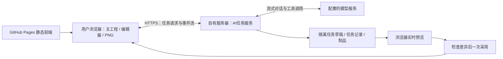

# M2工程与交付历史台账

本文件汇集原始批次记录，正文中的“当前”、未通过项、发布授权和测试数字只属于各自日期及冻结。现行顺序以[路线图](../07-roadmap.md)为准；不把历史通过数拼成新验收。

- [45-ai-authoring-and-unified-v1-plan](#doc-45)
- [46-validation-retention-audit](#doc-46)
- [47-m20-unified-v1-handoff](#doc-47)
- [48-m20b-shared-core-validation](#doc-48)
- [49-m20c-resource-io-validation](#doc-49)
- [50-m20d-preservation-conversion-validation](#doc-50)
- [51-m20e-library-conversion-validation](#doc-51)
- [52-m20f-native-workspace-validation](#doc-52)
- [07-roadmap](#doc-07)

<a id="doc-45"></a>

<a id="doc-45-m2-方向与实施边界流式创作助手统一-v1-与服务端任务"></a>
## M2 方向与实施边界：流式创作助手、统一 v1 与服务端任务

状态：2026-10-23用户确认设计，2026-10-25现已实现M2-0至4并通过M2-5公网必要旅程；本页保留产品方向并标明当前边界。应用版本号仍为 `0.2.0-m1-d2`，默认主界面使用新标识完整v1、原生会话及两个新仓库。M2-3场景制作与M2-4受限SVG/渐进同化已接通，M2-5服务器容器、可信公网IP HTTPS及Pages配置已上线，真实模型创作→保护采用→本机保存/导出/重载的必要联合旅程通过。旧产品自动化结果见[44](workspace-content-validation.md#doc-44)，不能用来证明新能力；现行回归结果集中在[05](../05-ai-and-generation.md)与[09](../09-quality-plan.md)。当前状态以[07](../07-roadmap.md)为准，精确AI合同和线上实际结果以[05第15节](../05-ai-and-generation.md)为准。

2026-10-24批次补充：M2-0a至e历史保留于48至[51](#doc-51)；f主会话/Canvas/工作台/样板与默认工程/个人库切换已实施，旧整页入口退役，当时必要检查归[52](#doc-52)。精确字段归04、容器/保全/转换归06、共享模块归03，交接归[47](#doc-47)。旧六库与原文件仅在兼容边界只读发现/保全/转换，原件可核验后下载，不自动转换用户数据。随后M2-1本地任务/流式续答、M2-2技能/物件草稿与保护采用已扩展到M2-3有限场景工具和M2-4本机SVG/参数物化；2026-10-25 M2-5公网HTTPS与Pages真实必要旅程也已通过，完整私密、两批扩围、自由创作与视觉质量等门槛仍逐项保留。


<a id="doc-45-1-本次定下来的产品"></a>
### 1. 本次定下来的产品

用户可以用中文提出场景或素材要求，看到文字和制作进度流式出现。AI 在独立任务草稿内使用应用提供的技能与工具，逐步建场景、摆素材、制作或修改 SVG、检查结果并调整。用户可以中途打断和补充要求，完成后检查整体差异，再一次采用到主工程。

首版接入**对话 API**，不接生图或图像编辑 API。PNG 导出由场景/SVG 的本地渲染完成，不需要再向模型购买一次“转图片”。模型能否读取参考图、回看截图，须对实际渠道验证；流式文字、工具调用和视觉输入是三项不同能力。

原有的单组件→组合→明确范围渐进同化继续保留，作为创作助手的一组工作流。仅换风格时保留位置、占地、通行、秘密和人工记录；用户提出布局创作任务时才启用对应领域工具。原可选 M2-L 的场景/布景/文字职责并入主线，旧编号只作追踪；不再按“先接生图、以后再做对话”安排。


<a id="doc-45-2-部署与职责"></a>
### 2. 部署与职责



| 部分 | 第一版承担的责任 |
|---|---|
| Pages 前端 | 首页、手工编辑、素材库、选择/图层、主工程 IndexedDB、撤销/快照、任务预览与采用、双受众 PNG |
| 自有后端 | TypeScript + Node.js + Hono；访问控制、provider 适配与密钥、技能版本、模型/工具多轮循环、取消、任务状态和事件重连 |
| 共享核心 | 无 React/DOM 依赖的完整类型、整数毫米几何、有限命令、范围/锁/依赖校验；前后端使用同一实现 |
| 任务存储 | 单服务实例，SQLite存任务/检查点/事件索引，私有文件保存原始/规范化SVG与记录；实际PNG由浏览器物化进入工程，这不是主工程云同步 |
| 浏览器适配器 | Canvas 预览、位图解码/参数物化、本地导出等浏览器能力；按任务绑定接收有限工具请求，返回可校验结果 |

浏览器只配置我们的后端地址，不持有模型 API key。自有服务器调用模型服务，不需要自部署模型或 GPU。线上后端须有 HTTPS、精确 Origin 白名单、真实鉴权及任务归属检查；CORS 不能替代鉴权。首版按维护者自用入口设计，不新增注册、团队或收费系统。Dockerfile、Compose持久卷/健康检查、Caddy HTTPS/SSE反代及分离环境已在真实服务器部署；[Pages前端](https://wojisama.github.io/sceneweave/)已配置[可信公网IP HTTPS后端](https://124.223.95.142)，发布40113648232成功。默认信任TLS1.3与LE YE2/IP SAN证书、真实模型工具及完整必要旅程实测见05第15节；短期IP证书的续期仍须维护。初次443/证书失败属于保留历史，不再是当前部署状态。

任务状态与制品可持久化、断线后可查询，**不等于首版保证关掉浏览器也能完成整个制作任务**。遇到需要浏览器渲染/解码的步骤，客户端离线时进入等待或暂停；恢复连接后核对任务代次和草稿版本再继续。服务重启保留最近有效检查点，对状态未知的模型请求不重复计费重试。完整无人值守续跑和服务端渲染以后按需要补齐。


<a id="doc-45-3-统一为一个新的完整-v1"></a>
### 3. 统一为一个新的完整 v1

这次统一的是开发中累积的产品模型和入口，保留已有建筑、室外、组件、图层、外观、历史和素材库能力。目标为一个主编辑器、一个完整工程读写格式和一个工程仓库；个人素材库仍独立管理固定内容和个人整理。

| 要统一的对象 | 准备与转换要求 |
|---|---|
| 场景/完整工程 | 使用新的格式标识区分 M0 几何 v1；新完整格式从版本 1 起步。不能只将现有 `schemaVersion`/`containerVersion` 改为 1 |
| 领域与历史 | 汇总有效 v3 场景、identity3、appearance1 与当前约束，迁入一份明确合同；不凭重编号获得持久建筑身份或任意拓扑恢复 |
| 旧工程与快照 | 盘点六库当前工程、自动/命名/保护历史、迁移原件和来源链；先可取回备份，再按独立副本转换并验证。不能悄悄只迁当前而丢旧历史 |
| 个人目录与备份 | [40](workspace-content-validation.md#doc-40)保留原中性v6载体合同；e已提供新完整v1中性载体/新库/备份，保持算法1身份、内置补标、许可、私密模板与个人整理对应，见04/06/51 |
| 代码与入口 | 共享核心与原生主会话/渲染/新仓库已接通，旧读者/迁移器隔离到兼容边界；f已收敛旧整页入口，必要等价验收和原件取回收尾见52 |

现有源素材和固定版本不能随重构改义。旧历史若无法无损映射到新的可恢复身份，保留可导出、可取回的独立旧档案并明确限制；不得把“已备份”写成“可在新格式局部恢复”。数据保全完成前不删除旧 IndexedDB 或转换输入。后续真实不兼容变更仍需要版本演进，“统一 v1”不是永远免除迁移。


<a id="doc-45-4-技能工具与任务草稿"></a>
### 4. 技能、工具与任务草稿

技能是项目维护的工作方法，例如“制作海岸哨所”“画俯视家具 SVG”“逐件统一风格”，包含步骤、示例和检查标准。工具是应用真实提供的能力，例如读场景、找素材、绘房、放置、预览、保存 SVG。模型选择工具，任务服务执行循环；技能文件不能授予额外读写权限，安装在 Codex 中的技能不会自动成为 Sceneweave 的能力。

M2-2先开放场景/目录读取、独立物件放置与调整、透明度和草稿检查。M2-3现已按既有有限命令接入绘房、墙厚/顶点、附着门窗/入口，地形/道路/高差边/台阶坡道/用途区，固定组合/家具/散布及GM注记；工具只接受明确授权的Floor/图层/边界/既有实体与固定定义，不开放任意拓扑或秘密改写。M2-4接入受限SVG配方和配色/亮度/透明度同化，由浏览器独立物化实际资源。每个工具有严格输入、作用范围、资源限额和清晰错误；模型不直接提交任意完整工程，也不运行JavaScript、shell或下载任意URL。

任务绑定主工程基线、明确范围与可用工具；草稿有独立递增版本。流式文本可以即时显示，工具参数必须收完整并校验后才执行。成功步骤只修改隔离草稿；场景步骤重放后显示差异，SVG/样式配方须等待浏览器生成并校验真实资源，不能把服务端账本通过当成图片已完成。暂停/追加要求不丢草稿；取消后迟到结果不能复活。

最终采用重新验证主工程基线、范围、锁、完整资源和真实依赖，先成功落保护点，再按 CAS 形成一笔新事务和一个撤销单位。主工程等待期间若有新编辑，拒绝旧基线直接采用；允许保存草稿成果并在新基线上重新计算。首版不实现自动三方合并。

现有每次采用最多 256 条展开命令的边界继续保持：最终差异按完整依赖计数，多轮工具调用不能规避总采用预算。超限先缩小任务，或由用户明确安排后续独立批次；不暗中把一次采用拆成多个主工程提交。全场大制作能力因此需分阶段验证。


<a id="doc-45-5-svg-与导出"></a>
### 5. SVG 与导出

M2-4已将运行时**可编辑SVG源＋固定PNG结果＋不可变来源版本**接入完整v1，保留原始与规范化源及实际PNG字节/hash/处理器版本；现有静态PNG/JPEG/WebP入口继续可用。不接生图API，不从任意URL下载素材，也不以完整SVG替代语义场景。

首批采用有界静态SVG子集：明确viewBox、有限svg/g/defs、图形/路径/填色/线条及线性/径向渐变；逻辑尺寸、锚点和占地仍来自定义/实例。拒绝活动XML/DOCTYPE/实体、脚本/事件、外部资源、image/text/字体/CSS、foreignObject、动画与滤镜。源经确定性解析规范化和复杂度/字节检查，通过隔离Blob图片解码/Canvas生成真实PNG，不插入应用DOM。完整校验重读两源、核对hash/规范化/尺寸比例，再实际栅格化逐RGBA比较PNG；缺能力、损坏、取消均不产生可采用的半套工程。精确语法和保护值见04/05。

授权按单件→公开组合的存活成员→明确目标和边界的局部范围展开，也可明确允许本任务新建物件；不自动扩散到全图。仅换外观保留位置、逻辑尺寸、占地、支撑、通行、秘密及组合/散布人工记录，原素材和祖先许可不改义。源/PNG进入当前及所选历史的真实闭包、冷保存重开、普通/历史离线包、有限外观恢复和个人库中性载体；含SVG的固定内容用算法2，无SVG旧内容保持算法1身份。

场景仍用语义对象保存墙、门、地形、物件、组合和图层；把整张地图画成一幅 SVG 不能冒充可独立编辑的场景。每件 SVG 保留源文本和固定派生字节/hash/处理器版本，保存重开不依赖再次调用模型。玩家导出继续从已过滤的场景和实际像素生成；SVG 源与生成来源默认属于主持人工程，不随玩家 PNG 泄漏。


<a id="doc-45-6-实施顺序与完成条件"></a>
### 6. 实施顺序与完成条件

| 顺序 | 切片 | 做到什么算完成 |
|---|---|---|
| 1 | **M2-0：统一完整 v1 与共享核心** | 先冻结格式标识/身份/快照/目录转换表与支持矩阵，再实现主格式、主仓库及核心复用；真实备份/转换/重开与关键手工能力等价。同步最小 provider 能力探针，避免把能力假设带入任务引擎 |
| 2 | **M2-1：自有后端与流式连接** | 本地 Node/Hono 服务、配置/鉴权、provider 适配、文本与工具调用流解析、取消和错误；SQLite/制品存储及事件重连。实际渠道通过流式文本和至少一轮工具结果续答 |
| 3 | **M2-2：技能/工具与实时草稿** | 中文请求→读场景/找素材→多步工具→草稿预览→打断修正→一次采用/撤销；过期/锁/超限/断线和保存失败可恢复 |
| 4 | **M2-3：场景制作工具扩展** | 建筑、室外、组合/散布、GM文字按能力清单开放；用既有原创场景检查可继续手改与有限恢复，不把结构连通当全图寻路 |
| 5 | **M2-4：SVG 与渐进同化** | 新/默认/用户素材制作或派生，单件→组合→两个明确批次；源与PNG入库、离线往返、局部恢复和双受众导出；不调用生图API |
| 6 | **M2-5：部署与联合验证** | Pages＋实际HTTPS后端联通、鉴权/CORS、流式中断/重连、任务与制品生命周期、正确性/隐私/存档；按用户通知组织完整回归 |

M2-0至2本地流程已实施，M2-3场景制作与M2-4SVG/渐进同化已接通；完成条件表保留原任务范围，不能仅凭代码将实际渠道完整场景质量或线上验收一并勾完。a至e历史见48至[51](#doc-51)，f当时结果见[52](#doc-52)；v6原证明转换、v1–v5历史独立保全及旧算法1精确key保持。M2-5现已在真实Pages/Chrome与可信公网HTTPS上通过grok明确配方任务：9次模型请求、44展开操作/5草稿步，双房/内外门/院路、灯具/GM线索、96px SVG及brightness0.8/opacity0.7；保护快照后一次采用到r1并保存，完整包43条目逐hash/源与实际PNG、4K主持人PNG及重载再导出通过，0页面错误/失败API，应用凭据未进local/sessionStorage。容器内部与重启/取消/备份还原/合成7日清理分项结果、初次公网失败及后续成功均归05第15节。现行回归集中在[05](../05-ai-and-generation.md)与[09](../09-quality-plan.md)；完整私密/两个明确批次扩围、自由创作与视觉质量、34正式性能、人工P3、完整SCN、真实小团、跨浏览器/配额/UVTT欠项独立保留。


<a id="doc-45-7-已知与待验证"></a>
### 7. 已知与待验证

- 原准备时只测/models；M2-1已验证grok-4.5文字流、工具续答、本地中止/错误和生产链路，实际范围及token参数限制集中05第11节。M2-2另以合成工程通过一笔真实物件调整/检查，详05第12节；M2-5后续已通过公网HTTPS/Pages真实场景与SVG/风格明确配方必要旅程，详05第15节，自由创作与视觉质量仍未签收。
- 对话模型由服务配置选择；先验证流式参数拼装、工具调用ID、结果续答、错误、取消及用量。视觉回看单测，不从模型名称推断支持；若不支持，明确提示，只使用结构/渲染诊断，用户目视审阅仍可用。
- M2-1任务/事件/连接工具schema、预算、七日保留和应用令牌已实现；M2-2草稿/采用合同扩展到M2-3场景操作及M2-4SVG/样式配方，严格schema、范围与限额已落地，详05。当前连接能力声明svg:true表示支持受限SVG流程，vision仍为unverified，不证明模型已能回看图像。
- M2-5服务器容器、可信公网IP HTTPS、Pages地址配置和必要创作旅程已通过；使用IP证书不等于正式品牌域名已经选择，也不证明长期可用性或全部QA完成。完整私密、两个明确批次扩围和视觉/人工验收仍待，精确证书时段、生命周期证据与边界见05第15节。测试key不写入仓库、前端、工程、日志或本页；账号/协作、主工程云同步、任意代码执行、服务端全自动渲染和生图API未纳入首版。


<a id="doc-45-8-资料依据与验收资料整理"></a>
### 8. 资料依据与验收资料整理

[GitHub Pages 官方说明](https://docs.github.com/en/pages/getting-started-with-github-pages/what-is-github-pages)确认其静态托管职责，因此保留当前前端部署、另设任务服务是本项目的架构选择。[工具调用文档](https://docs.x.ai/developers/tools/function-calling)说明模型请求工具与应用执行工具的循环；它不证明中转渠道完整兼容。[浏览器流读取](https://developer.mozilla.org/en-US/docs/Web/API/Streams_API/Using_readable_streams)与[SVG 作为图像](https://developer.mozilla.org/en-US/docs/Web/SVG/Guides/SVG_as_an_image)提供浏览器实现依据，不替代项目自身的协议、SVG校验和实际测试。核对日期：2026-10-23。

验收资料盘点与具体去留建议单列于[46](#doc-46)。后续用户明确要求清理work/与docs/evidence/，现已执行；报告保留当时的结论/失败/限制，必要B5输入移入专用测试夹具目录，原始附件不再可本地取回。本次清理不改变M2开发顺序或验收结论。


<a id="doc-46"></a>

<a id="doc-46-验收资料保留与清理盘点"></a>
## 验收资料保留与清理盘点

日期：2026-10-23。初次盘点阶段只读评估，下面第1–6节保留当时数字与建议；用户随后明确要求清理work/和docs/evidence/，现已执行，结果见[第7节](#doc-46-7-按用户要求执行清理)。最小测试输入已迁出，其余原始附件删除，没有另复制大包或改写Git历史。


<a id="doc-46-1-结论"></a>
### 1. 结论

保留可执行测试、最小夹具、简短验收结论和未解决问题；优先整理大型机器报告、重复图片与可重建缓存。历史报告有用，但不必在每份主文档重复几十段过程记录。日常入口只需要当前状态、下一步和证据链接。

本次发现的主要成本是 **759.1 MiB 原始证据**，其中三份内嵌附件的压缩报告占219.2 MiB；23份验收Markdown报告本身合计仅2,101行、285 KiB。测试源码27,321行承担可运行的行为保护，不宜按行数删除。


<a id="doc-46-2-实际体量"></a>
### 2. 实际体量

字节为文件逻辑长度；MiB/GiB按1024进位。文本行数只计常见文本后缀（md/txt/json/jsonl/log/csv/ts/tsx/js/mjs/css/html/svg/yml/yaml/xml/snap）且排除含NUL的文件，不含sha256/list等其他后缀，不展开压缩包，也不等同于有效需求或测试用例数。文件数与字节统计全部文件。

| 类别 | 文件 | 文本行 | 逻辑体积 | Git状态 |
|---|---:|---:|---:|---|
| `docs/*.md` 全部顶层文档 | 45 | 7,106 | 1,094,670 B | 42已跟踪、3未跟踪 |
| 其中验收报告（名称含validation，加25） | 23 | 2,101 | 292,176 B | 21已跟踪、2未跟踪 |
| `docs/evidence/` | 1,299 | 530,768 | 795,931,945 B / 759.1 MiB | 1,193已跟踪、102未跟踪、4被忽略 |
| `tests/`，含浏览器测试/辅助 | 57 | 11,664 | 983,155 B | 54已跟踪、3未跟踪 |
| `src/**/*.test.*` | 98 | 15,657 | 1,158,449 B | 93已跟踪、5未跟踪 |
| `work/` | 3,344 | 12,607,186 | 2,428,559,127 B / 2.26 GiB | 被忽略 |
| `performance-results/` | 279 | 4,363,676 | 1,032,354,678 B / 984.5 MiB | 被忽略 |
| 根部 `test-results/`＋`playwright-report/` | 6 | 89 | 1,516,041 B | 被忽略 |
| `dist/`＋`dist-performance/` | 132 | 不计生成代码行数 | 5,802,344 B | 被忽略 |
| `node_modules/` | 9,107 | 不计依赖源码行数 | 169,745,785 B | 被忽略 |
| `.git/` | 2,911 | 不适用 | 544,138,881 B / 518.9 MiB | Git内部对象等 |

`docs/evidence/`已跟踪部分为782,573,216 B；未跟踪部分13,076,004 B；被忽略部分282,725 B。未跟踪资料来自已完成的新内容/回归批次，不能当作临时垃圾。`coverage/`本次无文件。


<a id="doc-46-3-最值得治理的具体内容"></a>
### 3. 最值得治理的具体内容

| 原始报告 | 压缩字节 | 解压字节 | 内容特征 |
|---|---:|---:|---|
| `docs/evidence/m1-d-outpost/browser-final.json.gz` | 93,104,531 | 138,754,282 | 189个内嵌附件body |
| `docs/evidence/m1-c2/browser/full-run.json.gz` | 68,845,880 | 97,197,875 | 130个内嵌附件body |
| `docs/evidence/m1-c1d/browser/full-run.json.gz` | 67,914,290 | 93,670,192 | 112个内嵌附件body |

三个压缩文件合计229,864,701 B（219.2 MiB）；解压后约99.8%字符来自附件body。应把结果摘要与附件分开存，并迁出普通Git中的大包，保留批次/用例→内容hash→归档位置的关系。

文件级SHA-256比对发现 `docs/evidence/` 有62组相同字节、134份额外副本，额外逻辑体积189,619,006 B（180.8 MiB）。例如C5一幅4K study图保存了16份，每份4,764,733 B；另有island-500与study-2000各6份相同图。不同受众/批次可以指向同一字节，但必须保留它们各自的运行和断言记录，不能去重后丢掉配对关系。

被忽略的 `work/`、`performance-results/` 等中有753个文件、464,366,594 B（442.9 MiB）与docs证据完全相同，是后续按清单清理本地副本的优先对象。这些数字有内容重叠，不能与前三大报告直接相加当作总节省量。尚未展开tar/zip内部查重。


<a id="doc-46-4-现在不能直接删除的资料"></a>
### 4. 现在不能直接删除的资料

| 内容 | 原因及处理 |
|---|---|
| 单元/浏览器测试、TS夹具 | 是现行产品的可执行检查。新v1迁移时按能力迁移/合并，旧模块退役后才删除失去对象的重复测试；几何、秘密、存档、CAS/撤销等行为覆盖继续保留 |
| B5真实负载最小夹具 | `docs/evidence/m1-b5/final/manifest.json`和四个`fixtures/{study,island}-{500,2000}.sceneweave`实际被性能工具及配置后的浏览器测试使用，四包合计961,333 B；须先更新读取路径再移动 |
| 源SVG、产品PNG、manifest/许可 | 属于实际产品资产，不属于验收垃圾；素材测试直接读取，固定工程也依赖它们 |
| 32/33/34相关性能资料 | 完整性能门未通过，保留方法、原始样本、失败/未完成批次和对照来源，不能用新v1或一次成功运行抹去旧结论 |
| 44初轮失败及修正/截图异常 | 保留“203项首轮200/3、相关14/14复验”事实和关键现场；不能精简成“一轮203全绿” |
| 仅存在忽略路径的文件 | `docs/evidence/m1-c2/diagnostic/test-results/`的4个失败附件被`test-results/`规则忽略；它们尚不能视为已进Git备份 |
| 本次回归work原件 | `work/regression-20261023/`有353文件、134,852,088 B；紧凑首轮/复验索引分别有290/19条`retained:false`，索引不代表对应字节已归档 |

当前复现路径见[贡献说明](../../CONTRIBUTING.md)及 `tools/performance/archived-fixtures.mjs`；测试通过 `SCENEWEAVE_B5_FIXTURE_DIR` 等配置读取实际包。夹具复制件能否移除需检查默认值、环境配置和历史索引。


<a id="doc-46-5-建议实施的清理顺序"></a>
### 5. 建议实施的清理顺序

1. **先减少阅读负担。** README与docs导航只保留当前状态/下一入口，历史报告集中列目录；当前需求在01–12维护，旧报告不继续追加新方案。本轮已执行入口精简和AI旧方向纠正。
2. **停止制造新的大包。** 后续沿用 `tools/testing/compact-reporter.mjs` 的紧凑结果和hash附件；只保存支撑结论所需的关键现场，避免附件内嵌base64及重复源码/dist快照。未保留附件明确标记，不假称完整归档。
3. **先迁档并取回核验。** 为上述三份大报告、C5重复图及唯一失败资料准备清单。选定可长期访问、权限合适的归档位置，记录大小/hash/批次/用途/完整性，实际取回核验，再更新索引和引用，最后从普通Git当前树移除迁出的副本。公开归档前检查私密内容与凭据。
4. **清理本地重复与缓存。** 先处理已核对的753份重复副本；根部dist和依赖可重建。test-results/playwright-report须先确认失败现场去向。`work/`、冻结源码/生产包和performance-results逐项处理，不整目录清空。
5. **随统一v1退役旧代码测试。** 新功能等价、旧数据转换和关键回归完成后，合并重复入口用例与旧版本专属实现测试；必要旧格式转换夹具和负例继续保留。不能先删测试再以“没有失败”通过重构。

以上是初次盘点时的建议，随后用户选择直接清理两目录，实际执行按第7节；没有另外迁档，不将资料整理作为M2功能开发前置阻塞。


<a id="doc-46-6-git体积与保留规则"></a>
### 6. Git体积与保留规则

180.8 MiB是工作区重复文件的逻辑体积，不是Git历史可以节省的量；Git通常已复用相同字节的blob。删当前文件并提交仍会保留旧提交中的大对象。当前 `git count-objects -vH` 显示2,881个loose对象、约525.59 MiB分配体积、无pack；它与上表逻辑字节口径不同。

若以后确实需要缩减历史体积，须独立设计历史重写、远端/分支和其他工作区迁移；本次不做强推、删Git对象或历史重写。先规范新产物和清理当前树即可控制后续增长。

普通Git长期保留：测试/必要夹具、QA定义、简短结论与失败修正、可复现命令/环境/代码指纹、最小结果摘要、关键截图和归档清单。大型完整原始报告、全套4K/trace、整份源码/dist副本进入长期归档。归档可去重，事实、失败与未通过边界不得改写；唯一字节没有可靠去向前继续保留。

复核方法：`git ls-files -z`及未跟踪/忽略列表分类，Python按文件stat和UTF-8文本换行计数，SHA-256逐文件查重；gzip解压JSON统计附件body。未运行产品测试，没有为此次盘点再制造原始报告大包。


<a id="doc-46-7-按用户要求执行清理"></a>
### 7. 按用户要求执行清理

2026-10-23用户明确提出“本地work、原始验收附件docs/evidence都想清理”。此授权替代此前仅盘点/先迁档的安排：保留测试输入和结论，删除两目录的其余原始产物，不另复制为隐藏大包。

| 目录 | 删除文件数 | 删除逻辑字节 |
|---|---:|---:|
| work/ | 3345 | 2428559970 |
| docs/evidence/ | 1299 | 795931945 |
| 合计 | 4644 | 3224491915，约3.00 GiB |

已先迁出四个B5工程包（961333字节）及确切manifest（39886字节），共1001219字节，放在[专用夹具目录](../../tests/fixtures/performance-b5/README.md)。保持原字节/完整summary/许可与内部路径，文档和性能工具示例指向新路径；它们是可执行测试输入，没有保留整套测量附件。

四组原始hash及包内身份/计数/范围/资源摘要已通过现有copyArchivedFixtures加载器校验，未运行浏览器、全量回归或正式性能。历史报告增加附件可用性说明，旧附件链接改为历史路径文字；当时的通过/失败/未通过结论不更改。未提交的新内容/回归附件也在此次清理范围内，不能再宣称它们可从本地取回。

work/与docs/evidence/现均不存在；docs/evidence/已加入忽略规则，后续临时运行输出按需生成、清理，不默认进入Git。performance-results/、依赖、当前构建目录和浏览器实际工程数据不在本次删除范围。没有改写Git历史或自动提交推送。


<a id="doc-47"></a>

<a id="doc-47-m2-0统一完整v1与共享核心实施交接"></a>
## M2-0：统一完整v1与共享核心实施交接

后续实施更新：M2-0a至e历史结果保留于48至[51](#doc-51)。f原生Workspace/Canvas/Workbench/样板已切换新完整v1及sceneweave-projects、sceneweave-library，旧整页入口退役，旧只读发现/保全/转换继续保留；实施完成、必要定向检查已通过，实际219项定向、11项Chrome联合及1项补充专项、正常生产/构建和原件取回结果见[52](#doc-52)。下一开发入口为M2-1后端与流式连接，不自动转换用户数据。以下第1至6节及末段保留a准备时的代码盘点/未实测事实，不把当时描述当作当前实现状态。

2026-10-24。起点为已推送`0367c5f`、应用`0.2.0-m1-d2`，工作区原有`todo.md`独立编辑保留。用户本轮授权**准备M2-0**；已核对代码并定下本文和04/06的新合同，尚未实现新格式、共享核心、转换器或AI服务。本轮没有访问用户IndexedDB、调用模型、运行产品回归或新建原始验收包。

45确定产品方向，本文把M2-0落实为实施入口。字段以[04](../04-scene-document.md#完整v1现行合同2026-10-24)为主，容器/仓库/转换以[06](../06-storage-and-export.md#完整v1现行存储合同2026-10-25)为主，模块边界归03，排期归07，验收归09。


<a id="doc-47-1-已核对的事实与决定"></a>
### 1. 已核对的事实与决定

| 实际情况 | 本轮确定的处理 |
|---|---|
| 最新能力分散在core/v2几何、v3场景、v4结构witness、v6身份/外观，v6本身仍依赖旧代 | 吸收真实实现为`src/shared`，新主路径不再经旧文档视图往返；不是换名或长期re-export |
| 六个工程库都是Dexie schema 1/native IDB version 10 | 新主工程库`sceneweave-projects`，个人库`sceneweave-library`，各从schema 1开始；保留旧库只读，数据库版本与产品格式分开 |
| 旧M0也是容器1/场景1 | 新工程使用`sceneweave-complete-project`、新场景使用`sceneweave-scene`，版本从1开始；先识别format，不能按数字1分发 |
| 当前工程升级只迁当前，history包不含自动快照和原件链 | 增加独立完整迁移保全格式；v6家族统一转换，v1–v5全部旧历史独立保全，首批只转换其当前工程 |
| 目录身份不含载体格式/ZIP bytes | 普通位图/参数素材保留身份算法1和旧精确key，仅更新新载体字节hash；SVG固定内容另有显式身份域 |
| 个人整理可为未安装素材存在，现有备份只包含所选安装项 | 迁移必须捕获全库组织记录和安装状态；不能拿一个最多64项的旧库备份当全部512项已保全 |
| 完整资源校验会使用ImageBitmap/Canvas | 共享纯规则、字节/容器和真实像素适配分层；缺像素执行能力不能报告“完整校验通过” |
| 当前previewPrepared只追加素材，adoptPreview不先落保护点，命令还有领域混批限制 | 另定原子候选接口；M2-0冻结边界，M2-2再实现多步任务与最终一次采用，不能循环主工程execute来模拟 |


<a id="doc-47-2-新主合同的边界"></a>
### 2. 新主合同的边界

新完整v1承接最新所有持久内容：整数毫米场景、用户层、建筑/室外/组合/散布与人工记录、固定内容/资源/许可、完整外观图、物件/组合/室外出生和拓扑身份。去掉多代类型继承；旧版本只留严格兼容读者与转换器。

纯`ProjectData`不含Blob、Canvas或仓库对象；实际图片/SVG字节由`ProjectBundle`的资源端口提供，完整读取必须同时取得并验证。转换不能只拿JSON模型就宣布完整工程可重开。主工程不携带完整对话、服务凭据或任务运行状态。

SVG源/规范化源/固定PNG引用在v1字段中提前定义，M2-0转换输出为空；未实现真实SVG校验时，非空源明确返回不支持，不半验后采用。M2-4实现该能力时沿用既定字段和资源闭包，不再把源文件塞入任意metadata。

首批完整保留v6已有lineage/root、出生/拓扑token及墓碑；新当前工程只分配一次新sceneId并从revision0开始。历史摘要明确ownerSceneId，历史内容保留原sceneId/revision。建筑witness不序列化、不跨转换继承；不增加任意拓扑恢复。


<a id="doc-47-3-转换支持矩阵"></a>
### 3. 转换支持矩阵

| 来源 | 新当前工程 | 原有全部历史 | 新v1原位局部恢复 |
|---|---|---|---|
| M0 v1、v2、v3 | 转换到最新完整语义，补默认层/外观及当前身份 | 自动历史及原件链进入完整legacy保全包 | 不凭同ID追认旧连续性；可从保全包显式另建独立工程 |
| v4、v5 | 当前完整内容转换，已有身份/外观保留，只为当前缺失类别分配身份 | 自动、命名、保护及原件全部独立保全 | 首批不开放跨旧历史恢复；不能把当前补出的token复制给旧快照 |
| v6 | 完整转换当前 | 同一家族的命名/保护转换；自动历史转只读`imported-auto`；原件链保全 | 保留原本可证明的物件/组合/室外恢复；拓扑不连续或建筑旧会话witness仍拒绝 |

这是一轮明确收敛范围，不等于删除较早历史。legacy包和旧库都能取回；恢复为独立工程与在当前工程局部恢复须分开标识。所有固定定义及非活动祖先、私密模板、实际资源/许可都必须跟随其相应历史，不能只存一组实体JSON。


<a id="doc-47-4-先保全再转换"></a>
### 4. 先保全，再转换

最小操作单位为一个旧工程家族或一个完整个人目录。只读发现已有库，逐库一个只读事务捕获其所需记录；不存在的库不创建。捕获内容、源元数据/历史/资源/原件索引形成sourceFingerprint。IndexedDB行保全其确切字段值，已有Blob保全字节；不把新序列化JSON称为原磁盘文件。

普通`.sceneweave`和旧`.sceneweave-library`不足以完成保全。06定义迁移set：完整清单＋有界分卷，包含当前、全部自动/命名/保护、资源/许可/绑定、原件来源链，目录还包含所有organization-only记录；每份都有hash和完整性状态。只有重新读取所有选中分卷核验完整后，才能进入转换发布；下载已开始不等于备份可取回。

转换过程为`captured → backup-verified → prepared → committed → verified`。先以唯一jobKey预留journal和ID映射，状态推进使用jobVersion CAS。工程内容/资源/历史在目标单库原子写入为preparing，同时更新既有journal；冷读完整验证后以目标CAS开放。个人库先写不公开的conversionStaging，冷读后按catalog revision一次发布，旧可用条目/整理在失败后保持。崩溃重试复用同一job/ID映射，不能生成第二份或覆盖后来手工编辑的目标。

源库从头到尾不写不删。发布前后检查源指纹，变化时显示目标来自哪次捕获，并要求重读/明确补迁；不能宣称跨七个旧库、新工程库和新目录库存在单事务CAS。全库合并先计算目标累计预算；超限选择较小明确范围或保全后暂不转换，不能静默丢历史、拆采用事务或提高容量承诺。


<a id="doc-47-5-共享核心和适配器"></a>
### 5. 共享核心和适配器

```text
src/shared/{model,validation,geometry,commands,history,appearance,projection,project,catalog,ports}
src/application/workspace                 唯一编辑会话、候选、撤销与保存调度
src/platform/browser/{storage,images,render,files}
src/compat/legacy/{v1,v2,v3,v4,v5,v6}        严格旧读者、保全及转换
src/content                              与UI无关的内置素材定义/provider
```

依赖方向是`editor → application → shared`，平台实现端口，兼容层将旧输入转为新模型。shared不得导入editor/React/Dexie/Hono/DOM渲染器；纯投影要搬入shared，不从history反向导入浏览器renderer。源代码文件夹不是另一个用户格式版本。

窄端口明确ID分配、时钟、hash/字节、图片解码/编码和像素处理、存储。ID/时间作为准备上下文注入，重试复用。Blob/Web Crypto可存在平台实现，但shared必须有单独无DOM的编译入口和实际Node导入检查；当前全项目tsconfig含DOM，普通typecheck不足以证明边界成立。

内核认证仍只相信本进程严格解析后深冻结的对象引用。Worker/网络/持久化重读重新验证；资源三元JSON之外另绑定本机独立捕获的不可变字节闭包/受控资源句柄代次，不能凭相同端口或hash声明省略字节/hash/解码。authoringSources另验并绑定完整资源证明；当前依赖/许可/预算与外观真实像素分别检查，不能传`validated:true`。旧来源链认证只用于兼容读取，新主保存不递归调用六代写入器。


<a id="doc-47-6-原子候选接口的准备范围"></a>
### 6. 原子候选接口的准备范围

04冻结`AtomicCandidate`的基线、允许范围、步骤来源、最终读写集合/差异和展开预算语义；精确实现安排在M2-2。只读查询、参数物化与草稿步骤不写主工程revision/undo。

候选从完整基线的独立副本计算；如跨多个命令领域，须在独立草稿中按已验证顺序重放并记录真实身份推进，再整体校验最终结果。最终采用用本机生成的真实成本和依赖，不能信任服务端自报或把JSON差异条数当命令成本。保护点成功、源/场景/元数据CAS后，主工程只提交一次revision+1/撤销。现有普通命令类别限制在替代接口验证前不移除。


<a id="doc-47-7-可直接执行的实施切片"></a>
### 7. 可直接执行的实施切片

| 顺序 | 切片 | 交付与必要简单验证 |
|---|---|---|
| 已完成准备 | **M2-0a 合同/映射** | 本文、04/06/03/07/09一致；已核对代码，不把文档检查记为产品通过 |
| 已实现/适用定向通过 | **M2-0b 共享模型与纯规则** | 新类型/严格schema、几何/依赖、身份/外观/纯投影和ID/时钟端口；无DOM独立编译、Node导入、关键等价向量；不切旧存档写入 |
| 已实现/适用定向通过 | **M2-0c 字节/像素端口与新完整IO** | 新标识/严格ZIP/资源端口、浏览器真实解码/派生像素；当前/所选历史实际字节与许可往返，六代旧读者拒绝；实际49，不把测试格式适配当转换器 |
| 已实现/必要定向通过 | **M2-0d 工程保全/转换/主仓库** | 完整保全set/真实重读凭证、六代当前/v6全家族、旧档案、固定journal映射与原子提交/冷读开放；124项定向/4项Chrome及构建见50，未转换用户数据 |
| 已实现/必要定向通过 | **M2-0e 个人库与内置内容** | 新载体/新库/所选备份、算法1精确key、全组织/安装状态、私有暂存冷读一次发布、62补标/6精修保持；实际检查见51 |
| 已实施/必要定向检查已通过 | **M2-0f 主会话和入口收敛** | 新完整v1主会话/Canvas/Workbench/样板及两个新库成为默认，旧整页入口收敛、legacy只读保全转换保留；219项定向、11项Chrome联合及1项补充专项、正常生产/构建和139模块边界通过，实际结果归52 |

每个切片只运行适用的定向检查、类型/正常构建和少量真实闭环；完整回归等用户通知，34正式性能保持后置。provider最小探针可与准备并行，但本轮未调用；M2-1接流式文本/工具结果续答，不能用models列表代替。此准备没有要求服务器域名或重复确认已有架构。


<a id="doc-47-8-代码依据和仍需实测的事"></a>
### 8. 代码依据和仍需实测的事

- 当前六库发现/只迁当前：[project-registry.ts](../../src/editor/workspace/project-registry.ts)；当前完整合同/历史hash/副本：[project-file.ts](../../src/io/v6/project-file.ts)；全库预算/CAS：[storage.ts](../../src/io/v6/storage.ts)。
- 身份/拓扑和命令类别：[identity.ts](../../src/core/v6/identity.ts)、[commands.ts](../../src/core/v6/commands.ts)；当前候选范围：[workspace.ts](../../src/editor/v6/workspace.ts)。
- 目录固定hash与中性闭包：[content.ts](../../src/catalog/content.ts)；组织/库CAS：[repository.ts](../../src/catalog/repository.ts)；旧所选备份：[backup.ts](../../src/catalog/backup.ts)。
- 浏览器依赖及派生像素：[resources.ts](../../src/io/v6/resources.ts)、[prepare.ts](../../src/io/v6/prepare.ts)；内置provider反向依赖：[builtin.ts](../../src/catalog/builtin.ts)。

真实用户各库存量、坏行、预算/磁盘和可取回备份目前没有扫描；新schema、保全set读写、目标仓库和Node运行尚未实现或实测。只读代码盘点不能关闭QA-AI-16，也不继承旧44为新v1回归证据。


<a id="doc-48"></a>

<a id="doc-48-m2-0b共享模型与纯规则"></a>
## M2-0b：共享模型与纯规则

2026-10-24，起点main/0367c5f及未提交的M2-0a准备稿。用户要求继续按设计实施，本批完成b；应用版本仍为`0.2.0-m1-d2`，现行UI/六库/v6读写继续运行。下一入口为M2-0c，新完整文件读写、真实像素适配、保全转换和任务后端尚未实现。本文只记录必要检查，不新建work或原始验收附件目录。


<a id="doc-48-本批实现"></a>
### 本批实现

- [共享入口](../../src/shared/index.ts)及37个源码模块：独立完整`SceneDocument`（sceneweave-scene/schema1）、完整`HistoryIdentity.version1`（承接identity3）、AppearanceGraph、纯ProjectData与资源字节端口；严格字段/JSON/预算、几何、依赖、命令、外观及有限恢复实现均在shared，不导入旧core/editor/io/render。
- 场景、建筑、室外、组合、层和散布直接使用同一新模型。有效锁视图保持新format/schema和完整层信息，不改成旧v2/v3。256按实际实体/成员/排除记录及中间步骤展开；普通命令类别隔离保持，草稿不能同批解锁后编辑。
- 固定源/祖先/派生元数据、非活动定义根、源→层→实例覆盖及私密模板保持。完整出生/墓碑和室外拓扑身份、有限物件/组合/室外/散布恢复，以及不持久化的C2会话witness已提取；没有新增任意拓扑或持久建筑恢复。
- 玩家投影提为纯模块，历史恢复不再反向依赖浏览器renderer。ID通过PreparationContext注入；时钟端口供应用准备上下文提供确定时间。固定散布/外观/拓扑hash保留原算法域，新ProjectData内容hash使用04规定的UTF-16键序规范JSON。
- [ProjectData校验](../../src/shared/project/validate.ts)只认证纯JSON/身份/外观、图片元数据及许可闭包/保护预算，不读取图片字节或发完整资源凭证。非空authoringSources明确unsupported-feature；SVG运行时继续归M2-4。ProjectBundle字节端口仅定义交付边界，完整字节/解码/派生像素认证归c。
- [无DOM配置](../../tsconfig.shared.json)使用ES2023、types为空、NodeNext。新相对导入为显式.js；[检查工具](../../tools/check-shared.mjs)以TypeScript AST检查依赖/平台调用边界，实际发射至系统临时目录并在Node原生ESM导入、执行简单闭环，结束后清理临时编译物。

这是迁移过程中的独立新内核；旧规则尚未接向它。M2-0f须在转换/等价流程成立后统一主路径并退役重复旧入口，不能长期维护两套稍有不同的规则。当前未切换写入器，不把测试用例的格式适配当作生产转换器。


<a id="doc-48-实际简单检查"></a>
### 实际简单检查

环境：本机Node `24.14.1`，TypeScript `5.9.3`，Vitest `4.1.12`，Vite `7.3.7`；未启动Chrome或调用模型。

| 命令 | 实际结果 | 覆盖及限制 |
|---|---|---|
| `npm run check:shared` | 通过，37个源码模块 | AST依赖边界、无DOM独立编译、真实Node ESM；执行场景显示命令、身份/外观、ProjectData/hash与玩家投影，不含图片适配器 |
| `npx vitest run src/shared` | 最终4文件45/45通过，2.15秒 | scene 12、commands 12、history 12、project 9；代表性旧夹具对照和关键失败边界，无完整回归声明 |
| `npm run typecheck` | 通过 | 现行应用、共享内核和测试类型；不能单靠此项证明无DOM，另有上项 |
| `npm run build` | 通过，Vite阶段3.61秒 | 正常生产构建；仍有原有依赖注释/混合动态导入/大chunk提示，不据此声明优化或新UI已验证 |

45项包括：VIS书房/岩岛和私密组合的几何/依赖/GM与玩家投影等价；完整/部分共墙与门端点、真实旋转占地/道路/有限全宽高差通行；支撑/层/递归注记锁、失败无部分输入改动；中间组合展开预算、稳定散布与人工记录；出生/墓碑/换拓扑再改回、固定外观源/参数/私密组合；范围外后续编辑保留的有限恢复及C2 witness失效；严格新标识/未知键/访问器/非JSON/伪冻结输入、元数据与许可闭包、UTF-8与内容hash。

首轮没有隐去：45项中38通过/7失败。6个历史测试的反向适配漏回旧`format:'sceneweave'`，另1个门端点前后差约1e-12但测试要求浮点完全相等；修正测试适配后第二轮43通过/2失败，另暴露一处断言错误地要求报错包含锁定注记ID，而新旧规则均报告其依赖根domain。最终补齐精度与旧实现同拒绝断言后45/45通过。新旧完整候选仍精确比较，没有为通过测试放宽领域规则。

首次无DOM检查还发现放置schema被局部变量遮蔽，已改名修复；导入检查器最初用正则误读字符串，改用AST。许可正文另拒绝无法无损UTF-8往返的孤立代理项；普通JSON规范化和UTF-8编码有对应检查。


<a id="doc-48-qa与后续入口"></a>
### QA与后续入口

| 追踪 | 本批状态 |
|---|---|
| QA-V1-01 | 场景/ProjectData严格字段与新旧标识适用子项通过；真实新旧容器分发留c |
| QA-V1-02 | b范围内无DOM/Node导入与代表性规则等价通过 |
| QA-V1-03 | 纯身份/墓碑/拓扑/有限恢复子项通过；真实家族转换/owner/imported-auto与冷读留c/d |
| QA-V1-04/05/06 | 全scope保全、实际转换/库CAS/全目录映射未运行，留d/e |
| QA-V1-07 | 纯JSON所有权/三元认证、元数据/许可守卫子项通过；真实字节/句柄代次/像素适配留c |
| QA-V1-08 | 新主会话/UI混合旅程未运行，留f |

不关闭整个QA-AI-16/M2-0，不继承44为新内核全量回归；完整回归等用户通知，34正式性能仍后置。下一c建立实际字节/图片端口和新完整IO，验证当前及所选历史的真实资源/许可往返，再推进d保全转换、e目录、f主会话。

本批未读取用户IndexedDB、改变旧存档/素材/旧测试或独立todo，未调用provider、部署、commit/push。既有a准备稿和历史报告保留；新文档链接/基线保护结果见本轮progress记录。


<a id="doc-49"></a>

<a id="doc-49-m2-0c真实资源端口与完整v1文件读写"></a>
## M2-0c：真实资源端口与完整v1文件读写

2026-10-24，起点main/0367c5f及未提交的M2-0a/b成果。用户继续授权按设计实施，本批完成c；应用仍为`0.2.0-m1-d2`，现行UI、六库及v6写入器保持。下一入口M2-0d工程保全/转换/新主仓库。只记录必要定向结果，不重建work或原始验收附件目录。


<a id="doc-49-本批实现"></a>
### 本批实现

- [资源校验](../../src/shared/project/resources.ts)独立捕获JSON、读方法和实际字节，验证SHA256、实际图片格式/尺寸、许可闭包及预算，再经图片端口真实解码。固定派生还对照源、参数与输出的全部RGBA像素；hash正确但像素不符仍拒绝。公开入口对已认证输入也重新读取/解码。
- 完整资源凭证仅绑定模块拥有且深冻结的ProjectData与对应不可变字节端口。输入、输出字节均独立复制；更换JSON或端口不能命中认证。批次按hash只持有一份联合字节，每个工程的端口只能读取自身闭包，不能读取仅历史引用的图片。所有输入端口仍各自验证，失败/取消不返回可用认证包。
- [浏览器图片适配器](../../src/platform/browser/images/adapter.ts)实现静态PNG/JPEG/WebP实际解码、sRGB Canvas参数处理及规范化PNG编码；逐次占用解码槽，成功、取消和错误均释放Bitmap/Canvas，无长期位图缓存。单图20MiB在分配字节副本前检查；共享层保持无DOM，未来Node真实图片实现另接端口，缺能力不能冒充完整验证。
- [新完整容器](../../src/shared/project/file.ts)直接读写`sceneweave-complete-project/schemaVersion:1`，四份JSON分别hash，图片与UTF-8许可按hash保存。严格ZIP路径/本地记录/中央目录、CRC/长度/SHA、完整引用及累计JSON预算均检查；当前与所选历史使用不同入口，互相拒绝，不能静默丢历史。
- [所选历史](../../src/shared/project/history.ts)保留ownerSceneId与历史文档sceneId/revision的区别，验证摘要hash/lineage、固定定义/来源及出生墓碑冲突；当前身份合入可证历史墓碑，不修改输入。便携包只收明确命名/保护，各最多32；imported-auto和legacy原件保全留d。
- 新共享入口共48个源码模块，仅依赖共享模块及已有zod/fflate。纯SHA原语提取为[hash.ts](../../src/shared/validation/hash.ts)，既有散布算法/导出保持；未增加依赖或修改旧产品模块。非空SVG源仍明确不支持，运行时SVG归M2-4。

06的原保护值保持：ZIP压缩100MiB/展开300MiB、3000条、manifest/history各1MiB、JSON深128/累计600000值、历史文档128MiB；单图20MiB/边8192/3200万像素，联合256张/6400万像素。这些是拒绝超限的保护值，没有进行容量或正式性能验收。


<a id="doc-49-实际简单检查"></a>
### 实际简单检查

本机Node24.14.1、TypeScript5.9.3、Vitest4.1.12、Vite7.3.7、Chrome156.0.8078.47。

| 命令 | 实际结果 | 覆盖及限制 |
|---|---|---|
| `npm run check:shared` | 通过，48源码模块 | AST依赖/平台边界、ES2023无DOM独立编译、真实Node原生ESM；场景命令/身份/投影及无图片当前/所选历史ZIP往返，不称Node真实图片验证 |
| `npx vitest run src/shared` | 最终6文件77/77，1.78秒 | 既有45项及新增32项：资源所有权/认证/取消/预算、历史冲突、严格ZIP/JSON/实际hash、全部六代旧读者拒绝新包；图片使用明确Node替身 |
| `SCENEWEAVE_BROWSER_CHANNEL=chrome npx playwright test tests/m20c-resources.spec.ts --reporter=line` | 最终4/4，5.8秒，1 worker，0重试/跳过 | 实际PNG/JPEG/WebP及许可往返/续编、历史专属资源、半透明派生像素、错误派生/失败/取消及Bitmap释放；没有访问用户工程库 |
| `npm run typecheck` | 通过 | 现行应用、新共享/平台模块及最终测试 |
| `npm run build` | 通过，Vite阶段2.79秒 | 正常生产构建；原有依赖注释、混合导入和大chunk提示保持；主界面尚未切换新IO |

Chrome使用原有v6/C3图片夹具，经测试专用格式适配产生新完整模型，不把这个适配器当作生产转换器。当前3张真实8×8 PNG/JPEG/WebP逐字节/SHA/尺寸及完整许可往返后继续一次物件原子编辑、再导入保持；玩家投影排除秘密。命名/保护历史各1份，当前仅2张、历史各3张，历史专属WebP仍完整可读，owner与原场景ID不同但lineage/root保持。参数用例对照独立旧管线的亮度0.5输出，透明/半透明/不透明及全部像素一致，恶意输出即使自身hash正确仍拒绝。

77项中的边界包括：访问器零调用、异步前捕获、外部修改不影响已有结果、确切认证对象对/伪造拒绝、公开重验、不同历史资源读取范围、联合像素及同hash描述冲突在IO前拒绝、变换后取消不编码、坏像素/解码失败不认证；摘要/归属/修订/lineage/hash、重复快照/出生与固定内容冲突；未知标识/字段/入口、路径穿越/额外条目、CRC/SHA/长度、坏UTF-8/重复转义键/非有限数、超预算声明和SVG拒绝。测试范围没有扩大到全量回归。

首轮Chrome为1通过/3失败（13.0秒）：Canvas夹具的JPEG带APP2 ICC、WebP带ICCP，原生格式正确拒绝非规范化资源。仅对明确sRGB的测试编码输出移除冗余profile并修正WebP标记/长度，实际压缩像素流保留，产品检查未放宽；修正后4/4（5.4秒），最终源码复验4/4（5.8秒）。整合类型检查也修正了捕获方法的TS收窄及测试Uint8Array泛型注解。

只读审查另发现历史输入和认证结果若逐快照独立保存字节，会重复持有整个联合资源；已改为单份不可变联合字节与分工程读取范围，并保留逐输入校验。联合像素预检、超长字节先拒绝和变换后取消均有定向用例。本批没有声称测得内存峰值或性能提升。


<a id="doc-49-qa与下一入口"></a>
### QA与下一入口

| 追踪 | 本批状态 |
|---|---|
| QA-V1-01 | 新容器精确字段/标识、当前/历史入口、六代旧读者拒绝新包及SVG拒绝适用子项通过 |
| QA-V1-02 | 48模块无DOM/真实Node导入与无图片IO通过；Node真实图片适配器尚未提供 |
| QA-V1-03 | 便携历史owner/原文档ID、摘要hash/lineage、出生冲突及墓碑合并通过；全v6家族/imported-auto转换与冷读留d |
| QA-V1-07 | 实际字节/所有权/确切认证、真实浏览器解码/派生像素、失败/取消与预算子项通过 |
| QA-V1-04/05/06/08 | 全scope保全/转换journal/新库CAS/全目录/主会话未运行，留d/e/f；普通所选历史包不代替保全set |

下一d先实现独立完整保全set的读写/重新读取核验，再按sourceFingerprint、固定journal/ID映射、新主库preparing→冷读→ready推进工程转换；源库保持只读。e随后承接目录身份与整理，f再切主会话和退役重复入口。M2-0/QA-AI-16整体仍开放，流式后端、任务草稿和SVG未据本批完成。

本批保留旧UI/六库写入器、素材、旧测试、48及更早报告、a/b成果和独立todo；未读取用户工程数据库、调用provider、部署或commit/push。完整回归等用户通知，34正式性能仍后置。


<a id="doc-50"></a>

<a id="doc-50-m2-0d工程保全转换和新主仓库"></a>
## M2-0d：工程保全、转换和新主仓库

2026-10-24，起点main/0367c5f及未提交的M2-0a/b/c成果。用户明确授权本批完成d，仅做必要简单测试。工程存储与转换接口已实现；主界面仍使用v6，应用版本保持`0.2.0-m1-d2`，目录迁移与主会话切换分别留e/f。未运行用户真实数据转换、全量回归或正式性能，不重建work/evidence。


<a id="doc-50-实现与使用边界"></a>
### 实现与使用边界

- [保全set](../../src/shared/migration/set.ts)实现06的独立索引/分卷：保留各角色、原键、语义hash与确切raw字节，只按rawSHA去重；块/卷/索引的CRC、长度、SHA和记录重组完整覆盖逐项验证，全部重读后才登记私有backupReceipt。导出不发receipt，JSON复制不能伪造。单块8MiB、卷展开含清单32MiB、卷压缩33MiB、清单1MiB、主索引16MiB/最多512卷、累计600000 JSON值/深128，均为保护值。
- [旧库捕获](../../src/compat/legacy/capture.ts)对六个已存在仓库检查精确版本/表/键/索引，每个工程家族在一个readonly事务捕获当前、全部自动/命名/保护、绑定、资源/许可、metadata和完整原件链；缺库不会创建，未知schema不升级。指纹包含这些实际记录/字节，历史改名、资源或metadata变化也能发现。
- [旧行编码](../../src/compat/legacy/row-codec.ts)保留独立捕获的字段值、Blob MIME和实际bytes；规范编码不称原磁盘JSON。捕获私有原始指纹/字节与外部对象分开，取回时独立解码，不暴露可修改的内部行。可序列化坏行能保全，转换仍严格拒绝，不能跳过后称全部成功。
- [旧文件入口](../../src/compat/legacy/file.ts)严格分发v1至v6完整/所选历史包，保全记录直接保存上传ZIP的确切字节；scope使用file-vN，与IDB的vN区分。重读时重新解析原包，准备时的临时规范行只在内存复用规则。新legacy节点及字节绑定实际原文件SHA，不用重新导出冒充原件。
- [完整转换](../../src/compat/legacy/convert.ts)将六代当前转为新完整v1、新sceneId/r0；v6保留lineage/root及出生/拓扑token、合入历史墓碑，历史文档保留原sceneId/revision，owner关联新当前。v6旧自动转只读imported-auto，名称固定`自动保存 · r<源revision>`；v1–v5历史完整保全但首批不安装为可局部恢复的新历史。C2 witness不继承，有限恢复范围不扩张。
- [新主库](../../src/platform/browser/storage/repository.ts)使用sceneweave-projects、Dexie schema1/native10和11表。支持完整保存/重开、同事务revision CAS、最近20自动、named/protection各32、imported-auto独立20、历史metadata和真实源hash CAS。全库资源/许可256MiB、文档128MiB、原件128MiB累计预检。未知结构及检查后出现的低版本外来库拒绝升级，禁止使用六个旧库和实际旧个人库名称。
- journal按唯一jobKey预留一次job、目标和历史映射，每次阶段推进比较jobVersion。prepare完整校验后，commit同事务添加全部内容/引用/来源并更新已有journal为committed，目标仍preparing；冷读完整校验当前、首份自动、全部历史与原件后，再CAS开放ready/verified。v6候选的全部预留历史必须到齐，来源kind及自动revision逐项匹配；重试不覆盖已发布后的手改。

共享资源批次提高到85份以容纳当前＋64命名/保护＋20来源自动；普通便携history仍最多64。兼容准备及冷读按hash共享一份私有字节联合集合，输出端口按工程范围限定读取；各份内容、绑定、许可和实际解码/派生像素仍完整验证，没有长期Bitmap缓存或免检标记。未测内存峰值或正式容量。


<a id="doc-50-转换编排入口"></a>
### 转换编排入口

[application/migration](../../src/application/migration/conversion.ts)提供：

| 接口 | 行为 |
|---|---|
| beginProjectConversion | 只读捕获指定旧库家族，预留/复用journal，导出完整保全set；不开放目标 |
| beginProjectFileConversion | 捕获确切旧文件，使用file-vN来源，同样先导出保全set |
| continueProjectConversion | 接收重新提供的完整索引/全部卷，验证receipt并从实际记录重算指纹、历史键/源hash，再prepare→commit→cold-read→ready |
| cancelProjectConversion | 停止同一journal；已commit但未开放的目标仍私有保留，重试继续冷读 |

源库在提交前、开放前后复查。默认源变更/不可读会阻断；明确sourcePolicy=captured-copy可将已保全内容作为独立副本，保留后来源编辑。发布后再发现源变化只报告副本来源，不回滚或改写新目标。固定文件来源没有可变源库，已重读的原bytes就是来源，不伪造DB检查。verified重入返回当前目标，允许其revision已高于0；并发失败的调用不能把另一调用已推进的journal标失败。

这里交付模块API和存储基础；首页/迁移面板、默认保存切换及旧入口退役归M2-0f。当前未自动迁移用户工程，File/Blob测试不等于已经完成真实磁盘下载/重新选择文件的UI验收。


<a id="doc-50-实际必要检查"></a>
### 实际必要检查

环境沿49：Node24.14.1、TypeScript5.9.3、Vitest4.1.12、Vite7.3.7、Chrome156.0.8078.47。数据库仅使用独立fake-IDB或Playwright新隔离context。

| 命令 | 最终实际结果 | 范围 |
|---|---|---|
| `npm run check:shared` | 52源码模块通过 | AST边界、无DOM编译、真实Node原生ESM；含无图片当前/历史ZIP及set重读/receipt，未提供Node真实图片适配器 |
| `npx vitest run src/shared src/compat/legacy src/platform/browser/storage` | 10文件124/124，8.00秒 | 既有共享规则/IO、14项set、16项legacy、16项仓库与85批次；含真实32MiB+7字节两卷、六代旧文件、IDB CAS/故障/结构与全历史门 |
| `SCENEWEAVE_BROWSER_CHANNEL=chrome npx playwright test tests/m20d-conversion.spec.ts --reporter=line` | 4/4，8.8秒，0失败/重试/跳过 | 实际PNG/派生像素、原件、全家族和原ZIP、File/Blob重读、新库冷开、commit中断续跑、后改不覆盖和源变化 |
| `npm run typecheck` / `npm run build` | 通过；最终构建含tsc，Vite阶段2.74秒 | 正常生产构建保留原有依赖注释/混合导入/大chunk提示；未把模块API检查写成新主UI已验证 |

四项Chrome分别验证：

1. 真实旧v6写入器建立PNG及亮度派生、v5原件、两自动与命名/保护各一份；完整捕获/重读/转换后关闭并冷开新库，实际字节/许可/外观、owner/原历史身份与token保持，玩家投影排除秘密，旧库指纹不变。
2. 坏包与取消保持未开放并复用job/目标/历史ID；原子commit后截住publish并刷新页面，重启无backup继续冷读开放；随后手工保存r1，转换重入保留手改。
3. 备份后源改到r2，默认拒绝开放；明确captured-copy后新目标仍是旧捕获r0，源r2保持，结果报告源变化。
4. 真实v6历史ZIP经原生File读取，作为schema6原件逐字保留，两个所选历史保持源身份/修订/token，无来源自动；注入的旧库工厂未被访问，真实旧库指纹保持。

首轮Chrome3通过/1失败（15.1秒），测试误将整个ProjectData传入严格三元命令入口；只改测试显式提取document/historyIdentity/appearance后4/4（8.7秒），最终源码4/4（8.8秒）。Node首轮仓库1项为receipt正则大小写，旧文件1项为v4/v5测试当前/快照分别生成不同lineage，均修夹具/断言后通过，未放宽产品校验。整合类型问题为descriptor.value可选类型，按已有运行时检查补TS收窄。

交叉审查实际补强：历史冷读单份资源union、私有捕获所有权、结构检查到打开间的升级竞争回滚、v6全部映射历史/类别/revision最终门，以及实际旧个人库名保护。最终相关单元、四项Chrome和构建均在修正后通过。


<a id="doc-50-qa与下一入口"></a>
### QA与下一入口

QA-V1-03的六代当前/v6家族/旧档案/身份子项、04的工程scope保全/卷损坏/原bytes、05的工程CAS/取消/commit刷新重试/源变化/预算注入、07的真实资源/冷读子项通过本批必要检查。没有穷举所有阶段的进程崩溃、真实用户库存量/配额耗尽或跨浏览器；全目录512安装/2048组织与精确身份映射留e，主会话混合旅程/双受众PNG和QA-V1-08留f。整个M2-0/QA-AI-16仍开放。

下一M2-0e：新个人库、中性完整v1载体和备份、算法1精确key、全组织/安装状态保全及curation/refines映射；随后f切主会话。AI服务、草稿与SVG仍按M2-1至4推进。旧源码/测试/素材、48/49及更早结论、独立todo与a/b/c成果保留，未commit/push或部署。

交付保护检查：54份文档801处本地链接/锚点、266张表格和QA/PRD/ADR编号、差异空白/凭据模式均通过。677份起始文件655原字节保持，22处为本批说明/计划及共享入口/批次/检查工具；新增21文件。旧产品源码/测试/素材、48/49、独立todo、依赖/应用版本、HEAD与空暂存保持，没有删除起始文件；work/evidence未重建。小型hash/检查清单仅在系统临时目录，不新增原始验收大包。


<a id="doc-51"></a>

<a id="doc-51-m2-0e个人素材库载体与内置内容"></a>
## M2-0e：个人素材库、载体与内置内容

2026-10-24，起点main/0367c5f及未提交的M2-0a至d。用户授权做e，只做必要简单测试。本批模块/API已实现，主界面仍使用v6及sceneweave-catalog-v1，切换留f；应用版本仍为0.2.0-m1-d2。没有自动转换用户数据、调用AI渠道、全量回归、正式性能或commit/push，不重建work/evidence。


<a id="doc-51-交付内容"></a>
### 交付内容

- [共享个人库](../../src/shared/library/index.ts)新增8个纯模块：算法1精确身份/metadata、组织、固定根闭包和新中性载体、所选备份、补标与过滤。namespace、logicalKey、contentHash、完整key及item元数据保持；新ZIP实际capsuleSha256重算。载体读取后完整重抽固定中性工程，包含私密组合模板、源祖先、非活动派生输入/输出及保全定义，不带场景实例/层规则/历史/原件。实际字节、许可和派生像素继续验证，采用仅返回追加固定内容候选，保持场景、身份、revision和256展开限额。
- [新所选备份](../../src/shared/library/backup.ts)使用sceneweave-asset-library/schemaVersion1/capsuleFormat sceneweave-complete-project@1。最多64安装项，也可只选择organization-only；原显示文本及顺序、颜色顺序和收藏保持。新旧格式互相拒绝，规范base64/实际SHA/完整载体逐项检查。备份64MiB、载体累计47MiB/单项32MiB保持，不把所选包称全库保全。
- [旧个人库捕获与转换](../../src/compat/legacy/catalog.ts)严格检查native10及三表/唯一索引，用一个readonly事务捕获全部安装、全部组织和原元数据；缺库不创建。metadata保全记录是全部原行的{rows:[{key,value}]}，空库不虚构revision。合法key的可序列化坏payload能先保全、转换明确失败；非法主键在begin预留时明确拒绝，仍可通过底层capture＋set单独取回，不静默漏行。旧所选文件用file-catalog-v1，确切原JSONbytes在保全set内保留，文件来源不扫描数据库。
- [新个人库](../../src/platform/browser/library/repository.ts)使用sceneweave-library、Dexie schema1/native10和五表：entries、organizations、metadata、conversionJobs、conversionStaging。普通变更64目标，完整转换512安装/2048组织有界单事务；单载体32MiB，公开载体与私有暂存合计128MiB，不能靠分批绕过。所有预留键/源摘要必须到齐；未知结构/低版本升级竞争明确拒绝。普通列表检查公开metadata/hash，load、写入与转换完整核验实际载体。
- 固定journal和jobVersion CAS贯穿备份重读、prepare、私有staging committed、冷读和一次原子发布。既有公开内容在发布前保持可读；合并检查精确/逻辑身份冲突，个人整理策略明确keep-local或replace-selected，范围外保持。取消、失败、目标冲突重试保留同job及已冻结策略；verified重入返回当前库，不覆盖后来的整理。已有exactkey复用也完整冷读旧载体，再在事务内比对，不能用有效暂存遮蔽损坏的已安装项。
- [独立内置provider](../../src/platform/browser/content/index.ts)运行时不依赖editor或旧catalog TS，使用125205字节固定内容JSON、57个既有PNG路径和原补标JSON，没有复制图片或重画素材。每次读取实际字节并走新图像端口，响应流按预期长度封顶，结构取消信号不冒充原生AbortSignal。旧新62项完整item、62个补标键及6组refines保持。


<a id="doc-51-转换入口"></a>
### 转换入口

[application/migration/library-conversion.ts](../../src/application/migration/library-conversion.ts)提供beginLibraryConversion、beginLibraryFileConversion、continueLibraryConversion及cancelLibraryConversion。begin只捕获/预留/导出；continue必须重新提供完整索引/全部卷，验证私有receipt并重算实际指纹、所有键及源hash，才prepare→commit私有暂存→冷读→发布。

源库提交前、发布前后复查；默认源变化/不可读阻断，明确captured-copy才继续采用已保全副本，原源后来修改保留。已committed的任务刷新后可不带备份继续冷读；尚未提交的重试仍须完整set。文件scope按已重读原bytes处理。首页、素材面板和默认保存切换留f，File/Blob测试不是磁盘下载/用户重新选择文件的UI验收。


<a id="doc-51-实际必要检查"></a>
### 实际必要检查

环境沿50：Node24.14.1、TypeScript5.9.3、Vitest4.1.12、Vite7.3.7、Chrome156.0.8078.47。fake-IDB/Playwright均使用隔离测试数据，不连接用户浏览器profile。

| 检查 | 最终结果 | 实际范围 |
|---|---|---|
| `npm run check:shared` | 60源码模块通过 | AST边界、无DOM编译、真实Node原生ESM；原闭环加organization-only新所选备份往返/旧格式拒绝；Node没有真实图片适配器 |
| `npx vitest run src/shared src/compat/legacy src/platform/browser/storage src/platform/browser/library src/platform/browser/content --maxWorkers=1` | 15文件165/165，18.79秒 | a至d相关基础＋e共享13、旧目录/provider11、新库17；实际65载体/2048整理发布，512是预留上限；故障/CAS/策略/预算/真实原bytes/身份对照 |
| `SCENEWEAVE_BROWSER_CHANNEL=chrome npx playwright test tests/m20e-library.spec.ts --reporter=line` | 4/4，7.8秒，0失败/重试/跳过 | 实际PNG/亮度派生/私密模板、全目录及原文件保全、File重读、空新库/冷开、commit刷新续跑/源后改、57实际图片与全部62item |
| 类型与`npm run build` | 通过，最终构建含tsc，Vite阶段2.71秒 | 正常生产构建；既有依赖注释/混合导入/大chunk提示保持，旧UI尚未切换 |

四项Chrome分别覆盖：

1. 真实旧写入器建立两项安装、三条整理（含未安装key）、实际亮度派生及私密组合；完整set重新读取后转换/冷开，原字节/许可/祖先/私密模板保持。本机同key整理按keep-local保留，范围外和organization-only不丢；新所选备份经File往返空库，旧源指纹不变。
2. 坏卷拒绝、取消和同job重试；私有暂存提交后截断publish并刷新，公开库仍为空，重启无backup完成发布；后续人工整理再重入不被覆盖。
3. 备份后源整理变化默认阻断，重试不重复传策略仍保留replace-selected，captured-copy采用捕获值并保留源后改；旧所选文件原bytes完整保全，文件转换从未打开旧库。
4. 独立provider使用真实浏览器端口验证57图，逐字比较原57图及62项完整item；6组精修关系、补标检索和新精修载体保持，provider不创建数据库。

首次整合15文件163/164通过，一项62内容对照在并发负载下超过默认5秒（6.878秒）；不改阈值，串行复验164/164（20.04秒）。审查修正策略重试后，最终同范围165/165。Chrome初版4/4（7.5秒），加入原策略省略续跑的实际断言后最终4/4（7.8秒）。类型整合修复测试颜色类型、默认数值literal及Record收窄；子任务初期的scatter夹具引用、spy复用、converterVersion缺失均只改测试，不放宽产品校验。

交叉审查补强已有载体完整复用、阶段patch首await前捕获和重试不丢原策略。固定provider生成时使用头尺寸替身，只作为内容数据生成；Node字节/规则测试不记真实解码，实际57图由上述Chrome另验。没有运行512实际安装/真实配额耗尽、内存峰值、全阶段进程崩溃或跨浏览器。


<a id="doc-51-qa与下一入口"></a>
### QA与下一入口

QA-V1-04/05的个人库scope保全、组织/安装状态、私有暂存/冷读发布、失败/CAS/续跑和策略保持，以及06/07的算法1/中性完整闭包/实际资源/62补标/6精修子项通过必要检查。QA-V1-08的主会话混合创作、离线续编/有限恢复与双受众PNG留f；整个M2-0/QA-AI-16仍开放，44不替代新内核证据。

下一M2-0f接通首页/主编辑会话、默认新主库/个人库、新核心/渲染与必要文件UI，验证实际等价后收敛旧整页入口；旧只读/转换及取回保全档案保持。AI服务、草稿和SVG仍按M2-1至4推进。历史48至50、旧产品源码/测试/素材、独立todo与a至d成果保留，未commit/push或部署。

交付保护：56份文档796处本地链接/锚点、267张表格、QA/PRD/ADR引用、空白/凭据模式检查通过。698份起始文件677原字节保持、21处为本批说明/计划和入口/工具，新增26文件，无起始文件删除。旧core/editor/io/render/catalog、旧测试/素材、48至50、独立todo、依赖/版本、HEAD及空暂存保持，work/evidence不存在。小型hash/检查清单只在系统临时目录，不新增原始验收大包。


<a id="doc-52"></a>

<a id="doc-52-m2-0f原生主工作区与入口收敛"></a>
## M2-0f：原生主工作区与入口收敛

2026-10-24，起点main/0367c5f及未提交的M2-0a至e，应用版本号仍为0.2.0-m1-d2。用户“继续”授权按设计推进f，只做必要简单测试。**M2-0f开发和本批必要定向检查已完成：默认编辑路径为新完整v1及两个新仓库，旧整页入口收拢到只读保全转换。下一开发入口为M2-1；完整回归、QA-AI-16全矩阵及性能门仍未关闭。**

本批没有自动转换真实用户工程或个人库，没有调用模型渠道、部署后端、启动全量回归或正式性能、commit/push。48至51保留各批历史结果，不改写为f的新主路径证据；旧素材、测试及独立todo保留，不重建work/或docs/evidence/原始附件目录。


<a id="doc-52-实施内容"></a>
### 实施内容

- [原生会话](../../src/application/workspace/workspace.ts)以新完整v1的ProjectData和独立资源端口持有唯一编辑分支，直接使用共享命令、身份、外观、纯投影及新ProjectRepository。普通编辑、预览/采用、撤销重做、串行保存/同事务CAS、失败另存副本和checkpoint保持；撤销也增加revision。普通命令领域限制、编辑锁、依赖展开和256预算保留，未提前实现M2-2多步骤任务采用接口。
- [编辑工程捕获](../../src/application/workspace/project.ts)使用明确native字段和资源端口；toBundle剥离应用端口后严格验证，fromBundle独立捕获实际字节和像素。未知字段、访问器、隐藏字段、Symbol和不合法端口拒绝，不把旧v6工程包装成新格式视图。
- [资源准备](../../src/application/workspace/prepare.ts)通过共享真实派生和浏览器图片适配器生成固定PNG，保留源/派生、许可、非活动固定根、物理字段和私密性。静态图片导入显式提供尺寸/占地/阻挡/许可；素材库采用走新中性载体和算法1精确身份。入库和参数准备不写主工程revision，采用前完整检查真实资源闭包。
- [主工作台](../../src/editor/main/Workbench.tsx)、[原生画布](../../src/editor/native-canvas/AssetCanvas.tsx)与[Canvas渲染](../../src/platform/browser/render/index.ts)成为默认路径，接入建筑、室外、组合、图层、框选/右键、有限恢复和三范围目录。视口、选择、编辑隐藏、布局偏好仍为会话/本机状态；玩家输出经过共享过滤投影及遮罩，不能读个人整理或历史秘密来生成公开内容。
- [原生样板工厂](../../src/platform/browser/content/factories.ts)直接构造新完整v1和独立资源端口，支持空白、书房与露台、双层岩岛、海岸哨所、原创材质校样、苔石墓园及灰烬熔脉。固定定义和实际素材沿用已有内容，不以默认最新素材替换历史引用，不提高P2/P3或完整SCN验收结论。
- [新默认入口](../../src/App.tsx)和[首页](../../src/editor/main-shell/WorkspaceHome.tsx)使用sceneweave-projects及sceneweave-library；旧整页hash统一回首页。兼容边界继续只读发现六库、严格读取旧文件、下载完整保全set并重新选择所有卷核验，再经固定journal和冷读开放为新副本；旧库/原文件不写不删。
- [原生历史包安装](../../src/platform/browser/storage/repository.ts)完整验证后创建新当前owner/r0，保留历史document的原sceneId/revision、lineage与出生/拓扑证明，以新owner及独立快照ID绑定；当前、自动版本、所选命名/保护、实际资源和许可绑定在目标库单事务写入，取消、坏资源或预算拒绝整笔回滚。

首页可[打开完整保全集合](../../src/application/migration/preservation.ts)：文件选择先核验索引、全部原名分卷、实际字节/重组/指纹；新浏览器重新生成与新job绑定的集合，仍须下载并重新选择。旧源缺失或变化时默认拒绝，仅明确captured-copy才继续；committed但未开放的副本也保留此选择。历史面板另可[下载迁移原件](../../src/editor/main/legacy-original-download.ts)，仓库每次验证所属工程、全部来源节点/前序、实际SHA及累计预算，下载确切字节。普通完整包不自动携带本地原件。

命名及局部恢复继续先保存当前、落保护点，再核来源快照hash、当前revision/元数据及会话checkpoint，一次采用并保留范围外编辑。C2建筑witness只在当前真实打开会话有效，回首页/继续和被动flush保留；真实重开、导入、另存副本或切工程清空。物件/组合/室外仍遵守既有出生/拓扑连续性，不提供任意拓扑恢复。


<a id="doc-52-当前已取得的必要检查"></a>
### 当前已取得的必要检查

所有浏览器检查使用隔离测试内容和profile，不访问用户实际IndexedDB。以下为实际运行结果，未将旧44或48至51当作新主路径通过证据。

| 检查 | 已有结果 | 范围与限制 |
|---|---|---|
| 最终类型与正常生产构建 | 通过；Vite 2.44秒 | npm run build及末次npm run typecheck通过；保留zod注释和大chunk警告，不据此宣布性能通过 |
| 新核心及f相关定向单元 | **28文件219/219，23.85秒** | shared、兼容转换、新工程/个人库、原生会话/准备、面板辅助、选择/视口、渲染、历史包/原件及保全文件选择；非全量单元回归 |
| 真实Chrome主路径联合批次 | **11/11，1.3分钟** | 3项入口/文件/目录、3项混合UI及5项双受众/隐私/资源检查；0失败/重试/跳过 |
| 已提交未开放副本补充专项 | **1/1，4.7秒** | 最后补齐的committed＋旧源缺失入口，默认拒绝、明确captured-copy后原target开放；独立批次，不混写为一次12项全绿 |
| 正常生产页面简单检查 | **通过，8.206秒** | 实际/sceneweave/子路径，首页→海岸哨所→125%缩放→Home继续→玩家PNG→重载/重开；0 pageerror/失败HTTP，仅两个新库；4096×3186 PNG，4723460字节 |
| 真实隔离Chrome新建空白 | 已通过简单检查 | 3个Canvas、pageerrors为0；只创建sceneweave-projects和sceneweave-library，没有创建旧库；不代表完整混合制作旅程 |
| 七种原生模板真实资源验证 | 已完成 | 上述七种模板通过真实Chrome完整资源验证；不等于七份完整人工SCN、全部交互或视觉P3通过 |
| 原生Workspace独立专项 | 2文件10/10，1.64秒 | 作为上述定向集合内子项记录，不重复计数；保存/冷读/单调撤销、来源/过期预览、锁/256、范围恢复/保护失败、跨连接CAS、witness及真实小PNG派生 |

无DOM与Node检查：npm run check:shared通过60个模块的独立无DOM编译、实际ESM规则/无图片ZIP及set/整理往返；Node真实图片适配器仍未提供。

最终定向命令：

```sh
npx vitest run src/shared src/compat/legacy src/platform/browser/storage src/platform/browser/library src/application/workspace src/application/migration src/editor/native-canvas src/editor/main-shell/read-preservation.test.ts src/editor/main/*.test.ts src/platform/browser/render --maxWorkers=1
SCENEWEAVE_BROWSER_CHANNEL=chrome npx playwright test tests/m20f-ui.spec.ts tests/m20f-entry.spec.ts tests/m20f-render.spec.ts --reporter=line
SCENEWEAVE_BROWSER_CHANNEL=chrome npx playwright test tests/m20f-entry.spec.ts --grep 'unpublished committed' --reporter=line
npm run check:shared
npm run build
npm run typecheck
```

联合11项运行时entry文件有3项；之后新增committed专项为该文件第4项并单独运行。现在上述不带grep的完整f命令将发现12项。普通书房、岩岛及海岸哨所的GM/player 4096长边PNG与旧参考逐RGBA完全一致；独立固定遮罩隐私副本另核对私密物件/注记投影和实际玩家遮罩像素，缺真实资源时拒绝出图且原工程保持。

UI实际覆盖新建/素材放置/框选/右键复制/单调undo-redo、图层暂态显隐、Home继续选区/缩放及显式重开；建房＋地形＋外观＋命名/保护恢复且保留范围外新位置/地形；仅整理的原文本/颜色顺序/收藏真实下载再导入且不安装素材。入口专项覆盖旧库取消落盘后同job/target重试、索引和全卷真实下载/重读、旧源指纹不变、确切原件下载SHA相同、空浏览器重开保全、新历史包空库独立安装及冷重开、坏文件保持当前分支、目录已冻结策略恢复。


<a id="doc-52-已知修正与证据边界"></a>
### 已知修正与证据边界

Workspace首次9项定向中6项通过，3项涉及测试锁命令写法、结构恢复未明确确认扩展依赖，以及同步抛错与异步拒绝包装；修正合同使用和验证入口后9/9通过。审查随后发现历史包安装后的最终字节捕获存在迟到切换窗口，已在install前再次检查checkpoint，并用真实新仓库和等待中的资源捕获验证：期间到达的新编辑保留，已导入成果作为独立工程保存。增加该用例后专项10/10通过。

原生会话新增输入边界先检查命令/恢复请求的数据描述符再复制；Blob使用原生读取属性与slice独立捕获。真实PNG派生专项核对固定源与输出SHA、实际像素和物理/支撑/私密字段，没有以元数据或成功返回值代替实际字节。

审查修正了取消转换的并发窗口：取消也持有同步操作锁，先停止并等待活动任务，再落journal状态，最后释放窗口，避免迟到取消覆盖下一次同job重试。恢复个人库任务显示并固定原organizationPolicy。另补committed目标在旧源缺失时的明确选择通道及来源原件下载。

浏览器首轮辅助代码曾受开发服务器HMR的双模块实例、未等待缩放更新、测试DOM变量遮蔽及导出未传真实图片端口影响；分别重启冻结后的服务、等待实际125%和修正测试变量/完整接口后通过。没有放宽产品校验或跳过断言。正常生产截图实际检查了GM/玩家画布及面板，不据此代签人工P3。

主路径使用shared及原生application/platform模块；旧core/io/render及旧编辑器代码保留在兼容/历史范围，旧输入转换可通过严格legacy边界调用必要旧读者，不能把兼容模块加载误记为新主工程经过旧格式往返。旧原件位于独立legacy表，普通新工程副本保留原身份关系，来源owner/旧库和先前保全文件仍保持；本批不清理原件或宣称普通便携包含全部旧档案。

本批没有重跑1123单元/203Chrome全量、正式性能矩阵、真实配额耗尽、跨浏览器、PWA冷启动、UVTT、人工P3或真实小团。保护预算保持既定数值，不把模板可加载当作实测最大容量。不接AI、后端任务循环或非空SVG，流式文本/工具续答能力仍须M2-1实测。


<a id="doc-52-qa与下一入口"></a>
### QA与下一入口

交付保护核对：724份起始文件中701份原字节保持、23处相关说明/主入口/新仓库等调整，无缺失；新增105份（101源码/数据/必要测试、3浏览器测试、1简短报告）。旧core/io/render/catalog、逐代编辑器、素材、48至51、todo及依赖/包版本保持。139个主工作台/runtime/样板递归模块无旧core/io/render/catalog/逐代编辑器依赖、无未解析导入。最终60份主文档/计划的814个本地链接（含46个锚点）无缺失，源码/文档/测试及生产构建产物的凭据模式无命中文件；本批diff/新源码空白检查通过，todo既有7处空白未触碰。HEAD仍0367c5f、暂存为空，无commit/push。小图/临时结果只在系统临时目录或被忽略的测试目录，不新建work/evidence。

QA-V1-08及适用IO/CAT/TXN/SEC的本批必要主会话子项已完成，M2-0a至f开发可交接下一切片。QA-AI-16全矩阵和新核心完整回归仍待安排，不把44旧主路径全量结果外推为新核心通过。

下一开发入口为**M2-1：自有后端与流式连接**。按既定Node/Hono、配置/鉴权、provider适配、SQLite/制品存储和有序事件流实现；实际渠道须通过文本流与至少一轮工具结果续答，再接M2-2独立草稿及一次采用。Pages前端、自有任务后端、首版无生图API、SVG及本地PNG方向保持。开发仍只做必要简单检查，完整回归等用户通知，34正式性能继续后置。


<a id="doc-09-2026-10-24-m2-34必要证据与尚待输入"></a>
#### 2026-10-24 M2-3/4必要证据与尚待输入

| 适用QA子项 | 已有实际证据 | 尚待完成，不能据此关闭整行 |
|---|---|---|
| QA-AI-01/03/04/07/08 | 共享场景/物件25项定向：共墙、入口、真实带区、地形/台阶/道路、固定组合/散布及人工记录、冻结范围/依赖/锁/遮罩、重复及展开预算、GM副本不改原public且既有秘密不披露；后端authoring14项定向继续通过 | 任意场景生成质量、完整SCN、全局布局/寻路、持久建筑/任意拓扑恢复没有新增承诺 |
| QA-AI-03/04/05/07及保存/撤销子项 | `tests/m23-m24-authoring.spec.ts`此前真实HTTP/Chrome 1/1通过：新场景→两间共墙小屋/院落/道路/门与入口/家具/GM线索→SVG/风格→本机重放/保护一次采用→保存→撤销/重做→离线源保全/重开；provider为确定性替身 | GM隐私收紧后本用例已在最终39项当前主路径Chrome统一复验中通过；不代表真实模型质量或费用结论 |
| QA-AI-05/09/10/11/14及ASSET/IO/CAT/REC适用项 | SVG/制品、资源/冷存储、同化/算法2目录定向覆盖源/规范化hash/实际PNG校验、祖先源/许可、组合人工/删除记录、冻结范围、冷存储/普通和历史ZIP/个人库备份及外观恢复；`tests/m24-svg-raster.spec.ts`此前Chrome 2/2核对实际本地PNG、坏像素拒绝、冷保存、所选历史/离线和GM地图PNG | Node图片和IndexedDB替身与真实浏览器证据分开；E-A03/04两连续扩围的完整真实浏览器、全部私密像素/元数据矩阵、人工P3及跨浏览器仍待 |
| 全量单元与当前交付复验 | 最终139文件1455/1455通过；AI专用10文件126/126，最终类型/正常构建、67共享模块/Node、生产子路径和编译后服务检查通过（05第16节）。各批数量分别记录，不叠加重复项 | 最终结果集中05第16节；修复后12文件39/39同次通过（3.2分钟），0失败/重试/跳过，保留此前失败/修复批次。旧203项属于历史，未冒充现行全套 |
| QA-AI-13/15的线上联合 | 真实服务器非root/只读容器、受信任IP HTTPS、精确鉴权/CORS与独立owner任务read/draft/events/control/delete隔离；真实Pages+grok 9请求/44展开，场景/SVG→保护采用/r1保存→43条完整包hash/4K/重开；公网SSE断流按序续读、重启完整草稿保全、零请求合成取消、隔离备份还原/7日清理通过 | 按精确配方的必要旅程不代替自由创作质量/人工P3、完整私密/两次扩围、跨浏览器、真实配额及正式性能；重启取消用零请求合成待决检查点，不称真实付费中断；首次签发未经历实际续签（05第15节） |

当前`svg:true`只广告已接通的SVG工具链，实际PNG由本机生成；视觉输入仍unverified。M2-1/2实际渠道子项保留历史归属，不外推为建筑/美术签收。线上必要旅程与离线玩家GM线索标签过滤子项见05第15节；完整验收继续分别记录人工修正、未知费用、私密来源、保存故障、两个扩围批次和正式性能。


<a id="doc-09-2026-10-25-实际使用失败修复与联合结果"></a>
#### 2026-10-25 实际使用、失败修复与联合结果

当前批次采用完整v1，世界坐标整数毫米，渲染与文件像素另计；scope/实际依赖/锁/256展开预算、保护点/CAS及单调revision均保持。第15/16节和上表是历史结果，以下不叠加重复测试数；可执行用例及精确环境/失败过程归05第17节。原产物仅系统临时/忽略目录，没有新编号报告或私有提示词/凭据附件入Git。

| 适用QA子项 | 当前实际结果 | 限制与剩余输入 |
|---|---|---|
| QA-AI-03/06/07/17，自然创作 | 同一双房小屋自然需求在开发中实际调用`grok-4.5`3轮：首轮Pages/公网16请求、241232入/5401出tokens而失败；第二轮正常本机dist/真实渠道16请求上限、209086ms、token未知，保全草稿后无新增请求人工接管；第三轮正常dist11请求、162195ms、38展开/3步、10工具含1失败修正后ready，保护采用/保存、39条manifest/重载通过。第二/三轮真实暂停追加成功 | 第三轮遗漏石墙、无可用床且画面稀疏，不记原需求全通过；特定900mm门与800mm接近带无占地相交不等于通用寻路。三轮版本中途修复，不作为固定版本成功率，未知费用不记0 |
| QA-AI-01/03/04/06/09，修复复验 | 授权素材分页/空词浏览、用户层上下文、0起失败操作序号/固定安全提示、failed有效草稿明确结束生成审阅、墙面材质及明确墙/端点授权已实施。独立真实`grok-4.5`补墙/SVG5请求、53149入/2374出tokens、16展开/1步、8工具0失败：7墙固定石材、起居室灯7041B实际PNG；其余几何/开口/对象/GM原文不变且未外发。保护采用r2/保存/独立新页冷读、42manifest逐hash、GM/player4096×3072通过 | 实看灯具可辨不等于用户P3审美确认；token已知不代表价格已核实。补墙脚本首次把#home导航当作清空会话导致等待错误，独立新页冷读通过，0新增模型请求；本机修复尚不自动等于Pages/服务器已更新 |
| QA-AI-02/04/13，失败草稿接管 | 确定性HTTP/SSE/SQLite/真实IndexedDB与产品UI专项1/1通过14.2秒：16请求耗尽仍保留有效draftRevision1，备份逐manifest核对、重新绑定/本机完整重放，明确结束生成转ready/保护一次采用/r1保存/冷读，恰1保护点，撤销r2可重做，全流程0新增provider请求 | 不是线上付费中断测试；服务端owner/generation/draftRevision/contentHash/无claim、原确切基线/资源及保护/CAS/30秒租约仍需满足 |
| QA-AI-05/09/10/11与ASSET/REC | 确定性provider的Chrome2/2同次通过1.2分钟：单件SVG→固定组合→两批新基线明确范围/独立保护采用；人工移动/删除/退出、shadow/禁用opacity覆盖、后加同层同定义及范围外同素材保持；取消第二批保留第一批，后续只恢复前批一件外观保持新位置及300mm露台编辑，共5保护点。冷读/断网所选历史完整源/PNG/许可逐hash保全，锁/越权后成员/缺位图拒绝 | 实际GM图512×341，不是4K；未调用付费模型，不代表真实风格质量/P3。早期探针/夹具/等待/teardown失败保留，exit130不记通过，最终2/2才是当前结果 |
| QA-SEC-01/02/03/06、QA-AI-05/14、QA-V1-08 | Chromium141.0.7390.37、Firefox142.0.1、WebKit26.0同次28通过/1失败/4跳过，241.806秒；唯一WebKit390px在watch reload空会话超时，冻结专项1/1通过25.988秒。书房/两岛屿变体/秘密门+私密SVG四配对×三引擎，玩家实际4K逐通道0差异，GM1024必须差异、热player1024一致，私密asset/文字/元数据过滤及漏mask拒绝通过 | 29适用项均有通过结果，不称第二次完整33项同次全绿；FF/WK跳过Chromium专属配额/原生200%各2项。只覆盖这4完整v1输入，不借旧48格数量外推当前全隐私矩阵 |
| QA-SEC-03/06，真实PNG出口 | 修复WebKit自动eXIf；出口真实CRC/静态容器/尺寸/元数据规范化、取消/失败释放。WebKit相同输入A/A也有偶发±1色阶，正式4096及临时纹理/mask请求readback路径后12个配对严格零差异；编辑预览路径保持。相关2单元文件10/10通过1.00秒 | 完整地图68182032B编码保护与素材20MiB分开，素材尺寸/像素/总预算不放宽；没有给秘密比较加容差，也不以Node替身证明真实出图或性能 |
| QA-IO-03/04/05、QA-REC-04、QA-V1-08 | 三引擎原生IDB保护add/save put失败注入保留旧持久分支/当前内存/保护与undo r3→保存重试→redo r4→冷读；两页revision和metadata最终事务CAS拒绝旧基线，保留45°胜者及70°冲突副本。Chromium首次IDB前512KiB真实quota，63766B种子+r1/历史后14431190B真实PNG被QuotaExceeded拒绝，11表/旧分支保持，恢复额度同候选成功 | 注入失败与真实浏览器quota明确分开；不填用户磁盘、不证明默认设备容量/真实磁盘满或FF/WK配额 |
| QA-AI-16、QA-V1-03/04/05/06/07、CAT | 六旧库同IDcapture全set→真实Blob/File重读→六个新ID/r0冷读，逐role/key/hash/字节及源store指纹保持；v1–v5历史独立保全，v6可证家族才安装。当前m20d/m20e另8/8 Chrome通过10.8秒，含真实祖先/named/protection/imported-auto、损坏/取消/journal/重启/后改保护、旧个人组织/私密模板、57图62项6精修关系 | 没有迁移真实用户数据或捏造旧连续性；不据这些固定输入关闭所有格式/攻击/失败组合 |
| QA-AI-05/14/16、QA-IO-01/05、REC | 三引擎删除源测试库后空新库断网导入所选SVG命名历史，局部恢复/再导出，原始/规范化SVG、实际PNG、确切许可/资源元数据、物理占地保持，4096²、1named+1protection、0HTTP | Chromium/FF原生offline；WK的offline模拟误伤Blob/FileReader，使用拒绝全部HTTP(S)且保留本地API。仅已加载应用离线，不宣称PWA冷启动 |
| QA-UX-01/02、QA-WS-04/06，窄屏/缩放 | 三引擎390px真实房间/灯具/室外/命名/外观恢复/保存重载/4096×2926下载、坏ZIP拒绝后原工程保持，0pageerror且scrollWidth=390；三抽屉Enter/Escape和焦点恢复。Chrome独立profile+原生tabs.setZoom(2)使1512→756、DPR2/visualScale1，核心流程可达、无整页横溢、document/身份/外观不变 | 不是CSSzoom或deviceScaleFactor替代；不等于所有浏览器原生200%、全输入/屏幕阅读器/中文输入法或无引导完整SCN/人工P3 |

墙面原子/资源闭包三文件29/29（2.09秒）、明确授权helper3/3（390ms）另行定向通过；最终正常构建2.62秒、M22/M23/failed恢复同次7/7 Chrome（1.1分钟）、AI服务分页17项定向通过。素材与场景读取分页可到1024，但仍只返回明确授权范围与有界输出。没有重复相加成新全量单元/Chrome数量。完整源/父源/许可闭包不因材质或SVG修复丢失，世界毫米/物理通行/秘密不因换外观改变。

真实小团、UVTT真实目标导入、用户最终审美/P3、完整无引导SCN及未执行的输入矩阵仍开放；视觉输入仍unverified。通用寻路、持久建筑/删除重建/任意拓扑恢复无新增承诺。首轮公网首次证书签发不等于已经历短期续签。上述本机修复随后已随887aad9发布并完成公网复测；功能冻结后34的四组×三轮正式性能矩阵已完成，100ms普通编辑门仍未通过。此次入口裁剪后的收尾与完整回归独立归05第18节，不外推旧批结果。


<a id="doc-09-13-各阶段验证范围与当前状态"></a>
### 13. 各阶段验证范围与当前状态

| 阶段 | 最少覆盖 | 所需结论 |
|---|---|---|
| D0 | 文档术语、相对链接、任务与 QA 引用、范围与状态检查 | 只确认文档一致性，不产生功能通过记录 |
| M0 | 核心几何与门墙、事务、保存安全、多标签、玩家遮罩、导出、性能与导入边界风险 | 对设计假设作出有证据的判断；修订未达标设计 |
| M1-A | 双样板规范、04/06扩展与迁移、14视觉参数、15素材制作清单、任务和QA映射 | 具体规格与设计检查见16；新增运行结果仍为未运行 |
| M1-B | VIS-01/02；真实材质/物件、斜墙、地形/连接、组合/散布最小流程、IO/隐私与真实纹理性能 | 两份可编辑样板及数据证明可继续扩展；明确渲染和预算结论 |
| M1-C/C1a | 名称/范围/三预设初始化、空白完整工程、已有单件放置/修改/删除、保存/离线工程/双PNG及失败和准备取消 | 已实现，新增5项浏览器子项通过；完整清单、复验与覆盖限制见23，不关闭完整PRD/QA/SCN或性能门槛 |
| M1-C/C5性能未完成，M1-D首批见35 | C0范围见22、C1a适用范围见23、C1b有限选择/批改/菜单范围见24；C1c组织/隐藏范围见26，C1d首批命名历史/备份/独立物件恢复见27，C2建筑/有限同会话结构恢复归28；C3–C5继续QA-UX-03/04、QA-LAYER-01/02、QA-ASSET-02、QA-REC-01至04与适用新合同迁移；SCN-01/04、双样板及适用几何/事务/IO/秘密/组合散布/预设/新增性能矩阵 | C1c所列组织/隐藏/持久化子项见26，C1d适用QA-REC子项见27；C2本地实现适用子项已验证，依28逐项判定；C3有限外观/组合/层规则子项以29判定，C4有限室外/散布子项以31判定，C5联合功能与最终生产通过、正式性能矩阵未完成及性能未达结论以32判定。完整手工制作、完整外观视觉评估、持久建筑/拓扑身份及联合矩阵有证据后才关闭对应门槛，为SCN-03准备工具流程 |
| U1a（已实现） | QA-WS-01/02/03/05：六仓库发现/安全打开、一个当前会话、草稿/候选及异步/保存/导航保护；适用旧入口、IO/事务/恢复回归 | 实际适用子项与失败/修正结果归38；U1b/U2未据此关闭 |
| U1b（已实现） | QA-WS-04/06及U1a：固定分栏/布局、键盘/窄屏、同工程混合旅程 | 历史39/44保持；本轮三引擎390px混合保存/恢复/出图及Chrome真实200%核心操作通过，见05第17节；完整无引导人工旅程/其他浏览器200%和全输入矩阵待验 |
| U2a（合同已冻结，40） | 04/06的目录/组织/备份schema、精确身份、限额、并发CAS、安装状态、导入冲突与QA-CAT输入集合 | 写入器之前完成合同检查；只可确认设计准备，不把文档检查写成产品QA通过 |
| U2b（已实现） | QA-CAT-01至06与相关WS/ASSET/COMP/IMPORT/IO/SEC | 简单结果41，本轮自动化/私密离线4K/CAS见44，完整人工矩阵保持待验 |
| M2-0 | QA-AI-16、QA-V1-01至08及IO/CAT/TXN/SEC适用项 | a至e历史见48至51，f归52；当前六库保全/空库离线SVG/三引擎秘密与故障及m20d/m20e8项补证见05第17节，旧39项回归归第16节；真实用户容量/全部格式攻击和完整故障矩阵待，不关闭整个QA-AI-16或完整M1 |
| M2-1/2 | QA-AI-01/02/04/12/13/15/17 | M2-1文字/只读连接工具、打断/事件续接/重启/错误的历史必要子项见05第11节；M2-2独立公开物件草稿/保护采用/撤销/故障见第12节，不因后续扩展重写原批次范围 |
| M2-3/4 | QA-AI-03/05/06/07/08/09/10/11/14及流式/任务回归 | 合同及历史必要证据见05第13/14节，旧当前主路径39项归第16节；实际自然创作失败/手工接管/遗漏与补墙SVG成功、确定性单件/组合/两批扩围/局部恢复、三引擎实际源/4K秘密/保存故障见第17节和本页第7节；未覆盖输入/模型审美及用户P3仍待 |
| M2-5 | QA-AI-13/15及线上完整创作/采用/存档旅程 | 受信任IP HTTPS/Pages真实模型必要旅程、访问隔离/事件续读/重启与合成取消/保全结果归05第15节；本轮真实创作首轮走公网，后续修复本机验证归第17节，不冒称已发布；实际续签、真实付费未知中断和完整线上故障矩阵保持开放 |
| M2-E 交付前验收收口 | 全量回归、完整Q4真实AI创作/局部修改、视觉回读、P3、正式性能、无引导SCN/QA-WS-06、UVTT真实导入、配额/未覆盖输入及交付核对 | T8–T12开发及T13新冻结技术回归是进入条件；复用同冻结技术结果，验收修复后按影响复验。全部在真实小团前完成，未通过项必须记录阻塞、限制试用或延期决定；T7仅保留历史 |
| M3 | 原SCN-01/02/03、预设、小团使用；SCN-04可补充混合用途；受变更影响的 M1/M2 用例 | M2-E验收收口完成后，三类场景获得实际使用记录，阻塞问题关闭，公开分发资料和素材清单可审查 |
| M4（目标适配前置执行） | 固定目标的全部 UVTT 用例与玩家秘密回归 | 在M2-E阶段完成真实导入矩阵；兼容声明、已知降级和PNG回退均有目标软件证据 |

M0历史证据见13，B1见17，B2/B3真实室内外素材与VIS-01/02首轮结果见18/19；完整QA按各行范围验收，不统一标为「通过」。B4双样板依赖/持久化/三组冷热隐私见[20](m0-m1-validation.md#doc-20)，B5支持操作的真实负载/资源观测及候选比较见[21](m0-m1-validation.md#doc-21)。C0、C1a与C1b已实现，各自判定见[22](m0-m1-validation.md#doc-22)/[23](m0-m1-validation.md#doc-23)/[24](m0-m1-validation.md#doc-24)；选择、C1c及C1d首批分别凭25/26/27，C2本地建筑与有限同会话恢复以28为准，C3有限外观/组合/源链/层规则以29为准，C4室外身份/有限恢复/道路散布以31为准。C5历史正式性能矩阵未完成及未达以32判定，本轮性能独立归34。M2实际证据见05第17节；从2026-10-28起，真实模型、用户P3、无引导SCN/QA-WS-06、UVTT和正式性能统一归入M2-E并置于M3真实小团之前。投入假设不构成工期承诺，未通过项不以自动化局部通过抵扣。


<a id="doc-09-性能欠项暂缓与验收边界2026-10-23"></a>
#### 性能欠项暂缓与验收边界（2026-10-23）

用户要求先完成其他需求，再集中处理余下性能优化；当前开发顺序与登记项见[07](../07-roadmap.md)和[34](../reference/performance.md#doc-34)。暂停性能专项和正式矩阵补测，欠项暂不阻塞后续需求开发；QA-PERF-01/04、C5整体及完整M1保持未通过，100ms/33ms目标、正式方法和容量证据要求不变。资源复用批次的992项单元、20项适用Chrome及生产结果归[33](m0-m1-validation.md#doc-33)，旧32和所有原始证据保持历史原样。后续功能继续适用的正确性、存档、迁移、失败保护与隐私回归；功能稳定后从新版本独立建立性能基线和完整矩阵。

以上保留2026-10-23安排及当时结果；2026-10-25用户已要求本轮恢复验收，当前转为功能冻结后独占串行测量，具体结果只在实际完成后归34，不预先关闭性能门。


<a id="doc-09-c3-适用证据归属2026-10-22"></a>
#### C3 适用证据归属（2026-10-22）

严格v5/完整资源及历史包、固定源/派生真实像素、参数开关/移除、当前层/实例和固定目标范围、固定组合/私密性、部分恢复/保护点/跨分支祖先源/许可/CAS及适用UI归[29](m0-m1-validation.md#doc-29)。Node资源解码与Workspace durability测试替身明确标注，真实PNG/JPEG/WebP、IndexedDB、离线和原生双受众结果单列浏览器/正常生产证据。全量回归只证明所执行用例；不扩大为跨浏览器、真实配额耗尽、小团体验、完整QA-ASSET/QA-UX、全交互性能或整个M1通过。


<a id="doc-09-c4-适用证据归属2026-10-22"></a>
#### C4 适用证据归属（2026-10-22）

严格v6/identity3、v5确切当前副本迁移、来源链/实际资源与许可、地形/边缘/高差连接/道路/用途区/可控散布、真实完整依赖与256展开预算、持久室外有限恢复/显式历史散布成员、原生IndexedDB双标签/保护点CAS及失败矩阵归[31](m0-m1-validation.md#doc-31)。对应QA-TERRAIN-01/02、QA-MAT-01、QA-SCATTER-01、QA-REC-01至04、QA-IO/IMPORT与QA-SEC的适用子项，不关闭整行或完整SCN-03/04。道路材质/秘密配对、独立公开参考4K、真实命中与隐藏资源拒绝由浏览器实测；单元替身与实际Canvas/IndexedDB分开记录。

C5联合功能与最终生产验证已通过，正式性能矩阵未完成，性能门未通过，实际批次见[32](m0-m1-validation.md#doc-32)。正式复测方法为：使用正常生产UI，将原B5完整包经UI迁为v6，study/island×500/2000各三轮独立Chrome，串行运行；从可信输入到同revision领域提交、DOM、Canvas、保存和双rAF分别计时，nearest-rank p95连同n报告。500普通领域目标100ms、连续帧目标33ms分别判断，2000为压力；CONTRIBUTING的默认次数是复现方法，不代表已执行结果。`performance-final`完成9/12轮，`island-2000-run-1`的`restore-protect-adopt-save`超过60秒观察窗口，页面最终约60.8秒完成revision29→30、保存和显示代理；`performance-repaired`完成2/12轮，`study-500-run-3`遇Runner event loop wall gap 853553ms；`performance-repaired-2`完成0/12轮，`study-500-run-1`遇wall gap 898445ms。后两批属于宿主挂起，不作为产品卡顿样本；三批均无`finishedAt`、`buildUnchangedAfterMeasurement`和`summary.json`，不合并p95，也不称正式矩阵通过。功能冻结后另以独立目录完成`study-500`单轮profile：普通编辑领域提交519.2→405.4ms（仍未达100ms），普通保存2004.8→1156.5ms，保护恢复领域提交4644.2→3014.0ms；这是优化诊断，不代替四组×三轮正式矩阵。已执行诊断仍未达普通编辑目标，旧25/26选择数据不升级为严格v6全交互性能证据。自由物件拖动、50×50显示网格、完整SCN-04/P3、GPU/去重物理峰值、真实配额耗尽、跨浏览器及小团仍缺独立证据。


<a id="doc-09-m1-d-海岸哨所首批证据归属2026-10-23"></a>
#### M1-D 海岸哨所首批证据归属（2026-10-23）

该批 `0.2.0-m1-d-outpost` 的独立记录归[35](m0-m1-validation.md#doc-35)。关联QA-SCN-04、QA-TERRAIN-02、QA-COMP-01、QA-SCATTER-01、QA-IO-01、QA-SEC-06及适用图层/外观/恢复子项；只按实际输入逐项记录，整行仍保持未完成。原始SVG/PNG和实际字节/许可、真Chrome空白结构与混合编辑、固定遮罩4K私密配对、所选历史空库离线恢复及正常生产旅程分别留证，Node替身不能替代Canvas/IndexedDB。

空白结构旅程不包括全套布景，样板编辑不等于完整手工制作；C4-N02更宽图片差异提示、全部固定输入、P3/用户视觉签收、真实小团、跨浏览器、通用寻路与全交互性能继续待验。本批无性能采样/补测，32/33与原始证据保持，34安排不变。


<a id="doc-09-本批内容与m1-d简单检查口径2026-10-23"></a>
#### 本批内容与M1-D简单检查口径（2026-10-23）

授权范围见[42](workspace-content-validation.md#doc-42)，实际逐项结果与失败修正见[43](workspace-content-validation.md#doc-43)。新素材核对真实源/PNG、尺寸、透明/平铺、CRC/hash与许可；补标核对严格精确身份、只读与个人隔离；精修保留旧固定物理字段并提供对照。少量真实Chrome检查小样编辑/保存/撤销、实图对照/显式采用，以及SCN-01/04的普通阶段创作和换图差异提示/草稿守卫。

这些是QA-ASSET/VIS/CAT/WS及QA-SCN适用的简单子项。完整旧版本、历史、存档离线/CAS故障、双受众4K、跨浏览器/窄屏和正式性能矩阵仍待用户通知；P3、独立无引导手工SCN及真实小团不由自动化代签。旧报告13、17–41及原证据保持历史结果。


<a id="doc-09-全量自动化回归执行2026-10-23-用户明确授权"></a>
#### 全量自动化回归执行（2026-10-23 用户明确授权）

本轮独立报告归[44](workspace-content-validation.md#doc-44)。98文件1123单元通过；Chrome203项完整首轮200通过/3旧测试合同失败，修正后相关三个文件14/14通过，产品源码保持同一字节；203项按最新同标题结果均通过，不记作一次新203/203运行。正常生产、实际390px首页、真实原生重开与资源包检查通过。新增U2真实Canvas派生/GM模板跨库备份、空库离线采用、合法遮罩/拒绝、实际4K双受众以及两页个人整理CAS通过，补41明确缺口。

完整自动化套件不自行关闭QA-WS-06最新统一入口的全套联合旅程、实际200%浏览器缩放/完整键盘触摸、P3/参考效果、真实小团/真实配额/跨浏览器或UVTT。正式C5性能仍按34后置。原报告与失败现场保持，后续新改动需按当时范围再验证。


<a id="doc-07"></a>

<a id="doc-07-开发路线与交付门槛"></a>
## 开发路线与交付门槛

2026-10-28用户确认的当前顺序：**基础修复与必要定向验证 → T8–T12开发 → T13冻结与技术回归 → M2-E统一验收 → M3**。完整Q4和Q5剩余收口不再作为T8的前置条件；T8/T9现已开始实施，具体范围与结果按[55的T8–T13计划](../07-roadmap.md#development)续记，T10–T12仍为计划。开发中只做必要定向检查和少量中性样图复核，完整真实AI、视觉回读、用户P3和正式性能集中到M2-E。T0–T7已有技术结果仅证明历史冻结，不能作为新功能证据；群岛仍只是通用地形的一个验证样例。

2026-10-28当前M2-Q进展：Q0–Q3三精修/同源空白与有限候选已实施；BigModel文字glm-5.3、视觉glm-5.3-flash。Q4原九任务和后续两份单份pilot失败按54独立保留。最新目录裁剪+low单份生成5草稿/202展开，完整结构与需求检查通过，但第14请求仍在300秒上限unknown，12项结构门10项通过，余8份和三新作局部未发。页面已提供新任务思考程度选择，接入完整任务链路；385 AI/共享/类型/构建及M2-1/2 Chromium 8项通过，GLM-5.3 low短请求通过，但没有重新跑完整创作。后端按剩余时间文字收尾与锚点诊断已实现，13.11时间线显示收尾阈值没有覆盖验收runner内部10秒等待，须纳入下一次调度；视觉仍unverified、Q4未过，见[54第13.11–13.13节](visual-quality-validation.md#doc-54-1311-低思考强度与授权目录的真实单份复验)。

状态：2026-10-25，当前本地版本`0.2.0-m1-d2`。U1/U2、内容补标/墓地火山/精修和M1-D分步制作已实现，范围见43；44保留重构前全量自动化历史，累计历史成果已提交推送0367c5f，此前322文件累计M2/首页成果已提交推送7cf25f2且Pages发布成功。M2-3/4及受信任IP HTTPS/Pages部署已实施、必要线上旅程通过，既往证据与边界归05第13至15节；当批主路径最终12文件39/39 Chrome统一通过，首页增强首轮焦点/窄屏失败与修复2/2另批结果保留，当批检查集中05第16节。本轮实际使用失败修复、真实补墙SVG、确定性两批扩围及三引擎秘密/存储/离线等适用联合结果见第17节与09。用户P3、无引导完整SCN/小团及未覆盖输入仍待；此前M2最终集成与正式四组×三轮已完成、当时100ms未通过；后续视觉第三冻结已通过两组500普通领域提交子指标，完整性能仍开放，当前见M2-V节；修复提交`887aad9`已由Pages工作流`40142916372`发布，服务器与公网复测结果归05第17节，性能细节归34。

**2026-10-25范围裁剪：开发阶段只维护统一完整工程工作区（现行v1/v2）。** 按用户明确要求删除旧整页工作台、首页旧版本发现及保全/转换入口，当前工程导入支持完整v1/v2当前包和所选历史包。未知hash统一回首页并经过当前未保存守卫。现有工程、来源原件、历史、资源闭包、CAS与有限恢复范围保持；旧领域/IO模块按实际依赖保留，不表示仍提供旧版本产品支持。此次改动后的全量回归按05/09记录，历史旧UI用例退休清单见[测试说明](../../tests/README.md)。

**M2-0f原生主路径、M2-1本地后端和M2-2保护采用已实现；M2-3有限场景工具、M2-4 SVG/渐进同化也已接通，M2-5受信任IP HTTPS后端已上线，真实Pages/模型的创作、保护采用和存档导出必要旅程通过。** 用户已确认前端GitHub Pages＋自有服务器任务后端、流式对话＋技能/工具＋隔离草稿＋SVG/本地PNG；首版不接生图API。方向见[45](#doc-45)，字段/现行存储合同见04/06，M2-0历史实施交接见[47](#doc-47)。b至e历史结果归48至[51](#doc-51)，f当批必要检查归[52](#doc-52)，M2-1至5当前合同/结果归[05](../05-ai-and-generation.md)；实际使用失败修复、真实补墙SVG及扩围/三引擎适用联合结果归第17节，修复提交`887aad9`已发布并完成线上复测。QA-AI-16中现行范围的故障/容量矩阵、实际模型质量和阶段验收不因工具接通而关闭；旧迁移UI不再是当前验收要求。旧M2-A/B/C与可选M2-L顺序由第5/6节替代。

切片先做必要定向检查，用户随后要求修复首页并执行回归：此前首页交付批次最终139文件1455单元及AI专用126项通过；当批最终39项主路径Chrome统一通过，保留首页增强首轮失败/修复2项另批结果，当批全量/构建结果集中05第16节。44保留历史批次，不代表后续改动无需验证。work/与docs/evidence/已按用户要求清理，结果见[46](#doc-46-7-按用户要求执行清理)；保留测试/简短结论与最小夹具，新原始产物不默认入Git。此前累计322文件已按授权提交推送7cf25f2，Pages工作流40111097779成功，独立todo.md未提交；随后e57898d部署配置已推送，40113648232发布线上后端地址；真实公网/模型旅程归05第15节；后续实际验收/修复见第17节，修复后最终回归、提交与发布按本轮实际结果另记。

2026-10-24另按用户授权完成原生样板加载修复：有界并行读取、内部验证证明复用、按需内置目录和即时进度/取消；66项单元、15项相关Chrome及正常构建/生产检查通过，前后低次数诊断集中在[34](../reference/performance.md#doc-34-2026-10-24原生完整v1样板加载修复)。其余性能与正式矩阵当时后置；用户2026-10-25要求本轮实际验收及后续收尾后，已恢复独占串行性能验收；M2四组×三轮的100ms未通过结果保留历史，后续视觉第三冻结子指标与完整性能限制见34。后续M2统一复验与必要HTTPS/Pages联合旅程的旧结果保持历史，本轮质量、人工验收及性能欠项分别判定。

本文的范围依据是[产品定义](../01-product.md)，数据与事务依据是[场景文档](../04-scene-document.md)。交互、AI、存储的细节分别以各自文档为准。本文件只安排依赖和交付顺序，不另建协议定义。室内、室外与混合地图的视觉目标和素材职责见[视觉与素材体系](../14-visual-and-assets.md#doc-14)。

01–12是主题文档，M0–M4是交付阶段；当前阅读入口见[导航说明](../README.md)。M1-A/B/C/D属于M1，B1–B5属于M1-B，C0–C5属于M1-C，C1a–d为C1内部顺序。M2-0至5为当前实施切片，与M1的A/B/C无关；旧A1、M2-A/B/C、M2-L与数字任务的迁移映射见第6节。


<a id="doc-07-1-里程碑与依赖"></a>
### 1. 里程碑与依赖

| 阶段 | 要回答的问题 | 进入条件 | 退出条件 | 状态 |
|---|---|---|---|---|
| D0 文档基线 | 产品范围、领域模型和验收方式是否一致？ | 用户确认名称与文档工作 | 文档导航可读；关键契约一致；未决项有责任阶段；本地与远端文档可核验 | 文档基线已完成 |
| M0 技术风险验证 | 墙门结构、撤销、保存、秘密导出和画布负载是否可支撑首版？ | D0 完成，且用户明确授权开发（已满足） | 对核心假设有可复现证据；阻塞风险解决或设计已调整；选型决定写回文档 | 几何版原型首轮验证完成；完整退出门槛仍待验收 |
| M1 室内外手工编辑器 | 能否从空白创作，并安全组织、批改和局部找回内容？ | M0核心风险收敛，M1-B真实素材风险明确 | VIS-01/02、SCN-01/04手工闭环，加框选/右键、图层、非破坏性外观、局部恢复适用门槛 | C0/C1a–C1d首批已实现，适用证据见22–27；C2/C3/C4已本地实现，适用证据见28/29/31；C5联合功能与最终生产通过，正式性能矩阵未完成（32），性能门未通过；D与视觉签收待完成 |
| M2 流式创作助手 | 能否通过对话连续制作可编辑场景/SVG，并保留可靠的采用和恢复？ | M2-0统一完整模型/工程包和核心；具体工具在已有能力及定向验证后开放，性能后置不阻塞开发 | 流式/工具/草稿/取消过期、SVG和单件→组合→范围工作流、当前完整v1离线/秘密/CAS及实际渠道验证通过 | M2-0至2历史及必要检查见48–52/05；M2-3/4有限工具和本机源/像素/同化已实施，M2-5受信任IP HTTPS/Pages必要旅程通过。实际创作失败与修复、真实补墙SVG、确定性单件/组合/两批扩围、三引擎四秘密配对及存储/离线/窄屏适用项已有证据（05第17节及09）；旧格式转换结果仅保留历史，本次旧入口删除后的回归另记。未覆盖输入、真实模型审美与用户P3仍待，正式性能另归34 |
| M2-V M3前视觉创作 | 能否做出边缘贴合、层次与环境统一且可编辑的场景？ | 用户已确认V1–V4；沿用M2事务/素材/任务 | 连续海岸/岩岛/室内的手工与AI旅程、离线4K/秘密/局部修改实证；审美签收另记 | V1–V4与后续Q0–Q3已实现，三精修/同源空白与AI候选见54；Q4旧grok公开图/标杆局部采用保持，新glm分模型组待独立验收，视觉unverified。修复复验、真实v2性能和发布按Q5接续，P3独立待签 |
| M2-T 通用地形能力提升 | 地貌组合、边缘/水面表现、素材层次和局部改造能否跨多类自然场景工作？ | 基础修复与必要定向验证；既有T0–T7状态冻结；确认样片与容量预算 | 按55完成T8–T12开发与T13新冻结技术回归；至少群岛、森林河谷、湖岸/丘陵与混合样片覆盖 | T8/T9开始实施，T10–T13待执行；完整Q4/Q5剩余验收后置M2-E |
| M2-E 交付前验收收口 | 当前实现是否完成真实模型、视觉、性能、人工场景和目标导入验收？ | T8–T12开发及T13新冻结技术回归完成；明确目标VTT、渠道预算和审阅输入 | 全量回归、完整Q4真实创作/局部修改、视觉回读、P3、正式性能、无引导SCN/QA-WS-06、UVTT真实导入、配额/未覆盖输入及交付核对完成；未通过项有明确处理决定 | 尚未开始；直接引用T13同冻结技术证据，修复变更后按影响复验 |
| M3 三场景小团验证 | 同一地图内核能否适配调查、战术与叙事使用？ | M2、M2-V、M2-Q及M2-E验收完成；带限制试用另作明确决定 | SCN-01/02/03 获得实际使用记录；阻塞问题关闭；公开分发资料和素材清单可审查 | 未开始 |
| M4 UVTT 首个目标适配 | 导出能否在一个明确版本的目标工具中正确使用？ | 明确目标工具、导入器版本和格式映射；作为M2-E的前置验收执行 | 真实导入矩阵完成，已知降级行为对用户可见，PNG 回退验证完成 | 未开始，执行顺序前置到M3之前 |

当前开发顺序为既有M1/U1/U2成果 → M2-0统一模型/核心 → M2-1任务后端 → M2-2草稿闭环 → M2-3场景工具 → M2-4 SVG/同化 → M2-5部署/联合验证 → M2实际使用/失败修复 → 最终回归与串行性能 → M2-V1–V4视觉创作及联合验收 → M2-Q0–Q3参考图质量与有限候选（已实施）→ **基础修复与必要定向验证 → T8–T12通用地形开发 → T13冻结与技术回归 → M2-E交付前验收收口（完整Q4真实AI/局部修改、视觉回读、Q5剩余收口、P3、正式性能、无引导SCN/QA-WS-06、UVTT真实导入）→ M3真实小团 → 发布与后续维护**。从2026-10-28起，M3真实小团不得与这些验收并行；任何未通过项必须先记录为阻塞、限制试用决定或明确延期。M4的首个UVTT目标适配工作前置到M2-E执行，M4名称保留用于兼容性责任追踪。

当前依赖按可验收批次表达；B5后新增4.3的滚动周计划，显式列出投入假设和剩余风险，不承诺固定日历日期。任务数量、子代理数量和素材数量不直接换算工期。批次是交付顺序，不是重复请求许可的审批流程。


<a id="doc-07-2-d0已完成的文档基线"></a>
### 2. D0：已完成的文档基线

| 任务 | 交付物 | 依赖 | 完成证据 |
|---|---|---|---|
| D0-01 | 名称、定位、首版范围、使用场景和非目标 | 已确认的用户需求 | README 与产品文档明确「织境 · Sceneweave」、场景地图优先、个人小团后续开源 |
| D0-02 | 编辑交互、架构、场景文档、AI、存储导出约定 | D0-01 | 单位、共享墙、门引用、事务、revision、玩家输出语义相互一致 |
| D0-03 | SCN-01/02/03 样例与质量验收计划 | D0-02 | 每个样例有可观察的验收结果，质量编号能关联开发任务 |
| D0-04 | 路线、决策记录、许可与来源说明 | D0-01 至 D0-03 | 已决与待验证分开；外部研究不标为运行证据；无官方规则或未授权素材打包 |
| D0-05 | 本地文档仓库与 GitHub 文档基线 | D0-01 至 D0-04 | 文件、相对链接和提交内容检查完成；仓库状态可核验；未包含应用、配置脚手架或测试代码 |

D0 完成时交付12份主文档与导航、20条 PRD、41项 QA、三个原创场景，以及 README、贡献与协作约定和 MIT 许可；该历史文档基线未包含应用代码。此后用户明确要求开始 M0，现已建立原型与测试；D0 的完成仍不等于 M0 全部门槛通过。


<a id="doc-07-3-m0技术风险验证"></a>
### 3. M0：技术风险验证

M0 的交付是原型、验证记录及据此修订的设计。当前已有固定简化雾灯宅（两个公开房间与密道）、现有实体编辑、完整几何保存、程序符号负载和双受众导出；不把它当作完整 SCN-01 或 M1 手工编辑器。

| 任务 | 当前进展 | 已取得证据 / 仍有边界 |
|---|---|---|
| M0-01 | 整数毫米、共享墙、附着门、原子事务与编辑锁已有实现和领域单测 | 净宽与结构负例证据见13；家具/区域占地路径未实现，非空 pathChecks 或已设置的 minPathWidthMm 明确拒绝 |
| M0-02 | Konva 批量绘制、选择/拖动/平移/缩放和 500/2000 原创符号负载已首轮验证 | Chrome 交互帧与绘制实测见13；真实图片纹理、完整场景与跨浏览器仍待验证 |
| M0-03 | 单调历史、Dexie 同事务 CAS、串行保存、20快照、隔离几何 ZIP 导入已有单元与浏览器证据 | 重开、多标签、模拟保存失败及切换期间编辑的证据见13；真实配额耗尽与异常崩溃矩阵未测 |
| M0-04 | 公共投影、秘密门补墙、固定矩形遮罩与 PNG 编码已有单元与浏览器证据 | Chrome 4K 编码、配对图片与资源观察见13；完整三场景、真实素材及峰值资源未测 |
| M0-05 | M0 工程预算已缩至2条目、5 MiB压缩/10 MiB场景；依赖版本锁定 | 当前支持环境与边界负例见13；完整资产容器与 PWA 未实现，其他浏览器未验证 |

下表保留任务的原始验收责任；没有标成已验证的条目仍须取得证据。

| 任务 | 建议负责模块 | 依赖 | 具体交付与验收 |
|---|---|---|---|
| M0-01 | core / geometry | D0 | 验证整数毫米、共享顶点与墙、门在墙上的定位、墙厚与真实净空，以及房间调整时的引用迁移；证明几何错误与悬空引用被整体拒绝。对应 QA-GEO-01/02/05、QA-TXN-01 |
| M0-02 | renderer / editor | D0；使用 M0-01 的样例结构 | 在记录清楚的设备与浏览器上测 Konva 拖动、缩放和选择；验证 50×50 显示网格、500 物件的拟议基线，2000 物件作为压力评估。提交原始数据和瓶颈分析。对应 QA-PERF-01/02 |
| M0-03 | core / io | M0-01 | 验证保存往返、失败不替换旧工程、撤销重做的单调 revision，以及串行自动保存和 IndexedDB CAS 对多标签冲突的防覆盖。验证导入边界。对应 QA-TXN-02、QA-IO-01/02/03/04 |
| M0-04 | export / renderer | M0-01 | 验证秘密门、隐藏通路、装饰光影和文本的玩家输出；完成拟议 4K PNG 负载实验，记录实际尺寸与资源占用。对应 QA-SEC-01/02/03、QA-PERF-03 |
| M0-05 | io / product | D0；汇总 M0-02 至 M0-04 | 固定初始支持环境、可接受文件和资产边界、超限行为、离线前提；在决策文档写明剩余限制。对应 QA-IO-05、QA-IMPORT-01/02 |

退出门槛：M0 实验涉及的几何、引用、原子性、持久化安全和玩家秘密均满足硬约束；性能有真实测量，不能把预期帧率写为事实。M0符号负载若无法支撑目标交互，应先提交选型修订与影响分析。真实纹理与新增地形效果的结论在 M1-B 取得，不能把它们作为尚无实现时已经通过的 M0 结论；M1-C 的全面扩展依据 M1-B 结果决定。压力负载的体验不直接作为硬性淘汰条件。


<a id="doc-07-4-m1室内室外与混合场景的手工闭环"></a>
### 4. M1：室内、室外与混合场景的手工闭环

目标是二维俯视地图，使用真实墙厚、材质、离散地形高程和装饰阴影表现层次。单个逻辑 Floor 可含不同高程区域；这不等于多楼层建筑或真实 3D。字段与几何规则以04为主，视觉规范以14为主。原 SCN-01 的尺寸与别名保持不变；斜墙、材质和地形能力先通过独立 VIS 样板验收，不回填为 M0 已实现能力。


<a id="doc-07-41-批次依赖与可并行工作"></a>
#### 4.1 批次、依赖与可并行工作

| 批次 | 具体工作与交付物 | 依赖 / 可并行项 | 退出产物 |
|---|---|---|---|
| M1-A 视觉规范及领域扩展设计 | 完成 VIS-01 书房与露台、VIS-02 双层岩岛的构图与材质规范；明确墙转角、斜边、表面尺度、地形边缘、高差连接、物件占地与素材来源；定义04中的扩展与旧工程迁移 | 以现有内核为基线；视觉样板规范、领域扩展及素材来源清单可并行编写，最终交叉核对 | 已交付14的样板规范、04/06的契约与迁移说明、08/09的验收输入、15制作清单及16检查/交接；没有新的运行通过结论 |
| M1-B 双可编辑样板验证 | 用真实平铺纹理与透明物件完成两个小样板；能改轮廓、换材质、调整高程连接和移动物件；保存重开及双受众导出；测真实纹理负载 | 依赖 M1-A；共用材质/资产基础建立后，建筑与地形样板可并行；导入和隐私验证同步进行 | B1完整包/资源基础见17；B2可编辑VIS-01及双受众4K见18。B3可编辑VIS-02及地形/散布/4K子项见19；B4三组48格隐私/依赖/存档失败矩阵见20；真实负载/可测资源与渲染决定见21，4.3给出后续滚动周计划；完整交互与P3验收继续 |
| M1-C 手工工具与组件库 | C0后先完成空白、选择/右键、图层与首批局部恢复，再补建筑、组件/参数外观、室外和集成；完成SCN-01/03手工制作准备 | 新持久化语义先完成版本契约与副本迁移；建筑/地形工具分别扩展依赖恢复，统一事务与锁定 | C0/C1a–C1d首批已实现，范围及验证见22–27；C2建筑/有限结构恢复已实现，适用证据见28，C3组件/参数外观与适用恢复已本地实现，证据归29，C4室外/持久有限恢复已实现，证据归31；C5联合功能与最终生产通过，正式性能矩阵未完成，性能门未通过（见[32](m0-m1-validation.md#doc-32)） |
| M1-D 混合场景与 M1 验收 | 完成 SCN-04 海岸哨所，将房屋、道路、地形与物件放在同一工程；回归 SCN-01、两个样板和核心编辑/导出流程 | 依赖 M1-C；混合流程、键盘体验和错误恢复可并行检查 | SCN-01 与 SCN-04 完整手工闭环证据、两类样板证据、已知限制与更新后的使用指南；不代替 M3 小团记录 |

M1-A已形成04/06的版本化规范、14主题与[15制作清单](../14-visual-and-assets.md#doc-15)，[16](m0-m1-validation.md#doc-16)记录交接。B1建立完整资源基础和独立校样；B2新增原创P2室内素材、可编辑VIS-01、有限结构/材质/组合编辑、两处门口净空检查和双受众4K，证据见[18](m0-m1-validation.md#doc-18)。B3新增可编辑VIS-02、原创室外P2素材、有限通行/散布与地形秘密配对，见[19](m0-m1-validation.md#doc-19)。B4三组固定配对、完整性诊断和双样板往返/失败矩阵见[20](m0-m1-validation.md#doc-20)，B5测量及交接见[21](m0-m1-validation.md#doc-21)。C0新增平移、鼠标锚点缩放、适应全图、准确选择与底图/选区分层，认证不可变文档复用严格校验结果，外部输入和资源仍完整检查；本批实际验证见[22](m0-m1-validation.md#doc-22)。其后C1a空白创作与C1b选择/菜单已实现，适用验证见23/24，选择性能优化归25；C1c图层已实现，证据归26；C1d命名历史/独立物件首批恢复已实现，证据归27；C2建筑工具与有限同会话结构恢复已本地实现，适用验证及限制见28；C3组件/参数外观与适用恢复见29，C4室外/持久有限恢复见31，C5联合回归与当前性能结论见[32](m0-m1-validation.md#doc-32)。B1校样独立于15的主题台账，样板技术测量不代表完整主题P3、SCN-04或全部性能目标通过。


<a id="doc-07-42-任务与验收责任"></a>
#### 4.2 任务与验收责任

M1-01 至 M1-06 保留原编号并扩大适用范围；新增任务从07开始。所有持久化变更经过共用事务，几何、视觉和跑团语义分别记录，不把贴图透明区、阴影或水色当作占地与通行数据。

| 任务 | 负责模块 / 批次 | 依赖 | 具体交付与验收 |
|---|---|---|---|
| M1-01 | core / A–C | M0 | 扩展稳定 ID、SceneDocument 校验及命令；材质、组件、地形与派生依赖遵守原子事务、编辑锁和单调历史。对应 QA-GEO-01/06、QA-TXN-01/02/03/04 |
| M1-02 | editor / geometry / B–C | M1-01/07 | 房间正交及斜边绘制、共墙、真实墙厚与转角、附着门窗、量尺；允许先画房后放门；调整边界时引用正确、地板铺装响应。对应 QA-GEO-02/03/05/06、QA-VIS-01、QA-UX-01、QA-PRESET-01 |
| M1-03 | editor / assets / B–C | M1-01/08 | 放置和调整家具、区域、地点/秘密注记；材质外观与物件占地分别编辑；构建可检索的室内外素材库。对应 QA-ASSET-01、QA-GEO-04、QA-SEC-01、QA-UX-02 |
| M1-04 | io / A–C | M1-01/08 | 完整资产容器、材料/组合/散布与旧 M0 工程迁移；资源预算、缺失处理、原子导入、自动保存与多标签恢复。对应 QA-IO-01 至 QA-IO-05、QA-IMPORT-01/02/03 |
| M1-05 | export / B–D | M1-02/03/04/09 | 固定版本的双受众 PNG；纹理、地形边缘、组合及装饰阴影经公共投影与最终遮罩；固定比例和范围。对应 QA-SEC-01/02/03/06、QA-PERF-03/04 |
| M1-06 | editor / QA / C–D | M1-02 至05 | 从空白完成原 SCN-01；关开后继续编辑、工程往返及双版本导出；回归键盘操作、错误恢复。对应 QA-SCN-01、QA-UX-01/02、QA-PERF-01 |
| M1-07 | product / design / A | M0 证据与用户视觉目标 | 形成14视觉规范、两类样板与15素材制作清单及发布所需记录；定义线条、色彩、尺度、光照方向及密度；把可观察验收写入08/09。对应 QA-VIS-01/02 的输入规范 |
| M1-08 | assets / renderer / A–C | M1-07；契约依赖 M1-01 | 材质平铺与变换、透明素材、同类变体、元数据与占地；先完成双样板所需的最小可用资产管线，再扩展库。对应 QA-MAT-01、QA-ASSET-01、QA-IMPORT-03 |
| M1-09 | core / terrain / A–C | M1-01/07/08 | 自然轮廓、草岩沙水过渡、离散高程、悬崖边界、明确的坡道/台阶连接；可编辑轮廓驱动关联视觉更新。对应 QA-TERRAIN-01/02、QA-VIS-02 |
| M1-10 | editor / composition / B–C | M1-01/03/09 | 组合放置/拆分、局部变体、沿区域与路径散布；保存确定的实例、保留人工编辑与锁定，预览再采用。对应 QA-COMP-01、QA-SCATTER-01 |
| M1-11 | QA / renderer / B | M1-02/04/05/08/09/10 的样板最小能力 | VIS-01/02 达到可编辑、保存、导出与隐私验收；真实纹理的500基线/2000压力及4K导出记录；检查冷热缓存和资源峰值。对应 QA-VIS-01/02、QA-PERF-04、QA-SEC-06 |
| M1-12 | editor / QA / D | M1-06/09/10/11 | 从空白完成 SCN-04，验证室内外尺度、道路连接、图层/高度、主体与装饰的协作；回归旧场景。对应 QA-SCN-04、QA-TERRAIN-02、QA-IO-01、QA-SEC-06 |
| M1-13 | editor / C1b · 已实现 | C1a、C0 | 框选、增减多选、包含/相交、重叠命中、组/成员选择与上下文菜单；有限批量命令一次采用/撤销，每事务最多256条，键盘等价入口；实际范围和适用验证见24。对应PRD-006/029、QA-UX-03/04、QA-TXN-03 |
| M1-14 | core / editor / C1c · 已实现 | M1-13；04/06新版本契约与迁移 | 用户图层、归属、合法排序、层锁；隐藏/独显暂态与玩家秘密独立；严格v3完整保存/往返及独立副本迁移，实际范围和验证见26。对应PRD-030、QA-LAYER-01/02、QA-IMPORT-03 |
| M1-15 | assets / editor / C3 | M1-08/14/16首批恢复 | 固定源与派生版本、支持参数、实例/组合/层范围的非破坏性外观；独立去除覆盖，保留占地/秘密。对应PRD-031、QA-ASSET-02、QA-LAYER-02 |
| M1-16 | core / io / C1d–C4已实现；C5联合验收中 | M1-04/14；资源闭包与迁移 | C1d实现命名/保护快照、显式勾选历史备份及1–256个独立物件的外观/变换/实体恢复，证据见27；C2补本会话连续性支持的现存结构位置/尺寸及业务属性恢复，适用验证及限制见28。跨会话身份/拓扑恢复需新版本迁移；C3已补有限组合/新外观链与当前层规则恢复（29）；C4已补持久室外身份及有限地形/散布依赖恢复（31），持久建筑/拓扑恢复仍未提供。过期、锁、CAS、配额及撤销按适用子项验收。对应PRD-032、QA-REC-01至04 |

退出门槛：两个样板、原SCN-01与SCN-04有真实操作证据，新增框选/菜单/图层、参数外观及适用局部恢复矩阵通过；正确性、存档、隐私、资源失败恢复和迁移门槛通过。主持人无需手改工程文件完成创作和局部恢复。视觉按14签收，性能记录实际负载与范围；AI素材生成在M2验收。


<a id="doc-07-43-b5-后的-m1-c-滚动周计划"></a>
#### 4.3 B5 后的 M1-C 滚动周计划

2026-10-21重排：新增图层模型、框选/菜单、非破坏性调整和局部恢复后，**旧W2–W8不再作为当前交付工期或工作量占位**。C0已完成的事实及22证据保留，原估算可从Git历史查看。仍以单维护者每周10小时（约7小时实现/素材、3小时验证/文档/返工）作为待确认的投入假设；新版本迁移、恢复负例和美术返工计入同一预算。当前按依赖切片排顺序，每完成一个切片记录实际投入再安排下一个，不把代理速度、测试墙钟或切片数量换算成人工工期。


<a id="doc-07-需求缺口与优先级"></a>
##### 需求缺口与优先级

这里R0–R3表示路线优先级，既不是缺陷严重级别，也不是15中素材P0–P3的制作状态。R0保护项随对应功能一同交付；它们是扩围的前置条件，不能仅因用户暂时只编辑一件物品而跳过。

| 能力 | 调整前状态 | 本次安排与优先级 | 原因 |
|---|---|---|---|
| 框选、多选 | PRD-006/02已有概念；C0只有单对象选择 | R1，C1b补命中、增减、组合、锁与批量事务 | 是图层操作和局部AI范围的共同入口 |
| 右键上下文菜单 | 02只提重叠对象选择列表 | R1，C1b扩为对象/多选/空白操作，C1c加图层菜单 | 降低常用操作成本，所有入口共享相同约束 |
| 用户图层 | 只有绘制顺序/渲染分带和界面泛称 | R1功能＋R0锁/隐私/迁移，C1c | 先稳定对象归属，避免每个工具重复设计范围 |
| 参数与非破坏性外观 | 固定定义/有限变体已有基础；C3有限参数/源链/覆盖已本地实现，范围见29 | R1，C3；原件/派生闭包与范围保护为R0 | 离线即可有价值，并为AI建立统一采用路径 |
| 命名快照与局部恢复 | C1d/C2/C3/C4已有命名/保护及适用恢复，范围见27–29/31；室外持久身份及有限恢复已实现，C5联合功能与最终生产通过，正式性能矩阵未完成，性能门未通过 | R0，C1d先独立物件/外观；C2/C3/C4补依赖 | 批改和风格实验前必须能找回局部成果 |
| AI生成与同化 | 旧A1及2026-10-21的素材优先安排 | 当前由M2-4承接SVG/参数及单件→组合→范围 | 2026-10-23确认对话主线，先完成格式/服务/草稿基础；首版无生图API |
| AI布局/文字；完整PS像素工具 | 布局/文字此前置于可选M2-L | 当前布局/布景/GM文字并入M2-3；PS像素绘画/滤镜栈仍未排期 | 对话创作是当前主线，工具按已实现能力逐组开放 |


<a id="doc-07-实施顺序与验收边界"></a>
##### 实施顺序与验收边界

| 切片 / 状态 | 具体交付 | 进入与继续条件 |
|---|---|---|
| C0 · 已实现 | 视口、底图/选框分层与有限校验复用 | 22保留实测与限制；不能充当框选、用户图层或自由拖动的证据 |
| C1a · 已实现，验证见23 | 空白完整工程、范围/预设、既有物件放置/修改/删除、撤销、保存重开、工程及双受众PNG | 沿用严格v2、稳定ID和完整资源闭包，不增加格式字段；实际范围及验证见23 |
| C1b · 已实现，适用验证见24 | 矩形框选、增减多选、包含/相交、对象/组合/成员选择；对象、多选和空白右键菜单，键盘替代；有限批量预览与原子采用 | 共用命令入口，每事务最多256条，失败/取消无部分提交；复制限独立物件，整组复制/删除与建筑/地形批量变换未开放；图层隐藏管理留C1c，实际负载及验证边界见24 |
| C1c · 已实现，适用验证见26 | 用户图层：创建/命名、成员归属、选择、层锁、合法排序、临时隐藏/独显、图层菜单 | 严格v3/native渲染及m1-layers独立仓库；完整副本迁移保留原件/旧历史。层锁与依赖锁合成，256条预算按实际展开集合计算；组织与隐藏子项验证归26，外观覆盖不在本批 |
| C1d · 首批已实现，适用验证见27 | 严格v3文档＋container4/m1-history独立仓库；32份命名＋32份保护快照，历史归档最多64个显式选中项；1–256个独立物件的外观、变换或完整实体恢复 | 完整v3副本迁移保留确切原件和旧来源链，旧自动20快照不迁移；稳定ID/出生令牌及属性组差异绑定来源；flush、保护点CAS及二次基线检查后，一次revision+1可撤销采用；适用证据和限制见[27](m0-m1-validation.md#doc-27)，扩展恢复与全交互性能继续开放 |
| C2 · 本地已实现；适用验证见28 | 矩形两点/数值与多边形房间、唯一完整/部分共墙、墙厚/顶点、附着门窗和显式入口、两点量尺、注记/固定矩形玩家遮罩、世界/导出范围；有限同会话结构恢复 | SCN-01从空白UI制作7房9门3窗的实际结果归[28](m0-m1-validation.md#doc-28)，不推定完整SCN-01/M1通过。共享几何/依赖ID及跨层影响明确确认；恢复保留材质/支撑/高程/图层/锁/拓扑，只接受本会话新建且连续性可证的快照，重开/导入、删除重建或拓扑改变拒绝，不加严格v3/v4字段 |
| C3 · 本地已实现，适用验证见29 | 可检索组件库、来源/尺寸、通用入库、组合/成员/拆分；参数外观与固定派生版本，明确图层覆盖和实例覆盖；补组合、人工覆盖及新外观链的局部恢复 | 严格v5信封/独立仓库保留有效v3与identity2/appearance1；固定源及实际派生、单项开关移除、同层独立物件固定组合/成员管理、有限组合/表面/层规则恢复。R0范围/锁/闭包/CAS及实际证据见29；物件opacity0–1、表面底材不透明、源自定义阴影保留。图层持续规则与未来AI冻结目标区分 |
| C4 · 本地已实现，适用验证见31 | 绘制/编辑地形轮廓/高程/覆盖、来源边缘、显式连接、道路、用途/危险区和可控散布；持久室外身份和有限恢复 | 严格v6/identity3、独立完整仓库与v5当前副本迁移。现存连续实体几何/业务/外观及显式历史散布成员恢复，保留当前拓扑、锁、层及人工/范围外编辑；256按实际展开计数。SCN-03技术基线、重开/离线/CAS/失败及双受众证据见[31](m0-m1-validation.md#doc-31)，30保留准备历史；不是完整SCN-03/04或全交互性能通过 |
| C5 · 联合功能与最终生产通过；性能未通过，余下优化暂缓 | 六项跨工具/受众/原生来源链/历史离线/恢复后故障联合专项已通过；内部三元认证及资源复用已实现 | 原全量Chrome168/168及生产UI见[32](m0-m1-validation.md#doc-32)，后续资源复用与992单元/20项适用Chrome见[33](m0-m1-validation.md#doc-33)；正式四组×三轮未完成。按2026-10-23用户安排，性能欠项后置，不阻塞后续需求开发；C5及完整性能验收仍未通过，见[34](../reference/performance.md#doc-34) |

C1a已完成严格v2空白工程、18件内置物件的放置/修改/删除与完整保存导出闭环，范围及验证见23。C1b选择/菜单与有限批量事务已实现，适用验证及剩余限制独立记录于[24](m0-m1-validation.md#doc-24)，不改写13/17–23。选择性能优化已完成正式对照（25），随后C1c图层以独立严格v3实现并验证（26）。C1d已冻结并实现历史信封、完整副本迁移、命名/保护快照、显式勾选历史备份及独立物件首批恢复，实际范围与证据见[27](m0-m1-validation.md#doc-27)。C2已本地实现建筑工具、量尺、注记/遮罩和有限结构恢复，适用验证及限制见28；当前版本为`0.2.0-m1-d2`，C3固定组合/参数外观与适用恢复见29，C4室外/有限恢复见31，C5联合功能与最终生产通过，正式性能矩阵未完成，性能门未通过（见[32](m0-m1-validation.md#doc-32)）；工期据实际投入校准。C2建筑结构恢复的`properties`包含`geometry`；持久建筑身份、已删结构重建和任意拓扑恢复尚未提供，须另设新版本迁移，不因室外身份扩展而放宽旧格式。C3已按独立v5合同保全当前v4原件及既有来源链；旧自动/命名/保护历史留原仓库。C4已按独立v6合同保全当前v5确切原件及来源链，旧历史仍留旧库；C5继续交叉验证。某一恢复类型尚未支持时，相关批量操作不能宣传为可局部回退；可提供明确拒绝和已有的完整副本恢复。

C5上一批冻结同一严格v6的跨工具/键盘/图层/参数/恢复、原生来源链/所选历史离线/恢复后保存失败及双受众矩阵，corrected六项专项通过；三元认证只复用自身严格解析和深冻结的场景/身份/外观引用，减少重复校验/复制，资源字节、许可、依赖、锁和CAS仍完整检查。该批冻结349份应用源码，最终单元82文件979/979通过（68.85秒），正常构建通过（2.75秒）；最终全量Chrome168/168通过，0失败/重试/跳过（12.8分钟）；最终正常生产UI通过（46.791秒）；study/island×500/2000各三轮正式性能矩阵未完成，已执行批次未形成可合并的完整p95。优化后study-500单次诊断普通领域提交1110.4ms，优化前诊断2174.2ms，均非正式分布且仍超过100ms，当前性能门未通过。具体批次与限制见[32](m0-m1-validation.md#doc-32)，旧25/26选择专项不升级为v6全交互性能。素材P0/P2/P3、完整SCN-01/03/04和用户视觉签收另列；该批当时暂停进入M1-D/M2，后续开发顺序已按下述用户安排调整。

C5资源复用第一批已完成实现与适用验证，独立报告归[33](m0-m1-validation.md#doc-33)：内部确切资源/许可三元闭包和绑定目标的完整原件链可复用；公开validate、冷载入、保存/导出、派生实际像素与CAS继续检查。该批全量单元992/992、适用Chrome20/20和正常构建/生产UI通过；同方法study-500单轮10次普通领域中位1118.6→325.0ms（约减少71%），每笔仍超过100ms，保存/显示尾部未改善，保护恢复仍约13秒。原建议的下一批分段诊断与正式复测，按下述用户安排暂缓；不把本批低次数诊断补入32。

**2026-10-23用户调整：先完成其他需求，再集中优化性能。** 保留现有资源复用、全部证据和未达标结论；余下领域/保存/恢复性能与正式矩阵补测登记在[34](../reference/performance.md#doc-34)，暂停专项实施。性能欠项不再作为后续需求开发的前置阻断，后续M1-D及素材主线切片可按原功能依赖和实际任务授权推进；这只调整开发先后，不表示C5整体、完整M1或QA-PERF-01/04通过。以下阶段表中的“M1完成”等验收条件保持，开发并行或提前准备不等于阶段签收。该排期调整批次只提交和记录；后续用户已授权下述M1-D首批。

C1b历史曾观察到大集合采用后的明显rAF间隔（见24）。本次先复现并拆分列表/覆盖层/属性/过渡成本，以选择会话、虚拟列表、按需摘要和编辑LOD优化，再按同一四组、每组3轮/90次各类选择完整复测。v2性能门通过，结果见25；native v3的独立复测归26，不能用旧v2测量替代。完整层隐藏/排序/恢复等成本尚未组成全交互矩阵，QA-PERF-01/04继续开放。

已有室内15张、室外13张PNG仍为P2候选；M1-D已追加6张混合素材，仍为P2候选；P3人工视觉评审与用户参考效果签收另计投入。新增设计不将它们升级为正式验收通过。M1-D继续完成SCN-01/04与完整M1验收；只有素材版本、作用范围和恢复边界稳定后才进入M2的批量生成与同化。


<a id="doc-07-5-m2流式对话工具创作与svg"></a>
### 5. M2：流式对话、工具创作与SVG

本次按用户2026-10-23确认的设计推进。AI行为主定义见[05](../05-ai-and-generation.md)，部署/统一v1方向见[45](#doc-45)。前端保留GitHub Pages，后端从第一版就承担任务循环；M2-0至2已有历史必要检查，当前M2-3/4有限工具、SVG和同化已接通。M2-5真实服务器、受信任IP HTTPS和Pages公开地址已部署，真实模型的场景/SVG→保护采用→保存/完整包/4K必要旅程通过；精确配方验收不等同自由创作或视觉质量签收。本轮自然语言创作三轮保留失败与遗漏，后续真实补墙/SVG修正及适用联合矩阵见05第17节；第二/三轮和后续修复当时使用本机正常dist/真实渠道；随后修复提交`887aad9`已发布并完成公网复测。本次旧入口裁剪及新修复的回归、发布另按05/09记录。

| 切片 | 具体交付 | 依赖与退出证据 |
|---|---|---|
| **M2-0 统一完整v1与共享核心 · 已实施** | 新格式标识/完整合同、共享领域核心、唯一主编辑器/主仓库及个人库；旧六库/目录保全转换属于已完成的历史批次 | 当前按04/06维护完整v1的资源/许可/历史身份、当前/所选历史包及个人整理。2026-10-25删除旧工作台和旧转换入口，不再为旧版本保留产品支持；已有来源原件及新库schema保持。47至52保留当批转换/验证历史；当前QA按实际范围重跑 |
| **M2-1 服务与流式连接 · 本地已完成** | Node/Hono、配置/鉴权、provider、文字/只读工具、SQLite/私有制品生命周期基础及有序事件重连 | 65定向、2Chrome、类型/正常构建、实际grok-4.5文本/工具续答/本地中止与错误、正常生产链路通过，合同/结果集中05第11节；场景草稿、SVG制品与HTTPS后续分别由M2-2/4/5实现，不把M2-1当批证据扩为整行QA通过 |
| **M2-2 技能与草稿闭环 · 本地已实施** | 应用内技能版本/工具白名单；读场景/找素材/单件调整→多轮独立草稿→实时预览→打断追加→一次采用与撤销 | M2-2当批只开放授权公开独立物件；原子隔离、完整参数、累计256、保护点/CAS及短租约，实际必要检查集中05第12节；建筑/室外/组合与SVG后续已由M2-3/4扩展，不据当批子项关闭整行QA。 |
| **M2-3 场景创作工具 · 已实施，必要子项通过** | 18种有限建筑/室外/组合/散布/家具/GM文字操作；冻结授权、真实成员/依赖/锁与累计256预算；原生草稿/差异与安全结构化诊断 | 05第13节；两共享文件25/25定向通过，真实HTTP/Chrome场景→SVG→保护采用/离线/撤销重开已在此前第16节39项统一复验中通过。本轮自然创作失败/人工接管、遗漏石墙后材质入口修复及真实补墙成功见第17.1/17.2节，合法草稿不等于原始创作要求全部完成。公开注记改写另成GM草稿，既有秘密不外发；不扩通用寻路、持久建筑或任意拓扑恢复。QA-AI-03/07/08及适用GEO/TERRAIN |
| **M2-4 SVG与渐进同化 · 已实施，必要子项通过** | 受限SVG源/规范化/实际PNG像素、固定父源/许可；单件/固定组合/明确范围，冻结外观目标；算法2 SVG目录和完整备份，参数继续本地可用 | 05第14节；定向覆盖源/像素/限制输入/人工记录/离线恢复，真实SVG Chrome此前2/2通过，联合1/1通过；已在此前第16节39项统一复验中通过。本轮确定性provider经真实UI/HTTP/SSE/SQLite/Canvas完成单件→组合→两个新基线明确范围、人工记录/取消/后加/范围外保持及局部恢复，Chrome同次2/2；四秘密配对×三引擎4K、离线源/PNG/许可及存储适用项通过，见第17节。真实模型风格质量、用户P3和未覆盖输入仍待。QA-AI-05/06/09/10/11/14 |
| **M2-5 部署与联合验证 · 已部署，必要线上旅程通过** | Node24 Docker/Compose、受信任IP证书/Caddy即时SSE、私有持久卷与Pages公开地址 | 05第15节；真实Pages/Chrome+grok 9请求/44展开，双室/门/院路/家具/GM文字/SVG→保护一次采用/r1保存→完整包43条hash/4K/重开通过；公网鉴权/任务隔离/断流续读/重启、合成零请求取消、隔离备份还原/7日清理通过。实际创作首轮走公网，后续修复与扩围/三引擎存储离线等适用结果当时为本机证据；随后`887aad9`已发布并完成公网复测，见第17节，不能把本机矩阵改称完整线上验收。本次旧入口裁剪及新修复已提交e24f6a7并由Pages40153321015与后端同版本发布，完整Chrome127/127、三引擎29通过/4条件跳过、公网11项和线上首页复测见第18节；短期证书实际续签、真实付费未知中断及完整线上故障矩阵仍待。正式性能按34的本轮实测另判。 |


<a id="doc-07-m2-0内部实施顺序2026-10-24历史交接"></a>
#### M2-0内部实施顺序（2026-10-24历史交接）

下表保留a至f当批交付与证据。f当时保留的旧库发现、保全和转换UI已按2026-10-25决定删除；这些历史条目不要求当前产品继续提供旧版入口，也不将历史检查写成本次删除后的通过结果。

| 切片 | 范围 | 当前状态与继续条件 |
|---|---|---|
| **M2-0a** | 合同/现行代码映射/转换矩阵/最小QA | 准备完成，见47；只完成文档与代码盘点，不关闭QA-AI-16 |
| **M2-0b** | 一份完整v1模型/严格schema、几何/命令/身份/外观/纯投影、ID/时钟端口 | **已实现，适用定向通过**；37模块无DOM/Node导入、45项定向与正常构建，见48；旧存档路径保持 |
| **M2-0c** | 资源字节/像素端口及新完整IO | **已实现，适用定向通过**；77项共享定向、4项真实Chrome、48模块无DOM/Node及正常构建，见49；当前/所选历史资源与许可往返、旧读者拒绝、空SVG边界保持 |
| **M2-0d** | 工程家族保全set/指纹/journal、新主仓库与转换 | **已实现，必要定向通过**；完整保全/重读凭证、六代当前与v6全家族转换、旧档案、固定映射/原子提交/冷读开放，124项定向/4项Chrome及构建见50；未迁移用户数据或切UI |
| **M2-0e** | 新个人库/载体/备份、内置内容provider及补标/精修映射 | **已实现，必要定向通过**；全组织/安装状态、算法1精确key/完整闭包、私有暂存冷读后一次发布；165项定向/4项Chrome及构建见51，未迁移用户数据或切UI |
| **M2-0f** | 主编辑会话/首页切换与旧整页入口退役 | **当批已实施，必要定向检查已通过**；新默认Workspace/Canvas/Workbench/样板与两个新库，以及当时保留的只读保全转换入口；219项定向、11项Chrome联合及1项补充专项、正常生产/构建和139模块边界通过，实际结果归52 |

M2-0的最小provider探针可以与格式准备并行，不必等全部重构才发现渠道缺少工具调用；该准备批次未调用，随后真实渠道结果按05第11/12节保留。任务存储采用SQLite＋制品目录，服务端纯领域执行与浏览器Canvas适配器分开；不要求先建设账号平台、云工程库或服务端完整渲染。M2-0当时只输出空SVG源，当前M2-4在真实源/像素校验后已开放，不能改写旧批次边界。

共同退出门槛：采用后的硬约束/引用/范围/锁/秘密违规为零；原件、命名历史、实际资源/许可完整；取消、断流、过期、预算和保存故障有可恢复结果。一次任务草稿最终一次原子采用，不逐物件确认，也不通过多轮工具绕过主事务预算。记录实际质量、修正量与用量，不把接口成功当美术签收。首版没有生图API任务。


<a id="doc-07-6-旧编号与当前范围映射"></a>
### 6. 旧编号与当前范围映射

以下保留需求追踪，旧编号不再代表当前开发顺序。历史报告保留原称谓；本页和05是当前安排。

| 旧项 | 当前去向 |
|---|---|
| A1、M2-A/B/C、M2-07至10 | 素材/风格工作流移到M2-4：SVG/参数制作、固定版本、单件→组合→明确范围；生图API从首版排除 |
| M2-01网关 | M2-1/5自有服务器任务服务，升级为有鉴权/状态/事件/工具循环的后端，不仅转发HTTP |
| M2-04提案采用 | M2-2：隔离草稿持续制作，最终预览/保护点/CAS/一次采用 |
| M2-05模型评测 | M2-0/1能力探测、M2-4实际质量与M2-5联合流程，按实际渠道取证 |
| M2-L、M2-02/03/06、PRD-013/017 | 场景/布景/GM文字进入M2-3主线；首批复用已验证领域工具，通用布局求解器不是接入前置条件 |

完整PS像素编辑/PSD往返、任意代码执行、任意地形或全场替换、自动全图风格传播、账号协作与工程云同步没有因本次调整纳入首版。


<a id="doc-07-m2-vm3前视觉创作2026-10-25新增"></a>
### M2-V：M3前视觉创作（2026-10-25新增）

用户批准按[53](../14-visual-and-assets.md#doc-53)四批实施，补充todo第4–8项涉及的连续边缘、静态效果、层次与曲线需求；todo.md本身保持用户原编辑。数据主定义归04/06，AI合同归05第19节，视觉归14、制作归15、QA归09。完整2.5D相机、动态天气、任意位图变形、全图寻路与VTT视线仍独立后置。

| 切片 | 交付范围 | 实际退出依据 |
|---|---|---|
| M2-V1 | 严格完整v2、保留原v1的独立升级副本；共享整数曲线、连续海岸/道路/围栏、真实尺度铺装 | 双侧真实采样、锁/依赖/256预算、真实控制柄草稿/确认/采用/撤销，保存/离线/4K一致 |
| M2-V2 | 连续崖面/草沿、alpha接触阴影、统一方向；24原创SVG/PNG及海岸/岩岛/旅舍样板、纯空白素材工程 | 真实高程/台阶、共墙/厨房/入口、完整来源/许可及独立成员，开发目视复核；P3不代签 |
| M2-V3 | 静态环境、二维遮挡点光、区域雾、可关闭声明式滤镜及有限视觉恢复 | 手工候选与保护恢复、秘密配对、PNG/公开裁切、重开/导入witness拒绝；预算超限明确失败 |
| M2-V4 | 制作清单/风格、视觉同源工具、结构/比例诊断、明确范围局部修正及可选实际玩家PNG输入 | 真实模型配方及保护采用/冷读/撤销，范围外/人工记录保持；渠道配置默认unverified、保留结构回退；后续Q4 high有限读图及真实三图采用通过，按固定渠道实证配置enabled |

以下为V1–V4历史冻结，后续Q2–Q5当前状态见54，不外推旧负载。该批最终测试以53为准，不沿用M2发布版全量通过。第三冻结1604单元/200 AI及共享/类型/构建通过；正式四组×三轮已独占串行完成，500物件普通领域提交p95为74.2/93.8ms、该100ms指标通过，连续帧/保存恢复和完整性能覆盖缺项继续归34，完整浏览器/生产UI复验另记53。渠道视觉、用户P3与自然创作稳定性仍独立验收。该冻结当时尚未commit/push/部署；后续累计发布见54第15节，不以历史本机结果替代线上核对。


<a id="doc-07-m2-q参考图质量提升后续计划2026-10-25"></a>
#### M2-Q：参考图质量提升后续计划（2026-10-25）

用户要求将三张参考图的差距和实现方式写成计划，并批准实施Q0/Q1，详细方案与本轮结果见[54第10节](visual-quality-validation.md#doc-54-10-q0q1实际实施与交付2026-10-26)。Q0基线已建立，Q1精修岩岛已实现/定向验证并提交审阅；不把工具通过等同参考图画质或P3达标。沿用PRD-021/027/041–043，未扩大到生图API、完整2.5D或通用寻路。

| 切片 | 顺序与具体交付 | 验收入口 | 状态 |
|---|---|---|---|
| M2-Q0 | 固定三类风格卡、审阅机位与缺陷表；分层对照定位问题 | QA-VIS-09 | 基线完成：两包/30图/同框分层与缺陷清单 |
| M2-Q1 | 优先完成精修双层岩岛：自然轮廓、清晰崖面、材质过渡、原创变体与可编辑完整工程 | QA-VIS-09/10/13 | 已实现/必要验证，13原创素材、48物件和离线双受众4K；待用户P3；后续Q4标杆局部任务已完成真实服务采用，旧四请求失败保留 |
| M2-Q2 | 扩展精修海岸与4–6房间室内，补足按用途组织的素材和家具组合 | QA-VIS-09/10/13 | 已实现/必要验证：15源海岸、23源五房间旅舍，三类同源空白/完整包/离线双4K；待P3 |
| M2-Q3 | 将各标杆规则接到AI有限候选、风格参数实际应用、布景与诊断；每个标杆完成时即接入 | QA-VIS-11/13 | 已实现：三类有限布局/按用途布景/风格映射、完整预演诊断与真实动态预算；最终回执原子性/私密计数泄露已修 |
| M2-Q4 | 按渠道分别验证读图；三类各3次独立创作与各1次局部修改 | QA-VIS-08/12/13 | 最新目录+low单份结构要素已齐，但最终文字回复超时unknown；12项结构门10通过，余8份/三局部未发。时间收尾/参数诊断及页面思考选择已实现，385项AI与8项浏览器通过，真实low短请求通过；收尾仍需计入runner节流，完整Q4与视觉未过，见54第13.11–13.13节；不重发旧unknown |
| M2-Q5 | 同一冻结版本全量回归、新完整v2真实负载性能、P3/已知限制与发布核对 | QA-VIS-14及QA-PERF-01/04 | src604/全量1631冻结一致；串行AI277/共享86/类型及正常构建、Chrome142＋最终HTTP10、正常生产11分别通过，后端变化及首轮脚本超时边界保留。严格v2四组×三轮1908观察正式矩阵完整结束、0失败，源码/构建/运行器保持；500物件普通domain pooled p95旅舍95.2ms、岩岛129.8ms，旅舍首轮130.2ms且岛屿各轮超100ms，性能门未通过，保存/保护恢复仍慢；功能5aae375已推送/Pages40272226261成功/同功能后端及公网11、线上独立完整复跑通过；0模型请求，P3独立 |

Q0–Q3按原顺序形成的作品与候选保持。2026-10-28起，完整Q4、视觉回读和Q5剩余交付验收统一纳入M2-E，不阻塞T8–T12开发。T13完成的新冻结技术回归可作为M2-E证据直接引用；若后续修复改变源码、素材或模型，复验受影响范围，不无条件重复整套，也不拼历史通过数。最终模型任务可按需求映射合并执行，但保留室内、局部、私密和保存/导出覆盖。优先复用现有材质覆盖、曲线和原子命令；新增渲染算法或持续绑定字段时，先定04/06严格版本和副本升级，不静默重释当前固定工程。Q4渠道受阻不阻塞素材与手工标杆，也不能宣称AI视觉闭环已完成。进入M3前按54列明P3、AI/局部修改、数据/秘密/导出与性能的具体结果，带限制试用需明确阶段决定。


<a id="doc-07-7-m3三类场景实际使用与预设完善"></a>
### 7. M3：三类场景实际使用与预设完善

进入本阶段前，先完成M2-E交付前验收收口，关闭阻塞项；未通过项若需带限制试用或延期，须由用户明确决定。M1室外和混合编辑的人工验收也在该阶段完成。M3保留SCN-01/02/03三类小团基线；SCN-04的混合制作先行验收，真实小团若使用它则另记补充记录，不自动替代三个基线的用途。

| 任务 | 建议负责模块 | 依赖 | 具体交付与验收 |
|---|---|---|---|
| M3-01 | rules / editor | M1及M2-E验收收口；阻塞项关闭 | 用三类场景完善已有调查、战术、叙事通用预设；切换只改变展示与量尺策略；完整物理坐标不变化。对应 QA-SCN-02/03、QA-PRESET-01 |
| M3-02 | QA / product | M3-01 | SCN-02 灰井遗址的循环路线、掩体、危险与当前通行的上锁豁免；有结构连接的锁门房间仍可声明 required。结合所采用工具实际使用导出图片。对应 QA-SCN-02、QA-GEO-03/04/05 |
| M3-03 | QA / product | M3-01 | SCN-03 风桥营地的开放区域、地标、距离段及可选方格；验证不靠封闭房间才能创作场景。对应 QA-SCN-03、QA-PRESET-01 |
| M3-04 | product / QA | M3-02/03；进入本阶段时 SCN-01 应已在 M1 完成 | 三个样例分别有真实小团使用记录，记录主持人修改、玩家信息暴露、导出使用和操作阻塞；反馈不包含未经许可的个人信息。对应 QA-PLAY-01 |
| M3-05 | maintainer / assets | M3-04 | 关闭阻塞问题，整理已知限制、使用指南和素材来源；如进入公开发布，核验原创代码、第三方依赖、素材及规则内容的实际许可。依据[规则、素材与许可](../10-rules-assets-and-licensing.md) |

退出门槛：三类样例都完成实际使用验证；硬门槛持续通过；无法完成核心备团流程的问题已处理。人工 walkthrough 可以帮助准备，但不代替真实小团证据。M3 完成不自动表示已经公开发布，发布范围以当时的实际授权为准。


<a id="doc-07-8-m4uvtt-首个目标适配前置于m3"></a>
### 8. M4：UVTT 首个目标适配（前置于M3）

保留M4任务编号用于兼容性责任追踪，执行顺序已调整为M2-E阶段。明确首个目标、补齐必要映射与导出后，在真实小团前完成目标软件真实导入；当前未实施或未验证的映射继续如实标明。

| 任务 | 建议负责模块 | 依赖 | 具体交付与验收 |
|---|---|---|---|
| M4-01 | io / maintainer | T13代码/素材冻结与技术回归完成；进入M2-E并明确目标环境 | 锁定 Foundry 与 Universal Battlemap Importer 的首个版本组合；记录单位、原点、尺寸、格线、墙门和秘密语义的映射及不支持项。对应 QA-UVTT-01 |
| M4-02 | io | M4-01 | 实现目标导出及面向主持人的说明；不能保留的属性必须明确提示；工程文件与主持人交换包的受众清楚。对应 QA-UVTT-02 |
| M4-03 | QA / product | M4-02 | 在目标工具真实导入 SCN-01/02/03，核查可见性与实际角色视角，保存重开并验证；填完兼容矩阵。对应 QA-UVTT-01/02/03 |

只承诺有真实证据的目标组合；JSON 结构通过检查不等于互操作通过。目标软件或导入器升级后，该组合要重新验证。M2-V已提供静态二维视觉点光，装饰火把也可单独搭配该效果；这不授予UVTT lights兼容。首个M4目标仍须单独定义单位/遮挡/秘密/光源映射并真实导入验证；未验证时明确标为不支持。M4 不引入对所有 VTT、多层或所有光照模型兼容的承诺。


<a id="doc-07-9-风险与待验证决定"></a>
### 9. 风险与待验证决定

| 风险 / 未决项 | 最晚处理阶段 | 验证或处理方式 | 影响 |
|---|---|---|---|
| 共墙编辑与门引用维护可能复杂 | M0 | 围绕拆墙、移墙、扩房间构造完整事务，查验引用与撤销 | 未解决前不扩充编辑工具数量 |
| v2 Canvas2D 在完整视口与真实素材编辑流程中的延迟仍需改善 | B5历史见21；C0实现与观测见22；C1–C5继续回归 | 同夹具500/2000分测渲染、校验、解码与采样资源；C0补命令准备和真实平移/缩放输入，后续工具再补自由物件拖动，M0 Konva符号结果保留历史 | 据实测调整校验、缓存、图层或画布选型；2000仅压力，不先假定优化或换引擎即达标 |
| 隐藏房间可能通过阴影、网格、剪裁或留白暴露 | M0，M1 持续回归 | 最终遮罩与配对场景图片对比、人工视检 | 玩家 PNG 的硬门槛 |
| 导入与跨标签写入可能破坏当前工程 | M0 | 暂存校验、失败保留旧状态、冲突防覆盖 | 持久化设计的硬门槛 |
| 支持浏览器、资源上限、文件封装细节未完全实测 | M0 | 冻结支持组合和限额，并写回[存储与导出](../06-storage-and-export.md) | 不支持的环境与文件应清楚失败 |
| 材质尺度、地形边缘、组件密度或风格不一致 | M1-A 定义，M1-B 验证 | 双样板在实际编辑与4K导出中逐项视检，记录来源与材质尺度；确认资产供给后再估周工期 | 影响最终画面及制作成本 |
| 高差、绘制顺序与通行语义混淆 | M1-B | 台地连接、悬崖阻挡、树冠/阴影负例及混合场景回归 | 不能用好看的截图替代可玩空间语义 |
| AI场景/SVG质量、同化一致性与成本未知 | M2-0/1先探能力，M2-3/4评估质量 | 固定场景/单件/组合/扩围任务，记录候选与采用、手工修正和真实/未知用量 | 决定工具/素材类型与预算，不承诺任意任务/风格都成功 |
| 三类预设是否满足实际备团习惯 | M3 | 三个原创样例的小团使用记录 | 决定后续区域、距离和素材功能优先级 |
| UVTT 属性映射与导入器版本差异 | M4 | 固定目标的真实导入矩阵 | 限定兼容声明 |
| 新图层/外观/历史语义破坏旧工程 | C1c/C1d，C3 | 新版本严格契约、完整副本迁移、旧读者拒绝与资源闭包验证 | R0：不能直接向当前v2添加字段或丢字段回退 |
| 局部恢复、图层操作或同化跨范围影响共享依赖 | C1d起，C2/C3/C4/M2持续 | 稳定ID与属性组差异、依赖闭包、层锁、过期/CAS、私密配对；范围外逐字段不变 | R0：阻止半恢复、暗中公开或覆盖人工新修改 |
| 规则与素材分发许可随内容选择变化 | 公开分发前 | 按实际来源、版本和使用方式逐项核查 | 决定哪些内容进入公开仓库或内容包 |


<a id="doc-07-10-每项任务的完成定义"></a>
### 10. 每项任务的完成定义

- 需求和数据契约有出处；实现发生变更时同步更新对应主文档及[决策记录](../reference/decisions-and-research.md#doc-11)。
- 交付能按描述复现，适用 QA 编号具有结果与证据；没有运行的验证明确标为「未运行」。
- 相关正确性硬门槛通过；体验评估提供实际数据、设备和范围。不能用平均值替代所要求的 p95，也不能用文档检查代替运行验证。
- 失败、取消、撤销、重新打开和导出受众均在适用范围内检查；未覆盖情况写进限制。
- 任务负责模块可以交接给其他参与者，不依赖当前聊天里的隐含约定。

M0与B1–B5的实际结果见13/17–21，C0见22，C1a见23，历史证据不改写。C1b选择与菜单已实现，适用验证和限制见[24](m0-m1-validation.md#doc-24)；选择优化及C1c用户图层已实现，证据见25/26；C1d命名/保护历史和独立物件首批恢复已实现，适用验证见27。C2建筑及有限同会话结构恢复已本地实现，实际验证与限制见28；C3有限参数/组合及适用源链恢复已本地实现，范围与证据归29；C4室外/持久有限恢复已实现，范围与证据归31，C5联合功能与最终生产通过，正式性能矩阵未完成，性能门未通过（见[32](m0-m1-validation.md#doc-32)）。持久建筑/任意拓扑恢复仍未提供；M2场景/SVG素材主线已实现，本轮适用实际使用与失败修复结果见05第17节，未覆盖输入、真实模型审美/用户P3及正式性能仍各自验收。完整SCN-01/04、主题P3、全交互性能、真实小团及VTT仍待各自验收。


<a id="doc-07-8-m1-d-海岸哨所首批2026-10-23"></a>
### 8. M1-D 海岸哨所首批（2026-10-23）

用户在性能暂缓安排后授权首批混合素材与海岸哨所。当前版本 `0.2.0-m1-d-outpost`，本批新增6件原创静态素材和补给固定组合、36×28m可编辑SCN-04，补房间换材质、整墙平移与既有单位/显示预设设置；完整v6资源、图层、外观与有限恢复沿用现有合同。实际实施/验证、失败修正及证据统一见[35](m0-m1-validation.md#doc-35)，不改写32/33/34历史。

本批入口只承诺空白关键结构旅程与完整样板上的混合编辑/存档/隐私，不将之升级为SCN-04全套手工制作通过。后续M1-D继续完成SCN-01完整布景与SCN-04全流程、素材视觉P3/用户签收及体验/错误恢复；随后按最新07第5节/45推进M2-0至5。C5整体与完整M1/性能门仍未通过，性能专项继续后置。


<a id="doc-07-首页统一工作区与素材目录2026-10-23准备"></a>
### 首页、统一工作区与素材目录（2026-10-23准备）

用户在审阅36讨论稿后接受建议顺序并要求“先做准备”。本段把U1/U2正式纳入M1产品整合任务；U1a/U1b/U2a/U2b是切片编号，不替代M1-A/B/C/D、旧A1迁移映射或M2-A/B/C。准备只修改主文档与交接；后续用户明确授权U1a后实施归38，其他切片仍按实际授权推进，不删除数据或自行提交推送。需求为PRD-034至037，状态及验收见37/09。

| 顺序/任务 | 依赖与实施范围 | 退出证据/状态 |
|---|---|---|
| 准备 | 核对M1-D首批/未完成项并保护现状，确定会话/布局/候选规则与U2合同责任 | 文档及保护检查归37，保留准备当时状态；后续U1a实施归38 |
| U1a · 已实现 | 基于现有v6，首页/六仓库发现、安全打开及完整副本升级；唯一工程/选择/视口/暂态/undo/保存会话 | QA-WS-01/02/03/05适用子项：同会话模块/首页往返保持，旧源及失败分支不损坏，浏览器导航与迟到结果安全；本批实际结果与限制归38 |
| U1b · 已实现 | U1a稳定；固定工具条/资源面板/画布/属性/场景导航/底栏，调宽/折叠/恢复/重置及本机布局偏好 | QA-WS-04简单子项见39；QA-WS-06混合旅程及存储/恢复/秘密/旧版本完整矩阵待用户通知统一回归 |
| U2a · 合同已冻结 | 独立目录v1精确身份、组织字段/限额、安装状态、并发CAS、完整闭包与备份/导入冲突 | 写入器之前冻结[40](workspace-content-validation.md#doc-40)并接回04/06；工程v6/v3保持，合同完成不等于完整产品验收 |
| U2b · 已实现，本轮自动化回归见44 | 三库范围/实图、规范化筛选、标签/多色/收藏/明确批量、独立库CAS、追加目录候选、完整内容备份/导入和移除隔离 | 仅简单定向/Chrome子项结果见[41](workspace-content-validation.md#doc-41)，本轮自动化套件与新增私密库/离线4K/CAS见44，完整人工/联合矩阵仍待；保留原空白预装策略 |
| 既有补标与墓地小样 · 已实现 | 旧37项及全部62项独立只读补标，墓地5图/固定组合/20×16m小样；不改旧固定tags | 15登记实际源/尺寸/占地/许可与P2，编辑保存/撤销及检索简单检查见43；用户P3/完整矩阵仍待 |
| 火山小样 · 已实现 | 火山5图/固定组合/20×16m小样，显式高台、来源崖边与坡道 | 熔岩外观与独立危险Region分开；实际简单编辑见43，视觉P3/完整矩阵待 |
| 旧素材精修 · 六项已实现 | 树冠/灌丛/碎石、草地/裸岩/细砂独立.refined@1；旧版与实际对照保留 | 原物理/像素字段保持，前后图与实际采用见43；人工P3仍待用户签收 |
| M1-D续批 · 普通阶段制作已实现，完整验收待 | 补七件真实室内家具；SCN-01/04从空白逐阶段普通命令预览/采用；C4-N02差异提示与换图草稿守卫 | 本轮5项Chrome简单流程和独立43证据，不拼接35；无引导手工、完整往返/恢复/错误/4K联合矩阵与P3另待用户通知/签收 |
| M2-0→5 · 当前实施主线 | 统一完整v1/核心→服务→任务草稿→场景工具→SVG/同化→部署验证 | 取代旧素材优先/可选布局排期；0至2历史见48–52/05，3/4有限场景与SVG/同化已实施，必要子项见05第13/14节；5已完成真实HTTPS/Pages必要旅程（05第15节），此前交付回归见05第16节；本轮实际使用/失败修复、真实补墙SVG、确定性两批扩围及三引擎四秘密配对/离线存储/迁移/窄屏适用结果见第17节，用户P3、完整输入和最终回归/性能另行追踪 |

上段U1原阶段只提取已有能力、会话和面板，不同时重写渲染器、历史、领域命令或格式；后续M2-0f另按04/06/47切换新核心及主入口，不能把U1当时的版本边界当作永久要求。2026-10-25进一步删除旧工作台和旧版本发现/转换入口，不删除已有工程、来源原件或历史数据，也不要求保留旧版产品支持。U2组织数据仍独立于固定定义，工程仍是自包含完整资源包；目录管理不回收工程/历史源根。

用户后续明确要求清理work/与docs/evidence/，现已删除原始产物，必要B5输入迁到tests/fixtures/performance-b5；结论与历史限制继续保留，实际见46第7节，没有改Git历史。后续运行使用紧凑结果与必要现场，原始附件不默认提交Git。本轮已恢复独占串行性能验收，方法与最终结果集中34，取得结果前既有未通过结论保持；适用正确性/存档/隐私/迁移/锁/CAS回归随功能执行；不因排期调整关闭C5、完整M1或QA-PERF-01/04。

2026-10-23用户已授权连续推进“既有补标＋墓地＋火山→旧素材精修→M1-D完整续批”，六项精修由实现方判断。三步为整理/真实制作、可编辑小构图、实际使用检查；仅简单测试，完整回归仍等通知。执行边界见[42](workspace-content-validation.md#doc-42)，不得把计划制作数量写为库存或将辅助创作演练记为完整无引导手工/用户P3验收。

本轮`0.2.0-m1-d2`实际结果归[43](workspace-content-validation.md#doc-43)：23件新增图（含六精修与七室内补件），内置62项/57图；原空白37项/34图保持。SCN-01实际UI采用13个制作阶段加一次七件目录候选、SCN-04采用20个阶段；原本已匹配的显示设置不制造空事务。当前M1-D基础布景/阶段制作功能已落地，完整验收仍开放。接下来整理M1-D剩余验收输入与P3反馈，完整回归等用户通知；M2按本页新顺序从统一v1/共享核心开始，保留素材/范围/恢复合同。

2026-10-23用户明确“全量回归”后，本轮已完成1123项全量单元、47文件203项完整Chrome执行及三个受影响文件14项复验、正常生产检查，详情归[44](workspace-content-validation.md#doc-44)。按相同用例最新结果，203项均通过；原首轮3失败不抹去、不伪装成一轮全绿。产品源码未改变，新增U2真实派生/私密固定库空库离线4K与两页整理CAS用例通过。38待验的C5冷启动、legacy卸载/关闭保存屏障及390px首页本次复核结果归44。完整人工QA-WS-06/200%缩放/P3、小团及34正式性能仍独立开放；可进入M2-0准备/后续实施，具体以用户授权为准，不自动提交推送。


<a id="doc-07-2026-10-26-独立地形路线t0t7"></a>
### 2026-10-26 独立地形路线T0–T7

用户授权实施[55](../reference/terrain-generation.md)的T0/T1。T0为新完整v3/场景v3/visual2/identity2/appearance2合同、双尺度预算技术向量、独立升级/原件归档、纯核心/Worker与原子候选；T1为24×18m岩岛/海岸最小手工纵向切片、五固定种子全部完整包/中性全景/固定近景、修改与冷读/双4K。当前实施结果、首轮问题及最终检查统一写55第17节；用户P3和正式性能独立开放。

用户随后授权继续T2，当前四类有限笔刷、现存轮廓拖动/数值、动态/物化过渡、失支撑自动布景找位、影响预览及保护/CAS后单次采用已本地接通。完整记录显式采用generation2，保留严格generation1、资源/固定源/人工与删除语义；定向验证与首次失败统一归55第18节。添陆/挖水目前仅推拉既有岸线；复杂布尔、笔刷新建独立内湖、分裂合并和自动补植仍开放，不将有限实现标记为全部地形拓扑能力通过。

用户随后授权T3，五新地貌配方、真实浅滩、有限指定路线/全净宽与冷读回执重验已本地实施，实际验证及限制归55第19节。本段为T3交付当时边界；T-S06、复杂拓扑、T4–T6后续实现与T7适用冻结结果见下节，T5物化、真实模型、P3和正式性能仍分开验收。


<a id="doc-07-2026-10-27-后续实施状态"></a>
#### 2026-10-27 后续实施状态

后续用户授权将T-S06、复杂拓扑、T4–T7按顺序完成；之后又要求先补完剩余代码再统一测试。T-S06、复杂拓扑及T4/T5/T6的实现状态和真实限制统一归[55第20节](terrain-validation.md#20-t4t6实现与t7收口边界)。T5父图符资源闭包、区域/水系/道路/地标/图符条件物化、包含式覆盖、边界交叉保留、公开/GM支撑、独立port与三态来源报告已有代码；代码收尾后的统一单元/AI/共享、类型/构建、适用浏览器和正常生产检查已完成，当前同批结果见[55第20.8节](terrain-validation.md#doc-55-208-代码收尾后的统一验收结果)，不外推早先冻结结果。

本轮完成的T7包含适用完整自动化回归、主路径/新增地形流程的浏览器验证、适用跨引擎验证、正常生产UI smoke和文档收口。用户要求T7后暂停，因此P3用户签收、真实模型16项任务矩阵及v3正式性能矩阵不在本轮执行；不把先前分批或不同源码冻结的结果拼成T7最终通过。无commit/push/deploy授权。

本批只作本地实施与相关验证，未自动commit/push/部署；保留另一会话的54成果、正式性能记录及独立todo.md。


<a id="qa-overview"></a>
## qa-overview：原入口状态摘要

首批视觉冻结结果：153文件1568/1568单元、16文件184/184 AI、81共享模块/无DOM与Node往返、类型及前后端构建通过；完整Chrome37文件137/137同次通过（13.2分钟），Firefox/WebKit新增视觉各10项共20/20同次通过（9.3分钟），均0重试/跳过。正常生产子路径UI8步通过（55.837秒），无开发钩子/模型请求/页面或资源错误。首轮CORS夹具失败、WebKit离线夹具问题和旅舍238像素排序回归及真实修复均保留于[53第5.3节](visual-quality-validation.md#doc-53-53-最终集成)，最终4K保持零容差。

实施、样板规格与实测主记录见[54](../14-visual-and-assets.md#visual-quality)，沿用PRD-021/027/041–043。Q0–Q3已实施，三份精修的编辑/冷读/完整包/离线双4K有历史技术证据。当前BigModel文字glm-5.3、视觉glm-5.3-flash；视觉8192随机12/12、地图4/5，仍unverified。Q4原九任务及后续单份失败分别保留，最新目录+low单份5草稿/202展开已满足结构与需求检查，但第14请求在300秒处unknown，12项结构门10通过，余8份及三新作局部未执行。工具目录、effort、短参数入口及时间收尾的372项检查保留历史；页面任务级思考选择后AI定向385/385、共享/类型/构建及M2-1/2 Chromium 8/8通过，实际GLM-5.3 low短请求正常完成。原30秒收尾没有计入runner内10秒等待，需在后续完整创作复验前处理；代码及短请求检查不替代正常模型结束、实际采用/资源/通行/保存导出/视觉或P3。详细批次、失败和未执行边界见[54第13.9–13.13节](visual-quality-validation.md#doc-54-139-2026-10-28短参数入口真实pilot)，旧grok/GLM结果不拼入本组，unknown不自动重发。

严格v2四组×三轮1908观察正式矩阵完整结束、0失败，源码/构建/运行器保持；500物件普通domain pooled p95旅舍95.2ms、岩岛129.8ms，旅舍首轮130.2ms且岛屿各轮超100ms，性能门未通过，保存/保护恢复仍慢；正式期间无并行自建浏览器/测试/构建，用户后台应用未受控；结果归[34](../reference/performance.md#doc-34)。P3、完整性能和发布分别判定。功能提交`5aae375`已推送，[Pages工作流40272226261](https://github.com/WoJiSama/sceneweave/actions/runs/40272226261)成功；自有后端已更新同一功能版本，公网11/11及线上完整复跑通过，0模型请求。用户独立todo及另一会话地形开发未纳入本次交付；不沿用旧完整v1分布关闭新v2门。

2026-10-26 Q0/Q1必要子项：两份原岩岛基线/30实图与三类风格卡；独立13原创素材/48物件/9覆盖的精修岩岛、17实图及同框对照已交付。QA-VIS-09/10岩岛部分完成开发复核，规则崖分格/简洁踏面及P3保留；QA-VIS-11新增公开真实环只读测量和配方；QA-VIS-13仅本岛候选/一次采用/撤销重做/冷读/离线源与许可/双受众4K子项通过。6文件35单元、AI2文件27项、83共享模块/类型/前后端构建、Chromium新1项（101.718秒）、正常生产5步（29.082秒）分别通过，0页面错误。真实grok-4.6一次3展开局部编辑及范围外保持成立，但4请求上限未正常结束；合成租约本机复现不算真实服务采用闭环。首轮物化/脚本失败、旧AI包Chrome156像素拒绝边界和未执行项详54第10节。该Q0/Q1批次当时未完成的QA-VIS-12/14与视觉/性能，以后续54第12/13节和Q5实际结果接续；上述首轮失败不改写。

2026-10-23 用户安排：先进行需求开发和简单测试，完整回归后续统一执行；不默认启动长时间专项或大规模证据归档。用户2026-10-24随后要求首页修复并执行回归：当前主路径最终12文件39/39 Chrome一次统一通过（3.2分钟）；首页增强首轮焦点/窄屏失败与修复2/2另批结果保留，最终1455单元、126项AI、类型/构建与生产检查集中05第16节。已运行的结果和失败现场分别保留，不据局部通过宣布完整验收或性能通过。

2026-10-25用户进一步要求M2实际使用验收及修复。当前批次结果归[05第17节](../05-ai-and-generation.md#17-2026-10-25-m2实际使用验收与修复)和本页第7节：真实`grok-4.5`自然创作前三轮保留两次请求上限失败、恢复/手工接管及第三轮石墙遗漏；修复后独立真实补石墙/SVG、保护采用/r2保存/冷读/双受众4K通过。确定性单件→组合→两批扩围Chrome2/2、failed草稿恢复1/1、三引擎联合28通过/1失败/4跳过后唯一项专项1/1通过、当前迁移/目录8/8分别记录。模型质量、自动化、上线和用户P3分别判断；正式四组×三轮性能已完成，但普通编辑100ms门槛未通过，结果与限制归34。

2026-10-25 M2收尾当批范围：原生完整v1与两个新库为唯一产品路径。按用户开发阶段决定，旧整页工作台、首页旧版本及转换入口已删除；当前QA只要求完整v1当前/所选历史导入、编辑与失败保护。旧M2-0保全/转换矩阵及已保存原件记录保留历史/底层验证语境，不要求重新开放旧入口。QA-V1-01至08作为QA-AI-16细分追踪；a至e历史归48至[51](#doc-51)，f适用必要子项及最终批次归[52](#doc-52)。新UI混合房间/地形/外观/保护局部恢复、organization-only实际备份、普通样板双受众4K逐RGBA对照，以及旧库UI保全/取消重试/重新选择全卷转换/原件下载已有真实Chrome检查。M2-0该批未自动迁移用户数据或调用AI，后续AI结果见05第11至17节；44旧结果不替代新内核。整个QA-AI-16及完整M1不因此关闭，正式性能结果仍独立归34。

本轮旧入口裁剪后的完整验证：143文件1492/1492单元、12文件158/158 AI、67共享模块、类型/前后端构建和正常生产UI检查通过。Chrome34文件127项首轮120通过/3失败/4未运行，修正火山资源计数、旧参考Canvas设置及U2按钮定位后，第二轮完整同次127/127通过（10.2分钟，0重试/跳过）。随后三引擎联合29通过/4条件跳过（3.5分钟）：Chromium11、Firefox9、WebKit9；后两引擎各跳过Chromium专属CDP配额与真实200%标签缩放。首轮、定向和最终结果分别见[05第18节](../05-ai-and-generation.md#18-2026-10-25-m2收尾旧入口删除与完整回归)，不合并计数或据此代签P3/完整人工SCN/小团/UVTT，34的性能门仍未通过。

状态：M0 几何版原型首轮验证完成，本文仍定义完整里程碑的验收目标。M0 历史已运行 95 个单元测试（8 文件）、13 个真实 Chrome 浏览器测试，生产构建与生产依赖审计通过，范围见[M0 验证报告](m0-m1-validation.md#doc-13)。M1-B 的 B1 新增领域、完整包、存储、迁移及素材工坊检查见[17 B1 验证记录](m0-m1-validation.md#doc-17)，最终运行数量由17记录；不将测试数量等同于全部 QA 编号或阶段退出门槛通过。

B2/B3可编辑样板、B4完整性/存档/隐私矩阵、B5真实负载与C0/C1a/C1b的历史证据保留于18–24。大量选择优化与四组正式对照见[25](m0-m1-validation.md#doc-25)；C1c已实现独立严格v3用户图层、完整副本迁移、层锁/排序/成员管理与暂态隐藏，实际验证及边界见[26](m0-m1-validation.md#doc-26)。C1d已实现命名/保护快照、显式历史备份和独立物件首批恢复，实际验证及限制见[27](m0-m1-validation.md#doc-27)。C2建筑工具和有限同会话结构恢复已本地实现，适用子项已完成验证，实际范围与结果归[28](m0-m1-validation.md#doc-28)，C3组件/参数/有限组合及源链恢复已有本地证据（29）；C4室外工具/持久身份与有限地形/散布恢复见[31](m0-m1-validation.md#doc-31)，C5联合功能与最终生产通过，正式性能矩阵未完成，性能门未通过（见[32](m0-m1-validation.md#doc-32)）。QA-LAYER组织/隐藏依26、C3有限覆盖依29；QA-REC独立物件首批依27、C2结构依28、C3有限组合/源链/层规则依29、C4有限室外/散布依31逐项判定。M2和三引擎/配额适用子项新增于05第17节，不改写旧报告；完整SCN-01/02/03/04、用户主题P3、真实小团、通用路径、Worker、PWA、UVTT、真实用户磁盘满/所有浏览器容量及全交互性能仍未完成，持久建筑/删除重建/任意拓扑恢复没有开放。

C5历史批次本地版本为`0.2.0-m1-c5`，同一v6跨工具/键盘/图层/参数/恢复、六原生仓库来源链、所选历史空存储离线续编、恢复后保存失败和双受众实际4K的corrected联合专项6/6通过。最终冻结349份应用源码，单元82文件979/979通过（68.85秒），正常构建通过（2.75秒）；最终全量Chrome168/168通过，0失败/重试/跳过（12.8分钟）；最终正常生产UI通过（46.791秒）；study/island×500/2000各三轮正式性能矩阵未完成，已执行批次未形成可合并的完整p95结果。早期81文件970项、初次生产UI及失败诊断各保留原批次归属，不替代最终冻结版本的结果，详见[32](m0-m1-validation.md#doc-32)。

C5内部认证只绑定自身严格解析并独立深冻结的document/historyIdentity/appearance三元对象引用；换任一元、外部克隆或未知/访问器/隐藏包装字段均不能借旧认证，实际资源字节/hash/许可/预算和每次解码仍检查，依赖/锁/保护点/CAS不省略。优化后study-500单次诊断普通领域提交1110.4ms，优化前诊断2174.2ms，均非正式分布，仍超100ms。性能门未通过，不关闭QA-PERF、C5或M1；用户后续将性能专项暂缓并授权M1-D首批，当前顺序按07/34。

2026-10-23新增U1/U2验收后，用户明确授权实施U1a。U1a批次`0.2.0-m1-u1a`的QA-WS-01/02/03/05适用子项运行与失败证据归[38](workspace-content-validation.md#doc-38)，准备历史归37。QA-WS-04/06的U1b布局/完整联合旅程与QA-CAT-01至06仍未运行，严格v6/identity3/appearance1/有效v3保持；36草图、35与各旧批次结果不替代本批实测。

<a id="qa-early-coverage"></a>
## 旧路径覆盖摘要

B1–B5历史与C0观测范围对应如下。“完整/部分”描述覆盖范围，不新增QA状态枚举；只有17–22列明的实际子项能够标记通过，B5结果由21判定，C0结果由22判定。

| QA 范围 | B1–B5历史与C0实现/子项范围 | 完整验收仍需完成 |
|---|---|---|
| QA-IO-01/02/03/04、QA-IMPORT-03 | v2完整包、v1隔离迁移、CAS/副本见17；B4双样板材质/Prefab/散布人工记录、离线重开续编/CAS/快照/失败见20 | SCN-04完整语义/操作矩阵、实际配额耗尽与其他环境；整项仍部分覆盖 |
| QA-IMPORT-01/02 | ZIP/JSON/资源预算、实际hash/静态编码/尺寸与规范化见17；B4多缺依赖、CRC/hash/元数据、原生解码/取消/预算矩阵见20 | 全部格式/攻击组合、外部管理UI和其他环境 |
| QA-GEO-06、QA-TERRAIN-01/02 | B2斜窗反转/拆分、厚墙转角、候选失败/取消/采用/撤销与真实像素已有证据，见18；B1支撑/地形校验子项见17 | B3固定台地/轮廓/高程/连接和有限全宽检查见19；任意锐角/复杂覆盖、通用寻路与完整矩阵仍待验收 |
| QA-MAT-01、QA-ASSET-01 | B2真实尺度木/石、方向/变体/裁剪、铺装相位、透明边界、原创许可与4K子项见18；B3室外覆盖/材质/相位与原图见19，B5真实负载观测见21 | 完整主题P3、用户美术签收及通用素材工具仍待验收 |
| QA-COMP-01、QA-SCATTER-01 | B2整体变换、成员覆盖、拆组、外观替换、锁和历史已有证据；B1关系存档见17 | B3固定组生成/再生成、人工/删除/脱离/锁定子项见19；通用新域/放置/复制工具待后续 |
| QA-VIS-01/02、QA-SEC-06、QA-PERF-04 | B2/B3固定样板首轮见18/19；B4三组VIS隐私48格、双样板存档矩阵见20；B5四组500/2000真实负载与可测资源见21；C0平移/缩放与输入准备成本观测见22，无持久解码缓存 | SCN-04隐私、完整美术签收、自由物件拖动及完整性能矩阵仍待M1-C/D；完整浏览器/GPU峰值缺证据 |

C1a新增浏览器证据只覆盖以下子项，具体环境、附件与最终回归结果见23，不关闭整项QA或SCN：

| C1a已执行子项 | 对应需求 / QA入口 | 适用边界 |
|---|---|---|
| 名称、范围和预设创建真正空白的单Floor工程；取消及非法尺寸保留当前工程 | PRD-001；QA-UX-01、QA-PRESET-01 | 三个通用预设用于新建初始化；不包含既有工程预设切换、绘房/地形或完整SCN流程 |
| 缩放平移后真实点击放置、整数坐标输入、越界拒绝、取消、单件修改/删除及单调撤销重做 | PRD-004/007/022；QA-GEO-04、QA-TXN-01/02、QA-UX-01 | 既有固定物件的单件流程；不证明框选多选、自由拖动、通用素材入库或整组新建通过 |
| 完整保存、刷新重开、空存储断网导入、继续编辑及双受众4K文件/尺寸 | PRD-008/009/010/011/012；QA-IO-01/05、QA-IMPORT-03、QA-PERF-03的输出功能子项 | 使用当前应用已加载的前提；不包含PWA断网冷启动，不以普通公开物件的双PNG替代秘密配对或性能统计 |
| 模拟快照写入失败，保留未保存内存与旧持久分支；新工程初次保存失败整笔回滚，恢复后重试 | PRD-008；QA-IO-03/05、QA-TXN-01 | 检查场景、快照及资源绑定等事务结果；模拟配额错误不是实际配额耗尽 |
| 暂扣新建素材响应，在准备阶段取消，再释放迟到响应 | PRD-001/008；QA-UX-01、QA-IO-03 | 当前内存、revision、撤销状态及存档/资源计数保持；进入首次保存后的取消禁用边界仍按实现和23列明的覆盖记录 |

临时放置图片逐次经真实资源检查及共享解码槽；额外解码失败用例确认退出候选、当前工程/历史/存档不变，恢复解码器后仍可放置。同素材重新选择会创建新候选并重新准备预览。

C1a首轮全量执行发现旧B4“无需素材目录网络即可打开完整工程”的回归：新建模块静态导入manifest引入初始目录请求。已将纯参数设置与素材工厂拆开，工厂改为新建时懒加载；修复后的复验结果以23为准，不能据新增用例通过提前宣称整套回归通过。创建界面的1–200 m、长宽比≤20、名称≤120限制与旧v2限额分开；放置显式支撑、关系锁、同系统绘制带排序和临时图片/占地预览的领域或界面覆盖，也只按23实际记录引用。

<a id="doc-01-overview"></a>
## 原产品入口的批次状态与实现边界

**2026-10-27 地形生成当前状态：** T0–T7核心实现已接入本地产品路径，包括既有建筑周边重生成、复杂布尔拓扑、T4近侧视固定素材、T5区域地图/有限下钻及T6明确授权的隔离作者候选。T7冻结回归与正常生产流程曾完成；之后继续修改了T5包含式覆盖、来源报告、支撑和进出口物化代码，相关统一测试、类型检查、构建和生产UI尚待代码收尾后执行，不能沿用之前冻结结果作为当前代码证据。真实模型16项任务、用户P3和v3正式性能仍未通过或未执行。细节与逐批证据见[55第20节](terrain-validation.md#20-t4t6实现与t7收口边界)，后文旧状态保留各自批次语境。

**2026-10-25 M3 前新增视觉创作：** 用户确认 V1–V4，手工与 AI 共用共享曲线、连续海岸/崖面/草沿/道路/围栏及比例材质；提供接触阴影、静态环境、墙体遮挡点光、区域雾和可关闭滤镜。新空白为严格完整 v2，已有新标识完整 v1 经明确保存独立副本启用视觉系统。三份原创海岸/岩岛/旅舍用于实际编辑和 PNG/离线验收；工具通过、真实自由创作质量和用户 P3 分开判断。可选截图须另行授权且渠道已启用；当前视觉探针未取得可验证成功，保留结构诊断。范围和实测归[53](../14-visual-and-assets.md#doc-53)、[05第19节](../05-ai-and-generation.md)。完整 2.5D、动态天气、任意位图形变、全图寻路和 VTT 视线继续后置。

以下为此前 M2 交付及 M0/M1 批次记录；当前格式以04/06的完整v1/v2为准。

2026-10-25现行状态：M2-0f原生主会话与入口收敛已实施，适用必要子项已验证，f当时批次归[52](#doc-52)。默认使用新完整v1、原生Canvas/工作台及sceneweave-projects、sceneweave-library；按用户2026-10-25开发阶段决定，删除旧整页工作台及首页旧版本/转换入口；当前只支持新完整v1工程和所选历史包，旧格式不提供产品支持，也不读取或清空旧库。混合建筑/地形/外观/保护局部恢复、organization-only备份、普通样板双受众4K逐RGBA对照、旧库保全/取消重试/重读转换和原件下载已有真实Chrome检查。a至e历史保留于48至[51](#doc-51)，算法1身份、62项补标/6组精修保持；PRD-040合同归04/06、模块归03，交接见[47](#doc-47)。M2-1本地后端/流式文字及只读工具续答已实现，合同和必要结果见05；M2-2草稿/保护采用已扩展到M2-3建筑/室外/组合散布/GM文字和M2-4受限SVG/渐进同化。M2-5服务器容器与可信公网IP HTTPS已上线，Pages真实模型创作→保护采用→保存/导出/重载的必要联合旅程已通过，详[05第15节](../05-ai-and-generation.md)；本轮回归见05/09；34已完成四组×三轮正式性能，100ms普通编辑门未通过，后续优化仍开放。

M2-5实测按明确配方制作双房、内外门、院路、灯具、GM线索及SVG/风格，保护快照后一次采用并保存；包内43条目逐hash、SVG/实际PNG闭包、4K主持人PNG及重载再导出核对通过。此结果证明必要线上产品旅程，不代表自由创作或视觉质量签收；完整私密/两个明确批次扩围、P3、人工SCN、小团、跨浏览器/配额/UVTT与正式性能仍开放，精确范围见05第15节。

本地版本号仍为 `0.2.0-m1-d2`。以下M0/M1批次说明保留当时严格v2至v6的实现与证据语境，现行新完整v1以上段及04/06为准。M1-D首批混合素材/SCN-04、房间材质与整墙平移、单位/格线显示的实际范围见[35](m0-m1-validation.md#doc-35)，内容续批见43；C5联合功能历史见[32](m0-m1-validation.md#doc-32)，资源复用见[33](m0-m1-validation.md#doc-33)。正式性能按[34](../reference/performance.md#doc-34)已完成四组×三轮，100ms普通编辑门未通过，C5及完整性能验收仍未通过。完整SCN、主题P3、持久建筑/任意拓扑恢复和真实小团未因统一主路径而完成。

当前提供简化雾灯宅、可编辑VIS-01书房与露台、VIS-02双层岩岛和SCN-04海岸哨所初版。完整素材工程、有限结构/组合/地形/散布编辑、样板门口与台阶接入净空、原子历史、保存和双受众4K已有实现。C2新增从空白绘制矩形/简单多边形房间、唯一共墙与附着门窗；C3静态素材入库、C4自由地形和有限恢复已有实现；完整SCN-01/02/03/04验收、全图占地路径、Worker、PWA与UVTT仍在后续范围；真实配额耗尽和跨浏览器未验证。

C0新增画布平移、以鼠标位置为锚点的滚轮缩放、适应全图及变换后的选择。倍率为相对适应全图的25%–800%；视口不写入场景revision。底图与选区覆盖层分开绘制，认证的不可变文档可复用严格校验结果；外部输入和位图资源仍按原规则完整检查。功能实现不代替性能、隐私与恢复验证，实际结果和限制见22，自由拖动物件仍属后续工具范围。

C1a可以填写名称、范围和调查/战术/叙事通用预设，创建没有样板实体的单Floor严格v2工程。新建界面限制名称不超过120字符、每边1–200 m、长宽比不超过20；这些是创建入口限制，既有v2格式限额保持不变。工程携带18个B2/B3固定物件定义及完整位图、许可，从左侧「放置」选择后可点击画布或输入整数毫米坐标放置，预览实际图片、外观轮廓和占地。支撑表面由用户明确选择Floor/Room/Terrain，不按鼠标落点自动归属；新件在同Floor、同系统绘制带内位于已有物件上方。该批未提供用户图层，图层随后由C1c独立严格v3补齐。预设保存吸附偏好，C1a未增加自动吸附。

C1a单件位置/角度修改和普通删除沿用关系保护、原子事务与单调撤销/重做，复用完整保存重开、空存储离线工程往返和双受众4K PNG。新建准备素材阶段可在弹窗取消或按Escape；进入首次保存阶段后禁用取消，完整保存成功才打开新工程，失败保留旧内存和持久分支。C1b选择/菜单、C1c图层和C1d命名历史/首批局部恢复已分批加入，详见23–27；C2建筑创作见28，通用素材管理的未支持子项和AI仍在后续。各批子项证据不能替代完整场景、性能或发布验收。

C1d保持SceneDocument严格schemaVersion=3，新增containerVersion=4、profile=`m1-history`的独立历史信封与仓库；完整v3场景通过四键投影视图交给原生v3读取/渲染。每场景32个命名快照、32个保护快照，历史归档最多显式勾选64个；当前工程备份不隐含历史，自动20份旧快照不迁移。首批支持独立物件的外观、变换或实体恢复，每次1–256个稳定ID，并在当前文档上执行带CAS保护的单次可撤销事务。实际证据与限制见27；C2的结构恢复边界如下，组合和地形恢复留C3/C4。

C2在历史工坊提供矩形/简单多边形的点击或整数毫米数值绘房、共点共墙和合法局部拆墙、墙厚/顶点编辑、附着门窗及入口声明、两点量尺、固定玩家遮罩和坐标/实体锚定注记。草图、量尺与候选仅驻留会话；完整影响ID和图层确认后一次采用、撤销，展开成本最多256条。建筑点击按预设网格吸附；矩形拖绘、自由拖边、普通房间/墙删除、整组建筑变换和任意拓扑修复未开放。世界与导出范围调整须保留完整合法实体，不以裁掉越界内容获得成功。

C2结构恢复仅支持当前与快照均存在的顶点、房间、墙、门窗和注记。位置与尺寸模式恢复明确对象及必要共享顶点的几何，业务属性模式另恢复所选对象名称/可见性/连通声明、墙阻挡、门窗状态/秘密和注记内容；邻室及其他依赖只检查，不隐式恢复。保留当前图层、编辑锁、材质/资源、支撑、高程、拓扑及范围外新编辑，先确认完整依赖/跨层影响，落CAS保护点，再一次revision+1采用。

结构连续性只为本次打开后新建的命名/保护快照保留在内存，不进入严格v3文档、v4信封或历史包。重开、导入、另存副本或切换工程后，旧快照结构恢复拒绝；所选或必要历史结构曾删除重建或改变拓扑，撤销回相同ID/JSON也不重新获得资格。C2不重建已删结构、不提供跨会话或拓扑恢复。命名历史仍持久保留，C1d适用独立物件恢复不受此会话限制；跨会话结构身份须另立严格版本与副本迁移。具体字段和证据见04/06/28。

织境帮助主持人把一个场景想法变成可编辑、可保存、可上桌的二维俯视地图。目标包含有厚墙、材质和细节的建筑室内，以及有不规则岸线、台地、悬崖和植被的自然室外；两者可存在于同一场景。体积感来自墙厚、离散高度、边缘表现与装饰阴影。项目以公开仓库维护，首个可用版本优先服务个人小团。品牌表达为“把故事画成可以探索的地方”。

视觉标准与素材流程见[视觉与素材体系](../14-visual-and-assets.md#doc-14)，新版领域与完整工程按04/06独立实现，原M0存档与历史证据保持独立。

2026-10-23用户在准备完成后明确授权U1a；首页、六仓库统一工程发现/打开与单一连续编辑会话已实现，实际验证归[38](workspace-content-validation.md#doc-38)。PRD-034与035中的会话部分进入本批，U1b固定布局与本机偏好后续已实现，简单检查归[39](workspace-content-validation.md#doc-39)；PRD-036/037的U2a合同现已冻结到40，U2b目录组织/备份已实现，简单检查归41，完整回归待通知。37保留准备，36保留讨论，严格v6/identity3/appearance1及原M1-D成果保留；性能按34后置。

<a id="doc-01-stages"></a>
## 原产品里程碑与T0–T7增量记录

## 5. 发布顺序与完成定义

| 里程碑 | 交付重点 | 当前状态 |
|---|---|---|
| D0 | 产品、交互、数据、架构、AI、保存、许可、样例和验证文档 | 文档基线已完成 |
| M0 | 共享墙门、保存往返、渲染性能、玩家遮罩和 4K 导出的风险验证 | 几何版原型首轮验证完成；完整退出门槛未全部验收 |
| M1-A | 视觉规范、素材策略与版本化契约设计 | 设计交付完成；当时未实现新功能，历史检查见16 |
| M1-B | 书房与露台、双层岩岛两个可编辑样板 | B1–B4交付见17–20，B5真实负载与资源观测见[21](m0-m1-validation.md#doc-21)；已交接M1-C，完整主题P3与全交互性能继续验收 |
| M1-C | 视口、空白创作、框选右键/图层/局部恢复、建筑/地形工具、非破坏性素材与组合库 | C0/C1a–C1d及C2已实现，适用证据见22–28；C3组件/外观与适用恢复已本地实现，范围及证据见29；C4室外/有限恢复见31，C5联合功能见32/33且性能仍未通过，后续顺序按[07](#doc-07-43-b5-后的-m1-c-滚动周计划) |
| M1-D | 海岸哨所混合验证、雾灯宅闭环及 M1 验收 | 海岸哨所首批已实现，实际子项见[35](m0-m1-validation.md#doc-35)；完整从空白SCN-04、SCN-01布景与阶段验收继续 |
| M1-U1/U2 | 首页/统一工作区、独立素材目录与个人整理 | U1a首页/入口/会话已实现，适用验证见[38](workspace-content-validation.md#doc-38)；U1b布局及简单检查见[39](workspace-content-validation.md#doc-39)，U2a合同已冻结到40，U2b已实现、简单检查归41，完整回归待通知，37保留准备。作为M1产品整合切片先于完整M1-D续批，不另建里程碑或关闭M1/C5 |
| M2 | 流式对话、技能/工具、独立草稿、SVG与渐进同化 | M2-0原生主路径已实施、适用必要子项见52；a至e历史见48–51，M2-1本地后端/流式对话已实现，M2-2/3/4技能/完整场景工具/受限SVG及渐进同化已实施，M2-5服务器容器与可信公网IP HTTPS已上线，Pages真实模型创作→保护采用→保存/导出/重载的必要联合旅程已通过，详05第15节，顺序见07/45 |
| M2-V | M3前视觉创作：连续边缘、静态效果、AI复核与三份原创样例 | V1–V4本地实现；当前冻结的自动化/浏览器/生产UI检查通过，尚未发布；渠道视觉验证、无引导稳定性及用户P3独立保留，见53 |
| M3 | 三场景小团验证与预设完善 | 未开始；依赖M2-V的实际结果和既有场景验收 |
| M4 | 首个 Universal VTT 目标适配 | 未开始 |

一个需求完成需要对应证据，不能仅以按钮出现或界面展示样例作为完成。风险验证与后续排期见 [开发路线](../07-roadmap.md)，测试层次与证据记录见 [质量计划](../09-quality-plan.md)。

调整后的M1-C计划见[07](#doc-07-43-b5-后的-m1-c-滚动周计划)。旧W2–W8不足以覆盖新增范围，已取消作为当前工期占位；每周10小时仍只是待确认投入假设。按切片和证据重估，素材处理、迁移、恢复验证和返工计入同一预算，不提供M1完成日期。

### C3 当前实现边界（2026-10-22）

PRD-031及组件库相关需求已有本地有限实现：检索/来源/尺寸/许可、静态PNG/JPEG/WebP显式尺寸入库、固定组合/成员管理、固定源与实际派生、持续图层和实例覆盖及逐项关闭/移除。PRD-032增加有限组合关系/成员/有效外观/当前层规则恢复；房间/墙面外观仍受本会话连续性证明约束，地形依赖留C4。严格v5完整信封与独立仓库不改旧v3/v4字段，原件/来源链保全；实际验证、有限透明度/阴影及仍缺的完整体验/性能证据见[29](m0-m1-validation.md#doc-29)。参数与手工入口已为M2素材生成/同化提供完整采用基础，C3未接入AI供应商，不关闭M2或完整M1门槛。

### U2a/U2b（2026-10-23）

U2a/b当前本地实现见[40合同](workspace-content-validation.md#doc-40)与[41记录](workspace-content-validation.md#doc-41)：统一工作区提供内置素材/我的素材/本工程、精确固定身份、独立个人标签/人工多色/收藏/批量、完整素材采用候选和所选库备份/导入。浏览和个人整理不改工程；完整固定闭包含实际字节/许可及组合模板私密性。首批不含实例标签、自动提色、AI或仅整理清单。完整回归按用户要求后置，原新建预装保持。

### 内容补标、题材与M1-D续批（2026-10-23）

用户已授权既有补标、墓地/火山小样、旧素材精修后继续M1-D，范围与数据边界见[42](workspace-content-validation.md#doc-42)，实际检查归[43](workspace-content-validation.md#doc-43)。内置素材新增23件实际图像及两种固定组合，既有37项补充只读用途/场景/人工颜色，六项精修独立身份并保留旧版对照；新增七件真实室内家具支持雾灯宅基础布景。空白原34图预装保持。分步制作逐步列明普通命令并预览采用，C4-N02提示新源图像范围与保留的映射/占地差异，换图草稿接入会话守卫。严格v6/v3、个人库与备份格式不变；P3、无引导手工SCN、完整联合回归与M1退出门槛分别待验，M2尚未实现。

### 本次全量自动化回归（2026-10-23）

用户已明确启动此前后置的回归，本轮结果见[44](workspace-content-validation.md#doc-44)：全量1123单元、203项Chrome及相关测试合同修正复验、正常生产通过，新增真实私密库/空库离线4K与两页整理CAS。38–43的“待全量”保留当时背景，当前以44实际覆盖为准；P3、人工矩阵/真实小团与正式性能不据自动化关闭。

## 室外地形生成 T0/T1 当前产品范围（2026-10-26）

[55](../reference/terrain-generation.md)确认场景地图为主、区域地图为辅，手工与 AI 最终共用生成核心；明确营地和路线要求优先，区域选区生成独立关联场景，修改先预览并保护人工成果。这是 T0–T7 的整体目标，当前只开放以下纵向切片。

| 能力 | 当前可使用范围 |
|---|---|
| 岩岛与海岸生成 | 「工程 → 生成自然地形」每次准备一个独立候选，界面默认 24×18m；提供五个固定种子逐份比较及自填种子 |
| 实际场景内容 | 保存地形分区、高差、合法登高连接、活动空地、有限树石和生成关系；继续使用54的既有俯视素材 |
| 预览与采用 | 显示几何检查和实际展开成本，超过256或存在未通过检查时不能采用；可取消或导出候选，成功保存新工程后才切换 |
| 已有工程升级 | 完整 v2 可保存独立地形副本，保全原工程；完整 v3 对应 SceneDocument3、visual2、identity2、appearance2，保存完整结果而非仅存种子 |
| 生成后的编辑 | 使用已有物件、曲线和地形命令细修；人工改动使相关受管字段转人工、规则暂停、既有检查失效，不自动重新生成其余内容 |
| 区域基础 | 仅有严格数据、投影和10×8km固定技术向量；该向量用于合同与预算可达性验证，不是已开放的区域生成产品 |
| AI | 地形工程可继续普通对话，场景草稿写入尚未开放；自然语言地形生成在 T6 接入 |

四种地形笔刷、带持续关系的局部重生成、河湖/森林/丘陵配方、近侧视树木、区域图符界面及区域选区生成场景，分别按55后续切片完成。T1不以“改岸后暂停规则”代替 T2 的完整联动能力，也不把技术向量当作 T5 交付。

当前浏览器首轮流程已有通过结果，固定输入的 Worker/Node 一致性已检查；视觉审阅发现高台偏圆及折面感，正在改进并重跑固定候选组。最终验证归[55](../reference/terrain-generation.md)与[09](../09-quality-plan.md)，这里不授予最终视觉质量、性能目标或用户 P3 通过。

### T2当前增量（2026-10-26）

用户追加授权四类笔刷与有限持续联动。已有地形工程可从当前实际曲线局部推拉岸线、拖轮廓、铺材质和清出保留空地，先预览实际影响，保护当前后一次采用与撤销。人工修改/删除/退出管理保持，锁和支撑冲突整笔拒绝，范围外字段保持；完整笔画与结果保存为严格generation2。布景只允许失去支撑的自动物件在同表面重新找位，不新增/复活树石。复杂拓扑、新河湖、生态补植、近侧视、区域创作及AI写入仍依T3–T6。实际定向检查见55第18节，不作为P3或正式性能结论。

### T3当前增量（2026-10-26）

新增河谷、内湖、森林、丘陵、混合五种独立地形候选及真实浅滩。可填写一条指定路线，按实际支撑、障碍、高差连接、转角和净宽有界搜索并完整检查；桥梁明确拒绝，搜索失败保留主工程。路线先保留再放树石，完整Path/硬约束/ground或ford检查身份持久，已知通过回执冷读重验。T2继续有限编辑并重验路线，不能放宽用户要求。现行范围与实际结果归[55第19节](terrain-validation.md#19-t3常见地貌与有限路线实施)。既有建筑周边重生成、湖中岛、复杂拓扑、近侧视/区域/AI及P3仍待。

### T-S06与T4–T6当前增量（2026-10-27）

在既有完整3工程内，可框定冻结矩形并选择是否重排仍受管的存活独立物件；候选读取房间、共享墙、门窗、道路、连接、活动区和路线，保留门前及连接净空。复杂拓扑提供并集/差集/交集和逐个支撑槽重绑，不能自动推断共墙、开口或跨Floor依赖。T4新增六件固定近侧视树岩，T5开放区域面线点/图符及有限选区下钻；T6仅在明确授权下生成隔离候选，仍须本机审阅、保护采用与保存。T5下钻先保留完整父图来源快照，再将通过边界、孔洞、宽度、支撑、许可和预算检查的区域面、河流/山脊带、可安全裁切道路及合格地标/图符物化为独立场景实体；其余内容保留来源并在候选报告列明。父图符资源闭包修复后完整区域真实UI复跑通过。T7当前冻结结果和所有限制以[55第20节](terrain-validation.md#20-t4t6实现与t7收口边界)为准。

<a id="doc-09-additional-results"></a>
## 质量入口的视觉与T7批次结果摘要

三样例实际4K逐RGBA往返、秘密配对和控制柄/有限恢复已覆盖；跨引擎20项只代表新增视觉流程，未运行的其他输入/窄屏组合不沿用旧版本。QA-VIS-07的旧岩岛任务未完整通过；后续grok-4.6独立v6已达到五类结构目标、实际树石灌丛/光雾滤镜和最终review，并通过应用API保护采用/保存冷读/撤销重做/完整包与4K，见05第19.5节，不是无引导成功率或P3。QA-VIS-08渠道视觉仍unverified；用户P3与真实小团独立。

最新第三冻结1604单元/200 AI、81共享模块/类型/前后端构建通过；后续完整Chrome137/137、Firefox/WebKit视觉20/20及正常生产UI复跑8步均通过，首轮生产失败与独立复跑按53分别记录。相同冻结正式四组×三轮1764观察无失败，study/island两组500物件普通领域提交p95为74.2/93.8ms、各轮均低于100ms，该指标通过；岛屿连续输入调度帧33.4ms未达33ms，保存/恢复仍慢且部分尾部变慢，完整QA-PERF-01/04继续开放。50×50网格、自由物件拖动和物理/GPU峰值等未覆盖项不因子指标通过而关闭，分布与历史结果归34。

当前src604文件与全量单元1631/1631冻结一致；最终串行AI21文件277/277、86共享模块、前后端类型及正常构建通过。最新完整Chrome142/142同次通过（1702.954秒），后端SSE/私有续答/schema在运行期间变化，因此另跑最终真实HTTP五文件10/10（2.4分钟），不把Chrome一批写成最终后端冻结验证。正常生产`production-glm-final-v2`完整复跑11/11（262092ms），页面/控制台/HTTP/阻断错误均0；首轮第8步岛canvas默认5秒等待超时保留，仅脚本两处canvas等待改90秒，产品未改。跨引擎首轮29/1与只修SVG测试参照PNG规范化后的三引擎专项3/3、RGBA零差仍分列，不合称30项同次全绿。

T7冻结时客户端Chromium完整156/156通过，覆盖T-S06、拓扑、T4和当时的T5区域流程。新增Firefox/WebKit首轮27/28通过，唯一WebKit区域位图解码失败保留；区域专项Firefox/WebKit另批复验2/2通过，首轮根因未确认。父图符资源闭包按仍被定义引用的资产修复，未放宽校验；shared T5单测3/3通过。区域真实UI完整离线包、冷重载及双4K已通过；这些都是此前冻结证据。此后T5又调整包含式覆盖、公开/GM支撑、独立port与三态来源报告，统一验收结果见下方收口记录。

T7最终适用检查曾完成：全量Vitest189文件/2036项、AI23文件/287项、共享107模块、正常前后端构建/类型和ai:build；Chromium156/156，Firefox/WebKit新增首轮27/28且区域专项复跑2/2，正常生产区域10步、T2编辑6个UI阶段及岩岛/混合路线16步均通过。该结果适用于当时冻结的代码。其后T5条件物化又有代码修改，统一回归、共享边界、类型/构建、浏览器和正常生产UI随后在代码收尾后完成，当前同批结果见55第20.8节。后续验证仍须覆盖来源快照、三态物化报告、包含/交叉拓扑、公开/GM支撑、port、资源许可闭包和双受众输出；不同源码批次、历史Q/M2结果、旧v1/v2性能数字和未覆盖浏览器不拼成结论。正常生产必须走构建后的真实UI，无DEV钩子/模型请求；浏览器耗时不作为正式性能p95。

最新代码收尾新增授权关联清洗/保留、独立GM道路/地标/图符逐实体遮罩、大主题装饰及完整反向折线用例。修正后统一验收为全量单元189文件2058/2058、AI23文件292/292、共享108模块、类型/构建通过；完整Chromium156/156通过，适用Firefox/WebKit专项28/28通过；区域、T2、T3和T4正常生产UI均通过。此前101通过/1中断/54未执行（exit 130）和首轮跨引擎失败均保留为历史，不作为当前结果。当前边界和未执行项见[55第20.8节](terrain-validation.md#doc-55-208-代码收尾后的统一验收结果)。

用户要求T7完成即暂停，因此P3、真实模型任务矩阵和v3正式性能不在本轮启动。T7仅代表列明的本地冻结证据完成，不代表全部真实模型、用户P3、UVTT或正式性能硬门通过，也不代表发布完成。

<a id="legacy-task-plan"></a>
## 旧执行计划（原根目录task_plan.md）

以下为2026-10-29文档整理时迁入的既有原文。日期、当批状态、授权、测试数字和未通过项仅属于原冻结；迁移没有重新运行检查，不作为当前执行入口或新验收结果。

# 当前：按顺序完成 T10 → T11 → T12 → T13（2026-10-29）

用户已明确要求在 T9 后依次完成 T10、T11、T12、T13。T10–T13 开发、冻结及技术回归已完成，当前移交 M2-E；完整 Q4、视觉回读、P3、全量回归和正式性能不在 T13 提前执行。

1. [complete] T10 地形边缘过渡：来源/距离场/受众过滤、投影与原生 Canvas、命令与局部更新、预算/身份/冷读。定向 7 项 transition、视觉/渲染/组合/历史相关回归与全仓类型检查通过。
2. [complete] T11 地形素材与 scatter-v1：固定源/派生 PNG/许可、树木岩石悬崖、稳定世界键与人工覆盖。新增 scenery candidate helper，54 项素材/近侧视/散布定向回归、共享检查、构建和 Chromium 2/2 通过。
3. [complete] T12 局部 AI/手工联动：依赖闭包、范围/halo、原子采用、冲突/CAS/取消/冷读。
4. [complete] T13 冻结与技术回归：manifest/hash、受影响回归、交付 M2-E handoff；完整 Q4、最终视觉、P3、全量回归和正式性能保留给 M2-E。

## T10 当前边界

- 只支持严格 `visual3.transitions` 离散常色 polygon/stroke；不引入渐变、纹理或 appearance3。
- 过渡只改变视觉，不改变支撑、通行、秘密或玩家投影的物理语义。
- 同一距离来源一次计算，持久化 polygons/strokes 与 source/hash；hit、mask、全量/局部绘制共用同一几何。
- 失败必须保留当前工程，成本继续按真实展开计入；未知计费请求不重发。

## T11 当前边界

- 素材与布景继续使用既有严格 SceneDocument/appearance2/scatter-cell-v1，不新增未迁移的持久字段或生图API。
- `scenery.ts` 只准备 detached candidate；正式采用仍经现有 workspace command/CAS/history，候选不自行推进身份或revision。
- 近侧视源固定根锚、图像范围、物理占地、阴影和渲染层；条件散布只变更 managed 成员，人工、删除、退出、锁定和排除记录保留。

---

# 历史：T9通用地貌组合与多岛骨架（2026-10-28）

用户授权继续T9；沿用T8首批严格完整v4设计，不把新语义塞进v3。保留全部既有改动及独立todo，不自动commit/push/部署，不进入T10或M2-E完整验收。

1. [complete] 核对当前场、几何、候选、完整包和独立副本链，确定分工与有限实现边界。
2. [complete] 实施稳定特征组合、多尺度/局部扭曲场、冻结全局阈值、真实分量/面积/水道要求与明确失败。
3. [complete] 接入严格完整4/新身份与旧语义保全、独立副本、候选采用/取消、完整保存冷读与手工入口。
4. [complete] 对应定向单元/类型/构建/浏览器与多种子少量样图，记录实际容量/失败，同步主题文档与台账。

T9完成证据：定向 71 项组合测试、旧地形/迁移相关 79 项回归、客户端 7 项、类型/共享边界/生产构建通过；Chromium 串行 12/12 预设×种子观察通过，成本 231–252/256，四类代表包导入/冷读哈希一致并输出 GM/player PNG。未执行 T10–T13、M2-E 完整AI/视觉/P3/正式性能、commit/push。

---

# 已完成：基础修复与必要验证 → T8（2026-10-28）

用户授权先完成模型连接、任务思考程度和包含runner节流的超时调度修复，做必要小规模验证后完成T8。不启动完整Q4、视觉签收或正式性能；todo.md独立，保留全部既有改动，不自动commit/push/deploy。

1. [complete] 基础调度修复与受影响169项检查、真实HTTP/SQLite/SSE页面同次8/8、前后端类型与build/ai:build通过；未发付费请求。
2. [complete] T8容量56/56、4文件40/40单元及2/2浏览器；三个明确坐标参考夹具导出6完整v3包/12双受众PNG，包往返与隔离库保存冷读一致。
3. [complete] 冻结后续完整v4首批有限结构与全scope原件/独立副本/资源/预算合同；尚未实现v4读写和迁移，不把当前v3验证外推。
4. [complete] 路线/55及AI/地形台账同步；37份Markdown的1178个本地链接（743带锚点）缺失0，diff检查通过；30份起点脏文件无意外改动，独立todo与18份样片产物hash保持。

本轮读取历史长记录两次输出截断，已改按最新章节/小段读取。历史任务及证据保留下方。

---

# 当前：文档精简完成（2026-10-28）

## 文档精简批次（用户授权，已完成）

目标：将18份主题文档收敛为10份主文档、4份按需参考；37份旧报告合并为6份历史台账。保留独有合同、完整场景基线、历史失败与许可，不修改运行时代码或todo。

1. [complete] 盘点内容与引用；冻结72份Markdown源；最终核对978份受保护文件及独立todo指纹。
2. [complete] 合并参考/素材与历史报告；拆开05/54/55的合同与纯证据，精简首页、路线图和协作说明。
3. [complete] 检查文件/锚点、QA编号、正文保全、非文档指纹与Git状态；固定表格及原97个QA编号完整保留，旧状态明确标为历史。

错误：初次Perl路径批改因分隔符正则失败；已改为按原文件位置解析链接并一次生成，不依赖中间移动路径。

最终校验：两次多文件patch因长行上下文不匹配而原子失败，未产生部分修改；改用精确链接目标替换。

当前顺序：基础修复与必要验证 → T8–T12开发 → T13冻结与技术回归 → M2-E完整AI、视觉及交付验收 → M3。以下旧检查数字属于各自历史冻结，不外推到T8–T13；本轮只整理文档，不运行产品测试、构建或模型请求，不自动commit/push/deploy。独立todo.md与无关改动保留。

## 前轮文档归档与技术检查（历史）

- [complete] 将 37 份历史批次报告移入 `docs/archive/`，最终保留10份主文档、4份按需参考和6份历史台账（另有导航索引）。
- [complete] 重写文档导航为按任务找入口，修正归档后的相对路径，并完成现存Markdown文件/锚点检查；最终数字见本轮进展记录，缺失 0。
- [not_requested] 本轮未提交或推送；用户只要求调整文档，其他脏改动和 `todo.md` 保持原状。

- [complete] 当前全量单元2058/2058、AI292/292及108共享模块边界检查通过。
- [complete] 前后端类型检查、正常构建与AI构建通过。
- [complete] 完整Chromium及地形/区域Firefox、WebKit适用专项；当前最终日志28/28通过，首轮失败单独保留。
- [complete] 正常生产生成、编辑、区域下钻和近侧视的保存/冷读/完整包/双受众输出。
- [complete] 同步当前验证结果、失败与复验边界；结果见`docs/55-terrain-generation-design.md`第20.8节。

## 代码收尾冻结与此前停止记录（历史）

用户再次明确“先写代码，全部完成了再进行测试”。本批来源比较与物化代码收尾已完成，验证保持后置，不自动启动P3、真实模型或正式性能。

- [complete] 统一获准来源关系清洗与来源hash重建，保留快照明确携带的授权关系，并补代码级回归用例。
- [complete] 静态复核区域物化、公开/GM支撑、port、预算与取消边界；补齐独立GM实体逐实体遮罩、实际主题外扩与完整反向折线方向。
- [complete] 同步文档和工作记录，交付代码完成状态；预算漏计疑点经复核未成立，保留现有预算实现。
- [complete] 后续统一执行单元/AI/共享、类型/构建、适用浏览器及正常生产检查；结果见当前段落及55第20.8节。

接手时仍有完整Chromium回归在运行，现已停止并取得退出结果：101通过、1中断、54未执行，exit 130，不称完整通过。交接记录中的189文件2052单元、23文件290 AI、108共享模块与构建通过属于本次代码修正前证据，不外推到后续源码。

## 先前代码收尾计划与记录

用户最新要求先完成剩余内容代码，再统一测试。保留所有既有脏改动与独立`todo.md`；不commit/push/部署。T6真实模型矩阵、P3签收及正式性能不混入本轮，完成统一测试后再报告剩余决策。

1. [complete] 阅读当前合同、T5实现、设计第20.4节及既有测试/工作区状态；确认来源图符、区域/河流物化、地标/图符实体和资源许可闭包范围。
2. [complete] 版本化来源快照，兼容既有链接，并记录获准图符及原始固定定义。
3. [complete] 完成区域包含/交叉边界策略、公开/GM实际支撑、道路与图符物化、port约束及三态报告；补齐代码级回归用例。
4. [complete] 静态审阅实现与用例，修复代码阶段发现的问题；零差异区域审阅凭证已显式标记为`reviewOnly`并阻断普通主工程采用；区域来源比较同时支持完整父图和获准公开子集 hash；区域下钻物化增加事件循环让步和取消复查；不运行测试、类型检查、构建或生产 smoke。
5. [complete] 收尾产品/存储/路线/质量/复现说明与工作记录，标清T7历史证据和当前代码边界；代码阶段现已完成。
6. [complete] 所有代码收尾后按设计文档统一执行单元/AI/共享、类型/构建、浏览器和正常生产检查，记录失败与复验，不混用旧冻结证据。

## 先前代码批次与验证错误记录

- 本轮读取预期的vitest.config.ts不存在；实际默认Vitest配置沿Vite读取，改按真实文件发现，不改变测试入口。

- 本段后续条目保留此前实施/验证历史。顶部当前收尾代码及新增用例未运行测试、类型检查、构建或生产 smoke，统一验证继续后置。
- 首次 T5 工作区复验发现道路带差集生成隐式交点、路径支撑覆盖不足及边缘图符视觉范围越界；改为 Floor 基面、可证明覆盖面和显式跳过越界物化后，区域定向 18/18 通过。
- 本轮 `tsc --noEmit` 发现 T5 兼容联合类型未按 v2 图符字段收窄，以及既有 `tests/terrain-presentation.spec.ts` 漏掉 `effectivePropShadow` 导入；已修复并重新通过类型检查。
- T4 复核发现近侧视绘制把显式 `shadowOverride.directionDeg` 覆盖为全局光照方向；已修正覆盖优先级，待表现/渲染定向回归。
- 覆盖式区域面不能用差集表达为孔洞；下钻保留不同优先级的完整重叠面，按公开/GM和稳定顺序分配覆盖优先级，差集结果含孔洞或为空时只保留来源。
- 区域下钻物化原先只在同步循环中检查取消，主线程无法及时处理取消事件；现按有限批次让出事件循环并在恢复后复查取消，新增回归用例待统一验证。
- 统一 Vitest 首轮因区域支撑检查漏一个右括号无法加载 8 个工作区测试文件；其余 181 文件的 1958 项通过。已修复，必须在最终代码冻结后重跑完整验证，不能合并首轮计数为通过。
- 修正语法后的全量复跑为187文件通过、2文件失败（2042/2052项）；区域最终物化遗漏使用局部validation对象，9项报ReferenceError；空审阅测试的draft辅助函数仍使用至少一个operation的步骤schema。已修复两处，须定向复验并最终全量复跑。

---

# 当前：地形后续完整实施（2026-10-27）

用户原授权依次完成既有建筑周边重生成、复杂拓扑、T4–T7、P3、正式性能，最新要求完成T7后暂停并共同讨论下一步。保留T0–T3与其他既有脏改动，不改todo.md；本轮授权不含commit/push/部署。

1. [complete] T-S06：现存建筑/院路保全、外围地形候选、显式范围/依赖/净空、保护与一次采用，相关测试和真实UI。
2. [complete] 复杂拓扑：新内湖/岛/分裂合并、明确身份及附着重绑、无丢面布尔几何，完整候选与失败安全。
3. [complete] T4：新固定近侧视树岩/根锚与地影、朝向/命中/复制/库/恢复、秘密配对及双4K。
4. [complete] T5：区域面线点/图符、区域创作与选区下钻、来源快照/比较、独立离线子包；父图图符资源闭包修复后真实UI及离线包流程通过。有限物化边界见55第20节。
5. [complete] T6实现：同源AI工具/重放/预算/隐私及作者范围UI已接通；真实模型任务矩阵未执行，未知请求不自动重发。
6. [complete] T7：完整Chromium156/156同次通过；跨引擎新增28项首轮27过/1 WebKit解码失败，区域专项Firefox/WebKit2/2复验通过；全量单元、AI、共享、构建及正常生产UI已完成并记录于55第20节。
7. [deferred_by_user] P3：用户要求T7后暂停共同讨论，不在本轮启动或代签。
8. [deferred_by_user] 正式性能：用户要求T7后暂停共同讨论，不在本轮启动。

本轮实现、适用回归与文档收尾完成，现停在T7。P3、T6真实模型矩阵、正式性能和发布顺序等待共同决定，不继续独立启动后续工作。原`t7-freeze.json`保留，最终清单另存`t7-freeze-final.json`。

## 本轮错误记录

- 初次探索假设terrain-generation/index.ts存在，实际无该文件；改为按真实文件边界读取。
- T5父图符资源成为子图未引用资产，按真实定义引用收敛子图闭包后通过；包比较改用规范化projectContentHash，不放宽完整校验。
- AI新增visual-review文件首轮因refinement schema使用.extend()而加载失败；改为.safeExtend()后完整AI287/287及构建通过。
- 新增跨引擎首轮27/28，WebKit位图解码失败根因未确认；区域专项另批2/2通过，首轮结果保留。
- T2生产脚本旧取消按钮名超时，按真实名称修正后完整复跑通过；三份生产脚本清理及语法检查通过。

## 历史计划（原样保留）

# 当前：T3 常见地貌与路线（2026-10-26）

用户要求做T3；保留现有脏工作区，不动todo.md，不提交、推送或部署。

1. [complete] 接续T2与初版T3，定位浅滩端点/森林相交及完整组装空引用；五地貌基础测试17/17。
2. [complete] 完善五配方、共享物理边界、浅滩和显式路线输入/完整保存，路线代理负责完整转角净宽与有界搜索。
3. [complete] 独立审查代理负责固定seed/尺寸矩阵、T2有限编辑兼容与硬路线重验。
4. [complete] 必要单元/共享/类型/构建、浏览器UI/Worker/冷读/包及正常生产检查。
5. [complete] 同步55/路线/产品入口/验收与真实边界，保留失败历史，报告未发布状态。

已遇错误：T3浅滩端点只落边界、森林同优先级/交叉、高台布置均已修；浏览器首轮因compose固定读取terrain-coast-curve失败，已定位待复验。

最终：五配方/真实浅滩/有限指定路线、全转角净宽与cold回执重验已接入。125无路线地貌/seed/尺寸、25默认指定路线组合；相关24文件409/409后，资源物化修复受影响4文件32/32；最终同次Chrome5/5、正常前后端构建/99共享、正常生产34/34/双4K通过。修复与首次失败归55第19节，T-S06/湖中岛/复杂拓扑/T4–T7/P3/性能继续开放。不改todo，不commit/push/部署。

---

# 本轮：实施M2-Q2/Q3/Q4/Q5并提交推送（2026-10-26）

用户授权继续完成Q2–Q5，然后commit/push。沿用planning-with-files；保留Q0/Q1及既有视觉脏工作区，todo.md保持独立。用户P3、真实渠道限制和性能门以实际证据为准，失败不改写为成功。

1. [complete] 核对54/当前实现并冻结起点；Q2海岸15新源/56物件、室内23新源/5用途房/45物件/5家具组完成；三类真实空白palette与完整包/离线双4K通过。用户P3独立待审阅。
2. [complete] Q3同源有限布局/布景/风格候选、诊断和真实动态预算/最终文字收束已实施；审查发现回执包装原子性和私密依赖计数泄露已修，230项完整AI通过。
3. [blocked] Q4 grok-4.6 high随机12/12及实际地图5/5，真实三图局部修改/实际服务applied/保护冷读/undo-redo/包/双4K通过；九空白新作及三新作局部验收先遇原渠道额度拒绝，用户后指定BigModel文本glm-5.3/视觉glm-5.3-flash；最小文字与工具续答通过，已补分模型/8192/SSE/私有续答及参数根对象兼容。v4真实新岩岛完成50展开后第5请求429/1305平台过载，余8及三新作局部待外部恢复；视觉随机12/12、地图4/5、三视图90s unknown，保持unverified。unknown不重发。
4. [complete] Q5前端604源码与1631项完整单元冻结保持；Chrome最终完整同次142/142；跨引擎29/30后PNG参照规范化专项三引擎3/3，产品不改；最终后端277/277完整AI、10/10真实HTTP浏览器和86共享/正常构建通过；正常生产完整11步独立复跑通过，严格v2正式12轮/1908完整、0失败/指纹保持；500普通domain pooled p95 95.2/129.8ms，存在超100ms轮、保存恢复慢，性能门未过。
5. [complete] 主合同/素材/验收/性能限制已同步，审计与保全通过；165相关文件提交推送5aae375，Pages40272226261成功/入口制品逐hash，后端同功能版本与2任务169事件保全、公网11及正常Pages独立完整复跑通过；0付费请求。todo及另一会话地形开发排除，实际交付记录另提交。

---

# 本轮：实施M2-Q0/Q1视觉基线与精修岩岛（2026-10-25）

用户授权“做q0q1”。按54展开视觉基线、原创变体、精修岩岛、同源AI小范围验证及必要编辑/导出联合检查。已有脏源码与历史结果保全，todo.md独立编辑不提交，未授权扩成Q2–Q5或发布。

1. [complete] 三类风格卡、两份原岩岛工程/30张分层图及四个固定近景已冻结；同引擎严格重导入与PNG/RGBA一致，缺陷表区分事实与未证原因。
2. [complete] 新增独立13件原创MIT素材与精修岩岛，非对称两级地形、1500mm实际台阶、48个独立物件/9个材质覆盖；完整源/PNG/许可及固定派生资源保持。
3. [complete] 岩岛配方与只读shapeReview已接入。唯一真实grok-4.6任务完成3展开局部编辑，但failed/request_limit，完整对话及真实服务采用闭环未通过；合成租约的本机复现通过，0付费重试。
4. [complete] 本轮35项共享/内容、27项AI、83模块边界/原生往返、类型/前后端构建通过；Chromium联合1项及正常生产5步通过，保存冷读/离线双受众4K核对完成；实际全景/四框开发复核完成，P3待用户。
5. [complete] 54/路线/素材/QA和实际失败边界已同步，交付可编辑工程与前后对照；最终文档/保全审计见progress。本轮未提交/推送/部署，Q2–Q5、渠道视觉、用户P3及正式性能保持各自状态。

本轮错误与边界：高台灌丛占地越界已移入支撑；水色tint补真实固定派生图；AI分工类型错误已修；生产脚本补先选工程tab后复验通过。真实采用脚本误读保护点API及四请求上限失败均保留，不重写为服务闭环成功。旧AI原包在Chromium141通过、Chrome156因SVG/PNG像素不一致拒绝，根因未确认，留Q5处理。最终审计的路径漏写live子目录已更正，仅影响检查脚本，不改产品或原证据。

---

# 本轮：参考图质量后续计划与实现方案（2026-10-25）

用户要求将三张参考图的差距分析写成后续计划与实现方案。本轮交付文档和路线/验收衔接；既有视觉代码及测试结果保全，计划状态不表示功能已经实现。

1. [complete] 核对当前路线、视觉/素材/AI实现与真实成图差距，记录可复用能力和确切新增点。
2. [complete] 编写54的M2-Q0–Q5：岩岛优先、海岸/室内扩展、AI制作/视觉回读、冻结验收与发布，明确模块、版本、预算与退出条件。
3. [complete] 同步07/09/14/15/05/53及导航；独立只读审查后纠正接触影术语、候选披露边界和多冻结任务计数。
4. [complete] 8份方案/关联文档的308条本地文件链接及新增54锚点、97个表格检查通过，git diff --check通过；923份受保护文件/HEAD/todo字节保持。本轮未运行产品或付费模型验证，计划可交付。

## 本轮问题记录

- 初次并行读取历史长文输出被截断；已改为读取最新记录和指定章节，避免依赖未见内容。
- 首次多文件补丁的findings锚点不存在，工具拒绝写入；改用实际末尾锚点重做。

---

# 本轮收尾：AI完整创作、视觉渠道与正式性能（2026-10-25 用户要求全部完成）

用户要求完成上轮留下的真实验收缺口，而不是只保留自动化通过：岩岛自然语言完整创作及中途修改、固定渠道图像理解、用户可审阅的美术效果，以及普通编辑100ms性能门。既有视觉实现和未提交成果全部保全，`todo.md` 独立改动不提交。

1. [complete] 修复岩岛曲线全局ID和连接白名单诊断；grok-4.6独立v6在263.125秒/9请求/183展开通过严格五目标完成门，实际应用API保护采用/冷读/撤销重做/完整包及4K通过；旧unknown/失败保留，不冒充无引导稳定性或P3。
2. [complete] 已补安全传输诊断及4×3随机色块新探针；grok-4.5仅1/12，用户指定grok-4.6后纯文本成功、视觉60秒超时unknown。探针工作完成，能力仍unverified，不自动重发或宣称渠道视觉可用。
3. [complete] 依据CPU/调用链实施内部draft证明交接、两处Workspace私有JSON比较与内部changed实体统计优化，9文件110项通过。第三冻结正式四组×三轮1764观察完整、0失败且源码/构建/运行器保持；两组500普通domain p95为74.2/93.8ms、各轮均低于100ms，该子指标通过。岛屿连续调度帧33.4ms、保存/保护恢复及完整覆盖缺项仍开放；第二冻结123.0/147.5ms和低次数诊断保留，不混合分布。
4. [complete] 已汇总原创样板、真实海滩/旅舍、旧本机补修与新v6实际岩岛的图片/完整工程及具体美术限制，材料work/visual-closure/review.md已在面板打开；用户主观P3签收保持独立。
5. [complete] 第三冻结后完整Chrome137/137通过（0重试/跳过/flaky/失败），Firefox/WebKit新增视觉20/20通过；正常生产UI首轮对话框等待失败且根因未确认，四轮12次样板物化/顺序检查后，独立8步生产复跑通过。最终审计见进展记录；渠道视觉、自然创作稳定性、用户P3及完整性能门仍开放。

## Errors Encountered
| Error | Attempt | Resolution |
|---|---:|---|
| 岩岛两次真实任务在曲线重采样后超预算/未形成完整自然场景 | 2 | 追加只读曲线施工诊断与更有约束的probe建议，重新验证；不拆批绕过256预算 |
| 固定渠道视觉探针仅返回通用失败，状态与计费未知 | 1 | 已补随机4×3与安全传输分类；grok-4.5为1/12，grok-4.6为60秒超时unknown；保持unverified，不自动重发 |
| 正式普通编辑p95远超100ms | 1 | 先离线定位重复完整校验，再做可证明的内部见证复用，公开边界继续完整校验 |
| 正常生产UI首轮未出现“确认打开工程”对话框 | 1 | 保留首轮失败；根因未确认，四轮样板物化后在独立目录重跑完整8步通过 |
| 本轮137项Chrome首轮136过/1失败 | 1 | Home测试在第二次缩放rAF提交前读旧值，保留失败；断言等待真实1.5625倍率后再记录会话基线 |
| 正常生产UI首轮未出现“确认打开工程”对话框 | 1 | 保留首轮失败；根因未确认，四轮样板物化后在独立目录重跑完整8步通过 |

---

# M3前视觉场景创作实施（2026-10-25 用户确认按计划完成）

用户已批准上轮四批方案。目标：共享边界/曲线和连续海岸→二维层次/配套美术→静态环境滤镜→AI编排/视觉回读和局部修正，完成可执行实现与必要联合验收。保留todo.md及历史事实，不恢复退役工作台，不自动发布。

1. [complete] 冻结新严格契约与当前完整v1升级副本、共享几何/手工及AI命令、玩家投影和像素预算，分工独立实现。
2. [complete] 实现共享曲线边界、连续海岸/崖面/道路笔触、确定性纹理和三份可编辑原创样例。
3. [complete] 实现环境/静态遮挡点光/区域雾/声明式滤镜与工作台编辑，保存/撤销/恢复/离线导出串联。
4. [complete] 扩展AI制作计划/布景/外观工具、五类冻结目标/确定性诊断和明确范围的实际画面输入。已实际探测渠道并保持unverified回退；海滩/旅店结构目标达成，岩岛两轮未完整通过，明确范围本机接管修复通过。工具实施完成，不关闭自动创作稳定性和用户P3欠项。
5. [complete] 最终1568/1568单元、184/184 AI、81共享模块/类型/前后端构建；完整Chrome137/137同次、Firefox/WebKit视觉20/20及正常生产UI8步通过。修复真实区域滤镜硬边与旅舍规范JSON往返绘制顺序，零像素容差；主文档/保全/凭据核对完成。岩岛完整自动创作、渠道视觉、用户P3及性能门仍独立开放，不宣称四批全部质量门已通过；未commit/push/部署。

## 分工

主代理负责版本/完整包/存储与工作台整合、验收、文档；几何代理负责独立visual模型/验证/几何/原子命令；渲染代理负责visual投影/连续边缘/环境效果；AI代理负责AI合同/工具/制作计划与图片输入。详细接口先固定在docs/53-visual-authoring.md，避免并发改同一文件。正式性能不混入并行开发负载，现有未通过结论保持。

## 上轮分析（历史保留）

# M3前视觉创作需求分析（2026-10-25）

用户要求结合海岸、岩岛和室内参考图，分析todo第4–8项及新增缺口，提出建议和可行方案。本轮仅分析与方案，不开发功能、不改todo.md、不将建议自动列为已批准排期。

1. [complete] 核对参考视觉、todo4–8及现行渲染/几何/AI/资产合同，区分已有能力和差距。
2. [complete] 设计共享边界/曲线/连续边带、二维高差层次、静态环境滤镜、配套素材与AI反馈的最小可行方案和分批范围。
3. [complete] 形成M2与M3之间新增视觉创作阶段的建议，以海岸→岩岛→室内三个原创样例验收；明确渠道视觉未验证、实际画质需视觉签收、性能门仍未通过。建议尚未成为正式开发排期。

建议实施顺序：V1共享边界/曲线与海岸纵向样例→V2连续崖面/接触遮挡及配套美术→V3静态环境/声明式滤镜→V4 AI制作计划/视觉回读/局部修正与三样例联合验收。V1–V4仅为本次方案中的建议批次；各批手工能力稳定后即接同源AI工具，不等最后才接AI。完整2.5D、动画天气与任意位图形变另行后置。详细依据与验收写入findings.md末尾，本轮不改正式路线、todo或产品源码，不执行模型、测试或部署。

## 已完成批次（历史保留）

# M2 全部收尾与完整回归（2026-10-25 最新授权）

用户要求先完成可执行的 M2 收尾，再继续全量测试。起点 main/origin/main 9ceb91b，todo.md 独立编辑保全，既有发布与测试记录保持历史事实。

1. [complete] 核查 AI 取消/清理故障、SVG/冻结范围、线上运维；实际修复和必要定向验证完成，最终全量仍待。
2. [complete] 按用户最新决定删除旧整页工作台、首页旧入口及转换 UI；当前只支持完整 v1 包，退休旧 UI 用例，保留仍有依赖的底层代码与数据。
3. [complete] 冻结实现，完整单元、AI 服务、共享边界、类型/前后端生产构建；完整适用 Chrome 及三引擎联合回归，分别记录首轮与修复复验。
4. [complete] 同步需求/QA/路线和运维，复核链接/许可/凭据/原数据保全，按已有授权交付相关提交并验证线上。功能提交e24f6a7已推送，Pages40153321015成功，后端已更新同版本；公网11项、既有任务逐JSON保持和HTTP1线上首页/火山副本/AI连接通过。

人工 P3、真实小团、目标 VTT 导入和仍未达标性能不因自动化全绿而关闭；自然证书续期尚未经时间验证。新运行产物仅在忽略目录或系统临时目录。

当前分工：主代理处理 App/旧组件清理、最终整合与验证；文档代理只改 README/CONTRIBUTING/docs README/06/07；测试代理只改 tests 和 Playwright 配置；工具代理只适配 tools 中依赖旧 UI 的运行器。todo.md 不提交。

## 已完成批次（历史保留）

# M2 实际使用验收、修复与性能收尾（2026-10-25）

用户明确授权完成四项：自然语言完整创作与中途修正；单件/组合及两轮明确范围同化；秘密、存档/故障、迁移/历史、离线、跨浏览器/窄屏与视觉评审；稳定后优化编辑/保存/保护恢复和主线程性能。原有后置性能安排由本次授权恢复，旧未通过结果保留。

1. [complete] 固定基线与验收范围，核对现行合同及可复现工具，保全todo.md与固定素材/旧报告。
2. [complete] 真实中文自由创作和中途修改，记录实际语义/工具失败/修正/采用率、用量、完整资源与输出；修复根因并定向复验。
3. [complete] 单件→组合→两个明确范围批次真实浏览器验收，包含批间手改/后加对象/范围外、取消及单件局部恢复。
4. [complete] 补齐新主路径隐私/保存失败/迁移历史/离线、跨浏览器与窄屏/缩放；建立实际视觉评审产物并修复问题。用户最终审美签收独立记录。
5. [complete] 完成热点优化及适用正确性复验；冻结正常生产源码/构建/运行器后，v7串行完成四组×三轮正式性能。普通编辑p95仍超100ms，性能门未通过；连续输入活动帧p95为16.7–16.8ms，不外推物理FPS。
6. [complete] 最终单元1471/1471、AI131/131、共享67模块、类型/前后端构建及Chromium27/27通过；同步文档、核对凭据/许可/链接/保全，再按已有授权提交推送和重新部署，排除todo.md。

约束：真实费用未知时不自动重发；不把工具成功当自由创作/视觉签收；不改旧固定身份；原始产物只进忽略/系统临时目录。正式性能时无并行浏览器、测试、构建或受测源码修改。未经历的证书自然续期不得宣称已验证。

分工：主代理负责真实模型/服务AI修复、视觉复核和最终一致性；同化子任务仅增补同化/恢复用例及获协调的AI面板修复；联合子任务负责存储/隐私/跨浏览器验收和隔离的存储修复；性能子任务负责原生测量工具/只读定位，先不启动测量、不改共享会话，待功能冻结后主代理串行运行。

## 历史计划（保留）

# M2-3/4/5 AI 场景、SVG 与部署

## 当前：M2-3/4/5（2026-10-24）

1. [complete] 盘点现有 M2-2 草稿、原生完整v1场景模型、资源闭包、Pages 工作流与服务端运行边界；保留所有既有未提交改动。
2. [complete] M2-3：扩展隔离草稿协议与工具，覆盖建筑、室外、组合/散布和 GM 文字，并接入本机重放/预览/一次采用。
3. [complete] M2-4：实现受限 SVG 解析、规范化、PNG 派生、来源/许可/离线制品与单件→组合→明确范围同化。
4. [complete] M2-5：独立容器/私有通道、公网443/受信任IP证书、Pages真实模型创作/保护采用/保存/完整包/4K/重开及公网隔离/续读/重启/合成取消均通过；离线SVG/图/许可保全和GM线索过滤子项通过，测试任务及临时owner已清理，文档已同步实际结果与边界。
5. [complete] 首页完整场景/详情和火山独立热裂已修复；139文件1455单元、126项AI、12文件39项Chrome、类型/67共享边界、最终生产构建/子路径和编译服务检查通过，结果同步05/09。
6. [complete] 累计322个相关文件已提交7cf25f2并push，远端SHA核对一致，Pages工作流40111097779成功；todo.md字节保全且未提交。后续真实部署结果另行同步提交，P3与正式性能继续单独记录。
7. [complete] 线上实证与能力文案收尾已完成：正常构建及3项相关Chrome、56文档857本地链接和实际凭据扫描通过，四个下载工程包无凭据。最终提交/推送及Pages发布、无模型请求的发布检查以Git/CI和交付记录为准，排除todo.md。

## M2-3/4/5 分工

- 主代理：M2-3 跨模块整合、前端 AI 草稿入口、共享工程采用、测试与最终文档核对。
- 子代理 A：仅修改 `src/shared/ai/scene-authoring.ts`、`services/ai/scene-authoring-tools.ts` 及其测试，扩展建筑/室外/组合/散布/GM 文字工具；不改 Workbench/部署。
- 子代理 B：仅新增 `src/shared/ai/svg.ts`、`src/shared/ai/svg.test.ts` 与 `services/ai/svg-artifacts.ts`（及必要独立测试），实现受限 SVG/PNG 制品；不改 authoring protocol、Workbench、部署。
- 子代理 C：仅修改部署/运行文件（`Dockerfile*`、`deploy/`、`.github/`、`services/ai/server.ts` 的可配置监听/健康边界、`CONTRIBUTING.md`），不改共享 AI 领域和前端。

## 约束

- 使用完整 SceneDocument / 原生完整v1工程，主工程只在浏览器本机校验后一次采用；任务草稿独立 revision，实际展开最多256条。
- 建筑/室外工具只能复用已实现命令，不能宣称持久建筑拓扑恢复、全图寻路或任意拓扑重写。
- SVG 禁止脚本、外部引用、foreignObject、DOCTYPE/实体、动画和未支持滤镜；源、规范化源、派生 PNG、hash、许可和物理标定必须闭包保存。
- 不调用生图 API；不把真实服务器凭据写入工程、前端构建或日志；未有真实服务器时部署只做可复现配置与本地联合检查。
- 用户后续已要求首页修复后进行本轮回归并commit/push（排除todo.md）；正式性能、P3、真实小团和 UVTT 仍按路线后置。

## Errors Encountered

| Error | Attempt | Resolution |
|---|---:|---|
| 初始 `rg` 汇总输出过大 | 1 | 改为按文件分组、限制输出并继续定位实际入口 |

# 历史计划

## 当前：M2-2技能与独立草稿（2026-10-24）

1. [complete] 核对04/05/07与既有会话/后端，保全全部未提交成果；固定首批工具/范围、两层发送授权、重放/预算/保护采用合同。
2. [complete] 共享技能/严格工具与独立物件草稿，服务端步骤/检查点/浏览器校验/采用租约；按原范围和累计预算执行，取消迟到/断线不重放。
3. [complete] 本地独立重放/真实资源验证、差异与Canvas预览、保护点＋CAS一次采用/撤销；前端明确授权、暂停修正、过期/保存故障保留草稿与成果。
4. [complete] 必要定向、真实HTTP/Chrome和有限实际渠道闭环、类型/构建；简短结果补现有主文档，不全量回归/正式性能、不部署或commit/push。

最终：145个不同定向单元、7个不同Chrome用例分批通过；63共享模块无DOM/Node，正常构建2.59秒、生产UI及真实渠道4请求合成物件草稿通过。合同/结果集中05第12节；458本地链接/锚点和凭据/保全检查通过，856起始文件无缺失，40处本批相关改动，todo/48–52和原素材、HEAD/空暂存保持。未完整回归/正式性能/部署/commit/push，下一M2-3。

## 当前：M2-1自有后端与流式连接（2026-10-24）

1. [complete] 保全834份既有文件，05/公共schema固定任务/事件/鉴权/预算/7日保留合同；Node24及实际grok-4.5渠道核对。
2. [complete] Node/Hono＋SQLite/私有制品生命周期基础、归属/Origin、幂等/有序事件/暂停取消/重启及严格provider工具续答；单实例锁、失败503和整轮工具checkpoint补齐。
3. [complete] 前端AI对话入口、两层发送范围、仅内存应用凭据、流式文本/查询重连/明确续接与主工程隔离；不提前实现场景采用或SVG。
4. [complete] 65项模块、2项真实HTTP/Chrome、61模块无DOM/Node、前后端类型/构建、实际渠道文本/工具续答/中止/错误及正常生产链路通过；合同/简短结果集中05/主定义/运行说明，422本地链接与凭据/范围核对通过。未全量回归、部署或commit/push，下一M2-2。

## 当前：样板加载性能修复（2026-10-24）

1. [complete] 保全829份既有文件；正常生产前后分列点击→确认框→保存/首屏与请求/解码/长任务，低次数诊断不混正式性能。
2. [complete] 校验器自有不可变数据/字节证明及应用私有包装交接，固定资源最多4路有界读取；公开保存/冷读/导入导出/渲染保持全验，无长期位图缓存。
3. [complete] 即时准备窗口/实际数量/取消及迟到结果保护；内置目录显式浏览或制作需要才加载，失败可重试；本批不加Worker，剩余长任务按34记录。
4. [complete] 必要66项单元、15项相关Chrome、类型/正常构建及生产取消/重试/4K通过；同方法前后诊断归34，未新增编号报告、执行完整回归/正式矩阵或commit/push。

## M2-0f主编辑会话和入口收敛（2026-10-24 用户“继续”授权）

1. [complete] 核对现行主会话/工具/渲染/首页与04/06/47/51，保全724份起始文件，冻结原生工程及分工接口。
2. [complete] 原生完整v1准备/物化/应用会话、新主库保存/历史/保护恢复接通，保持锁/依赖/256预算/单调撤销/CAS。
3. [complete] 真实原生Canvas/选择/预览及主工作台/素材/建筑/室外/图层等面板接通共享规则；首页统一新库、旧输入保全转换及明确重读UI。
4. [complete] 简单混合创作/保存重开/完整包与历史/双受众PNG、取消失败及旧输入检查；必要定向、类型与正常构建，不全量回归或正式性能。
5. [complete] 实际等价后收敛旧整页入口，更新52/主定义/路线和旧能力取回说明，保护a至e/todo/素材/旧报告，不自动commit/push或操作用户真实库。

最终：新核心及f定向28文件219/219（23.85秒），Chrome联合11/11（1.3分钟）及补充1/1（4.7秒）、正常生产8.206秒、类型/构建2.44秒/共享60模块无DOM与Node通过。139主路径模块无旧依赖。52与主定义/路线同步；724起始文件无缺失，todo/旧素材和48–51保持；完整回归/正式性能仍后置，未自动转换真实用户数据或commit/push。

## M2-0e个人库、载体与内置内容（2026-10-24 用户明确授权）

1. [complete] 核对04/06/40/47/50与现行目录身份/中性闭包/备份，保全698份起始文件；冻结共享库、旧目录捕获和新库转换接口及分工。
2. [complete] 8个无DOM共享模块实现新完整v1中性载体/算法1精确身份、组织/过滤/补标与所选备份，实际资源/许可及固定闭包保持。
3. [complete] 新sceneweave-library五表和全目录只读保全/固定journal、私有staging冷读后原子发布已接通；organization-only/安装状态、冲突策略/后改保护、已有载体完整复用校验保持。
4. [complete] 独立provider、编排/原文件入口与62补标/6精修保持；最终15文件165/165串行定向（18.79秒）、4/4真实Chrome（7.8秒，0重试/跳过）、60共享模块无DOM/Node及类型/正常构建（Vite2.71秒）通过。重试策略保持原值的实际断言已补后复验。
5. [complete] 简短51与主定义/路线同步e完成和下一f；56文档796本地链接/锚点、267表格、93 QA/40 PRD/50 ADR及空白/凭据模式通过。698基线677原字节保持、21处为18说明/计划和3入口/工具；新增26文件。旧core/editor/io/render/catalog及旧测试/素材、48至50、todo/依赖/版本/HEAD/空暂存保持；无work/evidence重建、全量回归/性能/真实用户转换/模型调用或commit/push。

本批沿用planning-with-files与AGENTS允许的独立子任务；旧UI/旧库继续保持至f。保全hash仅在系统临时目录，不恢复work/evidence或新建原始验收大包。

授权：先优化大量对象框选，验证稳定后继续 C1c。用户追加讨论后确认：轻量选择状态/摘要、列表虚拟化、选区分级、屏幕空间LOD与精确空间索引。保留既有C1a/C1b及无关改动；不提交推送。

## 阶段
1. [complete] 同四组真实素材选择基线及第一轮优化后测，各12轮完整；资源/存档/底图不变。
2. [complete] 分析残余长任务；实现选择会话解耦、按需属性、可见行列表、分级选框、精确空间粗筛和编辑LOD。
3. [complete] 正确性回归与串行同方法性能对照；500主要目标、2000压力，确认进入C1c。
4. [complete] 定稿严格v3图层、独立完整包/仓库与副本迁移；实现成员、锁、排序和暂态隐藏。
5. [complete] 图层保存/离线/CAS/撤销/私密、生产UI及native v3四组×三轮选择性能均通过，失败/修复/复验分别保留。
6. [complete] 需求/路线/26最终数值与原始证据已同步；561个本地链接、归档哈希及720个解压样本核对通过。保留既有未提交文件，不提交推送。

## 约束
- 正式采样期间串行，无并发构建、测试或浏览器。
- LOD只改编辑预览；世界几何、精确选择、事务与正式双受众PNG不降级。受众过滤先于派生。
- 不弱化资源/许可/解码/秘密/依赖锁检查；不向严格v2加图层字段。
- 性能门已通过，04/06 v3合同冻结；按独立严格v3实施。

## 调整
- 首个baseline被合盖睡眠打断，保留失败现场；工具增加休眠检测后verified批次已完整结束。
- 第一轮重复计算优化有效，但2000物件多选切单选显示代理仍约0.5秒；用户要求先讨论原因/设计，随后“就这样”确认新方案。

## C1d（2026-10-22 用户“继续”授权）
1. [complete] 冻结严格历史工程/容器、身份与预算合同，明确独立物件恢复范围及完整副本迁移。
2. [complete] 实现命名/保护快照、同事务CAS、完整历史备份及隔离导入。
3. [complete] 实现稳定身份/属性组差异、恢复候选与保护点后单一事务，保留范围外新编辑。
4. [complete] 接入历史工坊、重命名/删除/导出、预览/采用/取消与保存故障提示。
5. [complete] 全量53文件649项单测、正常生产构建/类型检查、C1d Chrome12项及生产UI通过；全量Chrome120/121，B4探针修正后4项复验通过。docs/27与证据已归档；617本地链接、20附件/43本地诊断、原reporter无损压缩哈希及31源码指纹核对通过。C1d本地交付完成，下一入口C2尚未开始。

本批保留此前全部工作和无关脏文件；不提交、不推送。正式性能观测保持串行。

## C2（2026-10-22 用户“做吧”授权）

目标：从空白完成建筑绘制、共墙/墙厚、附着门窗和量尺；扩展明确范围的共享结构局部恢复，保留层锁、秘密、完整资源、CAS与撤销边界。当前 main 起点2e14885，工作区干净；此前不提交约束为历史批次，本轮仅开发验证，不自行推送新批次。

1. [complete] 核对建筑/恢复契约与现有实现，冻结C2工具、依赖、身份及版本边界。
2. [complete] 实现原子建筑命令、整数毫米/共墙拓扑、门窗/量尺和当前工坊入口。
3. [complete] 实现共享结构恢复及完整依赖预览，保留范围外编辑、锁/隐私和保护点CAS。
4. [complete] 定向单元、真实Chrome创作/保存/往返/双受众及失败回归，必要修复。
5. [complete] 同步需求/契约/路线、docs/28实际证据和使用说明；报告实际范围与限制。

约束：不向旧严格文档/身份偷加字段；新语义若需持久化，先明确版本及完整副本迁移。无性能容量通过推定；正式性能观测与其他负载串行。

C2本地交付完成：721项单测、132项全量Chrome和正常构建通过，生产双室/窄屏及18份附件已核验，证据与限制归28；下一入口C3未开始。保留用户todo.md，不提交、不推送。

## C3（2026-10-22 用户“做c3吧”授权）

1. [complete] 冻结C3严格v5工程信封（完整v3有效场景＋非破坏外观图＋identity2），边界、来源/迁移和API。
2. [complete] 实现可检索组件/材质入库、固定来源与派生字节、实例/成员/层可停用覆盖、组合创建/放置/复制/拆分。
3. [complete] 实现组合/新外观链恢复及保护点/CAS；保留C2建筑与结构恢复。
4. [complete] 接入新工坊、真实预览/取消/一次采用/撤销、离线完整包和明确所选历史。
5. [complete] 最终70文件839项单元、全量Chrome145项及最终C3专项16项、正常生产构建与真实UI/4K/资源像素通过；不同源码批次分别记录，新证据归docs29。
6. [complete] 主定义/路线/验收已同步C3有限实现与下一入口C4；源/构建指纹、许可/资源与实际证据归档，历史13/17–28受保护文件核对及本地链接/凭据模式/空白检查完成。

保持当前未提交C2工作与用户todo.md；不提交、不推送。正式性能观测不与其他负载并行；本批不承诺正式性能容量、不实施AI provider。沿用256条实际展开原子命令预算。

C3本地交付完成：正常生产UI从空白放置、固定源调色/亮度、命名与局部外观恢复至r5、重开完整内容一致；18原图与3派生实际解码/像素、所选历史包和GM/玩家4096×3072输出通过，390px无横向溢出。保留所有当前无关编辑，未提交、推送或发布。下一入口C4尚未开始。

## C4 准备（2026-10-22 用户要求重新核对C3后的进度）

范围：核对当前仓库与C3实际交付，梳理C4室外工具/地形依赖恢复的复用点、格式边界、实施顺序和验收输入；本轮产出可接续的准备文档，不把准备状态写为C4实现或通过。不改用户todo.md，不提交推送。

1. [complete] 核对main/当前版本、C3证据及源码指纹，区分已记录验证与本轮核验。
2. [complete] 审阅地形/边缘/连接/道路/散布现有实现和v5外观/身份/恢复边界。
3. [complete] 整理C4可实施切片、依赖/恢复/格式决策与验收矩阵，接回路线与导航。
4. [complete] 检查交接文档链接、工作区边界和实际结论，报告C3现状及C4起点。

当前起点main/8fcf8ed，本地版本0.2.0-m1-c3；仅todo.md已有用户改动。C2/C3旧记录中的“未提交”描述当批结束状态，不代表当前Git状态。

C4准备交接已写入docs/30，并接回07及文档导航。建议先验证散布候选ID与出生身份冲突，冻结持久室外身份/副本迁移，再按地形→边缘/连接→道路→散布→局部恢复→联合证据推进。v6/identity3为设计建议，尚未冻结或实现；当前产品版本/格式和C2会话结构恢复边界保持。C4实施、正式性能及完整场景验收仍待后续。

准备检查通过：93处本地链接/锚点、表格及引用QA编号有效，排除用户todo.md后的空白检查通过；HEAD/版本、产品源码及历史报告/证据无变化，todo.md与起始SHA256一致。核查归docs/evidence/m1-c4-preparation/final-checks.json；本轮未重跑运行测试、提交或推送。

## C4 实施（2026-10-22 用户“做”授权）

1. [complete] 固定散布身份兼容复现，冻结严格v6/identity3与持久室外恢复、完整v5副本迁移及预算合同。
2. [complete] 实现通用地形/覆盖、规范来源边缘、连接/道路/Region及有限散布原子命令与真实依赖预览。
3. [complete] 实现独立完整v6包/仓库、快照与局部恢复，保留来源/许可、人工记录、锁、范围外编辑、保护点与CAS。
4. [complete] 接入室外工坊、绘图/坐标入口、当前对象编辑、显式历史恢复与v5迁移。
5. [complete] 最终同版源码81文件969项单元、正常构建、全量Chrome162项（含C4 14项）及正常生产UI通过；早期失败与修复批次独立保留。
6. [complete] 主契约/路线与docs/31已同步；独立证据、完整包/资源/许可和源码/产物指纹复核通过，705历史文件及todo起始hash保持，791本地链接/12锚点、213表格、67项QA引用与目标凭据检查通过；C4本地交付完成，下一入口C5，未提交推送。

分工：主代理负责editor/v6 JSX、App接入、跨模块契约/文档及最终浏览器验证；户外领域代理负责v3 outdoor/commands和v2散布；持久恢复代理负责core/io/v6与workspace；渲染代理负责v2/v3投影、Canvas及必要选择。允许定向单元并行开发，浏览器/正式性能统一串行协调。不提交推送。历史13/17–30及原证据和用户todo.md原样保全。

C4本地交付完成：严格v6室外工坊、持久有限室外/散布恢复及完整副本迁移已实现，实际范围与验证归docs/31。969单元、162 Chrome和正常生产构建/UI通过；不外推完整SCN-03/04、P3、持久建筑/任意拓扑恢复或全交互性能，不自行开始C5。

## C5 联合验收（2026-10-22 用户“做”授权）

目标：以当前严格v6完整工程联合建筑、室外、组件/参数、图层、选择/菜单/键盘、命名与局部恢复，验证完整迁移/历史包、保存/冲突/失败和双受众；建立明确负载/设备/方法的串行性能与资源观测，修复实际问题后按真实证据判定门槛。保留全部C4未提交成果、历史证据及用户todo.md；不提交、推送或开始M1-D/M2。

1. [complete] C4脏基线及826份历史/素材/许可受保护；联合矩阵已写work/c5-20261022/matrix.md，严格版本不变、C5本地版本0.2.0-m1-c5；性能口径先诊断再冻结操作数。
2. [complete] 新增真实v6跨工具/键盘/图层/恢复、五版本来源链、空库离线续编、native保存事务失败及六张真实4K隐私配对；corrected同批6/6通过。初始生产混合流程及独立资源/包核查通过，最终源码还须回归。
3. [complete] CPU证据定位重复严格解析及迁移原件链；合并普通execute并复用自身严格深冻三元内容认证，实际资源/原件/预算/许可检查保留。诊断4普通提交约1.11秒，仍未达100ms目标；349份源码及正式操作数已冻结。三批正式测量均已停止且均失败：performance-final 9/12、performance-repaired 2/12、performance-repaired-2 0/12。
4. [complete] 最终82文件979项单元、正常构建和168/168全量Chrome通过（770.381秒，0失败/重试/跳过）；最终正常生产UI通过（46.791秒），所选历史包/30图/双4K、重开及桌面/390px已核对。各批证据独立保留。
5. [complete] C5功能与证据收尾完成；三批失败现场、完整轮次与partial/pending均按批次独立保留，配置驱动formal facts/tables、独立归档及性能/资源/许可/历史文件/链接/指纹机械核查通过。35份原始归档、6份reporter、24附件、349源码/48产物及826份历史保护文件一致；40文档/892本地引用/12锚点、230表格、67项QA引用与目标凭据检查通过。completeFormalMatrix=false、performanceGatePassed=false，C5整体及性能验收仍未通过。

收尾结果：正式测量已停止。performance-final 完成 study-500、study-2000、island-500 各三轮，在 island-2000-run-1 的保护恢复等待超时；performance-repaired 在 study-500-run-3 因 853553ms 宿主 wall gap 中断；performance-repaired-2 在 study-500-run-1 因 898445ms 宿主 wall gap 中断。三批均无 finishedAt/summary.json，partial 与 pending 只保留失败现场，不补为成功样本。macOS find 不支持 GNU -printf 的核查命令已改用默认路径输出，未影响产品或证据。

性能边界：island-2000-run-1 的页面探针最终记录 revision 29→30、保存和显示代理完成，但原 60000ms 等待先超时；两次补测分别在 853553ms、898445ms 宿主 wall gap 中断，不能解释为产品操作时延。运行器仅增加可配置 `--wait-timeout-ms`，默认仍为 60000，补测为 180000；原始声明 hash 与当前 runner 实际字节分别保全，原始 runner 字节不可得，唯一 hash 例外已在 delivery-config 明示，旧 `performance-final` 不覆盖。

交付结论：最终功能回归、构建和生产 UI 通过，C5 性能矩阵未完成且普通领域提交明显超过 100ms；不进入 M1-D/M2，不提交或推送。后续性能工作从分段计时、资源闭包认证、命令局部验证/依赖索引、保存恢复复用和视口资源闭包重新设计，并以同一串行矩阵重新验收。

约束：不得把有限子项或调度代理外推为完整M1/全交互性能/完整场景/P3签收；2000是压力负载。正式测量不与其他浏览器/单元/构建并行，原始证据保留；格式身份/锁/256预算/资源闭包/CAS与秘密过滤不降级。

## C5 性能第一批（2026-10-23 用户“做”授权）

范围：梳理普通编辑的校验/提交/显示/保存链，实现已完整验证且确切不可变资源、许可和迁移原件的内部复用；外部入口、替换/新增资源、导出、冷载入及CAS仍严格检查。不提交推送，不开始M1-D/M2，保留所有既有C4/C5改动和todo.md。

1. [complete] 独立保护当前源码/正常dist/历史证据并记录todo起始hash；建立信任边界设计与分段观测方法。
2. [complete] 实现内部完整闭包认证、失效规则与prepare/workspace接入；新对象和外部调用回退完整验证。
3. [complete] 验证替换/伪冻结/未知字段/异步修改/取消、资源与原件拒绝、撤销/保存/冲突语义，完成适用单元与浏览器回归。
4. [complete] 串行500物件生产UI前后独立诊断，分别记录领域/显示/保存；必要时定位余下热点，不将低次数诊断当正式性能门通过。
5. [complete] 独立设计/验证报告33和新证据已归档；10366项证据核查、235处本地链接及范围/指纹/凭据模式/空白检查通过，1127份历史文件保持，外部更新后的todo现状保全。性能门仍未通过，未提交推送。

## 提交推送与性能暂缓（2026-10-23 用户新安排）

最新授权覆盖此前“不提交推送”和“下一批先性能”的排期限制。将已验证C4/C5及资源复用相关成果提交推送；性能专项暂缓，待其他需求完成后再集中处理。保留todo.md独立编辑、历史证据和性能未通过状态，本轮不开始新功能。

1. [complete] 实查main与origin/main起点一致，无嵌套仓库；核对528份相关文件和归档内容，348源码/48产物保持冻结，10366项证据核查通过；todo独立编辑排除提交。
2. [complete] C4/C5、资源复用及原始证据提交为54f8358；保留已验证源码确切字节，新增文件中已有的一处文件末尾空行单独记录，不改写历史指纹。
3. [complete] 新增docs/34并同步路线/验收/ADR/协作入口；38文档928处链接/12锚点及目标凭据/空白检查通过，437份既有报告/证据和todo现状保持，源码/产物未变。

交付操作：排期调整作为独立文档提交，与54f8358一并推送origin/main；远端ref及剩余文件核对结果保存在本次work/git-delivery-20261023操作记录，并由当前会话最终交付回报确认。

## M1-D 海岸哨所初版（2026-10-23 用户“做”授权）

目标：补齐混合追加素材，提供可编辑SCN-04海岸哨所初版；从空白实际创作并验证图层/外观/恢复、保存重开、完整包和双受众PNG。性能专项按34后置，不据功能完成关闭C5/完整M1/P3。保留todo.md独立编辑与所有历史证据，本轮不自行commit/push。

1. [complete] 核对08/14/15合同及现有工具，保存main/5589464、1188受保护文件及todo基线；明确素材、场景、UI和QA分工。
2. [complete] 新增原创混合追加SVG/静态PNG、固定定义/许可/补给组合及可复现制作流程，保持旧包字节。
3. [complete] 完成36×28m海岸哨所可编辑工程及入口，真实建筑/地形/连接/道路/组合/散布/秘密与层组织；补显示设置、房间材质及整墙平移实际缺口。
4. [complete] 定向及适用回归、正常构建、真实Chrome创作/保存/离线/恢复/双受众和生产UI验证；保留失败与修复证据。
5. [complete] 新增独立验证报告、归档资源/许可/PNG/工程/指纹，同步路线和当前说明，核对历史文件及todo，报告实际范围与剩余项。


首批完成：原创6件102296PNG字节/固定补给组合及34PNG、23物件、11材质、3组合完整目录；真实SCN-04样板、房间材质、整墙平移和单位/格线显示事务已实现。最终85文件1008单元、175Chrome均通过；正常构建2.67秒和纯生产UI54.214秒通过，独立恢复/重开/所选历史与双4K已核对。初次1过3败和修正4过均独立保留。25,545项数据/资源与536项归档核查、文档/表格/QA/目标凭据和本批空白检查通过，1188旧文件/todo/HEAD保持。

未commit/push或发布。余下性能专项按34后置；完整从空白SCN-04、SCN-01布景、C4-N02差异提示、P3/用户美术签收、通用寻路、持久建筑/任意拓扑恢复、真实小团与M2均未据首批关闭。后续按07和实际用户授权推进。

## 工作区、素材组织与数据生命周期讨论（2026-10-23）

用户要求先讨论首页/侧栏重构、自由标签与颜色筛选、火山/墓地素材及测试数据清理。范围为只读审查和设计安排，保留既有未提交成果及todo.md；不开始产品实现或删除数据。

1. [complete] 核对App六套整页入口、v6面板、素材标签合同与目录加载方式；独立只读盘点数据用途与体积。
2. [complete] 整理36讨论稿与可切换工作区草图，明确统一会话、标签作用域、素材采用闭包和清理规则。
3. [complete] 草图23项交互/宽度检查及浅深色/窄屏目视通过；两文档62处本地链接与本批空白检查通过。建议顺序归36，正式路线保持讨论前状态，未实现产品变更或删除数据。

草图验证记录：首检发现沙箱不允许原生form提交；改为本地按钮/Enter事件，不改沙箱权限，复验通过。重生成预览时已有目标文件被工具拒绝；仅对本次自有预览使用--force后成功，不涉及产品文件。

## 统一工作区与素材库准备（2026-10-23 用户“按你的建议顺序，先做准备吧”授权）

范围：核对并保全现有M1-D首批，收口U1入口/会话/布局/候选规则和U2目录组织边界，同步正式需求、路线与验收；本轮只改准备文档。产品源码、测试、配置、素材、35/36及既有证据保持，不删除数据，不开始U1/U2实现，不提交推送。

1. [complete] 核对现有成果与未完成项，保存当前脏工作区、HEAD及1641份源码/历史/素材/todo指纹。
2. [complete] 准备交接37已明确U1a工程入口/会话、U1b面板布局和候选转换规则，限定U2数据范围与U2a合同责任。
3. [complete] 已同步01/02/03/04/06/07/08/09/11/14/15和导航/协作说明，新增PRD-034至037及QA-WS/CAT各6项，均保持计划/产品未运行。
4. [complete] 跨文档、链接/锚点/表格、编号与新增文本检查通过；1624份非本轮文件、35/36、todo/HEAD/版本保持。准备交付归37及独立证据，下一实施入口U1a。

本轮继续planning-with-files，保留既有记录；基线独立归work/workspace-preparation-20261023。只验证文档和保护范围，不把历史1008单元/175 Chrome或草图23项记作本轮重新运行。

收尾：只读复核补齐旧原生入口同一离开守卫、当前recent=Continue/显式重开区别、私密组合模板/成员来源与跨库完整备份隐私。回首页的草稿/候选口径已统一为先明确结束，再保留同会话继续；没有扩大C2 witness寿命。首轮文档核查器未识别“QA编号 / 首次切片”列并误计旧重复引用，修正解析及起始基线比较后通过；一次收尾补丁hunk顺序错误未写入，调整顺序后成功。无产品/数据变更，无stage/commit/push，准备完成后不自行开始U1代码。

## U1a 首页、统一入口与连续编辑会话（2026-10-23）

用户明确授权实施U1a。保留现有M1-D、准备37、旧证据及todo；不实施U1b/U2、不commit/push。

1. [complete] 保存1646份起始文件基线，保留M1-D/准备/todo；明确registry、会话、QA与应用壳分工。
2. [complete] 首页、六仓库只读发现/完整打开、持续v6会话和草稿/导航/兼容close已实现；补StrictMode交接及旧来源消费/表单守卫。
3. [complete] 已运行检查保留：87文件1075/1075，正常生产构建通过；生产UI功能冒烟34.406秒通过。最新用例做类型检查，不启动更多回归。
4. [deferred] 用户最新要求需求开发与简单测试优先；完整浏览器回归、最新守卫用例与窄屏截图复核等待用户通知后统一执行，明细归38。
5. [complete] 38记录与主文档同步实现/已测/待测区别，保留历史及todo，不扩展大规模归档，不commit/push。


## U1b 固定分栏与本机布局偏好（2026-10-23）

用户明确授权固定分栏、调宽/折叠和布局偏好，仅简单测试；不启动完整回归、不commit/push，保留U1a/M1-D/旧证据/todo。继续使用planning-with-files保存进度。

1. [complete] 核对37/02布局职责与现有会话，保存本轮起始文件hash。
2. [complete] 固定左右分栏、右上属性/右下导航、宽度/折叠/找回/重置、独立版本化偏好与窄屏抽屉已实现。
3. [complete] 同一Canvas工具Portal与底栏接入，调宽保持实际比例和世界中心；常驻表单/选区/候选/undo不因布局丢失，工程格式不变。
4. [complete] 仅11项定向纯检查、类型/构建与两条布局冒烟；窄屏保存状态补充复验通过。39/路线/说明已同步，完整矩阵待用户通知，不commit/push。

## U2a/U2b（2026-10-23 用户授权）

1. [complete] 冻结独立catalog v1身份、个人组织、CAS、实际闭包及完整库备份合同；保持当前工程v6/v3。
2. [complete] 实现确切固定内容提取/资源闭包、跨工程候选采用及独立仓库/完整备份导入。
3. [complete] 实现三库/统一搜索筛选、缩略图详情、标签/多色/收藏/批量和明确安装/移除。
4. [complete] 仅定向简单测试、类型检查、正常构建及少量Chrome冒烟；完整回归等用户通知。
5. [complete] 同步需求/路线和独立证据；保全既有脏工作区、历史证据与todo，不commit/push。

## M1-D/U1/U2累计交付（2026-10-23 用户commit push授权）

1. [complete] 核对205份累计相关文件、旧证据/素材/许可/指纹、文档链接和凭据；保留todo独立编辑，不重跑产品回归。
2. [complete] 精确暂存相关成果并核对后提交，常规push main，禁止强推或改写历史。
3. [complete] 核对远端提交与剩余工作区，说明既有补标/墓地→火山→M1-D续→M2及回归后置。

## 内容补标、题材小样、精修与M1-D续批（2026-10-23 用户授权）

1. [complete] 核对实际图像、固定身份与台账，冻结补标/题材/精修清单，保全旧素材与todo。
2. [complete] 既有目录只读补充标注、墓地与火山真实素材及可编辑小组合/小构图，完成简单使用检查。
3. [complete] 对较粗糙素材提供独立精修版本和对照，保留旧工程固定来源；人工P3不自签。
4. [complete] 上述内容完成后推进M1-D完整续批：SCN-01/04实际创作流程及剩余必要提示，简单测试；完整验收另记待用户通知。
5. [complete] 同步需求/路线/台账和实际验证，交付可审阅结果，不自动commit/push、不全量回归。

本批0.2.0-m1-d2：功能与简单检查完成，P3/完整SCN联合回归待用户通知或签收，性能按34后置，未自动提交推送。实际43与证据保存首轮失败和修正轮结果。

## 全量回归（2026-10-23 用户明确授权）

1. [complete] 核对当前0.2.0-m1-d2、保存起始指纹并冻结范围；保全未提交功能、历史证据与todo。
2. [complete] 全量单元、类型与正常构建；定位并修复实际失败。
3. [complete] 完整Chrome浏览器套件，含U1/U2及内容/M1-D；正常生产检查，失败分别记录/修正后复验。
4. [complete] 独立44报告、实际证据及主文档同步；不自动commit/push，不启动后置正式性能专项，不代签P3/真实小团。

本轮完成：1123/1123单元，203项首轮200/3后相关14/14复验，203项最新结果通过；两正常生产通过。产品src未改，测试合同/等待与导航修正、两U2回归用例及独立44。保全1399文件，人工/P3/正式性能仍开放，不自动commit/push。

## AI 架构定稿与验收资料盘点（2026-10-23）

用户同意前端 GitHub Pages、后端自有服务器；首版以流式对话、技能与工具驱动场景/SVG创作为主，隔离任务草稿后整体采用，不接生图 API；开发格式统一为新的完整 v1。本轮只整理设计/路线和资料去留，不实现、部署或删除验收资料。

1. [complete] 恢复会话，核对当前工作区与既有未提交成果；1901份起始文件hash保存在忽略目录work/ai-plan-20261023。
2. [complete] 45准备稿及05主协议定稿，现行需求/架构/数据/路线/QA同步；README、导航和AGENTS精简为当前入口，历史报告不变。
3. [complete] 46记录体量、真实引用、重复/巨型报告、唯一ignored现场与分层保留建议；没有删除或迁档。
4. [complete] 492处本地链接/锚点、需求/QA/ADR编号及表格、空白和凭据检查通过；1901起始文件中1883保持，仅18份既有Markdown改变、另增45/46。无产品/测试/历史证据删除或改动，HEAD保持。

本轮工具修正：主文档同步脚本误用决策文档数字标题，断言失败且写入前停止；改用实际标题定位。编号检查器首次遗漏ADR三位零填充，修正检查器后通过；未为检查放宽或更改产品行为。

## 清理work与原始验收附件（2026-10-23用户明确授权）

用户要求清理本地work/和docs/evidence/，本轮授权替代46此前仅盘点/先迁档的安排；保留结论，不再保留两目录的原始附件。测试实际使用的最小B5夹具移至tests/fixtures/performance-b5，不复制整套验收包到别处。

1. [complete] 核对Git/目录与输入引用；仅B5 manifest及四个工程包是固定读取输入，其他work路径为可重建输出。
2. [complete] B5五个输入共1001219字节原样迁至专用夹具目录；删除两目录4644文件/3224491915字节，更新忽略和复现路径。
3. [complete] 401处旧附件链接调整，26份历史文档标记附件已清理；46及当前主文档同步已执行和未来临时产物政策，结果/失败/未通过不改写。
4. [complete] 四组合加载器/原字节、56文档723链接/锚点、差异空白检查通过；608起始非清理文件中568原字节保持，40处仅Markdown/忽略规则的必要变更。产品代码/测试代码/素材/todo保持，1193个已跟踪附件删除待提交；HEAD保持，无提交推送或历史重写。

## 2026-10-24 累计成果提交推送

用户明确授权commit push。交付范围为内容/M1-D续批、回归测试修正与结论、M2准备文档、原始附件清理及最小夹具迁移；保留todo.md独立编辑。按当前main执行普通提交/推送，不强推或重写历史，不在提交任务中开发新功能、重跑全量回归或正式性能。提交前核查暂存范围、资源/许可/hash、链接/凭据和远端基线；最终提交与远端状态以本轮实际Git结果为准。

## M2-0实施准备（2026-10-24）

累计成果已提交/推送0367c5f，起始工作区仅todo独立修改。用户要求按既定方案开始准备M2-0；本轮核对实际代码并冻结可实施的合同/映射与拆分，尚不写新格式写入器或大规模重构、不碰浏览器工程、不调用模型、不commit/push、不重建原始证据目录。

1. [complete] 重读当前入口/45与路线，核对Git并用系统临时小型hash清单保全现状。
2. [complete] 三个只读分工核对六库/历史、目录/备份身份和共享核心依赖；主代理核对完整v1目标及现行字段，修正交叉审查实际冲突并复核通过。
3. [complete] 在04/06冻结格式标识、身份/历史/资源/目录转换与失败/重试合同，在03/47明确模块边界、a至f实施顺序及最小验证；a准备完成，下一b。
4. [complete] 同步07/09/11/README/导航/AGENTS与现行40/方向45；本地链接/表格/编号/凭据模式及614份基线保全检查通过，17份本轮Markdown（16旧+47新），无产品代码/测试/素材/todo/HEAD改变，不commit/push。

## M2-0b共享模型与纯规则（2026-10-24 用户继续授权）

1. [complete] 核对04/47及真实依赖、保护本轮起始615份文件；按场景/几何、命令/依赖、身份/外观独立分工，主代理负责端口/完整元数据/投影和集成。
2. [complete] 实现37个独立完整v1共享源码模块；实际几何/命令/依赖/有限恢复/纯投影和ID/时钟端口，无旧格式视图或旧模块导入，尚不切旧UI/IO。
3. [complete] 无DOM独立编译与实际Node ESM闭环通过，4文件45/45定向、类型及正常构建通过；保留首轮38/7和第二轮43/2的测试适配/浮点/报错断言修正事实，未放宽规则、不做全量回归。
4. [complete] 48记录实际范围/失败/检查，主文档同步下一c；52份文档757链接/锚点、262表格、空白/凭据模式检查通过。615起始文件中597原字节保持、18处文档/单脚本配置相关调整；新44文件（37源码/4测试/48/工具/tsconfig），旧源码/测试/素材/todo、HEAD/暂存及依赖/应用版本保持。不commit/push、不操作用户IDB或调用模型。

## M2-0c真实资源端口与新完整IO（2026-10-24 用户继续授权）

1. [complete] 核对04/06/47/48和既有资源/ZIP/历史实现；保全659份起始文件，明确字节/图片/容器接口及分工。
2. [complete] 实现共享资源字节捕获/校验、严格新容器及所选历史读写、实际图片/像素浏览器适配器；48共享模块保持无DOM与原有预算，联合资源按工程限定读取。
3. [complete] 最终6文件77/77定向、4项真实Chrome、48模块无DOM/Node及无图片当前/历史ZIP闭环、类型和正常构建通过；首轮失败/ICC夹具修正事实归49，不做全量回归或性能专项。
4. [complete] 简短49与主文档已同步c完成/下一d；53文档777链接/锚点、264表格、QA/PRD/ADR及空白/凭据模式检查通过。659起始文件639原字节保持，20处为说明/计划、共享入口/SHA提取和检查工具；另增18文件。旧产品源码/仓库/测试/素材、48、todo/依赖/版本/HEAD/空暂存保持，work/evidence未重建；不调用模型、不commit/push。

## M2-0d工程保全、转换与新主仓库（2026-10-24 用户明确授权）

1. [complete] 重读04/06/47/49、核对677份脏基线与旧库实际schema，明确保全set、捕获/转换、主仓库/编排接口及分工。
2. [complete] 有界保全set/重读receipt、六库只读完整家族与六代旧文件输入、完整v1当前转换及v6可证历史已实现；v1–v5全部旧历史保全不追认连续性。
3. [complete] 新sceneweave-projects的11表、完整保存/历史/资源CAS、固定journal/映射、原子preparing→冷读→ready及应用编排已接通；同映射重试/源变化/后改保护保持。主UI仍留f。
4. [complete] 最终10文件124/124定向（8.00秒）、4/4真实Chrome（8.8秒，0重试/跳过）、52模块无DOM/Node、类型与正常构建（Vite2.74秒）通过；全历史映射/类别/revision、结构竞争窗口和实际旧目录名守卫已补齐后复验。不全量回归或正式性能。
5. [complete] 简短50及主文档同步d实际范围/限制和下一e；54文档801链接/锚点、266表格、93 QA/40 PRD/50 ADR定义及空白/凭据模式检查通过。677起始文件655原字节保持、22处为本批说明/计划及共享入口/批次/检查工具，新增21文件（14源码/6测试与夹具/50）。旧产品源码/素材/测试、48/49、todo/依赖/版本/HEAD/空暂存保持，work/evidence不存在；未自动commit/push、调用模型或操作用户真实数据库。

## Q4真实AI验收（当前）

- [complete] 新GLM视觉探针（8192预算，12/12；自动重试0）
- [complete] 一份公开场景回看（4/5，树群数7/8；视觉保持unverified）
- [complete] 9次独立空白创作（3类×3，逐份串行，全部未完成且requestState unknown）
- [blocked] 3次局部修改（没有一份AI新作达到可采用完整草稿，按规则未执行）
- [complete] 汇总结果，明确通过/失败/未知，不拼历史结果；Q4未通过，待渠道/预算或任务设计变化后新冻结复验

## 2026-10-28 Q4失败后的有限修复

- [complete] 素材分页按最终8KiB完整回执裁剪；计划索引诊断区分requirements/checks；曲线候选给出精确编辑形状；明确布局材质角色。
- [complete] 补充分页连续性、错误诊断/原子性、候选直接编辑和材质角色回归；最终串行AI23文件299/299、108共享、前后端类型/正常构建及ai:build通过。审查修正模拟callId长度并加入真实回执schema验证后，完整AI重新通过。
- [complete] 同步05/54当前合同和真实验证边界及主入口。旧九任务失败/unknown与视觉unverified独立保留；本轮0模型请求，不自动重发、commit、push或部署。

## 2026-10-28 修复后Q4新冻结复验

- [complete] 在独立忽略目录准备新的九份空白/完整资源与修复后运行时冻结；保留旧九失败和unknown，不续写旧任务。受测冻结8c96909c…共899项。
- [complete] 仅执行1份岩岛pilot；5请求/7工具全部工具成功、1草稿/50展开，第五请求finish_reason length、provider_incomplete/unknown；其余8份不发。全部预算和串行10秒、自动重试0保持。
- [complete] 保存实际失败/已知用量与不完整边界，同步54。未达到完整草稿，不执行三新作局部或将零模型重放冒充真实创作。视觉保持unverified。

## 2026-10-28 有限曲线候选短参数采用

- [complete] 新增有限stateless工具，用原提案配方、候选hash、确切草稿revision/hash重建候选后走同一原子编辑与8KiB安装守卫；普通visualBoundary ledger不变，不加持久缓存或放宽授权/预算。
- [complete] 新增13项相关回归，首轮75/76仅修锁定夹具口径；最终完整AI312/312、108共享、类型/正常生产构建和ai:build通过。真实部分草稿副本零模型重放两曲线一致，参数4521→510字节；实际合计377预算整批拒绝。
- [complete] 同步05/54合同、验证和pilot失败及入口。源码变化后旧冻结失效，不自动重发或新增付费任务，不commit/push/deploy。

## 2026-10-28 短参数入口真实验收

- [complete] 新九份空白/900项冻结11d0108e…，仅1份岩岛：7请求/8工具（6成功、2个ID冲突拒绝），300秒execution_limit/unknown，1草稿/50展开；余8份和3局部未执行。8192输出、串行10秒和自动重试0保持。
- [complete] 单份失败后停止扩跑，定位上下文和官方思考配置并实施修复；low独立单份结构要素齐备但最终仍超时，保留unknown，不做采用或扩跑。
- [pending] 视觉回读和最终P3分别判定；同步实际记录与代码验证，不混历史/离线结果，不自动commit/push/deploy。

## 2026-10-28 Q4工具目录与思考配置收束

- [complete] 按固定四类scope裁剪目录/T6入口，原执行授权/账本/保护/CAS/256及8KiB守卫保持；实际岩岛工具定义减少70.3%，新建对象变换/越权拒绝通过。
- [complete] 核对官方默认max/low支持，新增默认不发送的显式effort；独立low单份实际14请求均为enabled+low，保留私有续答和原预算，最终unknown不重发。
- [complete] 补时间收尾与锚点诊断；最终AI27文件372/372、类型/正常构建与ai:build通过，共享源码保持；同步05/54及主入口。Q4/视觉/采用仍未过，不自动commit/push/deploy。

后续仍需：最新代码新冻结单份正常收尾 → 实际保护采用/资源/通行/包/PNG → 同冻结其余8份 → 三新作局部及独立视觉/P3。本轮不继续付费请求。

## 2026-10-28 页面思考程度与超时解释

- [complete] 页面共享选择：跟随服务、low/high/max，提示选择模型支持的程度；普通对话/场景草稿发送同一设置。
- [complete] 创建时原子冻结有效程度、幂等和重启/续答保持，供应商请求覆盖完整贯通；已有unknown不恢复。
- [complete] 串行AI385、共享108、类型/正常构建/ai:build、M2-1/2 Chromium 8项通过；同步合同与超时时间线。用户随后授权测试渠道，1次真实low短请求通过，不扩跑完整Q4、不提交。

## 2026-10-28 新顺序与T8/T9实施

- [complete] 同步顺序：基础修复/定向检查→T8–T12→T13冻结技术回归→M2-E完整Q4/视觉/P3/正式性能→M3；保留所有历史失败和未知，不追加模型验收。
- [pending] T8冻结三类样片、尺寸/容量与严格持久合同；按现有能力开放有界尺寸入口，实际成本仍256。
- [pending] T9实现可组合稳定特征/多陆块及真实连通分量要求，保留旧生成记录与局部编辑语义，确定性和冲突诊断。
- [pending] 生成/编辑/Worker/IO必要定向测试、三类样片审阅与实际容量记录；不跑完整Q4、正式性能或完整回归，不commit/push/deploy。

## 2026-10-28 文档收敛与保全终检

- [complete] 核对现有裁剪，收敛为10份主文档、4份低频参考、6份历史台账；旧独立文件移除，保留稳定编号锚点。
- [complete] 对照HEAD核验被删材料的独有内容、失败、未通过门、冻结指纹、来源许可与复现方法；固定合同保留，旧状态改为明确历史。
- [complete] 核对现存仓库Markdown链接/锚点、历史内容保全与验收顺序；非文档和todo指纹按整理前基线复核。本轮不运行产品测试、构建或模型请求，未提交推送。

本批检查器修正：第一次递归范围包含node_modules和忽略的历史快照，产生无关失链；第二次改用Git文件清单但漏排已删除路径而报ENOENT。最终检查将只读现存的已跟踪/非忽略新增Markdown，不据前两轮输出改写文档。

<a id="legacy-findings"></a>
## 旧问题与研究笔记（原根目录findings.md）

以下为2026-10-29文档整理时迁入的既有原文。日期、当批状态、授权、测试数字和未通过项仅属于原冻结；迁移没有重新运行检查，不作为当前执行入口或新验收结果。

# 2026-10-28 T9核对

- 当前严格持久链只接受完整v1/v2/v3，generation1–4和visual2；T8合同规定新特征/组合必须完整4+scene4+generation5+visual3+identity3+appearance2，不能仅增加旧recipe字段。
- 现有场提取保留多分量但统一翻正闭环，新增组合必须独立识别孔洞/范围闭合并实际验证分量和水道，不能用特征数或颜色代替。
- 原始1022份非忽略文件hash冻结于work/terrain-t9/start-files.json；保留原脏文件与todo。

# 2026-10-28 基础与T8核对

- 容量首批实际数据：48×36网格=1813节点，单场Float64值14,504字节；T3显式几何未使用格网，不能把skeleton网格元数据报成实际分配。
- 五预置中36×36海岸实际成本达到256，不能承诺更多细节；最终56/56固定种子向量通过，24×24海岸也触顶，不承诺任意输入。
- 容量用真实Worker、实际资源准备和1024px完整预览分别计时；CDP只观测主页面JS堆，不含Worker/GPU/进程且无强制GC，不称峰值或正式性能。

- 现有未提交基础代码已接页面任务级low/high/max、固定创建快照、重启/续答与幂等；最近一次真实low短连接有历史成功证据，不自动重发。
- 已修复的缺口：节流已纳入TaskEngine调度，等待后才冻结payload/计数；保持300秒硬上限，当前含冷却的收尾窗口为40秒。
- T8自定义尺寸已补容量表和三个统一样片，6包/12图及实际冷读通过；新v4仅冻结合同，T9尚未实施。

# 本次文档结构决定

- 视觉14/15/53合并为单一主文档；交互/架构、固定场景、决策/研究与性能各收一份参考。
- 旧报告按主题合卷，保留旧编号与章节的前缀锚点；不保留旧文件跳转壳，减少实际文件数。
- 运行时代码不读取这些Markdown；历史fixture manifest中的sourceDirty路径保持原字节。
- 05/54/55只迁纯证据段，权限、预算、失败采用、SVG闭包及地形支持子集继续在现行合同内。

# 发现

## 2026-10-27 当前统一验收

- 实测发现区域下钻道路窄交叉可能不包含任何一方顶点/中点，activeTerrainSupports有限采样漏收实际支撑。复用coveredEverywhere对全部地形边界的每个面采样，不放宽完整路径验证；默认/大装饰主题GM道路用例现已通过。

- 本轮默认Vitest没有独立vitest.config.ts；AI单独使用vitest.ai.config.ts。Chromium主配置单worker，地形跨引擎配置涵盖六文件Firefox/WebKit；正常生产四入口脚本分别负责生成、编辑、区域和近侧视，不调用模型。

## 2026-10-27 按用户要求继续代码收尾

- 已停止接手时运行中的完整Chromium：101通过、1中断、54未执行，exit 130。当前不再启动验证。
- 已修复获准来源比较：重建子集时按kind/id匹配，清除未获准地标areaId/图符sourceRef，并保留快照明确携带的授权关系（包括选区外关系）；父图已不是区域模式时不调用区域子集比较。
- 原预算漏计疑点复核未成立：基线虽保留Prop、label和GM遮罩，但清空entityLayers后，既有变化检查逐实体计入同等新建成本。保留预算实现，不为此改动基线。
- 独立GM道路、地标和图符原先缺少玩家遮罩；现按每个物化实体建立固定遮罩，避免同一来源多个分量互相覆盖。地形装饰、道路描边和物件阴影与玩家投影共用范围公式，向外整数取整并裁到导出范围，替换固定5米外扩。
- 完整落入选区的反向折线现在保留全部折点并按flow反向，和裁切分支保持一致；不改父图数组。
- 新增来源关联、独立GM实体/大主题装饰、完整反向折线用例。最后一次有界静态复核未发现其他确定问题；当前修复与新增用例未运行验证，历史通过数字不外推。
- 第一次计划/进展联合补丁因进展文件标题实际为“执行记录”而未应用；现按实际标题更新，未改用户独立todo.md。

## M2-2起点（2026-10-24）

- 用户“继续”承接明确下一M2-2。现有previewPrepared只允许目录追加，preview按一批CompositionCommand准备；需新建持有私有证据的任务授权/原子候选，不直接信任网络完整文档。04要求完整步骤重放、单调身份/256累计展开、原主锁/范围、保护点与CAS一次提交。
- 首批在已采用固定素材上开放独立公开物件place/transform/opacity及显式授权delete；组合/散布成员、带注记等隐式依赖及建筑/室外留后续。服务只拿明确授权的完整ProjectData元数据，不上传实际图片/历史；provider仅公开摘要/目标及显式允许的素材信息。共享纯校验与本机实际资源校验分开，最终采用需要本机重放和保护。

- M2-2已实现固定应用技能、确定性步骤、后端私有账本/本机ready确认/短租约及本机私有授权、完整真实资源重放、保护与同事务revision/metadata/保护hash CAS。公开独立物件place/transform/opacity及显式delete是首批范围；纯对话4/8/120s不变，草稿16/64/300s，累计256含no-op。暂停可追加继续，也可不续费直接结束生成并送审。
- 本机grant和服务器JSON不可互相替代；同场景重开需明确重新绑定确切内容，旧主工程变化则拒绝。客户端JSON读20秒期限/草稿8MiB有界，待重试元数据随连接变化清除，回执绑定原client；采用临界区同时阻止连接更改与其他主工程写入。预览切换显式守卫，后台草稿不抢手工候选。
- 必要145个不同单元、7个不同Chrome流程分批通过；测试刷新自动重开假设和saved等待竞态已修正，未最终单轮完整7项重跑。真实渠道4请求合成符号工程准确得到指定坐标/角度/透明度、主工程不改；provider工具回执只给本步ID/计数，不外发许可/来源依赖集合。63模块无DOM/Node、正常构建/生产UI通过。结果集中05第12节，下一M2-3，未全量回归/部署/commit/push。

## M2-1起点（2026-10-24）

- 用户“继续下一步”承接当前明确下一入口M2-1。05/07/45规定Node/Hono、SQLite＋制品、有序SSE、应用鉴权与精确Origin、固定provider/模型，实际文本及至少一轮工具结果续答。当前无后端目录或本地env，Node24.14.1可用；不再讨论是否需要后端。
- 本轮先接通对话与只读连接能力工具，工程内容/素材/历史不自动外发，场景草稿及采用留M2-2，SVG留M2-4。完整回归和正式性能继续后置；不新增编号验收报告，保留现有a至f和加载修复/独立todo。
- 已完成65项定向与两条Chrome/正常生产链路；真实渠道grok-4.5三请求文本/工具/续答、首段后本地中止和坏凭据均通过，生产真实任务另1请求输入392/输出400 token。渠道max_tokens参数与回报不一致，明确费用未知/不承诺计费上限，视觉未测。恢复审查修复完整工具消息事务、写故障终态也失败时503、单实例SQLite锁、SSE背压重入与journal残留；原生浏览器fetch需要global receiver，Node替身未暴露，已由真实Chrome定位并修正。

## 当前样板加载诊断

- 用户授权修复加载性能；新原生v1样板已经没有旧v2→v3 ZIP往返。仍有逐张fetch、公共完整校验的反复字节/像素检查；内置目录loadBuiltinCatalog完整验证后fromBundle再次全验，且与首屏共用图片串行队列。
- 先在正常生产及隔离Chrome记录点击到确认/采用到首屏、请求/解码/像素读取和长任务，诊断与正式性能门分开；保留外部输入及保存/导出的完整检查，只复用应用可证明持有的不可变数据/字节。
- 同方法2上下文/样板诊断：首次书房PNG读取72→15、位图创建214→85；岩岛70→13、206→79。无延迟首开总耗时书房1620.9→1557.1ms、岩岛2255.2→2126.5ms，改善有限；模拟每PNG延迟80ms的书房确认1919.2→970.7ms。岩岛再次确认阶段变慢且波动，单长任务仍246ms，不能把网络等待优化当作全主线程性能通过。实现/方法/限制只补34，无新增编号报告。

## 2026-10-24 M2-0f完成与边界

- 原生EditableProject直接持有ProjectData及独立资源端口；唯一toBundle不构造旧格式视图。七模板742184字节新格式数据使用57既有public图片＋3校样嵌入图，运行时不调旧工厂。书房/岩岛/哨所双受众4K逐RGBA与旧参考完全一致，固定遮罩私密样板另验实际像素。完整保全set可在空浏览器取回，源库缺失默认拒绝，明确captured-copy才继续；新job仍需重新绑定保全。当前开发基础完成不代替QA-AI-16全矩阵、人工P3/完整SCN或正式性能。旧core/io/render/catalog及素材、48–51、独立todo和依赖原字节保持。

## 2026-10-24 M2-0f输入

- 现行App仍静态导入M0及v2/v3/v4整页编辑器，默认工作区挂载v6 OutdoorWorkbench（777行）并调用旧workspace/IO、旧catalog及v3渲染。仅把repository换名会继续向旧格式投影，不符合f收敛要求。
- 共享模型字段承接当前完整持久语义；可用原生ProjectData与独立资源端口作为编辑态，并以显式toBundle保存。需接通真实外观物化、保护恢复、Canvas/命中、样板/空白内容和文件迁移UI，不能丢失现有工具或把模块API测试写成主路径验收。

## 2026-10-24 M2-0e输入

- 旧个人库实际名称sceneweave-catalog-v1，三表entries/organizations/metadata和schema1/native10；现有普通备份只保存所选最多64安装项，不能代替512安装/2048组织的全库保全。
- 新合同为sceneweave-library五表和私有conversionStaging；新中性完整v1载体仍须精确重抽固定根闭包，算法1完整key保持，重算实际载体字节hash。全部个人显示文本/顺序、颜色/收藏及未安装organization-only保持，坏内容只能保全后明确失败。
- 旧builtin反向依赖editor/v6空白/主题工厂，e需抽出内容provider；curation为62个精确key与6条refines，不能按名称猜测重绑。06全库预算128MiB包含staging，普通批64和转换全库512/2048必须分开。
- 新provider固定数据125205字节，只含原定义/外观/完整许可及57既有PNG路径，无复制图片；运行依赖递归检查排除editor/旧catalog TS，仅补标JSON复用。生成时头尺寸替身仅用于内容快照生成，不作为像素证据；真实浏览器将用新图片端口全验57图。
- 元数据保全采用catalog-metadata单行集合{rows:[{key,value}]}，空库rows[]不虚构源revision，未知/损坏行可先保全后严格拒绝转换。旧所选备份file-catalog-v1保留确切原JSONbytes，不能把所选文件称全库捕获。
- 共享批量输入先读取原生真实长度/累计预算再复制，备份47MiB与全库128MiB分开；逻辑身份同时检查安装与organization-only。新capsule必须完全等于精确中性工程的重抽固定闭包，派生真实像素/祖先/非活动根和私密模板保留。
- 最后审查补策略重试保持：prepared取消/失败或目标revision冲突清暂存时，organizationPolicy仍保留，prepare也拒绝改策略；真实Chrome省略重复策略仍正确replace-selected。非法原主键begin明确失败不静默trim，底层capture＋set仍可保全；不把任意坏主键写成应用begin都能转换。
- 最终15文件165/165串行（18.79秒）、Chrome4/4（7.8秒）、60共享模块AST/无DOM/Node及类型/正常构建（Vite2.71秒）通过。57图实际bytes/解码、62完整item与6精修关系另由Chrome核对，Node替身不作为图片实测。
- 51与主文档同步e完成/下一f，56文档796链接/锚点、267表格及编号/空白/凭据检查通过。698起始文件677保持，21相关调整及26新增；旧产品路径/测试/素材、48至50、todo/依赖/版本/HEAD/空暂存保持，未全量回归/正式性能、操作真实用户库或commit/push。

## 2026-10-24 M2-0d实施与集成

- 新主库sceneweave-projects明确11表、schema1/native10；旧六库与个人目录不写入。普通完整保存/最近20自动、named/protection各32与只读imported-auto20分开，metadata/source/revision CAS和全库资源256MiB/文档128MiB/原件128MiB保持。
- 保全set直接携带精确字段/实际Blob或旧文件bytes，分卷32MiB/块8MiB/索引16MiB/最多512卷，完整重读CRC/长度/hash/重组覆盖才登记私有receipt。IDB规范行编码不称原磁盘JSON；序列化坏行可保全但转换严格失败，不裁剪历史。
- 六库每scope一个readonly事务捕获；指纹覆盖当前、全部历史/元数据、绑定与资源/许可/来源实际bytes。scope=file-v1至file-v6直接保全确切输入ZIP，restore重新走对应严格读者，临时规范行仅复用转换、不作为IDB原记录；文件来源不伪造DB并发检查。
- v6家族保留lineage/root、出生/拓扑与全部墓碑；历史保留原sceneId/revision并归属新owner，自动生成`自动保存 · r<revision>`的只读imported-auto。v1–v5仅当前转换，旧历史在set/旧库或原文件保全；不追认C2 witness。journal预留一次固定ID/映射，jobVersion CAS、完整prepared/原子committed、冷读再ready/verified，重试不覆盖已手改目标。
- 审查修正两个资源放大点：共享batch上限85以覆盖当前+64+20（普通便携history仍64），兼容准备和新库冷读都只持一份union字节；各份内容/绑定/许可/真实像素仍独立验证。旧捕获私有原始指纹/bytes与外部对象分离，读取不暴露可改内部行。
- 初轮4文件54项通过，集成最终前10文件122项通过（7.34秒）；无DOM/Node/保全set重读通过52模块。类型整合发现descriptor.value可选类型，root与兼容层按已有运行时字段检查补TS断言后通过。旧文件夹具首轮v4/v5两次构造不同lineage导致1失败，仅修同源夹具后兼容16项通过；仓库首轮1失败仅receipt正则大小写，修断言后通过。Chrome首轮3/1是测试误传完整ProjectData到严格三元命令入口，仅修测试解构后4/4；未放宽产品检查。
- 最终审查发现仓库原先仅拒绝未知历史，未强制全部预留v6映射到齐；已补v6/file-v6全历史、kind及自动revision最终检查，遗漏候选prepare/commit均拒绝，完整候选通过。实际旧个人库sceneweave-catalog-v1名称守卫及低版本外来库升级竞争回滚也已补齐。
- 最终10文件124/124（8.00秒）、4项真实Chrome（8.8秒）、52模块无DOM/Node及类型/正常构建（Vite2.74秒）通过；源码冻结后只同步说明。54文档801本地链接/锚点、266表格、编号/空白/凭据及677基线保护通过；655原字节保持、22相关调整及21新增。下一e个人库/载体，主UI留f；完整回归/性能、真实用户库和AI服务未运行，未commit/push。

## 2026-10-24 M2-0c实现与集成

- 新完整资源验证与ZIP读写在shared/project，真实PNG/JPEG/WebP解码、Canvas变换及PNG编码在platform/browser/images；shared共48源码模块，独立ES2023/types空/NodeNext编译与真实Node原生ESM通过，Node只验证无图片当前/历史IO，不伪称已有Node图片解码器。
- JSON/读取方法在首个await前捕获，实际字节在进入异步图片处理前独立捕获。认证只绑定拥有且深冻结ProjectData与不可变字节端口，公开入口重读/hash/解码；输入可变或伪冻结对象无免检权。派生输出须真实逐像素等于源/参数，许可来源完整保持。
- 整合审查发现历史逐快照捕获可能重复持有整个资源union，已改为单份不可变联合字节、分工程hash范围，并保留每个外部端口实际读取校验。联合256张/64M像素/300MiB元数据预检、同hash描述冲突、超长字节拷贝前拒绝及变换后取消均补上定向测试；没有测量内存峰值或正式性能。
- 便携历史summary的ownerSceneId与历史document.sceneId/revision分开，保持真实lineage/root、内容hash与出生墓碑冲突检查；自动历史/legacy原件不放入普通所选包，全scope保全和生产转换留d。四JSON/精确索引、ZIP CRC/长度/hash/路径/累计JSON、全部六代旧读者拒绝新包均有定向检查。
- Chrome首轮1/3失败来自测试Canvas JPEG/WebP冗余ICC元数据，原生规范化检查正确拒绝；仅移除明确sRGB夹具的profile并保持压缩像素流，产品检查未放宽。修正4/4、最终源码4/4（5.8秒）；实际半透明派生全像素、历史专属WebP、失败/取消释放Bitmap及IDB清单不变通过。类型整合的捕获方法收窄与测试Uint8Array泛型另已修正。
- 最终6文件77/77共享定向（1.78秒）、48模块无DOM/Node、类型与正常构建（Vite2.79秒）通过；简短49及主定义/路线同步c完成、d下一。新主库/保全set/journal/目录/UI未实现，不关闭整个M2-0/QA-AI-16，48及早期结果保持历史，不全量回归或调用provider。

## 2026-10-24 M2-0b实现与集成

- 已提取37个独立共享源码模块，模型为新完整v1；场景/命令/身份/外观/恢复/纯投影不再导入旧core/editor/io/render或生成旧格式视图。旧产品路径仍原样运行，切换到共享主路径留f，暂态两路径是迁移过程，不是长期保留重复算法。
- 字节/真实像素校验留c；b的ProjectData校验明确只覆盖严格纯JSON、身份/外观、资源声明/许可闭包和预算，不发图片认证。authoringSources非空显式unsupported-feature。
- 独立ES2023/types:[]/NodeNext编译与真实Node ESM导入已通过；所有相对模块用.js规范发射，ID/时间经PreparationContext，固定散布SHA使用无DOM UTF-8。
- 首次边界检查器的正则误把源字符串中的from当导入，改为TypeScript AST；首次编译发现放置schema局部名遮蔽并修复。首次45项定向38通过/7失败：6个历史用例的测试适配器遗漏旧format，1个物理端点断言未容纳约1e-12浮点差；产品新旧候选等价已通过，修正测试适配/精度后复验，不放宽领域规则。
- 最终4文件45/45通过（2.15秒）、类型/正常构建通过（Vite3.61秒）、最终37模块AST边界/无DOM编译/Node ESM闭环通过。第二轮43/2中另一个用例错误预期锁定注记ID，新旧实际均拒绝并报告依赖根domain；最终对照两者同拒绝。48仅简短记录，真实字节/PNG/ZIP/转换/目录/UI留c–f，QA-AI-16仍开放。

## 2026-10-24 M2-0实际合同缺口

- 六库均Dexie schema 1/native IndexedDB version 10，不能与产品v1–v6混为一谈。现有prepareProjectReference只转换当前；自动、命名、保护和原件链不能靠逐快照独立调用迁移器保全连续性。
- 完整history便携包只含明确命名/保护（最多64），不含20份自动历史或本地迁移原件；须定义独立迁移保全格式。旧历史库的资源256MiB/文档128MiB/原件128MiB按全库累计，六库合并需预检。
- catalog固定身份不含载体格式和ZIP bytes，可冻结身份算法1以保留原key，只重算capsuleSha256；但现有库备份只含所选安装项，遗漏organization-only记录，最多64项也不能代表512项全库。
- 跨旧/新IndexedDB无单事务CAS，只能每库一致捕获、目标单库原子发布及源指纹复查，源始终保留。
- WorkspaceV6.previewPrepared仅支持追加固定素材，adoptPreview不落保护点；v3/v6还禁止某些领域命令混批。未来AI多步草稿最终一次采用需独立共享准备/重放/预算/保护CAS接口，不能把当前workspace.execute循环当作实现。
- 收敛选择：M2-0先保证v6同一家族的当前/命名/保护及独立导入自动历史可转换；v1–v5当前转换，旧全部历史保留legacy档案，不在首批伪造缺失连续性。当前副本new sceneId/revision0，lineage/root和已有token保持，历史内容保留原sceneId/revision，owner显式区分。
- 目录采用新库/新备份format而保持现有无SVG内容的身份算法1与精确key；全库保全须包含全部2048组织记录和512安装项的有界分卷。共享层只吸收实现，完整图片校验走窄端口，不能伪称去DOM后已完成真实像素验证。
- 只读交叉审查补齐：journal首次预留固定ID后只能CAS更新，最终不能再次add；目录用私有staging冷读后一次发布，迁移专用512/2048事务与普通64/工程256区分；原件仅按rawSha256去重。资源JSON抽离Blob后，复用凭证还须绑定不可变字节闭包/受控句柄代次；草稿解锁不能绕主工程有效锁。
- 04/06机器合同、03模块边界与47交接一致；M2-0a准备完成，b共享模型/纯规则为下一入口，c新完整IO、d工程保全转换、e目录、f主会话。新增QA-V1-01至08与ADR-047至050；产品实现、用户IDB盘点和新QA均未运行。

## 2026-10-23 work/evidence实际清理

- 用户明确要求清理两目录，授权覆盖先前仅盘点/先迁档安排。实际删除work 3345文件/2428559970字节，docs/evidence 1299文件/795931945字节，总3224491915字节；没有复制大包到其他目录。
- 现行固定输入只有B5 manifest及四工程包；按原字节迁至tests/fixtures/performance-b5，共1001219字节，四组合通过现有copyArchivedFixtures完整加载/内部摘要验证。产品代码和可执行测试不需要改动。
- 401处原附件链接改为历史路径或新夹具位置，26份历史文档标记可用性；结论/失败/未通过事实保留。docs/evidence新增忽略，当前工程数据/素材、性能results和依赖不在清理范围。

## 2026-10-23 AI 定稿与证据整理输入

- 已确认采用 GitHub Pages 静态前端＋自有服务器任务后端；首版流式对话、应用内技能/工具与SVG/场景创作，隔离任务草稿持续预览、最终一次采用。生图API首版排除，PNG来自本地确定性渲染。
- 现行05/07仍把图像素材作为主线、布局对话作为可选M2-L，与最新讨论冲突，需同步改为对话创作主线；v1–v6归一是新的完整v1合同与一次转换，不能只替换版本号，也不能丢失资源/历史/目录内容。
- 当前仍为0.2.0-m1-d2、严格v6完整工程/有效v3场景，没有AI任务后端或运行时SVG编辑。既有源码/报告/素材/测试有未提交成果；本轮起始1901文件hash仅存忽略work，不复制大包。
- provider目前仅models与浏览器访问已探测；流式对话、工具调用、图像理解、任务续跑尚无实测结论。密钥不进入文档、工程、前端构建或日志。
- 只读证据审计：23份验收报告2101行/292176字节；docs/evidence共1299文件/795931945字节，三份内嵌附件gzip共219.2MiB，附件body占解压体积约99.8%。测试源码合计27321行。62组同hash、134额外副本占180.8MiB工作区逻辑体积；不能按此推算Git历史节省。
- 4个C2失败附件被test-results规则忽略，本次回归work仍有未完整归档原件；不能整删work。B5 manifest/四工程包被真实复现工具使用。去留清单已写46，本轮未删资料。
- 外部依据本轮核对：GitHub Pages静态托管 https://docs.github.com/en/pages/getting-started-with-github-pages/what-is-github-pages ；工具调用循环 https://docs.x.ai/developers/tools/function-calling ；浏览器fetch流与SVG图像 https://developer.mozilla.org/en-US/docs/Web/API/Streams_API/Using_readable_streams 、https://developer.mozilla.org/en-US/docs/Web/SVG/Guides/SVG_as_an_image 。这些支持架构推论，不证明实际中转渠道能力。

## C1d设计输入
- v3 CompleteProject读者严格检查顶层键；新历史身份必须有独立读写入口，不能将带额外元数据的工程交给旧IO。
- 原生v3 SceneDocument已表达本批所需完整几何/用户层；命名历史与lineage是工程级元数据。本批保留documentSchemaVersion=3，显式升级工程containerVersion=4，采用新profile和独立数据库。
- B4取消解码旧探针等待一次crop完成仍不足：对话框/忙碌提示导致视口尺寸再变，160ms后可重启预览。预览始终使用当前工程原Blob，ZIP导入产生不同Blob；按身份隔离真实导入的计数可直接覆盖目标生命周期而避免重绘干扰。
- 外观字段首批为definitionRef、appearance、visualBoundsMm、shadowClass、shadowOverride；位置/旋转单独一组。已有和历史对象均须无组合/散布/锚点注记恢复依赖。重建已删除对象显式使用完整实体、原层及现存合法支撑。
- 恢复保护会先进行异步flush/校验/落盘，生产UI采样须等工作台忙碌标志清空，再检查已保存和画布状态；仅看到旧“本地已保存”不能证明新采用已经结束。
- 最终C1d仅有功能/正确性、4K等价、秘密配对、离线和CAS证据；未运行历史资源峰值或全流程性能。25/26选择性能结论不自动推广到v4历史全流程。

- 起点 main / 62ba55b，本地 C1a/C1b 与路线改动尚未提交；版本 0.2.0-m1-c1b。
- 历史 C1b 四组框选底图绘制次数不变；单次最大 rAF 间隔 500 为 116.7ms，2000 为 283.4/350.1ms，不能作 p95。
- SceneLibrary 每次重建全部物件按钮，各行用 selectedIds.includes；全选时比较量接近平方。
- SelectionInspector 分别计算多种操作权限，每次 normalizeSelection 重建整图索引/绘制排序；锁提示逐实体扫描组及注记。
- 覆盖层在 useLayoutEffect 同步逐对象绘制，尚需与上述计算分开计时。
- C1c 既有设计：每个可编辑内容实体恰一层，组及成员同层；系统绘制带内排序，完整副本迁移，不改变高程/秘密。

- 性能优化前 production 构建已成功并保全于 work/selection-baseline-dist。测量工具代理只写 tools/performance；core代理只读准备，尚未开始C1c实现。
- 当前production base为 /sceneweave/，性能runner需兼容此前缀。

- 正常生产baseline study500三轮框选release→双rAF p95约45ms；study2000首轮213.7ms、替换495.9ms，长任务与排队明显。后续轮超时导致整个baseline非成功，已保留，不以完成四轮代替完整批次。
- 优化后27项定向单测与构建通过。下一步baseline独立CPU诊断再后测。

- 独立V8诊断样本767ms中program406ms、idle248ms；压缩JS热点无法凭此精确归因，保留cpuprofile仅诊断。列表补content-visibility跳过屏幕外行内部布局/绘制，DOM/键盘行保留。

- verified完整基线/第一轮后测均为12轮；500框选显示代理51/53→45/45ms，2000为193/186→128/120ms。2000多选改单选531/523→483/513ms，残余长任务未闭合。
- 全局styles.css button含 background/color/box-shadow 150ms过渡，选中样式同时变化2000行可能导致动画成本；需时间线/隔离验证。
- 新设计：完整文档不变；轻量选择会话独立订阅、列表仅可见行、属性按需、选择覆盖层分级；编辑预览按投影像素LOD，正式输出维持完整。
- 时间线隔离诊断（小样本、非正式成绩）：旧优化版control双rAF框选/改单选约160/144ms，隐藏列表约32/33ms，关闭按钮过渡约53/44ms。list/transition显示路径与残余成本强相关，待无trace确认。
- 用户共同属性改为展开后计算；摘要只读数量/类型/锁/AABB；超过256显示总范围与原子事务限额。精确命中/实际ID保持完整。
- 视口精细层使用独立crop canvas覆盖底图；每次全原投影校验与解码，取消迟到结果。不在selection依赖中重画底图或crop。

- C1c原生墙排序会影响miter所有权；必须按真实可见墙集合与层序算选择，而选择范围currentOnly只过滤候选，不能改变画面几何。点选/框选/控制轮廓/摘要均复用native墙多边形。
- 原生v3私密/资源/迁移/CAS矩阵已验证，默认迁移四组4K受众输出与v2零RGBA通道差异。空组GM注记和显式false/null来源等边界已修。
- 跨门异高连接仍受既有厚墙支撑和Room中心线范围合同限制，本次仅用合法B3连接作渲染/选择证据；Room分支是防御性隐藏闭包单测，不将不可构造夹具作为实际能力。
- 最终v3同四组720选择样本无LongTask，双rAF框选p95约32ms，与v2最终对照相近；DOM p95略增，未作函数级成本归因。全交互/资源峰值/跨浏览器仍开放。

## C2 起点
- main/2e14885 干净，C1与部署已提交推送；用户明确授权C2，按07的建筑绘制/共墙/门窗/量尺及结构恢复实施。
- 原生v3 SceneDocument已能保存房间/顶点/墙/门窗/注记；v3命令复用v2几何但缺创建建筑/开口入口，层归属需覆盖所有新增/拆分实体。
- 当前v4身份严格version1，仅对prop分配非复用出生token。结构恢复不能假装已有结构出生身份；设计必须明确复活/ID冲突边界及是否需要独立版本迁移。

- C2秘密房间遵循现有Region.kind=manualMask固定矩形合同；新增注记/遮罩命令使用现有字段，不新增场景schema。注记锚点递归锁与循环/悬空校验，删除被引用实体拒绝；玩家缺覆盖继续拒绝出图。
- 结构出生身份不在严格v4 identity v1中。本批结构恢复采用不可伪造会话连续性证明，命名/保护快照需在本次会话建立；重开/导入/拓扑变化后拒绝该恢复，不推断删除重建为同实体。后续持久恢复需显式版本迁移。

- C2全部Chrome132项在最终源码状态同批通过，避免沿用C1c/C1d的分批证明。正常产物双室验证r6→r7→r8→r9，所选历史包18位图/许可与邻室后改名保持；390px面板纵排且无横向溢出。
- 世界范围调整目前按全Floor锁及实体数+1保守计费，已有256实体可能拒绝扩大范围；该限制与仅同会话结构连续性都必须在28保留，不将有限恢复写成持久结构身份。

## C3设计起点
- C2源码31项及正常产物43项与docs28指纹一致，baseline main/2e14885，C2未提交。历史13/17–28及所有原证据不可覆写。
- 当前场景v3已有物件/材质/组合/层及有效外观字段；v4工程信封仅prop身份。C3需新工程信封/严格读者/来源闭包/组合身份，保留v3有效场景与native renderer。
- C3首版有限外观参数：tint（颜色或null）、brightness（0.25–2）、opacity（0–1）、shadowClass（仅物件）。逐项覆盖enabled，优先级固定源→当前层→实例/成员，非支持目标整笔诊断拒绝；更换外观不改物理/支撑/秘密。

### C3 implementation/verification findings — 2026-10-22
- Native strict v3 requires every image prop/template to have a fixed definition and every asset to have a scene/definition consumer. C3 therefore preserves non-active derived/ancestor images with immutable retained appearance definitions, not by deleting bytes or relaxing the native format. Actual Chrome originally reproduced UNUSED_ASSET after a second color version; the source-root fix resolved the real pixel/disable/remove tests.
- Strict v3 SurfaceStyle base.opacity stays 1. Props support opacity 0–1; styled surface scopes/layers with opacity below 1 reject atomically. Theme shadowClass does not override fixed source shadowOverride. These finite limits are now explicit in UI/contracts/report29.
- Room/wall paint restoration uses C2 session continuity evidence; no persistent room/wall birth identity was added. Terrain/path/edge/connection and scatter restore dependencies remain C4.
- A complete full-suite run passed 70 files/837 unit tests. A complete Chrome regression passed 145/145 (11.3m). After an App handoff callback fix, the final C3 cohort passed 14/14; source fingerprints before the narrow navigation fix are retained separately. No whole interaction performance inference is made.
- Final review identified that public prepared-import candidates must not serve as arbitrary in-place scene edits. Workspace ingress is being restricted to catalog/resource additions; command-prepared edits remain private and retain finite command/lock validation. A native V5 two-tab CAS check is being added, since old V4 Chrome evidence alone is not V5 evidence.
- All 666 protected historical reports/evidence match the C3-start hash. todo.md acquired unrelated edits during the task; the task never rewrites/restores that file and excludes it from this task's whitespace check rather than changing user content.

### C3 最终验证结论

- 上述实施中记录由最终结果补充：70文件839单元通过；全量Chrome145通过后，最终C3专项16项通过，含真实v5原生双标签revision与保护点metadata CAS。不同源码批次分别保留，旧v4证据不替代v5实测。
- 公开已准备候选入口已严格限为目录/资源追加；现存场景、身份、锁、私密和覆盖不能变化，旧资源/许可不能修改或移除。编辑命令经实际有限命令准备后走私有注册，没有公开可信标记可绕过。
- 正常生产页面没有开发API；空白→放置→调色/亮度→命名→再改色→单物件外观恢复→完整重开与下载均通过。实际派生像素、完整包hash/许可、GM/玩家4K及390px布局都有独立产物；完整报告29。
- 目前仅建立C3有限切片的适用证据。表面底材不透明、固定源自定义阴影优先、组合无嵌套/结构/散布、结构恢复会话连续性、256条原子预算继续有效；C4/C5与M2、完整视觉及全交互性能仍待后续。

## C5 性能超时定位

- `work/c5-20261022/performance-final/island-2000-run-1-partial-failure.json` 的失败动作是`restore-protect-adopt-save`。failure evidence 显示页面最终 revision 从29到30、`domainCommittedAtMs`、`savedReadyMs` 和 `displayProxyMs` 均已记录，且无 pageerror、request failure 或产品错误；耗时从可信 click 到显示代理约60.8秒，期间有7.2秒级、7.5秒级长任务。原错误是Playwright等待窗口60秒到期。
- 运行器增加`--wait-timeout-ms`，默认值和旧批次口径保持60000；新正式批次将显式180000并写入manifest，单轮15分钟看门狗不变。新批次必须单独目录并与旧失败目录并存，不能把混合runner哈希的结果直接伪装为同一批。

## C4 准备：现场基线
- 当前main/8fcf8ed已包含C2/C3，origin/main本地跟踪也在同一提交；远端是否一致另作只读核对。C3报告29及v5 core/editor/io已在仓库，旧计划的未提交状态为当时事实。
- C4路线现列地形轮廓/高程/覆盖、来源边缘、连接、道路支持子集、散布和人工覆盖恢复；C3严格v5仅持久prop/prefab出生身份，室外依赖恢复须审阅现有合同后明确范围。

- 已只读核对真实远端main为8fcf8ed835778da59fcf564a39ae9c5c0b2d7303，与本地一致；不据此推定Pages部署结果。当前276份源码/测试/配置及45份正常构建产物与C3最终指纹完全一致，11份reporter/日志归档压缩与解压hash均一致，4份生产工程ZIP CRC/条目hash一致。核查记录放独立m1-c4-preparation，不修改C3历史证据。
- C3记录为70文件839单元通过、较早全量Chrome145及最终专项16分别通过，不能合并为同批最终全量。正常生产UI记录passed；本轮仅复核记录/字节，没有重跑测试。
- SCN-03风桥基线明确为同平面2000mm净桥带，溪流上下段主动留口；不需要用高差连接或第二层支撑面伪造桥。量尺三段6000/4000/6000mm、两端2000mm净接入与原始Region/Prop/Note验收保持。
- 旧散布重生成以candidateKey派生确定prop ID；v5持久物件墓碑拒绝普通ID复用。密度降低删除后再升高可能触发身份冲突，C4需优先设计candidateKey与新生prop ID的区别并实测，不放宽墓碑。
- 首次按旧asset-renderer文件名搜索无结果；实际renderer路径为src/render/v2/renderer.ts与v3/renderer.ts，已按rg --files纠正。
- 两路只读审阅完成：通用创建工具、来源段重映射和道路真实投影/Canvas/选择/隐私链路是主要缺口；VIS-02辅助含样板特例，不能直接推广。散布身份问题仍为静态风险，未运行复现。
- C4建议按可跨重开的室外命名恢复设计显式新工程身份合同（拟议v6/identity3），先冻结04/06和独立完整副本迁移；有效场景仍可用严格v3。旧v5室外快照不补造身份，C2建筑仍仅会话恢复，旧物件/组合token及来源链保留。
- docs/30将默认外观与显式历史散布成员/关系恢复分开：默认保持manual/deleted/detached、全部当前exclusions和后续新增；关系恢复逐项列出真实实体、出生身份及抑制变更，不运行seed替代历史、不清空后续人工记录。
- SCN-03用途/危险Region入口需补，桥的同平面基线与6000/4000/6000mm量尺保持；高差技术变体另测，P2/P0素材状态及完整路径/全交互性能继续据实记录。

- C4首轮真实Chromium为3过9失败：3道路夹具负角度违反既有严格合同；4存储夹具把新外观派生与固定组合放同一准备批次；1高差拒绝提示实际为“高差边界必须为阻挡移动的 cliff”而断言未匹配；1退出成员按既有合同propId置null但独立Prop保留，预期误认为仍归组。SCN-03技术基线、跨重开恢复、显式道路/台阶已通过；失败不汇总为通过，夹具修正后独立复验。

- C4正常生产入口`/#outdoor`实测完成空白16×12m、真实草地/道路/散布、r6重开后地形geometry恢复为r7且道路后改宽度/散布物件保留、单保护点、明确所选历史包、双受众4K及390px布局。单元替身不代替该生产证据。完整Chromium delivery批次仍在运行。

- 已目视本轮正常生产的桌面恢复、390px重开以及GM 4K截图。恢复侧栏列实际依赖/跨层和before/after；窄屏垂直布局无横向溢出；树冠/草地/道路均在实际图中。生产道路仅显式Floor支撑，多支撑保存由C4专项Chrome独立覆盖。

### C4 最终证据边界

- 最终同版源码969单元、正常构建、162真实Chrome及最终生产UI全部通过；C4 14项是162内的子集。早期专项12过、早期全量161/162和初始夹具失败独立保留，不拼接不同批次通过数。
- 最终生产包425377字节，SHA256=828ffc320dc72add05ec89a179bbfba9770d15cb4244ec0df2b5981d486fbd23；当前/重开contentHash=9b7857c486f15d7d002c590d620a45527ab32e3d6544c9975044bc7d978335b7。生产场景全部公开，双PNG相同；真正秘密配对、资源拒绝和独立公开参考由C4 renderer另证。
- SCN-03仅30×24m原Region/Prop/Note技术基线：同平面4000×2000mm桥带、两端2000mm接入、6000/4000/6000mm实际量尺、有限通行正负例及两条GM线索双受众4K。仅1件P2石头，无完整营火/帐篷/灯架美术，不关闭完整SCN-03/路径/小团。
- 保护基线705份历史文件、todo原hash及371份冻结源码/48份正常产物已独立机械核对一致；24份无损归档、3 reporter、21附件与8份生产包CRC/资源/许可/内容hash通过。791本地引用、12锚点、213表格及67项QA引用有效，本批凭据/私人资料目标模式无命中。全交互性能、持久建筑/任意拓扑恢复、P3和C5联合矩阵不由C4通过推定；下一入口C5，本轮不开始、不提交推送。

## C5 起点

- 用户已授权C5联合验收。当前版本0.2.0-m1-c4、main/8fcf8ed，完整C4实现/证据及准备文档均未提交；保护它们和todo，不回退到HEAD。
- C5依据07应在同一v6工程混用建筑、室外、组件/参数、图层、选择/菜单/键盘，再验迁移/所选历史/离线/保护与保存故障/双受众，最后以500目标/2000压力串行测量；旧选择专项不代表现版本全交互通过。
- CONTRIBUTING总述与部分末尾段落落后C4；本批一并同步，不改旧报告或证据。首次文件清单搜索包含不存在的scripts目录，仅工具路径未命中，后续按rg --files实际tools目录操作。
- 正常v6只有data-revision/完成raster等DOM观测，无法精确拆出异步准备至领域完成。新增会话lastTransaction {sceneId,revision,committedAtMs}由Workspace全部校验/身份/历史更新后、通知React前采时；不持久化、不暴露工程内容，root DOM只给revision与时间。输入捕获至该时间才用于100ms领域目标，DOM/raster/保存另列。
- C5诊断2的500书房普通编辑从真实Enter至领域完成2174.2ms，重排2149.2/2465.6ms，采用682.9/765.8ms，恢复含保护5230.4ms；仅低次数诊断，不能作p95正式结论。选择显示33.7/23.8ms、隐藏约80ms，明显慢点在v6持久事务链。静态审查列普通execute至少4次完整v6资源/内容验证、7次全图resolve和多次clone；下一步先CPU profile确认，再按严格内部身份认证减少JSON重复，资源真实字节/许可/解码等检查不可省略。
- 性能候选口径为四组B5原包经正常UI完整升级v6，每组3新Chrome；每轮30框选/30替换、30平移/20wheel、10物件编辑、10隐藏/10重排、5有限层参数、3命名/恢复、冷开/重开及双4K。小层1–8成员避免违反256预算；先诊断后冻结正式口径，未运行不记录通过。
- 诊断3的CPU profile已完成且单列诊断开销，确认普通编辑中出现重复v3严格解析/有界JSON/组合内容求值和完整迁移原件ZIP。内部复用仅接受严格解析后自有深冻的确切document＋historyIdentity＋appearance组合，不能凭同revision或外部Object.freeze命中；资源与来源链每次仍独立捕获、预算/hash/许可/真实解码检查。普通execute合并准备/采用路径以去除中间显示预览的重复校验，正式是否达标仍待复测。

### C5冻结与无profile诊断4

- 最终349份源码/测试/工具/配置在2026-10-22T16:19:38.248Z冻结，版本0.2.0-m1-c5。单元979/979和正常构建通过，最终全量Chrome单worker串行执行中；正式期间不改受测代码或产物。
- 单study-500诊断4的普通领域提交1110.4ms，较诊断2单次2174.2ms下降约49%，仍超过100ms。恢复4733.4ms且完整显示/保存代理约8454ms；不能由选择约32ms推定整个交互通过，也不能把低次数诊断当正式p95。
- 目前安全优化仅减少内部严格JSON重复与普通编辑重复预览采用边界。实际资源/许可/原件链每次仍检查；下一轮若要调整检查粒度，须先设计可验证的资源/来源不可变边界与失败恢复，不能直接跳过校验。
- 正式矩阵进行中的9轮结果和CPU诊断方向一致：普通提交与保护恢复仍慢，500目标不能凭选择专项通过关闭。最后三轮island2000仍须完整执行；最终结论按12轮manifest、分组/每轮分布和实际资源峰值记录，C5功能通过与性能未通过分开交接。

### C5 归档结论，2026-10-23

- 三个正式性能批次均失败，失败原因不能合并为一个产品p95：原始批在`island-2000-run-1`等待超时，第一次补测在853553ms宿主wall gap中断，第二次补测在898445ms宿主wall gap中断。原始批探针虽最终记录revision 29→30、保存和显示代理完成，仍不改变等待超时事实。
- 当前可用事实是：原始正式子集9/12轮、1332条完整样本；补测各自只有2/12和0/12轮；三批合计11轮/1628条完整样本仅作库存清点。失败partial不进入统计，独立summary不存在；所有批次都保持`completeFormalMatrix=false`和`performanceGatePassed=false`。
- 唯一冻结源码偏差是`tools/performance/run-c5.mjs`的可配置等待时长；原始声明hash、当前hash/字节和理由均写入delivery-config及独立归档。其余348份冻结源码一致，不能将当前runner字节标为原始runner。
- 机械证据链的职责是证明记录完整、资源/许可/包/源码/历史保护核查通过，不替性能门背书。C5功能回归、构建、全量Chrome和最终生产UI可以关闭相应功能子项；性能门与完整M1仍开放，不进入M1-D/M2。
- 最终机械链已实际通过：349份源码（348未变、1项明确runner例外）、48构建、826历史及todo原hash、35原始归档/6reporter/24附件全部核对；三批性能原始树/失败字段/日志缺失或空日志分别保留，8时延字段按case/run及9行perRun独立复算。892本地引用/12锚点、230表和67项QA无问题；目标凭据模式无命中，任务空白检查通过。allPassed仅表示证据与文档完整性，不能改变性能失败结论。

## C5 性能第一批设计，2026-10-23

- 普通execute在prepare输入和materialize输出各完整验证v6；显式预览注册/采用再追加；save还有独立完整验证和持久迁移保全。每次包含v3依赖/许可/预算、每图字节CRC/hash/原生解码、变体实际像素、v5→v4→v3→v2/M0原件导入。捕获/物化的structuredClone会丢失对象引用资格，是安全复用前须改变的边界。
- 第一批采用模块私有WeakMap签发自有资源三元闭包（assets/licenses/licenseBindings），仅完整验证成功后的独立捕获对象可获证并深冻结，Blob也冻结以防方法/size/type覆盖。每候选仍走完整领域/依赖/许可对应关系与预算；默认validate、导入/导出/冷载入/保存继续全验，内部新入口仅复用确切注册闭包，任何对象替换回退全验。变体像素仍逐次检查，本批不缓存变体或位图。
- 迁移原件独立认证为自有冻结完整链，绑定目标sceneId并检验所有祖先唯一；换target重新校验，不凭sourceHash/scene revision或外部Object.freeze取得资格。捕获前检查普通data字段、描述符/原型，拒绝隐藏/symbol/accessor、循环与Blob方法覆盖；异步期间只验证捕获内容，取消/失败不签发。
- 冻结前正常dist的study-500独立生产诊断已串行完成；新目录保留10次普通编辑及其他低次数流程，后续按同方法对照，不混入32正式失败矩阵。存储事务CAS、资源/原件冲突比较、保护点及失败回滚本批保持原实现，保存权重与后续优化分开。

- C5资源复用第一批实测：同方法study-500各10次普通编辑，领域中位1118.6→325.0ms（减少70.95%），诊断p95/最大1817.1→858.7ms；第一笔858.7ms包含认证，后9笔275.4–380.1ms。当前每笔仍超100ms。画布中位1190.5→414.8ms；保存与显示代理尾部变慢，保护恢复仍约13秒，不能以领域收益关闭全交互性能。20项适用真实Chrome及992单元和正常生产UI通过。后续先分段定位剩余领域/保存/恢复成本；完整正式矩阵另启新批次。证据归docs/33。

## 性能暂缓决定，2026-10-23

- 用户明确要求先commit/push现有成果，余下性能优化暂时记录，其他需求做完后再集中处理。此安排替代上文各批当时“先性能、不进入M1-D/M2”的开发顺序，不改变性能未通过、正式验收和数据保护要求。
- 新增docs/34集中记录领域仍超100ms、保存/显示长尾、约13秒保护恢复和未完成正式矩阵，恢复入口为新版本分段诊断与独立完整测量。后续功能按07和实际任务授权推进，本轮不开始新切片。

## M1-D 海岸哨所初版，2026-10-23

- 用户“做”授权混合追加素材＋海岸哨所可编辑初版。起点main/5589464与origin/main一致，仅todo.md独立编辑；memory快查无Sceneweave条目，沿用planning-with-files。
- 08规定SCN-04为36×28m、1000/3000mm低高台地、两室共墙、院子道路、唯一显式台阶及补给/灯架。15的dirt-gravel、crate/supply-rack/campfire/lamp-stand/tent与补给组仍P0；旧双样板素材保持P2，不能代签P3。
- 采用现有原创SVG→真实Chrome栅格化→静态sRGB PNG与manifest/许可管线，独立新包；不改旧素材、格式和性能策略。当前v6具备命令/身份/恢复及完整IO，先复用再根据真实场景修复缺口。

- 独立审查找到既有工程显示设置和房间换地面材质入口缺口；新增setSceneDisplay仅修改现有units和presetSnapshot.distanceMode/gridSizeMm，保留固定preset身份/来源及毫米几何。v6预览/撤销/保存共用原子事务；坐标继续mm，量尺及范围按m/ft显示。
- 增加整面墙两端同笔平移入口，预览复用完整建筑依赖/锁及256展开预算；不增加建筑持久身份、通用拖拽或拓扑恢复。哨所有限门口/道路/台阶检查明确不替代全图寻路。

- M1-D实际修复与边界：固定源tint必须经materialize采用真实派生PNG后才可交付完整v6；隐私变体b中心Y9000，旋转图像/offset+4blur在08原固定mask内，未扩大遮罩。有限通行对未知版本/缺设施明确失败，UI不能用空集合every判断成功。灯架含GM锚点注记，按既有规则拒绝仅外观局部恢复；验收改用独立营火，灯架秘密保持。混合外观/普通命令仍分笔事务。
- 当前v6目录34PNG/23物件/11材质/3组合，旧固定物件/组合和v6材质定义deepEqual保留；新增6件102296PNG字节保持原创P2。直接原生blank保留创建sceneId/time，无伪造迁移。房间两处门净宽1200/1000、道路2m与台阶2m分别有限检查，不等于全程2m路径或转角搜索。
- corrected四项4/4后，全量85文件1008/1008单元通过70.806秒；冻结应用/工具/测试/配置/实际素材446文件，正在执行全量Chrome。本批不运行性能专项。

- 最终本批原始证据归docs/evidence/m1-d-outpost、报告35。全量175Chrome与1008单元通过，正常生产只用UI/下载字节，未调用src或开发API；保护恢复几何保留后续物理/外观与秘密，空库离线历史闭包和五次固定mask配对均有独立真实记录。完整SCN-04从空白尚缺全套布景，不把结构与样板旅程拼接成完整验收。25545数据/资源检查和536归档确切字节核对通过，历史1188文件和todo保全。

## 统一工作区与素材库讨论，2026-10-23

- 侧栏消失原因已由App路由确认：六个开发代际是六套整页工作台，默认旧geometry；v6自身又将场景/图层与素材等作为左栏互斥内容。02原设计已要求共用画布/会话；建议以v6能力提取稳定工作区，右侧保留属性及图层/对象/历史。
- 物件/材质/组合已有固定tags和简单搜索；用户导入可填标签，但缺入库后打标、批量整理、颜色筛选、缩略图和个人全库。现有VIS/SCN/P2标签不适合普通检索。固定定义含tags，个人整理不能原地改义，建议独立目录元数据并明确备份；工程增加持久字段须显式新版本。
- 空白工程预装全部三包资源；扩容应改为目录索引/缩略图与采用时完整闭包，离线库可安装主题包。旧工程已采用定义及历史/源链根不能仅因当前无实例而删除。
- 只读盘点work约1.9GiB、evidence约743MiB、tests约924KiB；大证据重复额外至少163MiB。work并非都可删：M1-D独立核查仍依赖原始目录。部署只上传dist。建议临时产物可再生清理、最小夹具留回归、历史大证据另行可复核归档。
- 顺序建议U1首页/工作区→U2素材组织→既有补标与墓地/火山小包→新工作区M1-D全流程→M2，性能继续后置；36为讨论稿，未改07正式路线。
## 2026-10-23 统一工作区示意核对

- 讨论草图保留同一场景画布，左侧切素材/建筑/地形不改变右侧选中对象与图层；浏览素材详情保持场景选择，首页/独立素材管理返回后保留搜索条件。浅深色桌面与窄屏已目视。
- 23项草图检查通过，覆盖模块/属性保持、墓地与灰色交集、个人标签添加与搜索、首页/素材管理往返、折叠恢复、对象选择、320–1024窗口及触摸窄屏无横向溢出；这是讨论草图验证，不是产品实现/回归证据。
- 36讨论稿与文档导航62处本地目标存在，本批空白检查通过。图中墓地/火山条目为示意，未产出或验收新的正式素材；主题包工作不沿用已有旧A1编号，避免和M2历史迁移映射混淆。

## 2026-10-23 统一工作区与素材库准备

- 准备基线HEAD为55894649，应用仍0.2.0-m1-d-outpost；1641份非忽略既有文件已记录hash。M1-D首批1008单元/175Chrome为35旧记录，不是本轮新测；完整从空白SCN-04、SCN-01布景、差异提示、P3和完整M1/性能仍待后续。
- 37明确U1a入口/共同会话→U1b布局→U2a独立目录合同→U2b组织与完整采用→既有补标/墓地/火山→M1-D续→M2。U1无需改当前严格v6/v3字段；精确新目录schema、身份编码、预算、并发和备份冲突先由U2a定稿，准备不假定已有写入器。
- 面板浏览不丢选择/草稿/候选；回首页先明确结束冲突暂态，再继续同一会话而非重开工程。浏览器导航/关闭保护和迟到异步代次须有验收；真实重开/导入/切工程仍按现有C2 witness失效，不能因统一UI扩大结构恢复权限。
- 本轮仅相关文档分工，36讨论原文、35及旧证据、产品代码/测试/配置/素材和todo保持；不提交推送、不清数据、不运行产品测试或性能采样。

## U1a 实施（2026-10-23）

起始基线独立保存于work/u1a-20261023/baseline.json。当前授权首页、统一工程入口和编辑会话；37保留准备历史，性能按34暂缓。

U1a当前结果：原生记录的savedAt是毫秒，v1 scenes为document包装；各库load整行失败会吞列表，故只读cursor发现与完整校验准备分开。当前v6走openPersisted，旧native当前修订新生成完整原件ZIP，四级已有原件仍逐字节保全；不能拿不同时间导出的ZIP元数据要求整包SHA相同。StrictMode effect重复注册必须在实际交付请求时才消费。显式legacy close重置undo/witness，成功导航释放单次source再设置当前handoff。legacy待预览表单按owner跟踪，采用只结束相应owner，不能让不相关即时提交清掉另一草稿。


2026-10-23用户最新开发安排：需求与实现优先，每个切片仅必要类型/构建和简单定向检查；完整回归等待用户明确通知统一进行。U1a待验证事项归docs/38第5节，之前已运行结果/失败保留，不默认再跑全量或扩大证据归档。


## U1b 起点

37固定布局合同：顶栏工程操作；左窄工具条+资源/工具选项；中央同Canvas；右上属性/外观，右下图层/对象/历史；底栏视图控制。U1a当前左侧混有图层/对象/历史与工具模块，需分离挂载位置而保持组件生命周期和同一会话。偏好仅本机版本化UI配置，损坏/不可用存储不影响工程。范围仅简单验证。

U1b布局pref采用sceneweave:workspace-layout:v1，两个展开宽度+三项折叠，实际窗口压缩不覆写记忆值。视口在resize按fit比重算相对zoom并保持真实scale/中心，触界仍用既有25%–800%与pan约束。左右pane和tab固定DOM，Portal只移动原工具按钮。旧窄屏asset-save display:none需在统一shell覆盖，避免保存状态消失。

## U2 调研与合同取向（2026-10-23）

现有workspace.previewPrepared提供严格append-only目录候选入口，采用继续同一revision/undo/CAS；新库不改场景语义。用只含所选固定闭包的中性v6载体复用实际PNG/派生像素/许可/ZIP校验，明确禁止场景几何、历史及迁移原件入库。个人组织独立CAS，组合必须复制确切prefabAppearanceTemplates及私密性。原空白34图预装保留。

U2最终：内容API以中性原生v6载体复用严格IO；独立catalog v1不改变工程格式。个人整理只有库revision，采用才revision+1/undo；同逻辑异内容连org-only记录也拒绝。完整备份仅选中安装条目，JSON内嵌真实v6 ZIP与许可，不含工程/历史/迁移原件。默认新建仍预装34PNG。完整QA-CAT与旧版/历史/双受众4K/性能后置，不把小单元或两个Chrome旅程升级为全验收。

2026-10-23累计交付核对：M1-D、U1和U2此前相关脏文件共205份；仅todo.md为独立编辑排除。素材实际布局为assets/SVG源与public/PNG，分别按sourceSha256与图片hash/尺寸检查。GitHub接受88.79MiB压缩历史报告但给建议警告；原报告和日志保留，不在提交任务内启动数据清理或LFS迁移。下一开发任务保持既有补标＋墓地小样，随后火山、M1-D完整旅程及M2。

## 内容批次起点（2026-10-23）

已推送e749fab，工作区仅todo独立编辑。用户新增顺序：既有补标＋墓地＋火山，沿用制作/小构图/实际检查，之后精修旧素材，再开始M1-D完整续批。旧固定定义含标签也不可原地改义；补标需独立精确身份只读索引，个人整理与场景有效颜色仍分开。新建原34图预装策略保留；新题材/精修通过内置库采用，不往旧工程自动加图。

实际B2/B3接触图已查看。六项精修确定为树冠/圆灌丛/灰绿碎石、草地/裸岩/细砂，用户回复“没有，你自己看吧”，无需再确认对象。M1-D SCN01完整布景缺7真实室内物件，已安排在16件题材/精修后补做，不用现有椅/架冒称床/炉台。42明确只读精确身份补标及新旧固定版边界，后续只简单运行。

本批最终：23新PNG（8材质/15物件）与两组合，内置62项/57图；旧空白37项/34图保持。实际视检后树/灌木/碎石/熔岩返工为P2候选，用户视觉P3待。真实UI暴露树旋转边界及对照图懒加载，已修并复验。SCN向导只派普通命令，不替换文档；真实从空白13/20阶段完成，未代签完整SCN。

全量回归首轮（当前到72/203）：assets-browser窄窗完整校验报告挤压viewport后仍断言整canvas必须位于stage内；C0候选预览保持相对zoom1.25断言失败（实际1.3986988848）。只读代码/截图诊断均与U1b已定“保持世界中心与实际px/mm，fit变化时相对zoom补偿”一致。首轮期间不改源码/测试；跑完后将适应全图按钮行为与实际比例/中心保持分别验证，保留原失败记录。不能因当前尾部无失败误报全日志无失败。

浏览器首轮完整203项200通过3失败，14项相关文件复验全通过（65.123s），产品src无变化。新增U2真实派生/私密模板→空库离线→真实4K及两页CAS均通过。正常生产首次脚本在点击zoom后过早采样旧data-zoom=1，而实际已1.25，Home Continue保持1.25；补真实缩放完成等待后独立重跑，保留原失败。已实际查看本次390px首页fullPage截图，内容连续、无旧报告38所列重复画面，宽度390无横溢出；不推定全部触摸/200%缩放通过。

重要视觉复核更正：第二次正常生产功能通过，但其390px整页截图又出现拼接重复；第一轮同尺寸图正常。新独立正常生产诊断：DOM始终只有1 home/header/h1与5样板，scrollY真实0/650/1040时header分别0/-650/-1040，根高度1884；实际viewport分段截图中部/底部连续正常，未重复。等字体与双rAF后独立fullPage也正常，支持整页捕获时序/拼接问题的推断，尚不声称已确认Chrome内部原因。工具补resize后字体/双rAF再重新截图，原重复图保留，不用于视觉签收。
## M2-3/4/5 startup observations (2026-10-24, historical)

以下为开发启动时观察，后续实现已接通场景工具、非空SVG、实际PNG/像素/许可/离线闭包及capabilities.svg:true。用户后续也已授权本轮提交推送，todo.md除外。

- `services/ai/authoring-tools.ts` and `src/shared/ai/authoring.ts` currently expose only independent public prop operations (`place`, `transform`, `opacity`, explicitly authorized `delete`). The store/engine already supports isolated draft revisions, browser validation, short adoption lease, and applied receipt.
- `src/shared/model/project.ts` already has `authoringSources`/`SvgAuthoringSource` slots, but `src/shared/ai/protocol.ts` advertises `svg: false`; runtime SVG authoring and artifact persistence are absent.
- v6 SceneDocument already contains building, terrain, path, connection, prefab and scatter command families. Existing native workbench panels preview and adopt those commands through the shared workspace, so AI should produce the same command-shaped changes in a detached project rather than inventing a second scene model.
- GitHub Pages workflow currently builds only the static `dist`; the Node/Hono service has local start/build scripts but no deployment image, health endpoint contract, reverse proxy, or production environment template.
- Current branch is `main...origin/main` with the large M2-0f/M2-1/M2-2 working tree uncommitted. Preserve it and do not stage or push automatically.
- Live integration review: `Workspace.prepareAtomicCandidate` already replays exact server ledger locally, fully validates image resources, and `adoptAtomicCandidate` protects/CAS-commits one undo unit. Current `atomicChanges` only summarizes touched props, so scene-entity diffs need an explicit summary path without weakening the existing commit path.
- `applyCompositionCommands` owns the strict native command schemas and rejects mixing appearance commands with ordinary scene commands; M2-3 wrappers must continue to use that entry and its lock/dependency/256-expanded-operation checks.
- ProjectData has strict SVG source metadata fields and package paths, but `validateProjectData` currently rejects every nonempty `authoringSources`; M2-4 must verify source, normalized source, raster hash, and actual PNG bytes before lifting that gate.
- M2-5 runtime already has configurable host/port/private data dir, `/healthz`, strict Origin/Bearer checks, task restart/cleanup handling, and Pages endpoint configuration. Deployment work can focus on reproducible TLS/reverse-proxy/container setup and explicit Pages variable wiring.
# M2-3/4/5 implementation startup findings (2026-10-24, historical)

- The working tree already contains the M2-0f/M2-1/M2-2 implementation and documentation as uncommitted work. Preserve it; M2-3/4/5 must extend the native complete-v1 path rather than revive an old editor path.
- M2-2 already provides the required safety seam: the service stores only an isolated authoring ledger; the browser replays it against an exact locally authorized baseline, validates real resources, then creates a protected, single atomic adoption. M2-3 and M2-4 should retain that seam.
- M2-5 has a local deployment scaffold only: a non-root Node image, internal Compose network, Caddy HTTPS proxy, durable task/TLS volumes, a Pages public-origin build variable, and deployment instructions. No target server, DNS, credentials, or live HTTPS evidence are present.
- `src/shared/ai/svg.ts` and its unit test now exist in the working tree. They define a strict static SVG parser/normalizer that rejects executable and remote SVG features. Runtime rasterization, source/asset persistence, authoring protocol integration, and browser adoption still need to be checked against the M2-4 implementation.

## 首页与最终回归续批

- 用户已追加 commit/push 授权，并明确要求首页展示详情和修正火山后执行回归；`todo.md` 仍保持独立，不纳入提交。
- 原火山完整场景中的熔岩冷壳主要是灰绿板片，缩图下近似普通石板；新热裂候选使用独立 `lava-hot` 源/PNG和固定材质，不覆盖已有 `lava` SVG/PNG/身份。
- 首页首次打开样板时，StrictMode 的 controller 注册/清理会取消过早消费的队列；首页子任务已将消费推迟到 microtask 并检查仍为当前 controller。
- `tests/m23-m24-authoring.spec.ts` 清理处的 ServerType 不保证 closeAllConnections；改用通用 close。类型检查已通过，浏览器联合结果待最终串行运行。
- 未发布lava-hot第二候选PNG为77293cce6b4d42e1dffa991a9753f524b987301d57550f31a805cd07eecd6e94、61237字节。旧热裂候选7c7f…000b92没有提交或发布，移除后重新应用；生成工具从此拒绝同固定ID不同字节，以免日后覆盖发布内容。

- 最终lava-hot候选已通过完整58图资源校验，原始源/PNG及manifest保留。文档与台账单独记录此P2样板变体，不将目录62/57膨胀为新入库计数。AI本地最终126项通过，正常生产构建2.54秒通过。

## M2-5真实部署核对（2026-10-25）

- 官方IP证书已可用，Caddy2.11.7 + 显式ACME/shortlived + TLS-ALPN仅占443；默认IP内部CA不足，Docker NAT须default_sni。来源为https://letsencrypt.org/2026/01/15/6day-and-ip-general-availability/与Caddy官方TLS/全局选项文档，未因资料存在宣称实签通过。
- 服务器Docker26.1.5/Compose2.26.1通过真实配置/镜像构建；普通docker compose被/usr/local下不可执行同名插件遮蔽，未修改系统插件，显式调用/usr/libexec/docker/cli-plugins/docker-compose。新增deploy/compose.ip.yaml需要Compose>=2.24.4的!override，只映射443。
- 后端容器非root/node、根只读、8787无宿主发布、独立卷目录700/SQLite600、健康通过；既有80业务200保持。私有环境文件通过SSH stdin写服务器600，独立应用凭据另存被忽略本机.env.ai-online，供应商key未输出。
- 公网TCP443超时，ACME生产和staging均报告Timeout during connect；主机Docker NAT/转发已建，判断云侧网络仍待用户放行，不改已有80业务或关闭TLS检查。未设置Pages公开变量指向尚不可用服务。
- SSH私有隧道真实部署服务：无凭据401、错Origin403、Pages精确GET/POST/DELETE预检204、严格请求400、能力svg与sceneDraft true；1次真实模型请求完成，394输入/197输出tokens，SSE断开回读、有序事件与同ID幂等未重发。
- 实际重启保留已完成任务；离线注入running检查点（0请求）重启后paused/service_restarted/unknown，明确取消后0新增请求。停服务一致性备份再无网络独立还原，2个检查点正确；另隔离时钟越过7日清理源/任务通过，真实配额耗尽未测。两验证任务已DELETE并核对404/空列表。

- 用户回复443可用后重启Caddy重新生产申请，CA仍报告connect timeout；22秒eth0握手头观测没有任何目的端口443入站SYN，只有本机外联HTTPS流量。已向用户明确上海ins-kurjr3e7/IP、入站TCP443、0.0.0.0/0、绑定与优先级需核对，尚未改Pages变量或绕过证书。

2026-10-25公网443放行最终生效：Caddy日志有多个CA验证节点的入站挑战，authorization valid并certificate obtained；Node默认信任验证、/healthz200、鉴权401/错Origin403/精确Pages预检204均通过。此前超时结论保留为历史，不再视作当前阻塞。

2026-10-25真实Pages模型场景旅程完成：9请求、136152输入/2366输出tokens、44展开操作；两房7墙/内外门/院落道路/灯/GM线索/SVG与风格，保护1、r1保存、43条完整包逐hash、4K PNG及重开再导出通过。实际GM图已目视，属于按精确配方的连接/工具验收，不等于完整美术质量或P3。发现AI面板底部仍有M2-2旧文案，已仅更新能力说明，相关构建复验另记。

离线补充脚本的首次等待误用了旧版本“确认打开工程”候选对话框；新完整v1导入由App完整验证后保存独立副本并直接打开（确认框只给样板/旧流程），当前主合同正确。脚本调整为先加载工作台再断网，从首页实际导入新完整v1并等待主会话/保存，不为脚本修改产品。

## 2026-10-25 自由创作首轮

真实中文提示没有坐标或工具配方。英文连续检索中文固定素材未命中，模型耗尽16请求/37工具，仅完成2房/7墙、内外门、院落3步；241232输入/5401输出tokens，最终用量已知，未采用。探针暂停定位器有误，已修正。已补仅授权目录分页、空检索回退及布局技能；参数诊断仅固定建议和schema路径，不转发私密ID或领域原文。工具prop schema缩窄，避免重复整份场景/同化schema；不增加请求/展开预算。

- count稳定320ms不足以证明300ms延后任务空闲，必须同时观察pending=false与有效裁剪；框选同步abort阻止迟到图发布，resize发生在框选期间须标记松手恢复。内部不可变wrapper证书只适用确切原引用，不能凭freeze或丢弃解析返回值授证；candidate、保存、资源像素和CAS仍全验。

## 2026-10-25 旧工作台退休

- 用户明确当前开发阶段不支持旧工作台和首页旧版本入口。旧五工坊、几何 CanvasView、旧首页、导航协议和转换弹窗不再被 App 使用，已删除；当前 Workbench 的非统一布局/旧 M0 迁移入口也已裁剪。
- 仍有真实夹具、样板构造和低层回归依赖旧领域与 IO 模块；本轮不盲删这些共享依赖，不读取或清空用户旧数据库。完整 v1 当前包和所选历史导入继续使用真实资源/CAS 保护。
- 第一轮 typecheck 与子任务删除旧测试并发，出现 TS6053 文件列表过时；待修改冻结后重新完整类型检查。该次不计通过。

- 删除旧产品路径后的最终完整Chrome127/127同次通过；三引擎适用联合29通过/4条件跳过。1492单元/158 AI和67共享模块检查通过；未以退役UI用例的减少掩盖当前功能失败，退休131用例在tests/README逐组列明。当前产品原生入口和数据/秘密/故障检查仍保留，P3和正式性能独立判断。


## 2026-10-25 M3前视觉需求分析

- todo4–8分别是光照/氛围/雾风、自定义滤镜、高度/图层/2.5D、拼接边缘柔化、曲线与组件拉伸。当前文件部分UI/格式文字已过时，原文保持，不当作当前能力清单。
- 参考图分别展示平面沙滩/泡沫/礁石、手绘悬崖/多带岸线/方向阴影，以及厚墙/定向铺装/家具/局部暖光；视觉目标需要几何关系、素材供给、渲染和AI规划共同支持。纸张折痕/拍摄反光不属于目标效果。
- 初次代码定位沿用了不存在的旧路径（src/shared/scene等），rg部分报错；改为先列实际模块，再读取原生模型/渲染与现行AI协议，不据错误搜索认定能力缺失。

- 代码实查canvas-renderer：paintImage按世界毫米与origin固定相位平铺；fillSurface有overlay.blendWidthMm羽化；drawTerrainEdges逐直段绘制崖面四边形/方向阴影、材质带与偏移虚线岸沫。已有基础不足以称连续曲线岸线、共享控制点或崖面拐角拼接。
- 原生SceneDocument仍为严格schemaVersion1，地形轮廓/道路均点列；用户图层、ground/object/canopy、离散高程是不同机制。没有环境实体/灯光系统/全图滤镜管线；StyleTheme只有有限轮廓/开口/边线和阴影预设。
- AI现行scene工具提供18种有限操作，style只有tint/brightness/opacity；没有画面回读。受限SVG支持安全路径与渐变，不接受任意filter/CSS/image，不能等同高级材质生成或图像理解。

### 视觉创作可评审方案（建议，未批准实施）

目标是在M2与M3之间增加独立的视觉场景创作阶段，让AI用可编辑结构、素材、材质和效果制作参考图同类的原创地图。首版继续采用二维分层与本地确定性合成，不以生图API或完整3D为前置。风格相近的可编辑结果技术可行；当前素材线条/细节与参考图有差距，不能只靠调色保证同等美术完成度。

todo4–8应按依赖重新排序：

1. **共享边界与曲线（7/8基础）**：明确两侧引用的稳定边界、方向、整数毫米控制点；编辑时一次事务更新双方轮廓与附着依赖。地形、道路、命中、领域验证与导出共享确定性细分，不能存两份可自由漂移的轮廓。先海岸/道路/围栏，曲线建筑墙不作为首批前置。
2. **连续边带与层次（7/8/6）**：沿整段累计弧长铺设纹理和笔触；湿沙/浅水/泡沫/草沿由真实边界派生。凸凹角、端帽、交汇、开口裁切和内缝抑制须明确；崖顶/侧面/崖底接合，方向阴影合并遮罩后画，避免逐段加深。岩壁保持硬边，沙水过渡按配置渐变，透明素材边缘规范化单独处理。长度增加时重复细节或拉伸指定区域，不能整体拉宽木板/岩纹；地毯等规则构件可用九宫格。
3. **静态环境与滤镜（4/5）**：环境色/曝光、统一方向光、局部暖光、区域薄雾、晕影及少量声明式调色/颗粒预设。若室内点光需要受墙体遮挡，加入独立二维遮挡计算并据此验收，单纯glow不称完整光照。支持对象/明确区域/图层/全图范围、固定叠加次序、非破坏开关及确定性4K导出；动态风浪雾、全VTT视线及真实三维反射后置。
4. **AI编排和回看**：各批手工命令稳定即开放同源AI工具。自然语言目标先形成结构化制作清单，再按布局→地形高差/连接→材质边缘→主体与留白→细节→环境推进；检查需求遗漏、范围/锁、净空、边带断点、纹理尺度。当前provider消息只接受文本，需扩展后实际验证渠道图像理解；未验证时不宣称AI看图。视觉回读仅使用明确授权受众/范围的实际截图，设置有限修正轮数与用量限制；无视觉时保留确定性检查与人工审图。

需要增加的配套需求：

- **风格配置和主题素材包**：固定调色板、线宽、纹理尺度、阴影方向、颗粒强度和细节密度；海岸至少配干/湿沙、水、泡沫、岩石/崖侧、草沿，室内配墙/木板/家具/杂物。固定版本、真实源文件/实际图片/许可保全，引用参考图不等于取得分发许可。
- **布景关系**：沿墙/岸/道路放置、朝向贴合、支撑与占地检查、门口/活动区留白及分区细节密度；使用现有结构连通与局部净空，不宣称全图寻路完成。
- **效果编辑与局部保护**：可点选边带/曲线控制点、调整范围和强度、前后对比/开关/撤销。只修明确范围，列出边界附着/阴影/模糊外扩影响；保留人工记录、锁、物理与秘密字段。局部恢复适用范围随新契约明确设计，不继承任意拓扑恢复承诺。
- **完整存档与预算**：新增持久语义需显式新契约，只处理现行完整v1的升级副本，不恢复退役编辑器或六库支持。参数化视觉细节保存完整配方、固定版本与资源，不把大量独立可编辑物件伪装成一条操作来绕过256预算。当前16请求/64工具/300秒限制要求成本预检；超限先明示，不能后台自动拆批采用。
- **受众与性能**：从过滤后的玩家投影生成光、影、雾和模糊，再施最终遮罩，秘密实体不能影响范围外可见效果。Canvas2D先复用；效果缓冲区裁剪到局部并计入外扩/像素/时间预算，用实际4K样例验证，再决定是否引入其他渲染后端。当前正式编辑性能门仍未通过，新增效果不应掩盖或加剧已有欠项。

建议四批，每批均有可编辑样例、保存重开和同源AI工具：

| 批次 | 具体产出 | 样例及通过条件 |
|---|---|---|
| V1 | 共享边界/曲线、连续材质带、可控贴边/收口、海岸配套素材 | 原创24×18米海滩；拖动岸线后干湿沙/浅水/泡沫联动，礁石边可贴合，无明显断缝/双边，预览与4K纹理尺度一致 |
| V2 | 连续崖侧/草沿、接触阴影、遮挡顺序、统一风格与布景约束 | 两级高台岩岛与室内片段；崖面凸凹角不裂、不重影，方向一致，台阶保持真实连接，木板方向/尺度稳定，门口留空 |
| V3 | 静态环境/点光遮挡/局部雾、声明式可移除滤镜、合成及资源预算 | 室内暖光/角落偏暗与岩岛晨雾；效果可分范围关闭，隐藏光源不泄漏，正常预览/4K/离线重开一致 |
| V4 | AI制作计划、实际视觉回读（渠道探针通过后）、有限局部修正与诊断 | 用户自然语言生成三张原创完整场景；指定只修改右上岸线，范围外/人工调整保持，报告遗漏与费用，保护采用/撤销/保存/离线完整包通过 |

首个应实施的是V1海岸纵向试点，它集中验证连续边缘、弯曲、材质比例、素材质量、编辑与导出，是后续层次和氛围的基础。先看真实样图再决定扩展，不用尚未拆解和实测的工作量给出天数承诺。最终审美由用户视觉签收；结构/事务测试不能代替画质验收。

### 实施后实际画面与往返诊断

三份原创样板拼图已实看：海岸材质/连续泡沫与植被小路、两级崖面岩岛及台阶、双室旅舍铺地与局部暖光均可辨。这是可编辑样板构造，不代表AI自动完成或用户P3签收。WebKit旅舍往返差异定位为房间字典插入顺序，修复场景2合法带内稳定ID排序后实际4K原图/导入0像素差，不放宽比较要求。普通编辑100ms正式性能门仍未通过，渠道视觉能力仍未验证。

最终正常生产UI截图已目视复核：旅舍灯修改采用并重载后光照正常，原创视觉空白显示24×18m画布、0物件及三样板入口；没有空白渲染或面板遮挡。8步生产检查55.837秒通过，与全量137 Chrome及20跨引擎视觉测试分别记录，不代签用户审美。
# 2026-10-25 真实未通过项收尾

- 性能只读排查确认：原生 `execute/registerPrepared` 在完成准备后又深拷贝完整工程，丢失三元认证并重新完整校验；视觉拓扑见证也在每次普通编辑无条件复制全部场景。本轮已改为保留准备输出的不可变分支、仅在实际视觉拓扑命令时复制视觉分支，候选基线/玩家投影/锁/身份与commit仍检查。
- 上述首次定向 `workspace.test.ts` 与 `prepare.test.ts` 15/15通过（1.53秒）；这只是正确性定向，不是性能分布或100ms门证据。
- 固定渠道旧视觉探针失败缺少传输阶段/HTTP/超时明细，不能推断不支持；保持`unverified`并准备新随机像素挑战。岩岛失败涉及曲线控制柄朝内和采样展开吞噬256预算，新增建议必须仍以真实授权ring与完整预演计费/预算为准。


- v5高冠默认Catmull-Rom外扩使低台楼梯落点进入高草冠，错误却曾误导物件probe。正修复为仅公开且明确授权的连接错误白名单诊断；另将制作指导改为8–10轮内并列独立工具，检查实际素材缺项与环境效果，保留300秒/16请求/256展开和最终诚实回复预算。

- 本轮重新实看旧岩岛确定性修复PNG：低台岸线圆顺，3岩3灌/雾已保全；中央高冠仍呈明显四尖/大树冠占幅，不能当作AI新完整效果。v6将用修复后的真实提案和更小外扩的新任务另验，旧图保留为失败边界。

- 已从真实v5离线复放确认第二次smoothness=.35的失败根因是段ID“1/2/3/4”与第一条曲线重复；smoothness=1还存在CONNECTION_ENDPOINT/TRANSITIONS。不能再把两次都归同一几何问题。修复生成有界且核对全局实际身份的段ID，连接诊断只返回明确授权公开依赖及白名单code。

- grok-4.6岩岛v6已通过有限制作完成门和实际浏览器应用API采用/保存/冷读/撤销重做/完整包/4K导出。实际GM图可辨水面、两级地形、台阶与树石灌丛，曲线采样仍偏粗、崖面低对比、布景较疏，用户P3尚未签收；有阶段配方提示，不能据单任务声称无引导成功率。
- 新study-500低次数诊断普通编辑domain137.5ms，CPU profile包含字段准备和随后公开保存/渲染，不能将整段687.4ms归作领域提交。继续依据精确调用树检查可证明重复扫描。

## 第三冻结正式性能结果（2026-10-25）

- 内部draft证明/私有值比较后，正式四组×三轮完整1764观察、0失败，所有源码/构建/运行器指纹保持。两组500普通领域提交pooled p95为74.2/93.8ms、各轮均低于100ms，此子指标通过；2000压力为192.9/284.5ms。
- 不能把domain改善外推全流程：岛屿500保存p95为1214.8ms、保护恢复保存9314.9ms；岛屿2000分别3757.2/31050.5ms，部分尾部比第二冻结更慢。岛屿pan/wheel活动帧p95为33.4ms，超过33.334ms比例约36%，书房16.7ms/0；差异根因未确认，既不抹去也不归因猜测。
- 夹具是原B5真实素材转完整v1，在当前代码的共同主路径测量，不包含新v2高密度曲线/光雾；50×50显示网格、自由物件拖动、完整SCN全交互和物理/GPU峰值仍缺，QA-PERF-01/04保持开放。后续代码若变必须独立冻结/采样，原分布及失败现场保持。


## 2026-10-25 视觉阶段最终集成复验

- 当前冻结完整Chrome 137/137、Firefox/WebKit新增视觉流程20/20通过；正常生产UI复跑8步通过，错误计数为0。首轮生产失败是对话框等待超时且发生在第三样板前，根因未确认；保留首轮结果与四轮12次物化诊断，不写成修复了已知产品缺陷。
- 模型保持grok-4.6；内联图像随机色块挑战未在60秒窗口得到有效输出，费用状态未知，视觉能力继续unverified，不触发重试。
- 正式性能矩阵通过的仅为两组500对象普通领域提交100ms子指标；连续帧、保存/保护恢复及QA-PERF-01/04完整门继续开放。

## 2026-10-25 参考图质量后续方案

- 上轮已实际重新打开最早三张图：沙滩/礁石/泡沫、多层手绘岩岛、多房间室内。当前真实AI海岸接近直线且礁石重复，岩岛轮廓规整/崖面低对比/树冠重复，室内双室留白较多；这是具体成图差距，不等于所有相关底层能力缺失。
- 连续曲线/边带、静态环境/滤镜、完整v2、可编辑素材与同源AI工具已实现。后续需以标杆成图推进素材/轮廓/高差/构图精修，优先岩岛，再扩展海岸与室内。
- 当前grok-4.6文字/工具可用，图片理解仍unverified；规划中需分别处理结构诊断、可选视觉回读和人工作品审阅，不虚构视觉成功。
- 本轮为计划文档工作，保护既有脏源码、原素材/夹具及用户todo，不触发实现、付费模型、提交或部署。
- 源码核对及独立只读审查：visual.version固定1，场景/完整工程接受1或2；无独立渲染/采样算法版本。曲线物理采样必须逐点相等，不能用改变默认采样算法来静默升级旧工程。新增自然轮廓候选可以直接保存完整控制点；新的渲染算法或持续边缘绑定则先定义版本与副本升级。
- 现有SurfaceStyle已支持多边形覆盖与毫米羽化；样板多数只用底材，因此优先通过现有命令增加不规则草岩/沙水过渡，再决定是否新增材质模型。现有崖面已有连续底面/分面/转角和台阶裁剪，不应重复列为全新开发；需通过固定近景与效果开关定位具体不足。
- 当前24件新素材中，树/岩/灌各一个源；配方与素材需共同补形状变体。现有AI brief已有色板/线宽/纹理尺度/密度/光向，plan已有六阶段，后续应扩展确定性候选和实际风格应用，避免重复开发计划表。
- 已建立923份非计划文件基线，含todo确切SHA和HEAD；最终检查本轮写作没有改变既有产品源码或资产。
- 计划独立只读审查指出：接触阴影是alpha轮廓无方向模糊，世界光向用于物件/墙/崖投影；已纠正措辞。另明确模型候选不泄露未授权依赖、旧程序边带需实际渲染对照、共性变更后的9任务要重新冻结，局部3任务复验不可拼成同次9/9。

## 2026-10-26 Q0/Q1实际交付

- Q0已冻结两份旧岩岛原包、30张实际分层/近景图、三类风格卡与四处同世界框缺陷表。同Chromium141严格重导入后PNG字节/RGBA相等；旧真实AI包在Chrome156因桶素材SVG/PNG像素不一致拒绝，根因未确认，不改包或放宽验证，留Q5处理。
- Q1精修版是人工标杆：24×18m、800/2600mm两级地形、12/7段非对称曲线、1500mm台阶、48个独立物件与9个显式覆盖。13独立原创MIT源、14张实际PNG、40资源和29许可绑定完整，新增水色固定派生图；旧24素材及通用渲染/曲线算法保持。
- 最终完整包807348字节，SHA256 a8df5fd8ce6fef9053f60607a154a7e760308a703574e55a72d5ed857b7a60b9。46个ZIP条目含manifest，manifest实际列45条记录。GM/player4K均4096×3072、9230496字节；新页面严格import后GM1600/GM4K/player4K与原图PNG/RGBA零差。最终图及两组原像素前后对照归work/q0q1/final。
- 实看最终全景/中性图/四框，非对称形体、树石灌变体、地面斑块与台阶落点较旧版改善；规则崖面分格、整齐岸纹及简洁踏面仍明显，不把开发复核当用户P3或参考图全部细节达标。
- 岩岛AI配方和只读shapeReview复用现行完整预演/授权/累计预算，测量只描述真实环，不证明支撑/通行/美学。唯一grok-4.6任务57.627秒、4请求、9工具，真实3展开局部修改合法且范围外保持；第四轮未stop，failed/request_limit。真实claim后的脚本错读保护点API，服务applied闭环未获证据；0新增模型的合成租约本机复现通过保护/采用/撤销/重做/冷读/完整包，过期claim已释放，原失败与appliedRevision=null保持。
- 本轮必要35项内容/共享、27项AI、83共享模块/Node往返、类型/正常前后端构建、Chromium联合1项及正常生产5步均通过；完整回归、跨引擎、渠道视觉、Q2–Q5及正式性能未据此关闭。生产首轮失败只修正脚本漏选工程tab，未改产品。
- 起点936文件清单捕获时素材分工已开始，含随后删除的临时island-art.test.ts；更早923文件清单没有该文件。保全审计须区分这个本批临时文件与既有用户文件，不能称936文件全部无缺失。

## 2026-10-26 Q2–Q5续批：真实视觉、预览和渠道

- 海岸/室内新标杆完成且严格完整包/离线双受众4K通过；三精修palette可从零实体空白使用，室内保留主题引用的固定组合定义，零组合实例。
- Q4 grok-4.6 high图片模式在独立随机色块12/12、实际公开岛图5/5正确；实际三图任务9请求/2展开通过，主工程保持、范围外canonical/资源不变。主代理复看overall/local/after，模型能指出西侧台阶/棕色高台与局部石灌交界；低分辨整图对小旋转变化不敏感，模型也明确报告，不能代用户P3。
- Q5诊断发现Workbench使用带effectiveLocks/layerOrder的派生视图作visual before，导致500未变props误报；改为完整工程document与完整候选比较，保留依赖闭包与真实写入预算区分。灯光UI回归强化为确切单一影响ID。
- 首批3个Q4真实任务provider_response/unknown（0自动重发），保留首轮。无计费GET models正常、不能证明POST；另新独立九任务使用HTTP状态/content-type诊断、串行执行及实际五条brief映射。

### Q2–Q5发布配置核对

只读比较服务器私有环境与本机：provider base/key逐hash一致（未输出hash或值），服务器仍grok-4.5/vision unverified、文件0600；更新时沿用原应用token/provider key，仅按用户指定改grok-4.6及本轮实际验证的vision enabled。当前release e24f6a7、AI healthy、Caddy/独立任务卷保持。已准备忽略部署脚本但未执行：先构建、保留上一镜像，再仅停AI服务做一致SQLite/WAL/制品卷私有tar备份，最后切新镜像与current；不重启其它容器、不删除任务/证书卷。

初步最终审计：158处累计相关文件（含独立todo，交付排除），942起点文件0缺失；23说明文档744本地链接/202表格无错，源码和dist未见实际私有凭据。804冻结仅tests/README说明更新，其余实现保持；最终提交前再做适用审计。

## 新BigModel分模型渠道实测

用户指定文本glm-5.3、视觉glm-5.3-flash。文本最小SSE请求200、READY正确、16输入/44输出token。视觉随机图128输出token请求200但finish length，独立thinking disabled诊断仍生成reasoning并length；第三张全新随机图在产品1024预算内正常stop，301输入/251输出，答对11/12，未达12/12，保留unverified。三请求分别保留，未自动重发旧unknown，原grok九任务失败保持。WebKit失败是测试参照未规范化PNG元数据，产品规范化已有；仅测试修复后三引擎专项3/3、RGBA差异0。

2026-10-26 GLM渠道新发现：island-basic-v3两次composition参数确实来自供应商的字面{}（2字节、正常tool_calls），不是本机组流漏字段。该工具schema根是oneOf而其他九工具为object；官方示例采用object/properties，但没有明确禁oneOf的兼容表，故只定兼容性嫌疑。准备给根增补对象/字段而保留原oneOf/严格运行时合法集。独立三视图地图诊断90秒超时unknown，旧4/5不改，视觉仍unverified。


## 2026-10-26 正式v2性能期间只读恢复路径审查

当前矩阵仍冻结运行，不改源码。静态发现workspace.loadNamedSnapshot/createSnapshot将仓库已验证bundle再次fromBundle全验；prepareRestore/applyRestore把materializeProject已认证wrapper再次validateEditableProject；restorationProject无条件新建四资源元数据分支和reader，使同资源transform的派生证明失败。可在真实私有证明存在/确切不可变闭包相同时延续，外部或不匹配继续全验。静态调用次数不是新v2的耗时归因；旧profile恢复4614.1ms、usageInTransaction inclusive2544.9ms不套当前负载。后续应同负载单次分段诊断计全验/解码/SVG栅格及load/materialize/usage/保护/保存，再决定优化，公开保存/冷读/CAS不省略。


## 2026-10-26 Q5正式v2部分结果及交付边界

截至矩阵9/12轮，study500普通domain各轮p95 130.2/95.2/86.4ms，island500为129.8/133.3/126.1ms；因此每500组各轮100ms的目标已不满足。study2000为352.7/286.5/206.2ms。仍等12轮完整结束再核pooled分布、资源、时钟/源码/构建/运行器保全，不合并旧v1结果或删除慢轮。没有在测量中改产品源码。

部署助手已核只有6个provider字段从私有配置带入，vision强制unverified；原应用token、owner映射和Origin经容器env私有hash核相等。关闸停旧AI后保全一致卷，开闸前失败才可精确恢复旧卷；开闸可能已发生时保留新卷向前恢复。线上bounded检查只GET/OPTIONS且阻止任务写入，不能作为GLM九场景验收替代。

## 2026-10-26 线上实际交付

功能5aae375/Pages40272226261与自有后端已发布，实际公网入口JS hash对制品一致。服务器优先Compose插件不可执行，已有/usr/bin/docker-compose2.26.1-4可用，显式选择而未改全局；任务/事件/草稿及应用访问设置保持。线上失败来自检查脚本对折叠details与reload后重开流程的旧假设，改脚本后空profile第四轮完整通过；不改产品或把旧轮拼接。GLM视觉unverified、九空白/三新作局部受1305阻塞，P3/完整性能仍未过。

## 2026-10-26 T3

T3当前：初版五地貌生成通过；真实浏览器发现compose固定岸线ID空引用。完整折线路线尚须转角净宽、连接锚点和真实代价；T3规则需单独支持局部编辑，不得冒充未知算法重算。

## T3最终合同与已发现问题

- T3 terrain-scene-t3@1独立于T1 terrain-scene@1；五配方保持完整v3/SceneDocument3/visual2，界面24×18m，核心最多120×90m有限范围。
- 指定路线先搜索再布景，实际Path带区留300mm占地净空；浅滩真实200mm、低地800mm、台地2600mm，经1400/1500mm有效坡道转换。不能用图片或hash代替通过证据。
- 代码审查发现冷读回执只比hash不足，已加入已知route/ground算法@1真实全带重验；ground用固定算法身份持久并由T2重验，不能重开后忘掉渡水要求。
- 125纯生成组合全验及T1兼容通过；路线25组合/最终相关回归尚在收尾。正常生产首次五配方逐包/双4K运行，实例paint可辨性调整后要重建重新验证，不拼旧图到当前证据。
- 现存建筑周边自动重生成、湖中岛/分裂合并、完整生态/近侧视/区域/AI和正式性能不由本批有限矩阵关闭。

T3最终结果：正常生产34/34五类/route/双4K和逐包hash，6编译Worker，所有错误0；最终Chrome5/5、组装修复32/32及99共享/build通过。实例paint先有未物化派生PNG的完整拒绝，生成编排已补真实materialize→新生关系hash→成本→全验；仅重置本次独立新生成generation，不覆盖任何旧人工状态。旧38生产和4/5失败完整保留，详细归55第19节。原始输出ignored work，不commit/push/部署。


## 2026-10-27 地形后续起点

T2现有prepareTerrainEdit支持既有岸线推拉和草/清除，没有外围重生成入口。SceneDocument3已预留严格regional1/presentation/来源快照，但当前明确拒绝非空regional与nearSide行为；不能据schema已有就标已实现。T3算法terrain-scene-t3@1与T1保持独立。

## T-S06/T7 continuation audit (2026-10-27)

- polygon-clipping 0.15.7 runtime exports default operations, unlike its named declarations. Default import plus explicit pure dependency whitelist restored production and Node shared checks (104 modules).
- Current full unit batch: 185 files, 2013/2013; initial Chrome batch: 151/152 (22.2m). T-S06 failure was accessible button name mismatch, then a test race reading pre-adoption saved status. After accessible label and awaiting hidden candidate/revision+1, targeted T-S06 passed 1/1 (18.4s); no receipt loss occurred.
- Topology audit found incomplete per-slot support matching, missing scope/lock checks, v2 stroke loss on promotion, insufficient receipt coordinate budget, and weak current output validation. Tightened these before UI integration. Full generated low input now correctly exceeds 256 including archived coordinates; no budget increase. A simple explicit rectangle fixture covers supported bounded success.
- T4, T5, T6 independent content/UI/tools delegated to existing agents; final regression/production freeze has not occurred.
# T7 continuation (2026-10-27)

- The latest user instruction supersedes the earlier sequence after T7: stop once T7 is complete, then discuss the next work together. Do not begin P3 or formal performance in this turn.
- The T5 browser flow reaches the regional drill-down operation after create/edit/protection/undo/redo. Three attempts failed before producing a child because `prepareRegionalDrillDown` cloned the complete regional document, nulled `regional`, and then ran complete scene validation while regional-symbol raster assets were still present. `inspectDependencies` correctly reports these as `UNUSED_ASSET`; do not weaken that validator.
- The workspace adapter materializes the child from an independent blank scene and retains the full parent source snapshot/link. Verify which regional symbol definitions/assets should be materialized in the child versus preserved only in the parent source record before changing closure behavior.
- T7 scope still requires a fresh current-source freeze: full unit + AI + shared + typecheck + normal build, relevant Chromium, applicable Firefox/WebKit, and normal production UI. Existing 12/12 terrain Chromium, 30/30 older visual cross-browser, and 283 AI results are useful prior evidence but do not form a same-freeze final pass.

## T7最终结果与停止点（2026-10-27）

- T5子图只剔除失去全部定义引用的父图符专属资产，严格UNUSED_ASSET规则保留。规范化projectContentHash解决测试的字典顺序比较；真实Chromium区域旅程及Firefox/WebKit区域复跑通过。下钻只保证完全位于子图内且不与道路带重叠的区域面物化，其他几何由来源快照保留。
- 完整Chromium45文件156/156同次通过，单worker、0失败/重试/跳过/flaky。新增Firefox/WebKit首轮27/28，WebKit区域位图解码失败根因未确认；区域专项另批2/2通过。早期视觉30/30不拼入本次结果。
- 最终全量Vitest189文件2036/2036、AI23文件287/287、共享107模块、前后端类型/正常构建与ai:build通过。AI首轮visual-review因带refinement的Zod对象调用.extend()加载失败，改.safeExtend()保留校验后完整复验通过；客户端源码未因此改变。
- 正常生产区域10步、T2编辑6个主要UI阶段及岩岛/混合路线16步完整通过，均正常退出。完整包、冷读与已执行双受众4K检查通过，错误计数为0。T2首轮旧按钮名超时、区域清理/channel差异及复验分列保留，不能把smoke耗时作为正式性能。
- 原t7-freeze.json共823份文件；收尾比对只有服务端schema修复、三份已复验生产脚本和tests/README说明变化。客户端源码及todo/34/54保持原hash。另生成最终清单并保留原冻结，不覆写运行历史。
- T7按55第20节列明范围完成。用户要求在此暂停；真实模型16项及4项局部任务、用户P3和v3正式性能未执行，未commit/push/部署。

## T4 P3评审准备（2026-10-27）

- 已展示T4同构图中性前后图、固定近景、根锚/占地辅助图，以及主持人/玩家和私密配对4K输出。`content-facts.json`显示20个近侧视实例均为固定竖直方向、`rotation=0`，根锚/地形/源字节/完整包/冷读保持一致；私密配对输出按固定遮罩保留。
- 目视初评：新树岩的近侧视轮廓清楚，根部定位和阴影关系可辨，整体构图没有空白渲染；但新素材的深色粗描边、大范围软阴影和较大的树冠体量明显强于原地形，产生风格与视觉重量不一致。该判断是评审意见，不是自动化失败或几何错误。
- 当前不把T4记为用户P3签收。下一步需用户决定：接受现状作为P3候选，或先调整描边/阴影外扩/树冠比例后再做一次同构图与4K复评。

## 2026-10-27 T5内容代码收尾起点

- 设计第20.4节将当前区域下钻限定为有限物化，但用户已要求先补剩余内容代码再统一测试；本轮补齐来源图符快照、道路带相交区域面分割、河流带、地标和图符物化。
- `SourceRegionLink.inherited`目前只允许area/line/landmark/port，且没有固定图符定义；区域图符转入场景必须复制为普通`Prop`，保留真实资产、`propDefinition`、许可绑定和完整资源字节闭包，严格校验器不能放宽。
- 当前工作区适配器从独立空白场景物化子图，适合由共享快照携带几何与定义快照，再在工作区将河流转为阻挡地形、地标/图符转为普通物件。相交道路带应使用布尔差集，孔洞或非连续结果明确拒绝，不能整块静默丢面。

## 2026-10-27 T5代码阶段收尾

- 区域下钻不再把低优先级外层包住高优先级内湖的合法包含关系做成孔洞。完整覆盖面保留为重叠 `TerrainArea`，由子图 `coveragePriority` 解析有效表面；即使完整包含，也保留独立来源面。
- 真正边界交叉需要新的显式整数交点时保留不可变来源并写明原因；包含式覆盖面完整保留，不把合法内湖做成孔洞。区域图符、地标、水系、道路和许可闭包合同保持。
- GM 表面先检查公开分区；若私密边界需要拆改公开面边界，则该私密来源只保留快照，避免通过公开几何分割泄露秘密范围。完全包含的私密覆盖仍可作为 GM-only 的高优先级面。
- 代码、文档与测试用例已经补齐；依用户要求，尚未运行统一测试、类型检查、构建或生产 smoke。

## 2026-10-27 T5报告与支撑逻辑补充

- 来源条目按候选片段和实际物化片段计数，支持 `materialized`、`partial`、`sourceOnly` 三种状态；辅助进出口、部分线段和部分裁切面不再伪装成整条成功。
- 子图保留独立 `port` 来源为 `generation.constraints` 的 soft port，并继续保留完整父图来源快照。
- 道路/图符支撑按覆盖优先级采样和 `pointOnSurface` 判断；只有真实相交且当前可见的 TerrainArea 才进入支撑集合，公开对象触及 GM 覆盖则保留来源。
- 新增工作区用例覆盖反向包含、连续顶点无重复、边界交叉来源保留和仅端口的部分物化；这些用例尚未执行。

## 2026-10-27 T4正常生产dist最终复验

- 当前源码重新构建后，真实生产入口 smoke 通过7步（41341ms）：入口无DEV钩子，候选“南望苔岛 · 近侧视”显示20张位图/48件物件，实际Canvas渲染完成；完整包64条清单逐条哈希、20张PNG、19个SVG来源及许可闭包均通过。
- 通过“重新载入已保存版本”冷读后，本轮包SHA-256仍为`93bc9776626ecdbd929c82dba4d9bb51dc23fc6ce9977bdba6517d448f483202`（1,085,725字节）。GM/player实际PNG均4096×3072并由浏览器原生解码；页面错误、console错误、HTTP错误、失败请求和外网阻断均为0。工程创建时间会使不同轮次完整包哈希变化，不能跨轮比较该哈希。
- 该结果补齐T4正常dist UI技术证据，不改变首轮跨浏览器失败记录，也不把公共样板两张同哈希PNG误作私密配对证明；私密配对仍依赖固定遮罩夹具，描边偏重、阴影外扩和树冠比例属于待用户P3决定的视觉问题。

## 2026-10-27 统一验收收口

- 当前修复后全量单元189文件2058/2058、AI23文件292/292、共享108模块、类型/构建和ai:build通过；窄交叉道路支撑改为完整覆盖面采样后，区域相关回归不再漏检真实支撑。
- 当前完整Chromium156/156及适用Firefox/WebKit28/28通过。首轮跨引擎位图失败与此前中止的101通过/1中断/54未执行均保留，不把历史现场改写成当前失败或当前通过。
- 生产区域、T2、T3与T4均从真实dist UI走完整包/冷读/双受众PNG检查，页面、console、HTTP、失败请求和外网阻断均为0；这些是技术链证据，不等同P3视觉签收或正式性能。
- 统一验收后仍未启动T6真实模型任务、用户P3、UVTT真实导入和v3正式性能，也未commit/push/deploy。后续顺序需要用户决定。

## 2026-10-28 页面思考程度和验收超时

- 新任务支持可选low/high/max；跟随服务须在创建事务冻结有效配置。pending重试保留同一payload与ID，暂停/续答不能改程度。旧任务缺字段保持原行为。
- 原pilot的节流包在fetch包装内；engine约264秒做第13轮决策时尚余36秒，实际HTTP在274秒发出，故30秒文本收尾规则不等于已解决实际超时。
# 文档精简批次发现

- 代码不直接读取这些 Markdown；主要风险是 README、CONTRIBUTING、tests/README、tools/performance/README 和文档内部链接。
- 04/05/06/07/09/10/54/55 是当前合同与验收主入口；02/03/08/11/12/14/15/34/53 的独有内容不能丢失，应先移入 docs/archive。
- 最终结构为10份主文档（含合并14/15/53的视觉与素材）、4份低频参考和6份历史台账，另保留导航索引。旧02/03/08/11/12和34归reference，历史批次归archive。
- 终检发现AGENTS仍有旧独立编号及已清理原始evidence的表述，需要更新为当前主题入口；验收顺序统一沿用T13冻结后进入M2-E。
# T10 顺序实施记录（2026-10-29）

- 严格合同来源：`src/shared/terrain-generation/composition-contracts.ts` 的 `TerrainTransition`/`visual3TransitionSchema`；T9 校验目前仍拒绝非空 transitions，需由 T10 的真实校验替换。
- 投影来源：`src/shared/visual/projection.ts` 已完成边界与 materialized edge 的受众过滤，但没有 transitions；`Projection.visual` 需要新增受众过滤的 polygons/strokes。
- 渲染入口：`src/platform/browser/render/canvas-renderer.ts` 在 terrain edges 后调用 `drawVisualBoundaries`；T10 过渡应在同一地面视觉层、墙体和物件前绘制，并共用持久几何。
- 历史恢复风险：`Workspace.restoreHistory` 不能直接修改冻结历史 candidate；已交给独立代理修复并补 v4 undo/redo 回归，根代理在 T10 阶段验证。
- 受众边界：GM/玩家必须先过滤来源与绑定地形，再派生/绘制效果；GM 私密来源不能通过过渡改变玩家图像或 mask。

\n

<a id="legacy-progress"></a>
## 旧实施进展（原根目录progress.md）

以下为2026-10-29文档整理时迁入的既有原文。日期、当批状态、授权、测试数字和未通过项仅属于原冻结；迁移没有重新运行检查，不作为当前执行入口或新验收结果。

# 2026-10-28 T9

# 2026-10-29 T10

- T10 严格过渡开发已完成：`src/shared/visual/transition.ts` 物化整数毫米过渡，校验两侧地形/道路来源、材质与高程、墙体/开口/物件遮罩、公开与GM私密边界，保存距离场来源及输入/输出hash；stroke 使用共享方端帽/miterLimit 2/bevel 几何。
- 接入 visual3 projection、原生 Canvas 绘制、编辑绘制 padding、过渡命令/锁/依赖/预算、composition integrity 和 `TerrainTransitionPanel`；`restoreHistory` 同批修复冻结历史 candidate 的可写草稿路径。
- 新鲜定向验证：T10 相关 13 个文件 134 项通过；transition 6/6、视觉目录 30/30、全仓 TypeScript 检查通过。验证覆盖 GM/player、Floor/layer 漂移、公开私密道路、边界错误、命中、遮罩、局部 halo、Canvas 绘制和 v4 历史采用；未执行完整 Q4、用户P3、全量回归或正式性能。
- T10 结果移交 T11；本批未提交、未推送，既有脏改动与独立 `todo.md` 保留。

# 2026-10-29 T11

- 新增 `src/shared/visual/scenery.ts`：沿用严格 scatter-cell-v1 条件域，审计固定物件定义/图片资源/世界图像范围/物理占地/同Floor支撑，准备 detached candidate，并在采用前复核来源hash、revision、候选hash和 manual/deleted/detached/locked 成员快照；排序固定为 ground/object/canopy、renderOrder、y、ID。
- 新增 `src/shared/visual/scenery.test.ts` 3 项，覆盖固定源和公开GM拒绝、确定性候选、候选不修改输入、人工成员保留、基线/保护成员/候选篡改拒绝、稳定渲染顺序。近侧视/素材相关定向 6 个文件 54 项通过；共享无DOM 117 模块通过，正常生产 `npm run build` 通过。
- 开发期样图/资源链：`tests/terrain-presentation.spec.ts` Chromium 2/2，通过真实保存冷读、固定资源闭包和 GM/player PNG；这不是完整素材目录、视觉回读或用户P3签收。
- T11 结果移交 T12；完整Q4、全量回归和正式性能仍留在 T13 后 M2-E。本批未提交、未推送，既有无关改动与独立 `todo.md` 保留。

# 2026-10-29 T12 → T13

- T12 局部联动闭环完成：依赖报告现覆盖 transition 来源/clip/reach、同 Floor 结构遮罩、地形材质/许可、固定布景定义/资源、domain source 和 generation5 依赖，并生成 `sourceInputHashes`；输入变化会使候选失效。
- 局部散布只物化 dependency halo 内成员；halo 外成员、手工/删除/退出/锁定记录作为保护快照保留。散布层锁和物件锁均阻断刷新，新的 managed 出生 ID 由确定性分配器避开当前文档及历史身份占用。
- AI `sceneweave_terrain_regenerate_region` 与候选工具已支持显式 `terrainLocal` 分支，目录只在对应 scene grant 存在时公开；工作台新增严格 v4 局部联动预览/采用/取消入口，采用沿用保护点、CAS、单调 revision、撤销和保存失败保全。
- 新鲜定向验证：局部核心、工作区、AI、scenery 21/21；`npm run check:shared` 118 模块通过；类型检查通过。完整 Q4、最终视觉、P3、全量回归和正式性能仍留在 M2-E。
- 已进入 T13：冻结代码/素材/算法并生成唯一 manifest/hash，随后只做与 T8–T13 变更对应的技术回归和关键生产冒烟；冻结后再移交 M2-E。

# 2026-10-29 T13 冻结、技术回归与 M2-E 移交

- 冻结 manifest 已生成并在正常构建后复算：`work/terrain-t13-freeze/manifest.json`，覆盖源码 181、测试 143、工具 14、源素材 71、构建素材 73、生产构建 85，共 572 个输入条目；唯一 `freezeSha256` 为 `2469417905a1fb5fc2c8eb600df8eb3fdf3c8ebc0d743fdf6e0e846bfae7ea6c`。指纹绑定每个冻结文件的路径、字节数与 SHA-256，manifest另记录生成时的 Git revision；`progress.md`、`task_plan.md`、`findings.md`、`todo.md`、`work/**` 和 `docs/**` 不参与运行时冻结指纹。
- 新鲜技术回归：冻结相关 29 个 Vitest 文件、292 项通过；`npm run typecheck` 通过；`npm run check:shared` 通过（118 个无DOM共享模块）；`npm run build` 通过。构建仅保留既有 Zod 注释清理与大 chunk 提示。
- 新鲜正常生产冒烟：`work/terrain-t13-production-smoke-final/result.json`，17/17 通过（约 35.9s）；取消保全、候选导出/采用、完整包保存/冷读字节一致、编译 Worker 路径与 hash、GM/player 4K PNG 均通过；页面、控制台、HTTP、资源请求和外网阻断错误均为 0。
- T13 技术出口完成，移交 M2-E。完整 Q4 创作与局部修改、最终视觉回读、用户 P3、全量单元/AI/跨浏览器回归、UVTT 真实导入和正式性能仍未执行，不能由本批技术结果代签；后续修复须按影响范围复验，共用算法/素材/模型变化时重跑受影响任务组。

- 用户授权继续T9，已读入口与T8新合同并冻结起点hash。沿用planning-with-files；算法/严格格式分工，主代理负责物化/候选/UI和最终一致性。
- 首个agent跟进消息误为无效编码，已立即撤销并用明确只读任务替换，未据其执行改动；一次计划patch漏结束行未执行，现补正。

# 2026-10-28 基础修复与T8

- 最终基础AI7文件169/169，受控时钟收尾2文件10/10独立复验；T8四文件40/40及最终浏览器2/2（13.3秒）通过，108共享边界、前后端build和最终typecheck通过。初次测试动态导入类型错误修复后浏览器再跑通过，不新增模型请求。
- 三类明确坐标样片6完整v3包/12张2048×1536 PNG、实际资源/包往返/保存冷读一致；18产物hash已清点。树石偏稀、纹理重复、崖带生硬留给T9–T11，P3/完整Q4未关闭。
- 04/06冻结完整4有限结构与全scope副本/冷读/失败保全设计，未启用v4解析或迁移。路线/55和两个既有主题台账已同步，本轮停在T8。
- 最终文档检查37份Markdown、1178本地链接/743锚点缺失0，git diff --check通过；30份起点脏文件只发生预期的engine/provider-types和定向测试变化，todo原SHA-256保持，18份包/PNG与清点hash一致。容量/样片/当前生成核心和尺寸面板hash一致，两次runner hash分开保留。

- T8容量56/56通过。样片首轮脚本将同sceneId的neutral/effect revision0存同库，严格CAS正确拒绝第二次保存；改为两个独立样片库，不放宽保存守卫。尝试清理失败目录的命令被执行策略拒绝，命令整体未执行；保留失败目录，另建samples-final复跑。

- 修正测试响应正文读取后，基础真实HTTP/SQLite/SSE与页面完整8/8同次通过（1.2分钟，0付费请求）；首轮6/8保留。不重新请求旧unknown。正在串行前后端类型/构建，之后进入T8实际样片和容量。

- 基础浏览器首轮6通过/2失败；失败为暂停用例创建响应response.json的CDP正文不可取回，现按真实创建UI请求clientRequestId在同一服务权威store取snapshot，仍核对201及确切任务，不绕开产品HTTP/UI。待复验。

- 按用户最新授权接续：先基础修复与定向验证，再T8。已冻结起点脏文件hash，保留全部既有改动与独立todo.md。
- T8参考夹具已完成纯核心6/6检查：群岛三独立陆块、河谷阻挡水面、丘台真实坡道；首轮固定key/共边夹具失败已修，不放宽校验。浏览器工程/样图及容量尚未运行。
- 基础调度先等待再冻结payload；代理已取得最小时间线24项通过，正在补实际runner接入及受影响检查。
- 读取命令曾假设tsconfig.app.json/project/types.ts存在，已改按实际tsconfig.json/model/project.ts读取；无文件改动。
- 分工：scheduler代理负责engine/provider调度及相关定向测试；contract代理仅负责04/06下一严格版本合同；主代理负责连接/页面复核、T8样片/容量/尺寸与最终一致性。

# 2026-10-28 文档精简进展

- 盘点完成：18份主题文档、37份旧报告；最终保留10份主文档、4份参考及6份历史台账（另有导航索引）。
- 旧报告正文、固定场景和QA输入保留；只按主题合并及改写相对路径/锚点。
- README、路线图和AGENTS去除重复历史流水；真实调用和技术回归结果集中到对应台账。
- 固定场景、数据/视觉/存储表格及原97个QA编号完整保留；历史失败、性能未达和许可/复现记录均可追溯。
- 最终两阶段检查覆盖37份非忽略Markdown、1,156个本地链接（其中721个带锚点），缺失文件/锚点为0；`git diff --check`通过。978份受保护文件逐SHA-256一致，todo.md保持SHA-256 `78140e6e62b51b075c274f9579a91cc472ed698e242b82f7ebe0ec7db517057b`。
- 本轮未运行产品测试、构建或模型请求，未提交、推送或部署；既有代码改动保持。

# 执行记录

## 2026-10-28 前轮文档归档与导航收尾（历史）

- 将 37 份历史批次报告移入 `docs/archive/`；最终结构为10份主文档、4份参考、6份历史台账及两个导航索引，历史内容未删除。
- 重写 `docs/README.md` 为按任务找入口，明确 M2-E 当前收口、M3 前置条件、主定义责任和后续维护规则；把调研文档改为按需参考，并修正 T2/复杂拓扑的当前状态表述。
- 修正归档文档到顶层文档、仓库源码/素材/测试/工具的相对路径；归档内报告彼此引用保持原文件名。另修正 `01` 与 `07` 指向已删除导航锚点的问题。
- 临时检查脚本曾有语法、绝对路径缓存及 Unicode 标题识别问题，修正检查器后重新完整检查；未据中间错误输出判定通过。
- 初次归档检查覆盖72个文件、1095个相对链接和135个本地锚点；最终复核结果记录在本批顶部，`git diff --check` 通过。未运行产品测试/构建，未提交或推送。

## 2026-10-27 启动当前源码统一验收

- 修复后全量189文件2058/2058（212.52秒）、独立AI23文件292/292（29.06秒）、108共享模块/无DOM Node及前后端typecheck、正常build、ai:build全部通过。构建保留既有Zod注释及大chunk提示；源码冻结不改，开始完整Chromium独立报告。

- 首轮全量189文件：2056通过/2失败（215.84秒），失败为两个独立GM道路遮罩用例。诊断证实道路窄交叉森林边缘，原顶点/中点采样漏掉实际支撑面。改用既有完整带区覆盖检查收集真实活跃支撑，完整区域19/19定向复验通过（9.85秒）；首轮及诊断结果独立保留。随后启动修复后全量复跑，源码冻结另存tested-freeze.json。

- 用户“跑做”明确启动刚说明的统一验收，替代上一阶段验证后置安排。核对README/文档导航、工作区脏改与package脚本，没有残留测试/开发服务进程。
- 沿用planning-with-files记录当前冻结与结果，保全todo.md和无关改动。已启动`npm test -- --maxWorkers=1 --testTimeout=30000`，串行继续AI/共享、类型/构建、浏览器及正常生产；未启动模型、P3或正式性能。

## 2026-10-27 用户再次要求先完成代码

- 停止接手时仍在运行的完整Chromium回归：101通过、1中断、54未执行，exit 130。未继续跨引擎、生产smoke或性能；已有结果与当前代码状态分开记录。
- 沿用planning-with-files，完成获准来源关联hash、独立GM实体遮罩、实际主题范围外扩和完整反向折线方向修复；补代码用例但不执行测试/类型检查/构建。
- 预算漏计疑点复核未成立：清空entityLayers后的变化检查已计入Prop、label和遮罩的新建成本，预算实现保持。
- 完成最后一次有界静态复核及55/09/tests说明同步，本批代码阶段收尾；统一验证待后续执行，未自动启动P3、付费模型矩阵、正式性能或交付发布，独立todo.md保持。

## 2026-10-24 M2-2技能与独立物件草稿

- 按用户“继续”推进首批技能、严格范围/操作合同与两层发送许可。并行分工共享纯重放、后端工具/账本/租约和本机原子采用；root集成客户端/授权/差异/Canvas及跨文档一致性。起点856份文件hash保存在系统临时目录，原有M2-0、加载修复、M2-1和todo保持。
- 实现后端16轮/64工具/300s、最多256实际操作，独立draftRevision、完整步骤确定性身份；本机真实素材重放后ready，保护/CAS/30秒租约一次采用/撤销。暂停追加与不续费直接送审、刷新查询明确重绑、旧主基线拒绝而本机完整草稿保留均已接通。连接/请求/回执身份和本地关键期守卫已检查。
- ai:test101/101（6.17秒）、atomic/workspace/repository44/44（7.04秒）；7个不同Chrome用例分批均有通过，未宣称最后单轮完整7项全绿。中途两处测试重开/等待假设修正后的复验范围在05第12节明确记录。63共享模块无DOM/Node、前后端类型/正常构建与生产UI通过，真实grok-4.5合成符号草稿4请求精确得到指定变换/透明度（输入6881/输出1380 token），不改主工程。
- 结果归现有05第12节及04/06/07等主文档，不新增编号报告或原始验收大包；后续M2-3接领域工具，M2-4 SVG，M2-5 HTTPS。未完整回归/正式性能/真实用户转换/部署/commit/push。
- 最终正常生产构建2.59秒，生产替身流程再次通过（5轮、采用/撤销/重做/重开、pageerror 0），本批服务均关闭。856起始文件无缺失，40处本批相关变更，todo/48–52与原素材保持；458个本地文档链接/锚点及本批diff空白检查通过，源码/生产构建未检出实际凭据。HEAD与空暂存保持。

## M2-2技能与独立草稿（2026-10-24）

- 用户授权继续M2-2；核对README/导航/AGENTS、04原子候选、05任务权限和真实application/shared/services代码，保留a至f、加载修复、M2-1及独立todo。沿用既有planning-with-files，不新增编号报告；基线仅系统临时目录。将按共享草稿、应用原子采用、后端任务分工，根负责精确协议、UI/传输/集成和必要验证。

## M2-1自有后端与流式连接（2026-10-24）

- 用户授权继续下一步，核对主定义与环境后进入M2-1；起始保全仅系统临时目录。沿用planning-with-files和AGENTS允许的独立分工；服务、provider和前端接口先冻结，根代理负责集成/实际渠道/最终检查。初始读取猜测的tsconfig.app/node及WorkspaceShell文件不存在，已改用真实tsconfig和main-shell目录，不影响产品。
- 初次/models用Python默认客户端被HTTP拒绝，改用实际Node fetch成功（不输出凭据）。grok-4.5真实三请求依次通过文本流、工具调用及结果续答，无自动重试；max_tokens=64/256/128而渠道回报输出133/205/274，明确不据此承诺费用上限。首批Chrome连接失败定位到浏览器原生fetch被类字段当方法调用，Node替身未暴露receiver要求，已改全局receiver；另修测试server联合类型和aria名称。原失败不计通过，正在独立复验。
- 最终65/65定向（4.04秒）、两条真实HTTP/SQLite/Chrome（12.8秒，0失败/重试/跳过）、61共享模块无DOM/真实Node、前后端类型及正常构建（Vite2.48秒）通过。正常生产真实子路径→本地Hono→真实grok-4.5完成文字任务，r0保持、0页面错误、凭据无浏览器持久化、删除成功，截图已目视。实际渠道另测首段中止/坏凭据成功；不推定上游停止计费或视觉支持。server配置已另拒绝复用provider key为应用凭据，并补既有配置用例复验；未执行全量/正式性能、部署或commit/push。
- 配置补充后24项后端复验通过（1.81秒），最终ai:build无DOM服务编译通过。起始834份文件无缺失，20相关调整/22新增，旧源码/素材/04/34/48–52和独立todo保持；HEAD0367c5f及空暂存保持。422当前文档链接/锚点、空白检查和全部Git候选文件/正常前端dist真实凭据扫描通过；.env.ai权限0600且被忽略，work/evidence未重建，无新编号报告。生产任务已主动删除，本轮临时服务已关闭，M2-1本地交付完成，下一M2-2。

## 当前样板加载性能修复

- 诊断工具初稿把render-count读在外层容器、并假定跨工程画布计数单调；实际属性在Canvas且切工程会重挂载。已改为等待新候选采用结束、已保存且当前Canvas完成至少一次绘制，初稿未形成可用基线，不计正式或前后结果。

- 2026-10-24用户明确授权按建议修复。核对README/导航、当前原生工厂/目录/工作台/资源/渲染；既有a至f未提交源码和todo保持，基线清单仅存系统临时目录。沿用现有计划和34性能文档，不新增编号报告；先分段诊断再实现，仅必要定向和简单浏览器验证。
- 最终4路字节读取/取消收尾、真实不可变完整验证证明交接、按需内置目录/重试及即时准备进度已实现。13文件66项单元（11.81秒）、两批6＋9项Chrome（57.8/46.7秒，0失败/重试/跳过）和正常构建含tsc（Vite2.42秒）通过。正常生产真实子路径取消后无候选、重试保存及4096×2926玩家PNG成功，0页面/HTTP错误，准备截图已目视。串行低次数前后JSON和截图仅系统临时目录；书房/岩岛本地及模拟80ms网络方法、岩岛确认阶段波动和246ms长任务归34，不关闭正式性能门。未全量回归、真实用户数据转换、AI调用、提交或推送。
- 最后核对829份起始文件无缺失，22份本次相关修改＋5份新增；旧路径/资源/48–52、依赖/版本/todo原字节保持，HEAD0367c5f及空暂存保持。292处当前文档本地链接/锚点、改动文件空白及凭据模式检查通过，work/evidence未重建；本轮本地服务已关闭。

## 2026-10-24 M2-0f完成

- 默认主编辑会话、原生Canvas/工作台/样板与两个新库已切到新完整v1；旧整页入口收拢，六库/旧文件/个人库保全转换、完整set重开和确切原件下载可用。取消串行/原策略重试、committed旧源缺失明确选择和迟到安装checkpoint均补齐。28文件219/219定向、11/11 Chrome联合＋1/1专项、60共享模块无DOM/Node、类型与正常构建（Vite2.44秒）通过；生产真实子路径检查8.206秒，4096×3186玩家PNG/0页面或HTTP错误。139主路径模块无旧依赖。下一M2-1，未启动完整回归、正式性能、模型或后端部署，未commit/push。

## M2-0f实施，2026-10-24

- 用户“继续”承接已明确下一入口f，授权接通主编辑会话/首页/默认新库与入口收敛；保留必要简单检查、完整回归待通知。先读README/导航/AGENTS及47/51和真实接口，724文件起始hash仅在系统临时目录，保留全部a至e未提交成果和独立todo。
- 采用原生完整v1的编辑态ProjectData＋资源端口，持久化显式ProjectBundle；不经旧v3/v6视图往返。共享规则/新库/独立provider作为主路径，旧严格读者只在保全转换边界。并行分工会话/准备、原生Canvas/选择和原生工具面板，root负责首页/转换/内容创建/集成与验证。

## M2-0e实施，2026-10-24

- 用户明确授权做e，沿用必要简单检查/完整回归后置。先读README/导航/AGENTS、04/06/40/47/50与现行目录实现；起始698份文件和0367c5f/空暂存以hash保存在系统临时目录，所有a至d未提交成果及独立todo保留。
- 实施范围为新完整v1中性载体/精确算法1身份、新个人库/备份、全组织/安装状态保全转换，以及内置provider和62/6映射；主UI切换留f，不访问真实用户库、不调用模型、不commit/push。
- 三个独立子任务新增共享库8模块、旧目录/旧文件捕获转换和独立provider、新五表库；root负责应用编排、共享出口/Node闭环、四项Chrome和文档。纯模块算法1及完整item逐字段等价，固定中性载体重抽闭包；普通所选新备份允许organization-only，完整迁移仍用set。
- 新库转换全部预留键必须到齐，私有staging和公开载体共同计入128MiB，普通64目标与转换512安装/2048整理分别检查。定向实际发布65载体＋2048整理；512仅预留上限测试，不据此报告完整512实际容量。审查补已有exactkey载体完整冷验及事务内比较、阶段patch首await前捕获，避免异常既有数据或后置getter影响。
- 首次整合typecheck有测试colors推断string[]、共享最大值默认参数推断literal64及Record收窄后的put类型三类问题，均已修窄类型；初次15文件163/164通过，62项旧新内容对照在并发负载下超默认5秒（6.878秒）。未改产品或放宽阈值，改串行maxWorkers=1后同15文件164/164通过20.04秒；60模块无DOM/真实Node（新增organization-only新备份往返）及类型通过。
- 初版Chrome4/4通过7.5秒。最终只读审查发现prepared取消/失败或目标冲突重试会清空organizationPolicy，可能使replace-selected默默变keep-local；已保留原策略并在prepare拒绝改策略，补仓库取消/冲突和真实浏览器省略策略续跑断言。修正后最终15文件165/165（18.79秒）、Chrome4/4（7.8秒，0重试/跳过）、正常构建含tsc（Vite2.71秒）通过；原有构建注释/混合导入/大chunk提示保持。
- 实际Chrome检查57张图原bytes/新端口解码、62全部item与6组精修、新私密组合/源祖先/派生、冷开和新所选备份组织only、旧原文件逐字保全、坏卷取消/commit刷新续跑/源后改与后续整理不覆盖。File输入不访问旧DB；全部只在隔离profile，实际磁盘下载/重新选择UI留f。
- 51及README/导航、01/03/04/05/06/07/09/11/40/45/47、AGENTS/CONTRIBUTING已同步；56文档796链接/锚点、267表格、93 QA/40 PRD/50 ADR及空白/凭据检查通过。698起始文件677原字节保持，21相关说明/计划与入口/工具调整，另增26文件（16源码/1纯固定数据JSON/7测试与夹具/2Markdown）；没有删除起始文件。旧core/editor/io/render/catalog及旧测试/素材、48至50、todo/依赖/版本、0367c5f/空暂存保持，work/evidence不存在。e本地交付完成，下一f；未全量回归、正式性能、真实用户转换、模型调用、部署或commit/push。

## M2-0d实施，2026-10-24

- 用户明确授权完成工程保全/转换/新主仓库，仅必要简单测试。677份起始文件hash保存在系统临时目录sceneweave-m20d-zu3k_mnb，HEAD0367c5f、未提交a/b/c及独立todo保持；不重建work/evidence、不自动提交推送、不读写用户真实工程库。
- 先核对06 B–E精确合同，按AGENTS授权独立分工保全set、legacy只读捕获/转换与新仓库，主代理负责公共接口、转换编排、集成/少量Chrome及跨文档一致性。主UI切换和个人库归后续f/e，本轮不部署AI服务。
- 公共migration/types、保全set/严格独立ZIP、legacy六库捕获/严格行codec与新模型转换、新主库11表和application转换编排已接通。begin只导出set；continue需重新提供全部文件并恢复实际记录对照源指纹，之后才能prepare/commit/cold-read/publish；失败/取消只停同一journal，重试固定映射，源变化默认阻断、明确captured-copy保留两分支。
- 兼容层补captureLegacyFile，旧v1至v6输入ZIP逐字保全与来源节点，v6所选历史可转换；旧文件不冒充DB原行或使用DB指纹复查。3项初版Chrome扩成4项（含真实图片/旧原件/重读/冷开、坏包取消/commit中断重试/后改不覆盖、源变化及文件输入），当时待运行，最终结果见下。
- 首轮4文件54项定向通过；整合后10文件122项（7.34秒）通过，52共享模块无DOM/真实Node（含set重读receipt）通过，类型检查修复descriptor可选值收窄后通过。只读审查补冷读union共享与85状态批次，仍逐份完整校验；数据库结构竞争窗口另补拒绝既有低版本升级守卫后最终复验。
- 最后交叉审查补v6/file-v6全部预留历史必须到齐、来源kind与自动revision匹配，避免仓库接受遗漏的候选；冷读与commit两侧均保持。实际sceneweave-catalog-v1也加入旧库名保护。最终10文件124/124（8.00秒）、Chrome4/4（8.8秒，0重试/跳过）、52模块check:shared、类型与正常构建通过（Vite2.74秒）。首轮Chrome3/1为测试误传完整ProjectData到严格三元命令入口，仅修测试解构后4/4，再于最终源码4/4；其他夹具/断言修正及范围归50。
- 50、README/导航、01/03/04/05/06/07/09/11/40/45/47及AGENTS同步d完成/下一e，主UI仍v6，个人库/主会话留e/f。文档编辑一次大patch上下文失配和一次Python输入编码错误均在写入前失败，拆成小patch完成，无半份文件或源码更改。
- 收尾54文档801本地链接/锚点、266表格、93 QA/40 PRD/50 ADR定义及空白/凭据模式检查通过；677份起始文件655原字节保持，22处为本轮说明/计划、shared入口/85批次及检查工具，另增21文件（14源码、6测试/夹具、50）。旧产品源码/素材/测试、48/49、独立todo、依赖/应用版本、0367c5f及空暂存保持，work/evidence不存在。没有全量回归、性能专项、真实用户库转换、provider、部署或commit/push；d本地交付完成。

## M2-0c实施，2026-10-24

- 用户继续按设计实施；本轮推进真实字节/图片端口和新完整v1容器/所选历史，不切旧UI/仓库、不实现全scope转换或AI服务。起始0367c5f及a/b未提交成果/独立todo共659文件，hash清单仅存系统临时目录。
- 沿用planning-with-files；按AGENTS允许独立分工，主代理负责资源捕获/完整校验/历史合同及集成，平台图片和新容器并行。仅必要定向/少量浏览器与正常构建，完整回归等通知。
- 完成13个新源码模块（共享11、浏览器图片2）及32项资源/历史/容器定向、4项实际Chrome；共享当前共48源码模块。输出按工程范围共享不可变资源union，公开重读与真实解码/派生像素不省略；双入口严格拒绝丢历史、六代旧读者拒绝新包，SVG非空仍拒绝。
- 最终`npx vitest run src/shared`6文件77/77（1.78秒），`check:shared`48模块AST/无DOM/Node及无图片当前/历史ZIP往返通过，类型与正常构建通过（Vite2.79秒）；Chrome最终4/4（5.8秒，无重试/跳过）。首轮1/3失败、ICC夹具修正及中间4/4（5.4秒）如实记49；未放宽产品输入、未读用户工程库。
- 资源/历史整合的独立字节所有权、认证对象对、按工程读取范围、联合像素预检/元数据冲突、取消不编码、ZIP/UTF-8/CRC/hash/坏输入均有定向检查；只读交叉审查无阻塞问题。49与README/导航/03/04/06/07/09/47等已同步，下一d先保全set读写/重读核验，再journal/转换/主库，旧UI/六库读写保持。
- 收尾53文档777处本地链接/锚点、264表格和编号/空白/凭据模式检查通过；编号检查器补识别带“/U1a”第一列与正文ADR-041/042定义后通过，没有为检查改产品文档。659起始文件639原字节保持、20处为本轮说明/计划、shared入口/SHA提取及检查脚本，新增18文件（13源码/4测试/49）。旧src/旧测试/素材、48、todo/依赖/应用版本、0367c5f/空暂存保持；work/evidence不存在，没有用户库写入、provider、全量回归、性能专项或commit/push。c本地交付完成。

## M2-0b实施，2026-10-24

- 用户要求继续按设计实施；本轮推进b共享完整模型与纯规则，不切换旧UI/存档。起始0367c5f，保全a的17份准备文档及todo，起始hash仅在系统临时目录。
- 按AGENTS允许的独立子任务分工提取实际实现，主代理负责端口/完整ProjectData/纯投影和集成验证；仅必要定向检查、类型/正常构建，不调用模型或启动全量回归。
- 初始只读清单确认尚无src/shared，单一tsconfig包含DOM；部分猜测的tsconfig.app/node不存在，改以实际tsconfig为准。旧多代规则约7000行，需真实提取与去视图，不能只新增转导出入口。
- 共享37源码模块及4份必要定向测试已建立；无DOM编译/真实Node ESM与简单命令/身份/投影/ProjectData通过。边界检查正则误识别改AST、放置schema遮蔽修复；首次定向45项38通过/7测试适配或浮点断言失败，类型同指向旧format遗漏，修正后继续复验。实际图片/容器/库迁移留c以后，尚未切换旧路径。
- 最终定向4文件45/45通过2.15秒，类型和正常构建通过（Vite3.61秒），最终AST边界/无DOM/真实Node ESM通过37源码模块。第二轮43/2保留于48：一处端点浮点断言、一处误要求锁定注记ID而新旧均报告domain；最后修正测试断言，源规则未放宽。48及README/03/04/06/07/09/47/协作入口同步b完成、c下一；没有运行Chrome/全量回归或正式性能。
- 最终文档/保护检查通过：52份文档757处本地链接/锚点、262张表格，凭据模式/空白检查通过；615份起始文件597原字节保持，18处仅本轮说明/计划和package新增check:shared脚本。新增44文件为37共享源码、4定向测试、48/检查工具/独立tsconfig；旧src/旧测试/素材/todo、0367c5f/暂存区、依赖与应用版本保持，work/evidence未重建。b完成，下一c；未提交推送。

## M2-0实施准备，2026-10-24

- 用户要求按已确认设计开始准备M2-0。起始main/0367c5f已推送，仅todo独立修改；沿用planning-with-files，hash清单仅存系统临时目录，不恢复work/evidence大包。
- 三个只读子任务分别核对工程仓库/历史转换、目录精确身份/备份、共享核心真实依赖，均不编辑或跑产品测试。主代理负责具体合同、新准备交接47与跨文档一致性，本轮不启动大规模代码重构或模型调用。
- M2-0a已完成：04/06新format/纯模型/资源/历史/全scope保全与幂等转换定稿，03共享层/适配器边界，47实施交接及07 a至f顺序；下一b，新增09的QA-V1-01至08全部未运行。交叉审查发现的journal重复add、目录未验证内容公开/64项限制冲突、语义去重丢原bytes和资源认证抽离Blob边界均已修正并只读复核。
- 文档机械检查及基线保护通过；614份起始文件中598原字节保持、16份现行Markdown调整，新增47；产品源码/测试/素材、独立todo与HEAD0367c5f保持。没有读用户IDB、模型调用、npm/浏览器/性能/全量回归或提交推送；work/evidence未重建。小型hash/文档检查结果仅在系统临时目录，本轮不保留新的原始验收大包。

## 2026-10-24 累计成果提交推送

用户授权commit push。起始main/e749fab，暂存区空；1193份原始附件删除、51份内容资产文件及6份最小夹具待交付，todo.md独立编辑排除。小型基线仅在系统临时目录保存，不重建work/evidence；本轮只做提交前核对和常规Git交付，最终SHA及远端结果由实际Git命令验证。

## 清理work与原始验收附件，2026-10-23

- 用户明确要求清理work/与docs/evidence/。沿用planning-with-files；本轮移出最小可执行B5输入后删除两目录，不另建原始大附件备份。Git/起始hash等小型保护清单只放系统临时目录，保留已有脏源码、素材、测试及todo。
- 实际删除两目录4644文件/3224491915字节；B5五输入1001219字节原样迁移，四组合copyArchivedFixtures校验通过。401旧附件链接及26历史文档可用性说明已同步，新的忽略规则生效，56文档723本地链接/锚点和差异空白检查通过。无需运行产品浏览器/构建/全量或正式性能；原始未提交附件也已按授权清除，没有偷偷迁存大包。
- 最终保护核对通过：608份起始非删除范围文件中568原字节保持，40处变化仅Markdown和.gitignore；源码/测试代码/资产/todo保持，1193个已跟踪原始附件删除待提交，HEAD与暂存安排未改。两个目标目录不存在，复现输入无旧路径残留；系统临时目录仅留小型检查清单，未向项目新建大验收包。本次清理完成。

## AI 架构定稿与验收资料盘点，2026-10-23

- 用户批准前后端分离方案并要求文档沉淀、评估验收资料是否值得保留。沿用planning-with-files，恢复既有计划并保存小型起始hash清单；不重复归档源码或报告大包。
- 已分派一个只读子任务统计验收报告、原始证据与测试/缓存及引用关系；主代理负责当前设计、主文档和路线一致性。本轮不写产品代码、不删文件、不commit/push。
- 文档同步脚本首次假定决策文件使用数字二级标题，校验断言失败；所有内容先在内存处理，失败前未写入该批09/11/CONTRIBUTING。改按实际“待验证事项”标题定位后继续。
- 45/05及主文档同步完成：M2-0统一格式/核心→1服务→2草稿→3场景工具→4SVG/同化→5部署验证；新增PRD-038至040、QA-AI-12至17与ADR-043至046均是计划，未运行产品验证。独立只读审阅发现01/07/09旧排期表和AGENTS旧交接指针，已修正；46补齐文本行数统计口径。
- 46盘点并列具体去留候选；README/导航/AGENTS减少重复历史流水，23份旧结论报告及原始证据保持。开始链接/编号/差异/凭据与1901份起始文件保全核对，没有产品代码或测试执行。
- 收尾通过：492处本地链接和锚点有效，PRD-001至040/QA-AI-01至17与新增ADR-043至046唯一，表格/空白和目标凭据模式检查通过。编号检查器首次漏掉ADR三位零填充，已修正检查器。1901起始文件中1883原字节保持，仅18份既有Markdown改变，新增45/46；源码/测试/产品资产/23份历史报告/证据/todo和HEAD保持。本轮没有产品测试、构建、模型调用、部署、删除、commit/push；小型检查结果仅留忽略work。

## C1d，2026-10-22
- 用户在下一步建议后“继续”，授权命名快照、独立物件局部恢复、安全保护点及可携带历史备份。
- 已核对README/导航/AGENTS、路线、04/06/09及现有v3工作区/仓库/完整包。继续使用planning-with-files；原Git脏改动均保留，前批证据不覆盖。
- 合同选择：SceneDocument继续严格v3；历史身份为新严格v4工程信封/容器的数据，不向v3文档或旧manifest加字段。领域、渲染和用户层继续使用完整原生v3文档。
- C1d合同已冻结；核心身份/恢复、IO容器/独立仓库、工坊UI分别分工。主代理已写WorkspaceV4，完整资源随撤销状态保存，保护点前后校验基线/源快照，尚未运行验证。
- C1d领域、IO、工作区与UI均已实现；全量53文件649项单测、正常生产构建通过。两项重写入存储测试受全套并发影响超过默认5秒，保留失败日志并分别设20秒上限后全套通过；未放宽产品校验。
- 首轮12项Chrome为9过3败；双样板/双受众4K逐像素等价、两组秘密物件恢复、真实双标签CAS及5项UI已通过。离线夹具过早拦截运行时静态素材元数据，迁移符号夹具遗漏清空未配套位图目录；修正测试准备后进行12项串行复验，保留首轮现场。
- 修正夹具后的C1d定向12项全部通过；全量Chrome121项为120过/1败，唯一失败是旧B4 VIS-02取消探针混入后续视口crop解码（decoded17/closed14），产品/持久化/取消状态断言通过。
- 探针改按当前资源Blob身份排除预览，只暂停/统计导入解出的新Blob；真实解码和精确关闭计数不放宽。B4四项串行复验全过，完整121项已分别取得通过记录，但不写成同批一次全过。当前完成正常生产UI与docs/27归档。
- 正常生产UI通过并目视桌面/390px窄屏：真实样板命名、35°→0°范围恢复、取消、保护点、r3/r4/r5采用/撤销/重做与明确备份子集均符合预期。首次runner过早采样已另留报告，补等待忙碌状态结束后通过；产品未改。最终独立类型检查通过。
- docs/27已记录严格v4信封/严格v3文档、迁移/身份/三种恢复模式、预算/CAS与故障阶段、各批真实计数和未完成项。C1d目标20份附件、全量reporter无损gzip、日志及诊断已归档，正在完成机械校验；未开始C2。
- C1d最终机械检查通过：31份主文档的617个本地链接/11锚点、20份附件、43份本地诊断、原reporter压缩前后hash和31份源码指纹一致。仅清理4个本批源码文件末尾多余空行，无语义改动；目标凭据模式未命中，LICENSE/public无本批更改，暂存仍仅todo.md且保留原空行提示。本地交付完成，未提交/推送，C2尚未开始。

## 2026-10-21
- 已重读 README、导航、协作和相关路线；Git 状态已盘点。memory 搜索无 Sceneweave 命中。
- 当前进行性能基线与工具设计，尚未修改产品源码或开始 C1c。

- 性能定向既有单测26项通过；基线短跑study500正常完成(2次，不纳正式)。现正式四组×3轮×30次基线串行运行。
- 已改选择索引仅认证快照复用、锁提示复用、Set合并/列表查询、memo行、面板派生缓存；等待后测。新增访问者可变/浅冻结负例尚未运行。

## 性能设计确认后
- baseline-verified / optimized-verified 均完整12轮；第一轮后433项单测、构建通过，未据此开启C1c。
- 2000框选DOM p95由82/86ms降至23/21ms，双rAF128/120ms；多选改单选仍483/513ms。
- 已发现全局button选择颜色/背景过渡150ms，待外部隔离与时间线验证，不把嫌疑当定论。
- 用户确认选择会话解耦、轻量摘要、对象列表虚拟化、选区和编辑预览LOD、精确空间索引。
- 子代理分别只写虚拟列表、空间索引/摘要、诊断工具；主代理负责会话集成与LOD。正式测量统一串行。

- 已集成选择独立订阅、按需共同属性、32/256级选框；长列表约14行。编辑视口保持即时变换，停稳160ms后请求最长2048px可见crop；渲染端LOD独立入口由core代理实现中。诊断串行运行，暂不测试。
- 首轮C0/C1b浏览器15过4败，trace明确为候选取消后复用同project身份但crop源canvas已释放，layout effect误读零尺寸Canvas导致卸载。已增加释放态检查并补回归，保留失败log于/tmp/sceneweave-selection-v2-browser.log。

- 修复crop释放态后C0/C1b真实Chrome19项全部通过；LOD真实6项5过，1项small测试工程越Floor边界，测试代理修夹具并定向复测。另补placement bitmap已关闭尺寸防护。

- 新production构建通过并保全work/selection-designed-dist。正式采样首批在第二轮被refinement检查中止：实际60样本计数均2，setup/warmup中1→2被过宽before窗口误判；工具代理修正窗口后用全新selection-designed-verified-setup-fixed重跑，旧失败目录保留。
- docs/25草稿与baseline/第一轮后测的无损压缩样本、诊断overview已入evidence/m1-c-selection，不作为最终通过声明。

- 最终选择复测12轮完整通过，500/2000双rAF框选p95均约32ms、改单选约28–29ms，720样本选择窗口无LongTask。已开启C1c；core/v3、io/v3、render/v3分工，主代理负责编辑集成。完整交互性能仍开放。

## C1c，2026-10-22收尾
- 严格v3领域、native投影/Canvas、m1-layers完整包和独立DB、v2确切原件/来源链迁移已实现；图层成员移层/非空删层显式完整范围预览，锁与256预算复用完整依赖校验。
- 修正真实可见墙join/层序选择、隐藏连接与递归文字、空组合GM注记及显式null/false迁移来源；选择层成员及对象菜单移层已接入。
- 最终全量单测47文件568项通过；生产构建通过。单测首次4败来自跨门高差无效夹具，改为合法B3地形连接及明确防御性引用闭包测试，保留失败日志，不弱化几何校验。
- 全量Chrome109项108过/1败；旧B4取消解码探针混入后台初始crop。等待初始crop完成再暂停真实导入后，B4四项+C1c三项定向7项全过；C1c持久化/渲染13项在全量内全部通过。原失败现场与最终定向记录均保留。
- 生产UI真实副本迁移、展开7项整组移层、隐藏不改revision、正常站点无DEV/performance API已验证并目视两张截图。仅有既有favicon.ico 404；不计为地图资源错误，报告单独保留。
- native v3相同四组B5负载正式选择测量已启动，期间无其他浏览器、测试或构建。
- native v3正式12轮完成，720样本无LongTask；500/2000双rAF框选p95为31.7–32.8ms、替换27.3–29.3ms。完整native v3包/原始IDB/revision/save/base/refinement及构建指纹不变；独立样本已归档26，未混用v2成绩。
- 最终检查561个本地文档链接无缺失，归档哈希与解压720样本一致；本批native源码无尾随空白、目标密钥模式未命中。git diff --check仅既有todo.md末尾空行提示，保持无关文件原样。未提交、未推送；C1c本地交付完成，下一入口C1d仍待后续授权与新历史合同。

## C2，2026-10-22
- 用户“做吧”授权C2。已重读AGENTS/README/导航、07与现有v3命令/v4身份/恢复/历史工坊。使用planning-with-files，保留历史计划记录并追加新阶段。
- memory快速检索Sceneweave无命中；无相关历史memory事实。工作区干净，从main/2e14885开始。

- C2已接入建筑面板/画布整数吸附、矩形与斜边多边形、墙门属性与显式依赖确认、会话量尺、固定遮罩/注记及既有世界/导出范围字段的事务入口。独立 annotations/范围/绘图暂态9项单测通过，当前类型检查通过；建筑拓扑和结构恢复由分工代理继续实现，尚无完整UI或SCN01通过声明。
- 工作期间todo.md出现用户新增“打开场景等待准备/确认”的缺陷记录，保留原样，未纳入C2结论或覆盖。

- C2结构恢复已接工坊：类型筛选/虚拟列表、精确依赖与跨层确认、字段差异、保护点后一次采用及取消。修复建筑列表展开交互；补组合/散布父锁回归。集成类型检查及SCN01/命令32项通过；SCN01首轮两失败为支撑边界夹具和浮点端点断言，修正测试后复验通过，未放宽产品守卫。现串行Chrome C2首轮执行中，尚无浏览器通过结论。

- C2首轮Chrome 6项5过1败；渲染/离线/秘密3项及共墙锁/量尺2项通过。SCN01入口复选框直接预览后checked读旧文档造成控件复位，修为暂态勾选+显式预览入口修改，待复验；完整失败日志和trace保留在c2-first。

- C2最终全量单测59文件721项通过，正常生产构建含类型检查通过；C2定向Chrome11/11通过，全量Chrome同批132/132通过（714.04秒），没有跳过、失败或重试通过。此前失败现场与修正后独立记录均保留。
- 正常生产构建真实UI双室/门窗、r4命名后r6共墙厚度恢复、取消、保护采用r7/撤销r8/重做r9及所选历史完整包通过。目视1512×982与390×844截图，无横向溢出；邻室后改名称和完整资源保持，正常页面无开发/性能API。仅既有favicon404留在报告。
- C2报告与主文档已同步实际子项结果及会话结构恢复/预算限制。归档18份目标附件、113份本地诊断索引、原始reporter无损gzip及31份本批源码指纹；现在完成文档/哈希/许可与私人信息机械检查。未改用户todo.md，未提交、推送或开始C3。
- 另目视符号家具的玩家/GM 4K对照：固定遮罩隐藏密道、秘密门及GM文字，GM保留对应内容；这组图仍只作28所列有限子集证据，不升级完整SCN-01或主题P3。
- C2交付机械检查通过：35份主文档及全部本地链接/锚点、205个表格、33项PRD/67项QA引用、原reporter无损hash、18附件、31源码/43构建和113本地产物指纹一致；完整ZIP CRC/hash/许可复核通过，目标凭据模式无命中，排除用户todo.md后无空白错误。去除了103份已核对相同的全量旧用例重复产物（原始test-results保留，原reporter无损归档），C2与失败截图独立保留。所有阶段完成，未提交推送、未开始C3。

## C3，2026-10-22
- 用户明确授权C3。已读取README、导航、协作、路线与04/06的来源/覆盖/恢复合同；继续planning-with-files，保留完整C2脏基线和所有历史证据。
- 采用新严格v5完整工程信封及独立仓库，完整有效SceneDocument保持v3；新的源/派生/层与实例覆盖图不偷加旧字段，identity2加入非复用组合身份。旧v4只通过显式严格视图用于既有几何/渲染，不能以视图替代保存。

### C3 integration progress — 2026-10-22
- Froze a new strict v5 composition envelope/container and independent repository; effective scene remains native strict v3. Public contract appended to 04/06; implementation still under verification.
- Root added /#composition, explicit V4→V5 entry, searchable stock/custom catalog, PNG/JPEG/WebP import form with physical/license declarations, parameter scope/per-rule removal controls, fixed prefab/member controls, generic reviewed candidates and V5 history UI.
- SceneInspector public workspace contract now explicitly permits async execution; compound delete/detach/unpack handlers await before changing selection. Existing V2/V3/V4 routes remain separate.
- New C3 real browser fixture and UI tests written; NOT yet run. Agents own core V5, complete IO/storage/migration/pixel validation, and restore/workspace semantics and tests. No historical report/evidence overwritten.

### C3 verification and fixes — 2026-10-22
- Domain targeted unit: 32 new tests across commands/graph/identity passed after enforcing source ancestry, immutable template privacy, continuous adjustment mutual exclusion and retained source/variant native-v3 roots. IO targeted unit: 51 tests passed; restore/workspace targeted: 31 passed before the final cross-branch ancestor-root addition. These are scoped results, not final all-suite evidence.
- System Chrome real PNG/JPEG/WebP metadata removal, wrong-pixel refusal, offline selected-history package and decode cancellation passed. Initial UI fixture missed a valid GM mask and was corrected without relaxing privacy guards; subsequent UI source/layer/undo, import/search/license and private prefab cases passed. A stable isolated scoped effective restore passed after a real orphan-derived-asset failure prompted fixed root retention. Targeted combined runs before that fix were interrupted/failed and retained under work/c3-20261022; final stable run pending.
- Root inspected desktop UI screenshot. Bounded surface opacity and custom source shadow rules now have explicit UI wording. Normal production runner prepared but not yet run. Final source freeze waits for branch-ancestor resource/license restore test, then unit/build/full Chrome/production and final documentation.

### C3 最终交付记录

- 跨分支祖先资源恢复、候选注册/采用二次校验已完成。最终审查进一步将公开previewPrepared限为纯目录/素材追加；既有实体、私密性、锁、层、identity、源映射和覆盖不变，旧资源/许可不可改删；普通编辑只走有限命令及私有注册。15种绕过拒绝与实际入库/CRC失败回归已通过。
- 最终全量单元70文件839项全部通过（55.05秒）；全量Chrome145/145（680.35秒），其后App一次性交接修复和v5入库限制由最终C3专项16/16（170.20秒）覆盖，两个源码批次指纹分开保留。新原生存储测试实际验证双标签revision冲突与完整另存副本、保护点metadata竞争拒绝与重新预览成功。没有把不同批次相加成一次全量结果。
- 最终构建首次仅因新测试条目unknown类型失败；补两处会被擦除的as const后正常npm run build通过。正常构建C3按需加载，仍保留主包>500kB及第三方注释警告；未作正式性能容量声明。
- 正常生产UI不调用dev API：创建16×12m空白、解码18内置素材、放置书桌r1、分别调色/亮度至r3、命名后再改色r4、只恢复物件外观并落保护点至r5、下载与重开通过。18原图+3派生真实解码且派生逐像素符合固定源计算；选一命名历史包222723字节、全部条目hash/许可核验，GM/玩家PNG4096×3072。桌面与390px截图已目视，无横向溢出，无开发/性能API；仅既有favicon404。
- 主文档和docs29已同步实际范围与下一入口C4。839单元/最终C3原reporter、日志、生产包/PNG/截图已归档；145全量reporter原件留work，永久compact索引保留用例与附件真实hash，避免重复大附件。历史666文件逐项hash受保护，todo.md工作期间存在无关新编辑，全部保留，任务未写入或恢复该文件。未提交、推送或发布，未开始C4。

## C4 准备，2026-10-22
- 用户告知C3已在别处完成，要求重新核对进度并准备C4。已读取当前README/导航、路线及C3跟踪文件；main/8fcf8ed含C2/C3，package为0.2.0-m1-c3。仅todo.md有用户新增标签/过滤想法与样板打开性能排查记录，保留原样。
- 沿用planning-with-files开展C4接续准备；本轮不把准备文档当成实现，不覆盖13/17–29历史证据。memory快查无相关Sceneweave条目。
- 现场和C3证据完整性核查完成：远端main实查一致，276源码/45产物/11归档及4生产ZIP无不一致。C3通过批次边界已确认；不重复运行无新改动的全量测试。室外命令/渲染与恢复合同由两个只读子任务分别审阅。
- 两个只读子任务已完成，未写源码或运行测试。C4准备交接docs/30已整理现有复用点、道路与散布身份缺口、拟议持久身份/迁移、地形至恢复实施顺序、SCN-03原基线和待执行QA矩阵；07及导航已接入，顺带修正导航里C3层规则/组合恢复仍标待实现的旧术语。
- 本轮只修改准备/导航/跟踪文档并新增独立核查记录；版本仍0.2.0-m1-c3，拟议v6/identity3未冻结实现。接续首项为散布降/升密度身份复现与室外身份合同，第一份可演示切片为从空白绘地形/材质/来源边缘至保存重开。
- 最终准备检查通过：93处本地链接/锚点、表格与QA引用正常，git diff --check排除未写入的用户todo.md后通过；HEAD/版本和产品/历史文件无本轮变化，todo.md起始SHA256保持。结果归m1-c4-preparation/final-checks.json，C4准备完成，实施及运行验证仍待后续；本轮未提交推送。

## C4 实施，2026-10-22
- 用户“做”授权C4实施。现场main/8fcf8ed与0.2.0-m1-c3未变，已有准备/跟踪文档和用户todo.md脏改动全部保留；memory快查无相关Sceneweave命中。
- 三个独立代理分别实现户外领域、严格v6完整持久身份/恢复、道路原生渲染；主代理负责室外工坊、入口、契约与最终真实验证。保护基线写入work/c4-20261022/protected-baseline.json，历史及todo不改写。

- C4严格v6/identity3、独立完整包/仓库及通用室外工坊已接入。持久恢复支持室外几何/业务/外观、散布成员与人工记录；保护点与源/场景/元数据CAS保留。领域修复坐标行重排不能按数组索引复用来源边段，36项定向测试通过。
- 恢复后继续收尾：Chromium安装完成，HEAD及todo指纹与保护基线一致；集成typecheck通过，3文件56项定向单测通过。首次浏览器12项只在缺Chromium启动阶段失败，未执行产品代码；后续实际执行另记。散布成员普通属性入口已接统一室外预览，新增真实UI取消/采用/删除/退出回归。

- 首轮C4真实Chromium12项执行完成，3通过/9失败，失败reporter/截图/trace保留work/c4-20261022/chromium-first*。9失败均已定位为严格格式/准备次序及预期错误；不弱化守卫。散布成员UI预览取消、采用、删除回组、退出清选实际步骤已运行通过，后续散布密度断言需按propId=null且Prop独立保留修正。

- C4最终验证继续：类型检查通过；修正夹具后的全量80文件963项单元同批通过（unit-final-verified），正常生产构建通过。开始串行12项真实Chromium专项复验；首轮失败保留原位置。渲染/存储夹具只修正为既有合法合同，没有放宽产品守卫。

- C4收尾恢复：已核对现有计划、四项审查修复、969项单元与正常构建记录。正常生产UI runner本轮重新执行通过；完整Chromium使用独立delivery输出串行运行中，未并行构建/测试/性能。最终证据使用实际存在的tsconfig配置重新取源码指纹，旧失败/验证批次分别保留。

### C4 最终运行与归档

- 较早全量162项为161过1败，旧VIS-01门口阻挡提示丢失定位为SceneInspector把同步execute异常送入异步包装后吞掉；区分同步异常与Promise并补pageerror断言后，最终同版源码全量Chrome162/162通过（731.65秒、1 worker、0 skip/flaky/unexpected）。其中C4为14项（renderer3/storage4/workbench7），不与早期12项专项相加。
- 最终单元81文件969/969通过（21.14秒），正常生产构建exit0；源码冻结后未再编辑。正常生产最终run为2026-10-22T14-50-23-377Z：空白16×12m、28张真实图片、地形/道路/3散布物件，r6跨重开只恢复地形至r7，道路1200mm和3物件保留、1保护点。所选历史包425377字节，重开完整contentHash一致；GM/玩家各4096×3072，桌面与390px截图已目视。无pageerror/地图HTTP错误/开发API，仅既有favicon404。
- 已创建docs/31，主定义/路线/导航指向C5；24份原日志/JSON无损gzip、三份原始reporter ZIP、最终C4 18附件与早期失败3附件、两份生产UI及371源码/48构建指纹独立归m1-c4。其他旧回归外部大附件仍留work并记录实际hash/路径，索引不冒充完整备份。
- 归档探查曾因base64前缀、较早index路径、shell空glob和猜测截图/文件路径未命中，均按实际文件纠正；属于核查命令错误，不计为产品或测试失败。当前只做文档/证据机械收尾，不重跑已通过且源码未改的运行测试。
- 独立证据复核通过：371源码、48构建、24原始归档、3 reporter、21附件及8生产完整包CRC/资源/许可/内容hash一致。机械检查首次仅因输出final-checks.json尚未生成而将自身链接报缺，已让脚本先创建输出路径再检查；705历史文件和todo始终一致。顺带清理09旧总述中C3/C4仍统一标未运行的过时句，并将07未提供身份明确为建筑范围。
- C4最终机械检查通过：38份主文档791本地引用（12锚点）、213表格、67项QA编号有效；705历史文件和用户todo.md起始hash一致，371冻结源码/48构建及归档hash无变化，目标凭据/私人资料模式无命中。本批git diff --check通过；全工作区仅既有todo.md尾随空白，保持原样。复核脚本随证据保存。全部C4阶段完成，保留工作区未提交成果，未commit/push/发布，下一入口C5联合验收。

## C5 联合验收，2026-10-22

- 用户“做”授权C5。已重读README、导航、AGENTS、计划/进度及贡献指南；memory快查无Sceneweave命中。继续使用planning-with-files，新增C5阶段保留完整历史。当前main/8fcf8ed与C4脏源码仍在，todo原hash保持；保护基线独立写work/c5-20261022/baseline.json。
- 当前先冻结跨工具/持久化/秘密/失败矩阵及性能方法；C4 969/162为上批记录，不当作本批新增联合证据。贡献指南仍停留C3/C4待实现的旧总述，C5收尾同步实际范围。
- 已分派三个独立子任务：新增C5真实UI联合旅程、原生来源链/离线/失败矩阵、正常生产v6性能运行器；均不启动浏览器/全量测试/构建。主代理负责产品修复/契约和串行验证。
- 性能方法先区分可信输入→领域完成、DOM、底图及保存。为避免以React DOM冒充事务时间，v6新增仅会话lastTransaction完成时间与两个DOM属性；在完整校验/冻结/身份和undo更新后采时，工程/历史/导出无字段变化，安装工程清空。待定向验证，不作为已测记录。
- 事务观测定向单元17/17通过（1.19秒），包含等待真实验证gate后才通知、预览不记录、undo/redo单调revision、保存不夹带会话字段及重开清空。C5联合矩阵写work/c5-20261022/matrix.md，历史/素材/许可826份受保护；应用版本进入0.2.0-m1-c5，工程严格版本不变。
- 初次用Python stdin写含中文矩阵触发本地编码解析错误，未执行任何写入；改用apply_patch完成版本/矩阵，既有文件未受损。后续含中文脚本通过保存文件/runpy执行。
- C5新增UI三旅程及夹具已静态检查通过；首次浏览器运行在收集阶段因spec值导入含Vite raw许可的夹具而失败（ui-initial），未实际运行用例。已交原代理将纯常量与浏览器夹具隔离；存储代理同步避免同类导入。一次进度补丁匹配了findings中的标题，未写入文件，随后按实际progress尾部记录。
- UI首轮实际运行2过1败：混合旅程、六张4K私密/隐藏像素配对通过；257夹具第136件起落在地形有效支撑区却声明Floor，被严格拒绝。已只调整合法夹具网格，拒绝用例独立复验中；失败批次保留。诊断build遇到存储代理尚在编辑的spec使用旧layers字段的类型错误，已反馈代理按userLayers修正；不是最终构建结果。
- 257复验已越过预算/夹具环节，失败在把依赖锁误当输入必须disabled的断言；改为真实移动/外观操作并断言整笔拒绝，不改产品守卫。新增6张实际4K附件保留原件；完整来源链/独立空库离线/恢复后native写失败三项存储测试及正常生产混合runner已交付。
- 当前同版产品源码全量81文件970单元通过（68.36秒），正常生产构建通过（build-integration，保留既有chunk警告）。C5六项联合Chrome正在串行运行；性能runner及observer/summary已静态检查，待正确性后单组低次数诊断。
- 六项联合首轮4过2败：混合/像素/空库离线/恢复后原生事务中止均通过；跨层锁测试已改为锁下游受支撑物件后编辑地形的真实依赖方向，原来锁上游而改物件不属于合同。来源链夹具的M0旧遮罩未包含v3墙外扩，现仅生成首份原件前扩大合法夹具遮罩，保留秘密并断言后续不改遮罩。未改产品守卫，修正后的六项复验中。
- 性能诊断1完成冷导入/真实v6升级与原生存储审计，停在最近工程按钮：自动重开后当前项disabled，属于测量器打开路径不匹配。失败原始manifest/资源/截图保留，已回派修手工重开入口；该诊断不计正式性能样本。
- 修正后C5六项联合Chrome全部通过（joint-corrected，47.2秒），产品守卫未放宽；六张真实4K和原件/离线/故障记录均保留。诊断2已启动；手工重开只移除可选lastScene提示并核对前后原生存档不变，真实recent点击计时。
- 诊断2走完28个观察，最终仅因favicon样式的console404未分型而标失败；pageerror为空，原始结果保留。500普通提交2174.2ms、重排约2秒、保护恢复5230.4ms，已明确性能不达目标，开始仅诊断CPU采样定位，尚未正式采样或宣布C5通过。普通路径重复4次完整项目验证并逐次导入v5/v4/v3/v2原件链，静态成本与CPU实测分开。
- 4173预览服务已由此前本工作区进程占用，新的启动尝试正常拒绝；读取现有服务index与当前dist逐字节/hash一致，继续复用已有服务，不终止其他进程。一次猜测B5 summary文件名未命中，夹具真实摘要已在manifest，不再猜路径。
- 诊断3精确分型默认favicon404并保留实际URL/status，28个观察完成；首个普通编辑CPU profile为诊断专用（约2.465秒领域、额外约1.57秒保存/显示代理）。采样确认重复v3严格解析/JSON预算/组合外观与迁移ZIP链，inclusive嵌套不相加。新增内部严格自有深冻document/identity/appearance三元证书，外部/伪冻结/混合/隐藏字段仍全验；实际字节、许可、原件链及每次原生解码保留。认证安全定向3文件39项与v6定向7文件68项通过，尚未据此冻结最终版或宣布性能通过。
- 2026-10-23 C5最终回归：349份源码/测试/工具/配置已冻结；最终单元82文件979/979通过（68.85秒），正常构建/类型检查通过（Vite 2.75秒）。最终Chrome168项正在串行运行。
- 优化后无profile诊断4完成单study-500、28观测：普通提交1110.4ms，合法重排1001.2/946.7ms，均仍超目标；框选/替换显示代理31.9/22.8ms。诊断不并入正式p95。正式四case×三轮方法/操作数已写matrix，等待最终生产复验后执行；不降低资源/许可/来源链检查追求数值。
- 最终全量Chrome168/168通过，reporter实际770381.158ms，0失败/跳过/重试，C5六项为其中子集；原始reporter含40个JSON成员。4173正常生产index与15个JS/CSS逐字节匹配冻结dist，最终正常生产完整UI旅程已串行启动。
- 最终生产run-2026-10-22T16-32-53-066Z通过（46.791秒）；r14→r15仅恢复地形、1保护点，保留道路1200mm/6物件/组件20°及外观/建筑/层归属。所选历史包446105字节，SHA256=b80cda48222d65d248287cdfd3a550a442e131f6b74aaa22ad1186ab8677ab11；30图解码，重开contentHash=7cdb3da3a0e537bf5804413a183cf3cd2c0c73617dddce566fab2024218e356a一致。桌面恢复、390px重开与GM4K已目视；双PNG4096²/1526789字节，仅IHDR/IDAT/IEND，场景全公开，两受众像素相同。正式四组×3轮performance-final已串行启动，期间不改349份源码/工具/配置及dist，不并行测试/构建/浏览器。
- C5收尾续接：已核对当前main/8fcf8ed、0.2.0-m1-c5及全部C4/C5脏改动；正式进程26465/session63855仍在运行。manifest已完成study500、study2000和island500各三轮，共9/12，无运行失败；正在island2000第一轮。先复核报告/归档脚本，等矩阵complete后生成正式表格、归档与最终核查，不以中间结果替代正式汇总。一次macOS find不支持GNU -printf，改用find默认路径输出；未影响产品或采样。
- 2026-10-23 C5性能续接：失败现场的`restore-protect-adopt-save`在页面内最终已完成（revision 30、保存完成、显示代理完成），但主线程长任务使原60秒Playwright等待先超时；已确认不是产品pageerror、网络失败或未提交事务。为重跑压力负载，运行器加入正整数`--wait-timeout-ms`（默认60000，manifest记录），正式重跑显式用180000并写入全新证据目录；旧9轮和失败现场不覆盖。

### C5 收尾，2026-10-23

- 三批正式性能测量均已停止并按原目录独立保留：`performance-final` 9/12轮、`performance-repaired` 2/12轮、`performance-repaired-2` 0/12轮。三批均为failed，没有`finishedAt`或`summary.json`；partial样本分别137/89/112，pending与failureEvidence一致，不能补入成功分布。
- `report-formal.mjs`已按delivery-config生成`formal-facts.json`与`formal-tables.md`：原始正式子集仅`performance-final`的9轮/1332条完整样本；三批共11轮/1628条只作清点，不跨批合并p95。`completeFormalMatrix=false`、`performanceGatePassed=false`，普通编辑子集p95为1095.5–3613ms，仍超过100ms目标。
- C5证据脚本正在适配严格三批结构：冻结源码仅允许配置声明的`run-c5.mjs` runner hash例外并保留当前字节；其他源码/manifest/日志/partial/资源/诊断不匹配仍失败。性能验证机械检查与性能门结论分离。
- 归档、性能/资源/许可/包完整性、历史保护文件、todo起始hash、链接/锚点/表格/QA引用和凭据模式检查按顺序收尾；最终结果写入docs/32及`docs/evidence/m1-c5`，未启动浏览器、构建或性能补测，未commit/push。
- 收尾恢复已确认现有final-checks为allPassed；独立验证代理继续补强p95重算、失败现场字段与完整目录集合后再顺序复核。纠正task_plan对runner的归档措辞：原始声明hash保留但原始字节不可得，归档当前实际字节不能冒充原件；产品源码和原始测量均未改动。
- 最终archive→verify→final-checks串行全部exit0；证据复核与最终检查均allPassed=true。归档35份原始报告/日志、6份reporter、24附件、两次生产、三批性能132文件、四批诊断47文件及4份CPU基线产物；349源码/48构建、826历史与todo起始hash保持。40文档/892本地引用/12锚点、230表、67项QA有效，869文本载荷目标模式无命中；本批空白检查通过。8时延字段的case/run分布及9行perRun由原始样本独立重算；最终执行脚本按索引scripts内容寻址保全，首轮快照未覆盖。docs/32与计划已回填实际结果，C5功能及证据收尾完成，性能门仍未通过，不进入M1-D/M2，未commit/push。

## C5 性能第一批，2026-10-23

- 用户“做”授权未变化资源/许可/迁移原件内部认证复用。已重读README/导航、AGENTS、C5设计入口和计划；memory快查无Sceneweave命中，沿用planning-with-files。当前main/8fcf8ed和0.2.0-m1-c5，保留既有全部C4/C5未提交内容，不写todo，不提交推送或开始M1-D/M2。
- 独立基线写入work/c5-perf1-20261023：保存当前源码副本、正常生产dist、历史报告/证据指纹和todo原hash，用独立目录做前后诊断；不覆写docs/32及其原始证据。已分派只读信任边界审查，主代理负责设计、产品修改和串行运行验证。
- 优化前独立正常生产study-500诊断完成（36观测、10普通编辑）：领域值约1037.5–1817.1ms，显示约2648.3–3671.2ms，均为单轮诊断不是正式p95门。设计写入本批work/design；初步接入v3私有资源三元证书、v6目标绑定原件证书及prepare/workspace内部捕获，公共validator和持久save未放宽；变体仍逐像素重验。首次typecheck通过，未找到的tsconfig.app/vitest文件改按实际tsconfig/vite配置读取；定向回归运行中。

- 首轮定向5文件63项中9失败均因Node原生Blob.slice附带constructor被新捕获错误拒绝；已按原生data slots识别并改为native structuredClone隔离，深冻Blob及新Node handle。修正后剩余原件测试直接修改自有冻结输出的问题，改为修改外部clone；getter审查发现并修复未知document.sceneId在捕获前读取。原有专项63/63通过，新增资源信任/异步/取消/迁移目标测试通过；全量单元83文件992/992通过（102.26秒），typecheck通过。真实Chrome新增专项待运行，未据单元宣布浏览器或性能通过。
- 新增真实Chrome资源复用/派生像素/实际Workspace+IndexedDB三项3/3通过（12.465秒）；C4/C5存储/工作台/跨工具联合适用17/17通过（161.064秒），无失败/重试/跳过。本次共20项，不以旧全量168项结果替代当前范围。正常构建通过（Vite 3.50秒）；正常生产混合UI报告passed，操作区间53.708秒，关闭Chrome时原脚本等待退出辅助管道，后自行完成exit0；尝试清理前进程已退出，未终止用户浏览器。已冻结348源码配置/48构建，开始同条件study-500优化后诊断；期间不并行浏览器、测试或构建。
- 正常生产study-500同方法优化后诊断完成exit0（36观测、10次普通编辑、Chrome156.0.8078.47、Apple M1/16GiB）；领域中位数1118.6→325.0ms（减少70.95%），诊断p95/最大1817.1→858.7ms（n=10，首轮认证计入），9次后续275.4–380.1ms。画布就绪中位1190.5→414.8ms；保存中位3135.7→2900.2ms但尾部3637.1→4220.4ms，显示代理中位3203.2→2970.0ms但尾部3671.2→4306.5ms；不能声称完整交互/保存改善或100ms通过。保护恢复显示仍13077.3ms。前后双受众PNG均4096×2926/4764733字节、四文件SHA一致，方法/夹具/设备/浏览器/runner完全一致。独立comparison已由原始样本计算，不并入历史正式矩阵。
- 证据核查首次因todo哈希变化失败：基线3c4ae947…，当前1b98b0ff…、mtime 2026-10-23 10:33:37+0800，期间其他来源更新；本批未写todo，无法确定外部修改者。保留当前文件，不回滚，不声称起止相同；新增external-worktree-change记录并改为最终检查保持观测现状。其他1127份既有报告/证据/文档指纹继续严格核对，当前主定义文档仅允许06/07/09/导航四份更新。
- 收尾独立核查10366项全部通过：从原始归档重算前后各类统计和降幅，核验完整包条目hash/尺寸/UTF8许可、PNG CRC/尺寸/无文本及真实Chrome解码/像素/IndexedDB报告。最终范围检查通过，348源码/测试/配置和48产物保持冻结；235处本地链接、18份文本目标凭据模式及空白检查通过，1127份历史文件未变、外部更新的todo现状保全。报告归docs/33，独立证据归m1-c5-perf1；本批10个应用/测试文件，存储实现未改，HEAD未变，未commit/push。完整性能门仍false，下一批应先分段定位剩余领域与保存/保护恢复成本，不开始M1-D/M2。

## 提交推送与性能暂缓，2026-10-23

- 用户授权commit/push，并要求余下性能优化暂缓到其他需求完成后再做。当前main与origin/main从8fcf8ed起点一致；无嵌套仓库。528份相关文件/约256.59MiB包含C4/C5及资源复用，todo.md独立编辑排除；扫描3991个载荷、165个gzip、106个ZIP、9个tar和23份reporter文本附件，目标凭据模式无命中。348源码/48产物及10366项证据核查通过，本次未重跑产品测试。
- 实现与原始证据已提交为54f8358。暂存区完整空白检查发现src/core/v6/restore.ts已有末尾空行；保留与已验证冻结源码一致的字节，唯一无害空行记录在work/git-delivery-20261023/staged-whitespace.json，其他空白诊断无。未改写旧报告或证据指纹。
- docs/34及路线、质量计划、ADR-038/OQ-018、README/协作入口已记录性能后置；保留未通过状态，暂不阻塞后续需求开发，正确性/存档/迁移/隐私/CAS和正式验收要求保持。本轮不开始新功能。38文档928处链接/12锚点、目标凭据和文档空白检查通过，437份既有报告/证据、348源码/48产物和todo现状保持。排期调整独立提交，随54f8358推送；最终远端ref与剩余文件以work/git-delivery-20261023操作记录及当轮交付回报为准。

## M1-D 海岸哨所初版，2026-10-23

- 用户授权下一步混合素材与海岸哨所初版。已重读README/导航/协作约定、08/15与当前v6入口，基线写入work/m1d-outpost-20261023/baseline.json，保全旧证据/素材及todo独立编辑。本批不启动性能专项、不自行提交推送；planning-with-files继续记录实现、失败和实际验证。

M1-D实施中：新增原创6件包及源SVG/PNG/manifest，contact sheet已实际查看；源生成脚本退出稳定性仍在修正，不记录为最终验收。scene/catalog代理与QA代理独立分工，root已接样板入口、显示设置、房间材质、整墙平移和有限通行面板。定向显示/命令24项及workspace/建筑/显示49项已通过（有重叠，不合并计数）；尚未运行本批浏览器/正常生产构建。

- M1-D首轮真实Chrome四项1过3败（67.812秒）：空白关键结构旅程通过；隐私工厂缺tint派生真实字节，UI恢复选中了有GM锚点注记的灯架，native夹具混批外观/普通命令被合同拒绝。保留browser-initial及3份trace/截图；真派生走materializeProjectV6、秘密变体Y9000保持固定mask，测试改独立营火恢复并分开合法事务，未放宽守卫。
- 只读审查补修缺设施/未知样板版本的通行假通过，增加明确失败记录和UI适用版本/非空判断；旧v6 blank固定材质metadata保持。最终场景13项单元通过，真实Chrome corrected四项4/4通过85.338秒，无失败/重试/跳过；五次串行原生4096×3186导出，玩家两秘密变体与独立公开参考RGBA一致，GM不同，元数据无泄漏。
- corrected GM4K已实际目视，原始源/公开PNG及1188份历史受保护文件hash全保持、todo基线不变。全量单元已串行开始；正常生产runner准备完成，尚未据定向结果宣布全量回归或M1通过。

- M1-D最终全量85文件1008/1008单元通过70.806秒；全量真实Chrome175/175通过846.090秒，0失败/重试/跳过；源码/工具/配置/实际素材446份保持冻结。正常构建/类型检查通过，Vite2.67秒，保留分块>500kB提示；无性能专项。
- 正常生产run-2026-10-23T04-45-01-190Z通过54.214秒（含启动），57份dist实际HTTP字节一致。道路几何2200→2000保护恢复r2→r3，保留代价2、灯架亮度0.75和GM账目、结构/层/散布，1保护点；所选2份历史包591508字节，实际35图解码，重开contentHash一致。GM/player4096×3186有效不同/无文本metadata，桌面/恢复预览及390px已目视，scrollWidth390。仅默认favicon404单列。
- 独立docs35及m1-d-outpost证据归档完成；25545项数据/资源/完整包/PNG/指纹与536项归档检查通过，44文档975本地引用/14锚点、227表格和67QA无错误，793文本/31容器目标凭据模式无命中。1188历史保护文件/todo原hash/HEAD保持；本批无commit/push，旧报告未改，性能继续暂缓。

## 2026-10-23 工作区与素材组织讨论

- 重新只读核对README/导航、实际路由/侧栏与素材实现。memory快查无相关条目；沿用planning-with-files。两个只读子任务分别核对素材合同和数据用途/容量，均未改文件。
- 新增36设计讨论稿并追加计划/发现记录；准备可切换首页/编辑、模块与素材筛选的布局草图。正式路线、产品代码、测试、素材及原始证据未改，未执行删除或提交推送。
- 交互示意首检确认模块切换保留图层与对象属性、场景和颜色交集筛选正确；新增标签按钮被预览iframe的原生表单限制拦截，已改为本地按钮/Enter处理，未放宽沙箱。浅色桌面已目视；补充36文档导航，明确底栏格线/单位继续沿用现有持久化事务。
- 讨论示意最终23项检查通过、pageerror为0，覆盖筛选/个人标签/模块与首页往返及320–1024窗口宽度；浅色/深色桌面和390窄屏已目视。重新生成预览首次因目标已存在被拒绝，随后只对自有预览显式--force成功。两文档62处本地链接及本批空白检查通过；产品代码、正式路线07和原始证据未作本轮修改，未删除、commit或push。

## 2026-10-23 统一工作区与素材库准备

- 用户接受建议顺序并仅授权先做准备。已重读README/导航、最新AGENTS与规划记录，核对Git现状；M1-D首批与36讨论稿已有未提交成果，保留所有当前无关编辑。
- 在work/workspace-preparation-20261023保存全工作区非忽略文件hash、HEAD/脏状态与原差异，备份允许修改的文档；后续仅同步设计与验收，不改变源码/测试/配置/素材/旧报告和证据，不提交推送。

- 准备交接37与01/02/03/04/06/07/08/09/11/14/15、README/导航/AGENTS同步完成。明确U1a入口/会话、U1b稳定布局、U2a先冻结精确目录合同、U2b组织与完整采用，再既有补标/墓地/火山和完整M1-D续批。36保留讨论原文，35保留首批验收；PRD034—037和新增12项QA均为计划/未运行。
- 独立只读审查后，统一首页前结束冲突草稿/候选、同会话Continue不重新install、旧原生入口也算实际工程切换；完整素材库闭包点名私密模板visibility/成员源参数和祖先非活动根，跨工程缺合法遮罩须整笔拒绝，目录GM信息不进入玩家输出。
- 首轮文档核查器对“QA编号 / 首次切片”列过严，且误把原有QA复用行当本轮重复；依据起始文档修正解析与新增重复判定后通过，不修改QA或弱化运行验收。一次收尾补丁因hunk顺序错误未执行，按实际顺序修正成功。
- 准备文档/保护核对通过：1624非本轮文件保持，含361源码/测试/工具/配置、83素材及1149旧证据；35/36、todo、HEAD/版本保持，17主文档原字节归档核对一致。本次没有运行产品测试、构建、浏览器或性能，没有删除、stage、commit或push，尚未开始U1实施。机械结果归docs/evidence/workspace-preparation/checks.json。

## U1a 实施（2026-10-23）

起始基线独立保存于work/u1a-20261023/baseline.json。当前授权首页、统一工程入口和编辑会话；37保留准备历史，性能按34暂缓。

U1a实现与专项已完成：15项真实Chrome通过87.454秒；包含六库/坏行不变、原件/当前内容、Home同Canvas/undo/视口/witness、草稿/浏览器/卸载、真实资源取消/迟到和双标签CAS。两条legacy补充验证来源消费和未预览参数防丢。首轮StrictMode3失败后中止、入口修复4/4，以及首次全专项11过2个错误预期均留独立日志/现场。全量单元首轮默认并发1070过5超时（未改相关测试/源码），maxWorkers2完整1075/1075/87文件50.79秒；正常build3.08秒。当前456份源码/测试/工具/素材及60产物冻结，190Chrome正在串行执行；无commit/push，todo/35/36/37/历史未动。


用户后续明确调整开发节奏：先需求开发与简单测试，完整回归待用户通知统一进行。已停止继续验证/大规模归档；当前无回归后台进程。U1a功能已实现，最近全量单元87文件1075/1075（102.99秒）与正常构建（Vite4.70秒）已在调整前完成；正常生产UI功能冒烟34.406秒通过，4个完整包实际资源/许可/hash/34图解码及Home继续/原生重开保持。首轮完整Chrome与定向失败原记录保留；最新离开屏障、无多余卸载提示和390px截图复核待统一验证。具体归38；后续切片只做必要简单测试，不默认全量，U1b仍是下一入口，未开始或commit/push。


## U1b（2026-10-23）

用户授权固定分栏、面板调宽折叠和布局偏好，只做简单测试，完整回归等通知。起始基线归work/u1b-20261023/baseline.json，保留前批脏成果和todo。

U1b固定shell/严格本机偏好/常驻slots、左右分隔条、独立折叠、窄抽屉与Canvas控制Portal已实现；视口新增实际比例/中心保持。类型通过；仅两文件11项纯检查通过（221ms），两条UI冒烟首轮14.1秒，补焦点/截图后12.308秒均通过。正常构建通过（Vite3.27秒）。目视窄屏发现旧样式隐藏保存状态，已scope修复并补简单断言；没有启动全量回归。一次文档批量脚本因stdin编码解析失败未写主文档，拆为较短脚本后成功。

U1b收尾：正常最终构建成功（Vite3.52秒）；仅窄屏保存状态补充1/1通过（8.471秒）。本批只做简单检查，没有完整单元/浏览器/联合矩阵。文档归39，轻量日志/两幅截图/摘要归docs/evidence/u1b-layout；前批35–38、旧证据与todo保持，HEAD未动，未commit/push。

## U2a/U2b 开始，2026-10-23

已核对README、导航、37及04/06现有约束，工作区main/5589464有此前M1-D/U1改动；起始hash归work/u2-20261023/baseline.json。沿用planning-with-files记录，完整回归后置，仅本批定向检查和简单冒烟。准备先冻结新库合同，再并行实现内容、仓库和界面。

U2a已先冻结40和04/06补充合同及共享类型，之后启动内容/仓库/界面三个独立分工。root接入统一workbench的追加目录候选、取消/检查点与个人整理草稿守卫，保留旧组件入口。初批仓库/组织/备份3文件10项定向单元通过（739ms，后有小修待最终定向复查）；未运行全量回归。

内容7项、组织/仓库/备份最终11项、查询4项定向通过；新增个人整理草稿守卫所在29项小单元通过（170ms）。初轮2项Chrome冒烟均被测试脚本阻断：嵌套相对has定位错误和误用台灯（实际铜色桌灯），保留browser-initial失败报告/附件，修正定位后重跑；不能当作产品流程已通过。类型检查初轮有泛型/BlobPart错误，已由所属模块修复；DB卸载期间迟到open竞争新增定向保护。

U2a/U2b本地开发完成：分批定向内容7、仓库/组织/备份11、查询4及守卫29全部通过；类型检查和正常构建通过（Vite3.16s，既有chunk提示保留）。修正脚本后的Chrome2/2、0重试/跳过，18.224秒；真实PNG/实际许可入库、14158字节完整库备份→空库恢复、离线跨工程候选取消/采用r0→r1/放置与双撤销、窄屏草稿/首页守卫通过。初轮失败与修正独立留存。docs/40合同、41实施和精简证据、主需求/路线/QA/导航已同步；501本地链接、22源码指纹、9附件hash和空白/目标凭据核查通过；1687起始文件中1665份保持，22份均在明确本批范围，todo与35–39及旧资产证据保持，HEAD不变。完整回归/生产UI/正式性能未运行，未提交推送；下一入口既有补标与墓地小样。

## M1-D/U1/U2累计提交推送开始，2026-10-23

用户明确授权commit push并要求说明下一步。当前main/5589464，fetch后与origin/main一致，暂存区空；205份累计相关文件195318433字节，最大93.1MB的M1-D压缩报告低于100MiB单文件限制。todo.md独立编辑排除并保存hash。起始清单归work/git-delivery-u2-20261023/baseline.json。仅同步导航漏掉的当前版本和本轮交付授权，不改产品代码或历史证据，不重跑完整回归。

提交前首轮素材核查脚本误以为assets源目录也应有PNG，实际合同为assets存SVG、public存PNG；已修正为分别核对sourceSha256与实际PNG sha/尺寸，保留初轮脚本诊断。没有改动素材。其余205载荷、569tar成员、746zip成员与273MB解码数据的目标凭据扫描无命中，603本地链接、22最终U2源码指纹和todo保持。

累计205份相关实现/素材/文档与证据已提交为eb8e5e5并正常push到origin/main，ls-remote确认确切SHA一致；todo独立编辑未提交且hash保持。非日志源码/文档空白检查通过，原始工具日志的13条尾空格/末尾空行按证据原字节保留，例外归work/git-delivery-u2-20261023/staged-whitespace.json。GitHub对88.79MiB历史压缩报告给出50MiB建议警告但接受推送，未改LFS或清理旧证据。本轮未重跑产品测试。后续按07先既有补标和墓地小样，再火山、M1-D续批与M2；完整回归仍待用户通知。

## 内容补标/题材/精修/M1-D续批开始，2026-10-23

已重读README/导航/AGENTS、14/15和U2源码，实际查看B2/B3接触图。起始HEAD e749fab，todo独立编辑按work/content-20261023/baseline.json保全。继续planning-with-files记录，仅必要定向/类型/构建和少量浏览器检查；完整回归按用户通知。素材沿用项目已有可编辑SVG与PNG体系，不把库功能测试当作P3美术签收。

2026-10-23内容/M1-D续批完成需求与简单检查：7文件分批50项定向、类型/构建、修正后5/5 Chrome（79.865s）和正常生产简单检查（3.733s）通过。首轮1/5及Vite开发会话/确认时序失败保留，43记录实际边界。旧1303文件保全，todo未改，不commit/push；完整回归/P3/性能待后续通知。

2026-10-23用户“全量回归”授权，起始完整指纹在work/regression-20261023/baseline.json，保留上一批未提交内容与todo。全量单元98文件1123/1123（32.65s）、类型与正常构建（Vite3.38s）通过；curation真实Chrome --check通过62条。三处测试入口/定位按现行UI修正：统一工作区2处“场景”→右下“对象”，M0旧性能测试显式#geometry。新增2项U2真实私密库/派生/离线4K及两页CAS回归，未改产品。最终203项/47文件Chrome串行执行中，禁改源码，性能正式专项继续后置。

2026-10-23全量自动化回归完成：1123/1123（32.65s）；完整Chrome203首轮200通过3旧测试合同失败（1130.328s），相关三文件14/14（65.123s）通过。产品src字节保持，未重复全203。正常生产U1修正等待后12.638s通过、内容3.505s通过。独立44/紧凑证据，旧1399文件含todo保全；无提交推送，P3/人工/正式性能仍待。

收尾视觉复核：第二次生产功能通过但390px fullPage偶发重复，独立单DOM/实际scroll分段正确；最终字体/双帧等待后13.848s生产通过，整页图无重复。异常与像素分析保留。收尾文档同步曾遇UTF-8脚本解析错误，未执行写入，已用独立ASCII复制脚本及apply_patch修正，未影响产品或验证。
## M2-3/4/5 开发启动（2026-10-24）

- 用户明确要求开发 M2-3、M2-4、M2-5。已核对 README、文档导航、07/05、工作树和服务/场景入口；当前大量 M2-0f/M2-1/M2-2 文件处于未提交状态，全部保留。
- 现有 M2-2 协议只允许独立公开物件 place/transform/opacity/delete；主工程本机重放、完整位图校验、保护快照/CAS/一次采用已经存在。v6完整场景文档已有建筑/室外/组合/散布/GM注记命令，需接入相同事务语义。
- 完整工程数据已有 `authoringSources` 与 `SvgAuthoringSource` 槽位，但运行时SVG能力仍标记 false；Pages当前为纯静态工作流，自有Hono服务只有本地启动方式，生产容器/health/反代部署指南待补。
- 使用 planning-with-files 延续既有历史计划，新批次追加在顶部；用户允许subagent，三个互斥分工分别负责M2-3领域helper、M2-4受限SVG、M2-5部署准备。主代理负责协议/UI/工程集成、文档与最终检查。
- 初始跨树 rg 对测试资源匹配过宽输出极大；后续只按明确文件/目录和受控范围读取，避免再次扫描base64内容。
- 后续接口审阅确认：M2-3必须复用`applyCompositionCommands`和本机原子候选；`atomicChanges`目前只生成物件差异摘要，场景实体需要单独生成受控审阅摘要。C3外观/组合命令与普通场景命令按原生合同须分开处理，不能通过AI重放绕过。
- M2-4审阅确认：非空`authoringSources`仍由当前严格v1校验拒绝；仅有规范化SVG不足以形成完整工程资产，必须校验派生PNG的真实字节/像素及来源/许可闭包后才可采用。
- M2-5部署配置已开始落盘：Node24容器、Caddy TLS反代、私有持久卷、Pages公开endpoint变量。真实服务器/DNS/HTTPS与Pages变量尚未执行。
# 2026-10-24 — resumed M2-3/4/5 integration

- Recovered the existing M2-3/4/5 plan and inspected the native complete-v1 AI seam. Confirmed that M2-2 already enforces local replay, owned resource validation, protected atomic adoption, CAS, and a 256-operation budget.
- M2-5 deployment scaffolding is present and separately validated by its implementation agent; live deployment remains unavailable without the user's server and DNS credentials.
- M2-3 and M2-4 implementation agents are still extending the shared protocol/service layer. The next root-owned work is to connect their results to the native AI review UI and local adoption, then run focused tests, type checks, build, and applicable browser smoke tests.

## 最终首页修复与交付续批（2026-10-24）

- 已恢复现有工作，用户的 commit/push 和修复后回归授权持续有效。分工继续收尾 M2-3 replay、M2-4资源预算及首页 StrictMode/详情；主代理处理火山独立热裂变体、现行文档和最终回归/提交。
- `npm run typecheck` 已通过。发现首次火山准备取消的 StrictMode 队列问题已由首页分工修复；资源再生成中不执行最终浏览器结论。
- 火山热裂版本最初试生成到旧 lava 路径，及时改为独立新文件并从 HEAD 原字节恢复旧 lava SVG/PNG/manifest；未提交或发布覆盖旧固定身份的中间态。
- 续批全量单元回归：139文件1454/1454通过（114.52秒）。当前适用Chrome与最终构建尚待串行检查。
- 火山第二版热裂生成后遇“实际字节长度不匹配”：未发布第一候选hash仍指向同路径新图片。已仅移除这组未发布候选及其独立绑定，再从真实保全父源生成；生成工具新增不同字节不可覆写固定版本的守卫。已发布lava源/PNG/manifest原字节保持。
- 最终火山候选改为不规则炭黑浮板与橙红熔流，避免规则石板观感。独立新源/PNG/许可/父源闭包已全验，六张首页全图已成功重新生成并实际查看火山全图；目录仍62项57图，火山样板独立闭包58图。
- 全量单元1454通过后复核新增两项合同修正：公开注记改写不原位改原文，只新增GM副本，gmNoteUpdate只限本任务新建GM；连接capabilities.svg改为真实支持，实际PNG仍在本机生成。最终回归需包含这两项后续变化。
- 类型检查通过，共享边界/无DOM编译67源码模块、Node ESM与当前/所选历史IO和保全闭环通过。
- Docker CLI存在但daemon未启动（socket不存在），不能据此声称容器构建/启动或真实HTTPS通过。部署脚手架与服务本地回归分开记录。

- 当前主路径12文件38/38 Chrome统一通过（3.1分钟）。首页新增来源hash/详情采用/焦点和390px共2项正在单独复验，不伪称39项一轮全绿。56文档831本地链接检查无缺失，发现47两处因现行标题改名失效的锚点，已修正。

- 首页增强检查首轮2失败：Escape后触发按钮未回焦、390px旧存档操作区三按钮不换行溢出106px。已显式close并恢复真实trigger焦点、配对StrictMode清理；窄屏操作区自然换行，不遮蔽内容。保留原断言后2/2 Chrome通过（9.1秒），源码/源图停止变更。

- 2026-10-25最终源码全量单元复验：139文件1455/1455通过（116.72秒），包含公开原文/GM副本修正。此前AI专用10文件126/126通过。正常生产最终构建与子路径检查继续收尾。

- 最终正常生产构建Vite2.70秒通过；/sceneweave/生产子路径六图/详情/火山副本保存/390px通过，0页面错误/失败资源。生产探针曾因保存文案原始textContent前置空白超时，标准化后通过，未改产品。ai:build真实发射服务health/auth/精确Pages Origin/svg:true通过，0 provider请求。最终首页修复后统一39项Chrome正在运行。

- 最终统一Chrome12文件39/39通过（3.2分钟），0失败/重试/跳过；包含首页新增检查及全部当前原生主入口适用用例。源码停止变更。56文档843本地链接/锚点无缺失、diff空白检查通过；314文本/7PNG凭据及19项热裂来源许可核对通过。生成临时work产物已清理，todo字节指纹保全。远端已fetch，main与origin/main起点0/0，即将按用户授权提交推送。

- 暂存纳入新增文件后发现8处旧复制源码的EOF多余空行（未暂存diff无法覆盖新增文件）；仅规范末尾换行，暂存全量diff-check复核，无行为变更。最终提交322个相关文件，todo未暂存。

## 2026-10-25 M2-5 真实部署续批

- 累计实现已提交7cf25f2且远端SHA一致，Pages工作流40111097779 build/deploy均success。工作树只余独立todo.md，保全指纹未改变。
- 用户提供服务器授权，现有SSH公钥已可连接，无需保存聊天登录凭据。Debian13/amd64、Docker26.1.5、Node24.16；80/8787已有其他业务，443空闲，保留全部既有服务。
- 用户询问HTTP：Pages HTTPS页面不能直接请求HTTP后端，继续核查无需自有域名的受信任TLS方案和独立部署；不关闭浏览器安全检查。

- M2-5已在独立/opt/sceneweave-ai/releases/7cf25f2构建/启动真实Node24.14.1与Caddy2.11.7容器，公网443被网络阻断，已async请求用户放行。私有SSH服务检查、一次有限真实provider流式/断线回读/去重、重启暂停/取消/一致性备份隔离还原、7日清理通过；0新增自动模型重试，仍无公网TLS/Pages联合结论。

- 已发布Pages实际浏览器检查通过：六图/详情→火山独立副本→本机保存，390px无横溢出、0页面错误/失败素材；不是本地dist替代。服务器应用日志实际检查无应用/provider凭据、测试正文/回复。IP覆盖Compose实际合并核对仅443及正确Caddy配置；旧todo指纹继续保持。

- 部署复现文档与当前主定义同步服务器真实状态，清除“缺目标资料”旧当前描述；原历史批次保持。准备提交IP HTTPS配置与真实部署子项，仍保留公网443/证书/Pages联合未通过，不重跑无相关源码改动的全量测试。

- 用户已回复云443可以，正在重启Caddy重新申请证书并继续公网验证；上批e57898d已推送且Pages工作流40112903230成功，todo仍唯一独立修改。

2026-10-25用户再次要求重试后，ACME生产TLS-ALPN多点验证成功，受信任IP证书已签发；公网HTTPS API检查通过（0模型请求），Pages公开变量已设置并触发新发布。

2026-10-25公网证书实际核对：默认受信任TLS1.3，SAN IP Address:124.223.95.142，Let's Encrypt YE2，有效2026-10-24 15:54:28Z至10-31 07:54:27Z；Pages线上地址变量发布40113648232成功。真实Pages场景任务已启动，公网SSE首段读取/主动断开通过；尚待最终采用与导出结果。

公网补充检查：SSE主动在sequence21断开，续读38事件连续到59且无新增模型请求；临时第二owner通过真实部署验证其他任务read/draft/events/control/delete均404且list隔离；0模型请求合成running检查点重启paused后经公网明确cancel/delete通过。临时owner已移除，旧令牌401，原服务健康。两次真实容器重建后已采用任务sequence/usage/草稿/SVG完全相同。离线补充脚本首次用JSON.stringify比较许可字段顺序失败，改为实际对象深比较；产品未变。

2026-10-25离线补充最终通过：已加载真实Pages后断网，完整包直接导入/保存/重载/导出成功；原定义/图/物理占地/阻挡、SVG源/规范化源/实际PNG/许可逐字保全。玩家4K 4096×2731，GM线索标签区域均匀地面，未访问后端、0页面错误，仅该秘密注记子项不外推完整像素矩阵或PWA冷启动。能力文案修正后正常构建3.63秒，相关3项Chrome55.7秒通过。

2026-10-25交付前清理复核：公网验证任务DELETE204后读取404，维护者列表为空；服务器SVG任务目录实际移除，私有制品根无剩余任务目录。临时owner与备份文件已撤除，当前容器日志未含实际应用/provider凭据，AI健康，原80业务仍200。todo.md保全指纹未变；文档修正外门表述、精确区分草稿521733/采用包521732字节，并补线上连接入口。

## 2026-10-25 M2 实际使用验收与性能收尾启动

用户授权四项实际验收/修复及性能优化，起点8a2487f，工作树仅todo.md独立编辑，指纹存系统临时目录。沿用planning-with-files，正式测量后置到功能冻结且串行；旧报告/固定素材保持，人工审美签收与可自动验证结果分开。

自由创作首轮真实未完成结果已保留。共享12项定向通过，服务新分页用例夹具首次使用重复catalog/version而创建失败，正在修正夹具后复验。三个代理独立同化/联合/性能工具持续进行。

真实自由创作修复后第二次任务：授权目录已正常发现，暂停/追加成功，实际7步完成双房7墙、内外门与入口、草地院落/石路、桌椅/两灯及两树，但三次旋转树越界的笼统诊断导致16轮耗尽，线索未及生成。任务结束且费用因主动中断保留unknown，不自动继续收费。已补零基失败operationIndex及固定世界边界建议、默认最多16实体读取；failed草稿可本机完整校验后不增加模型请求转审阅，保护采用/保存/撤销1项Chrome已通过。
同化最终2项HTTP/Chrome联合通过（确定性provider，无付费模型）：单件SVG/组合/两个范围、人工覆盖/退出/删除/后增、取消、局部恢复与断网所选历史均通过。WebKit自动化offline禁本地Blob，与实际网络离线区分；另发现真实出口eXIf元数据，联合代理正在修PNG规范化。


### 2026-10-25 M2实际验收续批

- 同化新用例最终同次Chrome 2/2通过，failed草稿恢复1/1通过；均为真实HTTP/SSE/IDB加确定性provider，无付费调用，不代替模型语义/视觉验收。
- 真实模型第二轮在旋转树越世界边界后耗尽16请求。新固定诊断返回0基operationIndex和边界hint，真实几何失败/整步原子性/不回显私密原文测试通过，服务定向17/17；检索改授权目录分页和空结果回退，场景初始上下文补层ID。
- 该第二轮失败草稿已零新增provider请求转ready，保护采用到r1，手工补GM家徽线索到r2；完整包及双受众4K已导出，重新打开历史确认保护点。首个自动探针因假设保护点名称错误在最后断言失败，其前面的采用/人工操作均实际成功，独立审计脚本确认，保留首轮日志。
- 人工接手发现applied账本合法保留claim时UI仍显示待释放租约，已修status条件，现有failed恢复e2e增加采用后不出现释放按钮的检查。
- WebKit正式PNG出口发现浏览器附加eXIf，已由联合子任务修复出口规范化并保留逐像素/尺寸/CRC检查，资产默认20MiB不变，4K出口使用单独计算的最坏编码保护值。9项相关单元/类型已通过，三引擎联合仍在定位末尾差异。
- 正常build已成功；真实模型第三轮使用修复后的正常生产前端/本地真实渠道服务有限复验进行中，主动暂停造成的未知用量不能按零计费。正式性能尚未开始。

- 墙面材质与最小授权已接通：29项命令/AI/历史与3项授权helper通过；仅墙面授权不包含私密附着线索。正常构建2.52秒/AI发射通过，AI全131项、共享authoring12项通过。真实小屋有限修墙+暖铜SVG任务开始前探针遇全局“物件”按钮两处，改导航scope，尚未请求provider时失败，不改产品。
- 三引擎联合同次28通过/1失败/4跳过（241.806秒），唯一390px受运行中reload影响，冻结后WebKit1/1（25.988秒）通过；四组秘密4K配对×三引擎均逐通道0差异，真实隔离配额/200%缩放/保存故障/CAS/六库/离线SVG与历史通过。PNG规范化与仅4K软件读回修复已进入正常build，性能尚未开始。

- 真实有限补修task07851ab6用grok-4.5完成7墙浅灰石材与一盏暖铜SVG：5请求/53149输入2374输出tokens，16展开、1步、8工具全成功；实际源/PNG/许可和42manifest逐hash，几何/门/通道/其他对象与既有GM正文原样且tools无线索正文。采用r2/保存后首冷重开探针因同页hash导航返回首页仍保留当前会话，按钮为“继续编辑”而超时；另开新页真正冷读复验成功、双受众4K/保护点/0新增模型请求通过。GM全图及独立灯PNG已实看，仍为稀疏可编辑草稿、P3需用户签收。
- 旧m22 provider夹具仍按array读取find，现工具分页contract已变，首项失败后清理挂起；中止自有测试进程，将测试夹具读.assets[0]后同7项重跑，不改产品。

- 功能冻结：旧M22+M23及修改后failed恢复同次7/7 Chrome（1.1m）通过；最终分页定向17/17、正常build2.62秒通过。所有本人/子任务浏览器、Vite、AI服务和测试已停止；开始正常生产study500首份CPU诊断，低次数不作为性能门，正式测量期间不并行浏览器/测试/build/源码修改。

- 性能续批曾有三次未完成：v2被本机SIGINT中断、v3完整3轮后首个study2000框选与旧细化交叠、v4首轮后再次交叠，均保留失败证据不拼接正式p95。改为同步取消任务身份、延后恢复和显式pending测量；审查补框选期间resize恢复及合并取消信号。移除无效三元认证调用/重复证书查询，不扩大授信。最终类型、7文件69单元与2项真实Chrome取消/恢复和原交互通过；构建后先2000短诊断再冻结完整矩阵。
- v5完整study-2000三轮后，island-2000框选首样本因下载通知改变视口、脚本端点落到可视范围外而超时；事件无pointerdown/up，未判为产品选择失败。运行器补下载后适应全图与两端点可见/无遮挡检查，独立island-2000低次数29观察完整通过。此后重跑各批的失败现场分别保留，最终有效矩阵以v7为准。

- 最终v7正式矩阵完整四组×三轮，manifest/summary均complete，源码/构建/运行器冻结检查通过。普通编辑30样本各组pooled领域提交p95：island2000 2288ms、study2000 1651.8ms、island500 815.7ms、study500 596.8ms；100ms门未通过。pan/wheel活动帧p95 16.7–16.8ms，超33.334ms为0，仍只是调度观测。结果留系统临时目录，摘要补34。
- 最终集成：142文件1471/1471单元、10文件131/131 AI、67共享模块、typecheck、ai:build和正常build通过；M2主路径8文件27/27 Chromium同次通过（3.1分钟）。不与旧批次数量相加。正在同步最终结论并准备提交/推送和服务器/Pages重新部署，todo.md继续排除。
- 发布前复核：52份本轮相关文件未含本机真实应用/provider凭据或私钥，无大于1MiB的新增提交文件；55份入口/主文档的864个本地链接与锚点有效，diff检查通过。v7正式矩阵的受测源码/输入/运行器仍与当前文件逐SHA256一致，四组结果完整；todo.md保持原指纹。服务器当前仍为7cf25f2，待本批提交后更新独立release，保留任务与TLS卷。

## 2026-10-25 M2 最终收尾与全量回归续批

起点9ceb91b、与origin/main一致；仅todo.md独立修改，基线hash另存系统临时目录。已并行核查后端故障、SVG/冻结范围与线上运维，开始修复实际缺口。此前1471/131单元及27 Chrome是历史集成结果，本轮须重新完整验证。

- 用户最新明确开发阶段不支持旧工作台/旧版本，删除首页旧入口。App 和首页已移除旧发现/转换流程；正在删除无引用旧整页组件，保留当前原生工作区与完整 v1 当前/所选历史导入。旧 Chrome 258 项首批被主动中止，18通过/11失败/1中断/228未跑，不能作为本轮当前功能通过结论。
- 当前 App 的旧 pending/AbortController 残留已修正，未知 hash 采用一般路由规范化且保留未保存守卫；导入 manifest 明确拒绝非对象和非当前格式。最终类型/浏览器验证待清理合并后统一执行。

- 旧 UI 裁剪合并后，完整单元143文件1492/1492（44.78秒）、AI12文件158/158（20.50秒）、67共享模块/无DOM原生ESM、类型/AI发射/正常build2.22秒通过；与先前1495差3为删除的旧保全选择UI单元。线上匿名10检查和探针本地10单元通过，未请求provider；证书剩余约150小时，未经历自然续期。Chrome34文件127项完整执行中；三引擎33执行位置待串行。
- 文档全仓扫描67份897本地链接仅2处失效，均为32历史报告引用已退休旧测试；改到基线9ceb91b GitHub源码链接，不更改历史验证事实。todo.md与起始保全指纹一致。

- 已认证公网只读11/11检查通过，无模型请求；当前owner仅2任务（1 applied/1 failed），没有运行中任务。全仓68文档905本地链接/锚点通过，178相关文件/构建扫描3个本机真实秘密值未命中。当前Chrome首轮另发现旧reference与现行4K渲染逐像素不一致，保留零差异断言继续诊断，尚未判产品回归。

- 当前127项Chrome首轮完整结束（11.6分钟）：120通过/3失败/4因serial未运行。失败为火山旧57资源计数、旧reference与现行4K Canvas设置差异、U2备份按钮旧文案。失败PNG/trace保存在/tmp/sceneweave-m2-current-chrome-first-failures；先修准确测试合同并定向复验，保持零像素容差。

- U2两项19.3秒复验通过；火山/精修/SCN内容5项定向全部通过。对齐旧reference Canvas后新旧两受众分别0通道差、maxDelta0；额外GM=player断言不成立（玩家canonicalWalls规范方向/合并共线段，GM保留编辑方向），改为每受众A/A稳定性，未改产品。当前m20f五项继续复验。正常生产UI smoke 5步骤通过，0page/console/HTTP错误、390px无溢出/无DEV API；新工具study500严格保全落盘重读/冷发布、15实际资源解码、props/world/许可hash和关闭清理通过，未作性能测量。

- 渲染专项最终5/5 Chrome同次通过（47.7秒）：三样板GM/player各自与独立参考4K逐通道0差，study每受众重复导出稳定、固定私密遮罩与缺图拒绝保持。测试合同修正后的类型检查通过。实现/测试已再次冻结，开始默认全部127项第二轮完整执行，单worker、无重试、独立输出，不改受测源码。

- 第二轮34文件127项完整Chrome同次127/127通过，609.90秒（10.2分钟），单worker、0重试/跳过/flaky/意外失败。666份受测源码/测试/工具的冻结指纹保持。现串行运行Chromium/Firefox/WebKit的33个执行位置，实际适用通过与条件跳过须按最终report分别记录。

- 三引擎联合最终29通过/4条件跳过，208.71秒（3.5分钟），无失败/重试/flaky。Chromium11/11，Firefox与WebKit各9通过/2跳过；跳过为CDP配额与真实200%标签缩放。受测666文件保持、todo指纹保持，87文件交付清单已排除todo.md。进入文档/暂存复核及已授权提交推送和前后端发布。

- 已交付87文件提交e24f6a7，普通push main成功、远端SHA一致，todo未暂存且指纹保持；Pages40153321015成功。后端完整任务卷离线备份/归档重读后更新新镜像fd102680，current原子切至releases/e24f6a7；Caddy/TLS/原80业务和3卷保持，两份env及备份600。公网11/11、2任务完整JSON不变、4发射模块hash与本机一致。Pages默认Chrome首次导航连接关闭，保留失败；HTTP1复测六展示/详情/火山副本/保存重开/390px/AI真实只读连接及凭据刷新清空通过，0模型请求。最终发布事实补05第18节，人工/P3/性能和自然证书续期边界继续保留。


## 2026-10-25 M3前视觉创作分析

用户请求分析参考图和todo4–8，提供M3前新增需求建议及可行方案。起点d7e2bf2，仅todo.md独立修改；本轮不开发/发布、不改todo或正式路线，使用现有planning文件记录分析。memory检索未命中，不使用历史memory事实。
## 2026-10-25 M3前视觉需求分析完成

- 完成三类参考图、todo4–8与原生场景/材质/边缘渲染、AI工具/SVG/渠道消息格式的只读核对；两项独立子任务报告已汇总。
- 建议单列M2之后、M3之前的视觉场景创作阶段：共享边界/曲线→连续边带与二维层次/主题素材→静态环境滤镜→AI制作计划/真实画面回读和局部修正。以海岸、岩岛、室内三张原创可编辑样例验收。
- 方案明确首版继续不接生图API，完整2.5D和动态天气后置；渠道视觉能力尚未验证、素材美术需补齐、既有性能门未通过，不承诺仅加提示词或滤镜即可达到参考画质。
- 仅更新task_plan/findings/progress分析记录；todo.md保留原hash，未改产品源码/正式路线，未执行模型请求、测试、部署或提交推送。

## 2026-10-25 视觉场景创作实施开始

- 用户明确“按照计划完成吧”，四批方案进入实施；原“仅分析”范围作为历史保留。继续planning-with-files和明确文件分工，保留todo与所有既有未提交记录。
- 基线d7e2bf2；完整v1/SceneDocument1严格格式需要显式演进，旧工作台不恢复。先确定跨几何/渲染/AI的共享接口，再并行实现。


### 视觉阶段收尾复核（2026-10-25）

- 三份原创样板及真正24项原创素材空白入口已连通，旧62项/57图保持；主代理实际看过三份1200px样板和真实海滩/旅店图，不代签P3。
- 本机会话新增AI中间删后重建的视觉连续性失效传递及混合v1/v2所选历史包；定向27/27，另材质子源/父源与资源许可测试及视觉会话13/13通过。
- 常规AI表单补五类冻结目标（净空、数量/分组、高差连接、房间用途/实际家具地材、边带），真实UI/HTTP/SSE/SQLite/保护采用专项1/1通过，目标不增加授权。
- 完整真实海滩/旅店结构目标通过，岩岛两次失败保留（第二次最后请求unknown，不重发）；锚点分页及有限只读支撑探针已修，明确本机局部修复8步199展开且0模型请求，通过完整候选/保护采用/冷读/撤销重做；不称AI原任务完成。
- 补齐01–09/11/14/15/README与53合同和边界；最终集成全量及生产检查仍待执行，期间不自动commit/push/部署或混测正式性能。

- 最终冻结源码后完整单元153文件1567/1567（117.72秒）、AI16文件184/184（12.50秒）、共享81模块/无DOM/Node往返、类型/正常build2.39秒及ai:build通过。完整Chrome首轮137项136通过/1失败（809.49秒，0重试），新增10视觉项全通过；唯一失败为M23/24测试后端硬编码5173 Origin而站点5178。夹具按实际baseURL配置后1/1复验通过（14.34秒），产品源码无改、类型复验通过；不宣称同次137全绿。当前串行执行Firefox/WebKit新增20位置，之后正常生产UI smoke。
- 区域滤镜改世界尺度向内羽化，真实Canvas测试及原AI海滩重新导出/目视确认硬灰矩形消失；保留修复前图，未追加模型请求。全仓69份Markdown/939本地链接及295表格初检通过；258相关/构建文件无3个本机真实秘密值或私钥，151份原素材/公开内容/固定夹具保持，todo保持原指纹。

- 跨引擎首轮20项17通过/3失败，Firefox10项全过；WebKit原生offline影响本地Blob，夹具改用阻断所有HTTP(S)并断言零请求，保持实际PNG零容差。三样板复验2过1败，定位旅舍门口238像素差为canonical字典重排改变房间铺地顺序。产品修复场景2同层rooms/notes/regions稳定ID排序、场景1行为不变；新增双受众规范JSON投影测试7/7。重启无watcher服务后fresh WebKit实际4K A/A及A/导入均0通道差。53/04记录真实原因，下一完整最终回归；一次文档补丁上下文不匹配未写入，改为真实整行后成功。

- 排序修复后重新冻结703份受测源码/测试/工具（前706清单额外含3份被忽略的旧测试输出，本次不计为源码）；153文件1568/1568单元（46.32秒）、16文件184/184 AI（26.05秒）、81共享模块、含类型的正常构建5.43秒与ai:build通过。147份正常前后端构建文件冻结。当前默认完整137项Chrome重新执行中，无重试，完成后再运行Firefox/WebKit20项及正常生产UI。

- 最终完整Chrome37文件137/137同次通过，790.65秒（13.2分钟）、单worker/0重试/0跳过/0失败；703份源码/测试/工具与147构建SHA保持。当前串行运行Firefox/WebKit20项新增视觉流程；此前136/1及WebKit17/3与2/1失败历史继续保留。最终审计首次遇git show默认1MiB缓冲限制，调整只读审计缓冲后69文档941链接/295表格、151原素材夹具/todo及260相关和构建文件的3个本机秘密值扫描全部通过。

- Firefox/WebKit最终视觉20/20同次通过（556.09秒，9.3分钟），各10项、0失败/重试/跳过/flaky。三样板GM/player4K实际逐RGBA往返、秘密配对/公开裁切、控制柄/有限恢复与Canvas边界均通过；不是旧M2全部用例的跨引擎全回归。已开始正常生产子路径UI smoke，全程不用DEV钩子或模型请求。

- 正常生产8步UI smoke全部通过（55.837秒）：/sceneweave/子路径、三样板24资源闭包完整包/保存重载逐hash、旅舍灯0.75→0.35范围确认后一次采用r1且其他字段不变、玩家4096×3072实际PNG/CRC/无私密元数据、原创空白取消/创建0实体与24源/4层/native Canvas；0页面/console/HTTP/外网错误，无DEV或模型调用。实际生产旅舍/空白截图已目视。53/README/09/导航/AGENTS与计划同步最终结果，保留岩岛自动制作/渠道视觉/P3/100ms性能欠项，本地不提交推送部署。

- 最终收口：69份Markdown/942本地链接/295表格及diff检查通过；260相关/构建文件无3个本机真实秘密值或私钥；151份原素材/公开内容/固定夹具、todo原SHA及HEAD保持，暂存为空。703源码/测试/工具与147构建逐SHA保持最终受测版本，42新文件无超过1MiB项。所有本轮自有测试服务/浏览器已关闭，未commit/push/部署。
# 2026-10-25 本轮收尾启动

- 用户要求“按你说的全部完成”，目标是关闭上轮真实未通过项：岩岛 AI 完整创作/修正、固定渠道视觉理解、可审阅美术效果与普通编辑100ms性能门。
- 已读 README、docs/README、AGENTS、05/34/CONTRIBUTING及计划文件；确认已有视觉实现、样板、失败证据和未提交改动必须保全，`todo.md` 不提交。
- 三个并行代理分别处理岩岛诊断、视觉渠道安全探针、性能热点定位；正式性能测量必须等待源码冻结且串行。
- 下一步：收代理报告；据证据修改并跑定向正确性；随后按同一方法正式重测并同步文档。

- 用户指定 `grok-4.6` 后已切本地私有模型配置；纯文本 `OK` 探针成功。视觉随机4×3挑战收到HTTP200/SSE，但60秒无有效内容，状态unknown且不自动重试；能力保持unverified。岩岛v5任务10请求/18工具、158展开后触发300秒上限，草稿合法、三项结构目标supported及范围外对照不变，但缺布景/环境与最终回复，不作为完整AI创作成功。
- 本轮接入资源派生物化及必要定向后，全量单元153文件1581/1581、AI16文件196/196、类型、81共享模块、正常build及ai:build通过。默认137项Chromium首轮进行中，目前发现Home继续编辑视口保留1项失败，待完整结束后分析；不以旧批次抵扣。
- 只读复核发现提交/预览新wrapper会丢资源私有证明，当前优化尚不可持续；待回归完成后修复证明交接并增加多步命令/撤销重做验证，资源端口替换须保持全量回退。


- 本轮持续证明修复已合并：多步编辑/预览采用/AI采用/undo/redo不再丢弃验证器自有wrapper；公开采用、保存、冷读保持完整资源校验，拓扑改回/视觉删除重建的连续性失效继续传递。相关6文件75/75通过（2.80秒）。
- 岩岛v5只读复核确认300秒执行上限、5步158展开，缺岩石/灌丛/光雾滤镜且无模型最终diagnose/check。新增独立有限完成门对旧记录明确拒绝，不把3项结构supported当完整制作通过；新任务另用新目录/新ID且拒绝重复运行，既有unknown请求不续发。

- 正常build与ai:build已通过（Vite2.54秒），包含持续证明修复；曲线代理发现并正在补第二条proposal全局控制段ID碰撞，此构建为中间诊断准备，最终冻结后另构建。模型名仅本地私有配置为grok-4.6，未据未验证读图结果自动改线上能力。

- 独立只读复核发现两个Proxy顶层包装可在引用检查/随后读取之间换值的边界。已将共享派生校验和materialize顶层参数改为一次描述符捕获，避免忽略替换reader或给错误sizeBytes授证；资源/应用定向35/35及随后4文件49/49通过，另补恶意切换reader实际坏字节拒绝用例。普通getter拒绝、取消和公开全验语义保持。
- 新建忽略目录审阅材料work/visual-closure/review.md，分别展示原创样板、真实模型海岸/旅舍与非AI成功的岩岛本机补修图；本轮已重新实看，保留中央四尖高冠/大树冠等美术限制，不代用户P3。

- 最终一次内部资源/prepare/project/workspace/atomic/visual定向6文件77/77通过（3.30秒）；描述符捕获修复后含替换reader实际坏字节拒绝。审计69文档942链接/296表格通过，151原资产/固定夹具及todo原SHA保持；268相关/构建文件无3个真实本机秘密值或私钥。该审计仍属中间批次，最终构建与受测清单另冻结。

- 曲线续批4文件冻结：只读提案按boundaryId确定性hash并核对实际全局身份，顺序双环/256字符ID/占用碰撞通过；已授权连接外扩失败返回3种白名单码与ID，降低smoothness后通过，私密/未授权详情不外发，通用提案错误不再建议物件probe。AI定向2文件37/37、AI类型检查通过。主代理冻结710源码/测试/工具文件，开始正常前后端构建；接下来独立新任务v6，不重复旧unknown请求。

- 正常前后端最终构建通过（Vite2.44秒），710源码/测试/工具与147构建文件已冻结。v6新grok-4.6任务使用新ID/目录，保留旧任务unknown，不自动重发；等待其真实结束后再串行测性能。运行中只读打开任务SQLite被实例排他锁拒绝，停止此读取方式，不动锁/任务；脚本自身进度日志保持可读。

- grok-4.6独立新任务v6结束：waiting_browser、9请求/23工具、183累计展开/4步、263.125秒；213312输入/14850输出tokens且unknown=false。初轮有3个失败工具回执，模型修正后5项证据全supported、诊断issues=[]、光雾滤镜/最终plan review与model diagnose/check全部存在；严格门passed，主工程/范围外对照保持。当前只证明服务端完整有限配方，非无引导成功率或P3。开始0新增模型请求的真实浏览器保护采用/保存冷读/撤销重做及实际PNG/完整包。

- 岩岛v6本机采用/导出已完成，未新增模型请求：24张真实图片/许可闭包校验，173只读依赖/17变化，保护点为确切基线；一次采用r1、保存冷读hash一致，undo r2回基线、redo r3保持范围外灯具。服务器任务applied且usage不变，0页面错误。实际4K玩家PNG及77条目完整包逐size/hash通过；浏览器应用API验收与可见UI旅程分开记录。
- 冻结正常生产版完成1×1的study-500 CPU诊断：27个操作观测，ordinary edit domain137.5ms、saved528.7ms、显示调度代理542.7ms；保护恢复domain2134.1ms、saved4465.7ms。含CPU profiling且低次数，仅定位热点，不是正式p95或100ms通过证据。正常资源/快照/导出/选择检查通过。

- 710文件旧冻结全量单元首轮153文件1587通过/1失败：完整62项目录/57图对照5696ms超过默认5000ms，无断言差异；降低至2worker后全量153文件1588/1588同次通过（89.35秒），不改时限。AI全套16文件200/200（15.09秒）通过。之后基于profile继续两处最小元数据优化，故最终冻结/结果另记。
- 只读归因确认Pe为SHA主要出现在公开save/usage；普通prepare约100.2ms，整工程比较/commit约27ms。选两处最小优化：完整ownership合并scene双遍预算扫描；严格自有JSON预算精确计数取代canonical排序/复制/UTF8数组。新增20MiB多字节/转义精确边界及深度/总值/循环/访问器错误码检查，实际资源/许可/几何/依赖/CAS不放宽。

- 两处最小元数据优化独立只读审查通过，定向5文件68/68（2.74秒）；81共享模块/原生Node往返、类型/前后端构建通过（Vite3.66秒）。重新冻结712源码/测试/工具与147构建，最终单元153文件1590/1590（93.27秒，2worker）及AI16文件200/200（11.77秒）通过。之前5秒超时首轮及受控通过分别保留，不以其替本次新冻结结果。
- 正式perf-formal-v2已启动，正常生产版、默认四组×三轮和完整每轮次数，无CPU profile；全部测试/构建/其他自建浏览器已结束，不改受测源或工具。旧v1低次数profile与本次正式矩阵不混合。

- perf-formal-v2已完整退出0：四组各三轮、1764观察，manifest/summary complete，12/12成功且源码/构建/运行器前后指纹不变，全部自有浏览器进程正常退出。普通编辑领域p95为study500 123.0、study2000 403.6、island500 147.5、island2000 454.7ms；保存与保护恢复仍秒级，100ms门未通过。矩阵保留在独立目录，不和历史v7或profile合并。
- 已开始712源码/147构建冻结版本的完整137项Chrome回归；同时只读审查下一步draft与resolved内容证明分离方案，代理只在忽略目录准备补丁，不修改受测源码、运行测试/构建/浏览器。待该批结束后再决定应用并独立复测。

- 第二次冻结完整Chrome37文件137/137同次通过（731.20秒，12.2分钟），单worker、0失败/跳过/重试/不稳定项。最终视觉恢复与真实像素检查同次完成。随后串行启动Firefox/WebKit同一视觉20项，输出与首批分别保留，不混合计数。

- 同一第二冻结Firefox/WebKit视觉20/20同次通过（8.4分钟），0失败/跳过/重试。下一内部draft补丁已独立只读审查，无必须修改项；当前仍只放忽略目录，先串行完成该冻结正常生产8步smoke，再应用并另冻结/验证。

- 第二冻结正常生产8步smoke全部通过，源码712及构建147逐SHA仍保持；原版全部结果已封存。随后应用已审查的5源码内部draft补丁：snapshot观察与parsed结果分离、graph sync只复制待改分支、独立draft registry供内部完整认证继续resolve检查，公开mutable/no-op保持。补新增安全与prepare测试，另加描述符/get分离的Proxy回归，开始9文件定向验证；新补丁结果另记，不沿用第二冻结性能结论。

- draft补丁定向9文件105/105通过（2.91秒），类型初检发现已验证descriptor value在泛型推断中仍optional，按既有必填守卫加非空类型断言后正常build（Vite2.41秒）/ai:build与81共享模块/Node往返通过。未更改运行时验证。开始study500/island500各1轮3次普通编辑的独立无profile诊断，其他测试/构建/浏览器已结束；诊断不是正式门结果。

- draft证明补丁无profile诊断完成：study500三次domain85.9/75.1/71.5ms，island500为110.6/88.0/90.4ms，仅低次数定位不判正式门。随后只替换Workspace execute/adoptPreview两处已验证三元内容比较，私有递归忽略对象键顺序、保留数组顺序和-0=0；采用比较用公开校验实际返回candidate，其余canonical/hash与中间拓扑失效OR保持。
- 新增execute/preview同值操作不增revision/撤销/保存和外观数组顺序提交覆盖，首轮4项新增夹具失败（初始自动快照实际为1、纯色物件不支持brightness），修正测试夹具后9文件109/109通过（3.30秒），产品未因夹具失败改变。正常类型/build通过（Vite2.34秒），正在独立双500无profile低次数诊断。已安全核对有效本地模型为grok-4.6/vision unverified，未输出私有配置内容。

- 私有equality诊断完成，源码/构建/运行器保持，54观察无失败；study500三笔82.9/63.3/62.6ms，island500为107.1/87.4/82.0ms。岛屿进一步单次CPU诊断独立保留，profile将32.5ms归到普通事务changed实体统计的canonical排序；含profiling数据仍非正式门。仅ownedDraft分支的严格解析实体换成私有递归值比较，保持实际展开计数、unpack特殊成员及中间identity observer，public比较/固定ID hash不改。
- 增补数组顺序/缺省注记字段/负零与public语义对照，9文件110/110通过（3.37秒），正常build通过（Vite2.46秒）。第三次冻结713源码/测试/工具文件，开始完整单元2worker；所有正式测量待测试/构建结束后独占串行执行。

- 第三冻结完整单元154文件1604/1604同次通过（69.01秒，2worker），AI16文件200/200通过（12.16秒）；81共享模块/无DOM与原生Node往返、类型/正常build（Vite2.46秒）及ai:build通过。713源码/测试/工具、147构建逐SHA冻结保持。现在启动第三冻结正式四组×三轮默认矩阵，独立perf-formal-v3；无CPU profile，所有测试/构建/其他自有浏览器已结束，测量期间不改受测源码。

- 第三冻结正式perf-formal-v3于10:04:03–10:51:03 UTC完整结束，退出0：四组×三轮12/12、1764观察、0失败，源码/构建/运行器前后指纹保持，4准备+12测量浏览器均正常退出。两组500普通领域提交p95为74.2/93.8ms、每轮均低于100ms，该指标通过；2000压力为192.9/284.5ms。保存/保护恢复仍秒级，岛屿及部分书房尾部较第二冻结变慢；岛屿连续pan/wheel活动帧p95均33.4ms、超过33.334ms样本约36%，未确认环境或产品根因，不回写旧16.7ms结果。完整QA-PERF-01/04及容量边界仍开放，真实分布独立写34。
- 正式性能已结束后才启动第三冻结完整Chrome137项，独立chrome-final-v3。文档同步当前v1/v2、新空白v2和静态视觉灯光与尚无UVTT映射的边界，未改受测源码/测试/运行器/构建；todo未触碰。后续跨引擎、生产与最终审计仍串行。


## 2026-10-25 M3前视觉阶段最终复验收口

- 按用户指定固定`grok-4.6`；模型文字通道可用，但4×3随机视觉探针在60秒内未得有效内容，状态unknown、费用未知、无自动重发，视觉能力仍`unverified`。岩岛v6真实任务完成严格结构/效果清单并经应用API保护采用、保存冷读、撤销重做、77条目完整包与4K验证；这不证明无引导稳定性或用户P3。
- 性能第三冻结1604/1604单元、200/200 AI、81共享模块/无DOM与Node、类型和前后端构建通过。正式性能12/12轮、1764观察无失败；500物件普通领域提交p95为74.2/93.8ms，该子指标通过；保存/恢复秒级、岛屿活动帧33.4ms，完整QA-PERF-01/04仍开放。
- 当前冻结后的完整Chrome37文件137/137通过；Firefox/WebKit新增视觉流程20/20通过。正常生产子路径UI首轮因等待确认弹窗超时而失败，错误现场保留且根因未确认；随后四轮12次样板物化/顺序检查通过，另开目录完整8步生产复跑通过，页面/console/HTTP错误均0。
- 05/09/README/AGENTS/导航/路线和53、34已同步状态，最新独立结果归53第5.6节。`todo.md`哈希保持`6c90dcc9aaf934309add5b550c25020fb4d472955848f84dbc6f5ad9affda7f3`；新成果仍在本地，未提交、推送或部署。保留用户美术签收、视觉渠道、自然创作稳定性、全性能覆盖和M3真实小团等后续边界。

- 最终文档/保全审计：72份Markdown、951条本地文件链接目标与301个表格通过；第三冻结manifest中的682个源码/输入/运行器/构建文件SHA逐项匹配；`todo.md`原SHA保持，图像/fixture无变更，改动/新增文本扫描未发现凭据模式，`git diff --check`通过。本轮测试服务/浏览器已退出。

## 2026-10-25 后续计划与实现方案编写

- 用户要求写后续计划和如何实现，继续使用planning-with-files，保留已存在的三个计划记录文件。已检查Git脏工作区、README/导航、AGENTS及最新结果；个人记忆无相关命中，session-catchup未发现额外恢复信息。
- 本轮只形成并衔接计划，以岩岛为首个可编辑视觉标杆；当前V1–V4已实现能力和历史结果保持，新增批次全部从待实施开始。
- 首次多文件补丁因不存在的findings锚点被工具拒绝；已改为真实末尾锚点，不改产品源码。
- 已新增docs/54，形成M2-Q0–Q5目标、依赖、源码落点、素材初始清单、版本触发条件、AI同源候选/风格映射、有限视觉回读、9次创作/3次局部修改和最终回归/性能/交付方案。全部新任务标待实施。
- 已衔接07/09/14/15/05/53及导航，QA-VIS-09至14为计划而非结果；同时纠正53表头与14/15对后续岩岛v6/性能子指标的过时概述，旧失败正文保留。
- 独立计划审查通过主体顺序，已落实接触影/投影区别、只读候选公开范围、缺陷复现身份、旧外观对照和不同冻结模型结果不能拼接的建议。开始文档/保护文件检查。
- 本轮检查完成：8份文档的308条本地文件链接目标、指向54的新增锚点及97个表格通过；git diff --check通过。923份受保护文件逐SHA不变，todo仍为既定SHA，HEAD仍d7e2bf2。未运行产品测试、构建、真实模型、提交或部署；计划全部新批次保持待实施。

## 2026-10-25 实施M2-Q0/Q1

- 用户明确授权Q0/Q1。先固定三类风格卡与岩岛实际基线，再制作新固定素材/精修可编辑岩岛，沿现行完整v2/visual1实现；有证据必须改算法时先确定严格版本，不静默改旧工程。
- 交付包括四处固定近景、中性/最终图、完整工程、真实UI往返与一次明确范围真实AI制作/修改检查。Q2–Q5不自动展开，用户P3及渠道视觉继续独立判定。

- Q1新增独立13件素材批与精修样板模块、工作台安全打开入口；提取原样板真实素材物化以复用严格完整资源校验。首次场景检查发现高台北侧灌丛完整旋转占地越出支撑，已移入真实高台；不放宽支撑检查。
- 首次真实PNG物化发现水底色tint需要实际固定派生位图，纯场景合法不等于完整资源可发布；已将所需派生送入现有materializeProject，同样保存源/真实像素/许可，旧无派生样板仍走原完整fromBundle。首批两文件11项单元通过；并行AI测试类型错误由该分工修复。

## 2026-10-26 Q0/Q1验证与收口

- Q0固定原手工/真实AI v6原包、30张实际分层/近景和四世界框，原AI包逐字节保留；三类风格卡与逐项缺陷/原因证据/负责模块写入54第10节。同Chromium141正式严格往返PNG/RGBA一致；Chrome156对旧桶源/PNG像素不一致的拒绝单列Q5边界，不重释根因或放宽校验。
- Q1最终人工精修版加入工作台工程页独立入口，prepare→审阅→保存独立副本/取消保持。13原创MIT素材、48可编辑物件、9局部覆盖、真实两级高差/1500mm台阶及克制效果已完成；旧24素材/样板参数/通用采样及渲染保持。807348字节完整包、17实际成图与2张同框前后对照已冻结；新页面严格import→GM1600/GM4K/player4K的PNG/RGBA精确相等，45条manifest记录逐hash/size核对。
- 最终定向6文件35/35（1.55秒）、AI2文件27/27（2.90秒）、83共享模块无DOM/Node及原生往返、前后端类型与正常构建通过。Chromium联合1/1（101.718秒，0重试/跳过/页面错误）：取消、保存独立副本、候选/一次采用/重复拒绝、UI撤销重做、原工程保全、源/实际PNG/许可、保存冷读、离线完整包及双受众4K通过，离线0网络请求。
- 正常生产子路径新context完成5步（29.082秒）：实际按钮打开副本、环境预览/确认/采用、撤销重做、重载、完整包与玩家4K下载/原生decode/CRC/元数据，页面/console/HTTP/外部请求均0错误。首轮脚本未先点工程tab，保留失败，修脚本后独立production-v2复验通过，产品未因此改变。
- 唯一真实grok-4.6北侧任务4请求/9工具、57194输入/2255输出tokens、57.627秒，3展开合法局部编辑，范围外/资源保持；第四轮未stop，failed/request_limit，费用已知用量/价格未知，无自动重发。首轮真实claim采用脚本误读coldProtection.project，完整结果未返回，不宣称服务闭环通过。零新增模型、合成租约本机复现同一真实草稿的保护/采用/撤销重做/新仓库冷当前与保护点/重复拒绝/完整包通过；过期claim已明确release，paused/lease_expired、appliedRevision=null和失败保持。
- 已实看最终全景/中性/四近景与前后对照；自然形体/变体/材质斑块/台阶落点通过开发复核，规则崖分格/岸纹和简洁踏面留审阅，P3仍待用户。README、54/05/07/09/14/15/53及导航同步实际结果；Q2–Q5、渠道视觉、无引导稳定性、完整回归与正式性能保持各自状态。本批仅本地，未commit/push/部署。
- 收口检查首次用错忽略材料路径（漏live子目录），已按实际文件修正，未触碰产品/证据。起点936中临时island-art.test.ts来自本批素材分工，更早923清单不存在该文件；最终保全不将其误计为用户旧文件删除。todo SHA保持6c90dcc9aaf934309add5b550c25020fb4d472955848f84dbc6f5ad9affda7f3。
- 最终机械审计：9份交付文档377条本地链接、7条54锚点、104个表格均通过；136份改动/新增文本的凭据模式扫描0命中。成品与真实草稿复现包各46个ZIP条目/45条manifest记录逐size/hash一致。936文件起点仅缺本批临时测试，更早923文件0缺失；HEAD仍d7e2bf24180e2551bf94e204aa782044ec0b8d72、暂存为空、todo原SHA保持，git diff --check通过。原始审计结果与脚本在忽略work/q0q1/final-audit.json及final-audit.py。
- 尝试结束此前自建服务会话70846时，工具返回Unknown process id；未查杀其他进程，也不据此宣称用户服务状态。收口阶段只修改文档与忽略目录检查脚本，不重跑已通过的产品测试。


## 2026-10-26 实施Q2–Q5与提交推送

- 用户明确授权Q2/Q3/Q4/Q5和完成后的commit/push，继续沿用planning-with-files。先读当前README/导航/AGENTS/54及规划记录，个人记忆无相关命中；保留既有本地视觉开发与Q0/Q1成果，todo独立。
- 新起点在任何新分工写入前冻结到忽略work/q2q5/start.json；HEAD为d7e2bf2，暂存为空。Q2素材/场景与Q3独立分工，主代理负责跨模块/真实外部验收/冻结回归性能和最终交付。

- Q4新诊断一：grok-4.6 Chat Completions内联PNG，单请求90秒上限；53.044秒正常结束，实际随机色块11/12，486输入/2861输出tokens，无未知请求。较旧记录有改善，但仍未过12/12门；保留失败，接着运行一张独立随机布局的新诊断，不复用答案，也不自动重发旧unknown。

- Q2海岸/室内标杆、三类真实空白素材入口及Q3候选/预算收束已实施；初次完整单元160文件1631/1631、AI最终20文件227/227、86共享模块及前后端构建通过。AI首轮一项重累计测试5s超时已保留，给该单项20s后完整复跑通过。
- 本轮续批修复Workbench视觉预览误报：使用完整document作before，避免派生renderOrder误判全物件改变；正常类型/构建已通过。Chrome首轮142仍在运行；后续冻结全量另记。生产smoke增加三精修实际入口/保存重载/完整源许可检查，预期正确区分岩岛13源与14实际图（含固定水色派生）。
- 主代理已实看真实三图任务的整体/局部/修后图与模型原回复：边界与物件可读，未见范围外变化；规则崖分片/岸纹仍是用户美术审阅项。首批三真实空白任务渠道unknown暂停并保留，另串行新冻结任务定位，不续发未知请求。

- 最终服务审查发现并修复两条边界：预算/末轮指导包装导致超8KiB失败回执时，延迟安装state/plan/summary/SVG制品；公开回执不再暴露完整私密依赖数量，内部readIds与校验保持。新定向39/39及完整AI20文件230/230通过；完整单元160文件1631/1631、正常类型/构建也通过。只读复核确认修复闭合。
- 首轮完整Chrome142项为120通过/22失败，原报告与trace已移至work/q2q5/chrome-first-*。源码修复期间Vite HMR造成App导入带?t的Workbench，而动态测试import无query创建空实例，HTTP依赖图证据已保留；大多数错误非产品合同失败。另一个视觉空白文案断言已更新实际palette默认值，并补灯光范围不含远端客房物件。重启自有Vite清空模块图后，804源码/测试/工具文件重新冻结并开始完整142独立复跑；不混合首轮数。
- Q4真实三图任务已通过实际validate/claim/applied闭环：1保护点、r1保存、重复采用拒绝、undo2/redo3、新仓库冷读、40资源逐hash、807441B完整包和双4096×3072PNG通过；0新增模型请求，人工岛标杆来源清楚。九空白验收遇供应商pre_consume_token_quota_failed（HTTP403），小文本200/全集工具预扣失败。已向用户问补额度，余8任务暂停，unknown不自动重发。

### Q2–Q5接续核对（2026-10-26）

最终后端ai:build与四组严格v2夹具准备均exit0，manifest complete且无失败；完整Chrome重启Vite后复跑已过半，目前无新失败。804文件冻结比对仅tests/README.md说明文档更新，其余803份实现/测试/工具保持；不把说明文字更新当作受测实现变化。主导航/路线/QA/协作指引已同步Q2/Q3实现、Q4真实局部采用与渠道额度阻挡，旧完整v1性能保持历史归属。todo.md SHA256仍6c90dcc9aaf934309add5b550c25020fb4d472955848f84dbc6f5ad9affda7f3，暂存为空、未提交推送。

### 最终Chrome第二轮及合同复验

重启冻结Vite后的完整142项为141通过/1失败，867.788秒，0跳过/重试/flaky。唯一失败是旧failed-draft-recovery仍要求16工具回执，而Q3已保留第16请求仅文本、违规工具不执行。产品/服务行为符合新合同：16完成请求及已知usage、15成功工具、有效r1草稿仍保全。测试补明确16轮tools为空、违规check-16无回执/无执行和error.requestState finished断言；独立该完整旅程1/1通过（10.4秒）。旧失败与全部trace已移至work/q2q5/chrome-second-artifacts，不覆盖。804文件补充冻结v2仅更新该测试和testsREADME说明，src/services/tools原字节保持；再从完整142重新运行，不把141＋1拼成同次142全绿。

## 2026-10-26 新渠道与最终浏览器结果续接

用户明确文本glm-5.3、视觉glm-5.3-flash；密钥只在被忽略0600私有配置，不复述。开始独立兼容性验证，旧grok失败保留，不混合九任务。Chrome最终同次142/142通过；Firefox/WebKit30位置首轮29通过/1测试参照PNG规范化失败，专项处理中。正式1908性能观察尚未开始。

BigModel真实工具调用与续答2请求完成；glm-5.3首个完整场景任务首请求因1024 token推理输出耗尽失败，0草稿改动。flash实际地图1024同样provider_incomplete；独立11/12随机结果不算视觉通过，配置保持unverified。新增服务端可选创作输出token配置（默认1024、上限8192）及单独视觉模型路由，普通对话/事务256/5分钟/16请求/64工具/字节范围保持，修复后九任务需重新冻结。

官方BigModel文档确认glm-5.3/flash强制思考、工具续答须保留reasoning_content（来源https://docs.bigmodel.cn/cn/guide/capabilities/thinking-mode，抓取只在忽略目录）。适配新增默认关闭的服务端不透明推理续答：仅私有任务消息、每回复64KiB、总存储原限、永不进入text/SSE/snapshot/工具回执；开启后完整逐字回传。付费九任务在适配完成后建立全新冻结，不重发旧unknown。

GLM私有续答适配106定向/AI构建通过并经只读边界复核，启动新的glm-v3九任务冻结（601源码/运行时文件）。首island-basic前3请求协议完整，但composition工具两次空参数；第4请求HTTP429、unknown，0草稿改动，旧任务不重发，余8暂停等待参数/渠道诊断。完整AI与Chrome并行时5项测试超时（262通过/5失败），包括16MiB存储、真实累计预算与16k SSE边界，不改写为产品断言失败；待浏览器结束后串行复验。整图地图4/5保留，新增预先固定五项标准的整体+两局部独立三视图诊断，0自动重试，能力尚未变更。

第二次完整Chrome复验142/142同次通过（28.4分钟，0失败/跳过/重试）；前端源码冻结不变，后端SSE/reasoning及schema窄修发生在期间，最终后端完整AI与相关HTTP联合另复验，不把该轮说成全部新后端的同一冻结。composition根对象schema补充保留原oneOf及严格parse，新增6测试通过，AI构建通过；provider_rate_limit固定消息纠正为渠道限流、保留草稿且不自动重试，4测试通过。16MiB存储测试单项5.29秒，显式20秒后通过。浏览器结束后开始串行完整AI第二轮，首轮五超时保留。

GLM-v4独立九任务组已冻结601源码/运行时，新island-basic修schema后真实参数正常并建立1步/50累计展开合法两级地形草稿；第5请求HTTP429/unknown，100.412秒、84101输入/2486输出已知部分，未自动重发。九任务门仍未过，余8暂停，需依供应商固定错误码判明限流类型后处理。完整AI串行21文件277/277通过（46.44秒），与首轮262/5超时分开；正常构建首轮新增schema测试的JSONSchema联合类型TS2339，补显式对象类型守卫后前后端正常构建通过（Vite8.58秒），产品未因此改变。86共享模块/无DOM/Node往返通过；后端最终10项真实HTTP浏览器仍进行中。

最终后端相关真实HTTP浏览器5文件10/10同次通过（2.4分钟），包括普通续答/断线/暂停取消/草稿一次采用/旧基线拒绝/冷重绑/失败接管/完整SVG/视觉授权。GLM-v4的1305已核官方错误码与速率文档，为模型访问过大/平台服务过载，非已证欠费、账户速率或本任务预算；暂停本批付费，九任务门保留外部阻挡。当前源码/测试/工具811文件新冻结，src与前1631完整单元的受测字节保持；开始正常生产11步复验，之后独占正式四组×三轮1908性能观察。

最终正常生产复验首轮7/11后精修岛首次画布显露5秒等待超时；失败截图为「正在解码素材并绘制场景」，无页面/console/HTTP错误，现场保留production-glm-final。smoke原有资源/保存等待90秒，但canvas可见/实际尺寸两断言仍默认5秒；将这两处统一为显式90秒，产品不改，另目录production-glm-final-v2完整复跑，不将首轮7项拼成通过。

最终正常生产production-glm-final-v2独立完整11/11通过，262.092秒，页面/console/HTTP/阻止外部请求均0；实际三精修完整包及源许可检查保持。已停止自建Vite，确认没有其它测试/浏览器/模型任务后，正式四组×三轮1908观察启动到work/q2q5/performance-formal-v1；测量期间只做轻量文档和忽略部署脚本准备，不改受测源码/构建/运行器。部署脚本审查发现trap注册过晚、current与image回滚不一致、任务数据和重复env键风险，先修可恢复流程再发布，不执行旧硬编码grok脚本。

严格v2正式首轮study500完成159观察/七项正确性检查通过，domain多数60–83ms、一个130.2ms慢样本，保存2.1–3.38s、保护恢复20–24s；保留全部样本，未将首轮当完整矩阵结论。第二轮也159完成，第三轮运行中；只读调用链定位可并行，受测源码/构建/运行器均不改。
# 2026-10-26 GLM 分模型交付收尾续记

- 继续执行用户已授权的 Q2–Q5 收尾、commit/push 与服务器更新；文本固定 `glm-5.3`，视觉固定 `glm-5.3-flash`。凭据只在私有忽略环境文件中。
- 真实完整 v2 正式性能仍独占运行：已完成 study-500 三轮及 study-2000 第一轮（4/12），没有并行浏览器、测试、构建或修改受测实现。完整结果待矩阵结束统一判门；不删慢样本。
- 部署脚本静态审查完成，尚未执行。先关闭现有 Caddy 流量、保全任务卷及镜像，再核对新模型/SQLite/任务集合；可能开闸后禁止以旧备份覆盖新任务数据。
- 本次交付继续排除 `todo.md`；`docs/55-terrain-generation-design.md` 为另一会话的独立新增设计，同样不修改、不暂存。两个文件的基线 hash 留在忽略的交付排除清单中。


## 2026-10-26 GLM交付继续收尾

- 恢复session70146而未重启矩阵；已完成8/12轮、正在island-500第三轮，0记录失败。正式测量期间只做轻量文档和部署脚本静态复核，没有并行测试、构建或另起浏览器。
- 再核deploy-release-glm的关闸/一致卷备份/私有任务集合/CAS式current切换及开闸后保留新数据恢复边界；上传助手和线上脚本尚未执行，不能记为已部署。
- README与CONTRIBUTING把完整v1第三冻结的74.2/93.8ms明确为此前结果，避免冒充当前v2。todo及另一会话docs55保持独立排除。
- 本续轮一次进展补丁引用不存在标题，被apply_patch拒绝、未写入；改为追加真实记录。

- 发布脚本私有checkpoint加强为：不在running/applying的任务整份data SHA不变；所有留存任务的消息/事件旧前缀hash不变，重启态保留owner/fingerprint/authoring/calls等负载及原expiry。只允许明确重启附加说明/状态事件，过期任务仍按原七日规则。修改仅在忽略的发布助手，语法及隔离伪库检查等正式矩阵结束后串行执行。

- 正式矩阵已完成11轮并进入island-2000第三轮，0记录失败；受测源码/构建/运行器仍未改。现有500两组各轮均有超100ms，性能门不会因跑完转为通过。已准备私有checkpoint隔离伪库检查，覆盖零journal、WAL拒绝、payload/事件/草稿破坏及允许重启追加；正式性能结束后才执行。

## 2026-10-26 Q5正式矩阵结束与发布前审计

- session70146正常exit0，正式矩阵03:26:54.170Z至04:57:37.664Z，12/12轮、1908观察、0失败，源码/构建/运行器保持；逐轮所有correctness=true。旅舍/island500普通domain pooled p95=95.2/129.8ms；各轮分别130.2/95.2/86.4与129.8/133.3/126.1ms，性能门未通过。2000压力312.0/344.5ms，保存和保护恢复仍秒级，完整分布已补34，各当前文档同步。
- Bash/JS/Python私有发布助手语法通过。checkpoint隔离伪库首次因macOS临时目录/var→/private/var路径拒绝，未接服务器；测试先resolve真实路径后，未变/零journal/允许重启通过，WAL/payload/事件/草稿破坏均拒绝。发布逻辑未为夹具放宽。

- 最终审计：942起始0缺失、811冻结实现/测试/工具逐hash不变，23文档750本地链接/80锚点/209表格无错，实际凭据/模式与dist均0命中，diff空白通过。独立docs55在等待期间由另一会话继续编辑（当前SHA319c2d41359b5c68c6585eb6de1988e98071b86f6c5208f23c3ae2ec70277728），本任务未写此文件；保留现状并更新排除观察值，不回退外部编辑。todo原SHA保持。

## 2026-10-26 提交发布与线上独立复验

- 165相关成果已commit/push 5aae375，origin/main核一致；todo及另一会话地形开发保持未提交。Pages40272226261成功、制品入口index-CcHeiuv3.js与公网实际512170字节SHA一致。
- 后端首次预检失败：Docker优先Compose插件644不可执行，未关闸/停AI，旧服务恢复核对healthy。改为显式现有/usr/bin/docker-compose 2.26.1-4后更新成功，原Caddy不重建，current同40SHA，镜像216454d2…、node/readonly/healthy。2任务/169事件、原消息/事件前缀及草稿负载保持，应用token/Origin保持，一致卷备份及私有清单保留。
- 公网11/11，可信证书至2026-10-31T07:54:27Z/剩122.79h，未经历自然续签。正常Pages线上v4独立完整复跑通过，三个精修副本/冷读/完整包逐hash/源与PNG许可、真实HTTPS分模型能力/任务查询、内存凭据/刷新重开清空、4096×2993玩家PNG真实CRC/zlib/native decode，0模型/任务写入/页面/HTTP错误。
- 首两轮脚本清空折叠连接设置内输入失败；诊断后补显式展开。第三轮4K均通过但reload后直接断言原工程错误，改从首页最近工程明确重开；第四轮从空profile全部重跑通过，不拼批。仅忽略脚本改变，产品与像素校验未改，失败保留。
- 交付记录同步05/54及当前入口，Q4外部门、P3与性能未达仍开放；新增只是文档，不重跑已通过正确性套件。

- 交付记录续写发现主工作区已有另一会话T0/T1地形源码/测试/文档编辑，因此从5aae375创建独立工作区，只修改本次12份说明文件。808/808份Git内受测冻结文件逐hash一致；原811条目中另3份为被忽略的测试运行产物，不在Git制品。未把当前主工作区的地形改动计入本次验证或提交。
- 发布记录助手首次子进程报源文件编码错误，尚未写项目文件；确认源文件UTF8有效，改显式UTF8解码后执行通过。后续清理脚本首次被历史段落的精确断言拦下，未部分写入，按实际上下文修正。docs55哈希与旧排除观察值不同，来自另一会话继续编辑，未恢复或纳入提交。

- 独立交付说明最终检查：12份文档402本地链接、64锚点、83表格无误，实际凭据/模式0命中，diff空白通过；808份Git内受测文件与功能提交相等。独立todo原SHA保持，地形改动未纳入暂存。

## 2026-10-26 T3

T3接续：generate.test 17/17、terrain-generation七文件76/76、路线4/4、npx tsc -b通过。浏览器混合候选首轮失败保留，原因sampleSpacingMm空引用，修复后将重跑。

## T3集成收尾（2026-10-26）

五新配方、真实浅滩、全净宽有限路线与UI/严格v3保存已接入。125地貌/seed/尺寸矩阵同次通过；相关17文件313/313（冷读守卫追加前），真实浏览器T2/T3同次5/5；审查补已知路线回执冷读重验、ground方式持久化，专项14/14。正常构建/99共享通过后生产五配方route流程运行中。首轮生产图像发现浅滩/道路/森林和周边材质可辨性不足，仅调整实例paint，须重建后完整复跑；旧结果不可当最终源码证据。未修改todo/54/34，不commit/push/部署。

## T3资源完整收尾

最终染色首次Chrome4/5暴露未物化派生PNG，错误完整保留；修复生成编排通过materializeProject实际物化、冻结新生受管关系并核对成本，相关4文件32/32。最新同次Chrome5/5（1.9分钟）、正常构建（Vite5.00秒）与99共享通过。首轮旧dist生产38/38（1121394ms）通过但非最终paint；最终正常dist五类/route生产复验进行中，CANCEL=first。614源码/84产物及todo/54/34保护hash冻结，不执行其他浏览器/测试/构建并发。

## T3本地首批完成（2026-10-26）

最终同次正常生产34/34、865741ms，6编译Worker、5类实际Path/完整包候选→采用→冷重载字节相同、每类GM/player4096×3072共10PNG通过，页面/控制台/HTTP/失败请求/外网阻断均0。河谷/混合15图/13源/46entry；内湖/森林/丘陵14图/13源/45entry。最后材质/实际派生资源组装后的Chrome5/5、受影响4文件32/32、前后端类型/正常build/99共享通过，前广泛24文件409/409及首轮4/5失败分别保留，不拼为一次全仓回归。614源码/84dist与todo/54/34原hash保持，645路径/70锚点及diff检查通过，无暂存/提交/推送/部署。55第19节集中入口/合同/结果/失败/未覆盖边界；下一阶段T4需用户后续授权。


## 2026-10-27 地形后续完整实施

用户授权按序完成T-S06、复杂拓扑、T4–T7、P3与正式性能。已复核当前脏工作区/README/主设计，起点全文件hash保存在ignored work/terrain-followup-20261027/starting-files.json；todo保持独立。已有T3所有结果仍只对应原冻结。不继承commit/push/部署授权。

## 2026-10-27 continuation verification

Default polygon import/shared pure dependency allowlist fixed; complete typecheck, 104-module Node shared and normal build passed (Zod/chunk warnings retained). Full Vitest 185 files 2013/2013 in54.23s. Initial Chromium152 tests:151 passed/1 T-S06 failed in22.2m, preserved. Accessible cancel name fixed; test now waits adoption completion/revision, T-S06 targeted1/1 in18.4s. Two intermediate generation1 assertions were pre-commit test races, not confirmed receipt loss. More T4/T5/T6 implementation underway; these earlier counts are not final freeze evidence.

## 2026-10-27 T4 browser verification continuation

- T4 content/near-side Chromium test passed (47.1s): old terrain/roots/footprints, 19 sources, 20 PNG/instances, complete package round-trip, cold load, GM/player 4K exports and review artifacts all completed without page errors.
- The personal-library/private 4K test initially failed at the intended player projection safety guard because a private near-side prop had no explicit manual mask. The fixture now adds one fixed axis-aligned mask covering both paired positions and shadow padding; the targeted rerun passed 1/1 (25.9s). The projection guard remains unchanged.
- A final two-test T4 rerun is still required after the remaining UI/T6 edits; no user P3 sign-off is implied by these automated checks.

## 2026-10-27 T7继续：T5下钻与复杂拓扑

- 复杂拓扑真实Chromium UI通过1/1（18.9秒）：差集打孔、未授权范围不变、逐槽显式支撑重绑、保护采用、generation v4冷读和单次撤销。审查后补“未完成重绑时预览禁用”断言；重叠union/分离intersection正例补充后，布尔单元7/7通过。
- T5首次真实UI在下钻时将三个父区域图符资产判为UNUSED_ASSET。修复只移除独立子场景中失去所有定义引用的资产，保留仍被场景定义引用的资源；共享T5下钻单元3/3通过，校验器未放宽。
- 修复后第二次T5 UI已下钻并执行离线包流程，但测试用JSON字符串比较导致key顺序差异失败。已改为完整工程规范化projectContentHash；第三次全旅程运行中，输出在ignored work/terrain-followup-20261027/t7-regional-final-3。
- 当前T5物化的边界裁切/道路重叠面/河流/地标/图符范围须如实报告，来源快照不能等同全部物化；最终源码冻结回归尚未执行。
- 用户要求T7后暂停共同讨论；P3、正式性能、真实付费模型矩阵和提交/推送/部署未启动。

## 2026-10-27 T7最终冻结续验

- 接手时完整Chromium仍运行，保留原进程直到自然结束；OS PID不能作为exec session使用，一次write_stdin返回Unknown process id，随后通过进程与最终HTML内嵌正式报告取回结果，未重启全量浏览器。
- 完整Chromium45文件156/156同次通过，1244209.154ms、单worker、0失败/跳过/flaky，报告及全部逐项结果保存在ignored work/terrain-followup-20261027/t7-chromium-full/report-summary.json。
- 新增Firefox/WebKit地形/拓扑/近侧视/区域共28项首轮27过/1 WebKit位图解码失败；区域专项独立复跑2/2通过（82649.948ms）。首轮原因未确认，不能合并成28项同次全绿。
- 最终源码/测试/工具冻结在t7-freeze.json；当前全量Vitest串行执行，之后AI/共享/类型/正常构建及生产UI；未开始P3/真实模型/正式性能/交付发布。

## 2026-10-27 T7完成并按用户要求暂停

- 全量Vitest189文件2036/2036（190.92秒）；AI23文件287/287（27.81秒）；共享107模块、前后端类型/正常build与ai:build通过。AI首轮22文件283项通过且visual-review加载失败，.safeExtend()修复后独立完整复跑；没有修改Chromium受测客户端源码。
- 正常生产最终区域10步/14770ms、T2编辑6个主要UI阶段/23277ms、岩岛和混合路线16步/38921ms均passed、exit0。完整包逐条hash、冷读字节和已执行双受众4K通过，页面/console/HTTP/失败请求/外网阻断均0；首轮错误和清理修正保持独立记录。
- README、文档索引、55/路线图/质量计划/测试说明已同步最终结果和有限边界；findings补入最终结论，计划明确T7停止点。未将WebKit首轮27/28与区域另批2/2拼成28项同次全绿，未把T5来源快照写成全部物化。
- 文档检查覆盖15份入口/主文档的648个本地链接和77个锚点，缺失为0；git diff --check通过。
- 保留原823文件t7-freeze.json，最终源码/测试/工具清单另存t7-freeze-final.json；四份实现/脚本修复和一份测试说明变化逐项列明。客户端源码、todo.md、34及54原hash保持。最终三份脚本node --check通过；任务自建浏览器/预览进程已退出。
- 本轮不启动真实模型矩阵、P3或正式性能，不commit/push/部署。下一步共同评估视觉审阅、T5下钻范围、真实模型和性能的优先级。

## 2026-10-27 T4视觉评审准备

- 用户选择先看T4。已展示同构图中性前后图、近侧视素材近景、根锚/占地辅助图、GM/player 4K及私密配对4K；未修改产品源码、未启动模型或性能。
- 技术链复核保持通过：20个近侧视实例固定`rotation=0`，根锚/地形/源字节/完整包/冷读一致，4K输出存在且私密配对由固定遮罩覆盖。
- 目视初评保留两项待决意见：新树岩描边与原地形风格对比偏重；软阴影和树冠体量使中部视觉重量偏大。等待用户决定接受为P3候选，或先做描边/阴影/比例修订。

## 2026-10-27 T5内容代码收尾开始

- 用户要求先暂停后续内容，完成剩余代码后统一测试；本轮不启动T6真实模型、P3或正式性能，不commit/push/部署。
- 先按55第20.4节和现有工作区实现盘点：来源快照缺图符；区域面遇道路带整块跳过；河流只算带区未物化；地标和图符只保留来源，不进入子场景实体。
- 代码阶段顺序固定为：扩展严格快照并保留图符定义；布尔分割道路相交面并物化河流；用完整资源/许可闭包物化地标与图符；补冷读/来源比较和定向测试，之后统一回归。

## 2026-10-27 T4正常生产dist最终复验

- 在当前源码重新执行`npm run build`后，新增并执行`tools/testing/terrain-presentation-production-smoke.mjs`。真实生产UI点击“新建近侧视苔岛”，完成候选准备、实际Canvas渲染、完整工程下载、保存版本冷读和GM/player 4K导出；7步/41341ms/exit0。
- 完整包逐条校验64个ZIP清单项、20张PNG资源、19个SVG来源和许可闭包；本轮包1,085,725字节，SHA-256 `93bc9776626ecdbd929c82dba4d9bb51dc23fc6ce9977bdba6517d448f483202`，冷读字节一致，20个近侧视实例保持rotation=0。两受众PNG均4096×3072、9,382,210字节并由浏览器原生解码；页面/console/HTTP/失败请求/外网阻断均0，无生产钩子。工程创建时间会使不同轮次完整包哈希变化，本证据只要求同轮冷读一致。
- 证据保存在忽略目录`work/terrain-followup-20261027/t4-production-final/`，首轮失败和跨浏览器边界未覆盖或改写；该技术smoke不等同用户P3视觉签收，视觉描边/阴影/树冠体量问题留到技术收尾后讨论。
## 2026-10-27 T5剩余物化修复与统一测试准备

- 修正 `src/application/workspace/regional.ts`：不再对全量候选反复差集；以 Floor 作为完整基础支撑，仅保留边界可证明的河流/山脊/区域覆盖；道路不生成额外 road-band 地形面，Path 显式声明已物化覆盖面和 Floor 支撑；边缘图符视觉范围越界时保留来源证据但不物化非法 Prop。
- 修正近侧视显式阴影方向优先级：`shadowOverride.directionDeg` 在投影、Canvas 绘制及编辑计划中优先于全局光照方向。
- 修正 `tests/terrain-presentation.spec.ts` 的缺失导入。
- 定向复验：T5工作区/合同/下钻 19/19；T4表现/投影/编辑计划13/13；`npm run check:shared`和`npx tsc --noEmit`通过。统一测试尚未开始。

## 2026-10-27 T5代码阶段补充收尾

- 区域物化报告现在区分完整物化、部分物化和仅来源；多分量裁切、孔洞、退化面、宽度无效和边界交叉会保留来源并带原因。
- 独立 `port` 来源会在子图 `generation.constraints` 中保存为 soft port；道路端口与只生成辅助约束的来源不会再被报告为完整物化。
- 道路和图符支撑只使用当前覆盖优先级下实际可见的 TerrainArea；远处或未相交的 GM 面不再影响公开路径/物件，公开实体与私密覆盖相交时保留来源。
- 新增代码级回归用例覆盖逆向嵌套面、连续顶点、边界交叉来源保留和仅端口的部分道路物化。尚未运行测试、类型检查、构建或生产 smoke，等待全部代码完成后统一验证。

## 2026-10-27 T5代码阶段收尾

- 修正区域下钻的包含式覆盖语义：不再对外层面与内湖做差集孔洞，完整面保留并按公开/GM与稳定顺序分配唯一`coveragePriority`；即使高优先级面完整包含低优先级面，也保留两者的独立实体。
- 真正边界交叉需要新的显式整数交点时保留来源；完整包含面不做差集孔洞。新增工作区用例验证内外层面、优先级、连续顶点和物化报告。
- GM 来源在公开分区之后检查；需要改变公开边界的私密交叉只保留来源，完全包含的私密表面仍独立物化并分配更高优先级。
- 同步存储、质量和主设计合同。此前19/19及类型/共享检查属于本次修改前的代码状态；本轮代码完成后按用户要求未运行任何测试、类型检查、构建或生产检查。未commit/push/deploy。

## 2026-10-27 代码收尾后的统一验收完成

- 修复区域窄交叉道路支撑漏检后，全量串行单元189文件2058/2058、AI23文件292/292、共享108模块通过；前后端typecheck、正常build和ai:build均通过。构建提示保持为既有警告，不改写为失败。
- 当前完整Chromium156/156同次通过；适用Firefox/WebKit地形与区域专项最终日志28/28通过。此前首轮27/28及区域2/2复验、完整Chromium中止101/1/54均独立保留，不拼成当前结果。
- 区域生产复跑10项通过：真实UI创建/取消、父区域完整包/三图符定义、500m下钻、来源比较、独立包逐hash、冷读逐字节一致及GM/player 4096×4096；页面、console、HTTP、失败请求、外网阻断均0。T2生产6项、岩岛/混合生产16项同批通过。
- 近侧视生产复跑7项通过：真实dist入口、20位图/48物件、完整包64条清单、冷读逐字节一致及GM/player 4096×3072；本轮包hash为`e8688bc1adf60f23591496aba1bb8461b5f252230b6cf8bfc1f5d515475b5dac`，错误计数均0。
- 四份生产脚本语法、`git diff --check`、本地Markdown链接、源码/文档指纹和todo独立性检查完成；自建浏览器、预览和生产进程已退出。证据集中在ignored `work/terrain-followup-20261027/unified-final-20261027/`，没有commit/push/deploy。
- 截至该停点，T6真实模型矩阵、P3视觉签收、UVTT真实导入和v3正式性能未执行；当时等待用户共同决定。

## 2026-10-28 调整验收节奏

- 用户决定将T7之后剩余内容统一视为交付验收，并全部放在真实小团之前；不再把这些专项与M3真实小团并行安排。
- 新增M2-E交付前验收收口：真实模型16项自然语言任务与4项局部任务、P3视觉签收、v3正式性能、无引导SCN/QA-WS-06、UVTT目标软件真实导入，以及配额/未覆盖输入/已知限制记录。
- M2-E各项完成，或对未通过项形成明确的阻塞、限制试用或延期决定后，才进入M3真实小团；发布与后续维护放在真实小团之后。当前仍未执行这些专项，未commit/push/deploy。

## 2026-10-28 Q4真实验收启动

- 已确认Q4当前范围仍为视觉探针、公开场景回看、9次独立空白创作和3次局部修改；历史grok/GLM结果不拼接为新一轮。
- 已确认`tools/testing/ai-provider-probe.mjs`只做文字/工具三步探针，真实视觉入口为`dist-ai/services/ai/vision-probe.js --run-vision-probe`；调用层无自动重试，模型请求按串行低频执行。
- 本轮未读取或输出私有密钥，未发送模型请求；待先完成AI构建和一次新GLM视觉探针。

## 2026-10-28 Q4真实验收结果

- AI构建完成；新的8192输出随机视觉题由`glm-5.3-flash`读对12/12，1请求、约11.2秒，自动重试0。
- 当前代码重新准备9份独立空白并以指纹`d961a3c6eb72ee513f0957ef8e387ca50e502788791b95b9c97fe5a85207499d`冻结；文字/视觉模型、私有续答、预算和脚本/基线字节均锁定。
- 新鲜公开岩岛回看1请求约30.1秒，模型答对场景、水环、台阶方位和高地位置，但树群答7/基线8，地图4/5，视觉保持unverified。
- 9次真实创作全部逐一执行、请求间隔10秒、自动重试0：岩岛三次分别为`execution_limit`(8请求/1修订/50展开)、`execution_limit`(7/2/159)、`provider_incomplete`(1/0/0)；海岸三次为`provider_incomplete`(1/0/0)、`provider_incomplete`(1/0/0)、`execution_limit`(11/2/144)；室内三次为`provider_incomplete`(5/0/0)、`execution_limit`(7/1/43)、`execution_limit`(6/1/43)。全部`requestState: unknown`，无一进入`waiting_browser`，未知状态不重发。
- 因没有可采用的AI新作，三次局部修改和逐张视觉审阅未执行；Q4未通过，原始产物仅保留在忽略的`work/q4-glm-20261028/authoring`与`vision`目录。

## 2026-10-28 Q4有限修复开始

- 用户授权继续修复；离线轨迹确认曲线候选包装错误、完整素材回执超限、requirement/check索引混淆和室内材质角色不清。
- 主代理负责工具边界、描述和相关回归；材质角色子任务仅编辑composition-candidates源码与AI测试，主代理负责整合/串行验证。
- 保留当前未提交的地形计划和独立todo；维持256展开、16请求、64工具、300秒、8KiB及私密过滤，不重发未知计费请求。

## 2026-10-28 Q4有限修复完成

- 完整工具回执分页纳入嵌套JSON转义、callId/name与最终预算提示，保留完整条目和准确nextOffset；单条超限仍拒绝。
- 制作指导、工具schema/说明和提案回执统一曲线/组合精确编辑格式；保持严格拒绝错误包装。计划明确requirements零基索引，与checks分开，并修正错误分类；室内等布局材质角色按实际行为说明。
- 首批定向3文件63/63；提示/夹具加强后完整AI299/299。审查发现分页模拟callId超过128协议上限，仅修测试并增加ToolResultSchema断言后，最终完整AI23文件299/299（31.12秒）。108共享、前后端类型/正常构建、ai:build通过。
- 最终699份src/services受测清单逐hash不变，构建后仅上述测试夹具变化；9份已改Markdown的327处本地链接/锚点及diff空白检查通过。没有运行全量单元/浏览器/性能、模型或视觉请求。
- 05第19.12节与54第13.6节记录修复/结果，主路线与入口区分当前修复和此前Q批验证。真实Q4仍未通过，视觉unverified与九失败/三局部未执行保持；无commit/push/deploy，todo及旧验收目录保留。

## 2026-10-28 修复后Q4复验启动

- 用户明确继续；将以新的空白/冻结和新任务执行单份岩岛pilot，检查修复后的真实工具往返，不续写旧unknown任务。
- 请求仍串行、10秒间隔、自动重试0；不改变既定输出/请求/工具/展开/时间预算，不立即重跑九任务。准备与结构/渲染验证不产生模型调用。

## 2026-10-28 修复后Q4 pilot结果与短参数采用

- 新九份独立空白及899项冻结8c96909c…；审查前零任务冻结9afd3267…单独保留。只跑island-basic，5请求、7工具全部成功，1草稿/50展开；第五响应length/provider_incomplete/unknown，任务运行244661ms、墙钟245044ms，已知195452输入/4798输出token不含未知请求完整用量，费用未知。其余8份和三新作局部未执行，视觉unverified。
- 原13.5的124份证据逐hash保持，新失败也不续写。冻结在请求前后验证一致；之后的短参数代码使该冻结失效，结果按13.7保留。
- 新增sceneweave_apply_boundary_candidates，1–2份配方/实际操作hash加精确基线，确定性重建后走同一prepareAuthoringEdit/普通完整曲线账本与最后8KiB安装守卫；不增加持久候选缓存或权限。
- 首轮定向75/76，唯一锁定fixture在授权准备时已合法拒绝；只修测试口径后完整AI24文件312/312（33.65秒）、108共享、前后端类型/正常构建、ai:build通过，700份src/services最终受测清单逐hash保持。
- 在真实失败草稿独立副本上零模型验证：普通参数4521字节→短参数510字节（减88.7%），两条曲线完整状态/工程相同、累计展开50→185、完整回执427字节；密化两候选182+145加既有50=377，256预算整批拒绝且整个副本任务不变。未启动引擎/网络或恢复原任务，非真实创作/采用/视觉签收。
- 当前合同05第19.13节，pilot/验证54第13.7–13.8节；运行产物仅在忽略目录。无全量单元/浏览器/正式性能、额外模型请求、commit/push/deploy，独立todo保持。

## 2026-10-28 短参数真实验收启动

- 用户明确授权执行通过步骤。先在新的空白/冻结上验证短参数岩岛任务，再依实际完成情况扩大；未知旧任务不恢复。
- 请求仍串行、间隔10秒、自动重试0；预算不放宽。准备进一步记录每次输出截断的工具名与数值用量，供失败时定位，不记录私有思考正文或密钥。

## 2026-10-28 短参数pilot结束与下一修复

- 恢复原运行session3859，未重复发请求；冻结11d0108e142fce7f635faa17bdfe18d0cd1f8f879554101124379551bc485134的900项在请求后验证保持，原185份证据逐hash未变。
- 单份岩岛7请求/8工具，6成功、两次boundaryId与areaId冲突被原子拒绝；改用fresh ID后的两只读候选成功，未采用。300000ms上限/墙钟300630ms、execution_limit/unknown，已知328515输入/12442输出不含未知请求最终用量。仅1草稿/50展开，其余8任务和3局部未发。
- 首请求126842ms、7029输出token中7008 reasoning_tokens；完整工具目录实际Chat数组约118KB，其中未授权T6工具与重复schema占较大比例。仅确认上下文浪费，未证明其是超时根因。
- 按四组operations并集裁剪模型目录，T6工具只在对应权限下出现；执行端完整校验和授权保持，新增fresh boundaryId提示。首轮定向63项62通过/1测试序列化失败，因Zod目录隐藏属性不能用严格工程canonicalJson；仅将目录比较改为真实provider wire JSON。
- 并行只读官方核查确认glm-5.3默认reasoning_effort=max、可用enabled+low，当前正在实施默认不发送的显式配置；不读取/打印密钥，不请求新模型。

## 2026-10-28 授权目录与low独立验证

- 最终完整AI26文件355/355（39.42秒）、108共享模块、前后端类型、正常build与ai:build通过。工具定义实际Chat数组117744→34944字节（岩岛/海岸，减70.3%），室内33282字节（减71.7%）；不推算费用和延迟收益。702份源码冻结仅本批7改/2新增测试，其余起点源码保持。
- 新九份实际空白/完整资源准备通过，902项冻结21f7ea836525491cc3b2a24a804d8119b2c9fd0fe261bbf4ba83ab2704f5ee5e；仅用进程环境显式low，不修改或输出私有密钥文件。原短入口任务45份证据另逐hash保全。
- 已停止准备用Vite/浏览器，正串行执行1份独立岩岛，原16/64/256/300秒/8192及响应后10秒间隔、自动重试0保持；运行器记录实际请求的effort、thinking及工具字节/数量。旧unknown不恢复。

## 2026-10-28 low单份结果与时间收尾修复

- 902冻结21f7ea…请求后核对保持。14请求/21工具（18成功、3拒绝）/5草稿/202展开；3地形+真实台阶、8物件、2曲线、3边缘、2灯/2雾/1滤镜；12项结构门10通过，仅完整用量和正常对话结束未过。实际请求均low+thinking enabled、34944字节工具。
- 最终第14请求在300秒硬门中断、墙钟303286ms、execution_limit/unknown；已知286907输入/5568输出不含未知最终用量。首响应18.780秒/8reasoning token、13完整响应共862 reasoning token，独立任务且双因素变化，不推算单因素收益。
- 余8份和3新作局部未发；采用/资源/通行/PNG/视觉不算通过。本轮不再付费请求。采用脚本仅准备且语法检查，实跑当前失败输入在engine/browser前被gate拒绝；未恢复未知任务。
- 修复只按请求号预留最后轮的调度缺口：剩余时间<=min(30秒,10%执行预算)时authoring禁工具并诚实文字收尾，不延长硬时限；忽略禁工具整批拒绝，硬超时和未知不重发。修正anchors多ID参数错误的诊断。当前正串行跑最终完整AI，实际结果待记录。

- 时间收尾最终完整AI27文件372/372（47.41秒）、前后端类型、正常生产构建（Vite4.46秒）及ai:build通过；108共享前置通过后源码保持。703份src/services最终清单记录，未跑全量浏览器或正式性能。
- 05第19.14/19.15与54第13.9–13.12记录协议、两份真实单份结果及最新代码检查；README/路线/质量/导航已同步，旧结果不覆盖。最新代码尚未再发模型请求，Q4仍未通过、视觉unverified、三新作局部及实际采用/通行/保存导出待验。无commit/push/deploy，todo和另一会话地形改动保持独立。

## 2026-10-28 页面思考程度切片

- 当前仅有服务全局low/high/max配置，页面/创建协议/任务均无对应字段。本轮补完整链路，任务创建时冻结有效值（null表示不发额外供应商字段），不进入工程/历史/导出。
- low真实单份14请求的13次响应后节流共约130秒；结构检查约282秒结束，第14请求约292秒才真正发送、300秒硬门中断。请求响应约170秒。30秒收尾判断位于runner内部10秒等待之前，不能保证原时间线重放通过；保留Q4未过，不擅改预算或重发。

- 页面/协议/创建事务/每轮provider贯通，跟随服务/low/high/max及固定任务回显；null保留模型自身默认，续答/重试/服务重启不改任务原值。未进入工程/历史/导出。
- 首轮新增任务测试4项失败为测试替身fixture；修正流式正文后完整AI28文件385/385（43.77秒），共享108模块/类型/正常build（Vite4.84秒）与ai:build通过。浏览器初轮6通过/2项读取response body协议错误，测试改为response到达立即解析；专项2/2和完整8/8（约1.2分钟）通过，首轮不覆盖。
- 用户随后明确授权现有BigModel渠道测试：1次无工具GLM-5.3 low、max_tokens1024、120秒超时上限，7.239秒HTTP200/stop，正文及流式一致、用量29输入/7输出，自动重试0；无high/max/视觉/完整Q4扩跑，不更新渠道能力。
- 私有配置检查的首条shell引号解析失败，随后仅输出非敏感base/model/hasKey完成；未输出密钥。工具session90592在已完成后多余轮询报告Unknown process id，实际共享/build/ai:build均已取得exit0及完整日志，不从启动横幅推断。
- 02/05/54及当前README/导航/路线/质量/贡献同步；明确下一完整创作复验需把runner节流计入时间调度，不假称超时问题已解决。无commit/push/deploy，todo及另一会话地形文件未由本切片修改。

## 2026-10-28 用户授权新顺序并开始T8/T9

- 用户批准把完整Q4/视觉验收并入T13冻结后的M2-E；当前只进行T8/T9开发必要定向验证。
- 起点保留既有AI思考选择、Q4修复、文档、todo独立脏改动；文档顺序分工仅README/07/09/54/导航/贡献，主代理负责55/契约/代码与最终一致性。
# 2026-10-28 文档精简批次

- 用户授权减少大部分文档。初步决定保留 README、CONTRIBUTING、docs/README，以及 01/04/05/06/07/09/10/54/55 作为核心入口。
- 02/03/08/11/12/14/15/34/53 为低频专题：内容仍有历史或专项价值，先移入 docs/archive，不删除证据；后续由核心文档引用其归档位置。
- 需要更新 README、docs/README、CONTRIBUTING、tests/README、tools/performance/README 及 docs 内交叉链接。

## 文档精简最终复核

- 现存 Markdown：37 个文件；本地链接与锚点已用两遍解析复核，最终计数见本批顶部；缺失文件/锚点：0。
- 04/14/参考场景的固定表格与输入完整保留；09 的原97个QA编号全部保留，新增编号未覆盖旧编号。
- 四处易误读的旧状态已明确标为历史准备合同或历史验收输入；当前实现和验收顺序分别以04/05/07/55为准。
- 本轮未运行产品测试、构建、模型请求、部署或发布；`todo.md`哈希保持不变。

## 2026-10-29 T9通用地貌组合开发完成

- [complete] 完成严格完整v4/v5组合、稳定特征场、冻结阈值、真实分量/面积/通道要求、海面/浅滩/岸带/低地/台地物化、依赖与身份回执；森林覆盖保留高地和湖水真实支撑，通道检查实际墙/物件/区域/连接障碍，未知旧检查器不再凭旧回执通过。
- [complete] 接入 Worker 主线程重放、取消/超时/迟到结果丢弃、采用/取消、资源校验、冷读与失败保全、v4 生命周期暂停、恢复新拓扑身份后的回执保护和完整预算计费。
- [complete] 组合契约/字段/生命周期/要求/成本/客户端/事务定向验证、旧地形/迁移回归、类型、共享边界、生产构建和文档链接审计通过。
- [complete] Chromium 串行 12/12（4类预设×3种子）通过，成本231–252/256；四类代表包导入/冷读哈希一致并导出GM/player 1024px PNG，证据在忽略目录 `work/terrain-t9-run3/`。
- [pending] T10–T13、冻结后M2-E完整AI/视觉/P3/全量回归/正式性能仍未执行；本批不commit/push/deploy。

<a id="retired-reference-notes"></a>
## 参考与运行文档整理前记录（历史）

仅保全原文件文本。此归档不新增运行结果，不将整理前的“当前”状态外推到新整改与验收阶段。以下相对链接已按docs/archive/m2-project-validation.md的位置转换。

### 原 `CONTRIBUTING.md` 的整理前记录

以下内容属于原文件的历史说明或整理前文本，现行合同以对应主文档为准；不恢复旧排期、旧工作台或旧授权。

原第7–7行：

建议使用.nvmrc的Node.js24.14.1；B2/B3/B4使用该版本/npm11.11.0，B1历史覆盖24与26，依赖由package-lock.json锁定。package.json允许Node.js>=22.12.0且<27；其他允许版本不等于已验证。


原第34–34行：

测试使用独立 profile/浏览器上下文。M0历史在系统Chrome上通过13个浏览器测试，另有95个单元测试（8文件）、构建与生产依赖审计通过，见[M0验证报告](m0-m1-validation.md#doc-13)。B1历史环境和未测范围见[17](m0-m1-validation.md#doc-17)，C1a/C1b历史批次见[23](m0-m1-validation.md#doc-23)/[24](m0-m1-validation.md#doc-24)。这些数字及退休UI脚本只描述历史版本，不要求当前恢复旧工作台。构建、单元和浏览器证据分别记录于对应[历史台账](README.md)，当前验收口径归09。


原第40–40行：

使用`.nvmrc`的Node24.14.1。本地Node/Hono服务、只读对话工具及M2-2独立物件草稿已经实现，协议、预算/保留期和实际结果集中[05第11节](../05-ai-and-generation.md#11-m2-1连接与任务协议2026-10-24实施合同)。`node:sqlite`在本批Node仍有experimental提示；未声明其他Node版本通过。服务单实例独占一个数据目录，主工程/个人素材仍在浏览器。


原第49–49行：

另一个终端运行`npm run dev`。在统一工作区“AI对话”填写后端地址和`.env.ai`中的应用访问凭据，点击连接；页面不填写provider key。应用凭据仅本次页面内存，刷新后重新输入；模型/地址由服务器固定。生产前端可通过`VITE_SCENEWEAVE_AI_URL`设置公开后端origin；M2-5已部署[公网HTTPS后端](https://124.223.95.142)，[Pages前端](https://wojisama.github.io/sceneweave/)已预填该地址，必要线上创作/采用/保存导出旅程已通过，详05第15节。使用127.0.0.1与localhost时需分别配置准确Origin。


原第60–60行：

### 受控AI runner与T8定向复现


原第73–73行：

容量脚本每输入仅一次开发观察，同页缓存复用；CDP只采主页面JS heap，不包含Worker/GPU/进程，也不是正式峰值或p95。样片为当前完整v3明确坐标参考，保存/包往返和实际双受众PNG均验证；不表示T9通用算法或完整v4读写器完成。当前结果及限制见[地形台账](terrain-validation.md#t8-20261028)。


原第75–75行：

## M3前视觉AI开发与可选截图


原第77–77行：

本地开发版增加严格v2视觉工程、连续曲线/边沿、材质铺贴、局部光雾、有限滤镜与AI制作清单。既有完整v1在工作区先明确保存独立v2副本，再冻结Floor/图层/矩形/对象/素材/允许操作；AI不暗中升级。制作计划与结构诊断不代表模型已看到画面或完成审美验收。完整合同、真实模型失败/修正和本机保护采用结果见[05第19节](../05-ai-and-generation.md#19-m3前视觉创作的ai合同与本地真实验证)，产品范围见[视觉与素材合同](../14-visual-and-assets.md#doc-53)。Q2–Q5已有历史发布记录，2026-10-28任务级思考程度与基础修复仍为本地未发布改动；具体批次边界见[视觉历史台账](visual-quality-validation.md)。


原第83–83行：

在现有服务器环境文件中可显式设置`SCENEWEAVE_AI_PROVIDER_VISION=unverified|disabled|enabled`，默认unverified。保持unverified时可使用全部文字工具/结构诊断，截图复选框禁用。只有确认该固定渠道/实际视觉模型支持Chat Completions内联PNG后，维护者才设置enabled并重启服务；不要因模型名称或一次HTTP成功自动启用。旧`grok-4.6`渠道high随机12/12、实际地图5/5、三图有限修改及其后额度预扣失败均保留历史。用户最新指定BigModel文字`glm-5.3`、视觉`glm-5.3-flash`，新组保持unverified：文字/工具最小检查通过，flash8192预算随机12/12、实际地图4/5，不能借旧渠道实证启用。每消息一图/每任务四图及披露/范围绑定保持，未知请求不自动重发；详细实测与线上是否更新分别记05第19.10节及54。


原第91–91行：

AI面板连接后可为新任务选择跟随服务/low/high/max，并提示选择模型支持的思考程度；该设置同时用于普通对话和场景草稿。服务默认在创建事务中冻结，已有任务/暂停续答/同请求重试不受页面后来选择影响；更改服务器默认只影响新任务。任务实际设置单独回显，未显式指定为模型默认，不表示关闭思考。后端需提供`capabilities.taskReasoningEffort:true`；页面和后端必须同时更新才能启用该选择，当前本地改动未自动发布。协议见[05第19.16节](../05-ai-and-generation.md#1916-页面选择与任务固定思考程度)，本轮真实low短请求和385项代码/8项浏览器证据见[54第13.13节](visual-quality-validation.md#doc-54-1313-页面思考程度与超时时间线)。


原第102–102行：

截图须在新任务或明确继续时分别勾选同意。浏览器重新生成真实玩家投影并裁剪授权矩形，长边先768px，字节超限时降到512/384px；每张最多512KiB，任务累计最多4张。后端还验证真实PNG/CRC/hash/有限解压、sceneId/revision和当前草稿stamp；请求体上限6MiB，普通文字与元数据预算保持。图片只在私有任务消息中按七日/任务删除规则保留，不进snapshot/SSE；后续模型请求会重复携带带图历史，不能把一次上传当作仅计一次图片费用。`deploy/Caddyfile`和IP覆盖文件没有额外请求体限制；若外层另有反向代理，须核对6MiB创建/继续请求可达及SSE禁缓冲，不能只提高前端上限。现有线上版本尚未据本批本地检查更新或验证图片流程。


原第104–104行：

本批无费用的定向入口：


原第160–160行：

2026-10-25实际部署：服务器 Docker 镜像构建、非 root/只读容器内部健康通过；初次公网 TCP 443 超时后，云侧已放行，当前[HTTPS健康端点](https://124.223.95.142/healthz)返回200。受信任证书由 Let's Encrypt YE2 签发，SAN 为`IP Address:124.223.95.142`，本次有效期为`2026-10-24T15:54:28Z`至`2026-10-31T07:54:27Z`（以UTC记录，非固定续期时间）。Node默认信任验证/TLS1.3、缺凭据401、错误Origin403和Pages精确Origin的GET/POST/DELETE预检204已通过；经SSH的单次真实模型流/断线回读/幂等1请求、重启检查点/取消/备份还原及合成7日清理结果见[05第15节](../05-ai-and-generation.md)。公网HTTPS及静态Pages地址现已可用，实际Pages中的真实模型场景/SVG→草稿校验→保护一次采用→本机保存→完整包/4K PNG/重开必要旅程通过；9请求、44展开、43条完整包hash正确，0页面错误。公网SSE断流续读、任务归属隔离及重启保全/合成取消也通过；完整私密/两批扩围和自由创作质量仍单独验收。


原第164–166行：

2026-10-28当前开发节奏为：基础修复与必要定向验证 → T8–T12开发 → T13冻结与技术回归 → M2-E统一验收 → M3。基础修复与T8开发基线已完成，T9待实施；开发中运行与改动有关的必要定向检查和少量中性样图复核；完整Q4真实AI/局部修改、视觉回读、用户P3与正式性能集中到M2-E，不自动付费扩跑完整模型矩阵。T13的同冻结技术回归结果可直接作为M2-E证据，后续修复改变源码、素材或模型时按影响复验，未受影响结果无需重复整套。验收任务可按需求覆盖映射合并，但不得省略室内、局部、私密、保存/导出及独立任务数要求，也不拼历史数字。范围与最终入口见[55](../09-quality-plan.md#acceptance)、[54](../14-visual-and-assets.md#visual-quality)与[09](../09-quality-plan.md)。

旧整页工作台及旧转换UI已删除，默认Playwright套件执行当前完整v1/M2旅程和仍保留的底层API用例；退休UI文件及原因见[tests/README](../../tests/README.md)。旧203项Chrome结果和此前首页交付39项结果都保留为历史，不能直接证明当前改动通过。以下用于M2-E全量回归或用户另行明确要求的完整回归；日常切片仅运行受影响检查，命令依次串行执行：


原第193–193行：

首页图片刷新使用`node tools/build-home-showcase.mjs`，从真实完整样板原生渲染六图并记录源/PNG/像素hash。火山新增独立热裂版本使用`node tools/build-themed-art.mjs --lava-hot`及`node tools/build-volcano-variant.mjs`；旧lava v1源/图/manifest保留，已存在固定ID不同字节时拒绝覆盖。必要线上AI旅程见05第15节；本轮实际使用与失败修复的适用结果见[05第17节](../05-ai-and-generation.md#17-2026-10-25-m2实际使用验收与修复)及09：确定性单件/组合/两批范围、三引擎四个完整v1秘密配对的实际4K、保存失败/CAS/迁移/离线与390px，以及Chromium隔离origin真实配额和原生200%等子项已有通过证据。Firefox/WebKit的Chromium专属配额override和原生缩放两项为不适用跳过；未覆盖秘密/输入矩阵、默认设备容量/真实磁盘满、Firefox/WebKit配额、其他浏览器原生200%、完整无引导SCN、真实模型风格与用户P3仍分别验收。修复提交`887aad9`已由[Pages工作流40142916372](https://github.com/WoJiSama/sceneweave/actions/runs/40142916372)发布并完成公网复测；正式性能方法、实际结果和剩余边界集中于[34](../reference/performance.md#doc-34)，不预填本轮通过结论。


原第195–195行：

## 当前原生样板加载诊断


原第207–207行：

工具默认真实`http://127.0.0.1:5174/sceneweave/`页面，系统Chrome独立上下文，不启用应用调试API；每个上下文首次/回首页再次打开各一次。记录点击至确认、采用至保存/画布就绪代理、PNG读取调用、位图创建及长任务，等待本次后台活动稳定再计数。`--delay-ms`仅模拟每次PNG请求的延迟，路由会禁用HTTP缓存，不能当作GitHub Pages实测；低次数结果不产生正式p95/通过结论。没有长期位图缓存或Worker，本批不替代下述历史矩阵，也不重建work/evidence。


原第211–211行：

本轮使用`tools/performance/run-native-m2.mjs`，从正常`npm run build`产物的`/sceneweave/#home`进入同一原生完整v1工作区，不使用B5专用构建、旧v6入口或产品开发API。先完成受测功能修改与正确性验证，再冻结源码、构建和运行器；下列命令依次执行，采样期间不运行其他浏览器、单元/浏览器测试、构建或性能任务。系统须已安装Chrome；当前进程树RSS采样仅适配macOS。运行器使用独立回环HTTP服务和新Chrome进程/profile，拦截站外网络，不调用模型；macOS防空闲休眠仅在命令存活期间生效。


原第237–237行：

`manifest.json`及每轮结果记录Node、操作系统、CPU/逻辑核数、内存、Chrome版本、1512×982/DPR1视口和实际命令参数，并记录源码、构建输入、dist与运行器SHA256及采样前后未变核对。每轮原始输入/事务/LongTask、独立资源记录和CPU诊断文件保留，成功完成后自动写`summary.json`。RSS目标间隔100ms、目标页JS堆200ms，报告真实间隔、阶段、边界样本及采样错误；RSS可能重复共享页，JS堆不含完整浏览器/GPU，二者均非物理峰值。双rAF不是GPU或屏幕呈现完成；HTTP缓存关闭但不清系统缓存，不宣称50×50显示网格、自由拖拽或完整QA-PERF-04通过。输出目录必须为空且独立于原夹具，失败、取消与慢样本保留，修正后另开目录重跑。方法说明不是运行结果，本轮实际结果、失败修正、证据路径和剩余边界以[34后续记录](../reference/performance.md#doc-34)为准。


原第264–264行：

当前完整v1性能使用上节独立运行器，正式测量仍须冻结源码、构建与运行器并串行执行；macOS进程树RSS和目标JS堆是采样观测，均非完整浏览器/GPU物理峰值。低次数、少轮次、带CPU profile的诊断不能混入正式分布，双rAF仅是显示调度代理。实际结果和未通过门槛继续归[34](../reference/performance.md#doc-34)，本次入口删除不重认定旧结果。


原第281–285行：

- 用具体备团场景说明需求与卡点，注明规则体系、地图尺度和输出去向。
- 复核 M0 的共享结构、异常恢复、保密输出和可复现负载，补充真实证据。
- 按 M1-A/B/C/D 完善视觉规范、双样板、手工绘图、真实素材与组件，先用样板测量再扩展工具。
- M2按[45](#doc-45)先统一完整v1/共享核心，再接自有任务后端、流式技能/工具草稿、场景创作及SVG/渐进同化；首版无生图API，最终采用保持保护点/CAS/锁/256预算。
- 修正文档矛盾与含糊定义，附上来源或可复核的最小例子。


原第287–287行：

文档以中文为主，实体/字段名使用约定英文。新默认值要说明是产品偏好还是官方规则，并保留版本与来源。VIS-01/02首轮结果见[18](m0-m1-validation.md#doc-18)/[19](m0-m1-validation.md#doc-19)，B5技术观测见[21](m0-m1-validation.md#doc-21)，C1a创作闭环见[23](m0-m1-validation.md#doc-23)，C1b有限选择/批改/菜单见[24](m0-m1-validation.md#doc-24)，选择性能、C1c与C1d见[25](m0-m1-validation.md#doc-25)/[26](m0-m1-validation.md#doc-26)/[27](m0-m1-validation.md#doc-27)，C2建筑与有限恢复见[28](m0-m1-validation.md#doc-28)，C3组件/参数及适用恢复见[29](m0-m1-validation.md#doc-29)，C4室外/有限恢复见[31](m0-m1-validation.md#doc-31)，C5联合功能与最终生产通过、性能未达和正式矩阵未完成结论见[32](m0-m1-validation.md#doc-32)；其他浏览器、真实配额耗尽、完整主题P3、完整SCN-01/02/03/04与全交互性能尚未验证。不能由程序符号、单样板或有限支持操作推定完整通过。新结果补入对应主题历史台账，不新增逐批编号报告；旧结论和附件可用性分别保留。


原第299–299行：

2026-10-23用户随后明确要求清理work/与docs/evidence/，现已删除两个目录。B5 manifest与四个原始包按原字节保存在tests/fixtures/performance-b5，以上复现命令已更新；其余原始附件未另建大包备份，报告已标注可用性。新运行使用被忽略的`test-results/`或独立系统临时目录，不重建work/与docs/evidence/，按需清理，不默认提交大附件。删除当前文件不缩减Git历史，本轮不重写历史；测试随统一v1迁移与去重，不按行数删除行为保障。


### 原 `tests/README.md` 的整理前记录

以下内容属于原文件的历史说明或整理前文本，现行合同以对应主文档为准；不恢复旧排期、旧工作台或旧授权。

原第1–1行：

# 浏览器测试范围


原第3–3行：

当前产品入口只保留首页 `#home` 和统一工作区 `#workspace`，使用严格 `sceneweave-complete-project@1|2|3` 完整工程及原生工程／素材仓库。新空白为2，已有新标识1可建立独立视觉副本。未知 hash 回到首页，活动草稿仍接受正常离开守卫。


原第5–5行：

2026-10-25 按用户「开发阶段不需要旧工作台及首页旧版本支持」的要求，删除仅服务于旧整页工作台的测试。当前首页、样板、布局、素材、选择、混合工具、历史、AI 及 SVG 测试继续使用原生会话。U1a 的三种样板取消／采用、继续编辑、草稿导航守卫、建筑连续性、完整工程导入、资源取消与真实跨标签 CAS 均保留。


原第7–7行：

54冻结默认配置曾发现 **39个文件、142个用例**；在原37文件137项上新增精修岩岛1项及精修样板4项，含三palette真实空白闭包、SVG透明边缘CPU栅格、海岸/室内取消/采用/撤销/重载/离线双4K。M2旧入口裁剪批次为34文件127项。裁剪前清单是62文件258项；退休28组共126项，加混合文件移除的5项旧入口，合计减少131项。列表只确认发现与加载，实际执行结果见[视觉历史台账](visual-quality-validation.md)，旧M2裁剪回归见[AI历史18节](ai-validation.md#doc-05-182-本批验证与发布记录)；当前验收口径见[质量计划](../09-quality-plan.md)。


原第9–9行：

新增 `visual-authoring`、`visual-ai-authoring`、`visual-renderer` 覆盖真实原创空白、三样板UI/离线/4K逐像素、秘密光雾过滤、实际曲线控制柄与范围确认、有限历史恢复、视觉授权/制作清单及隔离保护采用、区域滤镜羽化和透明阴影。`tests/visual-playwright.config.ts`另含`refined-island`与`refined-samples`，15项用于Firefox/WebKit，共30个执行位置；它不代表旧M2全部流程都跨引擎执行。正常生产另运行 `node tools/testing/visual-production-smoke.mjs`，共11步且只经UI写入，没有DEV钩子或真实模型请求。


原第11–11行：

完整回归运行期间保持源码冻结，使用新的Vite进程。运行中修改Workbench会使App带时间戳导入与测试的无查询导入取得不同会话实例；Q5首次120通过/22失败的运行已保留，不能将空实例失败解读为保存成果丢失，也不能以定向通过冒充重新全套通过。


原第13–13行：

## T0/T1地形专项（2026-10-26）


原第15–15行：

新增`terrain-generation.spec.ts`四项：完整2→独立3前后PNG/旧内容hash及全scope原件ZIP下载/导入；Node与真实Worker固定重放；五岩岛＋五海岸未修图完整包/全图/固定取景近景；取消/再生成/采用、手工移树与改岸50mm、撤销重做/保存冷读/完整包/双4K。最终同次4/4通过（1.7分钟），新增升级用例的早期就绪等待/定位失败与trace单独保留，详[55第17节](terrain-validation.md#17-t0t1实施与实际验证)。


原第17–17行：

当前默认配置发现40文件146项；这是加载清单，未将其标记为本批完整执行结果。54的39文件142项保留为其历史冻结记录。


原第20–20行：

npx playwright test tests/terrain-generation.spec.ts --output=work/terrain-t0t1-browser


原第23–23行：

相关定向单元35文件393/393、服务边界4文件78/78及正常构建通过。新格式与旧格式严格分派、完整原件保全、嵌套身份/拓扑、逐步no-op累计成本、取消/旧候选与保存失败、物化边秘密过滤/绘制均有对应单元。原始附件保存在忽略的`work/terrain-t0t1-20261026/`，最终样本来自`browser-verified/`；不拼入54旧冻结全量回归数字，也不称T7/跨引擎/正式性能或P3完成。正常生产地形专项17/17通过（396463ms），4次真实编译Worker、岩岛/海岸候选/采用/冷读完整包字节一致及双受众实际4096×3072 PNG；错误均0。首次脚本误用14PNG数量的断言失败单列保留，实际岩岛空白为13原PNG，详55。


原第30–35行：

生产脚本只用真实UI，不使用DEV钩子、存储注入或付费模型；与其他浏览器/测试/构建串行运行。输出默认留在忽略的work目录，复跑可用`SCENEWEAVE_EVIDENCE_DIR`指定新的work子目录。


## T2有限地形编辑专项（2026-10-26）

`terrain-editing.spec.ts`三项覆盖真实拖笔与Escape、键盘多笔、四笔刷、设置变化后重新预览、保护后单次撤销重做、完整包/冷重载/空库独立导入、手工移树删树锁树后拖岸、越界和锁拒绝以及实际双受众4K。独立导入按现行合同建立fresh工程身份与revision0，不要求整包hash相同；本机冷重载仍要求完整内容hash相同。实际结果与首次失败统一归[55第18节](terrain-validation.md#18-t2笔刷与局部联动实施)。


原第38–40行：

npx playwright test tests/terrain-editing.spec.ts --output=work/terrain-t2-browser
npm run build
node tools/testing/terrain-edit-production-smoke.mjs


原第43–43行：

正常生产脚本只用UI和编译edit Worker，不用DEV钩子或模型。输出位于忽略的work目录，与其他测试/构建串行；保留首次失败产物，复跑用新的`SCENEWEAVE_EVIDENCE_DIR`。本批只覆盖既有岸线推拉、铺材质/清空、现存曲线和有界联动，复杂布尔分裂、独立内湖/区域/AI及T7完整回归不由此验收。


原第87–87行：

这些检查验证保留的内部算法或历史格式，不代表产品继续提供旧工作台、旧库发现或旧格式导入入口，也不能替代当前完整 v1 的 UI／联合证据。


原第89–124行：

`tests/m2-joint-playwright.config.ts` 仍发现 11 个不同用例、3 种浏览器共 33 个执行位置；部分浏览器存在明确条件跳过，必须按实际执行和跳过数报告。正式性能矩阵仍按独立计划执行，退休旧入口性能用例不表示性能门通过。

## T3五地貌与路线专项（2026-10-26）

`src/shared/terrain-generation/t3-matrix.test.ts`覆盖125地貌/seed/尺寸组合及T1兼容；`t3-route-generation.test.ts`覆盖真实指定路线、成本、完整保存与伪造回执拒绝；`geometry/terrain-travel.test.ts`核对完整转角带、障碍、连接和有限搜索。浏览器同源Worker/Node哈希及UI采用/冷读归terrain-generation.spec.ts的T3项。

```sh
npm test -- --maxWorkers=1 --testTimeout=30000 src/shared/terrain-generation src/shared/geometry/terrain-travel.test.ts src/application/workspace/terrain.test.ts src/application/workspace/terrain-candidate.test.ts src/application/workspace/terrain-review.test.ts src/application/workspace/terrain-edit.test.ts src/platform/browser/terrain-generation src/shared/scene-equivalence.test.ts
npx playwright test tests/terrain-generation.spec.ts tests/terrain-editing.spec.ts --grep 'T3|T2'
npm run check:shared
npm run build
SCENEWEAVE_TERRAIN_KINDS=river,lake,forest,hill,mixed SCENEWEAVE_TERRAIN_ROUTE=1 SCENEWEAVE_TERRAIN_CANCEL=first SCENEWEAVE_EVIDENCE_DIR=work/terrain-t3-production node tools/testing/terrain-production-smoke.mjs
```

正常生产必须在正常构建后，与其他浏览器/测试/构建串行；默认参数继续保留旧island/coast。新参数逐类检查完整候选/主工程/冷读字节、资源hash及实际双4K；取消检查默认每类，CANCEL=first只复核第一类，无DEV钩子或模型调用。实际结果与失败归55第19节，不外推到建筑周边重生成、区域/AI、跨引擎、P3或正式性能。

## T-S06、复杂拓扑与 T4–T6（2026-10-27）

`terrain-surroundings.spec.ts`覆盖既有房间、共享墙、门、院路和地形外围的候选预览/取消、保护采用、冷读及范围外保全；`terrain-topology.spec.ts`使用解除视觉绑定的合法矩形夹具，覆盖冻结范围拒绝、逐槽支撑重绑、完整包/冷读和单次撤销。两者均沿真实统一工作区运行，不提高256展开预算。

`terrain-presentation.spec.ts`覆盖T4近侧视固定源、旧地形/根锚/占地、完整工程与个人库往返、双受众4K及私密遮罩安全门。私密夹具必须提供覆盖两份配对几何和地影外扩的固定矩形遮罩；没有遮罩的场景应继续拒绝玩家投影。

T4正常生产入口另有独立smoke，只在正常构建后的dist preview中点击“新建近侧视苔岛”，等待真实素材和Canvas，检查完整包逐条hash、冷读字节一致及主持人/玩家4096×3072 PNG原生解码；不使用DEV钩子、源码导入、存储注入或模型：

```sh
npm run build
SCENEWEAVE_EVIDENCE_DIR=work/terrain-followup-20261027/t4-production-final node tools/testing/terrain-presentation-production-smoke.mjs
```

2026-10-27最终同次7步通过（41341ms，exit 0）：完整包64条清单、20张位图、19个SVG来源、20个近侧视实例，冷读SHA-256一致；GM/player实际PNG均4096×3072，页面/console/HTTP/失败请求/外网阻断均0。工程创建时间会使不同轮次的完整包哈希变化，本检查只要求同轮冷读一致。该结果只证明技术链，不关闭P3视觉签收；早期跨浏览器首轮失败及独立私密遮罩夹具结果仍按55记录。

`regional-authoring.spec.ts`覆盖三种区域配方预览/取消、区域实体保护采用、撤销/重做、来源比较、独立下钻、完整包/离线导入、双受众4K和离线网络计数。代码收尾后的当前统一验收已完成：全量单元189文件2058/2058、AI23文件292/292、共享108模块、类型/构建通过；Chromium156/156，适用Firefox/WebKit专项28/28；区域生产10项、T2编辑6项、岩岛/混合生成16项及T4近侧视生产7项均通过。条件物化不等于全量几何迁移，无法安全表达的来源继续保存在完整快照中。

T6 的作者范围和地形工具协议通过本地单元/服务边界检查；真实模型16项任务矩阵、配额/unknown重试和视觉质量签收尚未执行。当前最终证据为全量单元2058/2058、AI292/292、共享108模块/类型/构建、Chromium156/156，适用跨引擎28/28；正常生产区域、T2编辑、岩岛/混合生成和T4近侧视均通过。P3与正式性能不由这些专项自动关闭。

最新收尾补齐授权来源关联清洗/保留、独立GM道路/地标/图符逐实体遮罩、大装饰主题与完整反向折线用例，代码阶段及统一验证均已完成。修正前2052单元/290 AI/108共享和构建结果不外推；当前完整Chromium156/156、适用跨引擎28/28，区域/T2/T3/T4正常生产均通过。未执行项与首轮失败边界见[55第20.8节](terrain-validation.md#doc-55-208-代码收尾后的统一验收结果)。


### 原 `tools/performance/README.md` 的整理前记录

以下内容属于原文件的历史说明或整理前文本，现行合同以对应主文档为准；不恢复旧排期、旧工作台或旧授权。

原第1–1行：

# B5 真实素材负载复现


原第3–3行：

该工具测量 VIS-01 书房与露台、VIS-02 双层岩岛的 500/2000 物件副本。它通过独立生产入口复用实际 `AssetCanvas`、`WorkspaceV2`、样板候选守卫、资源校验、IndexedDB 仓库及 PNG 管线。普通 `npm run build` 不暴露 `window.__sceneweavePerformance`。


原第76–76行：

## baseline、已撤回候选与最终构建


原第78–78行：

历史正式 baseline 的 12 轮观测到 native decoder 在途峰值 **2**，与候选预算 1 不符。当前代码使用 `io/v2/resources.ts` 的共享单槽，覆盖同一页面模块实例中的验证、规范化和 renderer；这是并发预算修复；本次最终冻结构建的正式12轮实测峰值均为 **1**，记录见21及final原始observations。该槽覆盖同一页面模块实例，不是跨标签页/Worker/整个机器的信号量。


原第82–82行：

最终源码保留共享 decoder 单槽及临时资源所有权修复：相同 key 继续使用已有 paint，key 变化时先释放旧画布、分配新画布，并在获取 context/创建 pattern 前登记所有权；不再进行同尺寸重用及其 reset/clear。本次最终冻结构建已独立跑完12轮，不能沿用已撤回候选的通过结论；复现或后续修改仍须按实际受测构建另行记录。`candidate-reuse` 与最终构建可用于比较重用策略；baseline 与最终构建之间还包含 decoder 预算及所有权修复，耗时和资源差异须按这三个实际构建分别报告。数值、逐轮波动、RGBA/夹具一致性及最终判断统一见验证报告。


原第98–98行：

当前专用入口使用生产视口CSS和双层画布，长边1200栅格不变；主画布用aria标签定位。原`startMs`、`commitMs`和`displayProxyMs`保留命令准备完成后的起点，新增`intentStartMs`在读取当前工程和构造命令之前。`prepMs`、`intentToCommitMs`、`intentToCanvasCopyMs`、`intentToDisplayProxyMs`逐次保留，汇总器仅在新字段完整时输出新增统计。专用入口的意图是工具调用起点，不冒充真实用户事件。


### 原 `docs/reference/editor-and-architecture.md` 的整理前记录

以下内容属于原文件的历史说明或整理前文本，现行合同以对应主文档为准；不恢复旧排期、旧工作台或旧授权。

原第3–3行：

本文件承接原专题的独有合同和固定输入。涉及旧工作台、旧格式或当批状态的叙述保留历史语境；当前范围由[主导航](../README.md)和对应主合同确定。


原第13–15行：

**2026-10-27 地形交互当前状态：** 工作区已接入T0–T7地形/区域入口、外围重生成、复杂拓扑和有明确授权的AI隔离候选。T5下钻只对几何条件满足的区域面承诺物化；T7冻结收口和正常生产复跑在当批完成，随后曾按用户要求暂停讨论；当前顺序以[路线图](../07-roadmap.md)为准。实际边界见[55第20节](terrain-validation.md#20-t4t6实现与t7收口边界)，下方T0/T1和T2/T3记录保留原批次范围。


原第17–17行：

### 当前视觉创作交互（2026-10-25）


原第27–40行：

以下状态段保留此前批次入口，现行格式以完整v1/v2及上述交互为准。

状态：2026-10-25，当前本地版本仍为 `0.2.0-m1-d2`。默认首页、工作台、Canvas2D和完整编辑会话已使用新标识的完整v1、工程库`sceneweave-projects`与个人库`sceneweave-library`；按用户2026-10-25决定删除旧整页工作台和首页旧版本/转换入口；当前只接受新完整v1工程及所选历史包，不提供旧格式产品支持，不修改旧库。当前交互入口见下文2.2；M2-1/2对话与保护采用、M2-3场景工具和M2-4 SVG/渐进同化已接入同一工作区，操作见第9节，合同和实际证据归[05](../05-ai-and-generation.md)。M2-5服务器容器与可信公网IP HTTPS已上线，Pages真实模型创作→保护采用→保存/导出/重载的必要联合旅程已通过，详[05第15节](../05-ai-and-generation.md)。

M1/C0–C5及U1/U2各段保留当批格式、入口和实现边界，用于解释历史，不要求继续运行六套编辑器。新完整v1交接与主路径范围分别见[47](#doc-47)、[52](#doc-52)，数据/存储现行合同以04/06为准。完整SCN-01/04从空白制作、主题P3、持久建筑/任意拓扑恢复及真实小团仍待；正式性能四组×三轮结果见[34](../reference/performance.md#doc-34)，100ms普通编辑门保持未通过，后续优化继续独立追踪。本文仍包含后续交互目标，不据设计推定实现，也不在此重复最终回归数字。

U1a首页/安全打开和连续会话的历史范围归[38](workspace-content-validation.md#doc-38)，U1b分栏/调宽折叠/本机偏好归[39](workspace-content-validation.md#doc-39)。U2目录/标签/颜色/收藏与完整库备份已经实现，原批次归[41](workspace-content-validation.md#doc-41)，新个人库与完整v1载体收敛归[51](#doc-51)；37保留准备，36保留讨论。当前统一工作区沿用下表固定职责；旧严格v6档案和原历史证据保持，不作为当前主存档格式。

M0 已提供现有实体单选、家具拖动/属性编辑、共享墙与门属性、编辑锁、会话撤销重做、保存反馈、工程往返与玩家预览/PNG。B1/B2素材工坊提供完整资源工程、VIS-01样板、材质方向/替换、物件与组合属性、拆组，以及固定范围双受众PNG。结构修改从左侧「结构」选择顶点、墙或露台点后输入数值，候选画面可取消或一次采用；「组合」提供整体变换和拆分，子件仍可独立选取修改。具体操作与限制见[18](m0-m1-validation.md#doc-18)。B3新增VIS-02室外样板：从「结构」选择地形点、高程、草岩覆盖和台阶；从「组合」选择散布组，预览密度后采用/取消，成员可手移、固定、删除并保留排除区或退出组。未选择对象时可检查两处2m宽直线通路；这不搜索全图路线。实际证据见[19](m0-m1-validation.md#doc-19)。

C1a当批的新建入口生成真正空白的严格v2完整工程，左侧优先呈现「放置」目录；可用18件B2/B3固定素材，点击画布或输入坐标放置，以实际图片、外观轮廓和占地预览位置。放置后可单选修改位置/角度、普通删除、撤销重做、保存重开和导出。C0底图/选框分层是该批预览实现；C1b补选择/右键，C1c补独立v3图层，C1d补命名历史与首批局部恢复。C2在历史工坊补房间绘制、附着门窗、量尺、矩形玩家遮罩和文字注记；C3补静态素材入库，C4补用途区；M1-D补显示预设/单位/格线设置，当时尚无AI面板。旧自动快照的当批恢复与迁移边界保留，当前保全/转换及新命名历史行为以04/06/47为准。

按[路线图](../07-roadmap.md)，C1a–C1d、C2建筑/有限结构恢复、C3有限组合/外观和C4地形/散布恢复的历史证据分别归23至29/31，C5归32，M1-D混合首批归35。M2目前已将这些手工能力纳入原生完整v1，并开放有限AI场景工具、SVG和单件→组合→明确范围同化；实际授权、采用和未验边界见05第13至15节。对应PRD-006及PRD-029至PRD-033，后续目标仍按07安排。


原第65–65行：

C1a在素材工坊提供“新建空白场景”、打开工程、最近本地场景及独立样板入口。新建弹窗填写“场景名称”“画布宽度”“画布高度”和“使用预设”，默认14,000×10,000 mm与调查预设，另可选择战术或叙事。名称去除首尾空白后须为1–120字符，每边1,000–200,000 mm且长宽比不超过20；无效输入显示原因并保留当前工程。这些是新建界面的限制，不修改既有v2格式或导入限额。


原第67–67行：

点击“创建空白场景”先保存当前编辑，准备完整资源并校验，再完整保存新工程，成功后直接打开。准备阶段显示“正在准备素材…”，弹窗“取消”或Escape可中止；进入首次保存后显示“正在保存新场景…”，取消暂时禁用，等待明确的成功或失败结果。准备取消、资源失败、当前分支保存失败或新工程事务失败均保留原工程；迟到资源不能重新打开已取消的工程。空白结果只建立一个Floor及范围/预设，场景实体为空，同时携带18个B2/B3固定物件定义、实际位图和许可；不会预放房间、地形、物件、组合或散布。


原第69–69行：

C1a新建后开放既有单件放置；C2在历史工坊开放房间绘制与附着门窗。绘地形、主题管理等入口随相应工具实现。后续室内／室外／混合模板只提供起始设置，不限制后续工具；M2提供流式创作助手，按已启用工具制作场景、SVG及素材外观，草稿完成后一次采用。


原第72–84行：


<a id="doc-02-21-u1a首页与安全打开历史批次验证见38"></a>
#### 2.1 U1a首页与安全打开（历史批次，验证见38）

本节保留U1a当批六仓库/v6的入口与保全设计；当前入口及新完整v1载体见2.2，U2也已实施。U1a默认入口改为首页，提供新建、打开、最近工程、继续编辑和内置示例；素材管理在U2可用后才开放，不能放置假工作按钮。示例与个人工程分别呈现，开发夹具/负载不进入日常创作列表。该批最新工作区作为规范入口；旧深链接和读取器在兼容核查前保留，不把旧UI退役或数据清理作为前置条件。

统一发现六个原生仓库中的工程，以“仓库＋sceneId”区分身份，名称只作显示；同名、同sceneId但来自不同仓库的记录不能合并。最近列表点到当前相同身份时执行“继续编辑”，只有显式“重新打开”才安装/重置当前工程。旧工程仅在明确打开/升级时建立最新格式的完整独立副本，按既有合同保留原工程、原历史、确切原件和来源链；点击素材或切换工具不能触发迁移。旧深链接或旧原生编辑入口同样经过统一离开守卫，访问另一个原生工程属于真实切换，不算保留v6结构witness的模块浏览。

只保有一个当前完整v6工程。切换工程按“处理冲突草稿/候选 → 校验并保存当前分支 → 准备及校验目标 → 必要迁移并完整保存目标 → 激活”进行；任一步取消、错误或过期都不替换当前工程，不清空当前撤销、草稿和候选。首次保存等不可取消阶段明确显示状态；迟到准备结果不能在取消或后续编辑后重新激活。

回首页前，互斥绘图/放置草稿须继续完成或明确取消，待采用候选须采用或明确取消，当前成果须按保存规则保全。处理完后回首页与继续编辑只改变展示，不关闭当前工程：选择、视口、当前层、编辑隐藏、模块搜索、撤销以及保存/错误状态继续存在，不重新open/import。打开另一工程、真正重开或导入仍遵循既有结构连续性失效规则；仅切面板或同会话回首页不应丢失本会话结构恢复证明。浏览器刷新只保证已经成功保存的内容，不承诺重启后恢复这些会话态。浏览器Back/Forward、直接hash变化、离开站点和关闭标签须有对应导航/卸载保护，不能只保护顶栏按钮；原生离开提示不等于保存已成功。


原第93–93行：

新建、当前工程保存和主编辑会话均采用新标识完整v1，工程与个人素材分别进入`sceneweave-projects`和`sceneweave-library`。首页最近工程只列当前新库；普通工程和所选历史包只接受新完整v1，旧格式/损坏文件明确拒绝且保留当前工程。浏览素材、查看详情和切模块不导入工程。安全离开、单一会话及本机布局偏好继续适用，新格式的精确身份/历史/来源链合同以04/06/47为准。


原第144–144行：

C2当前入口位于历史工坊左栏「建筑」。选择矩形后依次点击两个对角，或填写起点与宽高；多边形/斜边逐点点击，或按每行`x,y`输入3–128个顶点。点击「预览新房间」后查看候选、完整影响ID与图层，勾选确认后「采用结构修改」。草图、量尺、预览和取消不写修订；Escape退出在途草图。当前不是拖边、矩形拖拽或独立正交工具，未实现的目标仍在下面保留设计。


原第220–220行：

C1a当前流程：左侧「放置」列出工程已采用的物件定义，空白工程带18个B2/B3内置物件。选择后，右侧「放置物件」提供X/Y/旋转和“放置表面”，画布随指针显示实际图片、外观轮廓与物理占地；此时尚未写入工程。可点击画布确认一次，也可填写数值后点击“在此放置”；成功后退出待放置并选中新物件，Escape或“取消放置”丢弃候选，不增加revision或历史。


原第270–270行：

工程备份仍只携带已采用的完整闭包及明确选中的历史，不自动分享个人全库整理。U2a先冻结独立目录/组织/备份的精确身份、schema、数量/字节预算、并发CAS、冲突及安装状态，再完成写入器；U2b目录与完整库备份的当批范围见41。该准备及旧v6/v3条款属于历史上下文，当前新完整v1及个人库收敛见51，数据合同分别归04/06。新库中的SVG来源使用M2-4算法2保全源/规范化/实际PNG闭包；无SVG的算法1固定身份保持。关键词、类型、标签、颜色、收藏与明确范围的完整库备份已可用，采用仍保留完整校验、原子失败及离线闭包，不能从实现状态推定任意目标筛选或未列入口均已支持。


原第466–538行：


<a id="doc-02-c3-组件工坊实际入口与有限外观2026-10-22"></a>
#### C3 组件工坊实际入口与有限外观（2026-10-22）

历史工坊「组件与外观」先保存当前修订，再确认创建独立v5副本；旧自动/命名/保护历史留原仓库，不显示为已迁移。组件工坊保留场景/图层/建筑/历史，新增素材库按名称、标签、固定ID检索，查看真实尺寸、来源和完整许可。自有PNG/JPEG/WebP导入填写图像与占地或铺装毫米、阻挡、标签、署名、许可全文与嵌入声明，规范化后预览图片、范围及许可再一次采用；取消不修改工程。

右侧可选冻结所选对象或持续当前层规则，调色、亮度、物件透明度及主题阴影类别各有独立开关和移除。同项目重新设置或启用会关闭旧启用记录，预览明确适用/不适用及组合依赖范围；采用时重查锁和256展开预算。源自定义阴影保留；严格v3表面底材须不透明，含铺装的层设opacity<1整批拒绝。外观不暗改占地、通行、支撑、Floor或秘密。

固定组合同层独立物件保存版本；放置需明确锚点、角度、图层及支撑，复制保留实际成员/人工覆盖/删除槽，拆开不重分配成员身份。成员可单独编辑、退出或预览重置；已删除槽的模板新建使用fresh ID，与历史恢复区分。命名历史增加有效外观、源/参数、位置、完整独立物件、显式整组关系和当前层规则模式；预览实际增删/字段、当前层与玩家公开变化，再保护当前并一次采用。表面仅现存房间/墙面及真实本会话证明，重开/导入/删除重建或拓扑失效拒绝；地形/散布依赖留C4。适用验证与限制见29。


<a id="doc-02-m1-d-首批当前入口2026-10-23"></a>
### M1-D 首批当前入口（2026-10-23）

室外工坊场景库新增「海岸哨所 · 混合场景」，打开前保全当前工程，准备完整资源并首次保存成功后切换。地图各实体独立可编辑；选择房间可预览地面材质，选择墙体展开「平移整面墙」输入两轴毫米位移，检查完整依赖后一次采用或取消。未经采用的候选不写工程与历史。

取消选中后在右栏展开「单位与格线」，选择调查/战术/叙事显示习惯，或自定义米/英尺、格距与吸附，再预览并采用。世界尺寸不变，编辑坐标仍标mm，量尺和范围按显示单位表达。哨所局部通行面板列举门口、道路与台阶的当前结果，缺项或未知版本不能显示成功。它不搜索任意起终点的全图路线，完整首批范围及证据见[35](m0-m1-validation.md#doc-35)。


<a id="doc-02-u2au2b2026-10-23"></a>
#### U2a/U2b（2026-10-23）

U2素材库先选范围，再用共用条件查找；每项复选框明确冻结批量范围，选择“整理所选”后标签逐行填写、多色带文字、收藏独立保存。详情留在资源面板，不选择场景对象。保存到我的素材不截取实例或图层覆盖；采用素材先生成工程候选，确认后再放置。完整库导入先显示所选范围/固定冲突/个人整理差异，再选保留本机或替换所选。库CAS冲突保留草稿，刷新基线后明确再保存；整理/导入草稿及异步操作接入统一离开守卫。取消草稿不清搜索/其他模块草稿。范围与简单检查见[41](workspace-content-validation.md#doc-41)，完整回归待通知。


<a id="doc-02-题材精修对照与分步制作2026-10-23"></a>
#### 题材、精修对照与分步制作（2026-10-23）

首页新增“苔石墓园”“灰烬熔脉”，先检查再保存为独立可编辑工程。内置素材详情将发布者、目录补充（只读）与个人整理分开，六项精修可看原件与新版实际图片并分别选用。浏览不会替换地图素材；采用仍先候选，再明确确认。既有空白预装保持。

统一工作区左侧“工程”展开“分步制作 SCN-01 / SCN-04”，选择雾灯宅或海岸哨所，从当前真实内容推导完成/下一步/阻挡原因。雾灯宅缺七件室内家具时先通过普通目录候选采用。每步列坐标和关系，预览真实改变与依赖后一次采用；已有部分对象、锁或不同基线拒绝补写覆盖，不持久保存隐藏向导进度。该辅助入口不能代替无引导手工验收。

物件“外观变体”先形成可取消草稿，显示新源尺寸、当前映射、旋转外包范围与占地差异，再“预览外观替换”。换图不改占地、支撑、阻挡或公开状态；该草稿限制切工程/回首页/冲突操作，成功候选或明确取消后释放。旧兼容工坊继续选择即准备可取消候选。实际范围与简单检查见[43](workspace-content-validation.md#doc-43)。


<a id="doc-02-地形生成-t0t1-实际交互2026-10-26"></a>
### 地形生成 T0/T1 实际交互（2026-10-26）

工作区左侧「工程」新增「生成自然地形」。本批选择岩岛或海岸，以24×18m独立空白为输入；每次只有一个当前候选。「对比五份固定方案」逐份生成 `terrain-v1-0` 至 `terrain-v1-4`，也可自填种子。五份对比不是一次同时采用五张图，55所设计的多候选并列和范围笔刷仍留后续。

1. 选择题材与种子，点击「生成预览」。准备期间显示进度并允许取消，已有工程保持；切换题材或种子后须重新生成，不能把旧预览当作新设置结果采用。
2. 在画布与候选卡查看地形分区、树石、高差连接、活动空地检查和实际编辑量。未检查、失败或超预算的候选不能采用；点击「取消预览」释放候选，不消耗历史。
3. 可「导出候选」保留完整可编辑工程用于比较；「采用此方案」在当前会话基线仍有效、资源和完整内容通过检查且新工程保存成功后切换。导出或预览成功不代表已采用。
4. 采用为独立新工程后，通过现有选择、物件移动、曲线控制柄和地形属性继续修改。手工修改的差异预览同时列出生成关系、人工字段及检查状态变化，每次实际采用形成一个撤销单位；建立并切换新工程不属于原工程的撤销历史。

手工移树、删除自动结果或改岸后，受影响字段保留人工语义，相关生成规则暂停，先前通过的约束检查改为待检查。系统保存当前完整实体，不在重绘、冷读或缩放时按种子重置。T1不自动补植、重铺过渡或恢复被删物件；后续T2已提供明确范围内的有限联动候选，见下节。实体或图层锁冲突仍拒绝，不能以“生成结果”绕过锁。

已有完整 v2 工程提供「保存独立地形副本」，先保全原件并保存新工程，再切换到完整 v3。该操作只升级合同，不给已有内容追加随机地形，也不把旧历史改写成新家族的连续历史。

当前地形工程的「AI对话」仍可普通聊天；「AI场景草稿」明确显示后续开放，不允许旧写入工具修改新地形工程。近侧视树木、区域地图界面和区域选区下钻分别属于 T4/T5；本批画布使用54俯视素材，不提供这些入口。具体视觉质量及最终回归状态由[55](../reference/terrain-generation.md)记录。


<a id="doc-02-t2局部编辑入口2026-10-26"></a>
#### T2局部编辑入口（2026-10-26）

完整v3场景在「工程→局部地形编辑」提供添陆、挖水、铺草、清出空地。半径以毫米输入，拖动抬笔自动预览；键盘坐标可逐笔添加，同类最多32笔会话草稿，每笔最多512个采样点。可框定本次可写范围，选择已有共享曲线拖控制点，或输入控制点坐标后预览。结果列实际写入、保留内容、只读依赖及成本，确认影响后保护当前并一次采用；Escape或取消放弃所有未采用草稿。

添陆/挖水针对已有陆地侧岸线，保留原材质及高程，不提供孤立挖湖/跨拓扑合并。关联过渡更新现有边带；自动布景只为失去支撑的受管物件寻找同表面合法位置，不补植或复活人工删除。铺草保持地面物理与树木；清空保留人工/锁定内容。无法满足支撑、锁、范围或预算时显示具体冲突，没有可采用成功候选。首次generation1→2升级在影响面板说明，完整保护点与一次undo保全此前状态。


<a id="doc-02-t3地貌与路线入口2026-10-26"></a>
#### T3地貌与路线入口（2026-10-26）

工程面板新增河谷/内湖/森林/丘陵/混合。五新配方可勾选「生成指定路线」，输入毫米起终点、400–3000mm净宽及只走地面/允许浅滩；桥梁当前不支持并明确拒绝。候选显示完整转角净宽结果和真实成本，设置改变须重新生成。预览取消不改当前工程，采用仍保存独立新工程后切换。旧岩岛/海岸首批不接指定路线；入口与检查边界见55第19节。


<a id="doc-02-t-s06及t4t6交互2026-10-27"></a>
#### T-S06及T4–T6交互（2026-10-27）

「局部地形编辑」中的外围重生成要求明确冻结矩形、同层地形曲线、种子、最大位移和是否允许重排受管存活布景；候选展示建筑/共享墙/门窗/道路/连接/路线等依赖、净空和展开成本。拓扑操作要求选择同层输入与模板、整数毫米裁切多边形、孔洞表面属性，并逐个确认物件/房间/道路/连接/注记支撑槽的新组件归属；存在覆盖或曲线绑定时需先明确处理。区域面线点和符号采用与人物通行分离；下钻生成独立场景候选，来源比较需父图在本机可用。AI地形/区域工具仅将明确获准字段送入上下文并生成隔离候选，候选不能直接改主工程。T5完整下钻浏览器流程已复验，T7冻结结果见55第20节。


原第544–544行：

**2026-10-27 地形架构当前状态：** 严格完整3已扩展到generation3外围重生成、generation4复杂布尔拓扑、appearance2固定近侧视表现、regional1区域编辑及T6隔离作者工具。各代严格语义、重放与保存合同见本文末节和[55第20节](terrain-validation.md#20-t4t6实现与t7收口边界)；T7适用冻结验收已完成。下列M0/M2/视觉批次的旧格式描述只覆盖其原阶段。


原第546–550行：


<a id="doc-03-当前视觉扩展2026-10-25"></a>
### 当前视觉扩展（2026-10-25）

原生主路径支持严格完整v1/v2与对应场景1/2；新空白为2，独立升级副本保留原件，旧工作台和转换入口继续退役。共享 `visual` 模块定义曲线/边带/环境/光雾/滤镜及同源命令、确定性采样/依赖/预算，`platform/browser/render/visual-renderer` 从纯受众投影绘制；真实资源验证先于裁剪。编辑LOD不进入正式PNG或AI公开裁切。透明物件局部滤镜在独立透明源上处理，再合成；所有影/遮挡/光雾先过滤秘密，最终仍应用不透明遮罩。


原第556–561行：

**2026-10-25 当前主路径为新完整v1，M2-3/4场景与素材工具已接通：** 默认Workspace/Canvas/Workbench/样板直接使用shared，工程/个人库为sceneweave-projects及sceneweave-library；新主路径不经旧core/io/render格式视图。按用户2026-10-25决定删除旧整页工作台、首页旧版本入口及转换UI；当前产品接受完整v1/v2当前/所选历史包。旧领域/IO/严格读者仍供底层夹具与历史验证使用，不构成产品旧版本支持。M2-0a至e历史见48至[51](#doc-51)，f及当时必要检查见[52](#doc-52)。M2-1本地服务/流式续答、M2-2保护采用已扩至M2-3建筑/室外/组合/散布/GM文字，以及M2-4受限SVG和明确范围同化；精确授权及结果见[05](../05-ai-and-generation.md)。M2-5服务器容器与可信公网IP HTTPS已上线，Pages真实模型创作→保护采用→保存/导出/重载的必要联合旅程已通过，实际结果见[05第15节](../05-ai-and-generation.md)。交接见[47](#doc-47)，方向见[45](#doc-45)，状态见07。

本地版本号仍为 `0.2.0-m1-d2`，现行格式为新标识完整v1/v2及对应原生场景v1/v2，承接identity3/appearance1已有语义。B1–C3历史见17–29，C4严格v6/有效v3当时实现见[31](m0-m1-validation.md#doc-31)，C5联合功能/原性能与资源复用见[32](m0-m1-validation.md#doc-32)、[33](m0-m1-validation.md#doc-33)，M1-D首批见[35](m0-m1-validation.md#doc-35)。现行回归结果集中在[05](../05-ai-and-generation.md)与[09](../09-quality-plan.md)；完整SCN、P3、持久建筑/任意拓扑恢复及完整M1未因此完成，完整私密/两批扩围、自由创作与视觉质量、跨浏览器/配额/UVTT仍开放，正式性能各冻结结果见[34](../reference/performance.md#doc-34)，第三冻结500普通领域提交100ms子指标通过、完整性能继续开放。

U1a首页、六仓库安全入口与连续会话的历史验证归[38](workspace-content-validation.md#doc-38)。U1b固定布局/偏好见[39](workspace-content-validation.md#doc-39)，U2原合同/实现见40/41，重构前完整自动化结果见44；37/36保留准备与讨论。M2-0f随后显式切换格式及核心，沿用既有领域、受众和有限恢复边界，不能把U1当时“不重写格式”的批次范围解释为永久保留六套写入器。


原第581–581行：

shared在b建立37个模型/规则模块，c/d/e增至60个源码模块，实际入口为src/shared/index.ts；这些数量保留当时切片事实。ProjectData检查纯元数据，ProjectBundle另经真实字节/图片端口验证。f将application/workspace、editor/main、editor/native-canvas及platform/browser/render接入默认主路径，样板由platform/browser/content/factories直接提供原生完整v1，不由旧编辑器工厂运行时转换。application/migration保留历史保全转换的底层实现和工具夹具用途，当前App不导入该模块。services/ai提供Hono HTTP/SQLite、provider和私有SVG制品；shared/ai提供严格任务/事件协议、固定应用技能、确定性物件/场景步骤重放及静态SVG规范化，platform/browser/ai提供鉴权fetch SSE和隔离SVG栅格化。AiAuthoringPane展示单件、场景和单件/组合/明确范围同化授权，application/workspace先本机重放，再由artwork物化实际PNG/固定来源与许可，最后提供私有原子候选及保护采用。服务端不执行Canvas或持有主工程写入权。


原第595–615行：

以下B1至C2等模块段保留M1当时的实现分层与证据，不是新主路径的运行时依赖；新应用不会为保存或渲染再生成多代格式视图。

B1采用并列模块：`core/v2`拥有严格新版领域、依赖和隔离迁移；`io/v2`拥有受控位图、完整资源包和独立资源仓库；`editor/v2`保留完整工程。B2的 `core/v2/commands.ts` 统一有限手工事务、候选预览和撤销；`render/v2` 先做受众投影，再用同一 Canvas 2D 管线绘制预览与PNG，支持厚墙转角、真实尺度材质、零高程露台、透明物件和主题装饰阴影，不向M0降级。为保持轮廓修改前后的纹理相位，铺装先按固定世界视图采样，再按表面裁剪。

C1a由 `editor/v2/blank-project.ts` 直接构造单Floor空白文档，并从现有B2/B3清单采用18个固定单件定义及对应PNG/许可；不生成样板几何或散布结果。完整资源校验与新工程保存成功后才切换工作区。放置幽灵是会话暂态，`core/v2/commands.ts` 的有限 `addProp` 从固定定义构造完整Prop，点击采用时执行全场景校验；移动/旋转和删除继续复用既有命令、Workspace历史和保存协议。schemaVersion仍为2，没有新增持久字段或仓库格式，具体范围与支撑选择语义归04/06。

每次绘制拥有独立位图，结束/取消后关闭；C0将底图与透明选框分成两个Canvas，选择改变仅更新选框，平移/缩放复用底图栅格，工程或受众改变则重新绘制。切换时两层同步隐藏，旧绘制通过取消信号与身份token失效，不能让GM底图或选框残留到玩家预览。当前没有持久位图缓存、纹理atlas、同尺寸paintCanvas复用或Worker。M0使用Konva，v2素材预览与PNG实际使用原生Canvas2D；历史负载与选型依据见[21](m0-m1-validation.md#doc-21)，C0对应证据归22，不能把有限样板结果外推为通用容量。B3沿同一管线加入高程、来源边缘、朝低侧的崖面、独立世界东南阴影、显式台阶和覆盖层；先过滤受众，再解析有效地形与派生边。散布使用同步有限候选和完整Prop存档，加载/绘制不重撒。后续按实测瓶颈评估优化和其他渲染引擎，B3证据见[19](m0-m1-validation.md#doc-19)，B1/B2证据见[17](m0-m1-validation.md#doc-17)和[18](m0-m1-validation.md#doc-18)。

C1a待放置图片的临时预览同样逐次检查引用/记录、实际字节、CRC/hash、尺寸与单图预算，经过共享原生解码槽。预览未就绪不能采用，失败退出待放置并保留当前工程；取消、换素材或离开时释放本次位图，不建立长期缓存。相关验证见[23](m0-m1-validation.md#doc-23)。

C1c的 `core/v3`、`io/v3`、`editor/v3` 与 `render/v3` 保留严格边界；显式v2领域视图只复用几何命令/面板，不进入v2渲染或IO。两版renderer共享schema无关的Canvas绘制与资源层。v3点选、框选、全选及选框范围使用同一按真实隐藏集合和层序生成的墙连接轮廓；仅当前层的选择范围不改该几何。

C1d的`core/v4`、`io/v4`和`editor/v4`实现历史信封及恢复事务；完整场景文档仍严格schemaVersion=3，新增containerVersion=4、profile=`m1-history`，使用独立`sceneweave-m1-history` IndexedDB。打开v4工程时先解析历史包，再将`toCompleteProjectV3`的`document`、`assets`、`licenses`、`licenseBindings`四项投影交给严格v3 IO与原生v3 renderer；历史身份、lineage和出生令牌不进入v3渲染视图。v3→v4迁移创建全新的sceneId/r0副本，精确保留v3原Blob/hash与v2/v1来源链；旧20份自动快照不迁移。可移植工程包不包含本地迁移原件。

C2复用上述严格v3文档、v4历史信封、仓库和native v3渲染，不新增持久字段或扩大限额。`core/v3/building.ts`处理绘房、唯一共墙、合法局部拆墙、门窗及入口；`annotations.ts`和`canvas-bounds.ts`处理注记、固定遮罩与世界/导出范围。统一`commands.ts`在隔离草稿执行建筑、注记及既有几何/物件命令，按展开成本累计最多256条操作，最终完整校验一次；中间草稿不暴露为已采用场景。实体、图层、父容器和共享结构/支撑/递归锚点依赖锁共同约束整笔事务，不能同批解锁后编辑。

`editor/v4/BuildingPanel.tsx`、`BuildingInspector.tsx`与`HistoryWorkbench.tsx`提供点击/数值绘房、属性、门窗、完整影响确认和候选采用；两点量尺、网格吸附草图及未采用结果只在会话。`core/v4/structure-continuity.ts`记录不序列化的会话连续性证明，`structure-restore.ts`生成有限结构候选；`StructureHistoryPanel.tsx`显示根对象、共享写入、依赖、跨层范围和字段差异，`WorkspaceV4`沿用C1d保护点/CAS采用入口。具体连续性与恢复限制见下文和04/06/28。

大量选择改用独立订阅会话、按需属性、虚拟列表、分级提示与认证精确空间索引。手势停稳后编辑LOD绘制可见范围，完整资源/解码先于裁剪和简化；正式PNG保持完整质量。具体阈值、证据和调度代理边界见25。


原第619–619行：

当前`App`以默认首页/`#home`与`#workspace`编排原生完整v1会话。`src/editor/main-shell`负责当前首页和样板详情，`src/editor/main`承载工作台及面板，`src/application/workspace`拥有工程/撤销/保存分支；非home/workspace的hash统一规范化到首页，并经过当前会话离开守卫。固定分栏继续使用WorkspaceLayout和常驻slots，目录读写接sceneweave-library。旧几何Canvas、五整页工坊、旧首页及旧导航协议已经删除；`src/editor/workspace`仅保留当前布局依赖及底层历史注册表代码。当前Workbench也不再保留非统一布局分支。


原第623–624行：

| 应用壳（U1a/b，f原生化） | 首页、新主库打开、完整v1当前/历史文件导入、导航守卫、全局动作、分栏及焦点恢复 | 首页与只读面板不直接写实体；未知hash回首页，当前工程失败保护与已有确切来源原件保持 |
| 当前编辑会话（f） | 唯一原生完整v1工程与字节端口、撤销/重做、保存/错误；选择、视口、当前层、编辑隐藏、模块搜索/草稿、唯一候选、异步代次 | 面板订阅同一会话，不依靠整页卸载重建；不建立第二份持久几何或多文档并行编辑 |


原第628–628行：

| 完整IO | 新完整v1当前/所选历史保存导入导出、真实资源/许可/来源与失败保护 | 列表元数据不是完整工程认证；不支持旧格式导入；不读取或清空旧库 |


原第646–646行：

#### 个人目录与固定采用（U2准备）


原第650–650行：

索引和缩略图只供浏览，不授予资源完整或可离线采用证明。采用前检查并复制固定定义、组合成员、祖先源/实际派生、字节、许可与预算；公开的准备候选入口保持纯入库限制，场景修改仍从受控有限命令登记，不能借统一壳扩大提交权。旧空白工程的全目录预装保持到U2新采用路径与兼容/离线验收成立，工程包始终自包含。


原第652–652行：

个人库备份明确选择组织记录，并携带可离线采用所需的固定闭包；可选的仅组织清单必须区分未解析引用和缺少资源。工程备份不自动携带个人全库整理，目录删除也不修改工程、快照、祖先源或已采用但暂时无实例的根。并发与失败原子性、精确容器/schema及恢复策略由U2a依04/06定稿；U2b不得先实现无可携带合同的界面缓存。


原第656–657行：

上述整合继续保留C5内容三元认证、资源/许可三元闭包与绑定目标的迁移原件证明边界：只复用内部独立捕获且深冻结的确切对象；外部输入、公开validate、冷载入、保存/导出、当前依赖/许可/预算与派生真实像素仍按既有合同检查。统一会话不是绕过完整校验或新增长期Bitmap缓存的理由。QA-WS-01/02/03/05的U1a适用子项已运行，实际结果归38；QA-WS-04的U1b简单布局子项见39，完整矩阵、WS-06联合旅程及QA-CAT-01至06仍待后续。


原第681–681行：

| UI 状态 | M0：Zustand 5.0.15；v2：WorkspaceV2与React会话状态 | 区分持久文档、选区、工具状态和临时视口；C0手势不提交领域事务 | 渲染订阅不能导致每次视口拖动全界面重算 |


原第683–683行：

| 计算 | M0/v2 主线程TypeScript；Worker尚未引入 | v2有限事务、候选与校验在主线程执行，B5分别观测支持操作的提交和显示；尚无通用布局/路径求解器 | 计算负载需要移出主线程时实现带版本与取消的协议 |


原第699–699行：

下图包含已实现模块与后续规划边界；C1d提供首批独立物件恢复，C2补有限同会话建筑恢复，C3/C4已扩有限组合/源链及持久室外连续身份恢复，M2-3/4接入受控场景与SVG草稿，M2-5已通过可信公网HTTPS与Pages真实模型必要旅程。Worker、持久建筑/任意拓扑恢复仍待，不能由箭头推定所有功能已开放。


原第727–727行：

| core | 实体、单位、有限命令、修订号、有效锁、事务和结构/几何不变量；v3图层/建筑、v4历史与会话结构、v5固定组合/外观源链、v6室外出生/拓扑身份及各自有限恢复 | 画布节点、模型调用、网络密钥；持久建筑/任意拓扑恢复仍待后续 |


原第733–733行：

| shared/project/library与platform/browser存储 | 完整v1容器/新工程和个人库、实际字节/许可/源链/SVG、命名/保护历史及CAS；旧读取器限底层历史/工具用途，当前UI不提供旧格式支持，UVTT待后续 | 以最后写入覆盖冲突、只保存seed或远端URL、输出完整GM数据给玩家 |


原第746–746行：

| 持久工程 | 原生场景v1墙门/地形/比例/秘密/固定引用/图层，完整v1中的身份/外观、SVG源及实际PNG | 完整保存并有格式版本；不能以渲染视图替代完整工程，新增语义经严格契约与副本迁移 |


原第753–753行：

命名快照属于独立持久历史仓库的记录，捕获完整文档、资源闭包及身份令牌；名称/保护状态不是当前地图里的实体，也不混入会话撤销栈。每场景最多32个命名与32个保护快照，历史归档最多64个显式选中项；C0内存认证仍只是运行时校验优化，不提供持久身份。自动20份快照与命名/保护历史分开管理，旧自动快照不迁移。


原第763–763行：

撤销与重做都形成新文档事务，revision单调递增；只恢复业务内容，不把修订号改回旧值。一次拖动、一次多对象操作、一次采用AI候选或一次局部恢复分别是一个撤销单位。C1d的历史工作台从明确快照和1–256个独立物件ID构造范围；`appearance`、`transform`和完整`entity`模式保留各自属性边界。预览基于checkpoint/scene/revision/source snapshot身份绑定。采用前flush并校验来源，通过当前场景+元数据+来源快照CAS写保护点后再次校验，最终提交一个revision+1事务。保护失败不改当前文档；采用后保存失败保留新内存文档、撤销与保护点，并保留旧持久分支。C2有限同会话结构恢复复用此流程，组合与地形依赖留C3/C4适配，不使用内部历史重放绕过锁、基线或资源校验。


原第802–802行：

严格v4的持久出生令牌只覆盖C1d物件，不能用于推断结构连续身份。C2为本次打开后建立的命名/保护快照记录内存连续性见证，绑定真实快照ID/hash、历史/当前完整文档和会话世代；运行时证明由私有WeakMap认证，普通JSON或同ID对象不能伪造。每次提交、撤销和重做推进记录；所选或必要历史结构曾删除重建、改变Floor/边界/支撑、墙方向端点、开口附着/基准端点或实体注记锚点后，撤销回相同JSON也不会恢复连续资格。坐标注记的位置变化不改变其身份。


原第810–810行：

#### M2流式任务、共享核心与采用（已部署，必要公网联合通过）


原第844–844行：

以下是后续Worker接入契约，M0/v2均尚未创建Worker。当前异步场景切换在完成持久化后再次核对场景/修订或工作区checkpoint，若期间有新编辑则保留当前场景；M0拖动也保存基线修订，撤销或其他修改使其失效。


原第856–856行：

启用AI时明确展示上传到自有服务器的完整工程元数据，以及转给provider的公开授权摘要/必要上下文；完整元数据上传须单独明确许可，图片字节和历史快照不随任务上传。模型不获得GM秘密或无关目录/历史。服务已实现应用鉴权、任务归属、精确Origin白名单、预配置provider和有界预算；M2-5服务器容器与可信公网IP HTTPS已上线，Pages真实模型创作→保护采用→保存/导出/重载的必要联合旅程已通过，具体见[05第15节](../05-ai-and-generation.md)。前端只有后端公开地址，没有模型key。


原第858–859行：

主工程及个人目录继续本地优先，任务存储是有限的服务端工作副本和制品。SQLite＋制品文件初版按单实例管理，明确保留/过期/删除；日志不保存完整提示词、源图或私密正文。服务器容器沿用维护者访问控制，不引入注册、协作、主工程云同步；非root/node、只读根和私有卷的内部健康，以及经SSH的真实模型流/断线回读/幂等1请求、重启检查点/取消/备份还原和合成7日清理已通过。后续公网443及LE YE2/IP SAN证书已生效，默认信任TLS1.3，Pages后端URL变量和发布已完成；实际Pages/Chrome→HTTPS→grok在9次请求内完成明确场景/SVG/风格配方、保护采用和本机保存/导出/重载，应用凭据未进local/sessionStorage，详05第15节。证书为短期IP证书，维护与续期按实际部署检查，初次443/证书失败保留为历史。凭据/私密本地路径不进入工程、前端或共享日志。


原第864–888行：

M0验证墙门关联、事务回滚、毫米坐标、保存往返、玩家投影和程序符号负载。M1-A确定两类视觉样板及契约，M1-B完成VIS-01书房与露台、VIS-02双层岩岛的可编辑样板；M1-C/C0已实现性能与视口基础，C1a已建立空白工程和固定单件创作闭环，实际验证归23。C1b已建立选择/右键与有限原子批改，证据归24；C1c已建立用户图层，证据归26；C1d已建立命名/保护历史、显式历史备份与独立物件首批恢复，证据归27；C2已建立建筑绘制、共墙/门窗、量尺和有限同会话结构恢复，范围与验证归28。C3组件/参数及源链恢复见29，C4室外与有限持久恢复见31，C5联合功能与性能欠项见32/33，M1-D首批见35。U1a首页/统一入口与会话已实现，适用证据见38；U1b固定布局与简单检查归39，U2a/b已按授权实现，合同/简单结果归40/41，完整回归待通知；完整SCN-01、SCN-04和M1退出门槛继续验收，不能由这些子集推定已通过。任务与门槛以[路线图](../07-roadmap.md)和[质量计划](../09-quality-plan.md)为准。“双层岩岛”指一个Floor上的高低台地，不表示两层Floor。

M2按45/07已接通流式对话、技能工具、隔离草稿、场景制作与SVG同化；现行回归结果集中在05/09。真实渠道已在可信公网HTTPS与Pages中通过明确配方必要旅程，详细源/实际图片/完整包及重载核对见05第15节；该结果不证明自由创作质量、视觉签收、完整私密/两批扩围或全部QA通过。历史13及各批结果保留，正式性能不随本轮功能验收关闭。

替换M0的Konva或v2的Canvas2D适配器、从IndexedDB迁往桌面文件系统、增加UVTT或多楼层，都应保留独立文档模型并通过适配和迁移实现。B5的具体渲染决策以21为准；任何引擎替换仍需真实负载、隐私、取消和资源生命周期验证。


<a id="doc-03-c3-原生有效场景与完整组件信封"></a>
#### C3 原生有效场景与完整组件信封

`core/v5`定义严格identity2、appearance1、固定源图、有限组合/覆盖命令及恢复；`io/v5`保存完整v5信封和所选历史容器、真实图片处理、实际像素一致性、许可闭包、独立仓库CAS及确切v4原件链；`editor/v5`用异步准备/预览/采用持有完整不可变工程与一次撤销。入口按需加载，v3只作显式原生渲染/几何视图，不能用来存储或导出替代v5。

已采用的非活动派生及祖先源也由真实固定定义保持native-v3引用闭包；内部保全定义不进入普通放置目录，资产、许可与完整有效场景仍在完整包中。历史恢复先保全祖先源及确切许可，不能因撤销分支缺少该根而删图成功。来源/变体/模板固定身份冲突、悬空、循环、超预算或像素不符均拒绝。图层持续规则与固定目标批改分开，采用后重新求值并核对全部有效锁、玩家遮罩与资源。完整契约归04/06，实际证据归29。

U1a当时的应用壳以`#home`/默认首页与`#workspace`编排一个v6工作台，历史实现证据见[38](workspace-content-validation.md#doc-38)。首页往返保持同一React子树与Canvas，隐藏时忽略零尺寸视口测量并暂停编辑热键；五个模块保持挂载，各表单明确登记/取消草稿，预览复用Workspace现有凭证。六仓库注册表只读发现和完整准备分开；当时原生v6调用openPersisted，旧版逐级副本迁移，兼容入口离开时清除旧undo/结构witness。f已将相同会话责任接入原生主路径及新格式，不沿用逐级写入器；新检查归52，没有增加长期位图缓存。


U1b的WorkspaceLayout保有固定面板树，折叠/右导航tab/窄抽屉只隐藏，不重装画布与表单。layout-preferences严格读写独立版本1的本机宽度/折叠配置。选择/平移与缩放按钮通过Portal进入工具/底栏，ResizeObserver按实际比例保持世界中心，触达既有限额时约束。UI偏好不经过工程命令或保存队列，原历史/资源/CAS保持；完整联合回归待用户通知，不能由39简单检查推定通过。


<a id="doc-03-u2au2b2026-10-23"></a>
#### U2a/U2b（2026-10-23）

U2新增独立src/catalog：content提取中性原生v6完整固定闭包、确切身份和append-only采用候选；repository/organization用独立Dexie v1和全局CAS存安装条目与个人整理；backup严格JSON封装有hash/CRC的完整原生v6载体；query负责规范化多维筛选。CatalogLibrary仅用于统一工作区，旧版CompositionLibrary保持。采用复用workspace.previewPrepared而非任意场景patch；库修改不调用工程保存队列。可见缩略图按assetID→资源SHA→实际Blob取图，URL回收；缓存有界且不存Bitmap。新库不演进工程格式；合同/实现边界见[40](workspace-content-validation.md#doc-40)/[41](workspace-content-validation.md#doc-41)。


原第893–893行：

`catalog/curation`为严格只读应用索引，精确关联完整CatalogIdentity key，独立于固定定义、DB、个人组织和库备份。生成器从真实完整内置资源提取确切身份；查询只读标签合并发布者与补标，个人语义保持独立。内置提供器append-only追加新23图与两组合，原空白工厂保持34图；精修新身份保全旧固定来源，详情按需立即加载对照实图，普通列表仍懒加载。


原第898–899行：

<a id="doc-03-地形生成-t0t1-模块与异步合同2026-10-26"></a>
### 地形生成 T0/T1 模块与异步合同（2026-10-26）


原第901–901行：

新路径采用严格完整 v3 / SceneDocument3 / visual2 / identity2 / appearance2。SceneDocument3保存地图模式、完整生成结果、配方/输入/规则/所有权/约束/来源及区域分区；visual2显式包住既有visual1并允许物化边缘，不能把新工程降为v2后丢字段保存。持久化与副本迁移主合同见[04](../04-scene-document.md)、[06](../06-storage-and-export.md)。


原第903–918行：

| 模块 | 本批职责 |
|---|---|
| `shared/terrain-generation` | 严格合同、确定性场/轮廓和岩岛/海岸生成、关系hash、人工编辑生命周期、完整成本、扩展身份、差异与区域技术向量；不依赖DOM |
| `platform/browser/terrain-generation` | 短生命周期Worker执行同一纯核心，严格输入/输出信封、取消/超时/替换与迟到结果拒绝；没有服务器生成任务或模型调用 |
| `application/workspace/terrain`及主工作区 | 捕获基线、主机确定性重放、完整资源/许可验证、独立候选、原件保全和保存成功后切换 |
| `editor/main/TerrainGenerationPanel` | 题材/种子、单候选摘要/检查/成本、取消/导出/采用；不直接修改工程或授予资源凭证 |
| 共享投影与原生Canvas2D | 先过滤受众/支撑/图层，再按确定顺序绘制；物化边缘只绘保存的多边形/笔触，不重新随机计算 |

Worker结果必须同时匹配 `requestId`、当前工作区 `sceneId`、`checkpoint`、`operationEpoch`、`inputHash` 与 `baseHash`，结果另有规范化hash。当前工作区身份与独立候选工程身份分别绑定。任一新请求、取消、超时、协议错误或完成均结束对应Worker；即使消息合法，主机仍须拒绝过期基线并重放验证，不能因Worker返回成功就跳过资源字节/像素、许可、锁或预算。

identity2把生成记录、区域实体、覆盖和物化表现的出生/拓扑记录并入原有身份总量；嵌套骨架、来源特征、区域控制点与笔触也有身份，存活与墓碑合计上限仍65536。普通命令和组合操作逐步观察拓扑，即使同批改回原JSON也不回退连续令牌。新旧身份池不得复用ID或令牌，历史合并保留当前拓扑证据。

手工修改通过相同有限命令入口更新人工字段、暂停受影响规则并使检查失效；生成关系改动也计入256累计展开。数据加载只验证已存结果与hash，不后台执行规则；取消与失败不安装半个候选。此为T1冻结；后续T2有限联动见下节。

浏览器Worker与Node已完成固定输入一致性检查，本批已有浏览器流程检查结果。它们验证合同与通路，不证明画面达到P3或性能目标。10×8km区域技术向量仅验证严格表示和预算；T4近侧视运行语义、T5区域创作UI、T6 AI写入仍未开放，最终冻结和检查结果集中在[55](../reference/terrain-generation.md)/[09](../09-quality-plan.md)。


原第921–926行：

#### T2局部地形候选（2026-10-26）

纯核心`shared/terrain-generation/edit.ts`读取当前严格v3实体，规范化笔画、有限变形共享曲线、检查支撑/人工/锁/冻结范围并累计逐笔实际成本。`edit-client.ts`/`edit-worker.ts`采用独立短生命周期协议，关联sceneId/checkpoint/epoch/输入hash/基线hash，取消与超时终止Worker；迟到结果不能取得新的采用权。主机仍独立重放，不把传输hash当作编辑授权。

`application/workspace/terrain-edit.ts`同步本次表面几何到固定派生源，保留原源参数及持续覆盖，再完整物化。Workspace持有不可克隆候选凭证，保护/互斥/CAS后原子采用。UI和Canvas只产世界坐标草稿；取消不消费revision/undo。当前完整支撑验证会读取全Floor及全图依赖，预览如实列只读集合；这不是局部读取性能优化。更大自然地形与AI写入仍按后续阶段开放。


原第929–932行：

#### T3路线与配方扩展（2026-10-26）

五新配方使用`terrain-scene-t3@1`，复用同一纯核心/Worker/主机重放/完整候选管线；T1身份保持。路线模块提供完整Path带区验证与确定性有界搜索，生成先路线后布景。compose保存真实Path/支撑、route约束及`terrain-route@1`或`terrain-route-ground@1`检查；完整加载对已知非unchecked回执重新运行物理验证，不运行生成器或搜索。局部编辑支持两代已知地形算法并重验原硬路线；不重选路线绕过范围授权，未知算法/硬端口仍保守拒绝。实际模块、限额及证据归55第19节。


原第935–939行：

#### T-S06、复杂拓扑与T4–T6模块（2026-10-27）

`shared/terrain-generation/surroundings.ts`按冻结矩形计算外围候选，完整读取建筑、共享墙、开口、道路、连接、活动区、路线和布景依赖；`generation.version:3`作为新严格记录，generation1/2仍按各自解析语义保留。`topology.ts`保留布尔运算的所有组件与孔洞，`generation.version:4`记录请求、输入/输出、逐槽支撑重绑和算法版本；不兼容输入属性、范围、覆盖/绑定、锁或预算整笔拒绝。

T4表现存在`appearance.version:2`固定素材闭包，不升级工程schema；世界轴占地、图像根锚、固定朝向与独立地影共同参与实际投影、命中和资源许可校验。T5 `regional.version:1`由`regional-workspace`及原生Canvas2D渲染器提供区域实体编辑，子图准备只物化明确支持的实体并保留来源快照。`terrain-authoring`与`services/ai/terrain-tools`复用同一生成/编辑/区域纯合同，服务端只形成隔离候选，本机仍执行完整重放和CAS采用。shared T5单测3/3通过；下钻真实UI、离线包及双4K复跑通过，适用冻结T7结果按55第20节登记。


### 原 `docs/reference/decisions-and-research.md` 的整理前记录

以下内容属于原文件的历史说明或整理前文本，现行合同以对应主文档为准；不恢复旧排期、旧工作台或旧授权。

原第13–30行：

**2026-10-26 地形生成决定：** 完整v3及T0/T1单候选、人工保护与后续视角/区域/AI边界见本文末节及[55](../reference/terrain-generation.md)；这些决定不把T1技术通路判为完整设计、性能或P3通过。

**2026-10-27 地形决定增量：** T-S06外围重生成与复杂拓扑分别采用generation3/4；T4使用新的固定近侧视源与appearance2表现；T5使用regional1，区域下钻先保留完整来源快照，再对通过边界、孔洞、宽度、支撑、许可和预算检查的区域面、水系、道路及合格地标/图符进行条件式物化，其他内容列入来源报告；T6工具只在明确授权下创建隔离候选。T7已完成当批适用本地冻结，随后曾按用户指令暂停讨论；当前顺序以[路线图](../07-roadmap.md)为准；真实模型矩阵、P3与v3正式性能不并入T7。当前实现/验证边界以[55第20节](terrain-validation.md#20-t4t6实现与t7收口边界)为准。

**M3前视觉阶段（2026-10-25）**：用户已确认按四批实施，新增ADR-051至053。现行完整v1/v2和原生共享主路径见04/06；旧工作台/旧转换入口继续退役，先前“保留旧入口”描述只属于历史批次。实际测试与新阶段范围归[53](../14-visual-and-assets.md#doc-53)，AI真实结果及视觉未验证边界归05第19节。

**2026-10-25最新实施：** ADR-047至050的04/06合同已接入f默认原生主路径及sceneweave-projects、sceneweave-library，旧整页入口退役，严格旧读取/只读保全转换和原件取回保留。a至e历史见48至[51](#doc-51)，f真实混合编辑/保护恢复、目录备份、普通样板双受众4K逐RGBA、旧库UI保全/取消重试/重读转换/原件下载及最终批次归[52](#doc-52)。ADR-043至046方向保持，M2-1本地后端/流式文字/只读工具续答及必要检查已完成，精确任务/事件/预算/应用凭据合同与实测集中05第11节，M2-2草稿/保护采用已扩展到M2-3场景工具和M2-4受限SVG/渐进同化（05）；M2-5服务器容器与可信公网IP HTTPS已上线，Pages真实模型创作→保护采用→保存/导出/重载的必要联合旅程已通过，详05第15节；45保留产品方向，46记录清理。未自动迁移真实用户数据，44不作为新内核全量证据，QA-AI-16/完整M1/性能门不因此关闭。

ADR-044的首版部署已由实际Pages/Chrome→可信公网IP HTTPS→grok任务支撑，后端地址已随Pages发布40113648232配置。明确配方完成双房/内外门/院路、GM线索和SVG/风格，1份保护快照后一次采用保存至r1，完整包43条逐hash/源与图片闭包、4K主持人PNG及重载再导出核对通过。初次443/证书失败和后续成功、短期IP证书有效期归05第15节；采用IP证书不意味着OQ-011正式品牌域名已决定。完整私密/两个明确批次扩围、自由创作与视觉质量、P3、人工SCN、性能、跨浏览器/配额/UVTT仍开放，不将该必要旅程当作完整QA结论。

状态：记录D0/M0、M1-A、B1–B5及M1-C的实现选择，各批历史证据分别保留。C2建筑与会话结构恢复见[28](m0-m1-validation.md#doc-28)，C3组件/参数见[29](m0-m1-validation.md#doc-29)，C4严格v6室外/有限恢复见[31](m0-m1-validation.md#doc-31)，C5联合功能及原正式性能见[32](m0-m1-validation.md#doc-32)，资源复用批次见[33](m0-m1-validation.md#doc-33)。当前版本`0.2.0-m1-d2`，余下性能优化按用户要求暂缓，后续需求先行，决定见ADR-038与[34](../reference/performance.md#doc-34)。M1-D首批混合样板见[35](m0-m1-validation.md#doc-35)，内容续批和最新自动化结果见43/44；完整M1、人工P3/完整SCN及全交互性能仍未完成。最后更新：2026-10-24。

2026-10-23新增统一工作区与个人目录决定ADR-039/040及OQ-019至022后，用户明确授权U1a。首页、统一入口和会话已实现，实际证据归[38](workspace-content-validation.md#doc-38)；37/36保留准备/讨论。U1b布局/偏好已实现，简单检查归[39](workspace-content-validation.md#doc-39)；U2合同/组织已实现见40/41，完整回归待，已有格式、M1-D与性能后置安排保留。

决策基线用于让后续实现有一致起点；它不证明功能已经完成。变更应先更新主文档与受影响验收，再记录理由。

2026-10-21后续范围已按用户要求调整，见本页末条记录及ADR-032至035：框选/右键、用户图层、非破坏性外观和局部恢复前置，M2改以素材生成同化为主线。路线调整后用户授权实现C1a，现已完成空白创作与单件放置，证据见23；随后用户“做c1b”授权并实现有限选择/批改/菜单，适用验证归24，C1c随后按“先性能，验证后做图层”授权实现；用户在此基础上“继续”，推进C1d首批命名历史/局部恢复。C1d证据和限制见27；用户后续“做吧”授权C2，建筑和有限结构恢复的适用子项证据见28；随后用户“做c3吧”授权C3，当前组件与参数外观已本地实现，实际范围与证据见29；当时下一入口C4，后续C4/C5见31–33、M1-D首批见35。旧格式读取器与历史运行结论保留。


原第33–33行：

### 当前决策


原第49–49行：

| ADR-013 | M1 PNG + 工程，M4 才做 UVTT | 优先保证手工可上桌；互操作需要目标实测 | 团测明确导入优先级改变 |


原第54–54行：

| ADR-018 | 未实现的路径硬约束明确拒绝；秘密输出保守失败 | required 仅证明结构连通；pathChecks/minPathWidthMm 未实现。固定矩形遮罩覆盖不足时拒绝玩家导出 | 占地/墙厚路径算法与可编辑遮罩实际验证后扩展 |


原第57–57行：

| ADR-021 | M1-A/B/C/D，室外与混合场景提前到M1 | 先设计两类样板、验证有限可编辑小样，再扩工具与混合闭环；B5后按07显式投入假设安排M1-C滚动周计划 | 前两周校准实际投入/返工/素材供给，再滚动修订；不把代理速度或测试墙钟当作人工工时 |


原第75–75行：

| ADR-039 | 统一首页与v6编辑会话，先U1a入口/会话，再U1b稳定布局 | 用户2026-10-23接受36后的建议顺序并只要求准备；六代整页入口目前暴露版本演进，v6已有多数工具。提取共同会话与面板，模块浏览保留选择/视口/草稿；离开前结束冲突候选并保全保存分支。准备见[37](workspace-content-validation.md#doc-37)，后续授权的U1a已实现/验证归38，U1b固定布局与本机偏好已实现，简单检查归39，完整回归待通知 | U1a安全打开/旧深链接/会话及U1b完整混合旅程验证时；不借重构同时重写格式/渲染/历史或自动退役旧UI |


原第94–94行：

“待验证”不是缺少设计。下面每项都列明默认方向和作出最终选择所需的证据。


原第96–148行：

| ID | 问题 | 当前方向 | 证据与最迟时点 |
|---|---|---|---|
| OQ-001 | React、Konva、Node 和工具版本 | M0 已锁定：Node 24.14.1、React19.3.1、Vite7.3.7、Konva10.9.0等，详见锁文件 | 单元/构建与本轮系统Chrome旅程通过；环境与范围见13，后续升级需重测 |
| OQ-002 | 斜边、自然轮廓与高差几何 | B1已有格式/依赖校验，B2已实现斜墙/窗有限编辑和两处门口检查；B3已有固定台地/连接/散布有限编辑，完整锐角矩阵与通用路径待推进 | B4受众/往返子项见20；复杂几何与全图通行仍需独立证据 |
| OQ-003 | 真实材质与阴影的渲染/4K能力 | v2保留Canvas2D；B5四组负载见21。C0已实现认证快照、一次投影内复用、双Canvas及平移缩放，仍无持久ImageBitmap缓存 | C0正式比较和真实工作台输入/手势证据归22；实现存在不等于完整QA-PERF-01/04通过，自由物件拖动、SCN-04和GPU峰值继续单列 |
| OQ-004 | 正式支持浏览器与最低硬件 | M0首轮已验证桌面系统Chrome，其他浏览器未测；不宣称最低硬件已确定 | M0实测矩阵见13，M1发布前明确支持范围 |
| OQ-005 | 容器和素材资源限额 | M0预算与v2候选保护值均保留，B5不把有限样板实例数当作唯一图片/总像素容量；500为工作目标、2000为压力观察，C0不提高格式限额 | B5资源口径/恢复见21，C0对应结果归22；RSS同时和不是去重物理/GPU峰值，完整容量与实际配额耗尽仍待证据 |
| OQ-006 | 初始素材风格与供给 | M1-A已在14固定首批主题/技术规格，15列出双样板及混合追加清单；实际资源均按制作状态入库 | M1-B制作、试放并记录来源/许可及视觉评审；参考截图不作为默认素材 |
| OQ-007 | 实际对话渠道/模型能力 | 首版对话而非生图；models只证明可访问，工具/流式/视觉分别探测 | M2-0/1实测分片参数、工具结果续答、取消/错误/用量，视觉另列 |
| OQ-008 | AI任务预算与体验 | 单活动任务，模型轮数/工具次数/期限/文本/制品/磁盘有界，最终256预算保持 | M2-1保护值归05第11节；M2-4制品/实际像素已接通；服务器内部模型流、重启/取消/备份还原和合成7日清理通过。可信公网HTTPS/Pages真实grok必要旅程以9请求、136152输入/2366输出tokens、44展开操作通过，详05第15节；自由创作/视觉质量和完整矩阵仍待。未知费用不填零，渠道token参数不承诺严格计费上限 |
| OQ-009 | 抽象距离标签的产品表现 | 通用可配置标签，不自动等同于精确官方距离裁定 | M3 匕首之心风格场景实用并核对来源 |
| OQ-010 | UVTT 首个版本组合与属性映射 | Foundry + Universal Battlemap Importer | M4 明确版本，真实导入和玩家视角通过 |
| OQ-011 | 正式品牌与域名 | 名称已确定，未注册域名或完成商标调查 | 正式品牌推广前按实际目标地区核实 |
| OQ-012 | 已冻结规范何时成为可读写格式 | 独立v2已实现B1读取/保存、资源闭包与副本迁移，B2/B3/B4有固定样板往返证据；v1读取器继续严格拒绝新格式 | 现有子项见17–20，B5负载下保存/重开见21；新工具与SCN-04仍需对应完整证据 |
| OQ-013 | 周排期和投入 | 新范围取消旧W2–W8占位，07按C1a–d/C2–C5依赖排；每周10小时仍为待确认假设，迁移/恢复验证和美术计入同一预算 | 每完成一个切片记录实际投入再重估；无M1完成日期 |
| OQ-014 | SVG/参数风格一致性 | M2-4先单件确认，再组合和明确批次；保留源/人工覆盖/排除，不自动全图替换 | 固定任务视觉评审和真实源/字节/许可/成本记录 |
| OQ-015 | 用户图层、外观与个人目录的持久化边界 | 既有v3/v5/v6的图层/appearance1/identity3语义由新完整v1承接；个人组织独立sceneweave-library，不进入工程/玩家输出，也不向旧格式偷加字段 | 历史26/29/31、U2原合同40及M2-0现行04/06/51/52分批记录；场景新增持久语义仍须显式版本演进 |
| OQ-016 | 命名快照预算、携带与部分恢复范围 | C1d严格v3文档＋container4/m1-history、独立仓库和原预算保持；独立物件三模式已实现。C2补1–256个现存结构的同会话位置/尺寸及业务恢复，不持久化结构身份 | 物件适用验证见27，C2适用子项证据见28；跨会话/拓扑结构恢复需新版本迁移，实际配额、完整资源容量、组合/地形与新外观链及全交互性能仍待各自证据 |
| OQ-017 | PS思路在场景编辑中的适用边界 | 采用选择、图层、可撤销外观和局部恢复；对象/空间依赖由本项目自定义，像素绘画、完整滤镜/PSD未排期 | C1–C5真实操作验证；12的外部资料仅支持参考思路，不作Sceneweave已实现证据 |
| OQ-018 | 普通领域提交、保存与保护恢复的剩余性能成本 | 资源复用后500对象诊断领域中位325.0ms，仍超100ms；保存长尾和约13秒保护恢复未解决，暂缓专项优化 | 按ADR-038及[34](../reference/performance.md#doc-34)待其他需求完成后分段诊断；独立完整四组×三轮未通过前不关闭QA-PERF-01/04 |
| OQ-019 | 统一会话的离开、取消和旧工程兼容是否安全 | 面板浏览保留草稿/候选，离开或互斥工具先明确结束冲突暂态；同会话首页往返不open/import，真实重开/切工程使C2 witness失效；f已接原生主路径和保全转换入口 | U1历史38/39及重构前44保留，f混合/有限恢复与旧库取消重试、全卷重读/原件取回必要子项归52；完整人工/错误联合矩阵仍待，不改写37为实测 |
| OQ-020 | 个人目录身份、预算、并发及备份的精确格式 | 04/06已冻结并实现新中性载体/所选备份、精确算法1、组织与安装状态、CAS及预算；organization-only可以实际备份，不自动安装或改固定定义 | 旧U2合同40/实现41与新51/52分开；超限/冲突整笔拒绝，真实容量/配额和完整回归仍待，不能将所选64项等同全库保全 |
| OQ-021 | 标签/颜色及墓地火山小样是否便于实际制作 | 首批人工多色、同维度任一/跨维度交集、自由词可整理；先既有补标与墓地小样，再火山，不自动扩危险/通行 | U2与题材小样按QA-CAT及14/15实际检索/小构图评估，P3由用户视觉签收，示意和数量不替代 |
| OQ-022 | 旧证据与work保留/清理 | 用户后续明确要求两目录都清理，已按46第7节执行；测试/最小夹具/结论保留，没有整包另存或改Git历史 | 此项去留已决定；新产物不默认入Git，删除旧附件不改变未通过结论 |
| OQ-023 | 六库实际存量和完整转换是否在新库预算内 | d/e全scope保全/预算/journal/冷读见50/51，f实际UI全卷下载重选、取消重试/转换和原件取回见52；均为隔离测试，未扫描用户IndexedDB，真实库存量仍未知 | 实际使用时只读盘点scope、取回备份/坏行/空间及失败矩阵；超限明确拒绝，不删历史或暗中提额，512实际安装容量不据65条定向推定 |
| OQ-024 | 共享核心在Node和浏览器的规则/实际资源是否等价 | b至e纯规则/真实浏览器资源见48至51；f原生混合主会话及三种普通样板双受众4K相对旧参考逐RGBA一致，见52；Node缺真实图片适配器时仍不能报告完整图片验证通过 | QA-V1-02/07/08按实际子项追踪；Node真实图片适配、完整秘密/故障/跨浏览器矩阵仍另验，44不作新内核证据 |

M0证据按13原样保留，B1完整素材工程见17，B2的VIS-01与有限编辑/渲染见18，B3可编辑VIS-02与有限地形/散布见19，B4诊断/受众/存档联合矩阵见[20](m0-m1-validation.md#doc-20)。B5历史实测归[21](m0-m1-validation.md#doc-21)，C0实现及对应验证归[22](m0-m1-validation.md#doc-22)，不覆写13/17–21与原始证据。B5/C0当时交接的下一创作切片为C1，M1-B交接见[16](m0-m1-validation.md#doc-16)，当前滚动计划与退出门槛见[07](../07-roadmap.md)。


<a id="doc-11-2026-10-20-视觉目标修订"></a>
### 2026-10-20 视觉目标修订

用户以建筑室内与自然岩岛两张图明确了最终观感，并要求将讨论写回文档。原设计“单层二维、M1老宅、M2可控AI”的可靠编辑原则保留；M1目标由单一基础平面样例扩为室内/室外双样板与同工程混合，正交限制仅保留为M0当前实现和M2首批生成模板的能力边界。未来手工建筑支持斜边，地形支持不规则轮廓与离散高差。

涉及01–11及新14；新增需求PRD-021至028、对应QA和VIS-01/02、SCN-04；13及其实现指纹、测试结果不重写。原参考图只用于描述目标，未发布截图或第三方拆分素材。本轮没有修改代码、依赖、schemaVersion或已保存工程。


<a id="doc-11-2026-10-20-m1-a-实施规范"></a>
### 2026-10-20 M1-A 实施规范

用户在路线修订后要求推进M1-A。本批将原来的概念草案细化为04/06的新版本领域与工程规范，14的主题与制作参数，以及15的首批素材制作清单；16提供M1-B实施切片和设计检查记录。新增ADR-025至028，未增加产品范围或将新增运行QA改为通过。

具体版本冻结只作用于后续开发输入：当前源码、M0工程、依赖和历史证据均保持原状。素材处于制作计划阶段，实际hash、来源和观感须在M1-B获得；周排期仍以双样板实测为输入。


<a id="doc-11-2026-10-20-b2-室内建筑样板"></a>
### 2026-10-20 B2 室内建筑样板

用户继续授权后完成VIS-01「书房与露台」的有限实现。静态PNG与可编辑SVG/真实manifest保留为P2候选；不调用外部图像服务，也不把此次评审当作完整主题P3。B2的Canvas 2D管线与M0 Konva并列；材质按固定世界视图采样后裁剪，避免轮廓改变造成纹理相位漂移，最终渲染选型仍由B5实测决定。

编辑采用有限严格命令，预览和采用共用校验；持久化 `sceneweave-vis01@1` 明确启用两处门口预留区，阻挡时不改修订/历史/保存。玩家按受众过滤后派生材质/阴影，再应用固定不透明矩形遮罩；下载名固定，避免从标题/修订派生文件名。实现、近景/4K、包往返及隐私证据归18，M0/B1历史保持不变。下一批B3，B4/B5继续双样板矩阵与真实负载，未扩大到AI或完整手工工具。


原第151–151行：

### 变更方式


原第153–153行：

修改设计时记录日期、原因、受影响的主文档/需求/QA、迁移和兼容影响。较小澄清直接修改原记录；方向改变保留旧决策摘要并标记被新决策替代。不要只在聊天或分散注记中决定长期行为。


原第155–313行：

例如，把 Konva 改为 PixiJS 必须说明测量证据与编辑能力成本；增加多人协同需要新的冲突和权限设计；新增场景格式字段需要兼容处理；规则包发布需要说明具体内容与许可，而不是仅勾选“支持某规则”。


<a id="doc-11-2026-10-20-b3-室外地形样板"></a>
### 2026-10-20 B3 室外地形样板

沿同一v2完整工程与Canvas管线实现VIS-02，保留M0/B1/B2历史。高程决定支撑与跨越，崖面向低侧绘制，装饰阴影独立朝世界东南；共边唯一、台阶开口不残留阻断崖线。浅水是显式世界材质覆盖，有限样板轮廓候选同时更新共点及其1500 mm浅水轮廓，不在重开时重新生成。

scatter-cell-v1按既定SHA-256测试向量实现同步有限候选，采用保存完整Props。手工覆盖/删除排除/退出与锁定成员保留；公开散布先过滤有效私密上下文，最终真实几何/锁/硬约束仍整体校验。只提供既有样板组的密度候选与有限直线通行，不扩为全图寻路、AI或任意绘图。证据与边界见19。B4联合矩阵见[20](m0-m1-validation.md#doc-20)：完整包仍严格拒绝，诊断只返回有界清单，玩家仅解码公共依赖；无持久解码缓存。当时安排的后续B5实测现已归21，滚动周计划见07。


<a id="doc-11-2026-10-20-b5-真实负载与m1-c交接"></a>
### 2026-10-20 B5 真实负载与M1-C交接

B5建立VIS-01/02×500/2000四组真实素材工程；每个受测版本每组三个新Chrome进程，每轮60次真实选择、30次物件编辑和30次轮廓编辑，分别记录真实保存/重开、20快照保留、双受众4K及超限后的编辑/撤销。专用production入口复用产品模块与候选守卫，正常构建不暴露性能API；完整工作台另列UI正确性用例，不把精简入口性能外推为整个工作台。

最终实现将渲染和IO校验/规范化共用一个原生解码槽，分别记录等待与createImageBitmap耗时；单槽不表示仅驻留一张解码图。单次render内同尺寸paintCanvas重用试验已完成正式比较并撤回；保留临时画布在context/pattern创建前登记所有权，失败/取消均释放。没有跨绘制ImageBitmap缓存或atlas。baseline、已撤回candidate-reuse及final各自结果、资源变化和正确性回归见21，不能从实现形式推定变快或峰值下降。

B5的commit与显示代理从命令构造完成后计时，不含工具准备、输入/面板或室外轮廓的克隆与浅水联动准备；提交子区间低于100ms不能关闭QA-PERF-01的普通编辑端到端目标。C0保留该历史可比窗口并新增准备前intent窗口，真实工作台输入/手势另测；这些新增观测仍不覆盖尚未实现的自由物件拖动或全部工具。

资源只报告macOS进程树RSS同时和的采样峰值与目标renderer的JS堆，目标间隔分别为100/200ms；JS堆全程汇总含tooling-audit、下载与idle，产品阶段从byPhase另提，全程字段须注明范围。共享页重复、漏采瞬态、去重物理内存及GPU分配的缺口明确保留。双rAF是显示调度代理；B5受测版本尚无v2自由平移/缩放，C0随后补齐视口，自由物件拖动仍待后续。完整QA-PERF-01/04、主题P3、SCN-04和实际小团验收继续按原门槛推进。500为M1-C工作目标、2000为压力观察，格式保护限额不扩大为容量声明；当时C0及后续安排采用W1–W8占位；2026-10-21新增范围后的当前排期见下文及07。


<a id="doc-11-2026-10-21-c0-性能与视口基础"></a>
### 2026-10-21 C0 性能与视口基础

用户授权进入M1-C/C0后，先保留Canvas2D并削减当前路径中的重复工作。新增ADR-029至031：严格验证返回独立深冻结文档，私有WeakMap仅认证自身返回身份；外部对象不缓存。Workspace保留隔离草稿、命令严格解析、锁/guard、最终一次完整领域校验与原子失败，提交头以原Schema的revision/updatedAt子集校验；历史内容共享不改变单调revision或CAS。普通applyCommandsV2继续返回可变候选，不改变既有调用契约。

renderer可以复用认证文档的输入领域校验，一次受众投影中的局部索引、几何和排序不跨render存储；资源字节每次严格检查、原生解码单槽和释放策略保持。没有持久ImageBitmap缓存、Worker或同尺寸paintCanvas重用。底图与透明选框分层，长边1200栅格通过CSS支持25%–800%倍率、指针锚定滚轮、平移与适应全图；视口不入文档、撤销、保存或PNG。两层在工程/受众变化时同步隐藏，取消信号和token阻止旧图回写。

设计同步03/04/06，格式与限额不变，不需迁移；13/17–21及历史素材/证据保留。C0正式矩阵、构建指纹、真实工作台手势与局限统一归22，有限负载与操作结果不外推为完整QA通过。下一创作切片为C1，主题P3、SCN-04、完整M1与真实小团验收仍独立推进。


<a id="doc-11-2026-10-21-创作交互素材ai与局部恢复路线调整"></a>
### 2026-10-21 创作交互、素材AI与局部恢复路线调整

用户要求明确框选、右键、PS式图层及可借鉴的编辑思路，并将AI主要用途说明为素材生成、默认素材修改与风格同化，从单组件逐步推广到组合和多个组合，同时要求快照能够部分恢复。此请求授权文档与路线调整；新增能力尚未实现，不沿用C0的运行通过记录。

原PRD-006已有多选/范围选择，02仅有简要框选与重叠命中列表，本轮细化操作语义并补PRD-029上下文菜单；PRD-030用户图层、031非破坏性调整、032命名快照/局部恢复、033渐进同化进入主线。PRD-028由可选A1升为M2-A，PRD-013/017及原布局/布景任务归可选M2-L；编号映射和新增M1-13至16/M2-07至10见07，验收见09。

R0安全与兼容保护随功能一同交付；C1按空白→选择/菜单→图层→首批局部恢复推进，C2/C4随结构/地形工具扩展恢复，C3提供参数变体，C5交叉回归。原W2–W8占位不足以覆盖新增工作，改按切片记录实际投入后重估。M2-A/B/C随后验证单件、组合、渐进扩围；M3/M4不等待可选布局AI。

借鉴依据为12新增的Adobe官方非破坏性编辑、快照和History Brush资料；持久命名快照、对象/属性组恢复和依赖闭包是Sceneweave自己的设计。运行契约仍为严格v1/v2，新增图层/外观来源链/历史携带语义必须经过新版本和完整迁移设计；本轮不修改Schema、资源限额、素材制作状态或既有工程。13及17–22与原始evidence作为历史保留。


<a id="doc-11-2026-10-21c1a空白创作实现"></a>
### 2026-10-21：C1a空白创作实现

空白工程复用严格v2和现有仓库，不增加持久字段。目录采用18件B2/B3固定物件及完整字节/许可，放置经有限addProp及当前全域校验。创建参数模块保持纯输入校验，完整素材工厂仅在新建时懒加载，避免已存完整工程重开时读取内置目录。准备可取消，进入完整新工程保存阶段后关闭取消入口；checkpoint、原分支flush及新工程CAS保存后安装继续生效。实际运行、修复与边界见[23](m0-m1-validation.md#doc-23)，后续从C1b推进。


<a id="doc-11-c1b实施记录暂态选择与有限原子批改2026-10-21"></a>
#### C1b实施记录：暂态选择与有限原子批改（2026-10-21）

用户“做c1b”授权本批。选择/框选/菜单均为会话状态；真实旋转图像轮廓与组成员并集参与命中，锁判断复用命令影响集。面板和菜单统一构建有限命令，经Workspace先预览再一次采用；复制当前实例而非定义默认值，保留有效隐私与支撑。保留256条命令上限，大负载选择不意味着可拆批提交；组合复制/删除、结构通用批量变换保持禁用，避免扩大关系修改语义。新增prefab编辑锁与独立物件copyProp均不改变schemaVersion。实际验证和开放边界归[24](m0-m1-validation.md#doc-24)。


<a id="doc-11-大量选择优化与c1c实施记录2026-10-21"></a>
#### 大量选择优化与C1c实施记录（2026-10-21）

用户先授权优化性能，验证稳定后继续C1c，并确认轻量选择、按需属性、虚拟列表、分级选区和屏幕空间LOD的设计。诊断定位全量列表/按钮过渡及选择订阅成本；保持Canvas2D，精确几何和完整资源检查不降级，正式测量通过后进入C1c。720样本和同负载三版对照见25；双rAF只作显示调度代理。

C1c采用strict v3/native渲染、container3/m1-layers和独立sceneweave-m1-layers仓库；完整v2副本迁移保留确切原包与v1来源链，不改旧仓库。层锁与实体/依赖锁合成，组织/内容/锁命令分开，256条预算按实际展开集合计算；层序服从系统绘制带和物理优先级。眼睛/独显/范围为会话暂态，正式双受众输出不使用编辑隐藏。实现与实际验证见26。该批交接的C1d命名历史/独立物件首批恢复现已实现，见下条及27；C3外观覆盖仍留后续。


<a id="doc-11-c1d实施记录2026-10-22"></a>
#### C1d实施记录（2026-10-22）

用户在C1c后要求“继续”，授权按既定路线推进C1d首批。该批本地版本为`0.2.0-m1-c1d`。场景保持严格schemaVersion=3；新containerVersion=4、documentSchemaVersion=3、profile=`m1-history`只扩完整工程历史信封，独立使用`sceneweave-m1-history` IndexedDB。`toCompleteProjectV3`只投影document/assets/licenses/licenseBindings四键给native v3读取与渲染，不把v4历史字段交给v3读取器。

v3→v4完整副本迁移生成新的sceneId/r0，保留确切v3原Blob/hash及其v2/v1来源链。旧仓库和20份自动快照保留但不迁移；可移植工程包不包含本地迁移原件。每场景32份命名和32份保护快照，history包最多携带64个显式勾选项并按hash去重资源；complete包只含当前工程。资源256MiB、文档128MiB、原件128MiB、归档文档128MiB和65536个出生令牌均为保护值，不是容量验证结论；原ZIP与图片/许可限额不因历史增加而放宽。

历史身份信封保存lineage/rootSceneId和出生令牌，已删除物件身份继续占用，不准新建重用旧ID。首批按1–256个明确稳定ID支持appearance（固定定义与外观）、transform（位置/旋转）或完整entity恢复/重建；既有editLocked保留，重建未锁，不借历史解当前锁，也不隐式删除后增对象。组合/散布成员、锚定注记/路径依赖、有效实体/图层/支撑锁、无效几何/隐私及身份/资源冲突明确拒绝。预览显示完整ID、字段差异及实际玩家可见性变化。

来源预览绑定checkpoint、scene/revision、快照ID/hash和请求。采用前flush并校验来源，以scene+元数据+来源快照CAS保存恢复前保护点，二次检查后执行一个revision+1的可撤销事务。保护失败不改场景；成功保护点可在后续取消/失败后保留并删除。采用后保存失败保留新内存文档、撤销、保护点及旧持久分支，不能把这种状态误写成从未恢复。适用验证、故障和限制以[27](m0-m1-validation.md#doc-27)为准，不据首批能力推定完整QA-REC或全交互性能通过。该批当时下一入口为C2建筑工具与共享结构恢复扩展，后续C2实施见下条；C3/C4继续组合/外观和地形恢复，C5集成。


<a id="doc-11-c2实施记录2026-10-22已实现适用验证见28"></a>
#### C2实施记录（2026-10-22，已实现；适用验证见28）

用户“做吧”授权按C1d之后的C2推进，本地版本为`0.2.0-m1-c2`。历史工坊新增矩形两点/数值、多边形房间，唯一完整与部分共墙，顶点/墙厚和附着门窗、显式入口、两点量尺、注记及固定矩形玩家遮罩，世界/导出范围分别明确调整。候选列出完整影响ID和图层，确认后一次采用；所有内容仍为严格v3既有字段，完整信封/容器与独立仓库继续v4/m1-history，不修改旧读者和历史证据。普通墙/房间删除、自由拖边、整组建筑变换及通用路径仍未开放。

部分共边拆旧墙并更新邻接房间边界，原墙start侧身份保留，拆段和切点继承旧层；新独立结构进目标层。共墙厚度冲突、自交/穿墙、同坐标身份歧义、开口跨切点、非整数斜墙计量和带局部覆盖墙的自动拆分均明确拒绝，不以近似挪门或复制覆盖身份换取成功。结构连接与真实通行分开，默认新房为草稿，required必须连显式外门。

有限结构恢复接受本会话新命名/保护快照中的现存顶点、房间、墙、开口和注记。`geometry`为位置与尺寸，`properties`包含几何再加所选业务字段；仅根和必要共享顶点写入历史字段，其他依赖列明、确认并检查，不回滚范围外业务内容。保留当前材质/资源/许可、支撑、高程、图层、编辑锁和拓扑，不重建已删结构。当前v4只有物件出生token；C2私有连续性记录不序列化，重开/导入/另存/切工程后旧结构恢复拒绝，曾删除重建或拓扑改变也不能靠同ID、相同最终JSON或撤销恢复资格。未来持久结构身份/跨会话或拓扑恢复另定新版本迁移。

采用前继续flush、真实来源hash/场景/元数据同事务CAS保护点、二次基线/连续性校验和一次revision+1可撤销事务；采用后保存失败保留新内存、撤销、保护点与旧持久分支。SCN-01从空白UI建7房9门3窗及结构/存档/双受众适用证据已完成验证，实际结果和限制归[28](m0-m1-validation.md#doc-28)，不据本地实现宣称完整SCN-01、完整M1、通用路径或全交互性能通过。下一入口C3组件库、参数外观及对应组合/新外观链恢复，C4/C5继续地形与集成。


<a id="doc-11-2026-10-22-c3-组件参数外观与适用恢复"></a>
### 2026-10-22 C3 组件、参数外观与适用恢复

用户“做c3吧”授权本批。采用新的严格完整信封/容器v5、profile `m1-composition`、独立仓库 `sceneweave-m1-composition`；有效SceneDocument仍严格v3，新增appearance1图与identity2组合出生token仅在新信封中持久化。迁移当前v4为独立sceneId/r0，保留确切原件与来源链；旧自动/命名/保护历史留原库，不暗示随迁移携带。所选v5历史备份逐份包含完整图、实际资源和许可。

有界RGB调色/亮度使用真实sRGB像素处理，透明alpha保持；图层/实例字段优先级可单项关闭移除，采用实际字节后核对源参数与输出像素。native-v3要求资产由场景或固定定义引用，所以非活动变体和祖先源用真实固定定义保全，不能为了通过而删掉源图或放宽旧校验；内部保全定义不进入普通目录。恢复分支也保全必要祖先定义与确切资产许可，保持范围外编辑、当前层及单调撤销。

严格v3仍要求材质底材opacity=1，本轮不扩成任意材质透明度；源shadowOverride仍优先主题阴影分类。房间/墙面外观恢复沿用本会话真实连续性证明，地形/路径/边缘/连接和散布依赖恢复留C4。固定组合首批同层独立物件、不含嵌套/结构/散布；成员/删除槽/人工覆盖按完整实际关系和256预算处理。未来需要持久结构身份、地形依赖或更广泛paint参数时另冻结显式版本/适配，不借当前source模式绕过身份检查。

C3实际实现、修复、真实图片/离线/UI/构建及仍缺证据以[29](m0-m1-validation.md#doc-29)为准；C4/C5下一步、M2素材主线及可选M2-L保持07的顺序。参数调整不等于已接AI，不构成主题P3、美术签收或完整QA/全交互性能结论。


<a id="doc-11-u2au2b2026-10-23"></a>
#### U2a/U2b（2026-10-23）

OQ-020的首批执行合同已在[40](workspace-content-validation.md#doc-40)冻结：独立catalog v1、精确内容身份、全局CAS、实际完整载体、严格所选库备份与显式导入策略；U2b已实现，简单结果归[41](workspace-content-validation.md#doc-41)，完整故障/离线/私密与联合回归仍待通知。OQ-021的题材小样与人工视觉反馈仍待，未以目录实现替代素材P3签收。


<a id="doc-11-内容补标与m1-d续批决定2026-10-23"></a>
#### 内容补标与M1-D续批决定（2026-10-23）

ADR-041：旧固定tags不原地补写，使用应用只读curation索引绑定确切完整内容身份；该索引不升级工程/目录DB/备份格式。精修保留旧版并建新固定族，物理字段保持，当前地图须显式采用/换图；只读颜色是人工描述。新图沿原创SVG→实际PNG既有管线，M2模型尚未接入。

ADR-042：SCN-01/04阶段辅助只产生可审阅普通有限事务，从真实实体推导进度并拒绝覆盖部分或不同基线；不以样板替换冒充从空白，也不以辅助流程签收无引导手工验收。C4-N02先解释源图像与保留映射/物理占地，换图草稿受会话守卫约束。范围归42，实际检查/剩余事项归[43](workspace-content-validation.md#doc-43)，性能和完整回归后置安排保持。


<a id="doc-11-2026-10-23-m2准备定稿"></a>
### 2026-10-23 M2准备定稿

本次只同步设计/顺序并审计资料去留。精确schema/身份/历史转换、SVG子集、服务鉴权/保留期/预算在对应写入器前定稿；实际域名/证书/凭据到M2-5填写。本次没有产品实现、付费模型调用、部署、删除、commit或push。


<a id="doc-11-2026-10-24-m2-0合同准备"></a>
### 2026-10-24 M2-0合同准备

用户要求开始准备M2-0，起点为已推送0367c5f；本轮只读核对六库/历史、目录与共享核心，冻结04/06和03模块边界，47拆为a至f，a准备完成、下一b。新增QA-V1-01至08均未运行。测试key不入文档，未调用provider、读取用户工程库或实现产品；未修改产品/测试/素材、独立todo或旧验证报告，不commit/push。


<a id="doc-11-2026-10-26-地形生成t0t1决策与待验证事项"></a>
### 2026-10-26 地形生成T0/T1决策与待验证事项

整体产品选择已在[55](../reference/terrain-generation.md)收敛：以场景地图为主、区域地图辅助；手工和AI共用生成；明确营地/路线优先；区域选区生成独立关联场景；修改先预览并保护人工和锁定内容。当前实现决定如下，算法与质量状态分别判断。

| 决定 | 原因与当前边界 | 后续验证时点 |
|---|---|---|
| 完整v3承载生成关系 | SceneDocument3/visual2/identity2/appearance2共同严格解析、保存与校验；已有v2先保全再独立副本，不向旧文件偷加字段 | T0/T1完整包、历史、资源与副本失败安全检查 |
| T1每次一个独立候选 | 默认24×18m岩岛/海岸，五个固定种子逐份保留比较；每份完整展开≤256，避免把大候选拆成隐式多次采用 | 固定候选全组重跑，资源/几何/成本与取消/基线一致性 |
| 人工修改先保护当前结果 | 改岸、移树等将受影响字段转人工，暂停规则并使检查失效；重开不从seed自动覆盖 | T1手工编辑与往返；完整联动另在T2验收 |
| 视角分阶段交付 | 用户最终选择场景地面俯视、树略露侧面，区域用正面图符；T1仍用54俯视素材，以便看清生成形态本身 | T4根锚/占地/遮挡/素材签收，T5区域图符及交互 |
| Worker结果仍需主机验证 | 共享纯核心、六项上下文绑定、确定性重放与真实资源校验共同成立，Worker完成不直接授予采用 | Node/浏览器固定输入一致性与迟到/取消/错误路径；性能单独测量 |
| 区域向量只作技术证明 | 10×8km固定陆地/河流/道路/山脊/森林向量用于严格模型和预算；没有区域生成产品入口 | T5双尺度界面、来源快照和关联场景旅程 |
| 完整v3暂不开放AI写入 | 旧工具不理解新分区，不能降级丢字段再写；普通聊天继续使用既有披露与权限 | T6共用生成工具、回执、私密范围和本机重放 |

最终同次四项Chrome流程与Worker/Node一致性通过；高台偏圆问题经弯脊/宽肩改进后已重跑并审阅完整十图，仍保留崖面分格、折面与过渡简单的限制。T0/T1最终冻结、失败与复验分别归55/09；性能目标、真实AI生成及用户P3不随技术测试自动通过。


<a id="doc-11-t3已实施的有限决定2026-10-26"></a>
#### T3已实施的有限决定（2026-10-26）

五新配方使用terrain-scene-t3@1；一条指定路线先保留后布景，完整转角带/净宽/真实高差连接检查，桥梁拒绝。渡水方式以已知route/route-ground检查算法身份持久；冷读重验物理结果，hash不是通行证明。实例染色产生真实派生PNG并完整保存源/许可，不把未经物化的paint作为可采用候选。当前是独立新场景，既有建筑周边重生成、湖中岛/复杂拓扑及T4–T7按55第19节保持开放。


<a id="doc-11-t-s06与t4t6已定边界2026-10-27"></a>
#### T-S06与T4–T6已定边界（2026-10-27）

外围重生成不能把建筑贴到替换地形；门窗、共享墙、路带、连接、活动区和指定路线要按实际几何参与冻结区候选。复杂布尔运算保留多组件/孔洞，所有受影响支撑槽由用户逐项确认新归属；不能凭entityId或JSON差异猜依赖。T4新素材不重释旧树冠/占地；T5来源快照完整保留，但不承诺所有区域几何均物化；T6模型授权只开放显式范围，候选仍须本机验证。T5 UI复跑和T7本地冻结已完成；真实模型16+4项、P3和正式性能未并入当批技术验收，后续统一按[路线图](../07-roadmap.md)在T13冻结后的M2-E执行。


### 原 `docs/reference/acceptance-scenarios.md` 的整理前记录

以下内容属于原文件的历史说明或整理前文本，现行合同以对应主文档为准；不恢复旧排期、旧工作台或旧授权。

原第3–3行：

本文件承接原专题的独有合同和固定输入。涉及旧工作台、旧格式或当批状态的叙述保留历史语境；当前范围由[主导航](../README.md)和对应主合同确定。


原第16–16行：

本批新增独立24图原创源包，不替换下文VIS-01/02或正式SCN。参考截图只提取观感，不当作资产。手工确定性样例、真实模型生成结果与用户P3分别判断，实际结果集中[53](../14-visual-and-assets.md#doc-53)及05第19节。


原第27–27行：

以下状态段保留既有样板批次与后续完整SCN输入。


原第29–29行：

状态：B2/B3已实现可编辑VIS-01/02及首轮证据（18/19），B4三组固定配对与双样板联合矩阵见[20](m0-m1-validation.md#doc-20)。B5双样板500/2000物件负载与适用观测见[21](m0-m1-validation.md#doc-21)；M1-C/C0视口与性能基础已实现，实际验证和测量判定见[22](m0-m1-validation.md#doc-22)。2026-10-21新增选择/图层、非破坏性外观、命名快照/局部恢复及M2素材同化工作流，C1a已完成空白工程闭环（23），C1b选择/右键与有限批量操作的适用子项执行记录归[24](m0-m1-validation.md#doc-24)；C1c图层/C1d命名与独立物件恢复见26/27，C2空白绘房及会话结构恢复见[28](m0-m1-validation.md#doc-28)，C3组件/参数与适用恢复见[29](m0-m1-validation.md#doc-29)，C4已实现并按31逐项判定，M1-D首批见35。其余尚无执行证据的内容仍为验收输入。完整SCN-01/02/03/04、主题P3与真实小团仍待验收。M0简化雾灯宅历史见[13](m0-m1-validation.md#doc-13)。本文布局和线索为项目原创，不摘录商业模组或官方规则文本。


原第37–37行：

M1-B 先完成 VIS-01/02 可编辑样板；M1-C/D 手工建立 SCN-01 与 SCN-04，补选择/图层、参数外观和局部恢复工作流，并记录保存、撤销、玩家输出的证据，同时准备 SCN-03 的室外工具流程。M2-3使用下文SCN的布局/布景/注记任务，M2-4使用固定SVG/参数素材、组合及扩围任务；流式/任务/采用基础按05/09验证，M2与视觉配方的后续真实AI运行见05及53；下文未列实证的输入仍未运行。M3完整验证原SCN-01/02/03三类场景的实际使用。不得用已手工修正后的成图倒推“AI一次生成成功”。


原第220–220行：

C2通过历史工坊建筑面板建立矩形/多边形及斜墙、附着门窗、固定遮罩/注记和显式入口。SCN-01建筑验证使用下节原坐标与固定导出范围；世界Floor扩大留出墙厚和门前检查区，不改变房屋中心线基线。实际领域/Chrome/UI、4K配对与离线工程证据统一见[28](m0-m1-validation.md#doc-28)。这不自动完成每房基础物件布景、全图占地寻路、主题P3或小团验收。


原第492–493行：

<a id="doc-08-c3-执行入口补记2026-10-22"></a>
#### C3 执行入口补记（2026-10-22）


原第495–547行：

E-M04/05及E-R02的有限参数、层/实例优先级、真实图片元数据与RGBA、固定源/派生闭包、明确所选历史离线、私密组合、部分恢复、保护失败/CAS和撤销分支祖先源按29判定。C3使用原创浏览器像素夹具及既有18件内置P2素材，不以程序像素夹具代替完整美术或真实小团制作。表面底材透明度、主题/自定义阴影、房间/墙面恢复witness与地形C4边界见04/06/29。SCN-01完整布景/寻路、SCN-04混合制作及M2渐进AI场景仍保持开放。


<a id="doc-08-m1-d-scn-04-首批执行范围2026-10-23"></a>
#### M1-D SCN-04 首批执行范围（2026-10-23）

海岸哨所36×28m可编辑样板已按本页固定布局实现，6件原创追加素材及当前目录/许可随完整v6工程保存。本批真实空白旅程只覆盖水面、低/高台地、两房/共墙/两门、道路与台阶关键结构；样板旅程覆盖换地面材质、补给组合/散布人工记录、图层/外观/有限恢复、南墙延伸、显示设置、保存/历史包往返和GM/玩家4K。实际成功/失败与精确范围以[35](m0-m1-validation.md#doc-35)为准；不将两条旅程拼成全套手工C4-M01或QA-SCN-04整项通过。

C4-N02的更宽图片差异提示、完整从空白布景、所有通行/交互输入及P3/真实小团继续开放。局部道路2m段、南门1.2m及台阶2m分别检查，道路首端贴图覆盖不代表2m可以穿过1.2m门；不宣称通用路径搜索。固定隐私遮罩保持本页原坐标，秘密变体须让实际旋转图像/阴影边界完整容纳后再渲染。


<a id="doc-08-u1u2工作流2026-10-23u1a适用子项已运行"></a>
### U1/U2工作流（2026-10-23，U1a适用子项已运行）

以下保留[37准备交接](workspace-content-validation.md#doc-37)的历史验收输入，配合[02交互](../reference/editor-and-architecture.md#doc-02)、[03架构](../reference/editor-and-architecture.md#doc-03)和[09质量编号](../09-quality-plan.md)。U1/U2后续已实现，适用检查见[38–44历史记录](workspace-content-validation.md#doc-38)；六原生仓库、v6与旧入口只属于当时夹具，当前不重新开放旧产品入口。固定VIS/SCN几何与遮罩保持，完整人工场景、P3和性能门按[07](../07-roadmap.md)独立验收，子项通过不关闭整项。


<a id="doc-08-u1au1b连续编辑与导航"></a>
#### U1a/U1b连续编辑与导航

U1b计划使用SCN-04海岸哨所的隔离副本作为完整同工程混合工作流；U1a已准备六个原生仓库的最小可读工程，其中包含同名工程、不同仓库相同sceneId、缺资源/不支持条目。每次记录原生“仓库＋sceneId”、格式、完整工程/资源/许可与历史基线；不以工程名称识别对象，不为演练更改既有固定样板尺寸或秘密区域。

| 对应QA / 切片 | 可复现操作 | 预期与留证内容 |
|---|---|---|
| QA-WS-01 / U1a | 从默认首页发现六仓库记录，检查同名/同ID不同仓库条目；仅浏览列表；分别显式打开旧工程升级副本和当前v6；从最近列表点当前身份，再执行显式重开；访问旧深链接 | 浏览不写迁移或删除记录；原件、来源链与旧历史按现有合同保全。目标完整校验/保存后才激活；点当前身份为Continue，显式重开才重置会话。旧原生入口属于真实切换，守卫与当前入口一致 |
| QA-WS-02 / U1a | 打开v6副本，选组合成员，平移/缩放，设置当前层和编辑隐藏，写一次可撤销修改；本会话建结构命名快照；在建筑、地形、素材及右侧导航间浏览并输入搜索。结束草稿/候选并保存后回首页→继续编辑 | 各模块搜索/草稿按原所属保留；素材详情不抢场景选择，选区、视口、当前层、隐藏、undo/redo及保存反馈不因只读浏览重置。回首页继续不执行open/import，未被实际结构变化作废的C2 witness继续可用；真正重开/切工程后仍按旧规则失效 |
| QA-WS-03 / U1a | 分别建立建筑草稿、待放置草稿和已准备修改/局部恢复候选；只读浏览后返回；尝试互斥指针工具、第二候选、冲突编辑及回首页。另挂起资源/导入准备，取消后释放迟到结果；原基线上再做一次新编辑 | 草稿须继续原工具或明确取消，待审阅候选须采用或明确取消才可离开；内联原因可见。只读浏览/平移缩放允许，目标不随新选择变化。取消不消费revision/undo，迟到结果不获新checkpoint；保护点若已成功落盘单独记录其保留，不谎称历史全部未变 |
| QA-WS-04 / U1b | 在桌面、窄窗口及200%页面缩放中记录实际CSS视口；调整/折叠面板、展开找回、重置布局；纯键盘和触控按钮走同样入口；注入损坏/旧版/越界布局偏好后重开界面；另修改格线/单位并撤销 | 左侧模块与右下图层/对象/历史可同时访问，右上保留场景属性；焦点不遗留在隐藏面板。布局恢复保持画布世界位置，偏好失败回到合法默认且不改工程/历史；格线/单位仍按工程事务，布局与缩放不产生该事务 |
| QA-WS-05 / U1a/b | 当前有未保存修改或候选时，分别通过顶栏、浏览器Back/Forward、直接hash和旧深链接导航；注入当前保存失败、第二标签CAS冲突、目标迁移/资源/首次保存失败，取消并释放晚到目标；尝试重试、导出和另存副本 | 未保全成果不被离开或目标激活覆盖；旧内存/持久分支及可用undo/草稿保持，失败原因和救援入口可达。关闭标签的原生提示不被记为已成功保存；每种失败单列当前/目标存储与资源绑定前后差异 |
| QA-WS-06 / U1b联合 | 首页新建→绘房→保持选区浏览素材→放置→编辑地形→图层/对象组织→命名及有限恢复→保存重开；导出当前与所选历史完整包，在空存储中离线打开续编并导出双受众4K；复测原秘密配对和旧入口 | 始终为同一完整v6工程，编辑与恢复沿现有原子语义；资源/许可/身份/源链及明确历史完整，范围外新编辑保持，玩家像素和元数据无泄漏。记录实际流程与格式，不能拿样板加载或旧C5结果抵扣本次联合旅程，也不等于完整SCN-04从空白验收 |

U1a先覆盖发现、安全激活、会话与候选/失败保护；U1b再覆盖最终布局和完整混合旅程。视口尺寸、操作对象和断言集合在各实施批次固定并随结果记录，当前不预写成功次数或性能分布。刷新验证只比较已经持久化的内容，不要求恢复未采用草稿或会话视口。


<a id="doc-08-u2au2b目录组织完整采用与携带"></a>
#### U2a/U2b目录组织、完整采用与携带

U2a先冻结测试目录的确切身份、schema/限额、并发CAS、安装状态及导入冲突规则。实施时以既有固定素材建立少量隔离目录，至少覆盖物件、材质、固定组合、同源实例/派生及完整源链，含同显示名称的不同固定身份和同ID/版本不同内容的冲突输入；不修改发布者原件。三库预期结果集、中文/空白/全半角/大小写等输入及备份所选范围在运行前固定。本准备未创建目录或墓地/火山新素材。

| 对应QA / 切片 | 可复现操作 | 预期与留证内容 |
|---|---|---|
| QA-CAT-01 / U2b | 在内置/我的/本工程切换同一查询；对类型、场景、用途和多色分别多选，再跨维度组合；自由标签分别全部/任一匹配；移除一个条件、清空和产生空结果 | 按固定身份及人工列出的预期集合比较结果：同维度OR、跨维度AND，自由标签语义明确；中文/规范化匹配不损失显示文本。条件和范围可见，空结果不暗改过滤器，本工程浏览不自动写我的素材 |
| QA-CAT-02 / U2b | 对单项及选定多项增删个人标签、调整多色描述/收藏；在另一工程检索相同固定身份；尝试改制作/保全标签及覆盖发布者同ID定义；制造组织数据并发写入 | 个人组织独立且按U2a规则保全冲突，场景实例、revision、固定源/定义、占地/通行/秘密不变；个人与发布者标签来源可辨。同名不同身份不串标，未选项不变，实例标签不会被顺带实现 |
| QA-CAT-03 / U2b | 从目录采用有成员、祖先源/实际派生的固定组合，保存工程后断网重开/往返；将私密组合从本工程显式存入我的素材，再在新公开Floor放置；分别有合法固定遮罩与缺遮罩，之后导出完整库备份并在空环境恢复重做 | 已采用与非活动依赖根、字节/许可完整，不能靠远程URL或只复制prefabDefinition续编。模板visibility、成员来源和参数不丢；合法遮罩成功路径保持私密，缺遮罩整笔拒绝，不能改公开通过。个人库是显式写入，不随浏览发生 |
| QA-CAT-04 / U2a合同、U2b运行 | 明确选择部分整理记录做完整库备份，空目录/空资源环境导入并离线采用；若提供仅组织清单，单独导入缺资源环境；重复导入、同ID版本异内容、未知版本、超预算、写入失败/取消和并发CAS分别执行 | 完整备份可重建所选组织及所需固定闭包；仅组织清单明确缺资源/未解析身份，不冒充离线完整库。同ID冲突不静默合并、失败不留下半目录/半资源，未选个人数据及当前工程保留；明确模拟故障与真实配额的区别 |
| QA-CAT-05 / U2b | 索引/缩略图存在但原图未安装、缺祖先源/成员/许可、禁止嵌入、字节/hash/解码失败时尝试采用；取消下载/准备后释放迟到结果。移除个人目录条目，再打开已采用它的工程、命名快照和无当前实例的源链 | 可浏览不等于可采用，原因/安装状态可见；失败不部分提交或改固定版本，迟到结果失效。目录移除不删除工程/历史/源根或范围外整理，不按“画布无实例”执行资源GC |
| QA-CAT-06 / U2b | 查看透明图片、深色/多色素材的缩略图/文字颜色描述，用键盘及窄窗口触控操作标签、筛选和详情；对同源实例施加不同外观覆盖；对上述私密组合的个人库/空库恢复结果输出GM/player | 色块有文字、选中与错误不只靠颜色，缩略图有明确身份/资源状态；目录颜色不假冒当前实例有效颜色，素材详情不改变场景选区。目录名称、缩略图、个人标签/收藏及秘密模板信息不进入玩家像素/元数据；模板私密语义与遮罩成功/拒绝路径均保持 |

后续墓地与火山仅作为小样验证筛选、比例、占地和主题协调；具体数量、尺寸、固定版本与许可由各制作切片提供。先既有素材补标、再墓地小样、后火山小样；大规模入库等U2合同。熔岩外观、危险区和通行分别明确设置，数量或自动化通过不构成P3签收。数据归档和删除另行安排，本工作流不清理任何现存工程或证据。

U1a首页/六仓库/连续会话及适用失败/导航子项的本批执行记录归[38](workspace-content-validation.md#doc-38)；本节完整稳定分栏与混合旅程仍留U1b，不从U1a专项或旧样板通过推定SCN全套、P3与真实小团通过。


原第550–550行：

#### 本批内容与M1-D辅助创作输入（2026-10-23）


原第557–560行：

<a id="doc-08-m2流式任务闭环计划未运行"></a>
### M2流式任务闭环（历史验收输入）

M2流式任务、独立草稿和保护采用已实现；本节是固定场景的额外矩阵输入，未列实证的子项仍未运行。实际证据见[AI历史台账](ai-validation.md)，当前合同与验收顺序见[05](../05-ai-and-generation.md)、[07](../07-roadmap.md)。

<a id="retired-reference-current-status"></a>
## 运行与架构旧状态补录

以下为2026-10-29文档整理移出的旧当前状态，属于原日期和冻结，不是持续部署或能力声明；未重新运行检查。

# 参考与贡献说明二次收敛（整理前历史文本）

旧“当前/本轮”仅指原记录，以下没有新运行结论；链接已按docs/archive/m2-project-validation.md位置转换。

### `CONTRIBUTING.md` 二次收敛的历史文本

原第56–56行：

草稿操作前先在产品内明确授权对象、允许操作、固定素材与支撑范围，并同意两层元数据发送范围。任务不会直接改主工程；等待本机实际资源校验、审阅差异后，才保护当前并一次采用。重新绑定/查询只读取任务，明确继续才再次调用模型。完整合同与结果见[05第12节](../05-ai-and-generation.md#12-m2-2-技能与独立物件草稿2026-10-24实施合同)。


原第79–79行：

本地开发版增加严格v2视觉工程、连续曲线/边沿、材质铺贴、局部光雾、有限滤镜与AI制作清单。既有完整v1在工作区先明确保存独立v2副本，再冻结Floor/图层/矩形/对象/素材/允许操作；AI不暗中升级。制作计划与结构诊断不代表模型已看到画面或完成审美验收。完整合同、真实模型失败/修正和本机保护采用结果见[05第19节](../05-ai-and-generation.md#19-m3前视觉创作的ai合同与本地真实验证)，产品范围见[视觉与素材合同](../14-visual-and-assets.md#doc-53)。实现、发布与真实模型结果分别见[AI合同](../05-ai-and-generation.md)和[视觉历史台账](visual-quality-validation.md)，不从旧发布记录推定当前部署。


原第85–85行：

在现有服务器环境文件中可显式设置`SCENEWEAVE_AI_PROVIDER_VISION=unverified|disabled|enabled`，默认unverified。保持unverified时可使用全部文字工具/结构诊断，截图复选框禁用。只有确认该固定渠道/实际视觉模型支持Chat Completions内联PNG后，维护者才设置enabled并重启服务；不要因模型名称或一次HTTP成功自动启用。文字/视觉模型与渠道能力以服务器连接信息及[AI合同](../05-ai-and-generation.md)为准。各渠道成功、失败和未确认请求保留在[视觉历史台账](visual-quality-validation.md)，不能借另一渠道的实证启用。每消息一图/每任务四图及披露/范围绑定保持，未知请求不自动重发；详细实测与线上是否更新分别记05第19.10节及54。


原第89–89行：

GLM-5.3/FLASH的强制思考及交错工具续答按[供应商说明](https://docs.bigmodel.cn/cn/guide/capabilities/thinking-mode)处理。私有配置可显式设置`SCENEWEAVE_AI_PROVIDER_PRESERVE_REASONING=enabled|disabled`，默认disabled，当前BigModel本机配置显式enabled。启用时仅在服务端私有消息中保留每回复最多64KiB的不透明`reasoning_content`，供provider续答，计入原每任务16MiB、全库256MiB及七日生命周期；不解释或执行该字段，不进入文字回调、snapshot/SSE、工具回执或工程/导出。关闭后不再保存或发给provider；既有任务在下次请求时移除本任务历史中的该字段，不批量改写全部旧任务。不要在诊断中打印该字段，配置变更需重启并独立验收。


原第93–93行：

AI面板连接后可为新任务选择跟随服务/low/high/max，并提示选择模型支持的思考程度；该设置同时用于普通对话和场景草稿。服务默认在创建事务中冻结，已有任务/暂停续答/同请求重试不受页面后来选择影响；更改服务器默认只影响新任务。任务实际设置单独回显，未显式指定为模型默认，不表示关闭思考。后端需提供`capabilities.taskReasoningEffort:true`；页面和后端必须同时更新才能启用该选择，发布状态须独立核对。协议见[05第19.16节](../05-ai-and-generation.md#1916-页面选择与任务固定思考程度)，本轮真实low短请求和385项代码/8项浏览器证据见[54第13.13节](visual-quality-validation.md#doc-54-1313-页面思考程度与超时时间线)。


原第160–160行：

Pages 工作流读取 GitHub 仓库 Actions 变量`VITE_SCENEWEAVE_AI_URL`作为公开后端Origin，并在构建前拒绝 HTTP、路径、查询、片段或凭据。**HTTPS Pages 无法调用公网 HTTP 后端**，浏览器会阻止这类混合内容；CORS 配置不能解除该限制。容器内的 HTTP 转发不影响浏览器对公网 HTTPS 的要求。证书签发并实际验证后，将仓库变量设为`https://ai.example.com`或`https://实际公网IP`，再手动运行或推送触发 Pages 工作流。只有设置该变量后，线上前端才会预填后端地址；凭据仍由使用者在页面内存中输入。工作流不读取服务器`.env.ai.production`，不会把应用令牌或 provider key 放进静态产物。检查命令中的示例域名/IP也应替换成实际部署地址。当前仓库变量已设为`VITE_SCENEWEAVE_AI_URL=https://124.223.95.142`，[Pages工作流40113648232](https://github.com/WoJiSama/sceneweave/actions/runs/40113648232)成功，前端地址为[https://wojisama.github.io/sceneweave/](https://wojisama.github.io/sceneweave/)。


原第178–178行：

本轮同化与失败草稿恢复使用默认Playwright配置和确定性provider，经过真实HTTP/SSE、SQLite、IndexedDB与Canvas，不调用付费模型。单件→固定组合→两个新基线明确范围，以及请求上限后的有效草稿备份/重绑/审阅/保护采用分别由下列专项复现：


原第199–199行：

2026-10-24按用户授权修复的范围及前后结果集中在[34](../reference/performance.md#doc-34-2026-10-24原生完整v1样板加载修复)，不新增逐批验收报告。必要定向入口为`npx vitest run src/application/workspace src/platform/browser/content src/platform/browser/storage src/editor/main/*.test.ts src/platform/browser/render --maxWorkers=1`及`SCENEWEAVE_BROWSER_CHANNEL=chrome npx playwright test tests/sample-loading.spec.ts tests/m20f-ui.spec.ts tests/m20f-entry.spec.ts tests/m20f-render.spec.ts --reporter=line`；本批结果分两批Chrome运行，不等同完整回归。


原第260–260行：

完整矩阵分类为`formal-visual-v2-production-ui-observation`；缩样或`--diagnostic`/`--diagnostic-profile`另列诊断，不混入正式分布。普通500物件intent→domain commit逐轮及合并p95仍以100ms为子指标，连续输入/曲线调度、保存/恢复、渲染和4K独立报告。相同冻结、时钟中断检测、实际采样间隔和RSS/JS堆边界沿用上节；运行完成不等于达到性能门，也不替代P3、完整QA-PERF-01/04或九份真实AI新作。当前实际结果与剩余瓶颈只写[34](../reference/performance.md#doc-34)，不覆盖旧完整v1或B5历史。


### `docs/reference/editor-and-architecture.md` 二次收敛的历史文本

原第22–22行：

AI可填制作清单、场景类型、可选风格及五类可核对目标（净空、数量/分组、高差连接、房间用途、边带），明确授权视觉/材质/公开对象/矩形范围；全图环境另勾授权。进度显示模型清单状态，标记完成仍需人工核对。公开截图每次另行选择，渠道未启用时禁用，结构诊断继续可用；实际范围、图像尺寸及任务保留边界归05/53。


原第29–29行：

下表为当前沿用的固定工作区职责；U1b当批简单检查与边界见39，新原生主路径见52。旧工作台和首页旧版本/转换入口已删除；不支持的hash统一回首页，并经过当前会话离开守卫。桌面浏览器是首版主要使用环境；画布占主要空间，固定面板可调整宽度和折叠，窄窗口仍能用明确按钮、键盘和触控展开面板。面板可达不等于已支持完整触屏地图编辑。


原第231–231行：

素材面板的完整目标包括用途、主题和类型筛选，可查看推荐尺寸与占地；C3当批只按其关键词/类型能力判定，后来实现的个人组织及颜色筛选见6.5。放置时提供外观轮廓和可切换的占地轮廓；透明边缘、树冠或投影不自动扩大阻挡范围。切换“完好／破损”等外观变体保持位置、尺寸和既有玩法属性；需要套用素材默认值时单独展示差异。


原第321–321行：

菜单按对象能力提供查看/编辑属性、复制可支持的物件、删除、锁定/解除锁定及C1c已支持的图层动作。C1d局部恢复从独立历史工作台发起；组合/拆组、参数外观等入口仅在对应事务实现后开放。复制生成新的稳定实体ID并通过完整引用/占地校验；复制组合或带依赖对象只有相应事务已支持时才开放。空白菜单提供取消选择、适合全图、在此放入已有素材等适用动作。新增AI入口随M2批次开放，不能以菜单可见宣称已经实现。


原第359–359行：

预览绑定来源检查点、scene/revision、快照ID/hash和恢复请求。采用前先flush当前工程，再验证来源；保护快照以scene、元数据和来源快照CAS成功后重新检查基线，最终在当前文档产生revision+1的单次可撤销事务。实际按钮为“保护当前并采用”。保护失败不改场景；保护成功后如采用或保存失败，已写入的保护快照可保留并删除。采用后保存失败时保留新内存文档、撤销记录、保护快照和旧持久分支。范围外编辑与未选字段继续保留。报告27记录本批适用验证和完整浏览器矩阵的实际结论。


原第416–416行：

状态、权限与实际验证边界以[05](../05-ai-and-generation.md)第11至15节为主，后续安排见07。M2-5服务器容器、受信任公网IP HTTPS及Pages后端地址配置已生效，Pages发布40113648232成功；实际Chrome中用真实grok工具按明确配方创建双房、内外门、院路、灯具/GM线索和96px SVG及风格参数，审阅后创建保护快照、一次采用到r1、本机保存、完整包/4K主持人PNG与重载再导出均通过。9次模型请求、44展开操作/5草稿步、0页面错误或失败API，完整包43条目逐hash和SVG/PNG核对见05第15节。该旅程不代表自由创作或视觉质量已签收；完整私密、两批扩围、P3、人工SCN、跨浏览器/配额/UVTT仍开放，正式性能按34后置。初次443及证书失败仍保留为历史。


原第482–482行：

AI扩展使用同源有限视觉工具、制作清单与确定性诊断；图片端口单独采用本机实际玩家PNG、确切范围和场景/草稿修订绑定，后端只接有界字节并校验，provider能力默认未验证。三份原创样板与视觉空白使用独立源包，运行时静态SVG规范化/真实PNG及许可闭包，不改旧固定目录身份。合同/实际结果见[53](../14-visual-and-assets.md#doc-53)和05第19节。以下M2-0及M1段落保留当批版本事实，现行新增语义以上述扩展及04/06为准。


原第493–493行：

| `src/shared/model,validation` | 04完整v1纯JSON、严格schema、结构/引用/预算；吸收当前v3完整场景 | 无Blob/DOM/React/Dexie；未知字段/格式严格拒绝 |


原第495–495行：

| `src/shared/history,appearance,projection` | 完整identity3语义、外观图与有限恢复、双受众纯投影 | 从render/v3拆出纯投影；history不反向导入Canvas；C2 witness仍为会话暂态 |


原第500–500行：

| `src/platform/browser/content` | 内置固定内容及与UI无关的浏览器provider，e实际落点 | 冻结纯内容JSON/既有资源路径，运行时无editor/旧catalog TS依赖；62项补标/6项精修键保持 |


原第502–502行：

共享入口为`src/shared/index.ts`。ProjectData检查纯元数据，ProjectBundle另经真实字节/图片端口验证。f将application/workspace、editor/main、editor/native-canvas及platform/browser/render接入默认主路径，样板由platform/browser/content/factories直接提供原生完整v1，不由旧编辑器工厂运行时转换。application/migration保留历史保全转换的底层实现和工具夹具用途，当前App不导入该模块。services/ai提供Hono HTTP/SQLite、provider和私有SVG制品；shared/ai提供严格任务/事件协议、固定应用技能、确定性物件/场景步骤重放及静态SVG规范化，platform/browser/ai提供鉴权fetch SSE和隔离SVG栅格化。AiAuthoringPane展示单件、场景和单件/组合/明确范围同化授权，application/workspace先本机重放，再由artwork物化实际PNG/固定来源与许可，最后提供私有原子候选及保护采用。服务端不执行Canvas或持有主工程写入权。


原第510–510行：

M2-0b/c已通过独立无DOM编译和实际Node导入/无图片IO；普通全项目tsconfig包含DOM，不能单靠原typecheck证明可服务端运行。c的`shared/project`直接执行严格ZIP/字节/闭包验证，`platform/browser/images`提供真实静态图片解码、sRGB Canvas变换和PNG编码。完整资源认证绑定拥有的深冻结ProjectData和不可变字节端口；联合资源只保存一份字节，按各工程闭包限制读取，公开验证仍重读/解码。Node真实图片实现尚未提供，缺端口不报告完整通过；实际检查归49。


原第578–578行：

| 结构校验 | Zod 4.6.7 + 原创几何校验；C0认证不可变快照 | 外部输入和变化事务最终状态仍完整严格校验，仅复用模块拥有的深冻结身份 | B3仅提供有限直线净宽通行与样板接入守卫；全图路径仍未实现，不能由Schema或缓存命中推定 |


原第580–581行：

| 保存 | IndexedDB + Dexie 4.4.6；fflate 0.8.3 | M0几何仓库与v2完整资源仓库分开；同事务CAS、快照与完整ZIP | 恢复与跨标签实测见13/17，VIS-01/02往返见18/19；真实配额耗尽未测 |
| AI任务后端 | Node24.14.1 + Hono4.13.13/node-server2.1.5，node:sqlite，服务器容器与可信公网IP HTTPS已部署 | 固定provider、流式工具续答、鉴权/归属、任务/取消/事件重连；授权场景与素材步骤、私有SVG制品及采用租约 | 容器内部/生命周期与Pages真实模型必要旅程通过，见05第15节；完整QA仍分项开放，SQLite当前仍experimental |


原第583–583行：

| 工程组织 | 单仓库；Web/shared/application/platform与services/ai已分层 | 前后端复用类型、命令/校验；主工程仍浏览器本地 | 先按45收敛完整v1，具体目录在M2-0冻结 |


原第585–585行：

M0已建立工具链，B1–B5沿用并扩展。建议使用Node.js 24.14.1，运行命令见[贡献说明](../../CONTRIBUTING.md)，依赖以锁文件为准。静态前端通过[GitHub Pages工作流](../../.github/workflows/deploy.yml)构建部署，Node版本读取 `.nvmrc`；AI任务服务的服务器容器与可信公网IP HTTPS已上线，Pages真实模型创作→保护采用→保存/导出/重载的必要联合旅程已通过，详[05第15节](../05-ai-and-generation.md)；Worker、工程云同步或正式发行流程仍待。历史单元、Chrome与构建结果分别见13/17/18/19/20；B5技术负载与资源观测单独见21，不等于跨浏览器、完整场景或全交互已达标。


原第594–594行：

下图包含已实现模块与后续规划边界；C1d提供首批独立物件恢复，C2补有限同会话建筑恢复，C3/C4已扩有限组合/源链及持久室外连续身份恢复，M2-3/4接入受控场景与SVG草稿，M2-5已通过可信公网HTTPS与Pages真实模型必要旅程。地形Worker已接入；持久建筑/任意拓扑恢复仍未提供，不能由箭头推定所有能力已开放。


原第627–627行：

| services/ai | provider适配、严格工具协议、多轮任务、SQLite/私有SVG制品/事件、预算和访问控制；可信公网HTTPS与Pages必要旅程已通过（05第15节） | 任意外联/执行、改变固定源定义或公开权限、自动采用主工程；必要旅程不授予主工程云写入权或证明完整QA |
