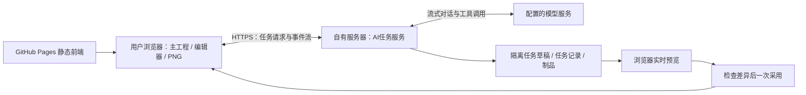

# M2工程与交付历史台账

本文件汇集原始批次记录，正文中的“当前”、未通过项、发布授权和测试数字只属于各自日期及冻结。现行顺序以[路线图](../07-roadmap.md)为准；不把历史通过数拼成新验收。

- [45-ai-authoring-and-unified-v1-plan](#doc-45)
- [46-validation-retention-audit](#doc-46)
- [47-m20-unified-v1-handoff](#doc-47)
- [48-m20b-shared-core-validation](#doc-48)
- [49-m20c-resource-io-validation](#doc-49)
- [50-m20d-preservation-conversion-validation](#doc-50)
- [51-m20e-library-conversion-validation](#doc-51)
- [52-m20f-native-workspace-validation](#doc-52)
- [07-roadmap](#doc-07)

<a id="doc-45"></a>

<a id="doc-45-m2-方向与实施边界流式创作助手统一-v1-与服务端任务"></a>
## M2 方向与实施边界：流式创作助手、统一 v1 与服务端任务

状态：2026-10-23用户确认设计，2026-10-25现已实现M2-0至4并通过M2-5公网必要旅程；本页保留产品方向并标明当前边界。应用版本号仍为 `0.2.0-m1-d2`，默认主界面使用新标识完整v1、原生会话及两个新仓库。M2-3场景制作与M2-4受限SVG/渐进同化已接通，M2-5服务器容器、可信公网IP HTTPS及Pages配置已上线，真实模型创作→保护采用→本机保存/导出/重载的必要联合旅程通过。旧产品自动化结果见[44](workspace-content-validation.md#doc-44)，不能用来证明新能力；现行回归结果集中在[05](../05-ai-and-generation.md)与[09](../09-quality-plan.md)。当前状态以[07](../07-roadmap.md)为准，精确AI合同和线上实际结果以[05第15节](../05-ai-and-generation.md)为准。

2026-10-24批次补充：M2-0a至e历史保留于48至[51](#doc-51)；f主会话/Canvas/工作台/样板与默认工程/个人库切换已实施，旧整页入口退役，当时必要检查归[52](#doc-52)。精确字段归04、容器/保全/转换归06、共享模块归03，交接归[47](#doc-47)。旧六库与原文件仅在兼容边界只读发现/保全/转换，原件可核验后下载，不自动转换用户数据。随后M2-1本地任务/流式续答、M2-2技能/物件草稿与保护采用已扩展到M2-3有限场景工具和M2-4本机SVG/参数物化；2026-10-25 M2-5公网HTTPS与Pages真实必要旅程也已通过，完整私密、两批扩围、自由创作与视觉质量等门槛仍逐项保留。


<a id="doc-45-1-本次定下来的产品"></a>
### 1. 本次定下来的产品

用户可以用中文提出场景或素材要求，看到文字和制作进度流式出现。AI 在独立任务草稿内使用应用提供的技能与工具，逐步建场景、摆素材、制作或修改 SVG、检查结果并调整。用户可以中途打断和补充要求，完成后检查整体差异，再一次采用到主工程。

首版接入**对话 API**，不接生图或图像编辑 API。PNG 导出由场景/SVG 的本地渲染完成，不需要再向模型购买一次“转图片”。模型能否读取参考图、回看截图，须对实际渠道验证；流式文字、工具调用和视觉输入是三项不同能力。

原有的单组件→组合→明确范围渐进同化继续保留，作为创作助手的一组工作流。仅换风格时保留位置、占地、通行、秘密和人工记录；用户提出布局创作任务时才启用对应领域工具。原可选 M2-L 的场景/布景/文字职责并入主线，旧编号只作追踪；不再按“先接生图、以后再做对话”安排。


<a id="doc-45-2-部署与职责"></a>
### 2. 部署与职责



| 部分 | 第一版承担的责任 |
|---|---|
| Pages 前端 | 首页、手工编辑、素材库、选择/图层、主工程 IndexedDB、撤销/快照、任务预览与采用、双受众 PNG |
| 自有后端 | TypeScript + Node.js + Hono；访问控制、provider 适配与密钥、技能版本、模型/工具多轮循环、取消、任务状态和事件重连 |
| 共享核心 | 无 React/DOM 依赖的完整类型、整数毫米几何、有限命令、范围/锁/依赖校验；前后端使用同一实现 |
| 任务存储 | 单服务实例，SQLite存任务/检查点/事件索引，私有文件保存原始/规范化SVG与记录；实际PNG由浏览器物化进入工程，这不是主工程云同步 |
| 浏览器适配器 | Canvas 预览、位图解码/参数物化、本地导出等浏览器能力；按任务绑定接收有限工具请求，返回可校验结果 |

浏览器只配置我们的后端地址，不持有模型 API key。自有服务器调用模型服务，不需要自部署模型或 GPU。线上后端须有 HTTPS、精确 Origin 白名单、真实鉴权及任务归属检查；CORS 不能替代鉴权。首版按维护者自用入口设计，不新增注册、团队或收费系统。Dockerfile、Compose持久卷/健康检查、Caddy HTTPS/SSE反代及分离环境已在真实服务器部署；[Pages前端](https://wojisama.github.io/sceneweave/)已配置[可信公网IP HTTPS后端](https://124.223.95.142)，发布40113648232成功。默认信任TLS1.3与LE YE2/IP SAN证书、真实模型工具及完整必要旅程实测见05第15节；短期IP证书的续期仍须维护。初次443/证书失败属于保留历史，不再是当前部署状态。

任务状态与制品可持久化、断线后可查询，**不等于首版保证关掉浏览器也能完成整个制作任务**。遇到需要浏览器渲染/解码的步骤，客户端离线时进入等待或暂停；恢复连接后核对任务代次和草稿版本再继续。服务重启保留最近有效检查点，对状态未知的模型请求不重复计费重试。完整无人值守续跑和服务端渲染以后按需要补齐。


<a id="doc-45-3-统一为一个新的完整-v1"></a>
### 3. 统一为一个新的完整 v1

这次统一的是开发中累积的产品模型和入口，保留已有建筑、室外、组件、图层、外观、历史和素材库能力。目标为一个主编辑器、一个完整工程读写格式和一个工程仓库；个人素材库仍独立管理固定内容和个人整理。

| 要统一的对象 | 准备与转换要求 |
|---|---|
| 场景/完整工程 | 使用新的格式标识区分 M0 几何 v1；新完整格式从版本 1 起步。不能只将现有 `schemaVersion`/`containerVersion` 改为 1 |
| 领域与历史 | 汇总有效 v3 场景、identity3、appearance1 与当前约束，迁入一份明确合同；不凭重编号获得持久建筑身份或任意拓扑恢复 |
| 旧工程与快照 | 盘点六库当前工程、自动/命名/保护历史、迁移原件和来源链；先可取回备份，再按独立副本转换并验证。不能悄悄只迁当前而丢旧历史 |
| 个人目录与备份 | [40](workspace-content-validation.md#doc-40)保留原中性v6载体合同；e已提供新完整v1中性载体/新库/备份，保持算法1身份、内置补标、许可、私密模板与个人整理对应，见04/06/51 |
| 代码与入口 | 共享核心与原生主会话/渲染/新仓库已接通，旧读者/迁移器隔离到兼容边界；f已收敛旧整页入口，必要等价验收和原件取回收尾见52 |

现有源素材和固定版本不能随重构改义。旧历史若无法无损映射到新的可恢复身份，保留可导出、可取回的独立旧档案并明确限制；不得把“已备份”写成“可在新格式局部恢复”。数据保全完成前不删除旧 IndexedDB 或转换输入。后续真实不兼容变更仍需要版本演进，“统一 v1”不是永远免除迁移。


<a id="doc-45-4-技能工具与任务草稿"></a>
### 4. 技能、工具与任务草稿

技能是项目维护的工作方法，例如“制作海岸哨所”“画俯视家具 SVG”“逐件统一风格”，包含步骤、示例和检查标准。工具是应用真实提供的能力，例如读场景、找素材、绘房、放置、预览、保存 SVG。模型选择工具，任务服务执行循环；技能文件不能授予额外读写权限，安装在 Codex 中的技能不会自动成为 Sceneweave 的能力。

M2-2先开放场景/目录读取、独立物件放置与调整、透明度和草稿检查。M2-3现已按既有有限命令接入绘房、墙厚/顶点、附着门窗/入口，地形/道路/高差边/台阶坡道/用途区，固定组合/家具/散布及GM注记；工具只接受明确授权的Floor/图层/边界/既有实体与固定定义，不开放任意拓扑或秘密改写。M2-4接入受限SVG配方和配色/亮度/透明度同化，由浏览器独立物化实际资源。每个工具有严格输入、作用范围、资源限额和清晰错误；模型不直接提交任意完整工程，也不运行JavaScript、shell或下载任意URL。

任务绑定主工程基线、明确范围与可用工具；草稿有独立递增版本。流式文本可以即时显示，工具参数必须收完整并校验后才执行。成功步骤只修改隔离草稿；场景步骤重放后显示差异，SVG/样式配方须等待浏览器生成并校验真实资源，不能把服务端账本通过当成图片已完成。暂停/追加要求不丢草稿；取消后迟到结果不能复活。

最终采用重新验证主工程基线、范围、锁、完整资源和真实依赖，先成功落保护点，再按 CAS 形成一笔新事务和一个撤销单位。主工程等待期间若有新编辑，拒绝旧基线直接采用；允许保存草稿成果并在新基线上重新计算。首版不实现自动三方合并。

现有每次采用最多 256 条展开命令的边界继续保持：最终差异按完整依赖计数，多轮工具调用不能规避总采用预算。超限先缩小任务，或由用户明确安排后续独立批次；不暗中把一次采用拆成多个主工程提交。全场大制作能力因此需分阶段验证。


<a id="doc-45-5-svg-与导出"></a>
### 5. SVG 与导出

M2-4已将运行时**可编辑SVG源＋固定PNG结果＋不可变来源版本**接入完整v1，保留原始与规范化源及实际PNG字节/hash/处理器版本；现有静态PNG/JPEG/WebP入口继续可用。不接生图API，不从任意URL下载素材，也不以完整SVG替代语义场景。

首批采用有界静态SVG子集：明确viewBox、有限svg/g/defs、图形/路径/填色/线条及线性/径向渐变；逻辑尺寸、锚点和占地仍来自定义/实例。拒绝活动XML/DOCTYPE/实体、脚本/事件、外部资源、image/text/字体/CSS、foreignObject、动画与滤镜。源经确定性解析规范化和复杂度/字节检查，通过隔离Blob图片解码/Canvas生成真实PNG，不插入应用DOM。完整校验重读两源、核对hash/规范化/尺寸比例，再实际栅格化逐RGBA比较PNG；缺能力、损坏、取消均不产生可采用的半套工程。精确语法和保护值见04/05。

授权按单件→公开组合的存活成员→明确目标和边界的局部范围展开，也可明确允许本任务新建物件；不自动扩散到全图。仅换外观保留位置、逻辑尺寸、占地、支撑、通行、秘密及组合/散布人工记录，原素材和祖先许可不改义。源/PNG进入当前及所选历史的真实闭包、冷保存重开、普通/历史离线包、有限外观恢复和个人库中性载体；含SVG的固定内容用算法2，无SVG旧内容保持算法1身份。

场景仍用语义对象保存墙、门、地形、物件、组合和图层；把整张地图画成一幅 SVG 不能冒充可独立编辑的场景。每件 SVG 保留源文本和固定派生字节/hash/处理器版本，保存重开不依赖再次调用模型。玩家导出继续从已过滤的场景和实际像素生成；SVG 源与生成来源默认属于主持人工程，不随玩家 PNG 泄漏。


<a id="doc-45-6-实施顺序与完成条件"></a>
### 6. 实施顺序与完成条件

| 顺序 | 切片 | 做到什么算完成 |
|---|---|---|
| 1 | **M2-0：统一完整 v1 与共享核心** | 先冻结格式标识/身份/快照/目录转换表与支持矩阵，再实现主格式、主仓库及核心复用；真实备份/转换/重开与关键手工能力等价。同步最小 provider 能力探针，避免把能力假设带入任务引擎 |
| 2 | **M2-1：自有后端与流式连接** | 本地 Node/Hono 服务、配置/鉴权、provider 适配、文本与工具调用流解析、取消和错误；SQLite/制品存储及事件重连。实际渠道通过流式文本和至少一轮工具结果续答 |
| 3 | **M2-2：技能/工具与实时草稿** | 中文请求→读场景/找素材→多步工具→草稿预览→打断修正→一次采用/撤销；过期/锁/超限/断线和保存失败可恢复 |
| 4 | **M2-3：场景制作工具扩展** | 建筑、室外、组合/散布、GM文字按能力清单开放；用既有原创场景检查可继续手改与有限恢复，不把结构连通当全图寻路 |
| 5 | **M2-4：SVG 与渐进同化** | 新/默认/用户素材制作或派生，单件→组合→两个明确批次；源与PNG入库、离线往返、局部恢复和双受众导出；不调用生图API |
| 6 | **M2-5：部署与联合验证** | Pages＋实际HTTPS后端联通、鉴权/CORS、流式中断/重连、任务与制品生命周期、正确性/隐私/存档；按用户通知组织完整回归 |

M2-0至2本地流程已实施，M2-3场景制作与M2-4SVG/渐进同化已接通；完成条件表保留原任务范围，不能仅凭代码将实际渠道完整场景质量或线上验收一并勾完。a至e历史见48至[51](#doc-51)，f当时结果见[52](#doc-52)；v6原证明转换、v1–v5历史独立保全及旧算法1精确key保持。M2-5现已在真实Pages/Chrome与可信公网HTTPS上通过grok明确配方任务：9次模型请求、44展开操作/5草稿步，双房/内外门/院路、灯具/GM线索、96px SVG及brightness0.8/opacity0.7；保护快照后一次采用到r1并保存，完整包43条目逐hash/源与实际PNG、4K主持人PNG及重载再导出通过，0页面错误/失败API，应用凭据未进local/sessionStorage。容器内部与重启/取消/备份还原/合成7日清理分项结果、初次公网失败及后续成功均归05第15节。现行回归集中在[05](../05-ai-and-generation.md)与[09](../09-quality-plan.md)；完整私密/两个明确批次扩围、自由创作与视觉质量、34正式性能、人工P3、完整SCN、真实小团、跨浏览器/配额/UVTT欠项独立保留。


<a id="doc-45-7-已知与待验证"></a>
### 7. 已知与待验证

- 原准备时只测/models；M2-1已验证grok-4.5文字流、工具续答、本地中止/错误和生产链路，实际范围及token参数限制集中05第11节。M2-2另以合成工程通过一笔真实物件调整/检查，详05第12节；M2-5后续已通过公网HTTPS/Pages真实场景与SVG/风格明确配方必要旅程，详05第15节，自由创作与视觉质量仍未签收。
- 对话模型由服务配置选择；先验证流式参数拼装、工具调用ID、结果续答、错误、取消及用量。视觉回看单测，不从模型名称推断支持；若不支持，明确提示，只使用结构/渲染诊断，用户目视审阅仍可用。
- M2-1任务/事件/连接工具schema、预算、七日保留和应用令牌已实现；M2-2草稿/采用合同扩展到M2-3场景操作及M2-4SVG/样式配方，严格schema、范围与限额已落地，详05。当前连接能力声明svg:true表示支持受限SVG流程，vision仍为unverified，不证明模型已能回看图像。
- M2-5服务器容器、可信公网IP HTTPS、Pages地址配置和必要创作旅程已通过；使用IP证书不等于正式品牌域名已经选择，也不证明长期可用性或全部QA完成。完整私密、两个明确批次扩围和视觉/人工验收仍待，精确证书时段、生命周期证据与边界见05第15节。测试key不写入仓库、前端、工程、日志或本页；账号/协作、主工程云同步、任意代码执行、服务端全自动渲染和生图API未纳入首版。


<a id="doc-45-8-资料依据与验收资料整理"></a>
### 8. 资料依据与验收资料整理

[GitHub Pages 官方说明](https://docs.github.com/en/pages/getting-started-with-github-pages/what-is-github-pages)确认其静态托管职责，因此保留当前前端部署、另设任务服务是本项目的架构选择。[工具调用文档](https://docs.x.ai/developers/tools/function-calling)说明模型请求工具与应用执行工具的循环；它不证明中转渠道完整兼容。[浏览器流读取](https://developer.mozilla.org/en-US/docs/Web/API/Streams_API/Using_readable_streams)与[SVG 作为图像](https://developer.mozilla.org/en-US/docs/Web/SVG/Guides/SVG_as_an_image)提供浏览器实现依据，不替代项目自身的协议、SVG校验和实际测试。核对日期：2026-10-23。

验收资料盘点与具体去留建议单列于[46](#doc-46)。后续用户明确要求清理work/与docs/evidence/，现已执行；报告保留当时的结论/失败/限制，必要B5输入移入专用测试夹具目录，原始附件不再可本地取回。本次清理不改变M2开发顺序或验收结论。


<a id="doc-46"></a>

<a id="doc-46-验收资料保留与清理盘点"></a>
## 验收资料保留与清理盘点

日期：2026-10-23。初次盘点阶段只读评估，下面第1–6节保留当时数字与建议；用户随后明确要求清理work/和docs/evidence/，现已执行，结果见[第7节](#doc-46-7-按用户要求执行清理)。最小测试输入已迁出，其余原始附件删除，没有另复制大包或改写Git历史。


<a id="doc-46-1-结论"></a>
### 1. 结论

保留可执行测试、最小夹具、简短验收结论和未解决问题；优先整理大型机器报告、重复图片与可重建缓存。历史报告有用，但不必在每份主文档重复几十段过程记录。日常入口只需要当前状态、下一步和证据链接。

本次发现的主要成本是 **759.1 MiB 原始证据**，其中三份内嵌附件的压缩报告占219.2 MiB；23份验收Markdown报告本身合计仅2,101行、285 KiB。测试源码27,321行承担可运行的行为保护，不宜按行数删除。


<a id="doc-46-2-实际体量"></a>
### 2. 实际体量

字节为文件逻辑长度；MiB/GiB按1024进位。文本行数只计常见文本后缀（md/txt/json/jsonl/log/csv/ts/tsx/js/mjs/css/html/svg/yml/yaml/xml/snap）且排除含NUL的文件，不含sha256/list等其他后缀，不展开压缩包，也不等同于有效需求或测试用例数。文件数与字节统计全部文件。

| 类别 | 文件 | 文本行 | 逻辑体积 | Git状态 |
|---|---:|---:|---:|---|
| `docs/*.md` 全部顶层文档 | 45 | 7,106 | 1,094,670 B | 42已跟踪、3未跟踪 |
| 其中验收报告（名称含validation，加25） | 23 | 2,101 | 292,176 B | 21已跟踪、2未跟踪 |
| `docs/evidence/` | 1,299 | 530,768 | 795,931,945 B / 759.1 MiB | 1,193已跟踪、102未跟踪、4被忽略 |
| `tests/`，含浏览器测试/辅助 | 57 | 11,664 | 983,155 B | 54已跟踪、3未跟踪 |
| `src/**/*.test.*` | 98 | 15,657 | 1,158,449 B | 93已跟踪、5未跟踪 |
| `work/` | 3,344 | 12,607,186 | 2,428,559,127 B / 2.26 GiB | 被忽略 |
| `performance-results/` | 279 | 4,363,676 | 1,032,354,678 B / 984.5 MiB | 被忽略 |
| 根部 `test-results/`＋`playwright-report/` | 6 | 89 | 1,516,041 B | 被忽略 |
| `dist/`＋`dist-performance/` | 132 | 不计生成代码行数 | 5,802,344 B | 被忽略 |
| `node_modules/` | 9,107 | 不计依赖源码行数 | 169,745,785 B | 被忽略 |
| `.git/` | 2,911 | 不适用 | 544,138,881 B / 518.9 MiB | Git内部对象等 |

`docs/evidence/`已跟踪部分为782,573,216 B；未跟踪部分13,076,004 B；被忽略部分282,725 B。未跟踪资料来自已完成的新内容/回归批次，不能当作临时垃圾。`coverage/`本次无文件。


<a id="doc-46-3-最值得治理的具体内容"></a>
### 3. 最值得治理的具体内容

| 原始报告 | 压缩字节 | 解压字节 | 内容特征 |
|---|---:|---:|---|
| `docs/evidence/m1-d-outpost/browser-final.json.gz` | 93,104,531 | 138,754,282 | 189个内嵌附件body |
| `docs/evidence/m1-c2/browser/full-run.json.gz` | 68,845,880 | 97,197,875 | 130个内嵌附件body |
| `docs/evidence/m1-c1d/browser/full-run.json.gz` | 67,914,290 | 93,670,192 | 112个内嵌附件body |

三个压缩文件合计229,864,701 B（219.2 MiB）；解压后约99.8%字符来自附件body。应把结果摘要与附件分开存，并迁出普通Git中的大包，保留批次/用例→内容hash→归档位置的关系。

文件级SHA-256比对发现 `docs/evidence/` 有62组相同字节、134份额外副本，额外逻辑体积189,619,006 B（180.8 MiB）。例如C5一幅4K study图保存了16份，每份4,764,733 B；另有island-500与study-2000各6份相同图。不同受众/批次可以指向同一字节，但必须保留它们各自的运行和断言记录，不能去重后丢掉配对关系。

被忽略的 `work/`、`performance-results/` 等中有753个文件、464,366,594 B（442.9 MiB）与docs证据完全相同，是后续按清单清理本地副本的优先对象。这些数字有内容重叠，不能与前三大报告直接相加当作总节省量。尚未展开tar/zip内部查重。


<a id="doc-46-4-现在不能直接删除的资料"></a>
### 4. 现在不能直接删除的资料

| 内容 | 原因及处理 |
|---|---|
| 单元/浏览器测试、TS夹具 | 是现行产品的可执行检查。新v1迁移时按能力迁移/合并，旧模块退役后才删除失去对象的重复测试；几何、秘密、存档、CAS/撤销等行为覆盖继续保留 |
| B5真实负载最小夹具 | `docs/evidence/m1-b5/final/manifest.json`和四个`fixtures/{study,island}-{500,2000}.sceneweave`实际被性能工具及配置后的浏览器测试使用，四包合计961,333 B；须先更新读取路径再移动 |
| 源SVG、产品PNG、manifest/许可 | 属于实际产品资产，不属于验收垃圾；素材测试直接读取，固定工程也依赖它们 |
| 32/33/34相关性能资料 | 完整性能门未通过，保留方法、原始样本、失败/未完成批次和对照来源，不能用新v1或一次成功运行抹去旧结论 |
| 44初轮失败及修正/截图异常 | 保留“203项首轮200/3、相关14/14复验”事实和关键现场；不能精简成“一轮203全绿” |
| 仅存在忽略路径的文件 | `docs/evidence/m1-c2/diagnostic/test-results/`的4个失败附件被`test-results/`规则忽略；它们尚不能视为已进Git备份 |
| 本次回归work原件 | `work/regression-20261023/`有353文件、134,852,088 B；紧凑首轮/复验索引分别有290/19条`retained:false`，索引不代表对应字节已归档 |

当前复现路径见[贡献说明](../../CONTRIBUTING.md)及 `tools/performance/archived-fixtures.mjs`；测试通过 `SCENEWEAVE_B5_FIXTURE_DIR` 等配置读取实际包。夹具复制件能否移除需检查默认值、环境配置和历史索引。


<a id="doc-46-5-建议实施的清理顺序"></a>
### 5. 建议实施的清理顺序

1. **先减少阅读负担。** README与docs导航只保留当前状态/下一入口，历史报告集中列目录；当前需求在01–12维护，旧报告不继续追加新方案。本轮已执行入口精简和AI旧方向纠正。
2. **停止制造新的大包。** 后续沿用 `tools/testing/compact-reporter.mjs` 的紧凑结果和hash附件；只保存支撑结论所需的关键现场，避免附件内嵌base64及重复源码/dist快照。未保留附件明确标记，不假称完整归档。
3. **先迁档并取回核验。** 为上述三份大报告、C5重复图及唯一失败资料准备清单。选定可长期访问、权限合适的归档位置，记录大小/hash/批次/用途/完整性，实际取回核验，再更新索引和引用，最后从普通Git当前树移除迁出的副本。公开归档前检查私密内容与凭据。
4. **清理本地重复与缓存。** 先处理已核对的753份重复副本；根部dist和依赖可重建。test-results/playwright-report须先确认失败现场去向。`work/`、冻结源码/生产包和performance-results逐项处理，不整目录清空。
5. **随统一v1退役旧代码测试。** 新功能等价、旧数据转换和关键回归完成后，合并重复入口用例与旧版本专属实现测试；必要旧格式转换夹具和负例继续保留。不能先删测试再以“没有失败”通过重构。

以上是初次盘点时的建议，随后用户选择直接清理两目录，实际执行按第7节；没有另外迁档，不将资料整理作为M2功能开发前置阻塞。


<a id="doc-46-6-git体积与保留规则"></a>
### 6. Git体积与保留规则

180.8 MiB是工作区重复文件的逻辑体积，不是Git历史可以节省的量；Git通常已复用相同字节的blob。删当前文件并提交仍会保留旧提交中的大对象。当前 `git count-objects -vH` 显示2,881个loose对象、约525.59 MiB分配体积、无pack；它与上表逻辑字节口径不同。

若以后确实需要缩减历史体积，须独立设计历史重写、远端/分支和其他工作区迁移；本次不做强推、删Git对象或历史重写。先规范新产物和清理当前树即可控制后续增长。

普通Git长期保留：测试/必要夹具、QA定义、简短结论与失败修正、可复现命令/环境/代码指纹、最小结果摘要、关键截图和归档清单。大型完整原始报告、全套4K/trace、整份源码/dist副本进入长期归档。归档可去重，事实、失败与未通过边界不得改写；唯一字节没有可靠去向前继续保留。

复核方法：`git ls-files -z`及未跟踪/忽略列表分类，Python按文件stat和UTF-8文本换行计数，SHA-256逐文件查重；gzip解压JSON统计附件body。未运行产品测试，没有为此次盘点再制造原始报告大包。


<a id="doc-46-7-按用户要求执行清理"></a>
### 7. 按用户要求执行清理

2026-10-23用户明确提出“本地work、原始验收附件docs/evidence都想清理”。此授权替代此前仅盘点/先迁档的安排：保留测试输入和结论，删除两目录的其余原始产物，不另复制为隐藏大包。

| 目录 | 删除文件数 | 删除逻辑字节 |
|---|---:|---:|
| work/ | 3345 | 2428559970 |
| docs/evidence/ | 1299 | 795931945 |
| 合计 | 4644 | 3224491915，约3.00 GiB |

已先迁出四个B5工程包（961333字节）及确切manifest（39886字节），共1001219字节，放在[专用夹具目录](../../tests/fixtures/performance-b5/README.md)。保持原字节/完整summary/许可与内部路径，文档和性能工具示例指向新路径；它们是可执行测试输入，没有保留整套测量附件。

四组原始hash及包内身份/计数/范围/资源摘要已通过现有copyArchivedFixtures加载器校验，未运行浏览器、全量回归或正式性能。历史报告增加附件可用性说明，旧附件链接改为历史路径文字；当时的通过/失败/未通过结论不更改。未提交的新内容/回归附件也在此次清理范围内，不能再宣称它们可从本地取回。

work/与docs/evidence/现均不存在；docs/evidence/已加入忽略规则，后续临时运行输出按需生成、清理，不默认进入Git。performance-results/、依赖、当前构建目录和浏览器实际工程数据不在本次删除范围。没有改写Git历史或自动提交推送。


<a id="doc-47"></a>

<a id="doc-47-m2-0统一完整v1与共享核心实施交接"></a>
## M2-0：统一完整v1与共享核心实施交接

后续实施更新：M2-0a至e历史结果保留于48至[51](#doc-51)。f原生Workspace/Canvas/Workbench/样板已切换新完整v1及sceneweave-projects、sceneweave-library，旧整页入口退役，旧只读发现/保全/转换继续保留；实施完成、必要定向检查已通过，实际219项定向、11项Chrome联合及1项补充专项、正常生产/构建和原件取回结果见[52](#doc-52)。下一开发入口为M2-1后端与流式连接，不自动转换用户数据。以下第1至6节及末段保留a准备时的代码盘点/未实测事实，不把当时描述当作当前实现状态。

2026-10-24。起点为已推送`0367c5f`、应用`0.2.0-m1-d2`，工作区原有`todo.md`独立编辑保留。用户本轮授权**准备M2-0**；已核对代码并定下本文和04/06的新合同，尚未实现新格式、共享核心、转换器或AI服务。本轮没有访问用户IndexedDB、调用模型、运行产品回归或新建原始验收包。

45确定产品方向，本文把M2-0落实为实施入口。字段以[04](../04-scene-document.md#完整v1现行合同2026-10-24)为主，容器/仓库/转换以[06](../06-storage-and-export.md#完整v1现行存储合同2026-10-25)为主，模块边界归03，排期归07，验收归09。


<a id="doc-47-1-已核对的事实与决定"></a>
### 1. 已核对的事实与决定

| 实际情况 | 本轮确定的处理 |
|---|---|
| 最新能力分散在core/v2几何、v3场景、v4结构witness、v6身份/外观，v6本身仍依赖旧代 | 吸收真实实现为`src/shared`，新主路径不再经旧文档视图往返；不是换名或长期re-export |
| 六个工程库都是Dexie schema 1/native IDB version 10 | 新主工程库`sceneweave-projects`，个人库`sceneweave-library`，各从schema 1开始；保留旧库只读，数据库版本与产品格式分开 |
| 旧M0也是容器1/场景1 | 新工程使用`sceneweave-complete-project`、新场景使用`sceneweave-scene`，版本从1开始；先识别format，不能按数字1分发 |
| 当前工程升级只迁当前，history包不含自动快照和原件链 | 增加独立完整迁移保全格式；v6家族统一转换，v1–v5全部旧历史独立保全，首批只转换其当前工程 |
| 目录身份不含载体格式/ZIP bytes | 普通位图/参数素材保留身份算法1和旧精确key，仅更新新载体字节hash；SVG固定内容另有显式身份域 |
| 个人整理可为未安装素材存在，现有备份只包含所选安装项 | 迁移必须捕获全库组织记录和安装状态；不能拿一个最多64项的旧库备份当全部512项已保全 |
| 完整资源校验会使用ImageBitmap/Canvas | 共享纯规则、字节/容器和真实像素适配分层；缺像素执行能力不能报告“完整校验通过” |
| 当前previewPrepared只追加素材，adoptPreview不先落保护点，命令还有领域混批限制 | 另定原子候选接口；M2-0冻结边界，M2-2再实现多步任务与最终一次采用，不能循环主工程execute来模拟 |


<a id="doc-47-2-新主合同的边界"></a>
### 2. 新主合同的边界

新完整v1承接最新所有持久内容：整数毫米场景、用户层、建筑/室外/组合/散布与人工记录、固定内容/资源/许可、完整外观图、物件/组合/室外出生和拓扑身份。去掉多代类型继承；旧版本只留严格兼容读者与转换器。

纯`ProjectData`不含Blob、Canvas或仓库对象；实际图片/SVG字节由`ProjectBundle`的资源端口提供，完整读取必须同时取得并验证。转换不能只拿JSON模型就宣布完整工程可重开。主工程不携带完整对话、服务凭据或任务运行状态。

SVG源/规范化源/固定PNG引用在v1字段中提前定义，M2-0转换输出为空；未实现真实SVG校验时，非空源明确返回不支持，不半验后采用。M2-4实现该能力时沿用既定字段和资源闭包，不再把源文件塞入任意metadata。

首批完整保留v6已有lineage/root、出生/拓扑token及墓碑；新当前工程只分配一次新sceneId并从revision0开始。历史摘要明确ownerSceneId，历史内容保留原sceneId/revision。建筑witness不序列化、不跨转换继承；不增加任意拓扑恢复。


<a id="doc-47-3-转换支持矩阵"></a>
### 3. 转换支持矩阵

| 来源 | 新当前工程 | 原有全部历史 | 新v1原位局部恢复 |
|---|---|---|---|
| M0 v1、v2、v3 | 转换到最新完整语义，补默认层/外观及当前身份 | 自动历史及原件链进入完整legacy保全包 | 不凭同ID追认旧连续性；可从保全包显式另建独立工程 |
| v4、v5 | 当前完整内容转换，已有身份/外观保留，只为当前缺失类别分配身份 | 自动、命名、保护及原件全部独立保全 | 首批不开放跨旧历史恢复；不能把当前补出的token复制给旧快照 |
| v6 | 完整转换当前 | 同一家族的命名/保护转换；自动历史转只读`imported-auto`；原件链保全 | 保留原本可证明的物件/组合/室外恢复；拓扑不连续或建筑旧会话witness仍拒绝 |

这是一轮明确收敛范围，不等于删除较早历史。legacy包和旧库都能取回；恢复为独立工程与在当前工程局部恢复须分开标识。所有固定定义及非活动祖先、私密模板、实际资源/许可都必须跟随其相应历史，不能只存一组实体JSON。


<a id="doc-47-4-先保全再转换"></a>
### 4. 先保全，再转换

最小操作单位为一个旧工程家族或一个完整个人目录。只读发现已有库，逐库一个只读事务捕获其所需记录；不存在的库不创建。捕获内容、源元数据/历史/资源/原件索引形成sourceFingerprint。IndexedDB行保全其确切字段值，已有Blob保全字节；不把新序列化JSON称为原磁盘文件。

普通`.sceneweave`和旧`.sceneweave-library`不足以完成保全。06定义迁移set：完整清单＋有界分卷，包含当前、全部自动/命名/保护、资源/许可/绑定、原件来源链，目录还包含所有organization-only记录；每份都有hash和完整性状态。只有重新读取所有选中分卷核验完整后，才能进入转换发布；下载已开始不等于备份可取回。

转换过程为`captured → backup-verified → prepared → committed → verified`。先以唯一jobKey预留journal和ID映射，状态推进使用jobVersion CAS。工程内容/资源/历史在目标单库原子写入为preparing，同时更新既有journal；冷读完整验证后以目标CAS开放。个人库先写不公开的conversionStaging，冷读后按catalog revision一次发布，旧可用条目/整理在失败后保持。崩溃重试复用同一job/ID映射，不能生成第二份或覆盖后来手工编辑的目标。

源库从头到尾不写不删。发布前后检查源指纹，变化时显示目标来自哪次捕获，并要求重读/明确补迁；不能宣称跨七个旧库、新工程库和新目录库存在单事务CAS。全库合并先计算目标累计预算；超限选择较小明确范围或保全后暂不转换，不能静默丢历史、拆采用事务或提高容量承诺。


<a id="doc-47-5-共享核心和适配器"></a>
### 5. 共享核心和适配器

```text
src/shared/{model,validation,geometry,commands,history,appearance,projection,project,catalog,ports}
src/application/workspace                 唯一编辑会话、候选、撤销与保存调度
src/platform/browser/{storage,images,render,files}
src/compat/legacy/{v1,v2,v3,v4,v5,v6}        严格旧读者、保全及转换
src/content                              与UI无关的内置素材定义/provider
```

依赖方向是`editor → application → shared`，平台实现端口，兼容层将旧输入转为新模型。shared不得导入editor/React/Dexie/Hono/DOM渲染器；纯投影要搬入shared，不从history反向导入浏览器renderer。源代码文件夹不是另一个用户格式版本。

窄端口明确ID分配、时钟、hash/字节、图片解码/编码和像素处理、存储。ID/时间作为准备上下文注入，重试复用。Blob/Web Crypto可存在平台实现，但shared必须有单独无DOM的编译入口和实际Node导入检查；当前全项目tsconfig含DOM，普通typecheck不足以证明边界成立。

内核认证仍只相信本进程严格解析后深冻结的对象引用。Worker/网络/持久化重读重新验证；资源三元JSON之外另绑定本机独立捕获的不可变字节闭包/受控资源句柄代次，不能凭相同端口或hash声明省略字节/hash/解码。authoringSources另验并绑定完整资源证明；当前依赖/许可/预算与外观真实像素分别检查，不能传`validated:true`。旧来源链认证只用于兼容读取，新主保存不递归调用六代写入器。


<a id="doc-47-6-原子候选接口的准备范围"></a>
### 6. 原子候选接口的准备范围

04冻结`AtomicCandidate`的基线、允许范围、步骤来源、最终读写集合/差异和展开预算语义；精确实现安排在M2-2。只读查询、参数物化与草稿步骤不写主工程revision/undo。

候选从完整基线的独立副本计算；如跨多个命令领域，须在独立草稿中按已验证顺序重放并记录真实身份推进，再整体校验最终结果。最终采用用本机生成的真实成本和依赖，不能信任服务端自报或把JSON差异条数当命令成本。保护点成功、源/场景/元数据CAS后，主工程只提交一次revision+1/撤销。现有普通命令类别限制在替代接口验证前不移除。


<a id="doc-47-7-可直接执行的实施切片"></a>
### 7. 可直接执行的实施切片

| 顺序 | 切片 | 交付与必要简单验证 |
|---|---|---|
| 已完成准备 | **M2-0a 合同/映射** | 本文、04/06/03/07/09一致；已核对代码，不把文档检查记为产品通过 |
| 已实现/适用定向通过 | **M2-0b 共享模型与纯规则** | 新类型/严格schema、几何/依赖、身份/外观/纯投影和ID/时钟端口；无DOM独立编译、Node导入、关键等价向量；不切旧存档写入 |
| 已实现/适用定向通过 | **M2-0c 字节/像素端口与新完整IO** | 新标识/严格ZIP/资源端口、浏览器真实解码/派生像素；当前/所选历史实际字节与许可往返，六代旧读者拒绝；实际49，不把测试格式适配当转换器 |
| 已实现/必要定向通过 | **M2-0d 工程保全/转换/主仓库** | 完整保全set/真实重读凭证、六代当前/v6全家族、旧档案、固定journal映射与原子提交/冷读开放；124项定向/4项Chrome及构建见50，未转换用户数据 |
| 已实现/必要定向通过 | **M2-0e 个人库与内置内容** | 新载体/新库/所选备份、算法1精确key、全组织/安装状态、私有暂存冷读一次发布、62补标/6精修保持；实际检查见51 |
| 已实施/必要定向检查已通过 | **M2-0f 主会话和入口收敛** | 新完整v1主会话/Canvas/Workbench/样板及两个新库成为默认，旧整页入口收敛、legacy只读保全转换保留；219项定向、11项Chrome联合及1项补充专项、正常生产/构建和139模块边界通过，实际结果归52 |

每个切片只运行适用的定向检查、类型/正常构建和少量真实闭环；完整回归等用户通知，34正式性能保持后置。provider最小探针可与准备并行，但本轮未调用；M2-1接流式文本/工具结果续答，不能用models列表代替。此准备没有要求服务器域名或重复确认已有架构。


<a id="doc-47-8-代码依据和仍需实测的事"></a>
### 8. 代码依据和仍需实测的事

- 当前六库发现/只迁当前：[project-registry.ts](../../src/editor/workspace/project-registry.ts)；当前完整合同/历史hash/副本：[project-file.ts](../../src/io/v6/project-file.ts)；全库预算/CAS：[storage.ts](../../src/io/v6/storage.ts)。
- 身份/拓扑和命令类别：[identity.ts](../../src/core/v6/identity.ts)、[commands.ts](../../src/core/v6/commands.ts)；当前候选范围：[workspace.ts](../../src/editor/v6/workspace.ts)。
- 目录固定hash与中性闭包：[content.ts](../../src/catalog/content.ts)；组织/库CAS：[repository.ts](../../src/catalog/repository.ts)；旧所选备份：[backup.ts](../../src/catalog/backup.ts)。
- 浏览器依赖及派生像素：[resources.ts](../../src/io/v6/resources.ts)、[prepare.ts](../../src/io/v6/prepare.ts)；内置provider反向依赖：[builtin.ts](../../src/catalog/builtin.ts)。

真实用户各库存量、坏行、预算/磁盘和可取回备份目前没有扫描；新schema、保全set读写、目标仓库和Node运行尚未实现或实测。只读代码盘点不能关闭QA-AI-16，也不继承旧44为新v1回归证据。


<a id="doc-48"></a>

<a id="doc-48-m2-0b共享模型与纯规则"></a>
## M2-0b：共享模型与纯规则

2026-10-24，起点main/0367c5f及未提交的M2-0a准备稿。用户要求继续按设计实施，本批完成b；应用版本仍为`0.2.0-m1-d2`，现行UI/六库/v6读写继续运行。下一入口为M2-0c，新完整文件读写、真实像素适配、保全转换和任务后端尚未实现。本文只记录必要检查，不新建work或原始验收附件目录。


<a id="doc-48-本批实现"></a>
### 本批实现

- [共享入口](../../src/shared/index.ts)及37个源码模块：独立完整`SceneDocument`（sceneweave-scene/schema1）、完整`HistoryIdentity.version1`（承接identity3）、AppearanceGraph、纯ProjectData与资源字节端口；严格字段/JSON/预算、几何、依赖、命令、外观及有限恢复实现均在shared，不导入旧core/editor/io/render。
- 场景、建筑、室外、组合、层和散布直接使用同一新模型。有效锁视图保持新format/schema和完整层信息，不改成旧v2/v3。256按实际实体/成员/排除记录及中间步骤展开；普通命令类别隔离保持，草稿不能同批解锁后编辑。
- 固定源/祖先/派生元数据、非活动定义根、源→层→实例覆盖及私密模板保持。完整出生/墓碑和室外拓扑身份、有限物件/组合/室外/散布恢复，以及不持久化的C2会话witness已提取；没有新增任意拓扑或持久建筑恢复。
- 玩家投影提为纯模块，历史恢复不再反向依赖浏览器renderer。ID通过PreparationContext注入；时钟端口供应用准备上下文提供确定时间。固定散布/外观/拓扑hash保留原算法域，新ProjectData内容hash使用04规定的UTF-16键序规范JSON。
- [ProjectData校验](../../src/shared/project/validate.ts)只认证纯JSON/身份/外观、图片元数据及许可闭包/保护预算，不读取图片字节或发完整资源凭证。非空authoringSources明确unsupported-feature；SVG运行时继续归M2-4。ProjectBundle字节端口仅定义交付边界，完整字节/解码/派生像素认证归c。
- [无DOM配置](../../tsconfig.shared.json)使用ES2023、types为空、NodeNext。新相对导入为显式.js；[检查工具](../../tools/check-shared.mjs)以TypeScript AST检查依赖/平台调用边界，实际发射至系统临时目录并在Node原生ESM导入、执行简单闭环，结束后清理临时编译物。

这是迁移过程中的独立新内核；旧规则尚未接向它。M2-0f须在转换/等价流程成立后统一主路径并退役重复旧入口，不能长期维护两套稍有不同的规则。当前未切换写入器，不把测试用例的格式适配当作生产转换器。


<a id="doc-48-实际简单检查"></a>
### 实际简单检查

环境：本机Node `24.14.1`，TypeScript `5.9.3`，Vitest `4.1.12`，Vite `7.3.7`；未启动Chrome或调用模型。

| 命令 | 实际结果 | 覆盖及限制 |
|---|---|---|
| `npm run check:shared` | 通过，37个源码模块 | AST依赖边界、无DOM独立编译、真实Node ESM；执行场景显示命令、身份/外观、ProjectData/hash与玩家投影，不含图片适配器 |
| `npx vitest run src/shared` | 最终4文件45/45通过，2.15秒 | scene 12、commands 12、history 12、project 9；代表性旧夹具对照和关键失败边界，无完整回归声明 |
| `npm run typecheck` | 通过 | 现行应用、共享内核和测试类型；不能单靠此项证明无DOM，另有上项 |
| `npm run build` | 通过，Vite阶段3.61秒 | 正常生产构建；仍有原有依赖注释/混合动态导入/大chunk提示，不据此声明优化或新UI已验证 |

45项包括：VIS书房/岩岛和私密组合的几何/依赖/GM与玩家投影等价；完整/部分共墙与门端点、真实旋转占地/道路/有限全宽高差通行；支撑/层/递归注记锁、失败无部分输入改动；中间组合展开预算、稳定散布与人工记录；出生/墓碑/换拓扑再改回、固定外观源/参数/私密组合；范围外后续编辑保留的有限恢复及C2 witness失效；严格新标识/未知键/访问器/非JSON/伪冻结输入、元数据与许可闭包、UTF-8与内容hash。

首轮没有隐去：45项中38通过/7失败。6个历史测试的反向适配漏回旧`format:'sceneweave'`，另1个门端点前后差约1e-12但测试要求浮点完全相等；修正测试适配后第二轮43通过/2失败，另暴露一处断言错误地要求报错包含锁定注记ID，而新旧规则均报告其依赖根domain。最终补齐精度与旧实现同拒绝断言后45/45通过。新旧完整候选仍精确比较，没有为通过测试放宽领域规则。

首次无DOM检查还发现放置schema被局部变量遮蔽，已改名修复；导入检查器最初用正则误读字符串，改用AST。许可正文另拒绝无法无损UTF-8往返的孤立代理项；普通JSON规范化和UTF-8编码有对应检查。


<a id="doc-48-qa与后续入口"></a>
### QA与后续入口

| 追踪 | 本批状态 |
|---|---|
| QA-V1-01 | 场景/ProjectData严格字段与新旧标识适用子项通过；真实新旧容器分发留c |
| QA-V1-02 | b范围内无DOM/Node导入与代表性规则等价通过 |
| QA-V1-03 | 纯身份/墓碑/拓扑/有限恢复子项通过；真实家族转换/owner/imported-auto与冷读留c/d |
| QA-V1-04/05/06 | 全scope保全、实际转换/库CAS/全目录映射未运行，留d/e |
| QA-V1-07 | 纯JSON所有权/三元认证、元数据/许可守卫子项通过；真实字节/句柄代次/像素适配留c |
| QA-V1-08 | 新主会话/UI混合旅程未运行，留f |

不关闭整个QA-AI-16/M2-0，不继承44为新内核全量回归；完整回归等用户通知，34正式性能仍后置。下一c建立实际字节/图片端口和新完整IO，验证当前及所选历史的真实资源/许可往返，再推进d保全转换、e目录、f主会话。

本批未读取用户IndexedDB、改变旧存档/素材/旧测试或独立todo，未调用provider、部署、commit/push。既有a准备稿和历史报告保留；新文档链接/基线保护结果见本轮progress记录。


<a id="doc-49"></a>

<a id="doc-49-m2-0c真实资源端口与完整v1文件读写"></a>
## M2-0c：真实资源端口与完整v1文件读写

2026-10-24，起点main/0367c5f及未提交的M2-0a/b成果。用户继续授权按设计实施，本批完成c；应用仍为`0.2.0-m1-d2`，现行UI、六库及v6写入器保持。下一入口M2-0d工程保全/转换/新主仓库。只记录必要定向结果，不重建work或原始验收附件目录。


<a id="doc-49-本批实现"></a>
### 本批实现

- [资源校验](../../src/shared/project/resources.ts)独立捕获JSON、读方法和实际字节，验证SHA256、实际图片格式/尺寸、许可闭包及预算，再经图片端口真实解码。固定派生还对照源、参数与输出的全部RGBA像素；hash正确但像素不符仍拒绝。公开入口对已认证输入也重新读取/解码。
- 完整资源凭证仅绑定模块拥有且深冻结的ProjectData与对应不可变字节端口。输入、输出字节均独立复制；更换JSON或端口不能命中认证。批次按hash只持有一份联合字节，每个工程的端口只能读取自身闭包，不能读取仅历史引用的图片。所有输入端口仍各自验证，失败/取消不返回可用认证包。
- [浏览器图片适配器](../../src/platform/browser/images/adapter.ts)实现静态PNG/JPEG/WebP实际解码、sRGB Canvas参数处理及规范化PNG编码；逐次占用解码槽，成功、取消和错误均释放Bitmap/Canvas，无长期位图缓存。单图20MiB在分配字节副本前检查；共享层保持无DOM，未来Node真实图片实现另接端口，缺能力不能冒充完整验证。
- [新完整容器](../../src/shared/project/file.ts)直接读写`sceneweave-complete-project/schemaVersion:1`，四份JSON分别hash，图片与UTF-8许可按hash保存。严格ZIP路径/本地记录/中央目录、CRC/长度/SHA、完整引用及累计JSON预算均检查；当前与所选历史使用不同入口，互相拒绝，不能静默丢历史。
- [所选历史](../../src/shared/project/history.ts)保留ownerSceneId与历史文档sceneId/revision的区别，验证摘要hash/lineage、固定定义/来源及出生墓碑冲突；当前身份合入可证历史墓碑，不修改输入。便携包只收明确命名/保护，各最多32；imported-auto和legacy原件保全留d。
- 新共享入口共48个源码模块，仅依赖共享模块及已有zod/fflate。纯SHA原语提取为[hash.ts](../../src/shared/validation/hash.ts)，既有散布算法/导出保持；未增加依赖或修改旧产品模块。非空SVG源仍明确不支持，运行时SVG归M2-4。

06的原保护值保持：ZIP压缩100MiB/展开300MiB、3000条、manifest/history各1MiB、JSON深128/累计600000值、历史文档128MiB；单图20MiB/边8192/3200万像素，联合256张/6400万像素。这些是拒绝超限的保护值，没有进行容量或正式性能验收。


<a id="doc-49-实际简单检查"></a>
### 实际简单检查

本机Node24.14.1、TypeScript5.9.3、Vitest4.1.12、Vite7.3.7、Chrome156.0.8078.47。

| 命令 | 实际结果 | 覆盖及限制 |
|---|---|---|
| `npm run check:shared` | 通过，48源码模块 | AST依赖/平台边界、ES2023无DOM独立编译、真实Node原生ESM；场景命令/身份/投影及无图片当前/所选历史ZIP往返，不称Node真实图片验证 |
| `npx vitest run src/shared` | 最终6文件77/77，1.78秒 | 既有45项及新增32项：资源所有权/认证/取消/预算、历史冲突、严格ZIP/JSON/实际hash、全部六代旧读者拒绝新包；图片使用明确Node替身 |
| `SCENEWEAVE_BROWSER_CHANNEL=chrome npx playwright test tests/m20c-resources.spec.ts --reporter=line` | 最终4/4，5.8秒，1 worker，0重试/跳过 | 实际PNG/JPEG/WebP及许可往返/续编、历史专属资源、半透明派生像素、错误派生/失败/取消及Bitmap释放；没有访问用户工程库 |
| `npm run typecheck` | 通过 | 现行应用、新共享/平台模块及最终测试 |
| `npm run build` | 通过，Vite阶段2.79秒 | 正常生产构建；原有依赖注释、混合导入和大chunk提示保持；主界面尚未切换新IO |

Chrome使用原有v6/C3图片夹具，经测试专用格式适配产生新完整模型，不把这个适配器当作生产转换器。当前3张真实8×8 PNG/JPEG/WebP逐字节/SHA/尺寸及完整许可往返后继续一次物件原子编辑、再导入保持；玩家投影排除秘密。命名/保护历史各1份，当前仅2张、历史各3张，历史专属WebP仍完整可读，owner与原场景ID不同但lineage/root保持。参数用例对照独立旧管线的亮度0.5输出，透明/半透明/不透明及全部像素一致，恶意输出即使自身hash正确仍拒绝。

77项中的边界包括：访问器零调用、异步前捕获、外部修改不影响已有结果、确切认证对象对/伪造拒绝、公开重验、不同历史资源读取范围、联合像素及同hash描述冲突在IO前拒绝、变换后取消不编码、坏像素/解码失败不认证；摘要/归属/修订/lineage/hash、重复快照/出生与固定内容冲突；未知标识/字段/入口、路径穿越/额外条目、CRC/SHA/长度、坏UTF-8/重复转义键/非有限数、超预算声明和SVG拒绝。测试范围没有扩大到全量回归。

首轮Chrome为1通过/3失败（13.0秒）：Canvas夹具的JPEG带APP2 ICC、WebP带ICCP，原生格式正确拒绝非规范化资源。仅对明确sRGB的测试编码输出移除冗余profile并修正WebP标记/长度，实际压缩像素流保留，产品检查未放宽；修正后4/4（5.4秒），最终源码复验4/4（5.8秒）。整合类型检查也修正了捕获方法的TS收窄及测试Uint8Array泛型注解。

只读审查另发现历史输入和认证结果若逐快照独立保存字节，会重复持有整个联合资源；已改为单份不可变联合字节与分工程读取范围，并保留逐输入校验。联合像素预检、超长字节先拒绝和变换后取消均有定向用例。本批没有声称测得内存峰值或性能提升。


<a id="doc-49-qa与下一入口"></a>
### QA与下一入口

| 追踪 | 本批状态 |
|---|---|
| QA-V1-01 | 新容器精确字段/标识、当前/历史入口、六代旧读者拒绝新包及SVG拒绝适用子项通过 |
| QA-V1-02 | 48模块无DOM/真实Node导入与无图片IO通过；Node真实图片适配器尚未提供 |
| QA-V1-03 | 便携历史owner/原文档ID、摘要hash/lineage、出生冲突及墓碑合并通过；全v6家族/imported-auto转换与冷读留d |
| QA-V1-07 | 实际字节/所有权/确切认证、真实浏览器解码/派生像素、失败/取消与预算子项通过 |
| QA-V1-04/05/06/08 | 全scope保全/转换journal/新库CAS/全目录/主会话未运行，留d/e/f；普通所选历史包不代替保全set |

下一d先实现独立完整保全set的读写/重新读取核验，再按sourceFingerprint、固定journal/ID映射、新主库preparing→冷读→ready推进工程转换；源库保持只读。e随后承接目录身份与整理，f再切主会话和退役重复入口。M2-0/QA-AI-16整体仍开放，流式后端、任务草稿和SVG未据本批完成。

本批保留旧UI/六库写入器、素材、旧测试、48及更早报告、a/b成果和独立todo；未读取用户工程数据库、调用provider、部署或commit/push。完整回归等用户通知，34正式性能仍后置。


<a id="doc-50"></a>

<a id="doc-50-m2-0d工程保全转换和新主仓库"></a>
## M2-0d：工程保全、转换和新主仓库

2026-10-24，起点main/0367c5f及未提交的M2-0a/b/c成果。用户明确授权本批完成d，仅做必要简单测试。工程存储与转换接口已实现；主界面仍使用v6，应用版本保持`0.2.0-m1-d2`，目录迁移与主会话切换分别留e/f。未运行用户真实数据转换、全量回归或正式性能，不重建work/evidence。


<a id="doc-50-实现与使用边界"></a>
### 实现与使用边界

- [保全set](../../src/shared/migration/set.ts)实现06的独立索引/分卷：保留各角色、原键、语义hash与确切raw字节，只按rawSHA去重；块/卷/索引的CRC、长度、SHA和记录重组完整覆盖逐项验证，全部重读后才登记私有backupReceipt。导出不发receipt，JSON复制不能伪造。单块8MiB、卷展开含清单32MiB、卷压缩33MiB、清单1MiB、主索引16MiB/最多512卷、累计600000 JSON值/深128，均为保护值。
- [旧库捕获](../../src/compat/legacy/capture.ts)对六个已存在仓库检查精确版本/表/键/索引，每个工程家族在一个readonly事务捕获当前、全部自动/命名/保护、绑定、资源/许可、metadata和完整原件链；缺库不会创建，未知schema不升级。指纹包含这些实际记录/字节，历史改名、资源或metadata变化也能发现。
- [旧行编码](../../src/compat/legacy/row-codec.ts)保留独立捕获的字段值、Blob MIME和实际bytes；规范编码不称原磁盘JSON。捕获私有原始指纹/字节与外部对象分开，取回时独立解码，不暴露可修改的内部行。可序列化坏行能保全，转换仍严格拒绝，不能跳过后称全部成功。
- [旧文件入口](../../src/compat/legacy/file.ts)严格分发v1至v6完整/所选历史包，保全记录直接保存上传ZIP的确切字节；scope使用file-vN，与IDB的vN区分。重读时重新解析原包，准备时的临时规范行只在内存复用规则。新legacy节点及字节绑定实际原文件SHA，不用重新导出冒充原件。
- [完整转换](../../src/compat/legacy/convert.ts)将六代当前转为新完整v1、新sceneId/r0；v6保留lineage/root及出生/拓扑token、合入历史墓碑，历史文档保留原sceneId/revision，owner关联新当前。v6旧自动转只读imported-auto，名称固定`自动保存 · r<源revision>`；v1–v5历史完整保全但首批不安装为可局部恢复的新历史。C2 witness不继承，有限恢复范围不扩张。
- [新主库](../../src/platform/browser/storage/repository.ts)使用sceneweave-projects、Dexie schema1/native10和11表。支持完整保存/重开、同事务revision CAS、最近20自动、named/protection各32、imported-auto独立20、历史metadata和真实源hash CAS。全库资源/许可256MiB、文档128MiB、原件128MiB累计预检。未知结构及检查后出现的低版本外来库拒绝升级，禁止使用六个旧库和实际旧个人库名称。
- journal按唯一jobKey预留一次job、目标和历史映射，每次阶段推进比较jobVersion。prepare完整校验后，commit同事务添加全部内容/引用/来源并更新已有journal为committed，目标仍preparing；冷读完整校验当前、首份自动、全部历史与原件后，再CAS开放ready/verified。v6候选的全部预留历史必须到齐，来源kind及自动revision逐项匹配；重试不覆盖已发布后的手改。

共享资源批次提高到85份以容纳当前＋64命名/保护＋20来源自动；普通便携history仍最多64。兼容准备及冷读按hash共享一份私有字节联合集合，输出端口按工程范围限定读取；各份内容、绑定、许可和实际解码/派生像素仍完整验证，没有长期Bitmap缓存或免检标记。未测内存峰值或正式容量。


<a id="doc-50-转换编排入口"></a>
### 转换编排入口

[application/migration](../../src/application/migration/conversion.ts)提供：

| 接口 | 行为 |
|---|---|
| beginProjectConversion | 只读捕获指定旧库家族，预留/复用journal，导出完整保全set；不开放目标 |
| beginProjectFileConversion | 捕获确切旧文件，使用file-vN来源，同样先导出保全set |
| continueProjectConversion | 接收重新提供的完整索引/全部卷，验证receipt并从实际记录重算指纹、历史键/源hash，再prepare→commit→cold-read→ready |
| cancelProjectConversion | 停止同一journal；已commit但未开放的目标仍私有保留，重试继续冷读 |

源库在提交前、开放前后复查。默认源变更/不可读会阻断；明确sourcePolicy=captured-copy可将已保全内容作为独立副本，保留后来源编辑。发布后再发现源变化只报告副本来源，不回滚或改写新目标。固定文件来源没有可变源库，已重读的原bytes就是来源，不伪造DB检查。verified重入返回当前目标，允许其revision已高于0；并发失败的调用不能把另一调用已推进的journal标失败。

这里交付模块API和存储基础；首页/迁移面板、默认保存切换及旧入口退役归M2-0f。当前未自动迁移用户工程，File/Blob测试不等于已经完成真实磁盘下载/重新选择文件的UI验收。


<a id="doc-50-实际必要检查"></a>
### 实际必要检查

环境沿49：Node24.14.1、TypeScript5.9.3、Vitest4.1.12、Vite7.3.7、Chrome156.0.8078.47。数据库仅使用独立fake-IDB或Playwright新隔离context。

| 命令 | 最终实际结果 | 范围 |
|---|---|---|
| `npm run check:shared` | 52源码模块通过 | AST边界、无DOM编译、真实Node原生ESM；含无图片当前/历史ZIP及set重读/receipt，未提供Node真实图片适配器 |
| `npx vitest run src/shared src/compat/legacy src/platform/browser/storage` | 10文件124/124，8.00秒 | 既有共享规则/IO、14项set、16项legacy、16项仓库与85批次；含真实32MiB+7字节两卷、六代旧文件、IDB CAS/故障/结构与全历史门 |
| `SCENEWEAVE_BROWSER_CHANNEL=chrome npx playwright test tests/m20d-conversion.spec.ts --reporter=line` | 4/4，8.8秒，0失败/重试/跳过 | 实际PNG/派生像素、原件、全家族和原ZIP、File/Blob重读、新库冷开、commit中断续跑、后改不覆盖和源变化 |
| `npm run typecheck` / `npm run build` | 通过；最终构建含tsc，Vite阶段2.74秒 | 正常生产构建保留原有依赖注释/混合导入/大chunk提示；未把模块API检查写成新主UI已验证 |

四项Chrome分别验证：

1. 真实旧v6写入器建立PNG及亮度派生、v5原件、两自动与命名/保护各一份；完整捕获/重读/转换后关闭并冷开新库，实际字节/许可/外观、owner/原历史身份与token保持，玩家投影排除秘密，旧库指纹不变。
2. 坏包与取消保持未开放并复用job/目标/历史ID；原子commit后截住publish并刷新页面，重启无backup继续冷读开放；随后手工保存r1，转换重入保留手改。
3. 备份后源改到r2，默认拒绝开放；明确captured-copy后新目标仍是旧捕获r0，源r2保持，结果报告源变化。
4. 真实v6历史ZIP经原生File读取，作为schema6原件逐字保留，两个所选历史保持源身份/修订/token，无来源自动；注入的旧库工厂未被访问，真实旧库指纹保持。

首轮Chrome3通过/1失败（15.1秒），测试误将整个ProjectData传入严格三元命令入口；只改测试显式提取document/historyIdentity/appearance后4/4（8.7秒），最终源码4/4（8.8秒）。Node首轮仓库1项为receipt正则大小写，旧文件1项为v4/v5测试当前/快照分别生成不同lineage，均修夹具/断言后通过，未放宽产品校验。整合类型问题为descriptor.value可选类型，按已有运行时检查补TS收窄。

交叉审查实际补强：历史冷读单份资源union、私有捕获所有权、结构检查到打开间的升级竞争回滚、v6全部映射历史/类别/revision最终门，以及实际旧个人库名保护。最终相关单元、四项Chrome和构建均在修正后通过。


<a id="doc-50-qa与下一入口"></a>
### QA与下一入口

QA-V1-03的六代当前/v6家族/旧档案/身份子项、04的工程scope保全/卷损坏/原bytes、05的工程CAS/取消/commit刷新重试/源变化/预算注入、07的真实资源/冷读子项通过本批必要检查。没有穷举所有阶段的进程崩溃、真实用户库存量/配额耗尽或跨浏览器；全目录512安装/2048组织与精确身份映射留e，主会话混合旅程/双受众PNG和QA-V1-08留f。整个M2-0/QA-AI-16仍开放。

下一M2-0e：新个人库、中性完整v1载体和备份、算法1精确key、全组织/安装状态保全及curation/refines映射；随后f切主会话。AI服务、草稿与SVG仍按M2-1至4推进。旧源码/测试/素材、48/49及更早结论、独立todo与a/b/c成果保留，未commit/push或部署。

交付保护检查：54份文档801处本地链接/锚点、266张表格和QA/PRD/ADR编号、差异空白/凭据模式均通过。677份起始文件655原字节保持，22处为本批说明/计划及共享入口/批次/检查工具；新增21文件。旧产品源码/测试/素材、48/49、独立todo、依赖/应用版本、HEAD与空暂存保持，没有删除起始文件；work/evidence未重建。小型hash/检查清单仅在系统临时目录，不新增原始验收大包。


<a id="doc-51"></a>

<a id="doc-51-m2-0e个人素材库载体与内置内容"></a>
## M2-0e：个人素材库、载体与内置内容

2026-10-24，起点main/0367c5f及未提交的M2-0a至d。用户授权做e，只做必要简单测试。本批模块/API已实现，主界面仍使用v6及sceneweave-catalog-v1，切换留f；应用版本仍为0.2.0-m1-d2。没有自动转换用户数据、调用AI渠道、全量回归、正式性能或commit/push，不重建work/evidence。


<a id="doc-51-交付内容"></a>
### 交付内容

- [共享个人库](../../src/shared/library/index.ts)新增8个纯模块：算法1精确身份/metadata、组织、固定根闭包和新中性载体、所选备份、补标与过滤。namespace、logicalKey、contentHash、完整key及item元数据保持；新ZIP实际capsuleSha256重算。载体读取后完整重抽固定中性工程，包含私密组合模板、源祖先、非活动派生输入/输出及保全定义，不带场景实例/层规则/历史/原件。实际字节、许可和派生像素继续验证，采用仅返回追加固定内容候选，保持场景、身份、revision和256展开限额。
- [新所选备份](../../src/shared/library/backup.ts)使用sceneweave-asset-library/schemaVersion1/capsuleFormat sceneweave-complete-project@1。最多64安装项，也可只选择organization-only；原显示文本及顺序、颜色顺序和收藏保持。新旧格式互相拒绝，规范base64/实际SHA/完整载体逐项检查。备份64MiB、载体累计47MiB/单项32MiB保持，不把所选包称全库保全。
- [旧个人库捕获与转换](../../src/compat/legacy/catalog.ts)严格检查native10及三表/唯一索引，用一个readonly事务捕获全部安装、全部组织和原元数据；缺库不创建。metadata保全记录是全部原行的{rows:[{key,value}]}，空库不虚构revision。合法key的可序列化坏payload能先保全、转换明确失败；非法主键在begin预留时明确拒绝，仍可通过底层capture＋set单独取回，不静默漏行。旧所选文件用file-catalog-v1，确切原JSONbytes在保全set内保留，文件来源不扫描数据库。
- [新个人库](../../src/platform/browser/library/repository.ts)使用sceneweave-library、Dexie schema1/native10和五表：entries、organizations、metadata、conversionJobs、conversionStaging。普通变更64目标，完整转换512安装/2048组织有界单事务；单载体32MiB，公开载体与私有暂存合计128MiB，不能靠分批绕过。所有预留键/源摘要必须到齐；未知结构/低版本升级竞争明确拒绝。普通列表检查公开metadata/hash，load、写入与转换完整核验实际载体。
- 固定journal和jobVersion CAS贯穿备份重读、prepare、私有staging committed、冷读和一次原子发布。既有公开内容在发布前保持可读；合并检查精确/逻辑身份冲突，个人整理策略明确keep-local或replace-selected，范围外保持。取消、失败、目标冲突重试保留同job及已冻结策略；verified重入返回当前库，不覆盖后来的整理。已有exactkey复用也完整冷读旧载体，再在事务内比对，不能用有效暂存遮蔽损坏的已安装项。
- [独立内置provider](../../src/platform/browser/content/index.ts)运行时不依赖editor或旧catalog TS，使用125205字节固定内容JSON、57个既有PNG路径和原补标JSON，没有复制图片或重画素材。每次读取实际字节并走新图像端口，响应流按预期长度封顶，结构取消信号不冒充原生AbortSignal。旧新62项完整item、62个补标键及6组refines保持。


<a id="doc-51-转换入口"></a>
### 转换入口

[application/migration/library-conversion.ts](../../src/application/migration/library-conversion.ts)提供beginLibraryConversion、beginLibraryFileConversion、continueLibraryConversion及cancelLibraryConversion。begin只捕获/预留/导出；continue必须重新提供完整索引/全部卷，验证私有receipt并重算实际指纹、所有键及源hash，才prepare→commit私有暂存→冷读→发布。

源库提交前、发布前后复查；默认源变化/不可读阻断，明确captured-copy才继续采用已保全副本，原源后来修改保留。已committed的任务刷新后可不带备份继续冷读；尚未提交的重试仍须完整set。文件scope按已重读原bytes处理。首页、素材面板和默认保存切换留f，File/Blob测试不是磁盘下载/用户重新选择文件的UI验收。


<a id="doc-51-实际必要检查"></a>
### 实际必要检查

环境沿50：Node24.14.1、TypeScript5.9.3、Vitest4.1.12、Vite7.3.7、Chrome156.0.8078.47。fake-IDB/Playwright均使用隔离测试数据，不连接用户浏览器profile。

| 检查 | 最终结果 | 实际范围 |
|---|---|---|
| `npm run check:shared` | 60源码模块通过 | AST边界、无DOM编译、真实Node原生ESM；原闭环加organization-only新所选备份往返/旧格式拒绝；Node没有真实图片适配器 |
| `npx vitest run src/shared src/compat/legacy src/platform/browser/storage src/platform/browser/library src/platform/browser/content --maxWorkers=1` | 15文件165/165，18.79秒 | a至d相关基础＋e共享13、旧目录/provider11、新库17；实际65载体/2048整理发布，512是预留上限；故障/CAS/策略/预算/真实原bytes/身份对照 |
| `SCENEWEAVE_BROWSER_CHANNEL=chrome npx playwright test tests/m20e-library.spec.ts --reporter=line` | 4/4，7.8秒，0失败/重试/跳过 | 实际PNG/亮度派生/私密模板、全目录及原文件保全、File重读、空新库/冷开、commit刷新续跑/源后改、57实际图片与全部62item |
| 类型与`npm run build` | 通过，最终构建含tsc，Vite阶段2.71秒 | 正常生产构建；既有依赖注释/混合导入/大chunk提示保持，旧UI尚未切换 |

四项Chrome分别覆盖：

1. 真实旧写入器建立两项安装、三条整理（含未安装key）、实际亮度派生及私密组合；完整set重新读取后转换/冷开，原字节/许可/祖先/私密模板保持。本机同key整理按keep-local保留，范围外和organization-only不丢；新所选备份经File往返空库，旧源指纹不变。
2. 坏卷拒绝、取消和同job重试；私有暂存提交后截断publish并刷新，公开库仍为空，重启无backup完成发布；后续人工整理再重入不被覆盖。
3. 备份后源整理变化默认阻断，重试不重复传策略仍保留replace-selected，captured-copy采用捕获值并保留源后改；旧所选文件原bytes完整保全，文件转换从未打开旧库。
4. 独立provider使用真实浏览器端口验证57图，逐字比较原57图及62项完整item；6组精修关系、补标检索和新精修载体保持，provider不创建数据库。

首次整合15文件163/164通过，一项62内容对照在并发负载下超过默认5秒（6.878秒）；不改阈值，串行复验164/164（20.04秒）。审查修正策略重试后，最终同范围165/165。Chrome初版4/4（7.5秒），加入原策略省略续跑的实际断言后最终4/4（7.8秒）。类型整合修复测试颜色类型、默认数值literal及Record收窄；子任务初期的scatter夹具引用、spy复用、converterVersion缺失均只改测试，不放宽产品校验。

交叉审查补强已有载体完整复用、阶段patch首await前捕获和重试不丢原策略。固定provider生成时使用头尺寸替身，只作为内容数据生成；Node字节/规则测试不记真实解码，实际57图由上述Chrome另验。没有运行512实际安装/真实配额耗尽、内存峰值、全阶段进程崩溃或跨浏览器。


<a id="doc-51-qa与下一入口"></a>
### QA与下一入口

QA-V1-04/05的个人库scope保全、组织/安装状态、私有暂存/冷读发布、失败/CAS/续跑和策略保持，以及06/07的算法1/中性完整闭包/实际资源/62补标/6精修子项通过必要检查。QA-V1-08的主会话混合创作、离线续编/有限恢复与双受众PNG留f；整个M2-0/QA-AI-16仍开放，44不替代新内核证据。

下一M2-0f接通首页/主编辑会话、默认新主库/个人库、新核心/渲染与必要文件UI，验证实际等价后收敛旧整页入口；旧只读/转换及取回保全档案保持。AI服务、草稿和SVG仍按M2-1至4推进。历史48至50、旧产品源码/测试/素材、独立todo与a至d成果保留，未commit/push或部署。

交付保护：56份文档796处本地链接/锚点、267张表格、QA/PRD/ADR引用、空白/凭据模式检查通过。698份起始文件677原字节保持、21处为本批说明/计划和入口/工具，新增26文件，无起始文件删除。旧core/editor/io/render/catalog、旧测试/素材、48至50、独立todo、依赖/版本、HEAD及空暂存保持，work/evidence不存在。小型hash/检查清单只在系统临时目录，不新增原始验收大包。


<a id="doc-52"></a>

<a id="doc-52-m2-0f原生主工作区与入口收敛"></a>
## M2-0f：原生主工作区与入口收敛

2026-10-24，起点main/0367c5f及未提交的M2-0a至e，应用版本号仍为0.2.0-m1-d2。用户“继续”授权按设计推进f，只做必要简单测试。**M2-0f开发和本批必要定向检查已完成：默认编辑路径为新完整v1及两个新仓库，旧整页入口收拢到只读保全转换。下一开发入口为M2-1；完整回归、QA-AI-16全矩阵及性能门仍未关闭。**

本批没有自动转换真实用户工程或个人库，没有调用模型渠道、部署后端、启动全量回归或正式性能、commit/push。48至51保留各批历史结果，不改写为f的新主路径证据；旧素材、测试及独立todo保留，不重建work/或docs/evidence/原始附件目录。


<a id="doc-52-实施内容"></a>
### 实施内容

- [原生会话](../../src/application/workspace/workspace.ts)以新完整v1的ProjectData和独立资源端口持有唯一编辑分支，直接使用共享命令、身份、外观、纯投影及新ProjectRepository。普通编辑、预览/采用、撤销重做、串行保存/同事务CAS、失败另存副本和checkpoint保持；撤销也增加revision。普通命令领域限制、编辑锁、依赖展开和256预算保留，未提前实现M2-2多步骤任务采用接口。
- [编辑工程捕获](../../src/application/workspace/project.ts)使用明确native字段和资源端口；toBundle剥离应用端口后严格验证，fromBundle独立捕获实际字节和像素。未知字段、访问器、隐藏字段、Symbol和不合法端口拒绝，不把旧v6工程包装成新格式视图。
- [资源准备](../../src/application/workspace/prepare.ts)通过共享真实派生和浏览器图片适配器生成固定PNG，保留源/派生、许可、非活动固定根、物理字段和私密性。静态图片导入显式提供尺寸/占地/阻挡/许可；素材库采用走新中性载体和算法1精确身份。入库和参数准备不写主工程revision，采用前完整检查真实资源闭包。
- [主工作台](../../src/editor/main/Workbench.tsx)、[原生画布](../../src/editor/native-canvas/AssetCanvas.tsx)与[Canvas渲染](../../src/platform/browser/render/index.ts)成为默认路径，接入建筑、室外、组合、图层、框选/右键、有限恢复和三范围目录。视口、选择、编辑隐藏、布局偏好仍为会话/本机状态；玩家输出经过共享过滤投影及遮罩，不能读个人整理或历史秘密来生成公开内容。
- [原生样板工厂](../../src/platform/browser/content/factories.ts)直接构造新完整v1和独立资源端口，支持空白、书房与露台、双层岩岛、海岸哨所、原创材质校样、苔石墓园及灰烬熔脉。固定定义和实际素材沿用已有内容，不以默认最新素材替换历史引用，不提高P2/P3或完整SCN验收结论。
- [新默认入口](../../src/App.tsx)和[首页](../../src/editor/main-shell/WorkspaceHome.tsx)使用sceneweave-projects及sceneweave-library；旧整页hash统一回首页。兼容边界继续只读发现六库、严格读取旧文件、下载完整保全set并重新选择所有卷核验，再经固定journal和冷读开放为新副本；旧库/原文件不写不删。
- [原生历史包安装](../../src/platform/browser/storage/repository.ts)完整验证后创建新当前owner/r0，保留历史document的原sceneId/revision、lineage与出生/拓扑证明，以新owner及独立快照ID绑定；当前、自动版本、所选命名/保护、实际资源和许可绑定在目标库单事务写入，取消、坏资源或预算拒绝整笔回滚。

首页可[打开完整保全集合](../../src/application/migration/preservation.ts)：文件选择先核验索引、全部原名分卷、实际字节/重组/指纹；新浏览器重新生成与新job绑定的集合，仍须下载并重新选择。旧源缺失或变化时默认拒绝，仅明确captured-copy才继续；committed但未开放的副本也保留此选择。历史面板另可[下载迁移原件](../../src/editor/main/legacy-original-download.ts)，仓库每次验证所属工程、全部来源节点/前序、实际SHA及累计预算，下载确切字节。普通完整包不自动携带本地原件。

命名及局部恢复继续先保存当前、落保护点，再核来源快照hash、当前revision/元数据及会话checkpoint，一次采用并保留范围外编辑。C2建筑witness只在当前真实打开会话有效，回首页/继续和被动flush保留；真实重开、导入、另存副本或切工程清空。物件/组合/室外仍遵守既有出生/拓扑连续性，不提供任意拓扑恢复。


<a id="doc-52-当前已取得的必要检查"></a>
### 当前已取得的必要检查

所有浏览器检查使用隔离测试内容和profile，不访问用户实际IndexedDB。以下为实际运行结果，未将旧44或48至51当作新主路径通过证据。

| 检查 | 已有结果 | 范围与限制 |
|---|---|---|
| 最终类型与正常生产构建 | 通过；Vite 2.44秒 | npm run build及末次npm run typecheck通过；保留zod注释和大chunk警告，不据此宣布性能通过 |
| 新核心及f相关定向单元 | **28文件219/219，23.85秒** | shared、兼容转换、新工程/个人库、原生会话/准备、面板辅助、选择/视口、渲染、历史包/原件及保全文件选择；非全量单元回归 |
| 真实Chrome主路径联合批次 | **11/11，1.3分钟** | 3项入口/文件/目录、3项混合UI及5项双受众/隐私/资源检查；0失败/重试/跳过 |
| 已提交未开放副本补充专项 | **1/1，4.7秒** | 最后补齐的committed＋旧源缺失入口，默认拒绝、明确captured-copy后原target开放；独立批次，不混写为一次12项全绿 |
| 正常生产页面简单检查 | **通过，8.206秒** | 实际/sceneweave/子路径，首页→海岸哨所→125%缩放→Home继续→玩家PNG→重载/重开；0 pageerror/失败HTTP，仅两个新库；4096×3186 PNG，4723460字节 |
| 真实隔离Chrome新建空白 | 已通过简单检查 | 3个Canvas、pageerrors为0；只创建sceneweave-projects和sceneweave-library，没有创建旧库；不代表完整混合制作旅程 |
| 七种原生模板真实资源验证 | 已完成 | 上述七种模板通过真实Chrome完整资源验证；不等于七份完整人工SCN、全部交互或视觉P3通过 |
| 原生Workspace独立专项 | 2文件10/10，1.64秒 | 作为上述定向集合内子项记录，不重复计数；保存/冷读/单调撤销、来源/过期预览、锁/256、范围恢复/保护失败、跨连接CAS、witness及真实小PNG派生 |

无DOM与Node检查：npm run check:shared通过60个模块的独立无DOM编译、实际ESM规则/无图片ZIP及set/整理往返；Node真实图片适配器仍未提供。

最终定向命令：

```sh
npx vitest run src/shared src/compat/legacy src/platform/browser/storage src/platform/browser/library src/application/workspace src/application/migration src/editor/native-canvas src/editor/main-shell/read-preservation.test.ts src/editor/main/*.test.ts src/platform/browser/render --maxWorkers=1
SCENEWEAVE_BROWSER_CHANNEL=chrome npx playwright test tests/m20f-ui.spec.ts tests/m20f-entry.spec.ts tests/m20f-render.spec.ts --reporter=line
SCENEWEAVE_BROWSER_CHANNEL=chrome npx playwright test tests/m20f-entry.spec.ts --grep 'unpublished committed' --reporter=line
npm run check:shared
npm run build
npm run typecheck
```

联合11项运行时entry文件有3项；之后新增committed专项为该文件第4项并单独运行。现在上述不带grep的完整f命令将发现12项。普通书房、岩岛及海岸哨所的GM/player 4096长边PNG与旧参考逐RGBA完全一致；独立固定遮罩隐私副本另核对私密物件/注记投影和实际玩家遮罩像素，缺真实资源时拒绝出图且原工程保持。

UI实际覆盖新建/素材放置/框选/右键复制/单调undo-redo、图层暂态显隐、Home继续选区/缩放及显式重开；建房＋地形＋外观＋命名/保护恢复且保留范围外新位置/地形；仅整理的原文本/颜色顺序/收藏真实下载再导入且不安装素材。入口专项覆盖旧库取消落盘后同job/target重试、索引和全卷真实下载/重读、旧源指纹不变、确切原件下载SHA相同、空浏览器重开保全、新历史包空库独立安装及冷重开、坏文件保持当前分支、目录已冻结策略恢复。


<a id="doc-52-已知修正与证据边界"></a>
### 已知修正与证据边界

Workspace首次9项定向中6项通过，3项涉及测试锁命令写法、结构恢复未明确确认扩展依赖，以及同步抛错与异步拒绝包装；修正合同使用和验证入口后9/9通过。审查随后发现历史包安装后的最终字节捕获存在迟到切换窗口，已在install前再次检查checkpoint，并用真实新仓库和等待中的资源捕获验证：期间到达的新编辑保留，已导入成果作为独立工程保存。增加该用例后专项10/10通过。

原生会话新增输入边界先检查命令/恢复请求的数据描述符再复制；Blob使用原生读取属性与slice独立捕获。真实PNG派生专项核对固定源与输出SHA、实际像素和物理/支撑/私密字段，没有以元数据或成功返回值代替实际字节。

审查修正了取消转换的并发窗口：取消也持有同步操作锁，先停止并等待活动任务，再落journal状态，最后释放窗口，避免迟到取消覆盖下一次同job重试。恢复个人库任务显示并固定原organizationPolicy。另补committed目标在旧源缺失时的明确选择通道及来源原件下载。

浏览器首轮辅助代码曾受开发服务器HMR的双模块实例、未等待缩放更新、测试DOM变量遮蔽及导出未传真实图片端口影响；分别重启冻结后的服务、等待实际125%和修正测试变量/完整接口后通过。没有放宽产品校验或跳过断言。正常生产截图实际检查了GM/玩家画布及面板，不据此代签人工P3。

主路径使用shared及原生application/platform模块；旧core/io/render及旧编辑器代码保留在兼容/历史范围，旧输入转换可通过严格legacy边界调用必要旧读者，不能把兼容模块加载误记为新主工程经过旧格式往返。旧原件位于独立legacy表，普通新工程副本保留原身份关系，来源owner/旧库和先前保全文件仍保持；本批不清理原件或宣称普通便携包含全部旧档案。

本批没有重跑1123单元/203Chrome全量、正式性能矩阵、真实配额耗尽、跨浏览器、PWA冷启动、UVTT、人工P3或真实小团。保护预算保持既定数值，不把模板可加载当作实测最大容量。不接AI、后端任务循环或非空SVG，流式文本/工具续答能力仍须M2-1实测。


<a id="doc-52-qa与下一入口"></a>
### QA与下一入口

交付保护核对：724份起始文件中701份原字节保持、23处相关说明/主入口/新仓库等调整，无缺失；新增105份（101源码/数据/必要测试、3浏览器测试、1简短报告）。旧core/io/render/catalog、逐代编辑器、素材、48至51、todo及依赖/包版本保持。139个主工作台/runtime/样板递归模块无旧core/io/render/catalog/逐代编辑器依赖、无未解析导入。最终60份主文档/计划的814个本地链接（含46个锚点）无缺失，源码/文档/测试及生产构建产物的凭据模式无命中文件；本批diff/新源码空白检查通过，todo既有7处空白未触碰。HEAD仍0367c5f、暂存为空，无commit/push。小图/临时结果只在系统临时目录或被忽略的测试目录，不新建work/evidence。

QA-V1-08及适用IO/CAT/TXN/SEC的本批必要主会话子项已完成，M2-0a至f开发可交接下一切片。QA-AI-16全矩阵和新核心完整回归仍待安排，不把44旧主路径全量结果外推为新核心通过。

下一开发入口为**M2-1：自有后端与流式连接**。按既定Node/Hono、配置/鉴权、provider适配、SQLite/制品存储和有序事件流实现；实际渠道须通过文本流与至少一轮工具结果续答，再接M2-2独立草稿及一次采用。Pages前端、自有任务后端、首版无生图API、SVG及本地PNG方向保持。开发仍只做必要简单检查，完整回归等用户通知，34正式性能继续后置。


<a id="doc-09-2026-10-24-m2-34必要证据与尚待输入"></a>
#### 2026-10-24 M2-3/4必要证据与尚待输入

| 适用QA子项 | 已有实际证据 | 尚待完成，不能据此关闭整行 |
|---|---|---|
| QA-AI-01/03/04/07/08 | 共享场景/物件25项定向：共墙、入口、真实带区、地形/台阶/道路、固定组合/散布及人工记录、冻结范围/依赖/锁/遮罩、重复及展开预算、GM副本不改原public且既有秘密不披露；后端authoring14项定向继续通过 | 任意场景生成质量、完整SCN、全局布局/寻路、持久建筑/任意拓扑恢复没有新增承诺 |
| QA-AI-03/04/05/07及保存/撤销子项 | `tests/m23-m24-authoring.spec.ts`此前真实HTTP/Chrome 1/1通过：新场景→两间共墙小屋/院落/道路/门与入口/家具/GM线索→SVG/风格→本机重放/保护一次采用→保存→撤销/重做→离线源保全/重开；provider为确定性替身 | GM隐私收紧后本用例已在最终39项当前主路径Chrome统一复验中通过；不代表真实模型质量或费用结论 |
| QA-AI-05/09/10/11/14及ASSET/IO/CAT/REC适用项 | SVG/制品、资源/冷存储、同化/算法2目录定向覆盖源/规范化hash/实际PNG校验、祖先源/许可、组合人工/删除记录、冻结范围、冷存储/普通和历史ZIP/个人库备份及外观恢复；`tests/m24-svg-raster.spec.ts`此前Chrome 2/2核对实际本地PNG、坏像素拒绝、冷保存、所选历史/离线和GM地图PNG | Node图片和IndexedDB替身与真实浏览器证据分开；E-A03/04两连续扩围的完整真实浏览器、全部私密像素/元数据矩阵、人工P3及跨浏览器仍待 |
| 全量单元与当前交付复验 | 最终139文件1455/1455通过；AI专用10文件126/126，最终类型/正常构建、67共享模块/Node、生产子路径和编译后服务检查通过（05第16节）。各批数量分别记录，不叠加重复项 | 最终结果集中05第16节；修复后12文件39/39同次通过（3.2分钟），0失败/重试/跳过，保留此前失败/修复批次。旧203项属于历史，未冒充现行全套 |
| QA-AI-13/15的线上联合 | 真实服务器非root/只读容器、受信任IP HTTPS、精确鉴权/CORS与独立owner任务read/draft/events/control/delete隔离；真实Pages+grok 9请求/44展开，场景/SVG→保护采用/r1保存→43条完整包hash/4K/重开；公网SSE断流按序续读、重启完整草稿保全、零请求合成取消、隔离备份还原/7日清理通过 | 按精确配方的必要旅程不代替自由创作质量/人工P3、完整私密/两次扩围、跨浏览器、真实配额及正式性能；重启取消用零请求合成待决检查点，不称真实付费中断；首次签发未经历实际续签（05第15节） |

当前`svg:true`只广告已接通的SVG工具链，实际PNG由本机生成；视觉输入仍unverified。M2-1/2实际渠道子项保留历史归属，不外推为建筑/美术签收。线上必要旅程与离线玩家GM线索标签过滤子项见05第15节；完整验收继续分别记录人工修正、未知费用、私密来源、保存故障、两个扩围批次和正式性能。


<a id="doc-09-2026-10-25-实际使用失败修复与联合结果"></a>
#### 2026-10-25 实际使用、失败修复与联合结果

当前批次采用完整v1，世界坐标整数毫米，渲染与文件像素另计；scope/实际依赖/锁/256展开预算、保护点/CAS及单调revision均保持。第15/16节和上表是历史结果，以下不叠加重复测试数；可执行用例及精确环境/失败过程归05第17节。原产物仅系统临时/忽略目录，没有新编号报告或私有提示词/凭据附件入Git。

| 适用QA子项 | 当前实际结果 | 限制与剩余输入 |
|---|---|---|
| QA-AI-03/06/07/17，自然创作 | 同一双房小屋自然需求在开发中实际调用`grok-4.5`3轮：首轮Pages/公网16请求、241232入/5401出tokens而失败；第二轮正常本机dist/真实渠道16请求上限、209086ms、token未知，保全草稿后无新增请求人工接管；第三轮正常dist11请求、162195ms、38展开/3步、10工具含1失败修正后ready，保护采用/保存、39条manifest/重载通过。第二/三轮真实暂停追加成功 | 第三轮遗漏石墙、无可用床且画面稀疏，不记原需求全通过；特定900mm门与800mm接近带无占地相交不等于通用寻路。三轮版本中途修复，不作为固定版本成功率，未知费用不记0 |
| QA-AI-01/03/04/06/09，修复复验 | 授权素材分页/空词浏览、用户层上下文、0起失败操作序号/固定安全提示、failed有效草稿明确结束生成审阅、墙面材质及明确墙/端点授权已实施。独立真实`grok-4.5`补墙/SVG5请求、53149入/2374出tokens、16展开/1步、8工具0失败：7墙固定石材、起居室灯7041B实际PNG；其余几何/开口/对象/GM原文不变且未外发。保护采用r2/保存/独立新页冷读、42manifest逐hash、GM/player4096×3072通过 | 实看灯具可辨不等于用户P3审美确认；token已知不代表价格已核实。补墙脚本首次把#home导航当作清空会话导致等待错误，独立新页冷读通过，0新增模型请求；本机修复尚不自动等于Pages/服务器已更新 |
| QA-AI-02/04/13，失败草稿接管 | 确定性HTTP/SSE/SQLite/真实IndexedDB与产品UI专项1/1通过14.2秒：16请求耗尽仍保留有效draftRevision1，备份逐manifest核对、重新绑定/本机完整重放，明确结束生成转ready/保护一次采用/r1保存/冷读，恰1保护点，撤销r2可重做，全流程0新增provider请求 | 不是线上付费中断测试；服务端owner/generation/draftRevision/contentHash/无claim、原确切基线/资源及保护/CAS/30秒租约仍需满足 |
| QA-AI-05/09/10/11与ASSET/REC | 确定性provider的Chrome2/2同次通过1.2分钟：单件SVG→固定组合→两批新基线明确范围/独立保护采用；人工移动/删除/退出、shadow/禁用opacity覆盖、后加同层同定义及范围外同素材保持；取消第二批保留第一批，后续只恢复前批一件外观保持新位置及300mm露台编辑，共5保护点。冷读/断网所选历史完整源/PNG/许可逐hash保全，锁/越权后成员/缺位图拒绝 | 实际GM图512×341，不是4K；未调用付费模型，不代表真实风格质量/P3。早期探针/夹具/等待/teardown失败保留，exit130不记通过，最终2/2才是当前结果 |
| QA-SEC-01/02/03/06、QA-AI-05/14、QA-V1-08 | Chromium141.0.7390.37、Firefox142.0.1、WebKit26.0同次28通过/1失败/4跳过，241.806秒；唯一WebKit390px在watch reload空会话超时，冻结专项1/1通过25.988秒。书房/两岛屿变体/秘密门+私密SVG四配对×三引擎，玩家实际4K逐通道0差异，GM1024必须差异、热player1024一致，私密asset/文字/元数据过滤及漏mask拒绝通过 | 29适用项均有通过结果，不称第二次完整33项同次全绿；FF/WK跳过Chromium专属配额/原生200%各2项。只覆盖这4完整v1输入，不借旧48格数量外推当前全隐私矩阵 |
| QA-SEC-03/06，真实PNG出口 | 修复WebKit自动eXIf；出口真实CRC/静态容器/尺寸/元数据规范化、取消/失败释放。WebKit相同输入A/A也有偶发±1色阶，正式4096及临时纹理/mask请求readback路径后12个配对严格零差异；编辑预览路径保持。相关2单元文件10/10通过1.00秒 | 完整地图68182032B编码保护与素材20MiB分开，素材尺寸/像素/总预算不放宽；没有给秘密比较加容差，也不以Node替身证明真实出图或性能 |
| QA-IO-03/04/05、QA-REC-04、QA-V1-08 | 三引擎原生IDB保护add/save put失败注入保留旧持久分支/当前内存/保护与undo r3→保存重试→redo r4→冷读；两页revision和metadata最终事务CAS拒绝旧基线，保留45°胜者及70°冲突副本。Chromium首次IDB前512KiB真实quota，63766B种子+r1/历史后14431190B真实PNG被QuotaExceeded拒绝，11表/旧分支保持，恢复额度同候选成功 | 注入失败与真实浏览器quota明确分开；不填用户磁盘、不证明默认设备容量/真实磁盘满或FF/WK配额 |
| QA-AI-16、QA-V1-03/04/05/06/07、CAT | 六旧库同IDcapture全set→真实Blob/File重读→六个新ID/r0冷读，逐role/key/hash/字节及源store指纹保持；v1–v5历史独立保全，v6可证家族才安装。当前m20d/m20e另8/8 Chrome通过10.8秒，含真实祖先/named/protection/imported-auto、损坏/取消/journal/重启/后改保护、旧个人组织/私密模板、57图62项6精修关系 | 没有迁移真实用户数据或捏造旧连续性；不据这些固定输入关闭所有格式/攻击/失败组合 |
| QA-AI-05/14/16、QA-IO-01/05、REC | 三引擎删除源测试库后空新库断网导入所选SVG命名历史，局部恢复/再导出，原始/规范化SVG、实际PNG、确切许可/资源元数据、物理占地保持，4096²、1named+1protection、0HTTP | Chromium/FF原生offline；WK的offline模拟误伤Blob/FileReader，使用拒绝全部HTTP(S)且保留本地API。仅已加载应用离线，不宣称PWA冷启动 |
| QA-UX-01/02、QA-WS-04/06，窄屏/缩放 | 三引擎390px真实房间/灯具/室外/命名/外观恢复/保存重载/4096×2926下载、坏ZIP拒绝后原工程保持，0pageerror且scrollWidth=390；三抽屉Enter/Escape和焦点恢复。Chrome独立profile+原生tabs.setZoom(2)使1512→756、DPR2/visualScale1，核心流程可达、无整页横溢、document/身份/外观不变 | 不是CSSzoom或deviceScaleFactor替代；不等于所有浏览器原生200%、全输入/屏幕阅读器/中文输入法或无引导完整SCN/人工P3 |

墙面原子/资源闭包三文件29/29（2.09秒）、明确授权helper3/3（390ms）另行定向通过；最终正常构建2.62秒、M22/M23/failed恢复同次7/7 Chrome（1.1分钟）、AI服务分页17项定向通过。素材与场景读取分页可到1024，但仍只返回明确授权范围与有界输出。没有重复相加成新全量单元/Chrome数量。完整源/父源/许可闭包不因材质或SVG修复丢失，世界毫米/物理通行/秘密不因换外观改变。

真实小团、UVTT真实目标导入、用户最终审美/P3、完整无引导SCN及未执行的输入矩阵仍开放；视觉输入仍unverified。通用寻路、持久建筑/删除重建/任意拓扑恢复无新增承诺。首轮公网首次证书签发不等于已经历短期续签。上述本机修复随后已随887aad9发布并完成公网复测；功能冻结后34的四组×三轮正式性能矩阵已完成，100ms普通编辑门仍未通过。此次入口裁剪后的收尾与完整回归独立归05第18节，不外推旧批结果。


<a id="doc-09-13-各阶段验证范围与当前状态"></a>
### 13. 各阶段验证范围与当前状态

| 阶段 | 最少覆盖 | 所需结论 |
|---|---|---|
| D0 | 文档术语、相对链接、任务与 QA 引用、范围与状态检查 | 只确认文档一致性，不产生功能通过记录 |
| M0 | 核心几何与门墙、事务、保存安全、多标签、玩家遮罩、导出、性能与导入边界风险 | 对设计假设作出有证据的判断；修订未达标设计 |
| M1-A | 双样板规范、04/06扩展与迁移、14视觉参数、15素材制作清单、任务和QA映射 | 具体规格与设计检查见16；新增运行结果仍为未运行 |
| M1-B | VIS-01/02；真实材质/物件、斜墙、地形/连接、组合/散布最小流程、IO/隐私与真实纹理性能 | 两份可编辑样板及数据证明可继续扩展；明确渲染和预算结论 |
| M1-C/C1a | 名称/范围/三预设初始化、空白完整工程、已有单件放置/修改/删除、保存/离线工程/双PNG及失败和准备取消 | 已实现，新增5项浏览器子项通过；完整清单、复验与覆盖限制见23，不关闭完整PRD/QA/SCN或性能门槛 |
| M1-C/C5性能未完成，M1-D首批见35 | C0范围见22、C1a适用范围见23、C1b有限选择/批改/菜单范围见24；C1c组织/隐藏范围见26，C1d首批命名历史/备份/独立物件恢复见27，C2建筑/有限同会话结构恢复归28；C3–C5继续QA-UX-03/04、QA-LAYER-01/02、QA-ASSET-02、QA-REC-01至04与适用新合同迁移；SCN-01/04、双样板及适用几何/事务/IO/秘密/组合散布/预设/新增性能矩阵 | C1c所列组织/隐藏/持久化子项见26，C1d适用QA-REC子项见27；C2本地实现适用子项已验证，依28逐项判定；C3有限外观/组合/层规则子项以29判定，C4有限室外/散布子项以31判定，C5联合功能与最终生产通过、正式性能矩阵未完成及性能未达结论以32判定。完整手工制作、完整外观视觉评估、持久建筑/拓扑身份及联合矩阵有证据后才关闭对应门槛，为SCN-03准备工具流程 |
| U1a（已实现） | QA-WS-01/02/03/05：六仓库发现/安全打开、一个当前会话、草稿/候选及异步/保存/导航保护；适用旧入口、IO/事务/恢复回归 | 实际适用子项与失败/修正结果归38；U1b/U2未据此关闭 |
| U1b（已实现） | QA-WS-04/06及U1a：固定分栏/布局、键盘/窄屏、同工程混合旅程 | 历史39/44保持；本轮三引擎390px混合保存/恢复/出图及Chrome真实200%核心操作通过，见05第17节；完整无引导人工旅程/其他浏览器200%和全输入矩阵待验 |
| U2a（合同已冻结，40） | 04/06的目录/组织/备份schema、精确身份、限额、并发CAS、安装状态、导入冲突与QA-CAT输入集合 | 写入器之前完成合同检查；只可确认设计准备，不把文档检查写成产品QA通过 |
| U2b（已实现） | QA-CAT-01至06与相关WS/ASSET/COMP/IMPORT/IO/SEC | 简单结果41，本轮自动化/私密离线4K/CAS见44，完整人工矩阵保持待验 |
| M2-0 | QA-AI-16、QA-V1-01至08及IO/CAT/TXN/SEC适用项 | a至e历史见48至51，f归52；当前六库保全/空库离线SVG/三引擎秘密与故障及m20d/m20e8项补证见05第17节，旧39项回归归第16节；真实用户容量/全部格式攻击和完整故障矩阵待，不关闭整个QA-AI-16或完整M1 |
| M2-1/2 | QA-AI-01/02/04/12/13/15/17 | M2-1文字/只读连接工具、打断/事件续接/重启/错误的历史必要子项见05第11节；M2-2独立公开物件草稿/保护采用/撤销/故障见第12节，不因后续扩展重写原批次范围 |
| M2-3/4 | QA-AI-03/05/06/07/08/09/10/11/14及流式/任务回归 | 合同及历史必要证据见05第13/14节，旧当前主路径39项归第16节；实际自然创作失败/手工接管/遗漏与补墙SVG成功、确定性单件/组合/两批扩围/局部恢复、三引擎实际源/4K秘密/保存故障见第17节和本页第7节；未覆盖输入/模型审美及用户P3仍待 |
| M2-5 | QA-AI-13/15及线上完整创作/采用/存档旅程 | 受信任IP HTTPS/Pages真实模型必要旅程、访问隔离/事件续读/重启与合成取消/保全结果归05第15节；本轮真实创作首轮走公网，后续修复本机验证归第17节，不冒称已发布；实际续签、真实付费未知中断和完整线上故障矩阵保持开放 |
| M2-E 交付前验收收口 | 全量回归、完整Q4真实AI创作/局部修改、视觉回读、P3、正式性能、无引导SCN/QA-WS-06、UVTT真实导入、配额/未覆盖输入及交付核对 | T8–T12开发及T13新冻结技术回归是进入条件；复用同冻结技术结果，验收修复后按影响复验。全部在真实小团前完成，未通过项必须记录阻塞、限制试用或延期决定；T7仅保留历史 |
| M3 | 原SCN-01/02/03、预设、小团使用；SCN-04可补充混合用途；受变更影响的 M1/M2 用例 | M2-E验收收口完成后，三类场景获得实际使用记录，阻塞问题关闭，公开分发资料和素材清单可审查 |
| M4（目标适配前置执行） | 固定目标的全部 UVTT 用例与玩家秘密回归 | 在M2-E阶段完成真实导入矩阵；兼容声明、已知降级和PNG回退均有目标软件证据 |

M0历史证据见13，B1见17，B2/B3真实室内外素材与VIS-01/02首轮结果见18/19；完整QA按各行范围验收，不统一标为「通过」。B4双样板依赖/持久化/三组冷热隐私见[20](m0-m1-validation.md#doc-20)，B5支持操作的真实负载/资源观测及候选比较见[21](m0-m1-validation.md#doc-21)。C0、C1a与C1b已实现，各自判定见[22](m0-m1-validation.md#doc-22)/[23](m0-m1-validation.md#doc-23)/[24](m0-m1-validation.md#doc-24)；选择、C1c及C1d首批分别凭25/26/27，C2本地建筑与有限同会话恢复以28为准，C3有限外观/组合/源链/层规则以29为准，C4室外身份/有限恢复/道路散布以31为准。C5历史正式性能矩阵未完成及未达以32判定，本轮性能独立归34。M2实际证据见05第17节；从2026-10-28起，真实模型、用户P3、无引导SCN/QA-WS-06、UVTT和正式性能统一归入M2-E并置于M3真实小团之前。投入假设不构成工期承诺，未通过项不以自动化局部通过抵扣。


<a id="doc-09-性能欠项暂缓与验收边界2026-10-23"></a>
#### 性能欠项暂缓与验收边界（2026-10-23）

用户要求先完成其他需求，再集中处理余下性能优化；当前开发顺序与登记项见[07](../07-roadmap.md)和[34](../reference/performance.md#doc-34)。暂停性能专项和正式矩阵补测，欠项暂不阻塞后续需求开发；QA-PERF-01/04、C5整体及完整M1保持未通过，100ms/33ms目标、正式方法和容量证据要求不变。资源复用批次的992项单元、20项适用Chrome及生产结果归[33](m0-m1-validation.md#doc-33)，旧32和所有原始证据保持历史原样。后续功能继续适用的正确性、存档、迁移、失败保护与隐私回归；功能稳定后从新版本独立建立性能基线和完整矩阵。

以上保留2026-10-23安排及当时结果；2026-10-25用户已要求本轮恢复验收，当前转为功能冻结后独占串行测量，具体结果只在实际完成后归34，不预先关闭性能门。


<a id="doc-09-c3-适用证据归属2026-10-22"></a>
#### C3 适用证据归属（2026-10-22）

严格v5/完整资源及历史包、固定源/派生真实像素、参数开关/移除、当前层/实例和固定目标范围、固定组合/私密性、部分恢复/保护点/跨分支祖先源/许可/CAS及适用UI归[29](m0-m1-validation.md#doc-29)。Node资源解码与Workspace durability测试替身明确标注，真实PNG/JPEG/WebP、IndexedDB、离线和原生双受众结果单列浏览器/正常生产证据。全量回归只证明所执行用例；不扩大为跨浏览器、真实配额耗尽、小团体验、完整QA-ASSET/QA-UX、全交互性能或整个M1通过。


<a id="doc-09-c4-适用证据归属2026-10-22"></a>
#### C4 适用证据归属（2026-10-22）

严格v6/identity3、v5确切当前副本迁移、来源链/实际资源与许可、地形/边缘/高差连接/道路/用途区/可控散布、真实完整依赖与256展开预算、持久室外有限恢复/显式历史散布成员、原生IndexedDB双标签/保护点CAS及失败矩阵归[31](m0-m1-validation.md#doc-31)。对应QA-TERRAIN-01/02、QA-MAT-01、QA-SCATTER-01、QA-REC-01至04、QA-IO/IMPORT与QA-SEC的适用子项，不关闭整行或完整SCN-03/04。道路材质/秘密配对、独立公开参考4K、真实命中与隐藏资源拒绝由浏览器实测；单元替身与实际Canvas/IndexedDB分开记录。

C5联合功能与最终生产验证已通过，正式性能矩阵未完成，性能门未通过，实际批次见[32](m0-m1-validation.md#doc-32)。正式复测方法为：使用正常生产UI，将原B5完整包经UI迁为v6，study/island×500/2000各三轮独立Chrome，串行运行；从可信输入到同revision领域提交、DOM、Canvas、保存和双rAF分别计时，nearest-rank p95连同n报告。500普通领域目标100ms、连续帧目标33ms分别判断，2000为压力；CONTRIBUTING的默认次数是复现方法，不代表已执行结果。`performance-final`完成9/12轮，`island-2000-run-1`的`restore-protect-adopt-save`超过60秒观察窗口，页面最终约60.8秒完成revision29→30、保存和显示代理；`performance-repaired`完成2/12轮，`study-500-run-3`遇Runner event loop wall gap 853553ms；`performance-repaired-2`完成0/12轮，`study-500-run-1`遇wall gap 898445ms。后两批属于宿主挂起，不作为产品卡顿样本；三批均无`finishedAt`、`buildUnchangedAfterMeasurement`和`summary.json`，不合并p95，也不称正式矩阵通过。功能冻结后另以独立目录完成`study-500`单轮profile：普通编辑领域提交519.2→405.4ms（仍未达100ms），普通保存2004.8→1156.5ms，保护恢复领域提交4644.2→3014.0ms；这是优化诊断，不代替四组×三轮正式矩阵。已执行诊断仍未达普通编辑目标，旧25/26选择数据不升级为严格v6全交互性能证据。自由物件拖动、50×50显示网格、完整SCN-04/P3、GPU/去重物理峰值、真实配额耗尽、跨浏览器及小团仍缺独立证据。


<a id="doc-09-m1-d-海岸哨所首批证据归属2026-10-23"></a>
#### M1-D 海岸哨所首批证据归属（2026-10-23）

该批 `0.2.0-m1-d-outpost` 的独立记录归[35](m0-m1-validation.md#doc-35)。关联QA-SCN-04、QA-TERRAIN-02、QA-COMP-01、QA-SCATTER-01、QA-IO-01、QA-SEC-06及适用图层/外观/恢复子项；只按实际输入逐项记录，整行仍保持未完成。原始SVG/PNG和实际字节/许可、真Chrome空白结构与混合编辑、固定遮罩4K私密配对、所选历史空库离线恢复及正常生产旅程分别留证，Node替身不能替代Canvas/IndexedDB。

空白结构旅程不包括全套布景，样板编辑不等于完整手工制作；C4-N02更宽图片差异提示、全部固定输入、P3/用户视觉签收、真实小团、跨浏览器、通用寻路与全交互性能继续待验。本批无性能采样/补测，32/33与原始证据保持，34安排不变。


<a id="doc-09-本批内容与m1-d简单检查口径2026-10-23"></a>
#### 本批内容与M1-D简单检查口径（2026-10-23）

授权范围见[42](workspace-content-validation.md#doc-42)，实际逐项结果与失败修正见[43](workspace-content-validation.md#doc-43)。新素材核对真实源/PNG、尺寸、透明/平铺、CRC/hash与许可；补标核对严格精确身份、只读与个人隔离；精修保留旧固定物理字段并提供对照。少量真实Chrome检查小样编辑/保存/撤销、实图对照/显式采用，以及SCN-01/04的普通阶段创作和换图差异提示/草稿守卫。

这些是QA-ASSET/VIS/CAT/WS及QA-SCN适用的简单子项。完整旧版本、历史、存档离线/CAS故障、双受众4K、跨浏览器/窄屏和正式性能矩阵仍待用户通知；P3、独立无引导手工SCN及真实小团不由自动化代签。旧报告13、17–41及原证据保持历史结果。


<a id="doc-09-全量自动化回归执行2026-10-23-用户明确授权"></a>
#### 全量自动化回归执行（2026-10-23 用户明确授权）

本轮独立报告归[44](workspace-content-validation.md#doc-44)。98文件1123单元通过；Chrome203项完整首轮200通过/3旧测试合同失败，修正后相关三个文件14/14通过，产品源码保持同一字节；203项按最新同标题结果均通过，不记作一次新203/203运行。正常生产、实际390px首页、真实原生重开与资源包检查通过。新增U2真实Canvas派生/GM模板跨库备份、空库离线采用、合法遮罩/拒绝、实际4K双受众以及两页个人整理CAS通过，补41明确缺口。

完整自动化套件不自行关闭QA-WS-06最新统一入口的全套联合旅程、实际200%浏览器缩放/完整键盘触摸、P3/参考效果、真实小团/真实配额/跨浏览器或UVTT。正式C5性能仍按34后置。原报告与失败现场保持，后续新改动需按当时范围再验证。


<a id="doc-07"></a>

<a id="doc-07-开发路线与交付门槛"></a>
## 开发路线与交付门槛

2026-10-28用户确认的当前顺序：**基础修复与必要定向验证 → T8–T12开发 → T13冻结与技术回归 → M2-E统一验收 → M3**。完整Q4和Q5剩余收口不再作为T8的前置条件；T8/T9现已开始实施，具体范围与结果按[55的T8–T13计划](../55-terrain-generation-design.md#terrain-next-plan)续记，T10–T12仍为计划。开发中只做必要定向检查和少量中性样图复核，完整真实AI、视觉回读、用户P3和正式性能集中到M2-E。T0–T7已有技术结果仅证明历史冻结，不能作为新功能证据；群岛仍只是通用地形的一个验证样例。

2026-10-28当前M2-Q进展：Q0–Q3三精修/同源空白与有限候选已实施；BigModel文字glm-5.3、视觉glm-5.3-flash。Q4原九任务和后续两份单份pilot失败按54独立保留。最新目录裁剪+low单份生成5草稿/202展开，完整结构与需求检查通过，但第14请求仍在300秒上限unknown，12项结构门10项通过，余8份和三新作局部未发。页面已提供新任务思考程度选择，接入完整任务链路；385 AI/共享/类型/构建及M2-1/2 Chromium 8项通过，GLM-5.3 low短请求通过，但没有重新跑完整创作。后端按剩余时间文字收尾与锚点诊断已实现，13.11时间线显示收尾阈值没有覆盖验收runner内部10秒等待，须纳入下一次调度；视觉仍unverified、Q4未过，见[54第13.11–13.13节](visual-quality-validation.md#doc-54-1311-低思考强度与授权目录的真实单份复验)。

状态：2026-10-25，当前本地版本`0.2.0-m1-d2`。U1/U2、内容补标/墓地火山/精修和M1-D分步制作已实现，范围见43；44保留重构前全量自动化历史，累计历史成果已提交推送0367c5f，此前322文件累计M2/首页成果已提交推送7cf25f2且Pages发布成功。M2-3/4及受信任IP HTTPS/Pages部署已实施、必要线上旅程通过，既往证据与边界归05第13至15节；当批主路径最终12文件39/39 Chrome统一通过，首页增强首轮焦点/窄屏失败与修复2/2另批结果保留，当批检查集中05第16节。本轮实际使用失败修复、真实补墙SVG、确定性两批扩围及三引擎秘密/存储/离线等适用联合结果见第17节与09。用户P3、无引导完整SCN/小团及未覆盖输入仍待；此前M2最终集成与正式四组×三轮已完成、当时100ms未通过；后续视觉第三冻结已通过两组500普通领域提交子指标，完整性能仍开放，当前见M2-V节；修复提交`887aad9`已由Pages工作流`40142916372`发布，服务器与公网复测结果归05第17节，性能细节归34。

**2026-10-25范围裁剪：开发阶段只维护统一完整工程工作区（现行v1/v2）。** 按用户明确要求删除旧整页工作台、首页旧版本发现及保全/转换入口，当前工程导入支持完整v1/v2当前包和所选历史包。未知hash统一回首页并经过当前未保存守卫。现有工程、来源原件、历史、资源闭包、CAS与有限恢复范围保持；旧领域/IO模块按实际依赖保留，不表示仍提供旧版本产品支持。此次改动后的全量回归按05/09记录，历史旧UI用例退休清单见[测试说明](../../tests/README.md)。

**M2-0f原生主路径、M2-1本地后端和M2-2保护采用已实现；M2-3有限场景工具、M2-4 SVG/渐进同化也已接通，M2-5受信任IP HTTPS后端已上线，真实Pages/模型的创作、保护采用和存档导出必要旅程通过。** 用户已确认前端GitHub Pages＋自有服务器任务后端、流式对话＋技能/工具＋隔离草稿＋SVG/本地PNG；首版不接生图API。方向见[45](#doc-45)，字段/现行存储合同见04/06，M2-0历史实施交接见[47](#doc-47)。b至e历史结果归48至[51](#doc-51)，f当批必要检查归[52](#doc-52)，M2-1至5当前合同/结果归[05](../05-ai-and-generation.md)；实际使用失败修复、真实补墙SVG及扩围/三引擎适用联合结果归第17节，修复提交`887aad9`已发布并完成线上复测。QA-AI-16中现行范围的故障/容量矩阵、实际模型质量和阶段验收不因工具接通而关闭；旧迁移UI不再是当前验收要求。旧M2-A/B/C与可选M2-L顺序由第5/6节替代。

切片先做必要定向检查，用户随后要求修复首页并执行回归：此前首页交付批次最终139文件1455单元及AI专用126项通过；当批最终39项主路径Chrome统一通过，保留首页增强首轮失败/修复2项另批结果，当批全量/构建结果集中05第16节。44保留历史批次，不代表后续改动无需验证。work/与docs/evidence/已按用户要求清理，结果见[46](#doc-46-7-按用户要求执行清理)；保留测试/简短结论与最小夹具，新原始产物不默认入Git。此前累计322文件已按授权提交推送7cf25f2，Pages工作流40111097779成功，独立todo.md未提交；随后e57898d部署配置已推送，40113648232发布线上后端地址；真实公网/模型旅程归05第15节；后续实际验收/修复见第17节，修复后最终回归、提交与发布按本轮实际结果另记。

2026-10-24另按用户授权完成原生样板加载修复：有界并行读取、内部验证证明复用、按需内置目录和即时进度/取消；66项单元、15项相关Chrome及正常构建/生产检查通过，前后低次数诊断集中在[34](../reference/performance.md#doc-34-2026-10-24原生完整v1样板加载修复)。其余性能与正式矩阵当时后置；用户2026-10-25要求本轮实际验收及后续收尾后，已恢复独占串行性能验收；M2四组×三轮的100ms未通过结果保留历史，后续视觉第三冻结子指标与完整性能限制见34。后续M2统一复验与必要HTTPS/Pages联合旅程的旧结果保持历史，本轮质量、人工验收及性能欠项分别判定。

本文的范围依据是[产品定义](../01-product.md)，数据与事务依据是[场景文档](../04-scene-document.md)。交互、AI、存储的细节分别以各自文档为准。本文件只安排依赖和交付顺序，不另建协议定义。室内、室外与混合地图的视觉目标和素材职责见[视觉与素材体系](../14-visual-and-assets.md#doc-14)。

01–12是主题文档，M0–M4是交付阶段；当前阅读入口见[导航说明](../README.md)。M1-A/B/C/D属于M1，B1–B5属于M1-B，C0–C5属于M1-C，C1a–d为C1内部顺序。M2-0至5为当前实施切片，与M1的A/B/C无关；旧A1、M2-A/B/C、M2-L与数字任务的迁移映射见第6节。


<a id="doc-07-1-里程碑与依赖"></a>
### 1. 里程碑与依赖

| 阶段 | 要回答的问题 | 进入条件 | 退出条件 | 状态 |
|---|---|---|---|---|
| D0 文档基线 | 产品范围、领域模型和验收方式是否一致？ | 用户确认名称与文档工作 | 文档导航可读；关键契约一致；未决项有责任阶段；本地与远端文档可核验 | 文档基线已完成 |
| M0 技术风险验证 | 墙门结构、撤销、保存、秘密导出和画布负载是否可支撑首版？ | D0 完成，且用户明确授权开发（已满足） | 对核心假设有可复现证据；阻塞风险解决或设计已调整；选型决定写回文档 | 几何版原型首轮验证完成；完整退出门槛仍待验收 |
| M1 室内外手工编辑器 | 能否从空白创作，并安全组织、批改和局部找回内容？ | M0核心风险收敛，M1-B真实素材风险明确 | VIS-01/02、SCN-01/04手工闭环，加框选/右键、图层、非破坏性外观、局部恢复适用门槛 | C0/C1a–C1d首批已实现，适用证据见22–27；C2/C3/C4已本地实现，适用证据见28/29/31；C5联合功能与最终生产通过，正式性能矩阵未完成（32），性能门未通过；D与视觉签收待完成 |
| M2 流式创作助手 | 能否通过对话连续制作可编辑场景/SVG，并保留可靠的采用和恢复？ | M2-0统一完整模型/工程包和核心；具体工具在已有能力及定向验证后开放，性能后置不阻塞开发 | 流式/工具/草稿/取消过期、SVG和单件→组合→范围工作流、当前完整v1离线/秘密/CAS及实际渠道验证通过 | M2-0至2历史及必要检查见48–52/05；M2-3/4有限工具和本机源/像素/同化已实施，M2-5受信任IP HTTPS/Pages必要旅程通过。实际创作失败与修复、真实补墙SVG、确定性单件/组合/两批扩围、三引擎四秘密配对及存储/离线/窄屏适用项已有证据（05第17节及09）；旧格式转换结果仅保留历史，本次旧入口删除后的回归另记。未覆盖输入、真实模型审美与用户P3仍待，正式性能另归34 |
| M2-V M3前视觉创作 | 能否做出边缘贴合、层次与环境统一且可编辑的场景？ | 用户已确认V1–V4；沿用M2事务/素材/任务 | 连续海岸/岩岛/室内的手工与AI旅程、离线4K/秘密/局部修改实证；审美签收另记 | V1–V4与后续Q0–Q3已实现，三精修/同源空白与AI候选见54；Q4旧grok公开图/标杆局部采用保持，新glm分模型组待独立验收，视觉unverified。修复复验、真实v2性能和发布按Q5接续，P3独立待签 |
| M2-T 通用地形能力提升 | 地貌组合、边缘/水面表现、素材层次和局部改造能否跨多类自然场景工作？ | 基础修复与必要定向验证；既有T0–T7状态冻结；确认样片与容量预算 | 按55完成T8–T12开发与T13新冻结技术回归；至少群岛、森林河谷、湖岸/丘陵与混合样片覆盖 | T8/T9开始实施，T10–T13待执行；完整Q4/Q5剩余验收后置M2-E |
| M2-E 交付前验收收口 | 当前实现是否完成真实模型、视觉、性能、人工场景和目标导入验收？ | T8–T12开发及T13新冻结技术回归完成；明确目标VTT、渠道预算和审阅输入 | 全量回归、完整Q4真实创作/局部修改、视觉回读、P3、正式性能、无引导SCN/QA-WS-06、UVTT真实导入、配额/未覆盖输入及交付核对完成；未通过项有明确处理决定 | 尚未开始；直接引用T13同冻结技术证据，修复变更后按影响复验 |
| M3 三场景小团验证 | 同一地图内核能否适配调查、战术与叙事使用？ | M2、M2-V、M2-Q及M2-E验收完成；带限制试用另作明确决定 | SCN-01/02/03 获得实际使用记录；阻塞问题关闭；公开分发资料和素材清单可审查 | 未开始 |
| M4 UVTT 首个目标适配 | 导出能否在一个明确版本的目标工具中正确使用？ | 明确目标工具、导入器版本和格式映射；作为M2-E的前置验收执行 | 真实导入矩阵完成，已知降级行为对用户可见，PNG 回退验证完成 | 未开始，执行顺序前置到M3之前 |

当前开发顺序为既有M1/U1/U2成果 → M2-0统一模型/核心 → M2-1任务后端 → M2-2草稿闭环 → M2-3场景工具 → M2-4 SVG/同化 → M2-5部署/联合验证 → M2实际使用/失败修复 → 最终回归与串行性能 → M2-V1–V4视觉创作及联合验收 → M2-Q0–Q3参考图质量与有限候选（已实施）→ **基础修复与必要定向验证 → T8–T12通用地形开发 → T13冻结与技术回归 → M2-E交付前验收收口（完整Q4真实AI/局部修改、视觉回读、Q5剩余收口、P3、正式性能、无引导SCN/QA-WS-06、UVTT真实导入）→ M3真实小团 → 发布与后续维护**。从2026-10-28起，M3真实小团不得与这些验收并行；任何未通过项必须先记录为阻塞、限制试用决定或明确延期。M4的首个UVTT目标适配工作前置到M2-E执行，M4名称保留用于兼容性责任追踪。

当前依赖按可验收批次表达；B5后新增4.3的滚动周计划，显式列出投入假设和剩余风险，不承诺固定日历日期。任务数量、子代理数量和素材数量不直接换算工期。批次是交付顺序，不是重复请求许可的审批流程。


<a id="doc-07-2-d0已完成的文档基线"></a>
### 2. D0：已完成的文档基线

| 任务 | 交付物 | 依赖 | 完成证据 |
|---|---|---|---|
| D0-01 | 名称、定位、首版范围、使用场景和非目标 | 已确认的用户需求 | README 与产品文档明确「织境 · Sceneweave」、场景地图优先、个人小团后续开源 |
| D0-02 | 编辑交互、架构、场景文档、AI、存储导出约定 | D0-01 | 单位、共享墙、门引用、事务、revision、玩家输出语义相互一致 |
| D0-03 | SCN-01/02/03 样例与质量验收计划 | D0-02 | 每个样例有可观察的验收结果，质量编号能关联开发任务 |
| D0-04 | 路线、决策记录、许可与来源说明 | D0-01 至 D0-03 | 已决与待验证分开；外部研究不标为运行证据；无官方规则或未授权素材打包 |
| D0-05 | 本地文档仓库与 GitHub 文档基线 | D0-01 至 D0-04 | 文件、相对链接和提交内容检查完成；仓库状态可核验；未包含应用、配置脚手架或测试代码 |

D0 完成时交付12份主文档与导航、20条 PRD、41项 QA、三个原创场景，以及 README、贡献与协作约定和 MIT 许可；该历史文档基线未包含应用代码。此后用户明确要求开始 M0，现已建立原型与测试；D0 的完成仍不等于 M0 全部门槛通过。


<a id="doc-07-3-m0技术风险验证"></a>
### 3. M0：技术风险验证

M0 的交付是原型、验证记录及据此修订的设计。当前已有固定简化雾灯宅（两个公开房间与密道）、现有实体编辑、完整几何保存、程序符号负载和双受众导出；不把它当作完整 SCN-01 或 M1 手工编辑器。

| 任务 | 当前进展 | 已取得证据 / 仍有边界 |
|---|---|---|
| M0-01 | 整数毫米、共享墙、附着门、原子事务与编辑锁已有实现和领域单测 | 净宽与结构负例证据见13；家具/区域占地路径未实现，非空 pathChecks 或已设置的 minPathWidthMm 明确拒绝 |
| M0-02 | Konva 批量绘制、选择/拖动/平移/缩放和 500/2000 原创符号负载已首轮验证 | Chrome 交互帧与绘制实测见13；真实图片纹理、完整场景与跨浏览器仍待验证 |
| M0-03 | 单调历史、Dexie 同事务 CAS、串行保存、20快照、隔离几何 ZIP 导入已有单元与浏览器证据 | 重开、多标签、模拟保存失败及切换期间编辑的证据见13；真实配额耗尽与异常崩溃矩阵未测 |
| M0-04 | 公共投影、秘密门补墙、固定矩形遮罩与 PNG 编码已有单元与浏览器证据 | Chrome 4K 编码、配对图片与资源观察见13；完整三场景、真实素材及峰值资源未测 |
| M0-05 | M0 工程预算已缩至2条目、5 MiB压缩/10 MiB场景；依赖版本锁定 | 当前支持环境与边界负例见13；完整资产容器与 PWA 未实现，其他浏览器未验证 |

下表保留任务的原始验收责任；没有标成已验证的条目仍须取得证据。

| 任务 | 建议负责模块 | 依赖 | 具体交付与验收 |
|---|---|---|---|
| M0-01 | core / geometry | D0 | 验证整数毫米、共享顶点与墙、门在墙上的定位、墙厚与真实净空，以及房间调整时的引用迁移；证明几何错误与悬空引用被整体拒绝。对应 QA-GEO-01/02/05、QA-TXN-01 |
| M0-02 | renderer / editor | D0；使用 M0-01 的样例结构 | 在记录清楚的设备与浏览器上测 Konva 拖动、缩放和选择；验证 50×50 显示网格、500 物件的拟议基线，2000 物件作为压力评估。提交原始数据和瓶颈分析。对应 QA-PERF-01/02 |
| M0-03 | core / io | M0-01 | 验证保存往返、失败不替换旧工程、撤销重做的单调 revision，以及串行自动保存和 IndexedDB CAS 对多标签冲突的防覆盖。验证导入边界。对应 QA-TXN-02、QA-IO-01/02/03/04 |
| M0-04 | export / renderer | M0-01 | 验证秘密门、隐藏通路、装饰光影和文本的玩家输出；完成拟议 4K PNG 负载实验，记录实际尺寸与资源占用。对应 QA-SEC-01/02/03、QA-PERF-03 |
| M0-05 | io / product | D0；汇总 M0-02 至 M0-04 | 固定初始支持环境、可接受文件和资产边界、超限行为、离线前提；在决策文档写明剩余限制。对应 QA-IO-05、QA-IMPORT-01/02 |

退出门槛：M0 实验涉及的几何、引用、原子性、持久化安全和玩家秘密均满足硬约束；性能有真实测量，不能把预期帧率写为事实。M0符号负载若无法支撑目标交互，应先提交选型修订与影响分析。真实纹理与新增地形效果的结论在 M1-B 取得，不能把它们作为尚无实现时已经通过的 M0 结论；M1-C 的全面扩展依据 M1-B 结果决定。压力负载的体验不直接作为硬性淘汰条件。


<a id="doc-07-4-m1室内室外与混合场景的手工闭环"></a>
### 4. M1：室内、室外与混合场景的手工闭环

目标是二维俯视地图，使用真实墙厚、材质、离散地形高程和装饰阴影表现层次。单个逻辑 Floor 可含不同高程区域；这不等于多楼层建筑或真实 3D。字段与几何规则以04为主，视觉规范以14为主。原 SCN-01 的尺寸与别名保持不变；斜墙、材质和地形能力先通过独立 VIS 样板验收，不回填为 M0 已实现能力。


<a id="doc-07-41-批次依赖与可并行工作"></a>
#### 4.1 批次、依赖与可并行工作

| 批次 | 具体工作与交付物 | 依赖 / 可并行项 | 退出产物 |
|---|---|---|---|
| M1-A 视觉规范及领域扩展设计 | 完成 VIS-01 书房与露台、VIS-02 双层岩岛的构图与材质规范；明确墙转角、斜边、表面尺度、地形边缘、高差连接、物件占地与素材来源；定义04中的扩展与旧工程迁移 | 以现有内核为基线；视觉样板规范、领域扩展及素材来源清单可并行编写，最终交叉核对 | 已交付14的样板规范、04/06的契约与迁移说明、08/09的验收输入、15制作清单及16检查/交接；没有新的运行通过结论 |
| M1-B 双可编辑样板验证 | 用真实平铺纹理与透明物件完成两个小样板；能改轮廓、换材质、调整高程连接和移动物件；保存重开及双受众导出；测真实纹理负载 | 依赖 M1-A；共用材质/资产基础建立后，建筑与地形样板可并行；导入和隐私验证同步进行 | B1完整包/资源基础见17；B2可编辑VIS-01及双受众4K见18。B3可编辑VIS-02及地形/散布/4K子项见19；B4三组48格隐私/依赖/存档失败矩阵见20；真实负载/可测资源与渲染决定见21，4.3给出后续滚动周计划；完整交互与P3验收继续 |
| M1-C 手工工具与组件库 | C0后先完成空白、选择/右键、图层与首批局部恢复，再补建筑、组件/参数外观、室外和集成；完成SCN-01/03手工制作准备 | 新持久化语义先完成版本契约与副本迁移；建筑/地形工具分别扩展依赖恢复，统一事务与锁定 | C0/C1a–C1d首批已实现，范围及验证见22–27；C2建筑/有限结构恢复已实现，适用证据见28，C3组件/参数外观与适用恢复已本地实现，证据归29，C4室外/持久有限恢复已实现，证据归31；C5联合功能与最终生产通过，正式性能矩阵未完成，性能门未通过（见[32](m0-m1-validation.md#doc-32)） |
| M1-D 混合场景与 M1 验收 | 完成 SCN-04 海岸哨所，将房屋、道路、地形与物件放在同一工程；回归 SCN-01、两个样板和核心编辑/导出流程 | 依赖 M1-C；混合流程、键盘体验和错误恢复可并行检查 | SCN-01 与 SCN-04 完整手工闭环证据、两类样板证据、已知限制与更新后的使用指南；不代替 M3 小团记录 |

M1-A已形成04/06的版本化规范、14主题与[15制作清单](../14-visual-and-assets.md#doc-15)，[16](m0-m1-validation.md#doc-16)记录交接。B1建立完整资源基础和独立校样；B2新增原创P2室内素材、可编辑VIS-01、有限结构/材质/组合编辑、两处门口净空检查和双受众4K，证据见[18](m0-m1-validation.md#doc-18)。B3新增可编辑VIS-02、原创室外P2素材、有限通行/散布与地形秘密配对，见[19](m0-m1-validation.md#doc-19)。B4三组固定配对、完整性诊断和双样板往返/失败矩阵见[20](m0-m1-validation.md#doc-20)，B5测量及交接见[21](m0-m1-validation.md#doc-21)。C0新增平移、鼠标锚点缩放、适应全图、准确选择与底图/选区分层，认证不可变文档复用严格校验结果，外部输入和资源仍完整检查；本批实际验证见[22](m0-m1-validation.md#doc-22)。其后C1a空白创作与C1b选择/菜单已实现，适用验证见23/24，选择性能优化归25；C1c图层已实现，证据归26；C1d命名历史/独立物件首批恢复已实现，证据归27；C2建筑工具与有限同会话结构恢复已本地实现，适用验证及限制见28；C3组件/参数外观与适用恢复见29，C4室外/持久有限恢复见31，C5联合回归与当前性能结论见[32](m0-m1-validation.md#doc-32)。B1校样独立于15的主题台账，样板技术测量不代表完整主题P3、SCN-04或全部性能目标通过。


<a id="doc-07-42-任务与验收责任"></a>
#### 4.2 任务与验收责任

M1-01 至 M1-06 保留原编号并扩大适用范围；新增任务从07开始。所有持久化变更经过共用事务，几何、视觉和跑团语义分别记录，不把贴图透明区、阴影或水色当作占地与通行数据。

| 任务 | 负责模块 / 批次 | 依赖 | 具体交付与验收 |
|---|---|---|---|
| M1-01 | core / A–C | M0 | 扩展稳定 ID、SceneDocument 校验及命令；材质、组件、地形与派生依赖遵守原子事务、编辑锁和单调历史。对应 QA-GEO-01/06、QA-TXN-01/02/03/04 |
| M1-02 | editor / geometry / B–C | M1-01/07 | 房间正交及斜边绘制、共墙、真实墙厚与转角、附着门窗、量尺；允许先画房后放门；调整边界时引用正确、地板铺装响应。对应 QA-GEO-02/03/05/06、QA-VIS-01、QA-UX-01、QA-PRESET-01 |
| M1-03 | editor / assets / B–C | M1-01/08 | 放置和调整家具、区域、地点/秘密注记；材质外观与物件占地分别编辑；构建可检索的室内外素材库。对应 QA-ASSET-01、QA-GEO-04、QA-SEC-01、QA-UX-02 |
| M1-04 | io / A–C | M1-01/08 | 完整资产容器、材料/组合/散布与旧 M0 工程迁移；资源预算、缺失处理、原子导入、自动保存与多标签恢复。对应 QA-IO-01 至 QA-IO-05、QA-IMPORT-01/02/03 |
| M1-05 | export / B–D | M1-02/03/04/09 | 固定版本的双受众 PNG；纹理、地形边缘、组合及装饰阴影经公共投影与最终遮罩；固定比例和范围。对应 QA-SEC-01/02/03/06、QA-PERF-03/04 |
| M1-06 | editor / QA / C–D | M1-02 至05 | 从空白完成原 SCN-01；关开后继续编辑、工程往返及双版本导出；回归键盘操作、错误恢复。对应 QA-SCN-01、QA-UX-01/02、QA-PERF-01 |
| M1-07 | product / design / A | M0 证据与用户视觉目标 | 形成14视觉规范、两类样板与15素材制作清单及发布所需记录；定义线条、色彩、尺度、光照方向及密度；把可观察验收写入08/09。对应 QA-VIS-01/02 的输入规范 |
| M1-08 | assets / renderer / A–C | M1-07；契约依赖 M1-01 | 材质平铺与变换、透明素材、同类变体、元数据与占地；先完成双样板所需的最小可用资产管线，再扩展库。对应 QA-MAT-01、QA-ASSET-01、QA-IMPORT-03 |
| M1-09 | core / terrain / A–C | M1-01/07/08 | 自然轮廓、草岩沙水过渡、离散高程、悬崖边界、明确的坡道/台阶连接；可编辑轮廓驱动关联视觉更新。对应 QA-TERRAIN-01/02、QA-VIS-02 |
| M1-10 | editor / composition / B–C | M1-01/03/09 | 组合放置/拆分、局部变体、沿区域与路径散布；保存确定的实例、保留人工编辑与锁定，预览再采用。对应 QA-COMP-01、QA-SCATTER-01 |
| M1-11 | QA / renderer / B | M1-02/04/05/08/09/10 的样板最小能力 | VIS-01/02 达到可编辑、保存、导出与隐私验收；真实纹理的500基线/2000压力及4K导出记录；检查冷热缓存和资源峰值。对应 QA-VIS-01/02、QA-PERF-04、QA-SEC-06 |
| M1-12 | editor / QA / D | M1-06/09/10/11 | 从空白完成 SCN-04，验证室内外尺度、道路连接、图层/高度、主体与装饰的协作；回归旧场景。对应 QA-SCN-04、QA-TERRAIN-02、QA-IO-01、QA-SEC-06 |
| M1-13 | editor / C1b · 已实现 | C1a、C0 | 框选、增减多选、包含/相交、重叠命中、组/成员选择与上下文菜单；有限批量命令一次采用/撤销，每事务最多256条，键盘等价入口；实际范围和适用验证见24。对应PRD-006/029、QA-UX-03/04、QA-TXN-03 |
| M1-14 | core / editor / C1c · 已实现 | M1-13；04/06新版本契约与迁移 | 用户图层、归属、合法排序、层锁；隐藏/独显暂态与玩家秘密独立；严格v3完整保存/往返及独立副本迁移，实际范围和验证见26。对应PRD-030、QA-LAYER-01/02、QA-IMPORT-03 |
| M1-15 | assets / editor / C3 | M1-08/14/16首批恢复 | 固定源与派生版本、支持参数、实例/组合/层范围的非破坏性外观；独立去除覆盖，保留占地/秘密。对应PRD-031、QA-ASSET-02、QA-LAYER-02 |
| M1-16 | core / io / C1d–C4已实现；C5联合验收中 | M1-04/14；资源闭包与迁移 | C1d实现命名/保护快照、显式勾选历史备份及1–256个独立物件的外观/变换/实体恢复，证据见27；C2补本会话连续性支持的现存结构位置/尺寸及业务属性恢复，适用验证及限制见28。跨会话身份/拓扑恢复需新版本迁移；C3已补有限组合/新外观链与当前层规则恢复（29）；C4已补持久室外身份及有限地形/散布依赖恢复（31），持久建筑/拓扑恢复仍未提供。过期、锁、CAS、配额及撤销按适用子项验收。对应PRD-032、QA-REC-01至04 |

退出门槛：两个样板、原SCN-01与SCN-04有真实操作证据，新增框选/菜单/图层、参数外观及适用局部恢复矩阵通过；正确性、存档、隐私、资源失败恢复和迁移门槛通过。主持人无需手改工程文件完成创作和局部恢复。视觉按14签收，性能记录实际负载与范围；AI素材生成在M2验收。


<a id="doc-07-43-b5-后的-m1-c-滚动周计划"></a>
#### 4.3 B5 后的 M1-C 滚动周计划

2026-10-21重排：新增图层模型、框选/菜单、非破坏性调整和局部恢复后，**旧W2–W8不再作为当前交付工期或工作量占位**。C0已完成的事实及22证据保留，原估算可从Git历史查看。仍以单维护者每周10小时（约7小时实现/素材、3小时验证/文档/返工）作为待确认的投入假设；新版本迁移、恢复负例和美术返工计入同一预算。当前按依赖切片排顺序，每完成一个切片记录实际投入再安排下一个，不把代理速度、测试墙钟或切片数量换算成人工工期。


<a id="doc-07-需求缺口与优先级"></a>
##### 需求缺口与优先级

这里R0–R3表示路线优先级，既不是缺陷严重级别，也不是15中素材P0–P3的制作状态。R0保护项随对应功能一同交付；它们是扩围的前置条件，不能仅因用户暂时只编辑一件物品而跳过。

| 能力 | 调整前状态 | 本次安排与优先级 | 原因 |
|---|---|---|---|
| 框选、多选 | PRD-006/02已有概念；C0只有单对象选择 | R1，C1b补命中、增减、组合、锁与批量事务 | 是图层操作和局部AI范围的共同入口 |
| 右键上下文菜单 | 02只提重叠对象选择列表 | R1，C1b扩为对象/多选/空白操作，C1c加图层菜单 | 降低常用操作成本，所有入口共享相同约束 |
| 用户图层 | 只有绘制顺序/渲染分带和界面泛称 | R1功能＋R0锁/隐私/迁移，C1c | 先稳定对象归属，避免每个工具重复设计范围 |
| 参数与非破坏性外观 | 固定定义/有限变体已有基础；C3有限参数/源链/覆盖已本地实现，范围见29 | R1，C3；原件/派生闭包与范围保护为R0 | 离线即可有价值，并为AI建立统一采用路径 |
| 命名快照与局部恢复 | C1d/C2/C3/C4已有命名/保护及适用恢复，范围见27–29/31；室外持久身份及有限恢复已实现，C5联合功能与最终生产通过，正式性能矩阵未完成，性能门未通过 | R0，C1d先独立物件/外观；C2/C3/C4补依赖 | 批改和风格实验前必须能找回局部成果 |
| AI生成与同化 | 旧A1及2026-10-21的素材优先安排 | 当前由M2-4承接SVG/参数及单件→组合→范围 | 2026-10-23确认对话主线，先完成格式/服务/草稿基础；首版无生图API |
| AI布局/文字；完整PS像素工具 | 布局/文字此前置于可选M2-L | 当前布局/布景/GM文字并入M2-3；PS像素绘画/滤镜栈仍未排期 | 对话创作是当前主线，工具按已实现能力逐组开放 |


<a id="doc-07-实施顺序与验收边界"></a>
##### 实施顺序与验收边界

| 切片 / 状态 | 具体交付 | 进入与继续条件 |
|---|---|---|
| C0 · 已实现 | 视口、底图/选框分层与有限校验复用 | 22保留实测与限制；不能充当框选、用户图层或自由拖动的证据 |
| C1a · 已实现，验证见23 | 空白完整工程、范围/预设、既有物件放置/修改/删除、撤销、保存重开、工程及双受众PNG | 沿用严格v2、稳定ID和完整资源闭包，不增加格式字段；实际范围及验证见23 |
| C1b · 已实现，适用验证见24 | 矩形框选、增减多选、包含/相交、对象/组合/成员选择；对象、多选和空白右键菜单，键盘替代；有限批量预览与原子采用 | 共用命令入口，每事务最多256条，失败/取消无部分提交；复制限独立物件，整组复制/删除与建筑/地形批量变换未开放；图层隐藏管理留C1c，实际负载及验证边界见24 |
| C1c · 已实现，适用验证见26 | 用户图层：创建/命名、成员归属、选择、层锁、合法排序、临时隐藏/独显、图层菜单 | 严格v3/native渲染及m1-layers独立仓库；完整副本迁移保留原件/旧历史。层锁与依赖锁合成，256条预算按实际展开集合计算；组织与隐藏子项验证归26，外观覆盖不在本批 |
| C1d · 首批已实现，适用验证见27 | 严格v3文档＋container4/m1-history独立仓库；32份命名＋32份保护快照，历史归档最多64个显式选中项；1–256个独立物件的外观、变换或完整实体恢复 | 完整v3副本迁移保留确切原件和旧来源链，旧自动20快照不迁移；稳定ID/出生令牌及属性组差异绑定来源；flush、保护点CAS及二次基线检查后，一次revision+1可撤销采用；适用证据和限制见[27](m0-m1-validation.md#doc-27)，扩展恢复与全交互性能继续开放 |
| C2 · 本地已实现；适用验证见28 | 矩形两点/数值与多边形房间、唯一完整/部分共墙、墙厚/顶点、附着门窗和显式入口、两点量尺、注记/固定矩形玩家遮罩、世界/导出范围；有限同会话结构恢复 | SCN-01从空白UI制作7房9门3窗的实际结果归[28](m0-m1-validation.md#doc-28)，不推定完整SCN-01/M1通过。共享几何/依赖ID及跨层影响明确确认；恢复保留材质/支撑/高程/图层/锁/拓扑，只接受本会话新建且连续性可证的快照，重开/导入、删除重建或拓扑改变拒绝，不加严格v3/v4字段 |
| C3 · 本地已实现，适用验证见29 | 可检索组件库、来源/尺寸、通用入库、组合/成员/拆分；参数外观与固定派生版本，明确图层覆盖和实例覆盖；补组合、人工覆盖及新外观链的局部恢复 | 严格v5信封/独立仓库保留有效v3与identity2/appearance1；固定源及实际派生、单项开关移除、同层独立物件固定组合/成员管理、有限组合/表面/层规则恢复。R0范围/锁/闭包/CAS及实际证据见29；物件opacity0–1、表面底材不透明、源自定义阴影保留。图层持续规则与未来AI冻结目标区分 |
| C4 · 本地已实现，适用验证见31 | 绘制/编辑地形轮廓/高程/覆盖、来源边缘、显式连接、道路、用途/危险区和可控散布；持久室外身份和有限恢复 | 严格v6/identity3、独立完整仓库与v5当前副本迁移。现存连续实体几何/业务/外观及显式历史散布成员恢复，保留当前拓扑、锁、层及人工/范围外编辑；256按实际展开计数。SCN-03技术基线、重开/离线/CAS/失败及双受众证据见[31](m0-m1-validation.md#doc-31)，30保留准备历史；不是完整SCN-03/04或全交互性能通过 |
| C5 · 联合功能与最终生产通过；性能未通过，余下优化暂缓 | 六项跨工具/受众/原生来源链/历史离线/恢复后故障联合专项已通过；内部三元认证及资源复用已实现 | 原全量Chrome168/168及生产UI见[32](m0-m1-validation.md#doc-32)，后续资源复用与992单元/20项适用Chrome见[33](m0-m1-validation.md#doc-33)；正式四组×三轮未完成。按2026-10-23用户安排，性能欠项后置，不阻塞后续需求开发；C5及完整性能验收仍未通过，见[34](../reference/performance.md#doc-34) |

C1a已完成严格v2空白工程、18件内置物件的放置/修改/删除与完整保存导出闭环，范围及验证见23。C1b选择/菜单与有限批量事务已实现，适用验证及剩余限制独立记录于[24](m0-m1-validation.md#doc-24)，不改写13/17–23。选择性能优化已完成正式对照（25），随后C1c图层以独立严格v3实现并验证（26）。C1d已冻结并实现历史信封、完整副本迁移、命名/保护快照、显式勾选历史备份及独立物件首批恢复，实际范围与证据见[27](m0-m1-validation.md#doc-27)。C2已本地实现建筑工具、量尺、注记/遮罩和有限结构恢复，适用验证及限制见28；当前版本为`0.2.0-m1-d2`，C3固定组合/参数外观与适用恢复见29，C4室外/有限恢复见31，C5联合功能与最终生产通过，正式性能矩阵未完成，性能门未通过（见[32](m0-m1-validation.md#doc-32)）；工期据实际投入校准。C2建筑结构恢复的`properties`包含`geometry`；持久建筑身份、已删结构重建和任意拓扑恢复尚未提供，须另设新版本迁移，不因室外身份扩展而放宽旧格式。C3已按独立v5合同保全当前v4原件及既有来源链；旧自动/命名/保护历史留原仓库。C4已按独立v6合同保全当前v5确切原件及来源链，旧历史仍留旧库；C5继续交叉验证。某一恢复类型尚未支持时，相关批量操作不能宣传为可局部回退；可提供明确拒绝和已有的完整副本恢复。

C5上一批冻结同一严格v6的跨工具/键盘/图层/参数/恢复、原生来源链/所选历史离线/恢复后保存失败及双受众矩阵，corrected六项专项通过；三元认证只复用自身严格解析和深冻结的场景/身份/外观引用，减少重复校验/复制，资源字节、许可、依赖、锁和CAS仍完整检查。该批冻结349份应用源码，最终单元82文件979/979通过（68.85秒），正常构建通过（2.75秒）；最终全量Chrome168/168通过，0失败/重试/跳过（12.8分钟）；最终正常生产UI通过（46.791秒）；study/island×500/2000各三轮正式性能矩阵未完成，已执行批次未形成可合并的完整p95。优化后study-500单次诊断普通领域提交1110.4ms，优化前诊断2174.2ms，均非正式分布且仍超过100ms，当前性能门未通过。具体批次与限制见[32](m0-m1-validation.md#doc-32)，旧25/26选择专项不升级为v6全交互性能。素材P0/P2/P3、完整SCN-01/03/04和用户视觉签收另列；该批当时暂停进入M1-D/M2，后续开发顺序已按下述用户安排调整。

C5资源复用第一批已完成实现与适用验证，独立报告归[33](m0-m1-validation.md#doc-33)：内部确切资源/许可三元闭包和绑定目标的完整原件链可复用；公开validate、冷载入、保存/导出、派生实际像素与CAS继续检查。该批全量单元992/992、适用Chrome20/20和正常构建/生产UI通过；同方法study-500单轮10次普通领域中位1118.6→325.0ms（约减少71%），每笔仍超过100ms，保存/显示尾部未改善，保护恢复仍约13秒。原建议的下一批分段诊断与正式复测，按下述用户安排暂缓；不把本批低次数诊断补入32。

**2026-10-23用户调整：先完成其他需求，再集中优化性能。** 保留现有资源复用、全部证据和未达标结论；余下领域/保存/恢复性能与正式矩阵补测登记在[34](../reference/performance.md#doc-34)，暂停专项实施。性能欠项不再作为后续需求开发的前置阻断，后续M1-D及素材主线切片可按原功能依赖和实际任务授权推进；这只调整开发先后，不表示C5整体、完整M1或QA-PERF-01/04通过。以下阶段表中的“M1完成”等验收条件保持，开发并行或提前准备不等于阶段签收。该排期调整批次只提交和记录；后续用户已授权下述M1-D首批。

C1b历史曾观察到大集合采用后的明显rAF间隔（见24）。本次先复现并拆分列表/覆盖层/属性/过渡成本，以选择会话、虚拟列表、按需摘要和编辑LOD优化，再按同一四组、每组3轮/90次各类选择完整复测。v2性能门通过，结果见25；native v3的独立复测归26，不能用旧v2测量替代。完整层隐藏/排序/恢复等成本尚未组成全交互矩阵，QA-PERF-01/04继续开放。

已有室内15张、室外13张PNG仍为P2候选；M1-D已追加6张混合素材，仍为P2候选；P3人工视觉评审与用户参考效果签收另计投入。新增设计不将它们升级为正式验收通过。M1-D继续完成SCN-01/04与完整M1验收；只有素材版本、作用范围和恢复边界稳定后才进入M2的批量生成与同化。


<a id="doc-07-5-m2流式对话工具创作与svg"></a>
### 5. M2：流式对话、工具创作与SVG

本次按用户2026-10-23确认的设计推进。AI行为主定义见[05](../05-ai-and-generation.md)，部署/统一v1方向见[45](#doc-45)。前端保留GitHub Pages，后端从第一版就承担任务循环；M2-0至2已有历史必要检查，当前M2-3/4有限工具、SVG和同化已接通。M2-5真实服务器、受信任IP HTTPS和Pages公开地址已部署，真实模型的场景/SVG→保护采用→保存/完整包/4K必要旅程通过；精确配方验收不等同自由创作或视觉质量签收。本轮自然语言创作三轮保留失败与遗漏，后续真实补墙/SVG修正及适用联合矩阵见05第17节；第二/三轮和后续修复当时使用本机正常dist/真实渠道；随后修复提交`887aad9`已发布并完成公网复测。本次旧入口裁剪及新修复的回归、发布另按05/09记录。

| 切片 | 具体交付 | 依赖与退出证据 |
|---|---|---|
| **M2-0 统一完整v1与共享核心 · 已实施** | 新格式标识/完整合同、共享领域核心、唯一主编辑器/主仓库及个人库；旧六库/目录保全转换属于已完成的历史批次 | 当前按04/06维护完整v1的资源/许可/历史身份、当前/所选历史包及个人整理。2026-10-25删除旧工作台和旧转换入口，不再为旧版本保留产品支持；已有来源原件及新库schema保持。47至52保留当批转换/验证历史；当前QA按实际范围重跑 |
| **M2-1 服务与流式连接 · 本地已完成** | Node/Hono、配置/鉴权、provider、文字/只读工具、SQLite/私有制品生命周期基础及有序事件重连 | 65定向、2Chrome、类型/正常构建、实际grok-4.5文本/工具续答/本地中止与错误、正常生产链路通过，合同/结果集中05第11节；场景草稿、SVG制品与HTTPS后续分别由M2-2/4/5实现，不把M2-1当批证据扩为整行QA通过 |
| **M2-2 技能与草稿闭环 · 本地已实施** | 应用内技能版本/工具白名单；读场景/找素材/单件调整→多轮独立草稿→实时预览→打断追加→一次采用与撤销 | M2-2当批只开放授权公开独立物件；原子隔离、完整参数、累计256、保护点/CAS及短租约，实际必要检查集中05第12节；建筑/室外/组合与SVG后续已由M2-3/4扩展，不据当批子项关闭整行QA。 |
| **M2-3 场景创作工具 · 已实施，必要子项通过** | 18种有限建筑/室外/组合/散布/家具/GM文字操作；冻结授权、真实成员/依赖/锁与累计256预算；原生草稿/差异与安全结构化诊断 | 05第13节；两共享文件25/25定向通过，真实HTTP/Chrome场景→SVG→保护采用/离线/撤销重开已在此前第16节39项统一复验中通过。本轮自然创作失败/人工接管、遗漏石墙后材质入口修复及真实补墙成功见第17.1/17.2节，合法草稿不等于原始创作要求全部完成。公开注记改写另成GM草稿，既有秘密不外发；不扩通用寻路、持久建筑或任意拓扑恢复。QA-AI-03/07/08及适用GEO/TERRAIN |
| **M2-4 SVG与渐进同化 · 已实施，必要子项通过** | 受限SVG源/规范化/实际PNG像素、固定父源/许可；单件/固定组合/明确范围，冻结外观目标；算法2 SVG目录和完整备份，参数继续本地可用 | 05第14节；定向覆盖源/像素/限制输入/人工记录/离线恢复，真实SVG Chrome此前2/2通过，联合1/1通过；已在此前第16节39项统一复验中通过。本轮确定性provider经真实UI/HTTP/SSE/SQLite/Canvas完成单件→组合→两个新基线明确范围、人工记录/取消/后加/范围外保持及局部恢复，Chrome同次2/2；四秘密配对×三引擎4K、离线源/PNG/许可及存储适用项通过，见第17节。真实模型风格质量、用户P3和未覆盖输入仍待。QA-AI-05/06/09/10/11/14 |
| **M2-5 部署与联合验证 · 已部署，必要线上旅程通过** | Node24 Docker/Compose、受信任IP证书/Caddy即时SSE、私有持久卷与Pages公开地址 | 05第15节；真实Pages/Chrome+grok 9请求/44展开，双室/门/院路/家具/GM文字/SVG→保护一次采用/r1保存→完整包43条hash/4K/重开通过；公网鉴权/任务隔离/断流续读/重启、合成零请求取消、隔离备份还原/7日清理通过。实际创作首轮走公网，后续修复与扩围/三引擎存储离线等适用结果当时为本机证据；随后`887aad9`已发布并完成公网复测，见第17节，不能把本机矩阵改称完整线上验收。本次旧入口裁剪及新修复已提交e24f6a7并由Pages40153321015与后端同版本发布，完整Chrome127/127、三引擎29通过/4条件跳过、公网11项和线上首页复测见第18节；短期证书实际续签、真实付费未知中断及完整线上故障矩阵仍待。正式性能按34的本轮实测另判。 |


<a id="doc-07-m2-0内部实施顺序2026-10-24历史交接"></a>
#### M2-0内部实施顺序（2026-10-24历史交接）

下表保留a至f当批交付与证据。f当时保留的旧库发现、保全和转换UI已按2026-10-25决定删除；这些历史条目不要求当前产品继续提供旧版入口，也不将历史检查写成本次删除后的通过结果。

| 切片 | 范围 | 当前状态与继续条件 |
|---|---|---|
| **M2-0a** | 合同/现行代码映射/转换矩阵/最小QA | 准备完成，见47；只完成文档与代码盘点，不关闭QA-AI-16 |
| **M2-0b** | 一份完整v1模型/严格schema、几何/命令/身份/外观/纯投影、ID/时钟端口 | **已实现，适用定向通过**；37模块无DOM/Node导入、45项定向与正常构建，见48；旧存档路径保持 |
| **M2-0c** | 资源字节/像素端口及新完整IO | **已实现，适用定向通过**；77项共享定向、4项真实Chrome、48模块无DOM/Node及正常构建，见49；当前/所选历史资源与许可往返、旧读者拒绝、空SVG边界保持 |
| **M2-0d** | 工程家族保全set/指纹/journal、新主仓库与转换 | **已实现，必要定向通过**；完整保全/重读凭证、六代当前与v6全家族转换、旧档案、固定映射/原子提交/冷读开放，124项定向/4项Chrome及构建见50；未迁移用户数据或切UI |
| **M2-0e** | 新个人库/载体/备份、内置内容provider及补标/精修映射 | **已实现，必要定向通过**；全组织/安装状态、算法1精确key/完整闭包、私有暂存冷读后一次发布；165项定向/4项Chrome及构建见51，未迁移用户数据或切UI |
| **M2-0f** | 主编辑会话/首页切换与旧整页入口退役 | **当批已实施，必要定向检查已通过**；新默认Workspace/Canvas/Workbench/样板与两个新库，以及当时保留的只读保全转换入口；219项定向、11项Chrome联合及1项补充专项、正常生产/构建和139模块边界通过，实际结果归52 |

M2-0的最小provider探针可以与格式准备并行，不必等全部重构才发现渠道缺少工具调用；该准备批次未调用，随后真实渠道结果按05第11/12节保留。任务存储采用SQLite＋制品目录，服务端纯领域执行与浏览器Canvas适配器分开；不要求先建设账号平台、云工程库或服务端完整渲染。M2-0当时只输出空SVG源，当前M2-4在真实源/像素校验后已开放，不能改写旧批次边界。

共同退出门槛：采用后的硬约束/引用/范围/锁/秘密违规为零；原件、命名历史、实际资源/许可完整；取消、断流、过期、预算和保存故障有可恢复结果。一次任务草稿最终一次原子采用，不逐物件确认，也不通过多轮工具绕过主事务预算。记录实际质量、修正量与用量，不把接口成功当美术签收。首版没有生图API任务。


<a id="doc-07-6-旧编号与当前范围映射"></a>
### 6. 旧编号与当前范围映射

以下保留需求追踪，旧编号不再代表当前开发顺序。历史报告保留原称谓；本页和05是当前安排。

| 旧项 | 当前去向 |
|---|---|
| A1、M2-A/B/C、M2-07至10 | 素材/风格工作流移到M2-4：SVG/参数制作、固定版本、单件→组合→明确范围；生图API从首版排除 |
| M2-01网关 | M2-1/5自有服务器任务服务，升级为有鉴权/状态/事件/工具循环的后端，不仅转发HTTP |
| M2-04提案采用 | M2-2：隔离草稿持续制作，最终预览/保护点/CAS/一次采用 |
| M2-05模型评测 | M2-0/1能力探测、M2-4实际质量与M2-5联合流程，按实际渠道取证 |
| M2-L、M2-02/03/06、PRD-013/017 | 场景/布景/GM文字进入M2-3主线；首批复用已验证领域工具，通用布局求解器不是接入前置条件 |

完整PS像素编辑/PSD往返、任意代码执行、任意地形或全场替换、自动全图风格传播、账号协作与工程云同步没有因本次调整纳入首版。


<a id="doc-07-m2-vm3前视觉创作2026-10-25新增"></a>
### M2-V：M3前视觉创作（2026-10-25新增）

用户批准按[53](../14-visual-and-assets.md#doc-53)四批实施，补充todo第4–8项涉及的连续边缘、静态效果、层次与曲线需求；todo.md本身保持用户原编辑。数据主定义归04/06，AI合同归05第19节，视觉归14、制作归15、QA归09。完整2.5D相机、动态天气、任意位图变形、全图寻路与VTT视线仍独立后置。

| 切片 | 交付范围 | 实际退出依据 |
|---|---|---|
| M2-V1 | 严格完整v2、保留原v1的独立升级副本；共享整数曲线、连续海岸/道路/围栏、真实尺度铺装 | 双侧真实采样、锁/依赖/256预算、真实控制柄草稿/确认/采用/撤销，保存/离线/4K一致 |
| M2-V2 | 连续崖面/草沿、alpha接触阴影、统一方向；24原创SVG/PNG及海岸/岩岛/旅舍样板、纯空白素材工程 | 真实高程/台阶、共墙/厨房/入口、完整来源/许可及独立成员，开发目视复核；P3不代签 |
| M2-V3 | 静态环境、二维遮挡点光、区域雾、可关闭声明式滤镜及有限视觉恢复 | 手工候选与保护恢复、秘密配对、PNG/公开裁切、重开/导入witness拒绝；预算超限明确失败 |
| M2-V4 | 制作清单/风格、视觉同源工具、结构/比例诊断、明确范围局部修正及可选实际玩家PNG输入 | 真实模型配方及保护采用/冷读/撤销，范围外/人工记录保持；渠道配置默认unverified、保留结构回退；后续Q4 high有限读图及真实三图采用通过，按固定渠道实证配置enabled |

以下为V1–V4历史冻结，后续Q2–Q5当前状态见54，不外推旧负载。该批最终测试以53为准，不沿用M2发布版全量通过。第三冻结1604单元/200 AI及共享/类型/构建通过；正式四组×三轮已独占串行完成，500物件普通领域提交p95为74.2/93.8ms、该100ms指标通过，连续帧/保存恢复和完整性能覆盖缺项继续归34，完整浏览器/生产UI复验另记53。渠道视觉、用户P3与自然创作稳定性仍独立验收。该冻结当时尚未commit/push/部署；后续累计发布见54第15节，不以历史本机结果替代线上核对。


<a id="doc-07-m2-q参考图质量提升后续计划2026-10-25"></a>
#### M2-Q：参考图质量提升后续计划（2026-10-25）

用户要求将三张参考图的差距和实现方式写成计划，并批准实施Q0/Q1，详细方案与本轮结果见[54第10节](visual-quality-validation.md#doc-54-10-q0q1实际实施与交付2026-10-26)。Q0基线已建立，Q1精修岩岛已实现/定向验证并提交审阅；不把工具通过等同参考图画质或P3达标。沿用PRD-021/027/041–043，未扩大到生图API、完整2.5D或通用寻路。

| 切片 | 顺序与具体交付 | 验收入口 | 状态 |
|---|---|---|---|
| M2-Q0 | 固定三类风格卡、审阅机位与缺陷表；分层对照定位问题 | QA-VIS-09 | 基线完成：两包/30图/同框分层与缺陷清单 |
| M2-Q1 | 优先完成精修双层岩岛：自然轮廓、清晰崖面、材质过渡、原创变体与可编辑完整工程 | QA-VIS-09/10/13 | 已实现/必要验证，13原创素材、48物件和离线双受众4K；待用户P3；后续Q4标杆局部任务已完成真实服务采用，旧四请求失败保留 |
| M2-Q2 | 扩展精修海岸与4–6房间室内，补足按用途组织的素材和家具组合 | QA-VIS-09/10/13 | 已实现/必要验证：15源海岸、23源五房间旅舍，三类同源空白/完整包/离线双4K；待P3 |
| M2-Q3 | 将各标杆规则接到AI有限候选、风格参数实际应用、布景与诊断；每个标杆完成时即接入 | QA-VIS-11/13 | 已实现：三类有限布局/按用途布景/风格映射、完整预演诊断与真实动态预算；最终回执原子性/私密计数泄露已修 |
| M2-Q4 | 按渠道分别验证读图；三类各3次独立创作与各1次局部修改 | QA-VIS-08/12/13 | 最新目录+low单份结构要素已齐，但最终文字回复超时unknown；12项结构门10通过，余8份/三局部未发。时间收尾/参数诊断及页面思考选择已实现，385项AI与8项浏览器通过，真实low短请求通过；收尾仍需计入runner节流，完整Q4与视觉未过，见54第13.11–13.13节；不重发旧unknown |
| M2-Q5 | 同一冻结版本全量回归、新完整v2真实负载性能、P3/已知限制与发布核对 | QA-VIS-14及QA-PERF-01/04 | src604/全量1631冻结一致；串行AI277/共享86/类型及正常构建、Chrome142＋最终HTTP10、正常生产11分别通过，后端变化及首轮脚本超时边界保留。严格v2四组×三轮1908观察正式矩阵完整结束、0失败，源码/构建/运行器保持；500物件普通domain pooled p95旅舍95.2ms、岩岛129.8ms，旅舍首轮130.2ms且岛屿各轮超100ms，性能门未通过，保存/保护恢复仍慢；功能5aae375已推送/Pages40272226261成功/同功能后端及公网11、线上独立完整复跑通过；0模型请求，P3独立 |

Q0–Q3按原顺序形成的作品与候选保持。2026-10-28起，完整Q4、视觉回读和Q5剩余交付验收统一纳入M2-E，不阻塞T8–T12开发。T13完成的新冻结技术回归可作为M2-E证据直接引用；若后续修复改变源码、素材或模型，复验受影响范围，不无条件重复整套，也不拼历史通过数。最终模型任务可按需求映射合并执行，但保留室内、局部、私密和保存/导出覆盖。优先复用现有材质覆盖、曲线和原子命令；新增渲染算法或持续绑定字段时，先定04/06严格版本和副本升级，不静默重释当前固定工程。Q4渠道受阻不阻塞素材与手工标杆，也不能宣称AI视觉闭环已完成。进入M3前按54列明P3、AI/局部修改、数据/秘密/导出与性能的具体结果，带限制试用需明确阶段决定。


<a id="doc-07-7-m3三类场景实际使用与预设完善"></a>
### 7. M3：三类场景实际使用与预设完善

进入本阶段前，先完成M2-E交付前验收收口，关闭阻塞项；未通过项若需带限制试用或延期，须由用户明确决定。M1室外和混合编辑的人工验收也在该阶段完成。M3保留SCN-01/02/03三类小团基线；SCN-04的混合制作先行验收，真实小团若使用它则另记补充记录，不自动替代三个基线的用途。

| 任务 | 建议负责模块 | 依赖 | 具体交付与验收 |
|---|---|---|---|
| M3-01 | rules / editor | M1及M2-E验收收口；阻塞项关闭 | 用三类场景完善已有调查、战术、叙事通用预设；切换只改变展示与量尺策略；完整物理坐标不变化。对应 QA-SCN-02/03、QA-PRESET-01 |
| M3-02 | QA / product | M3-01 | SCN-02 灰井遗址的循环路线、掩体、危险与当前通行的上锁豁免；有结构连接的锁门房间仍可声明 required。结合所采用工具实际使用导出图片。对应 QA-SCN-02、QA-GEO-03/04/05 |
| M3-03 | QA / product | M3-01 | SCN-03 风桥营地的开放区域、地标、距离段及可选方格；验证不靠封闭房间才能创作场景。对应 QA-SCN-03、QA-PRESET-01 |
| M3-04 | product / QA | M3-02/03；进入本阶段时 SCN-01 应已在 M1 完成 | 三个样例分别有真实小团使用记录，记录主持人修改、玩家信息暴露、导出使用和操作阻塞；反馈不包含未经许可的个人信息。对应 QA-PLAY-01 |
| M3-05 | maintainer / assets | M3-04 | 关闭阻塞问题，整理已知限制、使用指南和素材来源；如进入公开发布，核验原创代码、第三方依赖、素材及规则内容的实际许可。依据[规则、素材与许可](../10-rules-assets-and-licensing.md) |

退出门槛：三类样例都完成实际使用验证；硬门槛持续通过；无法完成核心备团流程的问题已处理。人工 walkthrough 可以帮助准备，但不代替真实小团证据。M3 完成不自动表示已经公开发布，发布范围以当时的实际授权为准。


<a id="doc-07-8-m4uvtt-首个目标适配前置于m3"></a>
### 8. M4：UVTT 首个目标适配（前置于M3）

保留M4任务编号用于兼容性责任追踪，执行顺序已调整为M2-E阶段。明确首个目标、补齐必要映射与导出后，在真实小团前完成目标软件真实导入；当前未实施或未验证的映射继续如实标明。

| 任务 | 建议负责模块 | 依赖 | 具体交付与验收 |
|---|---|---|---|
| M4-01 | io / maintainer | T13代码/素材冻结与技术回归完成；进入M2-E并明确目标环境 | 锁定 Foundry 与 Universal Battlemap Importer 的首个版本组合；记录单位、原点、尺寸、格线、墙门和秘密语义的映射及不支持项。对应 QA-UVTT-01 |
| M4-02 | io | M4-01 | 实现目标导出及面向主持人的说明；不能保留的属性必须明确提示；工程文件与主持人交换包的受众清楚。对应 QA-UVTT-02 |
| M4-03 | QA / product | M4-02 | 在目标工具真实导入 SCN-01/02/03，核查可见性与实际角色视角，保存重开并验证；填完兼容矩阵。对应 QA-UVTT-01/02/03 |

只承诺有真实证据的目标组合；JSON 结构通过检查不等于互操作通过。目标软件或导入器升级后，该组合要重新验证。M2-V已提供静态二维视觉点光，装饰火把也可单独搭配该效果；这不授予UVTT lights兼容。首个M4目标仍须单独定义单位/遮挡/秘密/光源映射并真实导入验证；未验证时明确标为不支持。M4 不引入对所有 VTT、多层或所有光照模型兼容的承诺。


<a id="doc-07-9-风险与待验证决定"></a>
### 9. 风险与待验证决定

| 风险 / 未决项 | 最晚处理阶段 | 验证或处理方式 | 影响 |
|---|---|---|---|
| 共墙编辑与门引用维护可能复杂 | M0 | 围绕拆墙、移墙、扩房间构造完整事务，查验引用与撤销 | 未解决前不扩充编辑工具数量 |
| v2 Canvas2D 在完整视口与真实素材编辑流程中的延迟仍需改善 | B5历史见21；C0实现与观测见22；C1–C5继续回归 | 同夹具500/2000分测渲染、校验、解码与采样资源；C0补命令准备和真实平移/缩放输入，后续工具再补自由物件拖动，M0 Konva符号结果保留历史 | 据实测调整校验、缓存、图层或画布选型；2000仅压力，不先假定优化或换引擎即达标 |
| 隐藏房间可能通过阴影、网格、剪裁或留白暴露 | M0，M1 持续回归 | 最终遮罩与配对场景图片对比、人工视检 | 玩家 PNG 的硬门槛 |
| 导入与跨标签写入可能破坏当前工程 | M0 | 暂存校验、失败保留旧状态、冲突防覆盖 | 持久化设计的硬门槛 |
| 支持浏览器、资源上限、文件封装细节未完全实测 | M0 | 冻结支持组合和限额，并写回[存储与导出](../06-storage-and-export.md) | 不支持的环境与文件应清楚失败 |
| 材质尺度、地形边缘、组件密度或风格不一致 | M1-A 定义，M1-B 验证 | 双样板在实际编辑与4K导出中逐项视检，记录来源与材质尺度；确认资产供给后再估周工期 | 影响最终画面及制作成本 |
| 高差、绘制顺序与通行语义混淆 | M1-B | 台地连接、悬崖阻挡、树冠/阴影负例及混合场景回归 | 不能用好看的截图替代可玩空间语义 |
| AI场景/SVG质量、同化一致性与成本未知 | M2-0/1先探能力，M2-3/4评估质量 | 固定场景/单件/组合/扩围任务，记录候选与采用、手工修正和真实/未知用量 | 决定工具/素材类型与预算，不承诺任意任务/风格都成功 |
| 三类预设是否满足实际备团习惯 | M3 | 三个原创样例的小团使用记录 | 决定后续区域、距离和素材功能优先级 |
| UVTT 属性映射与导入器版本差异 | M4 | 固定目标的真实导入矩阵 | 限定兼容声明 |
| 新图层/外观/历史语义破坏旧工程 | C1c/C1d，C3 | 新版本严格契约、完整副本迁移、旧读者拒绝与资源闭包验证 | R0：不能直接向当前v2添加字段或丢字段回退 |
| 局部恢复、图层操作或同化跨范围影响共享依赖 | C1d起，C2/C3/C4/M2持续 | 稳定ID与属性组差异、依赖闭包、层锁、过期/CAS、私密配对；范围外逐字段不变 | R0：阻止半恢复、暗中公开或覆盖人工新修改 |
| 规则与素材分发许可随内容选择变化 | 公开分发前 | 按实际来源、版本和使用方式逐项核查 | 决定哪些内容进入公开仓库或内容包 |


<a id="doc-07-10-每项任务的完成定义"></a>
### 10. 每项任务的完成定义

- 需求和数据契约有出处；实现发生变更时同步更新对应主文档及[决策记录](../reference/decisions-and-research.md#doc-11)。
- 交付能按描述复现，适用 QA 编号具有结果与证据；没有运行的验证明确标为「未运行」。
- 相关正确性硬门槛通过；体验评估提供实际数据、设备和范围。不能用平均值替代所要求的 p95，也不能用文档检查代替运行验证。
- 失败、取消、撤销、重新打开和导出受众均在适用范围内检查；未覆盖情况写进限制。
- 任务负责模块可以交接给其他参与者，不依赖当前聊天里的隐含约定。

M0与B1–B5的实际结果见13/17–21，C0见22，C1a见23，历史证据不改写。C1b选择与菜单已实现，适用验证和限制见[24](m0-m1-validation.md#doc-24)；选择优化及C1c用户图层已实现，证据见25/26；C1d命名/保护历史和独立物件首批恢复已实现，适用验证见27。C2建筑及有限同会话结构恢复已本地实现，实际验证与限制见28；C3有限参数/组合及适用源链恢复已本地实现，范围与证据归29；C4室外/持久有限恢复已实现，范围与证据归31，C5联合功能与最终生产通过，正式性能矩阵未完成，性能门未通过（见[32](m0-m1-validation.md#doc-32)）。持久建筑/任意拓扑恢复仍未提供；M2场景/SVG素材主线已实现，本轮适用实际使用与失败修复结果见05第17节，未覆盖输入、真实模型审美/用户P3及正式性能仍各自验收。完整SCN-01/04、主题P3、全交互性能、真实小团及VTT仍待各自验收。


<a id="doc-07-8-m1-d-海岸哨所首批2026-10-23"></a>
### 8. M1-D 海岸哨所首批（2026-10-23）

用户在性能暂缓安排后授权首批混合素材与海岸哨所。当前版本 `0.2.0-m1-d-outpost`，本批新增6件原创静态素材和补给固定组合、36×28m可编辑SCN-04，补房间换材质、整墙平移与既有单位/显示预设设置；完整v6资源、图层、外观与有限恢复沿用现有合同。实际实施/验证、失败修正及证据统一见[35](m0-m1-validation.md#doc-35)，不改写32/33/34历史。

本批入口只承诺空白关键结构旅程与完整样板上的混合编辑/存档/隐私，不将之升级为SCN-04全套手工制作通过。后续M1-D继续完成SCN-01完整布景与SCN-04全流程、素材视觉P3/用户签收及体验/错误恢复；随后按最新07第5节/45推进M2-0至5。C5整体与完整M1/性能门仍未通过，性能专项继续后置。


<a id="doc-07-首页统一工作区与素材目录2026-10-23准备"></a>
### 首页、统一工作区与素材目录（2026-10-23准备）

用户在审阅36讨论稿后接受建议顺序并要求“先做准备”。本段把U1/U2正式纳入M1产品整合任务；U1a/U1b/U2a/U2b是切片编号，不替代M1-A/B/C/D、旧A1迁移映射或M2-A/B/C。准备只修改主文档与交接；后续用户明确授权U1a后实施归38，其他切片仍按实际授权推进，不删除数据或自行提交推送。需求为PRD-034至037，状态及验收见37/09。

| 顺序/任务 | 依赖与实施范围 | 退出证据/状态 |
|---|---|---|
| 准备 | 核对M1-D首批/未完成项并保护现状，确定会话/布局/候选规则与U2合同责任 | 文档及保护检查归37，保留准备当时状态；后续U1a实施归38 |
| U1a · 已实现 | 基于现有v6，首页/六仓库发现、安全打开及完整副本升级；唯一工程/选择/视口/暂态/undo/保存会话 | QA-WS-01/02/03/05适用子项：同会话模块/首页往返保持，旧源及失败分支不损坏，浏览器导航与迟到结果安全；本批实际结果与限制归38 |
| U1b · 已实现 | U1a稳定；固定工具条/资源面板/画布/属性/场景导航/底栏，调宽/折叠/恢复/重置及本机布局偏好 | QA-WS-04简单子项见39；QA-WS-06混合旅程及存储/恢复/秘密/旧版本完整矩阵待用户通知统一回归 |
| U2a · 合同已冻结 | 独立目录v1精确身份、组织字段/限额、安装状态、并发CAS、完整闭包与备份/导入冲突 | 写入器之前冻结[40](workspace-content-validation.md#doc-40)并接回04/06；工程v6/v3保持，合同完成不等于完整产品验收 |
| U2b · 已实现，本轮自动化回归见44 | 三库范围/实图、规范化筛选、标签/多色/收藏/明确批量、独立库CAS、追加目录候选、完整内容备份/导入和移除隔离 | 仅简单定向/Chrome子项结果见[41](workspace-content-validation.md#doc-41)，本轮自动化套件与新增私密库/离线4K/CAS见44，完整人工/联合矩阵仍待；保留原空白预装策略 |
| 既有补标与墓地小样 · 已实现 | 旧37项及全部62项独立只读补标，墓地5图/固定组合/20×16m小样；不改旧固定tags | 15登记实际源/尺寸/占地/许可与P2，编辑保存/撤销及检索简单检查见43；用户P3/完整矩阵仍待 |
| 火山小样 · 已实现 | 火山5图/固定组合/20×16m小样，显式高台、来源崖边与坡道 | 熔岩外观与独立危险Region分开；实际简单编辑见43，视觉P3/完整矩阵待 |
| 旧素材精修 · 六项已实现 | 树冠/灌丛/碎石、草地/裸岩/细砂独立.refined@1；旧版与实际对照保留 | 原物理/像素字段保持，前后图与实际采用见43；人工P3仍待用户签收 |
| M1-D续批 · 普通阶段制作已实现，完整验收待 | 补七件真实室内家具；SCN-01/04从空白逐阶段普通命令预览/采用；C4-N02差异提示与换图草稿守卫 | 本轮5项Chrome简单流程和独立43证据，不拼接35；无引导手工、完整往返/恢复/错误/4K联合矩阵与P3另待用户通知/签收 |
| M2-0→5 · 当前实施主线 | 统一完整v1/核心→服务→任务草稿→场景工具→SVG/同化→部署验证 | 取代旧素材优先/可选布局排期；0至2历史见48–52/05，3/4有限场景与SVG/同化已实施，必要子项见05第13/14节；5已完成真实HTTPS/Pages必要旅程（05第15节），此前交付回归见05第16节；本轮实际使用/失败修复、真实补墙SVG、确定性两批扩围及三引擎四秘密配对/离线存储/迁移/窄屏适用结果见第17节，用户P3、完整输入和最终回归/性能另行追踪 |

上段U1原阶段只提取已有能力、会话和面板，不同时重写渲染器、历史、领域命令或格式；后续M2-0f另按04/06/47切换新核心及主入口，不能把U1当时的版本边界当作永久要求。2026-10-25进一步删除旧工作台和旧版本发现/转换入口，不删除已有工程、来源原件或历史数据，也不要求保留旧版产品支持。U2组织数据仍独立于固定定义，工程仍是自包含完整资源包；目录管理不回收工程/历史源根。

用户后续明确要求清理work/与docs/evidence/，现已删除原始产物，必要B5输入迁到tests/fixtures/performance-b5；结论与历史限制继续保留，实际见46第7节，没有改Git历史。后续运行使用紧凑结果与必要现场，原始附件不默认提交Git。本轮已恢复独占串行性能验收，方法与最终结果集中34，取得结果前既有未通过结论保持；适用正确性/存档/隐私/迁移/锁/CAS回归随功能执行；不因排期调整关闭C5、完整M1或QA-PERF-01/04。

2026-10-23用户已授权连续推进“既有补标＋墓地＋火山→旧素材精修→M1-D完整续批”，六项精修由实现方判断。三步为整理/真实制作、可编辑小构图、实际使用检查；仅简单测试，完整回归仍等通知。执行边界见[42](workspace-content-validation.md#doc-42)，不得把计划制作数量写为库存或将辅助创作演练记为完整无引导手工/用户P3验收。

本轮`0.2.0-m1-d2`实际结果归[43](workspace-content-validation.md#doc-43)：23件新增图（含六精修与七室内补件），内置62项/57图；原空白37项/34图保持。SCN-01实际UI采用13个制作阶段加一次七件目录候选、SCN-04采用20个阶段；原本已匹配的显示设置不制造空事务。当前M1-D基础布景/阶段制作功能已落地，完整验收仍开放。接下来整理M1-D剩余验收输入与P3反馈，完整回归等用户通知；M2按本页新顺序从统一v1/共享核心开始，保留素材/范围/恢复合同。

2026-10-23用户明确“全量回归”后，本轮已完成1123项全量单元、47文件203项完整Chrome执行及三个受影响文件14项复验、正常生产检查，详情归[44](workspace-content-validation.md#doc-44)。按相同用例最新结果，203项均通过；原首轮3失败不抹去、不伪装成一轮全绿。产品源码未改变，新增U2真实派生/私密固定库空库离线4K与两页整理CAS用例通过。38待验的C5冷启动、legacy卸载/关闭保存屏障及390px首页本次复核结果归44。完整人工QA-WS-06/200%缩放/P3、小团及34正式性能仍独立开放；可进入M2-0准备/后续实施，具体以用户授权为准，不自动提交推送。


<a id="doc-07-2026-10-26-独立地形路线t0t7"></a>
### 2026-10-26 独立地形路线T0–T7

用户授权实施[55](../55-terrain-generation-design.md)的T0/T1。T0为新完整v3/场景v3/visual2/identity2/appearance2合同、双尺度预算技术向量、独立升级/原件归档、纯核心/Worker与原子候选；T1为24×18m岩岛/海岸最小手工纵向切片、五固定种子全部完整包/中性全景/固定近景、修改与冷读/双4K。当前实施结果、首轮问题及最终检查统一写55第17节；用户P3和正式性能独立开放。

用户随后授权继续T2，当前四类有限笔刷、现存轮廓拖动/数值、动态/物化过渡、失支撑自动布景找位、影响预览及保护/CAS后单次采用已本地接通。完整记录显式采用generation2，保留严格generation1、资源/固定源/人工与删除语义；定向验证与首次失败统一归55第18节。添陆/挖水目前仅推拉既有岸线；复杂布尔、笔刷新建独立内湖、分裂合并和自动补植仍开放，不将有限实现标记为全部地形拓扑能力通过。

用户随后授权T3，五新地貌配方、真实浅滩、有限指定路线/全净宽与冷读回执重验已本地实施，实际验证及限制归55第19节。本段为T3交付当时边界；T-S06、复杂拓扑、T4–T6后续实现与T7适用冻结结果见下节，T5物化、真实模型、P3和正式性能仍分开验收。


<a id="doc-07-2026-10-27-后续实施状态"></a>
#### 2026-10-27 后续实施状态

后续用户授权将T-S06、复杂拓扑、T4–T7按顺序完成；之后又要求先补完剩余代码再统一测试。T-S06、复杂拓扑及T4/T5/T6的实现状态和真实限制统一归[55第20节](../55-terrain-generation-design.md#20-t4t6实现与t7收口边界)。T5父图符资源闭包、区域/水系/道路/地标/图符条件物化、包含式覆盖、边界交叉保留、公开/GM支撑、独立port与三态来源报告已有代码；代码收尾后的统一单元/AI/共享、类型/构建、适用浏览器和正常生产检查已完成，当前同批结果见[55第20.8节](terrain-validation.md#doc-55-208-代码收尾后的统一验收结果)，不外推早先冻结结果。

本轮完成的T7包含适用完整自动化回归、主路径/新增地形流程的浏览器验证、适用跨引擎验证、正常生产UI smoke和文档收口。用户要求T7后暂停，因此P3用户签收、真实模型16项任务矩阵及v3正式性能矩阵不在本轮执行；不把先前分批或不同源码冻结的结果拼成T7最终通过。无commit/push/deploy授权。

本批只作本地实施与相关验证，未自动commit/push/部署；保留另一会话的54成果、正式性能记录及独立todo.md。


<a id="qa-overview"></a>
## qa-overview：原入口状态摘要

首批视觉冻结结果：153文件1568/1568单元、16文件184/184 AI、81共享模块/无DOM与Node往返、类型及前后端构建通过；完整Chrome37文件137/137同次通过（13.2分钟），Firefox/WebKit新增视觉各10项共20/20同次通过（9.3分钟），均0重试/跳过。正常生产子路径UI8步通过（55.837秒），无开发钩子/模型请求/页面或资源错误。首轮CORS夹具失败、WebKit离线夹具问题和旅舍238像素排序回归及真实修复均保留于[53第5.3节](visual-quality-validation.md#doc-53-53-最终集成)，最终4K保持零容差。

实施、样板规格与实测主记录见[54](../54-reference-quality-plan.md)，沿用PRD-021/027/041–043。Q0–Q3已实施，三份精修的编辑/冷读/完整包/离线双4K有历史技术证据。当前BigModel文字glm-5.3、视觉glm-5.3-flash；视觉8192随机12/12、地图4/5，仍unverified。Q4原九任务及后续单份失败分别保留，最新目录+low单份5草稿/202展开已满足结构与需求检查，但第14请求在300秒处unknown，12项结构门10通过，余8份及三新作局部未执行。工具目录、effort、短参数入口及时间收尾的372项检查保留历史；页面任务级思考选择后AI定向385/385、共享/类型/构建及M2-1/2 Chromium 8/8通过，实际GLM-5.3 low短请求正常完成。原30秒收尾没有计入runner内10秒等待，需在后续完整创作复验前处理；代码及短请求检查不替代正常模型结束、实际采用/资源/通行/保存导出/视觉或P3。详细批次、失败和未执行边界见[54第13.9–13.13节](visual-quality-validation.md#doc-54-139-2026-10-28短参数入口真实pilot)，旧grok/GLM结果不拼入本组，unknown不自动重发。

严格v2四组×三轮1908观察正式矩阵完整结束、0失败，源码/构建/运行器保持；500物件普通domain pooled p95旅舍95.2ms、岩岛129.8ms，旅舍首轮130.2ms且岛屿各轮超100ms，性能门未通过，保存/保护恢复仍慢；正式期间无并行自建浏览器/测试/构建，用户后台应用未受控；结果归[34](../reference/performance.md#doc-34)。P3、完整性能和发布分别判定。功能提交`5aae375`已推送，[Pages工作流40272226261](https://github.com/WoJiSama/sceneweave/actions/runs/40272226261)成功；自有后端已更新同一功能版本，公网11/11及线上完整复跑通过，0模型请求。用户独立todo及另一会话地形开发未纳入本次交付；不沿用旧完整v1分布关闭新v2门。

2026-10-26 Q0/Q1必要子项：两份原岩岛基线/30实图与三类风格卡；独立13原创素材/48物件/9覆盖的精修岩岛、17实图及同框对照已交付。QA-VIS-09/10岩岛部分完成开发复核，规则崖分格/简洁踏面及P3保留；QA-VIS-11新增公开真实环只读测量和配方；QA-VIS-13仅本岛候选/一次采用/撤销重做/冷读/离线源与许可/双受众4K子项通过。6文件35单元、AI2文件27项、83共享模块/类型/前后端构建、Chromium新1项（101.718秒）、正常生产5步（29.082秒）分别通过，0页面错误。真实grok-4.6一次3展开局部编辑及范围外保持成立，但4请求上限未正常结束；合成租约本机复现不算真实服务采用闭环。首轮物化/脚本失败、旧AI包Chrome156像素拒绝边界和未执行项详54第10节。该Q0/Q1批次当时未完成的QA-VIS-12/14与视觉/性能，以后续54第12/13节和Q5实际结果接续；上述首轮失败不改写。

2026-10-23 用户安排：先进行需求开发和简单测试，完整回归后续统一执行；不默认启动长时间专项或大规模证据归档。用户2026-10-24随后要求首页修复并执行回归：当前主路径最终12文件39/39 Chrome一次统一通过（3.2分钟）；首页增强首轮焦点/窄屏失败与修复2/2另批结果保留，最终1455单元、126项AI、类型/构建与生产检查集中05第16节。已运行的结果和失败现场分别保留，不据局部通过宣布完整验收或性能通过。

2026-10-25用户进一步要求M2实际使用验收及修复。当前批次结果归[05第17节](../05-ai-and-generation.md#17-2026-10-25-m2实际使用验收与修复)和本页第7节：真实`grok-4.5`自然创作前三轮保留两次请求上限失败、恢复/手工接管及第三轮石墙遗漏；修复后独立真实补石墙/SVG、保护采用/r2保存/冷读/双受众4K通过。确定性单件→组合→两批扩围Chrome2/2、failed草稿恢复1/1、三引擎联合28通过/1失败/4跳过后唯一项专项1/1通过、当前迁移/目录8/8分别记录。模型质量、自动化、上线和用户P3分别判断；正式四组×三轮性能已完成，但普通编辑100ms门槛未通过，结果与限制归34。

2026-10-25 M2收尾当批范围：原生完整v1与两个新库为唯一产品路径。按用户开发阶段决定，旧整页工作台、首页旧版本及转换入口已删除；当前QA只要求完整v1当前/所选历史导入、编辑与失败保护。旧M2-0保全/转换矩阵及已保存原件记录保留历史/底层验证语境，不要求重新开放旧入口。QA-V1-01至08作为QA-AI-16细分追踪；a至e历史归48至[51](m2-project-validation.md#doc-51)，f适用必要子项及最终批次归[52](m2-project-validation.md#doc-52)。新UI混合房间/地形/外观/保护局部恢复、organization-only实际备份、普通样板双受众4K逐RGBA对照，以及旧库UI保全/取消重试/重新选择全卷转换/原件下载已有真实Chrome检查。M2-0该批未自动迁移用户数据或调用AI，后续AI结果见05第11至17节；44旧结果不替代新内核。整个QA-AI-16及完整M1不因此关闭，正式性能结果仍独立归34。

本轮旧入口裁剪后的完整验证：143文件1492/1492单元、12文件158/158 AI、67共享模块、类型/前后端构建和正常生产UI检查通过。Chrome34文件127项首轮120通过/3失败/4未运行，修正火山资源计数、旧参考Canvas设置及U2按钮定位后，第二轮完整同次127/127通过（10.2分钟，0重试/跳过）。随后三引擎联合29通过/4条件跳过（3.5分钟）：Chromium11、Firefox9、WebKit9；后两引擎各跳过Chromium专属CDP配额与真实200%标签缩放。首轮、定向和最终结果分别见[05第18节](../05-ai-and-generation.md#18-2026-10-25-m2收尾旧入口删除与完整回归)，不合并计数或据此代签P3/完整人工SCN/小团/UVTT，34的性能门仍未通过。

状态：M0 几何版原型首轮验证完成，本文仍定义完整里程碑的验收目标。M0 历史已运行 95 个单元测试（8 文件）、13 个真实 Chrome 浏览器测试，生产构建与生产依赖审计通过，范围见[M0 验证报告](m0-m1-validation.md#doc-13)。M1-B 的 B1 新增领域、完整包、存储、迁移及素材工坊检查见[17 B1 验证记录](m0-m1-validation.md#doc-17)，最终运行数量由17记录；不将测试数量等同于全部 QA 编号或阶段退出门槛通过。

B2/B3可编辑样板、B4完整性/存档/隐私矩阵、B5真实负载与C0/C1a/C1b的历史证据保留于18–24。大量选择优化与四组正式对照见[25](m0-m1-validation.md#doc-25)；C1c已实现独立严格v3用户图层、完整副本迁移、层锁/排序/成员管理与暂态隐藏，实际验证及边界见[26](m0-m1-validation.md#doc-26)。C1d已实现命名/保护快照、显式历史备份和独立物件首批恢复，实际验证及限制见[27](m0-m1-validation.md#doc-27)。C2建筑工具和有限同会话结构恢复已本地实现，适用子项已完成验证，实际范围与结果归[28](m0-m1-validation.md#doc-28)，C3组件/参数/有限组合及源链恢复已有本地证据（29）；C4室外工具/持久身份与有限地形/散布恢复见[31](m0-m1-validation.md#doc-31)，C5联合功能与最终生产通过，正式性能矩阵未完成，性能门未通过（见[32](m0-m1-validation.md#doc-32)）。QA-LAYER组织/隐藏依26、C3有限覆盖依29；QA-REC独立物件首批依27、C2结构依28、C3有限组合/源链/层规则依29、C4有限室外/散布依31逐项判定。M2和三引擎/配额适用子项新增于05第17节，不改写旧报告；完整SCN-01/02/03/04、用户主题P3、真实小团、通用路径、Worker、PWA、UVTT、真实用户磁盘满/所有浏览器容量及全交互性能仍未完成，持久建筑/删除重建/任意拓扑恢复没有开放。

C5历史批次本地版本为`0.2.0-m1-c5`，同一v6跨工具/键盘/图层/参数/恢复、六原生仓库来源链、所选历史空存储离线续编、恢复后保存失败和双受众实际4K的corrected联合专项6/6通过。最终冻结349份应用源码，单元82文件979/979通过（68.85秒），正常构建通过（2.75秒）；最终全量Chrome168/168通过，0失败/重试/跳过（12.8分钟）；最终正常生产UI通过（46.791秒）；study/island×500/2000各三轮正式性能矩阵未完成，已执行批次未形成可合并的完整p95结果。早期81文件970项、初次生产UI及失败诊断各保留原批次归属，不替代最终冻结版本的结果，详见[32](m0-m1-validation.md#doc-32)。

C5内部认证只绑定自身严格解析并独立深冻结的document/historyIdentity/appearance三元对象引用；换任一元、外部克隆或未知/访问器/隐藏包装字段均不能借旧认证，实际资源字节/hash/许可/预算和每次解码仍检查，依赖/锁/保护点/CAS不省略。优化后study-500单次诊断普通领域提交1110.4ms，优化前诊断2174.2ms，均非正式分布，仍超100ms。性能门未通过，不关闭QA-PERF、C5或M1；用户后续将性能专项暂缓并授权M1-D首批，当前顺序按07/34。

2026-10-23新增U1/U2验收后，用户明确授权实施U1a。U1a批次`0.2.0-m1-u1a`的QA-WS-01/02/03/05适用子项运行与失败证据归[38](workspace-content-validation.md#doc-38)，准备历史归37。QA-WS-04/06的U1b布局/完整联合旅程与QA-CAT-01至06仍未运行，严格v6/identity3/appearance1/有效v3保持；36草图、35与各旧批次结果不替代本批实测。

<a id="qa-early-coverage"></a>
## 旧路径覆盖摘要

B1–B5历史与C0观测范围对应如下。“完整/部分”描述覆盖范围，不新增QA状态枚举；只有17–22列明的实际子项能够标记通过，B5结果由21判定，C0结果由22判定。

| QA 范围 | B1–B5历史与C0实现/子项范围 | 完整验收仍需完成 |
|---|---|---|
| QA-IO-01/02/03/04、QA-IMPORT-03 | v2完整包、v1隔离迁移、CAS/副本见17；B4双样板材质/Prefab/散布人工记录、离线重开续编/CAS/快照/失败见20 | SCN-04完整语义/操作矩阵、实际配额耗尽与其他环境；整项仍部分覆盖 |
| QA-IMPORT-01/02 | ZIP/JSON/资源预算、实际hash/静态编码/尺寸与规范化见17；B4多缺依赖、CRC/hash/元数据、原生解码/取消/预算矩阵见20 | 全部格式/攻击组合、外部管理UI和其他环境 |
| QA-GEO-06、QA-TERRAIN-01/02 | B2斜窗反转/拆分、厚墙转角、候选失败/取消/采用/撤销与真实像素已有证据，见18；B1支撑/地形校验子项见17 | B3固定台地/轮廓/高程/连接和有限全宽检查见19；任意锐角/复杂覆盖、通用寻路与完整矩阵仍待验收 |
| QA-MAT-01、QA-ASSET-01 | B2真实尺度木/石、方向/变体/裁剪、铺装相位、透明边界、原创许可与4K子项见18；B3室外覆盖/材质/相位与原图见19，B5真实负载观测见21 | 完整主题P3、用户美术签收及通用素材工具仍待验收 |
| QA-COMP-01、QA-SCATTER-01 | B2整体变换、成员覆盖、拆组、外观替换、锁和历史已有证据；B1关系存档见17 | B3固定组生成/再生成、人工/删除/脱离/锁定子项见19；通用新域/放置/复制工具待后续 |
| QA-VIS-01/02、QA-SEC-06、QA-PERF-04 | B2/B3固定样板首轮见18/19；B4三组VIS隐私48格、双样板存档矩阵见20；B5四组500/2000真实负载与可测资源见21；C0平移/缩放与输入准备成本观测见22，无持久解码缓存 | SCN-04隐私、完整美术签收、自由物件拖动及完整性能矩阵仍待M1-C/D；完整浏览器/GPU峰值缺证据 |

C1a新增浏览器证据只覆盖以下子项，具体环境、附件与最终回归结果见23，不关闭整项QA或SCN：

| C1a已执行子项 | 对应需求 / QA入口 | 适用边界 |
|---|---|---|
| 名称、范围和预设创建真正空白的单Floor工程；取消及非法尺寸保留当前工程 | PRD-001；QA-UX-01、QA-PRESET-01 | 三个通用预设用于新建初始化；不包含既有工程预设切换、绘房/地形或完整SCN流程 |
| 缩放平移后真实点击放置、整数坐标输入、越界拒绝、取消、单件修改/删除及单调撤销重做 | PRD-004/007/022；QA-GEO-04、QA-TXN-01/02、QA-UX-01 | 既有固定物件的单件流程；不证明框选多选、自由拖动、通用素材入库或整组新建通过 |
| 完整保存、刷新重开、空存储断网导入、继续编辑及双受众4K文件/尺寸 | PRD-008/009/010/011/012；QA-IO-01/05、QA-IMPORT-03、QA-PERF-03的输出功能子项 | 使用当前应用已加载的前提；不包含PWA断网冷启动，不以普通公开物件的双PNG替代秘密配对或性能统计 |
| 模拟快照写入失败，保留未保存内存与旧持久分支；新工程初次保存失败整笔回滚，恢复后重试 | PRD-008；QA-IO-03/05、QA-TXN-01 | 检查场景、快照及资源绑定等事务结果；模拟配额错误不是实际配额耗尽 |
| 暂扣新建素材响应，在准备阶段取消，再释放迟到响应 | PRD-001/008；QA-UX-01、QA-IO-03 | 当前内存、revision、撤销状态及存档/资源计数保持；进入首次保存后的取消禁用边界仍按实现和23列明的覆盖记录 |

临时放置图片逐次经真实资源检查及共享解码槽；额外解码失败用例确认退出候选、当前工程/历史/存档不变，恢复解码器后仍可放置。同素材重新选择会创建新候选并重新准备预览。

C1a首轮全量执行发现旧B4“无需素材目录网络即可打开完整工程”的回归：新建模块静态导入manifest引入初始目录请求。已将纯参数设置与素材工厂拆开，工厂改为新建时懒加载；修复后的复验结果以23为准，不能据新增用例通过提前宣称整套回归通过。创建界面的1–200 m、长宽比≤20、名称≤120限制与旧v2限额分开；放置显式支撑、关系锁、同系统绘制带排序和临时图片/占地预览的领域或界面覆盖，也只按23实际记录引用。

<a id="doc-01-overview"></a>
## 原产品入口的批次状态与实现边界

**2026-10-27 地形生成当前状态：** T0–T7核心实现已接入本地产品路径，包括既有建筑周边重生成、复杂布尔拓扑、T4近侧视固定素材、T5区域地图/有限下钻及T6明确授权的隔离作者候选。T7冻结回归与正常生产流程曾完成；之后继续修改了T5包含式覆盖、来源报告、支撑和进出口物化代码，相关统一测试、类型检查、构建和生产UI尚待代码收尾后执行，不能沿用之前冻结结果作为当前代码证据。真实模型16项任务、用户P3和v3正式性能仍未通过或未执行。细节与逐批证据见[55第20节](../55-terrain-generation-design.md#20-t4t6实现与t7收口边界)，后文旧状态保留各自批次语境。

**2026-10-25 M3 前新增视觉创作：** 用户确认 V1–V4，手工与 AI 共用共享曲线、连续海岸/崖面/草沿/道路/围栏及比例材质；提供接触阴影、静态环境、墙体遮挡点光、区域雾和可关闭滤镜。新空白为严格完整 v2，已有新标识完整 v1 经明确保存独立副本启用视觉系统。三份原创海岸/岩岛/旅舍用于实际编辑和 PNG/离线验收；工具通过、真实自由创作质量和用户 P3 分开判断。可选截图须另行授权且渠道已启用；当前视觉探针未取得可验证成功，保留结构诊断。范围和实测归[53](../14-visual-and-assets.md#doc-53)、[05第19节](../05-ai-and-generation.md)。完整 2.5D、动态天气、任意位图形变、全图寻路和 VTT 视线继续后置。

以下为此前 M2 交付及 M0/M1 批次记录；当前格式以04/06的完整v1/v2为准。

2026-10-25现行状态：M2-0f原生主会话与入口收敛已实施，适用必要子项已验证，f当时批次归[52](m2-project-validation.md#doc-52)。默认使用新完整v1、原生Canvas/工作台及sceneweave-projects、sceneweave-library；按用户2026-10-25开发阶段决定，删除旧整页工作台及首页旧版本/转换入口；当前只支持新完整v1工程和所选历史包，旧格式不提供产品支持，也不读取或清空旧库。混合建筑/地形/外观/保护局部恢复、organization-only备份、普通样板双受众4K逐RGBA对照、旧库保全/取消重试/重读转换和原件下载已有真实Chrome检查。a至e历史保留于48至[51](m2-project-validation.md#doc-51)，算法1身份、62项补标/6组精修保持；PRD-040合同归04/06、模块归03，交接见[47](m2-project-validation.md#doc-47)。M2-1本地后端/流式文字及只读工具续答已实现，合同和必要结果见05；M2-2草稿/保护采用已扩展到M2-3建筑/室外/组合散布/GM文字和M2-4受限SVG/渐进同化。M2-5服务器容器与可信公网IP HTTPS已上线，Pages真实模型创作→保护采用→保存/导出/重载的必要联合旅程已通过，详[05第15节](../05-ai-and-generation.md)；本轮回归见05/09；34已完成四组×三轮正式性能，100ms普通编辑门未通过，后续优化仍开放。

M2-5实测按明确配方制作双房、内外门、院路、灯具、GM线索及SVG/风格，保护快照后一次采用并保存；包内43条目逐hash、SVG/实际PNG闭包、4K主持人PNG及重载再导出核对通过。此结果证明必要线上产品旅程，不代表自由创作或视觉质量签收；完整私密/两个明确批次扩围、P3、人工SCN、小团、跨浏览器/配额/UVTT与正式性能仍开放，精确范围见05第15节。

本地版本号仍为 `0.2.0-m1-d2`。以下M0/M1批次说明保留当时严格v2至v6的实现与证据语境，现行新完整v1以上段及04/06为准。M1-D首批混合素材/SCN-04、房间材质与整墙平移、单位/格线显示的实际范围见[35](m0-m1-validation.md#doc-35)，内容续批见43；C5联合功能历史见[32](m0-m1-validation.md#doc-32)，资源复用见[33](m0-m1-validation.md#doc-33)。正式性能按[34](../reference/performance.md#doc-34)已完成四组×三轮，100ms普通编辑门未通过，C5及完整性能验收仍未通过。完整SCN、主题P3、持久建筑/任意拓扑恢复和真实小团未因统一主路径而完成。

当前提供简化雾灯宅、可编辑VIS-01书房与露台、VIS-02双层岩岛和SCN-04海岸哨所初版。完整素材工程、有限结构/组合/地形/散布编辑、样板门口与台阶接入净空、原子历史、保存和双受众4K已有实现。C2新增从空白绘制矩形/简单多边形房间、唯一共墙与附着门窗；C3静态素材入库、C4自由地形和有限恢复已有实现；完整SCN-01/02/03/04验收、全图占地路径、Worker、PWA与UVTT仍在后续范围；真实配额耗尽和跨浏览器未验证。

C0新增画布平移、以鼠标位置为锚点的滚轮缩放、适应全图及变换后的选择。倍率为相对适应全图的25%–800%；视口不写入场景revision。底图与选区覆盖层分开绘制，认证的不可变文档可复用严格校验结果；外部输入和位图资源仍按原规则完整检查。功能实现不代替性能、隐私与恢复验证，实际结果和限制见22，自由拖动物件仍属后续工具范围。

C1a可以填写名称、范围和调查/战术/叙事通用预设，创建没有样板实体的单Floor严格v2工程。新建界面限制名称不超过120字符、每边1–200 m、长宽比不超过20；这些是创建入口限制，既有v2格式限额保持不变。工程携带18个B2/B3固定物件定义及完整位图、许可，从左侧「放置」选择后可点击画布或输入整数毫米坐标放置，预览实际图片、外观轮廓和占地。支撑表面由用户明确选择Floor/Room/Terrain，不按鼠标落点自动归属；新件在同Floor、同系统绘制带内位于已有物件上方。该批未提供用户图层，图层随后由C1c独立严格v3补齐。预设保存吸附偏好，C1a未增加自动吸附。

C1a单件位置/角度修改和普通删除沿用关系保护、原子事务与单调撤销/重做，复用完整保存重开、空存储离线工程往返和双受众4K PNG。新建准备素材阶段可在弹窗取消或按Escape；进入首次保存阶段后禁用取消，完整保存成功才打开新工程，失败保留旧内存和持久分支。C1b选择/菜单、C1c图层和C1d命名历史/首批局部恢复已分批加入，详见23–27；C2建筑创作见28，通用素材管理的未支持子项和AI仍在后续。各批子项证据不能替代完整场景、性能或发布验收。

C1d保持SceneDocument严格schemaVersion=3，新增containerVersion=4、profile=`m1-history`的独立历史信封与仓库；完整v3场景通过四键投影视图交给原生v3读取/渲染。每场景32个命名快照、32个保护快照，历史归档最多显式勾选64个；当前工程备份不隐含历史，自动20份旧快照不迁移。首批支持独立物件的外观、变换或实体恢复，每次1–256个稳定ID，并在当前文档上执行带CAS保护的单次可撤销事务。实际证据与限制见27；C2的结构恢复边界如下，组合和地形恢复留C3/C4。

C2在历史工坊提供矩形/简单多边形的点击或整数毫米数值绘房、共点共墙和合法局部拆墙、墙厚/顶点编辑、附着门窗及入口声明、两点量尺、固定玩家遮罩和坐标/实体锚定注记。草图、量尺与候选仅驻留会话；完整影响ID和图层确认后一次采用、撤销，展开成本最多256条。建筑点击按预设网格吸附；矩形拖绘、自由拖边、普通房间/墙删除、整组建筑变换和任意拓扑修复未开放。世界与导出范围调整须保留完整合法实体，不以裁掉越界内容获得成功。

C2结构恢复仅支持当前与快照均存在的顶点、房间、墙、门窗和注记。位置与尺寸模式恢复明确对象及必要共享顶点的几何，业务属性模式另恢复所选对象名称/可见性/连通声明、墙阻挡、门窗状态/秘密和注记内容；邻室及其他依赖只检查，不隐式恢复。保留当前图层、编辑锁、材质/资源、支撑、高程、拓扑及范围外新编辑，先确认完整依赖/跨层影响，落CAS保护点，再一次revision+1采用。

结构连续性只为本次打开后新建的命名/保护快照保留在内存，不进入严格v3文档、v4信封或历史包。重开、导入、另存副本或切换工程后，旧快照结构恢复拒绝；所选或必要历史结构曾删除重建或改变拓扑，撤销回相同ID/JSON也不重新获得资格。C2不重建已删结构、不提供跨会话或拓扑恢复。命名历史仍持久保留，C1d适用独立物件恢复不受此会话限制；跨会话结构身份须另立严格版本与副本迁移。具体字段和证据见04/06/28。

织境帮助主持人把一个场景想法变成可编辑、可保存、可上桌的二维俯视地图。目标包含有厚墙、材质和细节的建筑室内，以及有不规则岸线、台地、悬崖和植被的自然室外；两者可存在于同一场景。体积感来自墙厚、离散高度、边缘表现与装饰阴影。项目以公开仓库维护，首个可用版本优先服务个人小团。品牌表达为“把故事画成可以探索的地方”。

视觉标准与素材流程见[视觉与素材体系](../14-visual-and-assets.md#doc-14)，新版领域与完整工程按04/06独立实现，原M0存档与历史证据保持独立。

2026-10-23用户在准备完成后明确授权U1a；首页、六仓库统一工程发现/打开与单一连续编辑会话已实现，实际验证归[38](workspace-content-validation.md#doc-38)。PRD-034与035中的会话部分进入本批，U1b固定布局与本机偏好后续已实现，简单检查归[39](workspace-content-validation.md#doc-39)；PRD-036/037的U2a合同现已冻结到40，U2b目录组织/备份已实现，简单检查归41，完整回归待通知。37保留准备，36保留讨论，严格v6/identity3/appearance1及原M1-D成果保留；性能按34后置。

<a id="doc-01-stages"></a>
## 原产品里程碑与T0–T7增量记录

## 5. 发布顺序与完成定义

| 里程碑 | 交付重点 | 当前状态 |
|---|---|---|
| D0 | 产品、交互、数据、架构、AI、保存、许可、样例和验证文档 | 文档基线已完成 |
| M0 | 共享墙门、保存往返、渲染性能、玩家遮罩和 4K 导出的风险验证 | 几何版原型首轮验证完成；完整退出门槛未全部验收 |
| M1-A | 视觉规范、素材策略与版本化契约设计 | 设计交付完成；当时未实现新功能，历史检查见16 |
| M1-B | 书房与露台、双层岩岛两个可编辑样板 | B1–B4交付见17–20，B5真实负载与资源观测见[21](m0-m1-validation.md#doc-21)；已交接M1-C，完整主题P3与全交互性能继续验收 |
| M1-C | 视口、空白创作、框选右键/图层/局部恢复、建筑/地形工具、非破坏性素材与组合库 | C0/C1a–C1d及C2已实现，适用证据见22–28；C3组件/外观与适用恢复已本地实现，范围及证据见29；C4室外/有限恢复见31，C5联合功能见32/33且性能仍未通过，后续顺序按[07](m2-project-validation.md#doc-07-43-b5-后的-m1-c-滚动周计划) |
| M1-D | 海岸哨所混合验证、雾灯宅闭环及 M1 验收 | 海岸哨所首批已实现，实际子项见[35](m0-m1-validation.md#doc-35)；完整从空白SCN-04、SCN-01布景与阶段验收继续 |
| M1-U1/U2 | 首页/统一工作区、独立素材目录与个人整理 | U1a首页/入口/会话已实现，适用验证见[38](workspace-content-validation.md#doc-38)；U1b布局及简单检查见[39](workspace-content-validation.md#doc-39)，U2a合同已冻结到40，U2b已实现、简单检查归41，完整回归待通知，37保留准备。作为M1产品整合切片先于完整M1-D续批，不另建里程碑或关闭M1/C5 |
| M2 | 流式对话、技能/工具、独立草稿、SVG与渐进同化 | M2-0原生主路径已实施、适用必要子项见52；a至e历史见48–51，M2-1本地后端/流式对话已实现，M2-2/3/4技能/完整场景工具/受限SVG及渐进同化已实施，M2-5服务器容器与可信公网IP HTTPS已上线，Pages真实模型创作→保护采用→保存/导出/重载的必要联合旅程已通过，详05第15节，顺序见07/45 |
| M2-V | M3前视觉创作：连续边缘、静态效果、AI复核与三份原创样例 | V1–V4本地实现；当前冻结的自动化/浏览器/生产UI检查通过，尚未发布；渠道视觉验证、无引导稳定性及用户P3独立保留，见53 |
| M3 | 三场景小团验证与预设完善 | 未开始；依赖M2-V的实际结果和既有场景验收 |
| M4 | 首个 Universal VTT 目标适配 | 未开始 |

一个需求完成需要对应证据，不能仅以按钮出现或界面展示样例作为完成。风险验证与后续排期见 [开发路线](../07-roadmap.md)，测试层次与证据记录见 [质量计划](../09-quality-plan.md)。

调整后的M1-C计划见[07](m2-project-validation.md#doc-07-43-b5-后的-m1-c-滚动周计划)。旧W2–W8不足以覆盖新增范围，已取消作为当前工期占位；每周10小时仍只是待确认投入假设。按切片和证据重估，素材处理、迁移、恢复验证和返工计入同一预算，不提供M1完成日期。

### C3 当前实现边界（2026-10-22）

PRD-031及组件库相关需求已有本地有限实现：检索/来源/尺寸/许可、静态PNG/JPEG/WebP显式尺寸入库、固定组合/成员管理、固定源与实际派生、持续图层和实例覆盖及逐项关闭/移除。PRD-032增加有限组合关系/成员/有效外观/当前层规则恢复；房间/墙面外观仍受本会话连续性证明约束，地形依赖留C4。严格v5完整信封与独立仓库不改旧v3/v4字段，原件/来源链保全；实际验证、有限透明度/阴影及仍缺的完整体验/性能证据见[29](m0-m1-validation.md#doc-29)。参数与手工入口已为M2素材生成/同化提供完整采用基础，C3未接入AI供应商，不关闭M2或完整M1门槛。

### U2a/U2b（2026-10-23）

U2a/b当前本地实现见[40合同](workspace-content-validation.md#doc-40)与[41记录](workspace-content-validation.md#doc-41)：统一工作区提供内置素材/我的素材/本工程、精确固定身份、独立个人标签/人工多色/收藏/批量、完整素材采用候选和所选库备份/导入。浏览和个人整理不改工程；完整固定闭包含实际字节/许可及组合模板私密性。首批不含实例标签、自动提色、AI或仅整理清单。完整回归按用户要求后置，原新建预装保持。

### 内容补标、题材与M1-D续批（2026-10-23）

用户已授权既有补标、墓地/火山小样、旧素材精修后继续M1-D，范围与数据边界见[42](workspace-content-validation.md#doc-42)，实际检查归[43](workspace-content-validation.md#doc-43)。内置素材新增23件实际图像及两种固定组合，既有37项补充只读用途/场景/人工颜色，六项精修独立身份并保留旧版对照；新增七件真实室内家具支持雾灯宅基础布景。空白原34图预装保持。分步制作逐步列明普通命令并预览采用，C4-N02提示新源图像范围与保留的映射/占地差异，换图草稿接入会话守卫。严格v6/v3、个人库与备份格式不变；P3、无引导手工SCN、完整联合回归与M1退出门槛分别待验，M2尚未实现。

### 本次全量自动化回归（2026-10-23）

用户已明确启动此前后置的回归，本轮结果见[44](workspace-content-validation.md#doc-44)：全量1123单元、203项Chrome及相关测试合同修正复验、正常生产通过，新增真实私密库/空库离线4K与两页整理CAS。38–43的“待全量”保留当时背景，当前以44实际覆盖为准；P3、人工矩阵/真实小团与正式性能不据自动化关闭。

## 室外地形生成 T0/T1 当前产品范围（2026-10-26）

[55](../55-terrain-generation-design.md)确认场景地图为主、区域地图为辅，手工与 AI 最终共用生成核心；明确营地和路线要求优先，区域选区生成独立关联场景，修改先预览并保护人工成果。这是 T0–T7 的整体目标，当前只开放以下纵向切片。

| 能力 | 当前可使用范围 |
|---|---|
| 岩岛与海岸生成 | 「工程 → 生成自然地形」每次准备一个独立候选，界面默认 24×18m；提供五个固定种子逐份比较及自填种子 |
| 实际场景内容 | 保存地形分区、高差、合法登高连接、活动空地、有限树石和生成关系；继续使用54的既有俯视素材 |
| 预览与采用 | 显示几何检查和实际展开成本，超过256或存在未通过检查时不能采用；可取消或导出候选，成功保存新工程后才切换 |
| 已有工程升级 | 完整 v2 可保存独立地形副本，保全原工程；完整 v3 对应 SceneDocument3、visual2、identity2、appearance2，保存完整结果而非仅存种子 |
| 生成后的编辑 | 使用已有物件、曲线和地形命令细修；人工改动使相关受管字段转人工、规则暂停、既有检查失效，不自动重新生成其余内容 |
| 区域基础 | 仅有严格数据、投影和10×8km固定技术向量；该向量用于合同与预算可达性验证，不是已开放的区域生成产品 |
| AI | 地形工程可继续普通对话，场景草稿写入尚未开放；自然语言地形生成在 T6 接入 |

四种地形笔刷、带持续关系的局部重生成、河湖/森林/丘陵配方、近侧视树木、区域图符界面及区域选区生成场景，分别按55后续切片完成。T1不以“改岸后暂停规则”代替 T2 的完整联动能力，也不把技术向量当作 T5 交付。

当前浏览器首轮流程已有通过结果，固定输入的 Worker/Node 一致性已检查；视觉审阅发现高台偏圆及折面感，正在改进并重跑固定候选组。最终验证归[55](../55-terrain-generation-design.md)与[09](../09-quality-plan.md)，这里不授予最终视觉质量、性能目标或用户 P3 通过。

### T2当前增量（2026-10-26）

用户追加授权四类笔刷与有限持续联动。已有地形工程可从当前实际曲线局部推拉岸线、拖轮廓、铺材质和清出保留空地，先预览实际影响，保护当前后一次采用与撤销。人工修改/删除/退出管理保持，锁和支撑冲突整笔拒绝，范围外字段保持；完整笔画与结果保存为严格generation2。布景只允许失去支撑的自动物件在同表面重新找位，不新增/复活树石。复杂拓扑、新河湖、生态补植、近侧视、区域创作及AI写入仍依T3–T6。实际定向检查见55第18节，不作为P3或正式性能结论。

### T3当前增量（2026-10-26）

新增河谷、内湖、森林、丘陵、混合五种独立地形候选及真实浅滩。可填写一条指定路线，按实际支撑、障碍、高差连接、转角和净宽有界搜索并完整检查；桥梁明确拒绝，搜索失败保留主工程。路线先保留再放树石，完整Path/硬约束/ground或ford检查身份持久，已知通过回执冷读重验。T2继续有限编辑并重验路线，不能放宽用户要求。现行范围与实际结果归[55第19节](../55-terrain-generation-design.md#19-t3常见地貌与有限路线实施)。既有建筑周边重生成、湖中岛、复杂拓扑、近侧视/区域/AI及P3仍待。

### T-S06与T4–T6当前增量（2026-10-27）

在既有完整3工程内，可框定冻结矩形并选择是否重排仍受管的存活独立物件；候选读取房间、共享墙、门窗、道路、连接、活动区和路线，保留门前及连接净空。复杂拓扑提供并集/差集/交集和逐个支撑槽重绑，不能自动推断共墙、开口或跨Floor依赖。T4新增六件固定近侧视树岩，T5开放区域面线点/图符及有限选区下钻；T6仅在明确授权下生成隔离候选，仍须本机审阅、保护采用与保存。T5下钻先保留完整父图来源快照，再将通过边界、孔洞、宽度、支撑、许可和预算检查的区域面、河流/山脊带、可安全裁切道路及合格地标/图符物化为独立场景实体；其余内容保留来源并在候选报告列明。父图符资源闭包修复后完整区域真实UI复跑通过。T7当前冻结结果和所有限制以[55第20节](../55-terrain-generation-design.md#20-t4t6实现与t7收口边界)为准。

<a id="doc-09-additional-results"></a>
## 质量入口的视觉与T7批次结果摘要

三样例实际4K逐RGBA往返、秘密配对和控制柄/有限恢复已覆盖；跨引擎20项只代表新增视觉流程，未运行的其他输入/窄屏组合不沿用旧版本。QA-VIS-07的旧岩岛任务未完整通过；后续grok-4.6独立v6已达到五类结构目标、实际树石灌丛/光雾滤镜和最终review，并通过应用API保护采用/保存冷读/撤销重做/完整包与4K，见05第19.5节，不是无引导成功率或P3。QA-VIS-08渠道视觉仍unverified；用户P3与真实小团独立。

最新第三冻结1604单元/200 AI、81共享模块/类型/前后端构建通过；后续完整Chrome137/137、Firefox/WebKit视觉20/20及正常生产UI复跑8步均通过，首轮生产失败与独立复跑按53分别记录。相同冻结正式四组×三轮1764观察无失败，study/island两组500物件普通领域提交p95为74.2/93.8ms、各轮均低于100ms，该指标通过；岛屿连续输入调度帧33.4ms未达33ms，保存/恢复仍慢且部分尾部变慢，完整QA-PERF-01/04继续开放。50×50网格、自由物件拖动和物理/GPU峰值等未覆盖项不因子指标通过而关闭，分布与历史结果归34。

当前src604文件与全量单元1631/1631冻结一致；最终串行AI21文件277/277、86共享模块、前后端类型及正常构建通过。最新完整Chrome142/142同次通过（1702.954秒），后端SSE/私有续答/schema在运行期间变化，因此另跑最终真实HTTP五文件10/10（2.4分钟），不把Chrome一批写成最终后端冻结验证。正常生产`production-glm-final-v2`完整复跑11/11（262092ms），页面/控制台/HTTP/阻断错误均0；首轮第8步岛canvas默认5秒等待超时保留，仅脚本两处canvas等待改90秒，产品未改。跨引擎首轮29/1与只修SVG测试参照PNG规范化后的三引擎专项3/3、RGBA零差仍分列，不合称30项同次全绿。

T7冻结时客户端Chromium完整156/156通过，覆盖T-S06、拓扑、T4和当时的T5区域流程。新增Firefox/WebKit首轮27/28通过，唯一WebKit区域位图解码失败保留；区域专项Firefox/WebKit另批复验2/2通过，首轮根因未确认。父图符资源闭包按仍被定义引用的资产修复，未放宽校验；shared T5单测3/3通过。区域真实UI完整离线包、冷重载及双4K已通过；这些都是此前冻结证据。此后T5又调整包含式覆盖、公开/GM支撑、独立port与三态来源报告，统一验收结果见下方收口记录。

T7最终适用检查曾完成：全量Vitest189文件/2036项、AI23文件/287项、共享107模块、正常前后端构建/类型和ai:build；Chromium156/156，Firefox/WebKit新增首轮27/28且区域专项复跑2/2，正常生产区域10步、T2编辑6个UI阶段及岩岛/混合路线16步均通过。该结果适用于当时冻结的代码。其后T5条件物化又有代码修改，统一回归、共享边界、类型/构建、浏览器和正常生产UI随后在代码收尾后完成，当前同批结果见55第20.8节。后续验证仍须覆盖来源快照、三态物化报告、包含/交叉拓扑、公开/GM支撑、port、资源许可闭包和双受众输出；不同源码批次、历史Q/M2结果、旧v1/v2性能数字和未覆盖浏览器不拼成结论。正常生产必须走构建后的真实UI，无DEV钩子/模型请求；浏览器耗时不作为正式性能p95。

最新代码收尾新增授权关联清洗/保留、独立GM道路/地标/图符逐实体遮罩、大主题装饰及完整反向折线用例。修正后统一验收为全量单元189文件2058/2058、AI23文件292/292、共享108模块、类型/构建通过；完整Chromium156/156通过，适用Firefox/WebKit专项28/28通过；区域、T2、T3和T4正常生产UI均通过。此前101通过/1中断/54未执行（exit 130）和首轮跨引擎失败均保留为历史，不作为当前结果。当前边界和未执行项见[55第20.8节](terrain-validation.md#doc-55-208-代码收尾后的统一验收结果)。

用户要求T7完成即暂停，因此P3、真实模型任务矩阵和v3正式性能不在本轮启动。T7仅代表列明的本地冻结证据完成，不代表全部真实模型、用户P3、UVTT或正式性能硬门通过，也不代表发布完成。
