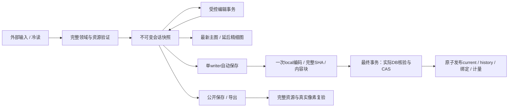
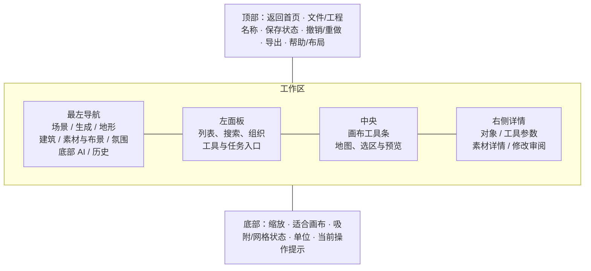
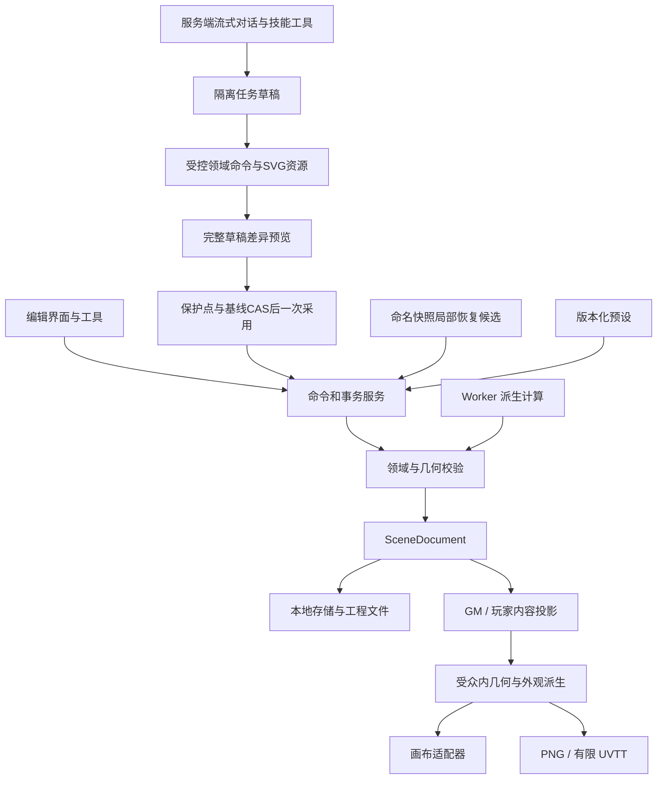

# 交互与架构参考

本页维护统一工作区的交互与模块职责。字段、严格版本和存储分别归04/06，AI归05，视觉与素材归14；开发任务归[路线图](../07-roadmap.md#development)，验收归[质量计划](../09-quality-plan.md#acceptance)。历史工坊入口与逐批实施过程从[历史索引](../archive/README.md)追溯。

- [02-editor-ux](#doc-02)
- [工作台信息架构调整：导航、左右分工与状态模型](#workspace-information-architecture)
- [地图细化工作流、道路与地形工具：用户确认目标](#detail-workflow-and-road-tools)
- [核心收束：操作、事务、领域与平台边界](#core-convergence-architecture)
- [03-architecture](#doc-03)

## 编辑器交互设计

### 当前工具入口与操作顺序

本节记录2026-11-08实现后的现行入口。用户确认的完整结构见[工作台信息架构](#workspace-information-architecture)，实施状态只看[07](../07-roadmap.md#workspace-information-architecture-plan)。八项开发整改已接入同一工作区；原草稿、候选、权限和保存合同继续有效，正式待验边界见09。2026-11-10确认的导航新顺序、道路语义吸附和升降工具仍为[待开发目标](#detail-workflow-and-road-tools)，不由本节的现行描述推定已实现。

首页和空工作区分别提供手工新建、生成地图与从样板开始。最左模块按创作过程排列：场景、生成、地形、建筑、素材与布景、氛围；AI、历史独立置底。新建、打开、样板、重新载入与备份在顶部文件菜单；场景设置承接名称、单位/格线、世界/导出范围和完整性检查。生成再按室内、森林与营地、火山、混合、自然地形、组合地貌、区域地图选择；地形再分绘制、修改、布置植被与局部重生成。执行位置与生成细节放在可展开设置中。只读切换模块或子任务保留原草稿和候选，冲突操作仍须先完成或明确取消。

当前工作区面板共用字体与表单基线，统一标题、标签/说明的层级及输入框、下拉框、按钮的高度、边框和圆角；AI对话使用同一主标题与桌面16px/窄屏14px内边距。按钮与字段使用相同键盘焦点环，主次按钮的悬停、禁用状态共用基线，外观子工具保留独立选中状态与未选项悬停反馈。外观入口显示“外观与氛围”，分边界、铺装、环境、灯光、雾、滤镜六项；常用目标、预设与主要参数优先，坐标/采样、接触阴影、雾区域坐标、滤镜精细参数和铺装对齐/相位按需展开。地形材质过渡只在边界内展开；过渡与铺装表单在子工具切换时保持挂载，保留目标、参数、局部覆盖和展开状态。折叠设置不改变字段含义、单位或候选采用流程，采用/取消仍按原会话规则重置草稿。

同一控件与文字基线也覆盖候选审阅、保存/错误/读取反馈、帮助、导出菜单、新建及VTT预检弹窗和场景右键菜单。候选正文统一滚动，长内容不再嵌套限高，确认与采用/取消保持可达；窄屏仍显示候选解释。普通长提示的正文可滚动，关闭入口常显，保存恢复区保持独立。弹窗保留输入滚动空间及底部操作，短屏聚焦末尾字段或确认框时不被遮挡；VTT关闭键先检查组合状态，再执行原关闭及返回焦点流程。

素材库卡片、用途/类型筛选、选中反馈、详情与管理按钮沿用工作区绿系基线；卡片把勾选、缩略图/名称/尺寸与放置操作分列，外部素材的添加操作另占一行。详情和精修对照保留较大预览，缩略图缺失警示保持独立颜色。搜索框只使用外层边框，焦点仍可见；卡片浏览与批量勾选保持独立语义。

左侧场景的图层、对象及独立历史模块共用面板标题、说明、数量和留白基线，取消嵌套面板的重复内边距；对象与历史搜索只保留外框，键盘焦点显示在整个搜索容器。图层图标操作保持可点尺寸，选中对象/快照的底色不被悬停覆盖。对象40px、历史对象48px的固定列表行高保持，文字层级调整不改变虚拟定位、搜索、键盘选择及历史恢复语义。

选中对象后右侧先显示位置、角度、用途等基础属性，高级外观和组合操作折叠。标题/名称/说明与事实列表使用共用文字层级和间距，数值字段保留单位后缀及单层边框。无选区时仅提示选择对象或工具；全图设置须从显式场景设置进入。常用建筑、放置和物件坐标跟随米/英尺显示，墙厚用厘米；内部仍校验整数毫米，切换单位不改变尺寸，失败提交恢复真实当前值。底层轮廓与技术ID可在详情查看。

切换模块恢复该模块的滚动位置，输入和筛选仍保持；切换工程清理旧会话滚动。地形/道路创建与属性面板先显示材质、高程、净宽及明确支撑；尺寸跟随当前米/英尺显示，工程仍使用整数毫米。轮廓常显点数和范围，精确坐标、覆盖优先级、连接路线/踏面/开口及散布随机参数按需展开，折叠不卸载表单。地形/区域至少三点、道路/连接至少两点后，画布旁的「预览绘制结果」复用原预览入口；工具栏「画地形」同时切换对应表单，预览后仍须确认实际影响。

地形、道路和连接的精确坐标仍使用整数毫米。缺失的坐标或重复标点须在预览前明确报错，不能补0或忽略空项；错误保留原草稿，修正后仍通过原候选和领域校验。

建筑表单先显示房间名称/形状、宽高、墙厚/地板材质及明确支撑，再提供绘制和预览；精确起点与顶点坐标放在可展开区域，建筑组和组结构在左侧以独立任务进入，右侧显示对应参数。地形常用参数与绘制/预览先于坐标及高级设置；窄屏并排字段与主要动作保持可达。折叠保留挂载、字段草稿和原禁用边界。

房间绘图两点完成矩形或至少三点完成多边形后，画布旁的「预览房间」与表单复用同一命令和校验。门窗工具先选类型与净宽，再点击墙面定位中心；墙角歧义、超出墙端、编辑锁及重叠开口明确拒绝。候选首先解释新增/修改的房间、门窗和物件，关联对象使用可读名称，完整字段、ID、依赖和跨层范围仍可展开；新增公开内容常显提醒，明确确认后一次采用并可撤销。

房间、量尺与室外取点从开始绘制时就在画布旁显示当前点数、下一步及退出入口；点数足够后才出现原预览动作。退出只结束当前取点，表单草稿保持，不写入工程或生成候选。

素材按家具、植被、岩石、建筑、地面、道具和其它浏览，来源独立选择本工程、内置、地形包或个人库；名称、尺寸和主要动作放在卡片，固定版本、许可与标签在详情。未加入工程的单项可「添加并放置/应用」，先完整检查固定闭包并确认候选，采用后继续放置或对原先明确选中的表面准备材质候选。取消、基线/图层/选区变化或失败不继续过期动作；批量添加和个人整理保留独立入口。场景对象默认显示全部可选择类型，统一支持名称/ID搜索、图层筛选和类型筛选，顶点与边缘属于精细几何分类。

素材库搜索在分类之前；详细筛选的折叠标题显示匹配数，已启用筛选常显，未勾选时不占用批量选择行。窄窗口通过内容抽屉浏览，卡片保留名称、尺寸和主要动作，跨模块返回保留筛选与勾选。

顶部「操作帮助」提供新建→绘制/布置→预览/采用→导出路径，并说明自动保存仅写入当前浏览器，工程备份须另行下载。撤销/重做作用于已采用的工程编辑；候选确认前不写工程。帮助可以用键盘展开、滚动和关闭，焦点在帮助内时Esc只关闭帮助并回到其入口，不取消当前候选。快捷键提示依据实际处理器，区分画布焦点、对象列表和字段输入，不把字段Enter确认解释为采用整份候选。

导出菜单遵循相同的Esc层级：焦点在展开菜单内时，只关闭菜单并回到「导出」，保留当前候选。输入法组合状态（含229键码）先于全局候选、新建/打开对话框和帮助/导出浮层的快捷键处理；取消拼音组合不得关闭表单或取消工程候选。处理器回归不替代真实输入法实测。

室内、森林、火山和混合生成在预览按钮旁说明首个参数问题及修改方法，修正后恢复原预览入口；局部重生成没有支持配方或可调整目标时说明范围及替代工具，不显示空白面板。个人素材库的读取中、读取失败与真实空库分别表达，失败原因与手动重读入口放在来源附近；重读保留筛选、勾选及整理草稿，不自动重试安装或导入。

本机保存失败或版本冲突时，独立恢复区持续说明当前成果仍在页面内，提供当前已采用工程的完整备份与另存副本；普通保存失败另有重试保存。备份不含未采用草稿并包含秘密。恢复区与可关闭的普通操作提示分开，操作处理期间禁止重复触发；冲突副本沿原新身份保存，不覆盖另一版本。导出菜单在不可用时说明当前阻碍，原候选/草稿守卫和完整资源验证保持。

画布旁集中说明当前选择范围、独显、手动隐藏及图层锁，并提供恢复所有可见图层选择、退出独显、显示当前层和前往图层管理的入口。图层行用文字区分手动隐藏与被独显排除；对象列表显示隐藏/范围外/自身或图层锁，点选被范围排除的对象时保留原选区并说明调整方法。可见的锁定对象仍能从列表选择查看，框选/全选沿原规则排除有效锁。

属性面板按现有选择锁依赖闭包列出真实对象锁与图层锁，相关对象用名称定位，图层锁可前往管理。只解除用户明确操作的一处锁，其他对象、容器、附属注记和相关图层锁保持；查看锁来源、显隐与选择范围不写工程或撤销记录。具体编辑仍检查命令真实影响范围，提示不取代候选、依赖或事务校验。

首页最近工程区分读取、读取失败与真实空库；失败保留上次结果并提供刷新，搜索按名称或完整ID匹配且忽略首尾空格，提供数量与清空入口。同名工程以短标识、保存时间和revision区分，完整ID可展开。当前会话卡显示真实保存状态，继续编辑保留选区、视口和撤销；顶部文件菜单的重新载入先保存再冷读，并明确重置选区和会话撤销。工程改名属于现有完整工程原子事务，输入草稿沿统一离开守卫，取消不修改工程。

首页无匹配结果时提供「清空工程搜索」，与搜索栏的清空操作共同恢复空查询并把焦点返回搜索框；真实空库则说明新建、生成或打开文件的起点，不把读取失败显示为空库。

画布选择按钮只有在没有放置、取点或笔刷时标记激活；切回选择会结束地形/植被笔刷并清除当前笔迹。曲线控制点拖动中Esc恢复拖动前坐标、释放指针捕获并提示取消，松开不生成新的候选。

历史面板明确区分完整保存版本、命名快照和局部恢复。完整恢复采用整个工程内容并先留保护点，结果标明此次新revision；局部恢复常显对象名称、中文属性和前后值，完整范围、ID及原始数据可展开，保持原依赖/跨层/公开变化确认。采用与按钮/Esc取消有结果提示；已采用后保存失败需明确当前内存结果和可撤销状态，不被普通历史刷新清除。

生成器修改参数后说明须重新预览；保留上次候选时明确画布仍是旧结果，并禁用不匹配参数的采用。组合地貌的运行、保存和导出状态分开，自身首次运行可取消，失败与其他任务阻塞分别说明；取消后保留参数并说明当前工程未改变，新操作清除旧反馈。失败区在当前面板可见时滚入视口，说明未自动重试，预览按钮明确改为「重新预览地貌组合」；只有用户再次点击才重新生成，原完整候选与保存为新工程流程保持。混合场景由面板、画布状态区或Esc取消时，明确区分取消生成、候选或参数修改，说明当前工程未改变；下一次预览清除旧操作提示。内部参数失效和基线更新不冒报用户已取消。

右上「导出」明确区分玩家地图PNG、含秘密的主持人PNG、可继续编辑的完整工程备份及VTT。两类PNG直接选择对应投影，不依赖当前预览受众；资源、像素、许可与玩家保密校验保持。重新载入已保存版本位于工程管理中。正式验收按[09交互矩阵](../09-quality-plan.md#ux-task-navigation)执行，开发自检不表示正式验收或P3签收。

## 核心收束：操作、事务、领域与平台边界（目标合同）

本节定义用户确认的四项核心能力收束方向；数据与受信证据主定义归[04](../04-scene-document.md#core-transaction-contract)，目录/保存与正式输出归[06](../06-storage-and-export.md#core-persistence-query-contract)。它补充现有会话快照架构，不宣称各使用方已迁移；开发状态只归07，完整验收只归09，不新增开发或验收阶段。

共同规则各有唯一owner，领域差异通过受信、强类型适配器组合。新增能力可以修改明确的组合根和必要的严格模型，不应复制工作区生命周期、重新猜测变化或在共同空间服务中增加题材分支。目标边界如下：

| owner | 输入与产出 | 不能代替的责任 |
|---|---|---|
| 操作会话 | UI意图、会话代次、独立表单草稿引用→活动操作状态、可用动作与阻碍原因 | 不写持久工程，不把模块浏览或空选区当作编辑授权 |
| 应用用例与候选服务 | 严格请求、确切基线、领域适配器→私有候选凭据、审阅事实与采用结果 | 不替代领域语义、资源验证、AI授权和最终存储事务 |
| 领域执行与校验 | 严格命令/配方、空间事实→真实变化、依赖和受信事务结果 | 不自行发布工作区、绕过身份/人工保护或猜测资源许可 |
| 投影与表现计划 | 确切快照、受众、表现能力→已过滤的几何/资源与绘制或输出计划 | 不反向赋予物理能力，不把编辑LOD当正式输出 |
| 应用端口与平台适配器 | 明确查询/提交/执行请求→结果与实际失败 | 平台实现不定义应用用例，不授予调用方免检或采用权限 |

### 统一操作与候选生命周期

活动操作用有类型的状态表达准备、运行、审阅、采用、完成、失败与取消；状态转换绑定操作ID、工程基线、会话代次及真实执行结果。公共协调者拥有互斥、迟到结果拒绝、取消和离开守卫，UI从同一状态取得可用动作及禁止原因。各模块的输入、筛选和未采用草稿独立保留；浏览模块不启动操作、不丢草稿、不重定向目标，也不因归一活动操作而强制多个表单共享一份输入状态。

候选服务统一独立捕获、私有凭据、输入/结果绑定、身份分配重放、预算与资源验证、审阅及取消。领域只提供严格准备和结果适配，不复制整套preview/cancel/adopt实现。候选状态与已采用工程、已持久化状态分别记录；一次重复采用、伪造凭据、已取消候选或旧代次结果均不能进入提交。采用期间取消只能按真实提交边界处理，不能把已经提交的事务标为“未发生”。

共用生命周期保留三种明确策略：

| 采用策略 | 必须保持的语义 |
|---|---|
| 独立新工程 | 独立scene/lineage和完整内容；先保全当前，完整保存并冷读核对成功后切换；保存成功但冷读/激活失败时保留独立成果并说明状态 |
| 当前工程修改 | 重新核对当前基线、实际写域、依赖与锁，按用例保护当前；一次原子提交及一次撤销，保存失败保留新内存成果、原持久分支和恢复入口 |
| AI或受授权草稿 | 在上述实际目标策略上额外核对05规定的权限、范围、租约、任务/预算账本和本机重放；通用候选凭据不能替代AI授权，未知计费请求不自动重发 |

右键、属性面板、快捷键和生成面板进入同一应用用例；预算准入、固定内容准备、作用域与审阅要求由用例提供。UI负责输入与反馈，不能为不同入口重写一套锁、净空、人工保护或采用条件。可替换预览与单writer持久保存保持各自调度；预览取消不取消已采用事务或应保存的成果。

### 领域事实、静态注册与组合执行

静态强类型领域描述集合集中登记输入规范化、结果schema、精确算法/配方版本、能力、事实提供器和报告适配。Worker、服务端、应用候选与UI能力展示消费同一声明；实际执行仍独立校验请求/响应，传输方的自报能力或摘要不授予采用权限。注册由受信代码组合根完成，不接受工程JSON指定函数、动态模块或任意算子；增加持久实体仍须显式扩展唯一v1严格模型。

领域事实提供器拥有题材/配方语义，从真实实体和显式引用提取并核验[04定义的事实](../04-scene-document.md#core-domain-capability-contract)。共同空间服务只拥有坐标、支撑、足迹、净空、端口、连接和明确约束；兼容旧算法的命名/seed推导留在对应适配器，不进入共享查询核心。几何、资源、外观和生成依赖仍由各owner产生有类型边，共同影响服务汇合结果并报告未覆盖范围，不新建竞争世界模型或全能几何引擎。

算子声明允许读取的事实、目标/字段写域及前置依赖；执行器以真实事务写集核对实际物化，阶段所有权继续作为外层保护。同阶段另一算子的内容也不能因最终几何合法而被越权修改。固定定义只允许按合同新增，不原地改义；领域事实声明不能替代本机完整候选和资源验证。

编排器拥有子配方调用、确定性子种子、精确输入绑定、阶段链、累计实际预算、取消和失败发布。混合领域保留外门接入、地面支撑、路线和环境协调等语义，子领域保留内部算法；可选步骤仅按明确软目标降级。旧自然重放桥是隔离的兼容边界，新增领域不能复制该豁免取得全域写入能力。重构不改旧算法/配方结果含义；确需改变时按独立算法轴演进。

### 应用端口与平台边界

应用层定义工程目录/完整载入/提交、历史目录/重建/保护、图片准备和生成执行等用例端口；共享层继续拥有纯模型、资源能力与确定性运行时合同。平台实现依赖这些接口，浏览器负责IndexedDB、Blob/图片适配、Canvas、Worker、网络、计时和取消信号桥接。应用合同不从具体browser仓库类用`Pick`反向导出，也不直接调用浏览器图片规范化；组合根负责装配实际实现和能力代次。

端口明确输入所有权、严格捕获、输出副本/不可变性、取消、错误与提交完成含义。内存适配器只能证明应用协议与失败处理，不证明实际浏览器事务、像素或性能；平台适配器继续承担真实字节、数据库、原生事务和输出检查。稳定端口对象不代表稳定资源字节；只有校验器按04绑定确切字节闭包/能力代次后才能复用证明。

依赖检查覆盖shared纯核心、application到端口以及平台组合根；兼容适配器的例外必须具有明确路径和owner。目录轻读与完整载入的信任区别、固定身份索引及历史保全按[06](../06-storage-and-export.md#core-persistence-query-contract)执行，不能因抽象端口降低公开验证或最终CAS要求。

### 投影与表现能力

渲染和输出保持工程快照→受众投影→表现计划→平台绘制/编码的方向。表现适配器声明真实几何来源、世界视觉包络、受众及依附传播、遮挡/接触依赖、固定资源、绘制阶段和适用输出/降级。描边、阴影、崖面、边缘或其他外扩必须进入视觉包络；缺少能力声明的类型不得默认裁掉、公开或完整导出。

玩家先过滤，再派生空间索引、边缘/接缝、遮挡和阴影；公共计划只携带相应受众允许的内容。裁剪、命中、局部失效和正式输出消费相容的几何/视觉能力，但物理足迹与视觉包络分别表达。编辑视口、隐藏层、LOD和选择覆盖层均为暂态，不写工程、不改变玩家秘密、不缩减正式输出闭包；GM/player不共享几何投影或合成缓存。

视觉质量问题按几何、底材、边缘、物件/接触影、环境的责任定位，修复落实在可复用的表现或内容规则。固定样板约束由明确的内容/约束适配器提供，永久硬约束、首次生成建议与手工合法草稿保持区别。成图标准归14，正式视觉/P3与性能证据归09；类型完整、开发自检或一次绘制成功均不能替代这些结果。

### 核心接口的代码归属

下表用于定位接口及其真实消费者，不表示验证或验收状态；进度仍只归07。新增有限能力优先扩展所属模块和静态组合根，保留表中完整回退边界。

| 接口 | 唯一所有者与消费者 | 复用及回退边界 |
|---|---|---|
| 四领域活动操作 | `editor/main/domain-operation-session.ts`由`use-domain-operations.ts`接入Workbench；各生成面板保留输入 | 一个活动代次管理draft/preparing/review/adopting、迟到释放和基线失效；Workspace负责候选真实权限和保存 |
| 新图候选 | `application/workspace/workspace.ts`的共同generation生命周期 | 领域薄包装共用捕获、重放、身份分配、取消与保存冷读；当前修改和AI授权仍分别检查 |
| 意图与平台端口 | `application/workspace/generation-intent.ts`、`application/ports`、`shared/ports/resources.ts`；browser组合根装配 | 固定素材归browser/content；图片无normalize能力时只允许严格PNG且核对实际解码/编码像素；不隐式降级JPEG/WebP |
| 事务回执 | `shared/transaction/receipt.ts`描述结构，`appearance/commands.ts`私有签发，`project/validate.ts`绑定完整工程 | 准备、预算、候选审阅、连续性与delta消费确切前后端点；普通回执仍全验、全投影，跨表示额外写入回退完整delta |
| 静态领域与事实 | `shared/generation/domains/registry.ts`及`fact-providers.ts`；执行协议/应用适配与空间服务消费 | 严格schema、能力及表现策略同源；旧配方命名知识只在对应facts适配器，旧自然桥精确身份在独立兼容合同 |
| 写域与组合 | `generation/materialization.ts`、`orchestrator.ts`、`composition-execution.ts` | 先冻结声明再检查实际记录/字段；组合子步骤绑定确切输入、阶段与累计预算，失败无部分发布 |
| 表现和资源闭包 | `projection/presentation-contract.ts`、`visual/paint-envelopes.ts`；editor render plan、canvas及residency消费 | 玩家先过滤；实际端帽/转角/纹理/阴影计入包络；未知消费者或未归属资源全量解码，正式输出不使用编辑LOD |
| 输出分派 | `export/entity-capabilities.ts`由UVTT计划消费 | 原生墙/开口/物理占地显式分派，未实现原生适配拒绝；PNG仍按完整受众投影，声明本身不签发保密或字节证明 |
| 导航与历史身份 | `application/ports/project-directory.ts`、`browser/storage/directory.ts`；首页/HistoryPanel消费。固定定义枚举归`shared/project/history.ts` | 目录为未全验导航，容量/原件按需全验；固定家族索引绑定实际历史行/块，在同事务fork且提交后发布，失效或冷开重建 |
| 选择派生交接 | `editor/native-canvas/selection-scene.ts`、`selection.ts`与`layer-selection.ts`；Workbench按确切ProjectData交接 | 选择自有不可变视图不授予工程认证；仅独立Prop位置/角度及revision逐步白名单，双端关系闭包均通过才迁移已算深冻形状。当前排序/锁/粗边界/区块清单/驻留仍重建，不保留旧索引或回执链 |

`tools/check-architecture.mjs`在正常typecheck/build前检查shared/application的运行时、类型和动态导入边界；一次性迁入的legacy依赖按文件显式登记，不允许应用层直接依赖browser实现。内容分桶、空间派生和导航分页各有不同成本：目录仍扫描原生元数据，新增固定身份仍重新读取/hash历史实际字节；本表不承诺全部局部操作O(K)、实体卸载或大包流式IO。

## 不可变工程快照、验证与持久化架构

本设计消费[04快照合同](../04-scene-document.md#workspace-snapshot-contract)和[06保存合同](../06-storage-and-export.md#snapshot-persistence-contract)。2026-11-08用户确认按本设计完整实施；当前状态只在[07](../07-roadmap.md#workspace-snapshot-implementation)，验收只在[09](../09-quality-plan.md#workspace-snapshot-acceptance)。诊断依据为[2026-11-07保存/重绘](performance.md#save-render-diagnosis-20261107)，不把诊断样本视作正式性能。

### 所有权与接口

| 模块 | 消费 | 产出与责任 |
|---|---|---|
| 完整快照/变更事务 | 严格入口或已认证before与受支持命令 | 确切不可变after，内部真实写集/依赖/逐步成本；保留有限Prop证据，其他操作完整回退 |
| 资源/快照校验器 | 独立捕获内容、字节与稳定受信能力 | 私有证明与不可变字节闭包；公开validate始终全验，内部快照消费允许确切证明复用 |
| 快照工作协调 | 确切快照、能力代次与消费者取消 | 在途同输入纯计算共享、独立消费者资格；失败/最后取消清理，不缓存失败或发布晚到证明 |
| 编码快照 | 已验完整工程与唯一坐标合同 | 自有canonical local文本/字节、flat SHA、长度、manifest/块；current/checkpoint/计量共用 |
| 存储内容事务 | 准备内容、实际DB行/块、expected revision/保护/metadata | 一次实际读取/核验的上下文，必要状态固定持有；最终CAS与完整原子发布，冷读另全验 |
| 预览调度 | 快照、受众、隐藏层、groundView、视口/尺度与渲染器代次 | 最新主图和低优先级精细图；精细图可取消，durable save保持单writer与确切版本等待 |

共享纯模型不依赖DOM/IndexedDB；平台持有稳定图片/SVG能力owner，实际方法/profile更换即失效，不以每次创建的包装对象导致虚假失效。外部端口即便同对象也不能证明字节稳定。TypedArray由私有闭包拥有、对外读返回副本；不持久化内存证明。

实际入口为`validateProjectSnapshot`、仓库`saveSnapshot`、`prepareEncodedSnapshot`和每画布独占的`PreviewScheduler`。能力证明及可发现的同快照在途校验各最多4份；原生AbortSignal通过可选结构订阅立即取消，只有`{aborted}`的端口沿异步检查点取消，共享层不使用平台计时器。最终签发前再次核对全部消费者，最后取消后只排空并释放，不能晚到签发。

存储必要全文证明固定为result/baseline/branch三个槽，各自受现行完整工程预算约束；同原生事务的实际行、已核块与物化结果另共用64MiB保守准入额度，不驱逐必要槽。额度不足时不保留可选读取结果，后续走完整核验，不拒绝合法工程。事务完成/回滚释放上下文；返回清单、块字节和工程均与私有缓存隔离。

冷全库核账的私有捕获另遵循[06预审与最终比较](../06-storage-and-export.md#snapshot-persistence-contract)：短只读事务结束后才执行历史Worker，最终事务重读全体物理行及实际字节逐项比较，再接回本次计量；捕获受64MiB保守估算／200万值保护，溢出或嵌套回退原事务审计。外部无权提供预审token／校验回调。最多两次重审只发生在任何业务回调执行前，业务写入、CAS冲突、未知结果和计费请求不能重试。同次重放内部按完整实际结构相等复用严格领域结论，三个元数据字段单独严格校验及核预算，每版本真实SHA保持；公开校验不复用。严格JSON捕获在检查描述符时直接复制对应值，坐标往返仍实际执行两次转换并比较完整结构，不依赖先前排序文本或跳过转换。

### 运行路径与失败

外部导入/冷读先全验，进入工作区后以确切不可变快照交接。受控编辑重新检查真实影响并产生新快照；主图、自动保存与精细图消费相同快照及未变资源证明。独立消费者取消只撤销自己的资格，最后一个消费者退出才取消共享准备，正在运行工作须清理完；切工程/关闭的旧代次结果不能覆盖新会话。资源变化或能力变化重新验证，数据库冲突不误撤销正确内存资源证明。

公开renderProject/PNG/备份完整验证；editor render使用私有快照消费，不把hidden layers/LOD当完整工程。玩家先过滤，裁剪/空间派生/道路联合/阴影在受众内执行。每次实际绘图按需解码并finally释放Bitmap/Canvas，GM与player不共享几何投影或合成缓存。保存忙碌时精细图延后，恢复时给最新视口执行机会，不能永久饥饿。

自动保存沿现有单writer+最新pending，不增加并行保存队列；flush/保护/切换必须等待确切待保存状态。预览可替换，已采用事务、历史分支及保护不得丢弃。保存成功仅绑定它实际提交的快照，较新内存编辑仍显示未保存。

保存准备编制一次EncodedSnapshot；最终事务实际读取并核验基线/head/metadata/保护、资源/块，再同事务发布。查询存在性不物化全文；同事务重复读取可复用已验实际内容。current/checkpoint共用编码产物，checkpoint仍按原recordHash和四节点重建边界；不改阈值掩盖重算。未知/inline/跨分支输入完整回退，坏块不能被内存正确副本覆盖。

### 边界、演进与验证

本轮保留world运行视图/local持久坐标、flat规范SHA、history v1与schema4，不引入Merkle、长期像素缓存、通用事件溯源或块GC。语义组、检查依赖、存储桶和空间区块正交。完整摘要、真实DB完整性、冷读与完整交付的全量成本单列；不承诺单次保存成为O(修改范围)。

先消除重复计算，再按剩余正常生产长任务决定受信Worker/流式计算：共享纯编码/固定PNG/SVG端口可迁移，平台消息绑定请求/会话/能力代次并严格检查；structured clone不能复制WeakMap证明，生成Worker输出仍本机重放与授权。无新的瓶颈证据不预先改写Canvas后端。

实现顺序为共享证明与能力生命周期→工作区内部保存/编辑渲染接线→编码与事务物化/历史共用→预览调度与取消→必要正确性/生产验证→按09执行受影响性能。每个切片的输入/输出以上表为接口，跨模块由主代理整合。证明伪造/失效、并发取消、坏块/配额/CAS、身份/锁/玩家秘密为硬门；正常构建同输入端到端和输出一致性决定性能结论，1万/10万需另冻结实测。

### 视觉创作入口

当前统一完整v1直接包含视觉能力；旧v2启用与副本迁移只作历史实现来源，不恢复入口。顶部「文件→从样板开始」提供海岸、岩岛和旅舍原创样板，以及带24项原创素材的纯空白入口，仍经过候选确认、保存及新ID打开。

「氛围」提供边界、铺装、环境、灯光、雾和滤镜；所选表面的“材质与铺装”可直接进入右侧参数。曲线支持整数毫米控制点和画布控制柄；手柄只改草稿，预览列双方地形、实际附着/支撑及跨层影响，确认后一次采用。边带可选择岸线、崖面、草沿、道路或围栏；材质保持固定版本，比例/方向/原点与羽化覆盖可编辑。环境与滤镜可停用或删除，实体滤镜只影响对应图像的透明轮廓。全图环境与局部效果分开，层滤镜为持续规则；AI只冻结明确目标，不传播到后来对象。

历史面板「视觉参数」支持本会话真实快照后的连续现存效果与曲线参数恢复，先保护当前，再一次采用并保留范围外编辑；重开/导入或删后重建、绑定/控制段身份改变后拒绝，不按同ID追认。完整包仍能保留和另开历史，不代表跨会话视觉局部恢复。

AI可填制作清单、场景类型、可选风格及五类可核对目标（净空、数量/分组、高差连接、房间用途、边带），明确授权视觉/材质/公开对象/矩形范围；全图环境另勾授权。进度显示模型清单状态，标记完成仍需人工核对。公开截图每次另行选择，渠道未启用时禁用，结构诊断继续可用；实际范围、图像尺寸及任务保留边界归[AI合同](../05-ai-and-generation.md)与[视觉规范](../14-visual-and-assets.md)。

当前仅有首页`#home`与统一工作区`#workspace`。工程、Canvas2D、历史和工具共用一份原生会话；严格新标识完整v1–v4按合同分派。旧整页工作台、旧格式导入/转换UI及旧库发现已退役，保留的旧领域/IO模块只服务兼容边界和底层验证，不要求恢复旧界面或删除旧用户数据。

### 1. 主页面信息结构

下表描述当前工作区，完整状态约束以[信息架构调整](#workspace-information-architecture)为准。旧实现和运行记录从[工作区台账](../archive/workspace-content-validation.md)与[M2工程台账](../archive/m2-project-validation.md)追溯。旧工作台和首页旧版本/转换入口已删除；不支持的hash统一回首页，并经过当前会话离开守卫。桌面浏览器是首版主要使用环境；画布占主要空间，固定面板可调整宽度和折叠，窄窗口仍能用明确按钮、键盘和触控展开面板。面板可达不等于已支持完整触屏地图编辑。

| 区域 | 内容 | 交互目的 |
|---|---|---|
| 顶栏 | 回首页、项目名称、保存状态、撤销／重做、工程与图片导出等全局动作 | 随时理解正在编辑什么，以及是否保存成功 |
| 最左模块栏 | 场景、生成、地形、建筑、素材与布景、氛围；底部AI、历史 | 只切换浏览入口，不启动画布工具 |
| 画布顶部工具条 | 选择、平移、房间、门窗、地形、放置、注记、遮罩、量尺 | 明确当前指针行为，与模块浏览分开 |
| 左侧内容 | 场景组织、素材查找、工具选择、生成/AI任务与历史列表 | 浏览不跳离工程；目录焦点、选区和候选目标独立 |
| 中央画布 | 地图、按需格线、选中轮廓、控制点、量尺、暂态几何 | 编辑空间与预览结果 |
| 右侧当前详情 | 对象/图层属性、活动工具参数、显式场景设置、历史恢复与候选审阅；素材详情临时覆盖并可返回 | 唯一参数和采用处理器，明确目标与作用域，不因空选区回落全图 |
| 底栏 | 缩放、适合画布、吸附、格线、单位、当前工具提示 | 缩放/选区/编辑隐藏为会话态；格线/单位沿用既有工程显示设置事务 |

“房间列表”属于场景对象导航；用户图层用于组织和调整明确的对象范围，渲染带约束合法叠放顺序。图层不是房间、组合、地面高程或Floor的同义词，改变图层顺序不能破坏门墙所属关系。首版只有一个逻辑楼层，楼层控件无需占据主要空间。属性面板将“叠放顺序”“地表高度”“阻挡移动/视线”分开，选中树冠或阴影时不会暗示其为可站立的平台。建筑、地形、素材及AI已共用一份原生工程、画布、历史和选区；旧工坊历史截图不替代当前交互证据。

分栏偏好仅存为本地、带版本的界面配置，提供恢复面板及重置布局；损坏或不兼容偏好回到可操作默认布局，不影响工程、revision、撤销或导出。调整分栏时保持画布世界位置，面板不能覆盖必要的采用/取消/错误反馈；窄窗口不能只用CSS隐藏后丢失入口。浮动窗口、自由停靠、多文档标签和完整PS像素工具不属U1b。AI面板已接入同一会话；未连接时显示配置与边界，手工工具继续可用。

内容面板、当前详情的开关直接可见，八模块由最左导航直达；“展开全部面板”和“重置布局”归入“布局设置”。执行后收起设置并返回入口焦点，Esc只关闭该设置，不取消底层候选；窄窗口仍一次显示一个抽屉。窄屏顶部、普通提示与生成任务入口采用较紧凑间距，面板内容可滚动且保留明确关闭入口。

#### 工作台信息密度（2026-11-09）

统一工作台按编辑工具的使用频率安排空间。正文与字段保持12–13px，面板标题13–14px；辅助文字保持可辨对比度。桌面单行控件约32px，组内间距约8px、组间约12–16px，常规面板内边距12px；窄屏及粗指针的常规字段和主要操作约38px，图层图标及密集分类入口保留32–34px点击区域，成对坐标仍须容纳长数值与单位。虚拟对象行40px、历史对象行48px与计算逻辑一致，不靠CSS单独压缩。

桌面内容/详情开关及布局菜单并入顶栏，保留具名可访问入口；窄窗口保留有文字的独立抽屉栏。图层名称、数量及当前绘制状态尽量同行，显隐/独显/锁的异常状态直接展示；没有选区时不占用移层操作空间。对象列表的搜索与结果优先于常规教程。物件名称与锁同排，位置X/Y成组；建筑顶点、整墙平移、遮罩、注记及放置坐标使用同一字段组。填充复制、坐标精度和常规操作说明默认折叠，展开不清空原参数；低频帮助与真实候选影响区分。

素材列表保留足够辨识的缩略图，详情大图、AI多行输入和候选滚动/操作区保持各自用途。保存失败、锁/支撑拒绝、玩家可见性变化及完整影响确认不折叠。仅显式成功的工程备份/PNG提示在8秒后收起；悬停或焦点停留时暂停收起，其他提示不因文字看似成功而自动消失。密度样式只作用当前工作台，不改变工程、画布世界尺寸、候选/撤销或资源校验。验收包含默认与展开状态、桌面/窄屏、布局断点往返及键盘焦点，见[09](../09-quality-plan.md#workspace-information-architecture-acceptance)。

### 工作台信息架构调整（2026-11-07确认的目标设计）

本节维护2026-11-07确认的页面结构设计，覆盖入口、面板职责、上下文、响应式及技术迁移。用户已确认“左侧全局组织与创作入口、右侧当前对象或操作详情、画布工具独立”的方向，并授权八项依次实现；2026-11-08已接入当前工作台，必要自检不等于完整正式验收。开发顺序和进度只在[07实施计划](../07-roadmap.md#workspace-information-architecture-plan)，全部正式验收只在[09对应矩阵](../09-quality-plan.md#workspace-information-architecture-acceptance)。后续导航顺序与道路/地形工具以[11月10日确认目标](#detail-workflow-and-road-tools)为准，以下保留既有实现的职责和状态依据。项目仍只有开发整改、验收两个阶段。

#### 目标与范围

用户应能用位置判断功能：左边查找整张地图的内容、选择要添加的东西和启动创作；右边查看并调整当前对象或当前操作；中央保留地图与操作反馈。高频独立任务直接可达，同类筛选和精细参数保留合理层级。

改版前的问题是：最左栏混合导航和指针模式；“资源面板”包含工程、生成、建筑、地形等非资源功能；全局图层/对象/历史在右侧，所选铺装却在左侧；建筑工具含世界范围、注记和玩家遮罩；右侧空选区含工程管理及全图房间材质，多个面板重复列同一批对象。这些入口需要按职责拆分，不能只换标题或把所有按钮提升为一级。

本轮包含信息架构、表单承载位置、统一上下文与适用的可访问性调整。沿用现有字体、绿系视觉、控件层级和原生画布，不另起一套主题；不新增生成算法、任意图层树重组、自由停靠、多文档标签、通用效果画布命中、触屏手势系统或新的素材编辑能力。完整工程仍为当前唯一v1；界面导航不改变领域模型、固定资源、存储格式或AI权限。

#### 整体布局与导航层级

下图表示2026-11-08已接入的区域职责与当时模块顺序，实施与验证状态见07；后续顺序调整见[地图细化目标](#detail-workflow-and-road-tools)。左右两栏都可折叠；右侧不再上下切成属性和全局导航两块。

| 区域 | 内容与主要行为 | 不承担的职责 |
| --- | --- | --- |
| 顶部 | 文件菜单含新建、打开、样板、备份、重载；工程名称可改名；真实保存状态与恢复入口、撤销/重做、双受众预览、导出、帮助、布局 | 不用“文件”按钮暗换工程；新建/重载仍经原离开与保全流程 |
| 最左导航 | 八个模块始终有文字标签和图标；点击选择左侧模块并展开内容，折叠或关闭通过面板标题按钮及“内容面板”开关完成 | 不启动绘图、生成、AI请求或改变画布选区 |
| 左侧面板 | 以“场景”“素材”等当前模块名为唯一主标题；查找、组织、选择工具/任务，必要的长生成表单和AI对话留在本模块 | 不保留一层“资源面板”总标题和七模块网格；不反复堆同义标题 |
| 画布工具条 | 选择、平移、量尺；明确标为工具的注记、玩家遮罩入口；当前绘图/放置状态、参数入口与结束动作 | 不承担工程/素材/历史导航；注记、遮罩沿用已有数值/取点能力，不暗加新的绘制方式 |
| 右侧详情 | 对象/多选、图层属性、活动工具参数、明确选中的素材/效果详情、候选审阅 | 空选区不再展示全部房间材质或全局工程管理 |
| 底部与反馈 | 缩放/适合画布、吸附、单位、当前操作说明；保存失败独立常显，普通提示可关闭 | 面板打开/缩放不修改工程；格线、单位等原本持久化设置仍走原事务 |

外侧模块沿[11月10日创作顺序](#detail-workflow-and-road-tools)排列，既有模块ID保持。可用非折叠分隔线区分组织、创作和任务，历史靠下；分组不增加点击层级。首次打开工程默认“场景”，从新建完成或指定制作入口进入时可定位对应模块；同会话返回继续保留上次模块。未打开工程时保留首页主流程，不为了展示八个模块制造空编辑器。

各模块首次进入从顶部开始，同一会话返回时恢复搜索、筛选、展开状态及浏览位置；显式定位对象、开始另一工具或查看错误时滚到相关内容。与调整前统一“切模块回到顶部”的规则不同，此处是新版目标，不能因此重置草稿。

画布工具条继续提供全选可编辑对象、替换/增加/减去选择、包含/相交、组合成员模式及原有子格/锚点设置；低频选项可用有名称的工具选项区，不因迁移选择/平移portal而遗漏。工具条激活态只反映真实指针行为，导航选中态只反映当前左模块。

| 模块 | 左侧内容 | 右侧接续 |
| --- | --- | --- |
| 场景 | 当前工程内容、对象搜索、图层及其成员、场景设置入口；已有内容按真实类型组织 | 选择对象显示属性；查看图层显示该层规则；打开场景设置显示明确“全图/指定Floor”范围 |
| 素材 | 搜索、用途分类、来源、收藏/详细筛选、卡片；导入与个人库管理 | 显式查看素材详情、放置参数；应用材质时保留目标表面 |
| 建筑 | 房间形状、门窗、已有建筑组/结构操作等工具入口；查看已有建筑跳到场景中相应过滤结果 | 新建/编辑房间、墙、门窗或建筑组参数 |
| 地形 | 地面、道路、高差连接、笔刷、植被布景、局部修改工具；保留生成来源适用性说明 | 当前地形/道路/连接/笔刷/簇或局部操作参数 |
| 氛围 | 全图环境、现有效果列表、创建灯光/雾/滤镜/装饰边带入口 | 明确所选环境项或效果的参数；局部与全图范围显式区分 |
| 生成 | 室内、森林、火山、混合、自然、组合地貌、区域地图七类任务；类型卡与完整请求表单、执行位置及状态 | 当前候选的范围、缺项与采用方式；长输入无需为了左右分工拆成两个半截表单 |
| AI | 连接、对话、明确授权、运行任务与草稿入口；切换模块不重连或重发 | 显式审阅草稿时展示差异、影响与保护采用；普通聊天不抢走对象详情 |
| 历史 | 完整版本、命名/保护快照、搜索与选择历史内容，含已删除对象 | 恢复方式、明确范围、属性差异与恢复候选；不要求目标在当前画布仍存在 |

独立任务以一次外侧模块点击到达；模块内至多再做一次明确的工具/类型选择即可到主要内容。家具/植物/岩石是素材筛选，七类生成是同一任务的类型，均不升级为外侧模块。高级坐标、许可、来源ID、采样和纹理相位用折叠详情。选择筛选不能隐式清空其他维度；“全部”必须写明全部对象/全部素材/所有可见图层，不能作为含义模糊的总模块。

#### 现有能力的归属与迁移清单

| 现有入口/能力 | 目标入口与内容位置 | 必须保留的行为 |
| --- | --- | --- |
| 工程中的新建、打开、样板、重载与备份 | 顶部“文件”；新建对话框继续显示手工/生成/样板起点 | 准备/资源验证/独立保存成功后才切换；取消不换空工程 |
| 工程名称、完整性/资源统计、教程、样板通路检查 | 名称在顶部；完整性/资源统计及VIS02/哨所现有通路检查在场景设置；教程在帮助及新建引导 | 改名事务、校验反馈、真实资源/许可，既有样板及其有限通路检查不丢入口 |
| 单位、网格、世界与导出范围 | 场景设置；底栏保留单位/网格快捷入口，导出菜单提供“调整导出范围”跳转 | 场景设置是全局入口；世界范围明确对应Floor，导出范围保持原固定双受众合同 |
| 右侧图层/对象、建筑/室外重复对象列表 | 左侧场景中的统一浏览；建筑/地形保留“查看已有…”的定位捷径 | 搜索、定位、隐藏/范围外/锁来源、组合与成员选择语义 |
| 房间、门窗、地形、道路、连接创建表单 | 左侧挑工具；右侧活动工具参数；中央取点和预览提示 | 两点/三点最低要求、明确支撑、净宽/高程、共享墙及全部拒绝原因 |
| 注记、玩家遮罩 | 画布工具条直接进入；左侧场景可过滤既有注记/遮罩 | 新注记默认GM、公开修改提示，遮罩范围与秘密过滤不依赖建筑模块 |
| 个人素材导入、批量摄取、安装、标签/收藏、备份 | 素材标题旁“导入/管理”明确入口；长批量任务使用独立管理视图或对话框 | 单图/多图/SVG/ZIP、固定内容、完整许可、草稿/冲突/失败保全；不挤占普通找素材首屏 |
| 素材来源/许可/精修对照 | 显式查看卡片详情，在右侧临时详情中显示并提供“返回对象” | 目录焦点与画布选区独立；关闭详情不清选区，不默认开始放置 |
| 所选表面的铺装/材质/比例/方向 | 右侧该表面的“材质与铺装”，从此打开左侧素材选择器 | 保留实际支持的房间、地形、墙、道路、地形边缘、高差连接六类，不缩减为房间地板 |
| 来源/图层/实例外观覆盖、固定变体 | 对象详情显示实例与继承来源；图层详情管理持续层规则 | 同级覆盖、停用/移除、固定来源版本及物理/秘密保全 |
| 边界曲线、边带、材质过渡、组件变形 | 地形相关对象详情；独立装饰边带从氛围创建/列表进入 | 控制点/链范围、绑定、尺寸和影响闭包完整；支持列表选取，不假定全部效果已可画布命中 |
| 环境、光照、雾、滤镜 | 氛围列表选择明确项，右侧编辑；选中已有相关效果可直接接续 | 全图/层/对象/区域范围常显；区域滤镜明确其区域来源，不再靠另一雾表单的隐藏草稿决定范围 |
| 组合制作、成员处理、重复/填充 | 所选物件/组合的右侧操作区；固定组合从素材启动放置 | 整组/成员互斥、人工删除/移动和私密性，预览预算和一次撤销 |
| 地表规则、树冠笔刷、布景、局部重生成、区域下钻 | 地形保留独立工具选择；区域生成/下钻可由生成任务或所选区域接续同一入口 | 作用域/原来源/支撑/人工保护及适用性说明；不可用不能显示空面板 |
| 全局历史和局部恢复 | 左侧选择快照/历史目标；右侧配置恢复与审阅 | 可恢复已删除内容；原身份/连续性检查、保护点/CAS及局部范围不变 |
| 普通候选、地形/生成新工程、AI草稿、恢复差异 | 共用右侧审阅外壳，保留各自实际采用处理器；画布保留紧凑状态与“查看修改” | 普通当前工程修改、新工程保存打开、AI保护采用、历史保护恢复四类动作分别显示；局部重生成仍按原保护后采用流程，不用统一展示省略保护点或改写目标工程 |
| 保存失败、冲突备份、玩家预览/PNG/工程/VTT | 全局独立恢复区、顶部受众/导出 | 不随当前模块或右侧上下文消失；完整备份含秘密且不含未采用草稿 |

场景树的显示层级不改变数据归属。以当前支持的Floor/图层列出成员；组合/建筑组/自然组按真实所有权显示，可展开成员。共享墙不能因被两个房间引用而变成两份可编辑实体，关联房间/支撑/附着显示为引用定位。实体缺乏当前浏览器行类型时增加只读可定位行，不伪造新实体类型。楼层管理可明确创建独立空Floor；Floor、地表高程与图层排序继续分开。

场景中的三类操作分开命名和处理：“查看图层”只打开图层详情；“设为绘制图层”改变后续工具目标；“选择本层对象”执行已有范围/锁过滤并报告结果。显隐/独显是编辑状态，编辑锁是原有持久事务，玩家公开/秘密是另一字段。图层树不能把拖行理解为任意改房间、组合或支撑拓扑；本轮沿用明确移层/排序命令。

#### 上下文与草稿状态模型

右侧显示“当前详情”，标题始终说明真实目标或任务，例如“书房 · 房间”“已选3件物件”“正在绘制道路”“素材 · 木地板”“全图环境”“修改审阅 · 移动12件物件”。右侧的位置不作为作用域证明，名称、范围和实际命令必须一致。

| 状态 | 右侧内容 | 左侧和画布允许的接续 |
| --- | --- | --- |
| 无选择、无任务 | 简短的选择/启动工具提示，可折叠 | 浏览模块、场景和素材；不自动展示或修改全图属性 |
| 对象/多选 | 名称、基础属性、外观、可见性、适用操作；多值用“不同值” | 更换选择前检查原字段草稿；不把混合值按0或第一件的值批量覆盖 |
| 显式查看图层/全局设置 | 该层或全图/指定Floor的参数与范围提示 | 保留画布原选区；“返回所选对象”回到对象详情，不能用空选区推断全图 |
| 素材临时详情 | 图像、尺寸、固定来源、许可、安装状态及返回入口 | 不改变场景选区；正在创建/审阅时详情以临时查看层承载，关闭恢复原任务 |
| 绘图/放置/局部编辑 | 本工具草稿、明确目标层/支撑、适用参数、预览与退出 | 可浏览其他模块；只有显式“开始工具”才检查并切换活动工具 |
| 已退出取点、参数草稿未结束 | 标为房间/道路等参数草稿，提供继续取点、适用的预览和放弃参数 | 指针恢复普通模式，右侧仍保留该草稿；完成或明确放弃后再返回原对象 |
| 待审阅候选 | 实际变化/只读依赖、范围、公开影响、必要确认、采用/取消 | 左侧只读浏览、平移/缩放继续；不能用新点选偷偷改候选目标 |
| 异步准备或提交中 | 本次操作、阶段与原支持的取消方式 | 禁止重复提交；切模块不重启任务，迟到结果检查会话和请求代次 |
| 保存失败/冲突 | 仍可查看当前上下文 | 全局恢复区保留备份/另存/重试，不能被右侧新详情覆盖 |

右侧任务上下文以正在提交/审阅、活动工具、显式查看详情、普通选区、空态的顺序解析。临时只读素材查看可覆盖详情正文但不取代底层任务，提供可见的返回入口；当前任务/候选状态及返回审阅入口始终可达，采用/取消按钮只在原审阅区固定呈现，不能隔着素材详情采用或复制另一套提交按钮。返回原审阅后沿原确认状态继续。普通选择不会夺走活动工具的参数；切回对象须显式结束工具并遵守原草稿守卫。保留旧选择并不允许把它自动变成新操作目标。

临时详情返回文案按进入来源显示“返回修改审阅”“返回工具参数”或“返回对象”；窄屏另可返回原素材列表。提交中即使关闭/返回详情也不能再触发采用，操作级状态由唯一提交处理器拥有。历史只读切换快照可以更新浏览结果，已生成恢复候选绑定的原快照、目标和确认不得随之替换。

“退出取点”沿用当前合同，只结束指针取点并保留参数草稿；“取消参数修改/放弃创建”才明确清除对应表单草稿；“取消候选”处理已准备的修改。右侧在退出取点后仍显示这份未完成草稿及继续/取消入口，不能自动跳回对象详情而藏起它。完整结束后再恢复之前查看的对象，失效/已删除目标返回空态而非错误绑定同ID对象。

实现至少区分以下会话状态：`activeModule`（左模块）、`canvasSelection`（画布选择）、`catalogFocus`与目录批量勾选、`inspectedLayer`（查看的层）、`drawingLayer`（创建目标层）、`activeToolSession`、`reviewContext`。这些名称是职责说明，实际类型可沿项目命名；不能再用一个`selectedId`或`sidebar`同时表达全部状态。

明确区分三个阶段的目标绑定：

1. **只读浏览**：搜索、看素材、切模块、看图层可自由变化，不写工程，不改变工具/候选目标。
2. **已有字段/工具草稿**：首次编辑或启动工具时绑定对象、目标层、支撑与必要基线；更换选区、图层或设置作用域不能丢弃草稿。冲突按既有守卫继续原操作或明确取消；若提供显式重新绑定，须完整重新预览，不沿用旧候选。
3. **候选/异步操作**：绑定工程会话、请求代次、checkpoint及实际范围；采用前再次检查基线、有效锁、依赖、预算、资源和权限。候选不能随着导航、选区或图层变化自动重定向。

普通选区/详情焦点和历史恢复目标各自独立；查询另一快照不改画布选择。全图环境、持续图层规则、冻结所选对象、局部区域不是同一种作用域，不因空选区、类型不适用或无匹配而回落为全图。域内操作支持范围继续由现有命令决定，表单无权静默跳过不适用成员。

当前“玩家预览”仍是主持人编辑器里的输出预览，不是新增的玩家账户或客户端权限系统。预览中的场景列表/详情仅使用公开投影，编辑模块及历史/素材/AI沿原限制禁用或隐藏，平移缩放继续可用；切回主持人前不在新详情正文或可访问树中留下私密对象/候选内容。底层主持人会话与工程文件可以包含秘密；顶部主持人备份等原有管理能力保持明确标识，不把完整工程备份称为玩家文件，也不宣称切换预览会清除本机私密数据。

#### 代表性使用流程

| 用户目标 | 连续操作与反馈 |
| --- | --- |
| 换房间地板 | 选中房间→右侧材质与铺装→左侧素材库选材质→明确应用到原房间→原候选审阅/采用；纹理比例和方向继续在右侧修改 |
| 放置家具 | 左侧素材搜索/筛选→查看详情或直接放置→右侧明确位置/角度/支撑与目标层→画布放置；外部素材先走原固定资源采用，再接续放置 |
| 新画建筑/道路 | 左侧建筑/地形选择工具→右侧参数→画布取点→Enter或按钮预览→右侧审阅→采用；返回选择模式按原规则结束工具 |
| 调整图层 | 左侧场景查看层→右侧名称/持续规则→若要改变绘制目标，另点“设为绘制图层”；若要移层，明确选择对象并预览真实成员影响 |
| 调整环境或局部灯光 | 氛围选择“全图环境”或指定灯光→右侧显式范围/参数→预览；选中一个房间不自动缩小全图环境范围，取消选择也不扩大灯光范围 |
| 找回删除物件 | 左侧历史选择快照及已删除目标→右侧恢复内容/依赖→保护并采用；不依赖当前画布能选到该对象 |
| 生成后手工精修 | 左侧选生成类型并完整填写→预览→右侧说明新工程或当前修改→保存/采用成功→可从场景/素材/对象详情继续；不重复生成 |
| 候选期间查素材 | 候选保持绑定→左侧素材浏览/查看临时详情→返回修改审阅→采用或取消；浏览不启动放置、不撤销候选、不重置确认 |

#### 响应式、焦点与可访问性

桌面保留最左导航、左面板、中央画布和单一右详情。导航预留图标及短文字，建议宽64px作为初始布局值；面板沿用可调宽和最小画布空间规则，具体尺寸由实现自检确定，不把草图尺寸当视觉验收。图标激活、当前工具、目录勾选、画布选中必须有不同的文字或形态反馈，不能只靠同一块绿色底色。

窄屏初始继续以现有1080px容器阈值为迁移基线，边界两侧实测后才调整。最多同时展开一个左模块或右详情抽屉，不把两栏叠在画布上。八个导航入口允许垂直滚动，当前项可见，低频历史仍可直接滚到而非藏在多级“更多”。面板关闭键、当前工具/候选恢复入口始终可达。

窄屏的具体规则：

- 点击模块打开左抽屉；主动开始画布工具后收起左抽屉、展示画布和“参数”入口，工具状态不依赖抽屉可见。需要参数时再开右抽屉，关闭后继续同一笔操作。
- 从场景列表明确选择对象，可接续右侧详情；在画布上普通点击不强制弹出遮挡地图的抽屉，只更新选中反馈及“详情”提示。显式“编辑/详情”才展开。
- 进入候选审阅时打开右抽屉；关闭抽屉只收起展示，紧凑“待确认修改/查看修改”入口常显，不取消候选。采用与取消固定在可见操作区，长摘要仅正文滚动。
- 在左抽屉浏览素材时可明确查看详情并返回素材列表，保留搜索、滚动位置和原画布选区；临时详情返回恢复之前任务。空态/错误/读取反馈不能令搜索和恢复入口不可达。
- 调整窗口或浏览器缩放不重建会话、不丢输入、不改变世界坐标。面板遮挡只影响视口可见范围；关闭返回画布时不自动缩放至全图。

所有面板入口可用键盘操作；导航若使用tab语义则完整实现tablist/tabpanel和方向键，否则采用带当前状态的按钮导航，不混用两套语义。画布工具条采用独立toolbar语义和可读名称；关闭面板回到触发入口，显式编辑打开详情时定位标题/首个可操作字段，普通只读切换不夺输入焦点。隐藏内容使用hidden/inert并处理焦点落在隐藏节点的情况。

Escape逐层处理菜单/对话框、临时详情、字段/工具自己的取消，再到所属抽屉或候选；一次事件只能被一个处理器消费，不能同时关闭抽屉并取消底层候选。输入框、可编辑内容、中文合成事件和229键码优先，Enter完成绘图不等于采用候选；复制粘贴、Delete、撤销/重做保留原焦点与权限守卫。真实中文输入法、VoiceOver、系统失焦按用户先前决定本轮不执行，继续标记未实测；不能用合成事件或ARIA检查代替。

#### 代码职责与渐进迁移

| 当前模块 | 本轮目标职责 | 实施约束 |
| --- | --- | --- |
| `src/editor/workspace/WorkspaceLayout.tsx`及布局CSS | 导航、左右slots、画布工具容器、抽屉、调宽和焦点 | 布局层不执行领域命令，不创建第二个工程会话 |
| `src/editor/main/Workbench.tsx` | 模块路由、共享上下文、现有事务/候选/异步处理器编排 | 逐项替换`sidebar`耦合及DOM查找跳转，保留唯一workspace、选区订阅和保存来源 |
| `src/editor/native-canvas/AssetCanvas.tsx` | 指针模式、实际选择/平移控件portal、视口控件和捕获 | 选择/平移不只来自外壳按钮；移动`toolControlsTarget`时保持单一挂载，缩放`viewControlsTarget`仍独立 |
| `SceneLibrary.tsx`、`UserLayerPanel.tsx`、`VirtualEntityList.tsx` | 统一场景浏览、层与对象定位、过滤/虚拟列表 | 看图层、设绘制层、选成员分别处理；复用现有选择/锁规则，避免重复实体行和全量非虚拟列表 |
| `BuildingPanel.tsx`、`OutdoorToolsPanel.tsx`及各Inspector | 拆出工具选择与参数呈现，统一创建/编辑目标标题 | 不复制本地草稿形成左右两份表单；新容器沿用命令、支撑和整体验证 |
| `CatalogLibrary.tsx`、`VisualPanel.tsx`、`VisualSurfacePanel.tsx`、`AppearancePanel.tsx`、`PrefabPanel.tsx` | 目录与对象/图层/效果详情分工 | 目录详情与选区独立，材质六类与覆盖层级完整；区域滤镜不读取无关表单草稿 |
| 生成、地形局改、AI、历史及恢复面板 | 长任务留左侧，审阅通过明确描述器进入右侧 | 只共用审阅展示/动作协议，不把不同候选强制转换成同一种领域提交 |
| `layout-preferences.ts`及既有UI测试 | 旧偏好安全映射、新布局和焦点测试 | 偏好版本独立于工程v1；旧结构截图/选择器逐项更新，不按新定位器删除旧行为断言 |

新增导航/详情描述器与会话适配器放在现有`src/editor/workspace`或`src/editor/main`边界内，不新建平行工作台。描述器至少给出类型、可读标题、真实作用域、返回上下文和适用操作，实际状态由唯一会话拥有；候选审阅动作携带原候选身份而非仅凭当前右侧选中ID调用。

表单草稿可以暂时继续使用稳定挂载，也可提升至独立会话控制器后再改变展示位置。不得直接把同一组件在左右条件渲染两次，或因为切模块/窄屏/portal目标变化而卸载本地状态。以`sceneId + sessionGeneration`区分真实工程会话；选区变化与revision变化沿各表单原重置/失效合同处理，不能用每次渲染的新key强制清空。隐藏面板保留草稿时暂停不必要DOM工作和读取，但不因此取消活动AI/Worker任务。

曲线/连接控制柄、笔刷和填充拖动必须由明确活动编辑会话控制，不再由`sidebar === visual/outdoor`决定是否存在。只读换模块保留工具；显式切换互斥工具按原取消规则处理。若布局切换导致拖动宿主失效，先按既有中断合同回滚并释放捕获；不能在消失的控件中继续提交，也不能把模块点击当作松手采用。

#### 布局偏好、兼容与回退

现有偏好键为`sceneweave:workspace-layout:v1`，字段包含左右宽度及资源/属性/导航三块折叠状态。目标布局改为左模块面板、单一右详情，使用独立`sceneweave:workspace-layout:v2`记录，严格校验字段/数值并限宽；该数字只表示UI偏好，不修改工程、数据库、算法或AI协议版本。

首次没有有效v2时，只读解析旧v1：左宽来自`resourcesWidth`，右宽来自`detailsWidth`并按新范围限宽；旧资源或旧导航任一展开时，新左栏展开；新右栏只继承`inspectorCollapsed`。旧导航是全局浏览，不再占用右栏。旧记录不删除；有效v2优先。两者损坏/未知时用可操作默认值，写入失败仅提示“布局仅本次有效”。用户“重置布局”只重置新偏好，不操作IndexedDB工程、历史或个人素材。

模块、目录焦点、选区、工具草稿、右侧上下文与候选属于当前会话，不加入工程/快照/PNG或URL，不承诺刷新后恢复未采用草稿。首页继续复用当前会话；真实重开、导入、另存副本按原规则重置及失效。布局改版不迁移工程数据，也不能为页面试验自动清库、另起来源端口或恢复旧格式入口。

迁移采用现有组件的适配与逐项替换，同一生产入口只运行一个工作台；迁完一项再移除其重复旧表单，确保相同操作仍有可达入口。阶段中可保留尚未拆分的原表单放在新模块内，避免一口气搬所有状态；最终去掉“资源面板”、右下全局导航及重复对象列表。临时适配器的清理列入07最后一步，不长期保留两套入口协议。

发现数据保全、候选错误采用、权限/秘密或丢草稿问题时，停止该切片的交付并恢复其上一套UI接线，保留原工程及证据；回退只涉及本轮代码/偏好读取，不回滚用户工程或删除新旧本机记录。没有发布授权时不推送、部署；旧提交授权不自动延续。

#### 风险与设计取舍

| 风险或取舍 | 处理方式 |
| --- | --- |
| 八入口在短屏占高，全部提升后又变杂 | 固定短标签、非折叠分组及滚动；只提升独立任务，筛选/高级参数仍在模块内 |
| 左右移动表单造成草稿丢失或重复事件 | 先确定会话所有权，再搬显示；稳定挂载/显式控制器二选一，禁止左右副本 |
| 素材详情、所选对象、活动工具争抢右侧 | 独立焦点与临时详情返回；任务优先，显式查看不改实际选区/目标 |
| 图层/效果全局设置意外作用于更多对象 | 始终显示范围；查看、设当前层、选择成员分开；空范围拒绝而不扩成全图 |
| 移走右下导航后，查对象与查素材需要切换 | 两者都有外侧直接入口，保留筛选/选区；对象“在场景中定位”及材质“去素材挑选”提供明确接续，不同时常驻更多面板 |
| 统一审阅丢掉新工程/AI/恢复的特殊保护 | 统一展示，不改原处理器；精确展示原操作名、提交条件和取消含义 |
| 旧页面验证被误记成新版已通过 | 09新布局矩阵重新冻结；旧证据留原台账，不拼接通过数 |

产品收束以“入口可找、范围明确、草稿保全、原操作完整”为依据；具体实现完成条件在07，正式旅程、键盘/窄屏及失败保全判定在09。外观满意度与用户P3仍单独记录，本节不宣称已获视觉签收。

### 地图细化工作流、道路与地形工具（2026-11-10）

本节维护用户确认的交互合同；确切实现范围以07为准。当前导航已采用创作顺序；道路工具支持默认语义吸附与Shift临时自由取点，普通模式的滚轮保持缩放，只有显式启用且可见的整面升降工具在所选轮廓内消费高程滚轮。开发范围、依赖与状态只在[07地图细化主线](../07-roadmap.md#map-detail-mainline)维护，正式检查与证据口径只在[09对应验收](../09-quality-plan.md#map-detail-acceptance)维护；地形升降的领域语义与支持边界归[地形工具设计](terrain-generation.md#terrain-sculpting-tools)。既有实现和历史自检不自动覆盖本节目标。

十项队列的后续交互合同归[04](../04-scene-document.md#detail-followup-contracts)：局部覆盖预览必须分别显示原面、新面、片段与锁/预算拒绝；持续附着必须明确绑定、跟随、解除和人工修改冲突，关门/门锁与结构端口分开；两者都沿确切快照、同事务CAS和一次撤销执行。实施先接领域依赖闭包/身份，再接当前面板，不用UI状态充当持久权威。

多Floor后续接入顺序为：完整领域/跨层引用→目标Floor投影/资源与秘密→正式PNG范围→会话activeFloor→Floor环境/配方/锁→完整往返。编辑楼层选择不进工程历史，导出明确指定Floor身份及其持久固定范围；Floor须进入异步发布、相机/命中/框选/吸附作用域，不能沿用取字典首Floor的放置/生成入口。范围命令拆开世界界限与输出范围，先补Floor出生/退休证明，再绑定环境预设槽位；首版独立Floor并保留跨Floor支撑/成员/连接拒绝。已有单Floor图无字段时保持原输出。当前首版已贯通独立Floor；当前楼层、绘制层、相机/选择/工具和异步预览同域，正式PNG仍从显式Floor参数和完整工程产生，不能切子Scene免验。对应同XY双Floor、异环境/秘密/阴影和目标范围的正反例，及跨层锁、旧基线、失败不切错楼层统一留09。

氛围模块新增「背景」工具，默认／纯色／透明为当前完整v1工程的全图输出选择；草稿、预览、采用与一次撤销沿原visualForm会话和工程设置候选。纯色仅接受六位RGB，恢复默认删除可选字段。编辑棋盘格及精细预览棋盘格为CSS查看辅助，公开PNG不包含；透明输出仍绘制真实地表、格线与注记并最后盖不透明秘密遮罩。底层字段归04、保存/alpha归06，开发状态与证据归07/09。

#### 导航按制作过程排列，保留自由编辑

目标主模块固定按“**场景 → 生成 → 地形 → 建筑 → 素材与布景 → 氛围**”排列，AI与历史作为底部独立入口贯穿整个制作过程。场景负责工程设置和内容组织，生成提供可编辑起点，地形安排地面、道路与高差，建筑安排房间及门窗，素材与布景负责家具、植被和细节，氛围处理最终环境与效果。这是固定位置的任务导航，不是必须逐步完成的向导；用户可跳过生成、从空白手工制作，也可随时返回前一模块继续细化。

左侧继续负责全局查找、组织与工具入口，右侧负责当前对象、活动工具参数及候选审阅；模块浏览、画布选择、绘制目标和候选身份保持独立。导航调整不重置搜索、筛选、滚动、表单或未完成草稿，不自动运行生成或AI，不把候选重新绑定到新选区。继续使用既有会话、草稿守卫和唯一采用处理器，窄屏可达与返回原任务规则保持。

道路在地形模块具有可见、可命名的独立工具入口，不要求用户先理解“室外取点”或展开高级坐标。建筑门口详情提供“从此门口接路”的捷径，接续同一道路工具和参数草稿，明确实际门、支撑、宽度及方向；不复制一套建筑专用道路命令。已有道路可从场景选择或地形入口继续修改。

#### 默认语义吸附与Shift临时自由取点

活动绘路默认开启辅助吸附。合法门前接入位、已有道路端点及中心线连接目标优先于普通网格；同一类目标按可见距离与稳定规则选择。吸附使用屏幕容差并按当前缩放换算世界距离，接近目标后保持稳定，避免鼠标轻微移动就跳到相邻对象。画布同时提示实际目标、落点与连接方向，用户能够辨认吸到了哪扇门、哪条路或哪个端点；不能只移动光标而不解释目标。

吸附候选须来自当前Floor、受众及编辑上下文，检查真实门洞、门前位置和道路净宽。支撑边界只提供可用位置与范围依据：道路中心不能直接贴到会使半宽、端帽或转角越出有效面的裸边界；不因鼠标靠近另一表面便暗中重绑支撑，也不凭图片轮廓把门、台阶或水面判成可通行。目标缺失、失效或不合法时明确反馈，保留用户草稿。

**Shift只在活动道路绘制/取点期间临时关闭辅助吸附**，松开即恢复；光标预览与实际落点使用相同规则，并在提示中表明当前自由取点状态。自由取点仍量化为整数毫米，仍执行原几何、支撑、依赖、锁、资源、预算及采用校验。Shift在选择模式继续增选，Shift加方向键继续加速视图平移，输入框和其他工具保留原快捷键；不能全局接管Shift。按键释放或窗口失焦后清除临时修饰状态，避免返回画布仍错误地关闭吸附。

首轮吸附保存审阅后的真实坐标与完整道路结果，不承诺门、道路或地形以后移动时自动跟随。若后续增加持久附着或拓扑连接关系，须另明确模型、依赖更新与历史恢复合同，不能从一次吸附推导已经存在这些关系。

当前手动画路的有限范围：门前目标只复用公开、打开且未上锁的正交外门适配器，并核对净宽、墙厚和同一地形支撑；端点/中心线目标须同Floor及兼容的显式支撑。捕获12px、保持18px，同类按距离与稳定ID；公开道路不消费私密来源。鼠标阶段不重复整图校验，目标配置随确切文档、支撑、宽度、隐藏范围和受众更新；预览/采用保留完整检查。建筑门详情「从此门口接路」使用已采用门的独立净宽参数，重新核对确切文档/checkpoint、公开有效外门及真实支撑、必要依赖锁和隐藏范围后，切入同Floor可见未锁图层的普通道路草稿。首点为真实outsideMm，宽度/支撑/公开状态按一次性请求交接；尚未采用的门窗字段不带入，也不自动开门。旧草稿守卫仍阻止覆盖未采用输入，取消不写工程。新建哨站编排1另外复用同一真实外门适配器准备样板入口路，并检查门内外及全路线净宽；布局构造与手工工具各自显式接线，持续附着和生成器更新仍属于后续范围。

#### 净宽反馈与可审阅绕行

道路草图应显示真实宽度和完整带区，而非只显示一条中心细线。检查包含方端帽、转角、有效支撑、墙体/门洞和物件旋转占地；与地形高差交界时仍需要真实足宽连接。吸附命中只说明目标位置明确，不代替这些检查，也不承诺角色在当前门开闭状态下全图可达。

直接接路的吸附与自动寻找绕行分别表达：前者帮助用户连接指定目标，后者在给定端点、净宽、经由点和预算内准备替代折线，列明改变范围、支撑与拒绝原因。绕行必须先形成可审阅候选，再沿原事务一次采用/撤销；不为取得成功暗减宽度、穿过阻挡物、修改门状态或移动用户布置。人工经由点、锁和范围外编辑保持，失败或取消保留原工程。道路走势与营地/地形留白还须在实际成图中核对，不能用吸附或技术通行通过替代自然融合与视觉签收。

#### 升降工具、滚轮与编辑导航

地形工具提供显式升高、降低等活动模式与可见的作用范围/步幅；领域支持、边界变化及联动只在[地形工具设计](terrain-generation.md#terrain-sculpting-tools)定义。本节只规定交互：当前普通模式的滚轮缩放保持，只有明确进入升降工具、指针位于其有效画布作用区且工具可操作时，滚轮才改变升降量，并同时显示方向和实际高程变化；面板滚动、普通选择和平移模式不因此改变。

触控板连续事件须规范增量并归并为一段明确手势，不能把每个wheel事件变成一次工程提交或撤销；一笔/一段已完成手势形成一次可取消、可审阅的修改，采用后对应一次撤销。工具活动时仍保留明确的缩放、适应全图及空格平移方式，退出工具后恢复普通滚轮含义，跨模块浏览保留未完成草稿。取消、捕获丢失、失焦和失败沿原会话规则处理；不能留半笔修改或让滚轮在用户看不到的工具中继续改变地图。

### 2. 进入与新建

首页和统一工作区提供“新建空白场景”、打开工程、最近本地场景及独立样板入口。新建弹窗填写“场景名称”“画布宽度”“画布高度”和“使用预设”，默认14×10米与调查预设，可选常用尺寸或自定并切换米/英尺，另可选择战术或叙事。名称去除首尾空白后须为1–120字符，每边1,000–200,000 mm且长宽比不超过20；无效输入显示原因并保留当前工程。视觉素材空白默认24×18m。上述是创建界面限制，导入和既有工程按各自格式预算校验。

点击“创建空白场景”先保存当前编辑，准备完整资源并校验，再完整保存新工程，成功后直接打开。准备阶段显示“正在准备素材…”，弹窗“取消”或Escape可中止；进入首次保存后显示“正在保存新场景…”，取消暂时禁用，等待明确的成功或失败结果。准备取消、资源失败、当前分支保存失败或新工程事务失败均保留原工程；迟到资源不能重新打开已取消的工程。普通空白使用完整v2，只建立一个Floor及范围/预设，场景实体为空，携带固定定义、实际位图和许可；不预放房间、地形、物件、组合或散布。

新建后可使用已支持的建筑、放置、地形、外观及AI工具；模板只提供起始设置，不能扩大格式或工具权限。AI草稿在审阅、完整校验及保护点/CAS之后一次采用。

打开已有工程前必须先保全当前编辑；保存失败或冲突时保留内存分支，提供重试、导出和另存副本，不以普通离开确认静默丢弃。导入格式无法读取时保留当前工程，显示文件问题和可行操作。M1-B先支持完整资产工程；缺素材或定义时列出依赖并保留原件，不将缺图文件导入为完整工程。后续若提供带名称占位图的诊断预览，须与正式可保存状态区分。M0几何工程对外部素材直接拒绝，具体边界见[存储与导出](../06-storage-and-export.md)。

#### 2.2 当前原生入口与样板详情（2026-10-25）

当前首页提供新建、打开、最近工程、继续编辑、素材管理及八个阶段成果样板：雨夜旧宅调查所、街角事务中心、余烬酒馆与旅舍、旧墓库、溪岸巡林补给站、潮湾渔获补给站、双台岬岛、灰脊火口观测步道。卡片展示同一固定完整工程派生的缩略图、尺寸、说明和特点；点击图片的“查看全图”或“查看详情”打开场景详情，显示主持人4K完整场景图及房间/地形/物件/组合数量。查看详情只浏览，不新建、打开或转换工程。弹窗可关闭、按Escape或“返回首页”，关闭后焦点返回原触发按钮。

卡片“打开为副本”和详情“用此样板创建副本”才开始真实创建：先保全当前工程，准备并完整校验样板资源，完整保存新副本后再激活。准备有即时进度及可用的取消入口；不可取消的首次保存显示实际状态。失败、取消或迟到准备不替换当前工程。样板来自随站点携带的完整v1归档，按需读取后核对固定摘要并实际校验资源与像素；创建独立sceneId及新历史lineage／出生身份，几何、固定外观、资源、许可与作者源字节保留。样板中的房间、室外、物件、组合和散布保持其完整可编辑成员，首页全图不替代存档。旧内容小样及材质校样保留工作区检查用途；首页不再展示它们。

新建、保存和主会话采用新标识完整工程，工程与个人素材分别进入`sceneweave-projects`和`sceneweave-library`。首页最近工程只列当前新库；普通工程及所选历史包按严格v1–v4分派，旧格式/损坏文件明确拒绝且保留当前工程。浏览素材、查看详情和切模块不导入工程。安全离开、单一会话及本机布局偏好继续适用，新格式的精确身份/历史/来源链合同以04/06/47为准。

#### 2.3 显示设置与通行反馈

统一工作区提供「海岸哨所 · 混合场景」，打开前保全当前工程，准备完整资源并首次保存成功后切换。地图各实体独立可编辑；选择房间可预览地面材质，选择墙体展开「平移整面墙」输入两轴毫米位移，检查完整依赖后一次采用或取消。未经采用的候选不写工程与历史。

取消选中后在右栏展开「单位与格线」，选择调查/战术/叙事显示习惯，或自定义米/英尺、格距与吸附，再预览并采用。世界尺寸不变，常用建筑、放置、物件坐标及填充复制间距跟随显示单位；填充候选的每份偏移与首末坐标使用同一单位，采用仍为整数毫米和一次可撤销事务。墙厚用厘米，技术轮廓仍可展开查看整数毫米。哨所局部通行面板列举门口、道路与台阶的当前结果，缺项或未知版本不能显示成功。它不搜索任意起终点的全图路线，完整首批范围及证据见[35](../archive/m0-m1-validation.md#doc-35)。

#### 2.4 题材、精修对照与分步制作

首页新增“苔石墓园”“灰烬熔脉”，先检查再保存为独立可编辑工程。内置素材详情将发布者、目录补充（只读）与个人整理分开，六项精修可看原件与新版实际图片并分别选用。浏览不会替换地图素材；采用仍先候选，再明确确认。既有空白预装保持。

统一工作区左侧“工程”展开“制作教程 · 调查宅邸与海岸哨所”，选择雾灯宅或海岸哨所，从当前真实内容推导完成/下一步/阻挡原因。雾灯宅缺七件室内家具时先通过普通目录候选采用。每步列坐标和关系，预览真实改变与依赖后一次采用；已有部分对象、锁或不同基线拒绝补写覆盖，不持久保存隐藏向导进度。该辅助入口不能代替无引导手工验收。

物件“外观变体”先形成可取消草稿，显示新源尺寸、当前映射、旋转外包范围与占地差异，再“预览外观替换”。换图不改占地、支撑、阻挡或公开状态；该草稿限制切工程/回首页/冲突操作，成功候选或明确取消后释放。实际范围与简单检查见[43](../archive/workspace-content-validation.md#doc-43)。

### 3. 工具模式与画布

下表为完整M1交互目标；视口、单件放置及建筑的当前范围分别在本节、6.2和4.1–4.2说明。正交绘图与墙边拖动已有独立入口；矩形拖绘、折线量尺等其余目标不因点击/数值工具存在而视为完成。

| 模式 | 主要动作 | 结束／取消 |
|---|---|---|
| 选择 | 点击对象；框选；多选；拖动允许移动的对象；通过属性精确修改 | 点击空白取消选择，Escape 结束当前暂态 |
| 平移 | 拖动画布；空格临时进入平移 | 松开空格返回之前工具 |
| 房间 | 矩形拖绘；正交或含斜边的多边形逐点绘制；选房间后调整边界 | 确认后提交；Escape 放弃当前草图 |
| 门窗 | 在有效墙上显示候选位置，点击放置，再调整宽度和状态 | 无有效墙时不生成对象；Escape 放弃候选 |
| 地形 | 绘制/刷改地表轮廓，设置台地高度；编辑岸线、悬崖、坡道/台阶及道路 | 草图或一次笔划先预览；确认后提交；Escape 取消 |
| 材质 | 选择地面/墙面材质，预览铺装方向、真实尺度和边缘效果 | 明确应用范围后提交；取消恢复原外观 |
| 物件与组合 | 选择素材或组合，预览外观与占地，放置后可移动和旋转 | Escape 取消待放置内容；一次放置一条历史 |
| 散布 | 在指定区域内预览植物/碎石等分布，调整密度、间距与避让 | 采用后成为可编辑物件；取消不保留候选 |
| 区域 | 标记危险、用途、移动代价或人工遮罩 | 确认边界后提交；不靠着色自动推断玩法 |
| 注记 | 选择锚点，输入文本与类型；默认主持人可见 | 保存后成为一个可撤销修改 |
| 量尺 | 测量两点或折线路径；按当前显示设置呈现 | 结束测量不修改地图文档 |

缩放围绕鼠标位置或当前画布中心，提供“适合地图”和百分比输入。网格显示与吸附分别控制；关闭格线不会改变世界尺寸。单位切换只影响展示。尺寸输入需显示当前单位与合法范围，内部精度遵循数据契约。

C0已实现的素材视口子集：地图上方提供选择/手形、缩小/放大、只读百分比与“全图”。倍率相对适应全图为25%–800%；滚轮以鼠标为锚点，按钮以中心缩放；手形、空格加左键或中键拖动，松开指针结束。Escape、失去捕获或窗口失焦取消在途平移并恢复开始位置。视口聚焦后支持方向键、`+`/`-`和`0`，输入框及模态弹窗不接管这些快捷键。修改/采用/撤销保留视口与世界中心，切换工程或受众回到全图；玩家可以导航但不能从画面选择秘密对象。视口不写修订、存档、撤销或PNG范围。预览底图长边1200px，放大可能显示像素；4K按完整固定范围另行渲染。该批C0不包含自由物件拖动、绘房、多选、百分比输入或触屏完整编辑；其历史回归见[22](../archive/m0-m1-validation.md#doc-22)。多选随后由C1b补齐，C2绘图见下节，其他未实现项仍按路线图安排。

C1a点击放置经视口逆变换后取整数毫米，数值输入也按整数毫米校验。C2绘房与量尺的画布点击按`units.snapMm`步长吸附；建筑数值输入仍直接校验整数毫米。物件放置不据此获得相同的网格自动吸附行为，显示格线和吸附分别表达。

#### 3.1 U1共享草稿与候选转换（U1a已实现，验证见38）

浏览模块、查看素材详情或图层/历史列表属于只读导航，不隐式改变场景选择或丢弃草稿。界面应区分尚可编辑的暂态草稿、正在准备的异步结果、已经完成校验待审阅的候选，以及正在采用/保存的事务；同一会话最多一个待审阅候选。各工具继续使用既有有限命令、依赖/锁/256预算、恢复保护点和CAS入口。

生成或打开另一个工程后，图层面板以当前工程和会话重新初始化楼层，不能沿用上一个工程的Floor；同工程只读切换分类仍保留图层草稿。保存生成结果、离开前保存、素材检查、工程备份与PNG导出分别显示当前操作的处理中说明，完成或失败后清除；不显示没有实际计量的百分比，也不把页面处理中状态当作已经保存。

| 当前状态 | 允许的转换与反馈 | 必须保持 |
|---|---|---|
| 工具草稿或待放置 | 可切只读面板并返回继续；启用互斥指针工具或回首页前先继续当前工具或明确取消草稿 | 草稿只在会话，不因组件卸载或工具点击被静默清空；不新增序列化草稿功能 |
| 异步准备中 | 可查看只读内容、平移/缩放及明确取消；等待有明确状态 | 原会话世代、request/checkpoint与基线仍有效才接收结果；取消后丢弃迟到返回，不能在返回面板时给旧结果换新基线 |
| 已准备待审阅 | 保留画布预览及差异；只读面板和视口可用；冲突编辑/工具、回首页或切换工程先采用或明确取消 | 显示具体冲突原因和同一处采用/取消入口，不反复弹通用确认；不允许第二候选暗中覆盖第一个或把候选藏到首页 |
| 采用或保存中 | 按既有原子阶段等待明确成功/失败；提供真实可取消状态 | 不因导航卸载中断持久事务后谎报成功；保存失败/冲突保留当前内存、撤销和救援入口 |

只读导航不改变已准备候选的冻结目标，后续选择不能暗改其范围。草稿明确取消、候选明确取消及无变化采用都不增加revision或撤销项；处理完候选后，同会话回首页仍保留已有选择、视口、撤销和结构witness。取消恢复若已落盘保护快照，按既有合同保留并说明该保护点，不把“当前文档未变”写成“所有历史均未变”。

### 4. 房间、共享墙与门窗

#### 4.1 绘制房间

统一工作区左栏「建筑」提供矩形、多边形和正交房间。矩形依次点击两个对角，或填写起点与宽高；多边形/斜边逐点点击，或按每行`x,y`输入3–128个顶点。正交绘制在吸附后按末段主方向约束水平/垂直，闭合时预览需要补上的垂直转角；重复、折返和自交边界拒绝。点击「预览新房间」后查看候选、完整影响ID与图层，勾选确认后「采用结构修改」。草图、量尺、预览和取消不写修订；Escape退出在途草图。

当前层决定新增房间及新独立墙/点的归属；复用的共墙/顶点保持既有身份与层，部分共边拆出的旧墙段及切点继承旧墙层。共边墙厚必须与既有墙一致。多边形方向自动规范，房间重叠、自交、穿越现存墙、切点穿过开口或不能精确保持整数毫米开口计量时明确拒绝，不自动删门或近似挪门。支撑面显式选Floor或已存在地形，地板材质仅能选工程已采用的适用固定版本；新房间不自动接管落在内部的既有物件。

「世界与导出范围」以毫米分别修改世界矩形和固定双受众输出矩形，各边1–200m、最大20:1，起点可为负。世界边界需容纳实际墙厚，缩小后仍完整检查保留实体；该操作列出整个Floor影响并检查其实体/层锁，不随秘密几何自动改变导出范围。「固定玩家遮罩」以数值建立/修改矩形；「文字与线索」建立固定坐标注记，选中建筑后也可建立附着线索。它们共用预览/确认/采用、撤销和保存流程；遮罩不足仍拒绝玩家出图，新增遮罩不表示秘密已经通过验证。

绘制时先显示草图与尺寸。鼠标移动只更新暂态预览；完成一个房间才提交一次事务。对齐既有边界时，显示吸附线与共享墙提示。草图自交、覆盖已有室内面积或形成不合法边界时，将问题边高亮并说明原因，用户可继续调整。

正交工具限制水平/垂直边，多边形工具允许斜边并提供角度与长度输入；两者产生同一类房间和共享墙。M1 不提供弧形建筑墙。墙厚以真实尺寸编辑，预览门口和室内净空影响；墙体轮廓、转角收口与地板裁剪随结构更新，不能仅把贴图描边加粗。

房间初建时通达要求为未指定（`accessExpectation=unspecified`），可以先独立存在。对象列表提示未连接，主持人可稍后添加门或通道。只有显式设为必达（`required`）的房间才执行入口结构连通硬约束；有秘密门或上锁门连接的房间仍可为 `required`。只有设计明确允许没有结构连接的房间，才标为有意隔离（`intentionalIsolation`）。结构上能否到达与门当前是否开启／上锁分别显示；指定门状态下的通行要求由独立约束表达。

相邻房间共用同一面墙。点选共享墙时同时显示两侧房间名称，避免误以为它们是可独立重叠的两条线。房间样式调整可以独立进行，共享几何的移动则按整个影响范围检查。

#### 4.2 调整与删除

通过建筑对象列表选房间、墙和顶点，右侧数值修改顶点、墙厚，反转墙方向或修改房间名称/可见性/连通声明。选墙时可拖动画布中点句柄，按原手势起点计算整数毫米偏移；松开后生成移动两端共享顶点的同一候选，Escape、失去指针或地图外松开取消。候选列出共享结构、门窗、支撑/组合/布景与递归注记、曲线及派生过渡的实际影响和图层，勾选完整范围后一次采用。

拖动边或输入尺寸时，预览受影响的房间、墙和门窗。若修改会影响未选择或锁定对象，暂停提交并指出对象，提供“取消”和“查看受影响对象”；扩展选择或解除锁定由用户另行操作。

修改边界时，能合法保留的门窗保持位置语义；无法保留时明确列出冲突，不静默挤压、删除或漂移。需要拆分墙或重新挂接门窗的操作必须作为一个完整修改提交。具体几何变换约定见 [场景文档契约](../04-scene-document.md)。

删除房间或墙只属于手工功能。提交前显示受影响对象及可执行的处理方式；删除共同墙不能留下仍依赖它的房间边界，也不能留下悬空门窗。删除注记锚点时需明确同时删除注记或改挂到场景位置。无法形成合法结果时阻止删除，提示先调整关联对象。

「删除房间」默认保留墙，勾选「同时删除无邻室外墙」后才清理无其他房间引用的墙；仍有支撑物、门窗、连接或注记引用时先明确解除依赖。自由墙可单独删除，仍属房间边界的墙拒绝删除。孤立顶点保留，避免隐式删除其身份或引用。

「整栋建筑变换」从选中房间或墙扩展所有共享顶点相连的建筑，填写平移、旋转中心及90度转数，预览后采用。房间支撑对象及适用路径/组合/布景随整栋移动；近侧视素材保持直立，表面对齐纹理与局部覆盖随变换，世界对齐纹理保留原点和方向。部分跨建筑成员、不能一同移动的地形连接或固定散布域会明确拒绝。

「拓扑修复」合并兼容的共线墙段与冗余接点；墙属性内「预览平移并修复接点」在同批平移后拆分精确T型接点。门窗按稳定端点和整数距离保全，跨开口、非整数重映射、附着注记语义不明或局部覆盖无法精确保全时拒绝。当前无效工程、斜交和重叠不自动修复。删除/改拓扑使原会话结构恢复凭据失效，撤销也不恢复旧连续性；本功能不新增持久建筑身份。

#### 4.3 门窗编辑

C2当前先在列表选墙，再填写稳定基准端点、近端偏移、净宽和门/窗种类，预览后一次采用；选已有开口可改这些字段、门窗状态/通行锁/秘密/揭示，并显式设置外部入口。没有直接点击墙面即放门的手势，也不靠鼠标位置猜附着关系。端部间隙、真实墙长、最小门宽、重叠与入口结构连通由完整候选校验；删除仍有入口、连接或注记引用的门窗须先明确解除引用。直接重新附着另一墙的领域命令仅在最终合法时可用，当前属性面板不提供跨墙重挂选项。

候选门窗吸附到墙并显示方向、位置与宽度；进入转角、与既有开口重叠或超出墙长时提示不可放置。已放置门窗在属性面板可编辑位置与状态。门的开闭／上锁状态与对象的“禁止编辑”锁定分开呈现。

文档中的 `editLocked` 对应“锁定编辑”，门的 `locked` 对应“门已上锁”，`state` 对应开／关；`secret` 与 `revealed` 分别表示秘密门及是否已揭示。界面用完整中文标签区分这些含义，不以一个锁图标承载所有状态。

秘密门的主持人视图使用明显但克制的标识；玩家预览中，未揭示的秘密门按普通完整墙表现。主持人需主动操作“向玩家揭示”；移动门、切换预设或采用 AI 提案不隐含揭示动作。

### 5. 自然地形、边缘与高差

#### 5.1 绘制自然轮廓

选择地形后先绘制地表区域，再设材质和高度。逐点轮廓与笔刷编辑都保留可修改的结构边界；一次笔划提交一次事务，连续拖动不能产生上百条历史。预览显示受影响的岸线、悬崖和连接，错误部分可继续修正或取消。

地表、道路和玩法区域使用不同的对象提示。画蓝色地面不会自动阻挡通行；放置道路贴图也不会自动清除已有障碍。路径工具提供宽度、材质和端点调整，通行用途在属性中明确设置。形状表达与校验以04为准，不把美术噪声的每条裂纹变成路径碰撞边界。

#### 5.2 编辑台地和连接

地形面板分别显示地表高度、边缘类型和连接。选中悬崖边缘可查看两侧地表、落差及移动/视线设置；阴影方向不决定哪一侧可站立。放置坡道或台阶时选择其连接的两处地表，预览有效端点、宽度和连接方向。

修改岛岸或台地轮廓时，依附边界的外观跟随更新；需要重挂的坡道/台阶、越界物件、范围不足的玩家遮罩显示在影响清单中。默认保留手动摆放物件的位置，不自动移动整个营地。可在同一候选中明确调整依赖；无法形成合法结果时保留原文档并指出冲突。

提高一块地面的叠放顺序不会把它变成高台。M1 仅处理单逻辑楼层里的离散高差，不提供同一位置上下两层都能探索的空间。桥面图片和连接对象分别管理，是否可通过以明确连接和通行数据为准。

#### 5.3 生成与候选

「工程→生成自然地形」提供岩岛、海岸、河谷、内湖、森林、丘陵和混合配方。普通生成提供24×18、36×20、36×36、48×36、120×90m预设及整数毫米自定义尺寸：宽24–120m、高18–90m、宽高比1–1.8。五个固定种子可逐份比较，也可自填；每次仅一个当前候选。

「通用地貌组合」是独立完整v4路径，提供群岛海岸、森林河谷、草岩丘陵、浅湾台地，界面固定48×36m；群岛可选2或3岛。两条生成路径分别使用其固定算法、输入和素材，不能把旧配方样图当作组合算法的视觉结论。

1. 设置题材、尺寸、种子/要求后生成预览；准备期间可取消，主工程保持。设置改变后须重新生成，旧候选不能以新参数采用。
2. 候选显示真实地形、布景、高差连接、约束检查与实际成本；未检查、失败、超限或过期时拒绝采用，可导出完整候选留作比较。
3. 采用为独立新工程须先保全当前、完整校验并保存/冷读目标，成功后切换；新建切换不冒称原工程的一次可撤销修改。采用后的有限编辑仍各形成一个撤销单位。
4. 完整工程保存全部实体、资源与生成/人工关系；缩放、冷读与重绘不按种子重撒。人工移动/删除/退出/锁定保持，相关规则暂停或检查失效时如实显示。

旧完整v2→v3、完整v3→v4通过「保存独立地形副本」明确升级；先保全全scope原件/历史，再保存新副本，不凭同ID追认跨版本连续性，也不给已有工程自动追加随机地形。

#### 5.4 有限笔刷与轮廓

「局部地形编辑」提供添陆、挖水、铺草、清出空地。拖动抬笔或键盘逐笔形成候选，同类最多32笔、每笔512个采样点。半径、只读目标高程、范围摘要和精确范围输入跟随工程米/英尺，内部仍为整数毫米；半径限制100–10000mm，范围宽高须大于零。范围默认显示尺寸与原点，可直接框选或展开精确调整；键盘落笔与曲线控制点保留高级整数毫米输入。现存共享曲线可拖控制点或数值预览。候选列写入、保留、只读依赖及成本；确认后保护当前并一次采用，Escape/取消不写工程。

添陆/挖水针对既有岸线，不从普通笔刷隐式创建孤立内湖或合并拓扑。关联过渡与受管布景仅按支持规则更新，不复活人工删除。拓扑变化使用独立完整布尔候选，并明确处理覆盖/绑定及逐槽支撑归属；范围、锁、支撑或预算冲突整笔拒绝。

完整v4的「预览局部地形联动」沿保存的依赖/halo生成有限候选，真实过渡可启停/移除；它与v3笔刷的入口和记录版本分开。确切支持边界与算法见[地形参考](terrain-generation.md)。

#### 5.5 路线与外围保护

河谷/内湖/森林/丘陵/混合配方可勾选一条指定路线，输入毫米起终点、400–3000mm净宽和只走地面/允许浅滩。桥梁明确拒绝；岩岛/海岸旧配方不接指定路线。候选核对完整转角带、真实连接和成本，不能以道路图片授予通行。

外围重生成显式冻结矩形、同层地形曲线、种子、最大位移及是否重排受管存活布景，列出建筑/共享墙/门窗/道路/连接/路线的真实依赖与净空。区域面线点和图符独立于人物通行；下钻创建独立场景，保留完整来源和条件物化报告，来源比较需要父图在本机可用。

AI地形/区域工具仅在明确授权范围内创建隔离候选，本机仍重放并完整校验后保护/CAS采用。“后端先生成完整底图，再自动衔接AI修改”的整段工作流仍是[开发整改目标](../07-roadmap.md#development)，不能由现有工具接通推定完成。

### 6. 材质、组件与布景

#### 6.1 铺装与主题

选中房间地板、墙面或自然地表后，可预览材质、真实铺装尺度、方向、起始对齐及适用边缘效果。地板默认按世界尺寸平铺；放大房间只增加覆盖范围，不拉长木板。材质预览显示整块选区和相邻接缝，应用范围明确到已选表面。

切换主题先展示会改变的材质与物件变体，缺少映射的内容保留原样并列出。采用只改变列明的外观，不重缩放地图或修改通行、锁定、公开设置。主题包更新也需显式采用；重开工程使用保存的版本和引用。

#### 6.2 单件与组合

左侧「放置」列出工程已采用的固定物件定义，普通空白与各视觉素材空白使用各自的完整预装闭包。选择后，右侧「放置物件」提供X/Y/旋转和“放置表面”，画布随指针显示实际图片、外观轮廓与物理占地；此时尚未写入工程。可点击画布确认一次，也可填写数值后点击“在此放置”；成功后退出待放置并选中新物件，Escape或“取消放置”丢弃候选，不增加revision或历史。

“放置表面”显式选择Floor、Room或TerrainArea，默认支撑为当前Floor，鼠标落点不会自动改变归属。采用时验证完整占地、引用、固定版本和支撑链编辑锁；失败保留当前文档与可调整候选。新物件按素材定义进入对应系统绘制带，在同Floor同带的已有物件上方；排序不改变高程或通行，也不是用户图层。选中后通过“物件属性”输入位置/角度，或使用“删除物件”；普通删除保留组合成员关系记录，仍被注记引用的物件不能直接删除，散布成员继续使用保留排除区的专门入口。成功放置、修改、删除、撤销和重做均沿用单调revision及完整保存；重开、离线工程往返和固定范围双受众4K沿用同一工程与渲染路径，适用证据见23。

素材面板按实际提供的用途、主题、类型及颜色等条件检索，可查看推荐尺寸与占地，明确个人组织及筛选语义见6.5。放置时提供外观轮廓和可切换的占地轮廓；透明边缘、树冠或投影不自动扩大阻挡范围。切换“完好／破损”等外观变体保持位置、尺寸和既有玩法属性；需要套用素材默认值时单独展示差异。

组合如“书桌＋椅子＋散落纸张”“营火＋帐篷＋木箱”作为一组预览、放置、移动和旋转。双击或对象树进入组内编辑；“拆开”保留子对象的世界位置、稳定身份、注记与秘密设置。整组操作遇到锁定子对象或非法占地时整组失败，不能默默跳过子对象。M1 组合不包含可自由变换的建筑墙或地形结构，结构仍通过专用工具编辑。

C1a待放置图片的临时预览同样逐次检查引用/记录、实际字节、CRC/hash、尺寸与单图预算，经过共享原生解码槽。预览未就绪不能采用，失败退出待放置并保留当前工程；取消、换素材或离开时释放本次位图，不建立长期缓存。相关验证见[23](../archive/m0-m1-validation.md#doc-23)。

#### 固定组合与有限外观

素材模块与属性面板共用当前完整工程，按名称、标签、固定ID检索并查看真实尺寸、来源和完整许可；旧组件工坊的v5迁移入口只属历史。自有PNG/JPEG/WebP导入填写图像与占地或铺装毫米、阻挡、标签、署名、许可全文与嵌入声明，规范化后预览图片、范围及许可再一次采用；取消不修改工程。

右侧可选冻结所选对象或持续当前层规则，调色、亮度、物件透明度及主题阴影类别各有独立开关和移除。同项目重新设置或启用会关闭旧启用记录，预览明确适用/不适用及组合依赖范围；采用时重查锁和256展开预算。源自定义阴影保留；严格v3表面底材须不透明，含铺装的层设opacity<1整批拒绝。外观不暗改占地、通行、支撑、Floor或秘密。

固定组合同层独立物件保存版本；放置需明确锚点、角度、图层及支撑，复制保留实际成员/人工覆盖/删除槽，拆开不重分配成员身份。成员可单独编辑、退出或预览重置；已删除槽的模板新建使用fresh ID，与历史恢复区分。命名历史增加有效外观、源/参数、位置、完整独立物件、显式整组关系和当前层规则模式；预览实际增删/字段、当前层与玩家公开变化，再保护当前并一次采用。房间/墙面表面恢复仍要求现存对象及真实会话证明；重开/导入/删除重建或拓扑失效时拒绝。室外与散布按各自持久身份及有限恢复合同处理，范围见04/06。

#### 6.3 可控散布

用户指定区域、候选素材、密度、尺寸变化范围、最小间距及避让对象，先看到候选结果和警告，再选择采用。可保持同一组结果继续调参，也可明确“换一组”；单纯缩放、重绘或重开不会重抽。

采用后，每个结果都是可选、可移、可删的物件。用户移动、删除或锁定的结果有明确保留语义；再次调整散布默认保留人工决定，不重生已删除的同一结果。地形变化后，失去合法位置的结果被标出并交给用户处理；不会借“自动修复”搬走人工布置。整次采用、更新或取消遵守同一历史与保存规则。完整结果和人工覆盖写入工程，不能仅存一个种子后重开重算。

散布首先是手工布景工具，与 AI 是否可用无关。M2-3的AI只调用已授权且经过范围检查的同类操作，不改变人工记录与完整结果保存规则。素材和风格的制作流程见[视觉与素材体系](../14-visual-and-assets.md#doc-14)。

#### 6.4 参数变体与非破坏性外观

C3提供与AI无关的参数调整入口：先选单件、组合成员或图层中的明确对象，再预览该类型支持的外观参数。首批候选范围为材质替换、铺装尺度/方向、颜色调整及物件外观版本引用；每种参数只有实现并通过预览/PNG一致性验证后才按白名单开放，未支持的物件着色不能因材质着色已存在而被推定可用。调整前后并排或切换比较，可以关闭某次外观调整、回到原版本，或保存为新变体。

原素材与固定定义版本保留，采用结果形成可撤销的覆盖或新版本，不原地覆盖所有使用同一素材的对象。面板区分“仅此实例”“选定组合成员”“本次所选对象”“图层外观覆盖”与“另存素材变体”。图层外观覆盖是持续规则，按源版本→图层覆盖→实例/成员显式覆盖的顺序生效，移入/移出层前预览继承或失去覆盖的结果；本次对象批量修改、AI采用与局部恢复则冻结目标名单，不自动作用于后来移入或相邻的对象。

整层调整先列出支持的目标、实际属性、不支持项与锁来源；持续规则修改若改变锁定成员的有效外观，整笔拒绝，不能借改层覆盖绕过实体锁。混合类型不能用一个通用滑杆修改未知属性，也不能跳过失败项后宣称整层完成；用户可改为明确选择支持的子集执行一次批量调整。层覆盖每项可关闭或移除，实例显式覆盖与它们分别展示。

可借鉴PS的对象组织、隔离编辑、保留原内容和局部调整思路，官方参考及采用边界见[调研依据](decisions-and-research.md#doc-12)；Sceneweave的持久命名快照和实体依赖恢复属于本项目设计，不能照搬像素历史操作。首版不以完整像素编辑器为交付目标。任意混合模式、像素蒙版、滤镜栈和任意图层效果须分别评估数据、预览、双受众导出及恢复语义后才能排期。外观改变不能暗改真实尺寸、占地、通行、锁定、秘密或玩家可见性；涉及这些属性的操作使用各自独立面板和校验。

#### 6.5 U2素材目录与个人整理（已实现）

素材管理与工作区左侧浏览器共用“内置素材／我的素材／本工程”范围和搜索/筛选。三个范围是目录视图，不表示自动共享、自动联网或复制全库；浏览本工程不自动推广到个人库。条目显示缩略图、名称、实际尺寸、固定来源/版本和许可，这些目录/个人组织信息属于GM编辑数据，不进入玩家输出。查看素材详情保持场景选区与右上属性，放置/应用才进入明确目标的候选流程。未安装、资源不完整、许可不可嵌入分别显示原因；缩略图可看不代表资源已经能离线采用。

个人标签、多色描述和收藏独立于固定定义/来源保存，允许单项和明确选中项的批量整理。普通中文与自由关键词可以输入；空白、全半角和大小写按统一规则匹配去重，同时保留显示文本。发布者标签、个人补充及内部制作/保全元数据分别呈现，个人整理不修改发布者固定内容或保全字段；同ID/版本不同内容必须报冲突，不能按名称合并。

| 操作 | U2实施语义与保留边界 |
|---|---|
| 类型、场景、用途、材质/状态及颜色等筛选 | 同一维度多选取“任一”，跨维度取交集；已选条件可见、可逐项移除或全部清空 |
| 自由标签 | 明确选择“全部匹配／任一匹配”；结果和空结果说明对应范围与条件，不悄悄清除过滤器 |
| 颜色 | 人工确认多个颜色描述，色块始终配文字；自动提色后续再做。描述固定源/变体，不冒充场景经层/实例覆盖后的当前颜色 |
| 个人整理 | 只改选中的确切固定素材身份及独立组织记录，不改场景实例、占地、通行、危险、锁或秘密；实例标签另属后续范围 |
| 完整素材库备份 | 明确选择整理记录并携带所需固定定义、组合成员、源/派生链、实际字节和许可；可在空环境恢复并离线采用 |
| 仅整理数据清单 | 若提供，须明确不含完整资源及其未解析引用，不称“完整可离线素材库”，不隐式联网补齐 |
| 移除目录条目 | 明示目录影响及依赖；不能删除已采用工程、快照或源链的根，不能因当前无实例自动回收工程资源 |

工程备份只携带已采用的完整闭包及明确选中的历史，不自动分享个人全库整理。独立目录/组织/备份的精确身份、schema、数量/字节预算、并发CAS、冲突及安装状态归04/06，历史实现见[工作区台账](../archive/workspace-content-validation.md)。新库中的SVG来源使用M2-4算法2保全源/规范化/实际PNG闭包；无SVG的算法1固定身份保持。关键词、类型、标签、颜色、收藏与明确范围的完整库备份已可用，采用仍保留完整校验、原子失败及离线闭包，不能从实现状态推定任意目标筛选或未列入口均已支持。

将私密固定组合从本工程显式保存到“我的素材”时，保留模板visibility、成员来源和参数，不能只复制组合定义后重新推断为公开。把该素材放入新公开Floor或从完整素材库备份恢复后，仍须遵守原私密性和固定遮罩合同：有合法遮罩时验证正确采用与玩家过滤，无合法遮罩时整笔拒绝，不通过改公开来完成放置。

#### 6.6 整理、导入与冲突

U2素材库先选范围，再用共用条件查找；每项复选框明确冻结批量范围，选择“整理所选”后标签逐行填写、多色带文字、收藏独立保存。详情在右侧临时显示，返回后恢复原对象或工具/审阅，不改变画布选区。保存到我的素材不截取实例或图层覆盖；采用素材先生成工程候选，确认后再放置。完整库导入先显示所选范围/固定冲突/个人整理差异，再选保留本机或替换所选。库CAS冲突保留草稿，刷新基线后明确再保存；整理/导入草稿及异步操作接入统一离开守卫。取消草稿不清搜索/其他模块草稿。范围与简单检查见[41](../archive/workspace-content-validation.md#doc-41)，完整验收按09执行。

### 7. 选择、上下文操作与图层

#### 7.1 框选、多选与命中

C1b把既有“框选/多选”目标落实为可验收的交互。单选显示对象名称、类型与属性；多选显示数量、共同属性、不一致项和有效锁定情况。选择集合只属于编辑暂态，不进入工程、文档历史或PNG。

| 输入/条件 | 选择语义 |
|---|---|
| 点击对象；在选择工具下拖动空白 | 点击替换选择；拖动形成矩形框选预览，松开才确定选择。未超过拖动阈值的空白点击清空选择 |
| 默认框选与“包含相交对象” | 默认要求完整包含选择轮廓；显式切换后选相交轮廓，边界接触计相交。不靠拖动方向暗中切换规则 |
| 追加/减去 | Shift加点击或框选为追加，Alt/Option为减去；工具栏同时提供替换/追加/减去模式，避免修饰键成为唯一入口 |
| 缩放、平移与旋转物件 | 指针与框选范围经视口逆变换参与世界坐标命中；物件使用旋转后的显示矩形，结构使用对应几何轮廓。阴影和选择描边不扩大命中范围；透明图片矩形与物理占地分别提示 |
| 重叠对象 | 默认命中当前可选范围内最上方对象；右键命中列表和对象树可选择被遮挡项，顺序与画面合法叠放一致 |
| 组合与组内编辑 | 默认以整个组合为选择单位，完全包含检查全部成员轮廓，相交检查成员轮廓并集；组边界空白不算命中。双击或对象树明确进入成员模式后才逐件选择；不把组和其子件重复计入同一次批量操作 |
| 编辑器隐藏或锁定对象 | 普通框选排除暂时隐藏和有效锁定对象，并提示被排除数量；整组候选若包含这些成员，整组不进入可修改框选结果。对象树仍可显式选择以检查或解除锁定；显示可见的锁定对象允许点击查看只读属性 |
| 取消和焦点丢失 | Escape、失去指针捕获或窗口失焦取消在途框选并恢复原选择；平移模式不同时触发框选 |

选择模式还明确“所有可选图层”或“仅当前图层”；全选遵循相同范围和锁定规则，不能选入玩家投影中不存在的秘密对象。房间选中不自动选择全部室内物件，也不获得邻室修改权；显示其依赖与所需扩展范围，由用户显式调整。

多选移动、旋转、删除、属性设置先计算完整目标及依赖，再预览并一次提交/撤销。C1b先支持物件；组合关系按现有组合约束检查，建筑与地形继续经专用工具处理。混合对象不支持同一操作、存在锁定或引用冲突时整批拒绝，允许用户明确重选合法子集，不静默跳过失败对象。一次拖动仍只产生一条历史。

当前批量面板与右键菜单明确区分“预览…”和“立即…”：复制/删除先进入候选，散布或布景及其关联成员的锁操作沿原规则先预览，普通锁操作立即执行。移动和旋转分别计算可用原因，近侧视朝向限制不阻止合法移动。候选摘要同时比较实体字段与真实图层归属，每对象计一次；图层组织变化单独统计，完整字段与依赖仍可展开。长摘要独立滚动，原确认复选框和采用/取消保持可达，填充复制共用同一组操作按钮。采用、取消（含Esc）、无变化和顶部/键盘撤销重做提示真实结果；一次采用仍为一个撤销单位，提示不替代右上角保存状态。

#### 7.2 右键上下文菜单

C1b中右键是明确操作的入口，打开菜单本身不改文档。右键已选对象时保留当前多选，并标明“当前N个对象”；右键未选对象时先替换为该对象，显示名称与类型。多个重叠对象提供“选择此处对象”的候选列表。右键空白保留已有选择但显示“此处空白”菜单；放置类动作使用打开菜单时捕获的世界位置，不误用先前选择或菜单按钮的屏幕坐标。

菜单按对象能力提供查看/编辑属性、复制可支持的物件、删除、锁定/解除锁定及C1c已支持的图层动作。局部恢复从统一工作区历史面板发起；组合/拆组、参数外观等入口仅在对应事务实现后开放。复制生成新的稳定实体ID并通过完整引用/占地校验；复制组合或带依赖对象只有相应事务已支持时才开放。空白菜单提供取消选择、适合全图、在此放入已有素材等适用动作。AI入口只展示实际支持的范围与动作，不能以菜单可见宣称已经实现。

不可执行的已支持动作显示禁用原因，例如“包含锁定成员”“需先进入组内编辑”“此类型暂不支持整体移动”；依赖影响通过差异预览展示。尚未实现的能力不伪装为可执行按钮。各菜单动作复用工具栏/属性面板的同一事务，不绕过编辑锁、当前基线、几何或资源检查。

菜单键或Shift+F10可打开当前对象菜单，方向键/Enter操作、Escape关闭并回到原焦点；属性面板的“更多操作”按钮提供同等入口。输入框和文本编辑区保留文本菜单，画布只在有相应应用菜单时接管原生右键。

#### 7.3 用户图层与范围调整

C1c提供可创建、命名、重排的用户图层，支持将对象移入层、在对象树选择层内内容，以及合成图层锁和实体锁。图层身份、名称、对象归属、合法叠放顺序和编辑锁须按04的版本化契约持久化并接受撤销、保存重开与工程往返；它们不是C0底图/选框两张Canvas。已冻结并实现04/06的严格v3及完整副本迁移，v1/v2读者继续拒绝v3。当前层“选择此层”或图层菜单“选择图层成员”选中本层可见且未锁定的画布对象，组合/成员遵循当前选择模式；尚无画布编辑的道路/注记不加入此集合。

“眼睛”与“独显此层”用于编辑器暂时查看、隔离工作，属于会话视图设置；它们不改对象的public/gm、秘密门揭示状态、玩家遮罩或正式导出。导出预览使用实际文档与受众规则，并提示编辑器暂时隐藏不等于玩家隐藏。需要改变玩家可见性时走独立的公开设置，逐项列出影响；层名和编辑器状态不进入玩家元数据。

图层顺序只能在04/渲染器定义的合法渲染带内调整。一个管理范围跨越不同渲染带时，分别显示可调的带内顺序，不把地表拖到墙上方、用叠放改变高程，或拆掉门墙依赖。对象树区分图层、组合与对象：移层保留实体身份和引用；首版组合/散布容器与成员同层，移层以整组原子操作完成。单成员要独立移层，先明确拆组或退出散布并保留人工记录。删除图层先选择将内容移至合法目标层或明确删除内容，不能顺带无提示删除对象。

层锁、组合锁和实体锁按“任一有效锁都禁止修改”合成；解除层锁不解除成员自己的锁，批量操作显示具体锁来源。锁定仍允许查看、量尺和正式导出，也不改变秘密状态。C1c先完成组织、选择与锁定；C3的外观批量调整通过本章6.4的明确目标和属性白名单执行，不能把所有PS像素图层能力视为首版承诺。

### 8. 手工与 AI 共用历史及快照

#### 8.1 会话撤销与重做

撤销历史使用用户能理解的名称，例如“移动写字台”“调整门宽”“采用书桌外观变体”。一次拖动只有一条历史；一次 AI 采用包含它依赖的全部修改，也只有一条历史。

撤销应恢复受影响实体的几何、关联、内容、材质、组合关系、散布人工覆盖和公开设置。重做恢复相同结果；撤销后有新的文档编辑时，既有重做分支按单线历史语义作废。地图修订继续增长，不能用撤销使旧 AI 提案重新变得有效。

缩放、选择、打开面板和未采用的提案不占用文档撤销历史。保存不是撤销步骤。关闭重开后至少恢复完整文档；跨次持久化撤销栈不列入 M1 承诺，界面应明确本次会话可撤销范围。

#### 8.2 命名快照与局部恢复

C1d历史工作台可创建、改名和删除命名快照；采用局部恢复前会创建当前分支的保护快照。命名和保护快照分别最多32份，另有独立的20份滚动自动快照。命名/保护历史保存在containerVersion=4、profile=`m1-history`的独立仓库中，场景本身保持严格schemaVersion=3。旧自动快照不迁移；完整工程备份只带当前工程，历史备份须逐项勾选快照，最多64项。历史备份导入创建隔离副本；可移植包不携带本地迁移原件，细节见06和[27](../archive/m0-m1-validation.md#doc-27)。

选定快照中的独立物件列表支持按名称或完整ID搜索、虚拟浏览；快照及差异面板显示来源修订与逐字段差异。恢复范围从历史对象列表或“使用画布所选”建立，明确选1–256个稳定ID，不截断、不拆批。C1d只接受独立物件，拒绝组合/散布成员、锚定注记/路径依赖、有效实体/图层/支撑锁、无效几何/隐私、lineage或出生身份冲突及资源身份冲突。当前新增对象不会被隐式删除。

首批提供三种明确模式：`appearance`恢复`definitionRef`、`appearance`、`visualBoundsMm`、`shadowClass`和`shadowOverride`；`transform`恢复`positionMm`与`rotationDeg`；`entity`按完整独立物件恢复或重建，需审阅物理占地、支撑、图层、私密性与玩家可见性差异。既有锁始终保留，重建对象为未锁；旧快照不能解开当前锁。图层色调下恢复历史有效外观的规则属于C3外观链，不是C1d能力。

预览绑定来源检查点、scene/revision、快照ID/hash和恢复请求。采用前先flush当前工程，再验证来源；保护快照以scene、元数据和来源快照CAS成功后重新检查基线，最终在当前文档产生revision+1的单次可撤销事务。实际按钮为“保护当前并采用”。保护失败不改场景；保护成功后如采用或保存失败，已写入的保护快照可保留并删除。采用后保存失败时保留新内存文档、撤销记录、保护快照和旧持久分支。范围外编辑与未选字段继续保留。历史适用验证见[M0–M1台账](../archive/m0-m1-validation.md#doc-27)，当前验收归09。

当前场景的实体视图与历史信封严格隔离：`toCompleteProjectV3`只导出`document`、`assets`、`licenses`、`licenseBindings`四项，再交给原生v3 IO/渲染；v4历史字段不传入v3读取器。用户仍可用滚动自动快照恢复完整副本；命名历史不提供整工程“回滚覆盖”，需用隔离副本或局部事务处理。

#### 8.3 C2有限结构恢复（已实现；适用验证见28）

历史栏「恢复对象」切换为「建筑结构与注记」，从快照列表或画布所选建立1–256个明确结构ID。`geometry`显示为「位置与尺寸」：房间恢复自身边界顶点坐标，墙恢复端点坐标与墙厚，开口恢复偏移/净宽，顶点恢复坐标，固定坐标注记恢复位置。`properties`显示为「位置、尺寸与业务属性」，包含上述几何，并对所选对象加房间名称/可见性/连通要求、墙阻挡、门窗种类/状态/通行锁/秘密/揭示及注记内容等业务字段。选房间不隐式恢复所有墙厚、门窗业务字段或邻室名称，需明确另选。

先点击「检查完整结构依赖」，审阅所选、共享几何和仅作校验的依赖；完整ID/字段与当前层逐项列出，扩展依赖及跨层影响分别确认后才能预览。当前层归属、编辑锁、材质、资源、支撑、高程和拓扑保持；邻室/支撑物件/连接/锚定注记只在必要范围内检查，不隐式回滚其业务字段。有效锁、无效几何/私密覆盖、超256条预算或来源/当前修订变化均拒绝整笔采用；采用仍先落完整保护点并同事务CAS，再一次提交且保留范围外新编辑。

结构恢复只接受本次打开期间新建且持有会话连续性记录的命名/保护快照。重开、导入、另存/切换工程后，既有快照仍可查看和携带，C1d适用独立物件恢复保持，但旧结构恢复明确拒绝；请在当前会话重新建立快照。所选或必要历史结构曾删除、重建、变更连接拓扑后，同ID及最终相同JSON也不足以恢复；撤销回来不重置连续性。C2不重建已删结构，不在严格v3/v4档案增加结构身份字段。跨会话结构身份/拓扑恢复须另设新版本迁移，实际范围与验证归[28](../archive/m0-m1-validation.md#doc-28)。

### 9. 流式对话与任务草稿（M2-1至M2-4已接入）

左侧“AI对话”提供中文流式对话和独立任务草稿。先填写“自有后端地址”和“后端应用凭据”，再“连接 AI 后端”；前端凭据仅存内存，模型渠道密钥留在后端。未连接时手工创作仍可用。普通对话`completed`仅表示回复结束；草稿仍须经过`waiting_browser`本机校验、`ready`审阅和明确保护采用，`applied`才表示采用已完成，本机保存另有成功状态。

连接后，“新任务思考程度”提供“跟随服务设置”“低 · low”“高 · high”“最高 · max”，并提示“请选择模型支持的思考程度”。它同时用于普通对话和独立场景草稿，只在创建新任务时生效；页面不自动检测供应商实际支持的等级。跟随服务显示当前服务默认，未显式配置时标为模型默认，不假定低强度或关闭思考。当前任务另显示创建时固定的设置，暂停续答、服务重启和同一请求重试都保持原值；页面后来选择只用于下一任务。未提供此能力的后端禁用选择并提示更新。较高程度可能增加等待和用量，不保证质量或完成时间；设置仅留在页面和任务服务，不进入工程、历史或导出。

“AI 场景草稿”先展示任务类型、固定基线、可修改范围、操作/定义白名单和发送上下文，再填写“AI 草稿要求”。创建前必须勾选“同意向自有后端发送上述完整元数据，并向模型发送授权的公开内容”；完整元数据可能含GM信息，但不发送图片和历史快照。模型仅接收授权公开内容、必要支撑/定义及本任务新建的GM文字，不接收既有私密正文、凭据或许可全文。无选区不默认为可覆盖整张既有地图。

#### 9.1 明确场景范围与有限工具

勾选“允许建筑、室外、组合和主持人文字工具”，以整数毫米填写“明确创作范围”，再“使用选中结构及其依赖”或“仅创作新场景”。操作列表、固定物件、“授权固定组合和材质”分别授权；范围、允许引用和既有公开实体在任务创建时冻结。任务新建ID可供后续工具继续引用，不扩大地理范围、固定定义或既有实体授权。

M2-3开放房间、墙/顶点调整、附着门窗及入口；地形、高差边界、台阶/坡道、用途区和道路；固定组合、家具布置、散布及保留人工记录的再生成；以及绑定对象的主持人注记。预览列出真实影响与只读支撑/附着依赖，沿用共享墙、净宽、支撑、锁、遮罩及完整校验。独立家具仅在明确授权下可继续使用普通移动/透明度/删除；组合和散布成员不因出现在草稿而获得独立物件通用修改权。

改写既有公开文字须新建GM注记并绑定原注记，公开原文保持。`gmNoteUpdate`只可修改本任务新建的GM注记；既有私密注记既不发给模型，也不因此开放修改。生成描述、线索和互动内容不自动改变公开设置。

#### 9.2 SVG与渐进素材同化

勾选“允许 SVG 制作与所选素材风格同化”，在“素材范围”选择“单个物件”“一个组合的存活成员”或“明确范围内的所选物件”，再“使用画布选中的素材”。范围模式可用“选取范围内全部公开物件”建立确切名单；任务启动后冻结IDs，后来选择、移入或相邻物件不自动加入。可分别授权“受限 SVG（本机生成实际 PNG，保留原件、源和许可）”“配色、亮度和透明度协调”，以及本任务新建物件的外观制作。

SVG仅接受有大小/复杂度边界的静态子集，经规范化后由本机生成真实PNG并核对像素；不支持脚本、任意DOM、外链或CSS。采用生成独立不可变的源/实际图片/定义版本，保留原件、确切父源与许可；物理占地、通行、支撑、秘密及人工记录保持。参数同化仅开放配色、亮度和透明度，组合仍保留完整可编辑成员，不能压成一张图。首版不接生图API；连接能力中的SVG表示该制作链可用，本机预览不代表模型已经看图，模型视觉能力仍为未验证。

素材保存到个人库与应用到场景是分别明确的操作。完整工程、明确选择的历史及完整个人库备份按各自范围保全SVG源、规范化结果、实际PNG、固定定义与来源许可闭包；局部恢复仍按已支持的实体/属性组执行，不因SVG出现而扩展到任意建筑拓扑或依赖恢复。

#### 9.3 审阅、保护与一次采用

| 阶段 | 用户看到与操作 | 主工程边界 |
|---|---|---|
| 制作中 | 流式文字、工具进度与已验证的草稿预览；可暂停或取消 | 多步修改仅在独立任务草稿，不逐个对象确认；主工程后续修改会使旧基线失效 |
| 等待/暂停 | 保留最后有效草稿，说明客户端连接或资源问题；可“结束生成并审阅当前草稿” | 该审阅操作不新增模型请求；浏览器离线时依赖其渲染的步骤等待 |
| 检查完成 | 展示主工程与草稿差异、实际对象/依赖/资源/警告和完整采用预算 | 只有完整验证成功且当前基线有效才允许采用 |
| 采用 | 用户一次确认，先保护点、再CAS和原子事务 | 一次采用/撤销；最终256展开命令上限不能通过多轮工具绕过 |
| 过期/失败/取消 | 明确原因并保留可用草稿和输入，可重新计算或另存独立成果 | 不覆盖新编辑，不复活迟到响应，不留下主工程半成品 |

第一版主工程变化后不自动三方合并旧草稿。任务完成也不自动公开、发布或下载；技能/工具不获得解锁、改变可见性或任意删除既有对象的权限。GM文字和私密来源保持相应限制。

“AI 草稿差异”展示实际增删、字段、依赖和可展开的完整ID/前后值；可“下载完整草稿备份”。“重新绑定并校验草稿”只接受确切相同基线，不能为过期提案换新基线。确认范围和差异后，勾选“已检查范围和差异，采用前创建保护快照”，再“保护当前并一次采用 AI 草稿”。最终累计256预算包含重复/no-op及实际成员展开，不能靠多次工具或拆批绕过。

采用先保护当前，再按源/场景/revision/元数据/保护hash进行同事务CAS和一次可撤销提交；资源及实际图片重新验证，旧提案不能覆盖新修改。保存失败保留新内存、保护点、撤销及旧持久分支。30秒采用租约及服务器回执保持；claim结果未知时只允许核对后补回执或明确释放，不能重复采用。

任务状态、权限、预算和采用规则以[AI合同](../05-ai-and-generation.md)为准；部署及模型旅程的真实结果见[AI历史台账](../archive/ai-validation.md)。旧必要旅程不能签收自由创作、视觉/P3、人工SCN、跨浏览器、配额或UVTT；当前验收范围与执行顺序只见[质量计划](../09-quality-plan.md#acceptance)。

### 10. 主持人／玩家导出

工程文件与地图图片是不同入口。工程导出标为“主持人工程，包含秘密与完整编辑数据”；图片导出先选择“主持人版”或“玩家版”，随后设置尺寸、范围、格线、比例尺与适用注记。

玩家导出必须进入最终效果预览。预览展示即将导出的完整范围和分辨率，并说明已隐藏的秘密数量；不得在预览图片或文件名里附带具体秘密名称。需要修正时返回编辑器调整，不能只在界面上遮住而输出完整地图。

| 对象情况 | 玩家预览与 PNG 结果 |
|---|---|
| 私密注记、线索、GM 图标 | 完全不绘制，不嵌入文本元数据 |
| 未揭示秘密门 | 用普通完整墙替代，不保留门缝、符号或阴影 |
| 隐藏房间、暗廊或私密地形 | 使用保守遮罩，连同地板、纹理、岸线、轮廓、装饰和阴影一并覆盖 |
| 私密物件、组合子项或散布结果 | 从投影中移除相应内容与派生装饰；不留下空位标记、选中框或来源信息 |
| 主持人主动揭示的对象 | 按数据契约的公开属性和内容设置生成 |
| 不确定能否正确遮蔽的结果 | 停止玩家导出，指出待处理对象，返回检查 |

主持人“VTT 导出”打开只读预检，显示当前快照的图片/格距、墙门灯数量、阻止原因及全部降级。审阅后下载带图片、UVTT、映射报告和说明的包；无法证明结构保密时提供普通玩家PNG回退。目标未保留的门锁/开关、窗口、点光半径和单位须按报告校正；完整合同见[06](../06-storage-and-export.md#universal-vttm4)。

“导出玩家 PNG”是最终动作；主持人先前已明确设置的公开内容不必逐条重复确认。用户首次把私密对象设为公开，或更改会暴露隐藏几何的属性时，显示具体影响供其确认。完整投影、遮罩顺序与文件行为见 [保存与导出](../06-storage-and-export.md)。

### 11. 空、不可用、错误与冲突状态

| 状态 | 界面行为 | 恢复方式 |
|---|---|---|
| 空场景 | 按已实现阶段展示放入素材、创建房间、绘制地形及可选素材生成入口 | 任一可用入口开始工作；不加载隐含示例覆盖空场景 |
| AI 未配置 | AI 面板说明连接方式，编辑工具保持可用 | 配置连接或继续手工编辑 |
| AI 断网、超时或返回无效结果 | 保留当前地图与用户输入，显示本次请求结果 | 取消或重试；旧请求的迟到返回不能应用 |
| 不合法几何 | 保留草图／暂态供修正，突出具体冲突位置 | 调整或取消；已保存地图保持完整 |
| 素材缺失 | 素材清单标出缺失项，保留当前文档；诊断占位不能被当成完整视觉结果 | 查看清单、更换或恢复资源；完整依赖恢复前不导出完整工程或成功 PNG |
| 自动保存失败 | 顶栏持续显示“保存失败，有未保存修改”，保留内存修改 | 重试或导出工程副本；不显示“已保存” |
| 多标签页写入冲突 | 显示“外部更新冲突”，保留本地图并暂停当前写入 | 打开较新版本，或把当前编辑另存为新场景；不得静默覆盖 |
| 工程版本不支持 | 提示支持范围及原文件未变 | 选择兼容版本或返回当前工程 |
| 局部恢复冲突或已过期 | 列出缺失依赖、锁定、范围外影响或当前版本变化，保留原图 | 调整明确范围并重新预览，或恢复为完整副本 |
| 导出失败或取消 | 不改变文档，保留导出设置 | 调低分辨率或重试；失败文件不冒充完成 |

B4素材工坊的完整性检查复用正式包校验：健康工程显示位图/固定定义/许可摘要，坏包显示对象与依赖清单并允许重选修复文件。多缺项聚合，字节/解码遇首错停止；256项展示上限包含明确截断说明。未通过诊断不能预览、入库或伪装为完整包。取消在途准备会释放迟到位图，当前工程/修订/历史保留；报告随工程、修订或受众切换清理。实际矩阵见[20](../archive/m0-m1-validation.md#doc-20)。

需要用户处理的错误采用持续提示，普通成功反馈采用短提示。错误消息说明哪里出了问题以及下一步，不直接显示调用栈、内部字段或原始模型输出。

正常保存状态按“未保存 → 保存中 → 已保存”变化；失败与外部冲突属于持续状态，不因关闭提示而恢复成“已保存”。打开较新版本之前，应先让用户导出或另存当前编辑，或明确放弃本地未保存内容。

### 12. 键盘与基本可用性

当前「操作帮助」列出已接通的工程撤销/重做/保存、画布视图/选择/取消和删除预览，以及列表/数值字段操作。工程快捷键在输入框、菜单、弹窗及未完成草稿/候选期间按原守卫处理；画布快捷键须先将焦点移到画布，方向键平移视图。Delete/Backspace仅在主持人选择模式、无进行中工具/拖动/草稿/候选及菜单/弹窗时进入现有删除候选；锁、受支持对象范围和完整依赖沿用有限命令校验，采用后仍可一次撤销。输入法合成及按住键产生的重复事件不触发删除预览。画布Ctrl/⌘+C复制当前工程内的独立物件引用，Ctrl/⌘+V按原件X/Y各偏移300mm生成粘贴候选，采用仍为一次可撤销事务。系统剪贴板只携带随机会话标记，对象、资源和秘密不写入其中；不能跨工程或外部应用粘贴。复制源字段、图层、出生身份或有效外观/私密性改变后明确拒绝并要求重新复制；无关修订不使引用失效，但当前锁、完整资源/支撑/许可及候选基线仍重新校验。工程切换/重开清空会话引用，输入框保留文本复制粘贴。房间、地形/区域、道路/连接完成当前取点后，可在画布按Enter或使用「预览房间」「预览绘制结果」进入同一候选；矩形需两角、多边形至少三点、道路/连接至少两点，不足时提示继续取点。Enter不采用候选，不处理修饰键/重复/合成事件；字段Enter只提交字段。下列条目继续作为基本可用性要求，不能用帮助入口或基础可聚焦作为完整键盘覆盖证据。

- 常用操作提供菜单或可聚焦按钮，不要求记住快捷键。快捷键在菜单中展示。
- 支持平台习惯的撤销／重做、保存工程动作、全选和删除；输入框正在编辑时不劫持文本快捷键。中文输入法合成期间不提交或删除地图对象。
- Escape 取消当前暂态，再退出工具或选择；不把一个 Escape 解释为删除对象。Delete／Backspace 仅在画布拥有操作焦点时处理对象删除。
- 对象树/图层支持键盘选择、追加/减去与范围查看；属性面板可输入位置、尺寸和旋转；房间草图提供数值输入入口，避免精确操作必须依赖拖动。右键菜单同步提供菜单键/Shift+F10与“更多操作”按钮。
- 焦点轮廓可见，标签包含工具名和状态；弹窗打开后焦点进入其中，关闭后返回触发位置。保存失败、校验结果和 AI 状态应能被辅助技术读取。
- 颜色以外配合线型、文字和图标区分锁定、隐藏、选中、警告及 AI 变更。小图标提供清楚的名称。

首版不承诺完整的非视觉地图绘制体验；需要记录键盘覆盖范围与辅助技术测试结果，避免把基础可聚焦等同于完整无障碍认证。验证记录要求见 [质量计划](../09-quality-plan.md)。

## 技术架构与模块边界

### 原生视觉与资源边界

原生主路径按严格完整v1–v4及对应子格式分派；新空白为2，独立升级副本保留原件，旧工作台和转换入口继续退役。共享 `visual` 模块定义曲线/边带/环境/光雾/滤镜及同源命令、确定性采样/依赖/预算，`platform/browser/render/visual-renderer` 从纯受众投影绘制；真实资源验证先于裁剪。编辑LOD不进入正式PNG或AI公开裁切。透明物件局部滤镜在独立透明源上处理，再合成；所有影/遮挡/光雾先过滤秘密，最终仍应用不透明遮罩。

`VisualPanel`、`VisualSurfacePanel` 和控制柄只产生会话草稿，Workspace候选审阅后一次提交。`VisualContinuitySession`仅在本次会话记录真实命名/保护快照、删除/绑定/分段身份变化；手工逐命令及AI本机逐步重放的中间失效都进入采用，不能以最终JSON相等绕过。重开/导入清空witness，现存连续参数恢复走原保护点/元数据CAS与撤销流程。

AI扩展使用同源有限视觉工具、制作清单与确定性诊断；图片端口单独采用本机实际玩家PNG、确切范围和场景/草稿修订绑定，后端只接有界字节并校验，provider能力默认未验证。三份原创样板与视觉空白使用独立源包，运行时静态SVG规范化/真实PNG及许可闭包，不改旧固定目录身份。视觉合同归[14](../14-visual-and-assets.md)，工具/截图合同归[05](../05-ai-and-generation.md)；实际模型与视觉检查分别归[AI台账](../archive/ai-validation.md)和[视觉台账](../archive/visual-quality-validation.md)，不把规范段当作运行证据。

本文件定义技术选择及职责。对象字段以[场景文档](../04-scene-document.md)为准，保存协议以[存储与导出](../06-storage-and-export.md)为准，AI 协议以[AI 与生成](../05-ai-and-generation.md)为准。

### M2-0共享核心与原生主路径

新主路径采用一份完整模型和实现；旧core/v2→v3视图、v4/v5/v6身份继承只留在兼容边界。不能创建shared后长期转导出旧模块，或让新保存反复投影到旧格式。实际复用的是已经验证的几何、依赖、锁、外观和身份规则，移动时用等价输入核对，不重写出第二套稍有不同的算法。

| 目标目录 | 职责与来源 | 依赖边界 |
|---|---|---|
| `src/shared/model,validation` | 新标识完整v1–v4及对应场景的纯JSON、严格schema、结构/引用/预算；各版本精确组合归04 | 无Blob/DOM/React/Dexie；未知字段/格式严格拒绝 |
| `src/shared/geometry,commands` | 现有core/v2几何/通行检查、v3建筑/层/室外与v6身份/外观命令包装的共同实现 | 整数毫米、锁/递归依赖和真实256展开保持；不扩大路径能力 |
| `src/shared/history,appearance,projection` | 对应严格版本的完整身份语义、外观图与有限恢复、双受众纯投影 | 从render/v3拆出纯投影；history不反向导入Canvas；C2 witness仍为会话暂态 |
| `src/shared/project,library,migration,ports` | 新IO/保全set、目录算法1及SVG算法2投影与中性内容检查、窄端口 | 纯规则与字节容器/解码分开；目录不依赖editor或内置页面 |
| `src/application/workspace` | 唯一编辑会话、候选、撤销、保存/保护点调度 | UI订阅这里；不让面板或服务直接替换主工程 |
| `src/platform/browser/{storage,library,images,render,files}` | 新主工程/个人库、字节读取、真实像素/PNG、Canvas和文件交互 | 实现shared端口，持久化/渲染仍完整校验；不把DOM类型泄入纯模型 |
| `src/compat/legacy/{v1,v2,v3,v4,v5,v6}` | 严格旧读者、六库发现/保全、独立转换 | 依赖shared输出新模型；新主路径不能反向依赖旧写入器 |
| `src/platform/browser/content` | 内置固定内容及与UI无关的浏览器provider | 冻结纯内容JSON/既有资源路径，运行时无editor/旧catalog TS依赖；既有补标与精修的确切固定键保持 |

共享入口为`src/shared/index.ts`。ProjectData检查纯元数据，ProjectBundle另经真实字节/图片端口验证。application/workspace、editor/main、editor/native-canvas及platform/browser/render组成默认主路径；样板由platform/browser/content/factories提供原生完整工程，按04的严格版本组合分派，不由旧编辑器工厂运行时转换。application/migration保留历史保全转换的底层实现和工具夹具用途，当前App不导入该模块。services/ai提供Hono HTTP/SQLite、provider和私有SVG制品；shared/ai提供严格任务/事件协议、固定应用技能、确定性物件/场景步骤重放及静态SVG规范化，platform/browser/ai提供鉴权fetch SSE和隔离SVG栅格化。AiAuthoringPane展示单件、场景和单件/组合/明确范围同化授权，application/workspace先本机重放，再由artwork物化实际PNG/固定来源与许可，最后提供私有原子候选及保护采用。服务端不执行Canvas或持有主工程写入权。

端口按用途分开：ID/时钟注入确定的准备上下文；hash/字节端口使用Uint8Array和独立捕获；图片端口提供解码描述/像素处理/编码与显式释放；存储端口接受完整候选及expectedRevision/metadataVersion，不接收任意表写入。具体TypeScript签名随对应切片及定向检查落地，字段/容器/失败语义不能偏离04/06。

`ProjectData`可在Node或浏览器中进行纯规则检查，但`ProjectBundle`完整校验还需真实字节、编码/尺寸和派生像素核对。含非空authoringSources时还需受信SVG端口：重验原始/规范化源、确定性规范化及PNG比例，实际栅格化后逐RGBA核对PNG；缺图片或SVG适配器返回明确能力不足，不能把纯检查结果命名为完整通过。首次await前拒绝访问器/隐藏/symbol/自定义原型；跨网络/Worker/冷读不继承认证。字节从JSON抽离后，复用凭证还绑定受控不可变字节闭包/句柄代次，不能只绑定相同端口对象。

样板加载修复仅在完整验证后的内部交接复用真实凭证：`fromVerifiedBundle`要求校验器持有的确切不可变数据/字节闭包，应用私有WeakMap另绑定自己创建的冻结EditableProject；克隆、换端口或伪冻结拒绝继承。冷仓库读取本身仍完整验证，公开验证/保存/导入导出/渲染保持全验。固定内容provider最多4路读取字节，解码仍使用既有槽；内置目录仅显式浏览或制作需要时准备。取消/失败先收尾再释放准备状态，不激活迟到结果。方法与实测边界见[34](performance.md#doc-34-2026-10-24原生完整v1样板加载修复)。

`check:shared`以独立无DOM编译和真实Node导入核对平台边界；普通全项目tsconfig包含DOM，不能单靠typecheck证明可服务端运行。`shared/project`执行严格ZIP/字节/闭包规则，`platform/browser/images`提供静态图片解码、sRGB Canvas变换和PNG编码。完整资源认证绑定自身捕获的深冻结ProjectData与不可变字节端口，联合资源只保存一份字节并按各工程闭包限制读取；公开验证仍重读/解码。Node缺真实图片适配器时明确拒绝对应完整验证，不能用纯规则检查代替。历史实现证据见[M2工程台账](../archive/m2-project-validation.md#doc-49)。

原子草稿接口由M2-2建立，M2-3/4复用同一流程：`prepareAtomicCandidate`不改主工程，`adoptAtomicCandidate`先保护点/CAS后一次采用；本机重放与真实SVG/PNG字节和像素校验后，使用短采用租约和同事务revision/metadata/保护hash CAS；append-only的previewPrepared继续不承担该职责。场景工具只操作明确授权的实体与固定内容，同化只改冻结外观目标并保留占地/通行/秘密及成员人工记录；跨步骤草稿不绕锁或256累计与最终预算。

转换发布不与纯核心混在一起：d在shared/migration实现无DOM保全set，在compat/legacy实现只读六库/旧文件捕获、严格读者及转换，在platform/browser/storage实现新主库，application/migration编排重读receipt、固定journal、preparing→冷读→ready。e另在shared/library实现中性载体/算法1/所选备份，compat/legacy/catalog捕获完整旧个人库及旧所选文件，platform/browser/library私有staging→冷读→revision CAS一次发布。转换器不写旧库；f已切换默认新写入器，旧格式读取仅在兼容边界。兼容保全/转换、原件取回和新主界面真实检查归52，50/51保留模块批次历史。

### U1应用壳/单一会话与U2目录边界

当前`App`以默认首页/`#home`与`#workspace`编排唯一原生完整工程会话。`src/editor/main-shell`负责当前首页和样板详情，`src/editor/main`承载工作台及面板，`src/application/workspace`拥有工程/撤销/保存分支；非home/workspace的hash统一规范化到首页，并经过当前会话离开守卫。固定分栏继续使用WorkspaceLayout和常驻slots，目录读写接sceneweave-library。旧几何Canvas、五整页工坊、旧首页及旧导航协议已经删除；`src/editor/workspace`仅保留当前布局依赖及底层历史注册表代码。当前Workbench也不再保留非统一布局分支。

| 责任 | 拥有的数据与动作 | 必须遵守的边界 |
|---|---|---|
| 应用壳（U1a/b，f原生化） | 首页、新主库打开、当前/所选历史完整文件导入、导航守卫、全局动作、分栏及焦点恢复 | 首页与只读面板不直接写实体；未知hash回首页，当前工程失败保护与已有确切来源原件保持 |
| 当前编辑会话（f） | 唯一原生完整工程与字节端口、撤销/重做、保存/错误；选择、视口、当前层、编辑隐藏、模块搜索/草稿、唯一候选、异步代次 | 面板订阅同一会话，不依靠整页卸载重建；不建立第二份持久几何或多文档并行编辑 |
| 工具与面板（U1a/b） | 指针工具、建筑/地形/素材选项、场景属性、图层/对象/历史、差异预览 | 展示与提交共用已有命令/Workspace；有效锁、依赖、256展开、保护点、玩家投影和CAS不变 |
| 布局偏好（U1b） | 独立本机的版本化宽度/折叠等界面配置 | 损坏/旧版/越界配置回到可达默认；不进入工程、revision、撤销、快照或PNG |
| 目录与个人组织（U2a/b，e/f原生化） | 内置/我的/本工程检索、索引/缩略图、个人标签/多色/收藏及安装状态 | 固定内容不可改义；个人组织独立于完整工程；采用须复制完整已验证闭包，organization-only备份不虚构安装 |
| 完整IO | 新标识完整工程当前/所选历史保存导入导出、真实资源/许可/来源与失败保护 | 列表元数据不是完整工程认证；不支持旧格式导入；不读取或清空旧库 |

U1a先统一工程发现与安全激活，U1b在此基础上调整固定面板；e/f继承这些会话责任并切到新仓库。最近列表命中当前新主工程时走Continue，显式重开才install/reset；首页往返不重新open/import，C2 witness保持，实际切工程/导入/另存副本仍清空。未知hash回首页经同一离开守卫，打开另一个当前工程属于真实切换，不作为面板浏览。U2a/b原合同见40/41，现行新目录及备份以04/06为主，实际原生主界面结果归52；开发顺序与授权归07。

#### 会话转换与异步失效（U1a已实现，验证见38）

模块、素材详情及左右面板属于只读展示时，保留当前选择、视口、层、草稿、搜索、候选和保存/错误状态。草稿与已准备候选是不同状态：互斥指针工具或离开编辑页前，草稿须继续当前工具或明确取消；已准备候选须采用或明确取消，冲突入口显示具体内联原因。仅允许一个待采用候选，新选择不能隐式重定向它的冻结范围；平移/缩放及只读面板不因此获得提交权。

回首页前先处理未结束草稿/候选并保全当前成果；之后首页→继续编辑复用同一会话，不执行open/import，不清空undo或C2结构witness。真正重开、导入、另存副本或切换工程仍执行既有连续性失效规则。浏览器刷新只保证已落盘的完整内容，不新增草稿/选择/视口的磁盘格式，不从同ID、相同JSON或命名快照伪造会话证明。

目标工程的准备可以等待，但激活必须在当前分支已安全保存、目标完整校验及必要的新副本保存成功后发生。失败/取消保留旧内存、旧持久分支、可用撤销和草稿；保存失败或跨标签冲突阻止丢弃式离开，重试、完整导出、另存副本继续可用。浏览器Back/Forward、直接hash变化、关闭标签和自定义导航须覆盖同一离开策略；原生未保存提示不等于已完成异步保存。

异步准备在开始时绑定原工程、checkpoint、操作代次与请求；取消/替换后旧结果失效，相关临时资源释放。面板重新显示或组件重挂载不能给迟到结果换新基线；开始持久事务后的取消界限沿既有IO规则。恢复先保护当前、后CAS采用的顺序不变；已成功落盘的保护点可保留，不把取消候选误写为所有历史均不变。

#### 个人目录与固定采用

目录组织记录以确切固定源身份关联标签、颜色和收藏，发布者元数据保持不可变；同ID/版本而内容不同是冲突，不按名称、最新版本或相似缩略图合并。三库范围共用查询语义，匹配规范化与保留显示文本分开；场景实例标签、当前有效颜色与目录固定源描述不是同一数据。内部保全定义/制作信息不作为用户可改字段。

索引和缩略图只供浏览，不授予资源完整或可离线采用证明。采用前检查并复制固定定义、组合成员、祖先源/实际派生、字节、许可与预算；公开的准备候选入口保持纯入库限制，场景修改仍从受控有限命令登记，不能借统一壳扩大提交权。空白工程保留其固定预装资源，目录采用复制所需闭包，工程包始终自包含。

个人库备份明确选择组织记录，并携带可离线采用所需的固定闭包；可选的仅组织清单必须区分未解析引用和缺少资源。工程备份不自动携带个人全库整理，目录删除也不修改工程、快照、祖先源或已采用但暂时无实例的根。并发与失败原子性、精确容器/schema及恢复策略依04/06执行；个人整理不能当作无可携带合同的界面缓存。

本工程浏览不自动写个人目录；显式转存固定组合也必须保留模板visibility、成员源和参数，不能只复制prefabDefinition再按新Floor推断公开。目录名称、缩略图和组织数据仅供GM编辑；玩家输出不带这些信息。私密组合跨工程采用及库备份恢复继续验证实际私密范围与合法固定遮罩，缺少遮罩时整笔拒绝，不通过改公开绕过投影。

上述整合继续保留C5内容三元认证、资源/许可三元闭包与绑定目标的迁移原件证明边界：只复用内部独立捕获且深冻结的确切对象；外部输入、公开validate、冷载入、保存/导出、当前依赖/许可/预算与派生真实像素仍按既有合同检查。统一会话不是绕过完整校验或新增长期Bitmap缓存的理由。QA-WS与QA-CAT的当前验收要求归09，原实现与运行结果见[工作区台账](../archive/workspace-content-validation.md)。

### 室内与自然地形的共同目标

目标画面为二维俯视地图，用真实墙厚、材质、离散地面高度与装饰阴影表现体积。建筑与自然地形共用同一 SceneDocument、坐标、事务、资产库和导出管线；房间工具负责精确的墙门连接，地形工具负责不规则轮廓、台地、岸线及表面过渡。M1 不引入可旋转三维视角、连续地形网格或动态光照。

| 职责 | 建筑中的例子 | 自然场景中的例子 | 必须保持的边界 |
|---|---|---|---|
| 空间结构 | 斜角房间、共享厚墙、附着门窗 | 地形区域、高差边缘、坡道／台阶连接 | 材质变化不自动修改结构或通行属性 |
| 视觉外观 | 木板方向、墙顶纹理、门框、接触阴影 | 草岩沙水过渡、悬崖侧面、岸线、水纹 | 绘制顺序不代表地面高度；阴影不代表视线阻挡 |
| 物件与组合 | 钢琴、书架、餐桌组合、桌面杂物 | 树丛、石群、营火组合、区域散布 | 图片、素材定义、场景实例分别管理；占地独立于图片透明度 |
| 跑团语义 | 门状态、家具阻挡、秘密与线索 | 困难地形、不可跨越悬崖、显式跨高差连接 | 不从颜色、光照或贴图推断角色能否行动 |

同一 Floor 可以包含不同地面高度，Floor 仍表示一张编辑平面；树冠等装饰可在地面上方绘制。海水基底与岛屿可通过显式地表覆盖顺序组合，每个 XY 只解析出一个实际支撑面；该顺序不等于渲染排序或高度值。M1 不表达同一 XY 位置上两个可行走面，也不表达桥下通行、多层楼或上下层可见性。这些限制须在建模和导入时明确诊断。

### 技术决策

| 领域 | 基线选择 | 当前理由 | 需要验证或重新决策的条件 |
|---|---|---|---|
| 应用 | TypeScript 5.9.3、React 19.3.1、Vite 7.3.7 | 二维编辑器 UI 与领域模型共用语言；已锁定依赖 | 浏览器证据及后续升级兼容 |
| 画布 | M0：Konva 10.9.0、react-konva 19.3.2；v2：原生Canvas2D | M0程序符号与v2素材绘制独立，v2共用预览/PNG适配器，覆盖建筑、地形与组合的有限样板；B5观测见21 | 先区分领域校验、解码、绘图提交与编码成本；必要优化后瓶颈仍在渲染，再评估PixiJS等适配器 |
| UI 状态 | application/workspace与React会话状态；旧Zustand/WorkspaceV2留兼容边界 | 区分持久文档、选区、工具状态和临时视口；C0手势不提交领域事务 | 渲染订阅不能导致每次视口拖动全界面重算 |
| 结构校验 | Zod 4.6.7、原创几何校验与内部认证不可变快照 | 外部输入和变化事务最终状态仍完整严格校验，仅复用模块拥有的深冻结身份 | 直线检查、有限地形路线与通用寻路分开，不能由Schema或缓存命中推定全部通行能力 |
| 计算 | 共享TypeScript纯核心；地形采用短生命周期Worker | 浏览器/Node共用确定性算法，主机重放后才能采用；有限事务最终校验和主工程提交仍由工作区负责 | 新计算任务须有版本、预算、取消与迟到拒绝协议，不能从有限路线推定通用求解器 |
| 保存 | IndexedDB、Dexie 4.4.6与fflate 0.8.3 | 当前工程和个人库独立，保全/历史按严格版本；同事务CAS、完整快照及ZIP | 恢复、跨标签、真实资源容量/配额耗尽与失败安全按09记录证据 |
| AI任务后端 | Node24.14.1、Hono4.13.13/node-server2.1.5与node:sqlite；容器/HTTPS反向代理 | 固定provider、流式工具续答、鉴权/归属、取消/重连、私有制品及采用租约 | SQLite实验性边界、部署健康、模型质量与生命周期分别验证；历史旅程不作当前可用证明 |
| 测试与性能观测 | Vitest 4.1.12 + Playwright 1.56.1 | 领域、存储和投影单测；Chrome旅程及显式生产性能工具入口 | 历史范围见13/17–20，B5方法与结果见21；全交互、SCN-04、其他浏览器和完整资源峰值仍有缺口 |
| 工程组织 | 单仓库；shared/application/platform与services/ai分层 | 前后端复用类型、命令/校验；主工程仍在浏览器本地 | 新能力遵守纯核心和平台适配边界，不复制多套持久模型 |

运行环境以`.nvmrc`和锁文件为准，命令见[贡献说明](../../CONTRIBUTING.md)。静态前端由[GitHub Pages工作流](../../.github/workflows/deploy.yml)构建部署；任务后端按独立容器/HTTPS流程交付，实际版本、证书和可用性需要当次核对。地形Worker已接入；工程云同步和完整发行流程未由现有实现提供。历史部署与模型旅程见[AI台账](../archive/ai-validation.md)，各冻结性能见[性能参考](performance.md)。

B5通过 `npm run build:performance` 生成显式工具构建，再由 `npm run perf:b5` 串行启动专属Chrome进程采集。默认每个样板/实例数组合三轮，每轮30次物件编辑、30次轮廓编辑和60次真实指针选择；正常构建不暴露性能API。OS进程树RSS采样目前仅适配macOS，目标CDP的JS堆与RSS分别记录；共享页、漏采瞬态和GPU分配的缺口在21说明。绘图阶段是Canvas调用提交区间，Canvas拷贝后的双rAF是显示调度近似值，不代表GPU/屏幕实际呈现完成。

C0保留B5从命令准备完成开始的可比计时，同时新增命令准备前的intent窗口，计入工程读取、室外克隆及浅水联动准备；精简模块入口与真实工作台输入/手势仍分开记录。实现变化不自动证明延迟或RSS下降，正式矩阵、构建指纹和剩余缺口统一归22。

### 数据与依赖方向

下图说明主路径的依赖方向：手工、AI草稿和有限恢复共用受控命令及工作区，地形Worker只返回待主机复验的候选。持久建筑/任意拓扑恢复、UVTT目标兼容等仍按各自主合同与验收范围处理，不能从箭头推定能力已开放。

领域内核不依赖 React、Konva、IndexedDB、HTTP 或具体模型。画布、存储、AI 与导出依赖领域模型；它们之间通过明确的文档与事件交互，不互相读取内部状态。绘图节点是文档的表现，可以全部重建。

历史领域/IO模块src/core/v2–v6、src/rendering、src/render/v2–v3及src/io/v2–v6和仍有底层依赖的editor/v2–v6代码保留；旧整页Workbench已删除；新主路径使用上文shared/application/platform分层。src/performance与tools/performance用于测量，B5专用构建与C5正常生产UI方法分别按21/32记录，不混用。下表按当前职责归类，旧版本名称不表示新主路径反向调用旧写入器：

| 模块 | 职责 | 不承担的职责 |
|---|---|---|
| shared/model、commands、history、appearance | 实体、单位、有限命令、单调修订、有效锁与事务，承接图层/建筑、固定组合/外观源链、室外出生/拓扑身份及各自有限恢复 | 画布节点、模型调用、网络密钥；持久建筑/任意拓扑恢复仍待后续 |
| editor/main与application/workspace | 原生统一会话/面板、工具模式、选择、快捷键、视口、属性、预览反馈及受控采用；历史editor/v2–v6保留原批次实现 | 单独维护另一份持久几何，或让不同入口采用不同锁/权限规则 |
| shared/projection与platform/browser/render | 新主路径双受众投影、原生Canvas绘制与PNG编码；历史M0/v2/v3 renderer保留在旧边界 | 直接修改文档、持久化画布节点、把有效视图另存成丢字段工程或省略保密规则 |
| shared/ai与application/workspace | 固定技能、受控场景/参数/SVG步骤重放、真实资源物化和原子候选准备 | 直接信任远端工程、任意执行脚本、扩大scope或放宽硬约束 |
| rules | 通用预设、比例尺显示、距离策略、版本快照 | 战斗结算、自动判定角色行动合法性 |
| services/ai | provider适配、严格工具协议、多轮任务、SQLite/私有SVG制品/事件、预算和访问控制 | 任意外联/执行、改变固定源定义或公开权限、自动采用主工程或提供主工程云写入权 |
| shared/project/library与platform/browser存储 | 严格版本完整容器/新工程和个人库、实际字节/许可/源链/SVG、命名/保护历史及CAS；旧读取器限底层历史/工具用途，当前UI不提供旧格式支持，有限UVTT单独预检/完整校验，真实兼容待验收 | 以最后写入覆盖冲突、只保存seed或远端URL、输出完整GM数据给玩家 |
| performance / tools/performance | 复用产品模块的显式负载夹具、操作观测与独立资源采样 | 替代真实工坊全部操作验收、绕过候选守卫或拥有额外提交权 |

M0 使用少量文件完成边界验证，没有引入泛化插件框架。接口稳定的判断依据是两种调用方确实需要同一能力，例如手工工具和 AI 都经由 CommandBatch。

M1-A 已明确新领域/存储规范与首批素材规格，实施切片见[设计交接](../archive/m0-m1-validation.md#doc-16)，素材制作任务见[清单](../14-visual-and-assets.md#doc-15)。M1 在这些边界内增加材质／素材目录、组合定义、地形领域操作与外观派生，不预先拆成独立服务。素材目录管理尺寸建议、分类、风格与许可；io 管理实际字节；core 保存实例引用、完整已采用结果和约束；rendering 生成纹理裁切、悬崖侧面和阴影。地形布景或散布算法只能产生待校验候选，不能绕过事务直接往画布加图。

### 工程编辑的四类状态

| 状态 | 示例 | 生命周期 |
|---|---|---|
| 持久工程 | 严格对应版本的墙门/地形/比例/秘密/固定引用/图层，以及身份/外观、SVG源及实际PNG | 完整保存并有格式版本；不能以渲染视图替代完整工程，新增语义经严格契约与副本迁移 |
| 编辑会话 | 当前工具、选择集合、视口、会话操作历史、图层编辑隐藏/独显、恢复预览、结构连续性记录和当前提案 | 可重建；撤销历史与结构连续性证明仅在当前会话有效 |
| 交互暂态 | 拖动中的候选位置、框选矩形、建筑草图、两点量尺、吸附提示 | 取消即丢弃，不递增 revision |
| 派生数据 | 房间相邻、结构/通行图、渲染缓存、预览图 | 带 sourceRevision，可失效重算 |

不得把暂态数据每个鼠标事件都写入持久文档。拖动期间渲染候选几何；释放时提交一次命令，整组成功后 revision 增加一次。无变化或取消不产生空历史。

命名快照属于独立持久历史仓库的记录，捕获完整文档、资源闭包及身份令牌；名称/保护状态不是当前地图里的实体，也不混入会话撤销栈。每场景最多32个命名与32个保护快照，历史归档最多64个显式选中项；C0内存认证仍只是运行时校验优化，不提供持久身份。自动20份快照与命名/保护历史分开管理，旧自动快照的迁移/保全按源家族与04/06明确合同执行，不能从渲染视图猜测历史连续性。

U1b本机布局偏好与U2个人目录组织是工程外的数据，不混进上述持久工程或会话撤销：前者可以重置为默认，后者须有独立、可携带的版本化合同。不能因为它们不属于地图字段，就把个人整理误作可随时丢弃的UI缓存。

### 编辑事务

CommandBatch 包含 baseRevision、source、scope、operations 和操作标识。流程是：确认基线 → 在隔离候选状态计算 → 检查引用、单位、几何、锁与声明的硬约束 → 原子替换当前文档 → 记录可撤销历史 → 排入自动保存。失败返回具体对象与原因，原文档保持可继续编辑。

撤销与重做都形成新文档事务，revision单调递增；只恢复业务内容，不把修订号改回旧值。一次拖动、一次多对象操作、一次采用AI候选或一次局部恢复分别是一个撤销单位。历史面板从明确快照和1–256个独立物件ID构造范围；`appearance`、`transform`和完整`entity`模式保留各自属性边界。预览基于checkpoint/scene/revision/source snapshot身份绑定。采用前flush并校验来源，通过当前场景+元数据+来源快照CAS写保护点后再次校验，最终提交一个revision+1事务。保护失败不改当前文档；采用后保存失败保留新内存文档、撤销与保护点，并保留旧持久分支。C2有限同会话结构恢复复用此流程，组合与地形依赖留C3/C4适配，不使用内部历史重放绕过锁、基线或资源校验。

C0在`core/v2/snapshots.ts`用私有WeakMap登记严格解析后、模块拥有且深冻结的文档身份。调用者自行冻结对象、复制相同字段或传入外部旧revision文档都不能跳过完整校验；普通`applyCommandsV2`继续返回独立可变候选，Workspace改用不可变快照入口。一次变化编辑仍在隔离草稿上执行严格命令、编辑锁与依赖检查，最终完整领域校验一次，随后对冻结候选执行样板守卫；revision/updatedAt通过小范围严格Schema后生成新文档头。失败、无变化和取消不消费历史或保存；撤销/重做共享已认证内容并产生当前revision+1，安全整数溢出仍拒绝。具体契约归04。

手工添加尚未连通的房间是合法草稿。连通性只有在对象声明 required 或生成请求要求时成为提交约束。算法与 UI 都必须区分结构相连和当前门状态下可通行；锁门不能触发自动打洞或开锁“修复”。

### 渲染与交互

- M0 的 React 界面与 Zustand 保存会话状态，Konva Stage 负责视口，单个批量 Shape 调用共享 Canvas 绘制器；命中与拖动由 editor 处理。拖动候选仅保存在会话中，不写入文档。按实体订阅、缓存和视口裁剪属于后续优化，是否需要以实测判断。
- v2素材工坊支持实际Canvas点击选择、属性编辑、有限结构候选与C0视口。视口倍率为适应全图的25%–800%，支持指针锚定滚轮缩放、按钮缩放、平移与适应全图；C1a空白创建与单件放置、C1b框选/多选和右键、C1c用户图层、C1d历史工作台及C2建筑/量尺均已实现，各自适用证据归23–28，不据此关闭完整交互验收。C2点击/数值工具不等于矩形拖绘、自由拖边、普通房间/墙删除或建筑整组变换已开放。
- 放置预览只更新透明覆盖层与暂态位置，采用入口核对工作区基线，有限命令携带固定定义、稳定ID与明确支撑；无效边界、锁、引用或过期基线不写入工程。支撑由用户显式选择Floor、房间或地形；Floor模式不按鼠标落点自动认领房间语义。新物件只在定义指定的系统绘制带内叠到已有同带物件之上，不跨带排序；用户图层归属及其带内顺序由独立v3契约处理。
- 地面、墙门、物件、标注批量合成为长边1200像素的底图，透明选框使用独立Canvas；网格批量绘制，格子不建立独立交互节点。CSS视口缩放不重新解码或调用场景绘制器，高倍率清晰度受该预览栅格限制。
- 缩放与平移只改临时视口变换，不更新SceneDocument、revision、撤销历史或保存队列；命中按实际变换后的底图矩形反算世界坐标与屏幕容差。PNG继续从文档固定范围独立采样，设备像素比不改变文档尺寸。
- 画面简化、纹理缓存、视口裁剪是性能优化，不可改变导出结果或实体业务状态。
- 秘密预览调用与玩家导出相同的投影策略；不维护一套只靠 UI 隐藏的规则。
- M0 使用单层；M1 仍为一个 Floor，增加同一平面内的离散地面高度。多个 floorId 或同 XY 多可行走面的文件不能默默合并为一层。

#### C1b–C3交互和图层职责（C1b/c及C3有限范围已实现）

C1b已将单一选择ID扩展为会话选择集合，框选、追加/移除选择和右键菜单使用与点击相同的世界命中转换。右键菜单根据命中对象及当前选择提供已支持动作，工具栏、快捷键和属性面板调用同一命令服务；批量操作先形成完整影响集合，再一次校验与提交。选择覆盖层继续只绘制编辑提示，图层列表和框选不能产生一份独立实体真值。

C1c新增的用户图层是同一Floor内可命名、排序、锁定的平面组织单元，实体唯一归属，组合/散布容器与成员保持同层；它与现有ground/object/canopy系统绘制带、地面高程及Floor分开。图层顺序只能在各系统带内生效；共享墙、支撑和注记依赖仍跨层统一解析。有效锁为实体锁或图层锁，修改影响到任一锁定依赖就拒绝整批。图层编辑隐藏/独显仅是会话状态，正式GM/player预览与PNG始终从完整文档和明确受众重新生成。

C3已开放受支持的非破坏性外观覆盖：固定源版本 → 图层外观覆盖 → 实例/成员覆盖，定义源件保留，覆盖可独立移除。渲染器消费经验证的有效外观，不能自行从目录最新版补值；改变覆盖后按当前成员计算实际影响，移层先显示外观变化。任意混合模式、像素蒙版、嵌套图层和完整PS兼容不属于这批架构承诺。对象语义、持久契约和迁移以04/06为准。

#### C1d与C2已实现的局部恢复及C3/C4扩展职责

io/v4读取并验证不可变命名快照及资源；core/v4按稳定ID、出生令牌和属性组构造首批独立物件候选，editor/v4展示历史对象虚拟列表、完整ID、差异、恢复模式及玩家可见性变化。命名快照和保护点各限32份；历史归档最多64项，仅显式勾选的快照随history包携带。完整包只含当前工程。当前完整文档始终是提交基线，范围外的新编辑保留。

`appearance`恢复固定定义引用与外观字段，`transform`恢复位置和旋转，`entity`恢复或重建一件完整独立物件。首批拒绝组合/散布成员、锚定注记/路径依赖、有效实体/图层/支撑锁、非法几何/隐私、lineage/出生身份或资源身份冲突；不隐式删除较新对象。历史来源预览绑定checkpoint、scene/revision、快照ID/hash和请求。flush、来源校验、保护点CAS、二次基线检查后才采用一次revision+1可撤销事务。实现范围及适用验证见27，不据此推定完整浏览器矩阵或扩展恢复类型通过。

C2只恢复当前与历史均存在的顶点、房间、墙、开口和注记。`geometry`恢复明确对象与必要共享顶点的位置/尺寸；`properties`包含几何，并恢复所选对象业务字段。相邻墙/房间、开口、地形支撑、物件及父容器、路径/连接、递归锚点注记只进入影响和校验闭包，不因此恢复其字段。预览必须明确确认全部扩展依赖和跨层影响；保留当前层、编辑锁、材质/资源、支撑、高程、拓扑和范围外新编辑，不重建已删除结构、不合并历史材质字节。最终通过完整v3几何、当前样板守卫和玩家投影，再沿保护点CAS流程一次采用。

历史C1d信封v4的出生令牌只覆盖当批物件；当前物件/室外持久令牌同样不能用于推断建筑结构的连续身份。C2为本次打开后建立的命名/保护快照记录内存连续性见证，绑定真实快照ID/hash、历史/当前完整文档和会话世代；运行时证明由私有WeakMap认证，普通JSON或同ID对象不能伪造。每次提交、撤销和重做推进记录；所选或必要历史结构曾删除重建、改变Floor/边界/支撑、墙方向端点、开口附着/基准端点或实体注记锚点后，撤销回相同JSON也不会恢复连续资格。坐标注记的位置变化不改变其身份。

重开、导入、另存副本或切换工程清空连续性记录；命名/保护快照仍落盘、可携带和查看，C1d适用独立物件恢复继续有效，旧结构恢复明确拒绝。记录不进入严格v3场景、v4信封、数据库、工程包或玩家输出。跨会话结构身份、拓扑恢复与删除重建恢复须新版本严格契约及完整副本迁移，C2不通过补JSON身份绕过此限制。具体范围及实际验证归28。

C3已扩有限组合/人工覆盖/表面与当前层规则恢复，具体新身份及边界见29；C4扩地形/连接/散布依赖。没有对应适配器的实体类型拒绝局部恢复，不按JSON片段硬贴。采用后保存失败保留新内存文档、撤销、保护点和旧持久分支；当前秘密/遮罩仍须校验。命名历史不被自动20份快照静默淘汰，完整资源闭包及历史备份规则由06定义。

#### 流式任务、共享核心与采用

前后端复用不依赖DOM/React的类型、领域命令及校验，分别提供存储和渲染适配器。后端拥有任务草稿/检查点，浏览器拥有主工程；模型工具只修改已授权草稿。完整工具步骤通过验证后发出有序事件供预览，文本增量和未完成参数不进入领域状态。

最终采用在浏览器完整验证基线、范围、锁、资源与依赖，成功保护点后CAS并一次提交/撤销。任务多轮不能绕过256展开预算；手工新修改使旧基线失效，首版不自动合并。任务持久化支持查询/重连，浏览器渲染步骤在客户端离线时等待；不把服务端有任务表等同于完整后台续跑。

SVG原始/规范化源和固定PNG已进入完整资源合同，同化保留单件→组合→明确范围。首版不接生图API。具体工具、状态、隐私与预算归05；个人目录使用新完整v1中性载体，无SVG算法1旧身份保持，含SVG采用算法2，见45/04/06；中性v6载体只保留在旧目录兼容边界。

#### M1 外观与地形派生管线

B2/B3实现下述建筑/地形样板子集，B4核查双受众与依赖，B5观测其真实负载；C4已补原生道路实际带区与有限室外管线，范围见31。当前渲染器对未支持外观明确停止预览与导出，不以省略内容冒充成功。以下同时保留未来扩展须遵守的管线契约。

1. 固定文档 revision，并取得工程保存的素材、组合与主题版本快照。
2. 先进行受众投影：剔除秘密实体，补齐未揭示秘密门，重建公开边界；只把允许公开的几何及依赖交给下一步。
3. 从该投影计算厚墙连接、房间地板裁切、地形边缘、材质过渡、路径带和装饰阴影。玩家版本不得借用完整 GM 几何生成的岸线、阴影或纹理接缝。
4. 解析相同物理尺度的素材并按确定绘制顺序合成；选择框和工具提示属于编辑覆盖层，不进入地图 PNG。最后应用玩家不透明遮罩。
5. 画布与PNG共用投影、几何、外观参数和排序。C0交互视口只对已有预览栅格施加CSS变换，PNG按请求的输出尺度独立采样；两者都不能改变自然轮廓、散布结果或纹理的世界相位。

材质按世界毫米平铺，保存对齐原点和方向。world 对齐使相邻区域可共享相位；surface 对齐允许房间有独立木板方向，区域移动时按自身坐标系移动。调整区域边界不根据新包围盒重新拉伸纹理或重置原点。

地形边缘的位置来自已采用区域轮廓和显式相邻关系；用户编辑边缘的种类、材质和视觉宽度。改变岸线／悬崖位置通过修改来源轮廓完成，防止形成一份独立漂移的外观轮廓。墙厚与高差参与结构；描边、悬崖侧面宽度和装饰阴影仅负责画面，不能替代净空或通行计算。

缓存至少区分 sceneId、sourceRevision、受众、主题／素材版本及输出尺度；秘密状态、材质、依赖轮廓或组合内容改变时使相关缓存失效。GM 与玩家派生缓存不得混用。按素材内容 hash 共用解码结果，不代表可以共用含秘密几何的合成缓存。任何降采样预览都必须保留已采用几何，最终导出重新按预算绘制。

C0只对认证文档复用输入领域校验；每次render仍验证该受众所需资源的实际字节并经共享单槽解码，结束后关闭。墙体几何、排序和受众局部索引在一次投影/绘制中复用，不跨render保存，也不把GM索引交给玩家。未新增跨绘制ImageBitmap缓存，材质paint key变化仍释放旧画布并另建，B5撤回的同尺寸重用方案不重新启用。

两类可编辑样板要同时验证视觉与编辑依赖：改变带斜角书房的边界后，墙角、门窗和地板正确更新；改变岩岛轮廓后，岸线、悬崖和材质正确更新，人工调整过的树石不被重新随机布置。有限样板首轮见18/19，双受众与存档矩阵见20；真实素材解码、绘图提交、4K编码和可测资源观测见21，用于后续缓存策略及Worker决策。M0程序符号数据不能替代这些测量，技术检查也不能替代主题P3与用户美术签收。

### Worker 与异步结果

地形生成、组合和有限编辑已通过`platform/browser/terrain-generation`短生命周期Worker执行共享纯核心。异步场景切换在持久化后再次核对场景/修订与工作区checkpoint，期间的新编辑使旧基线失效并保留当前成果。

Worker 任务至少携带 requestId、sceneId、baseRevision、taskKind 和任务参数版本。结果回到主线程时再次检查请求是否仍有效。取消、切换场景、文档更新或重新请求使旧任务失效，晚到结果只能被丢弃或作为显式重新检查的候选。

Worker 返回布局结果、诊断或派生结构，不拥有提交权。较长计算要提供合作式取消点；超出预算结束候选并返回诊断。不要为了等待 Worker 锁住整个编辑器。数据以可序列化文档/局部快照传递，避免将可变引用在异步链中当作稳定基线。

### 本地优先与 AI 网络边界

手工编辑、保存、工程文件和图片导出都在本地完成。首次页面加载仍需要获得应用资源；真正断网冷启动的 PWA 缓存在后续单独验证，不能把“本地数据”自动等同于“任何时刻都能离线启动”。

启用AI时明确展示上传到自有服务器的完整工程元数据，以及转给provider的公开授权摘要/必要上下文；完整元数据上传须单独明确许可，图片字节和历史快照不随任务上传。模型不获得GM秘密或无关目录/历史。服务拥有应用鉴权、任务归属、精确Origin白名单、预配置provider和有界预算；实际部署及模型旅程另见[AI历史台账](../archive/ai-validation.md)。前端只有后端公开地址，没有模型key。

主工程与个人目录继续本地优先；SQLite和私有制品只保存有界的服务端任务副本，按05的保留/过期/删除合同执行。部署使用维护者访问控制、非root进程、只读根与私有卷，不引入主工程云同步。日志不保存完整提示词、源图、私密正文或凭据。HTTPS、Origin、证书与版本须按实际交付核对；旧部署旅程见[AI历史台账](../archive/ai-validation.md)，不由旧200响应推定当前可用。

### 验证与演进

验证只按[质量计划](../09-quality-plan.md#acceptance)和受改动影响范围执行，实际通过、失败与限制归[历史台账](../archive/README.md)。替换Canvas适配器、迁移到桌面文件系统、增加UVTT或多楼层，都需保留独立文档模型并通过适配/完整迁移实现；引擎替换依据真实负载、隐私、取消与资源生命周期证据。

#### 内容补标与普通阶段创作（2026-10-23）

`catalog/curation`为严格只读应用索引，精确关联完整CatalogIdentity key，独立于固定定义、DB、个人组织和库备份。生成器从真实完整内置资源提取确切身份；查询只读标签合并发布者与补标，个人语义保持独立。内置提供器append-only增加固定内容，原空白工厂保留原固定闭包；精修新身份保全旧固定来源，详情按需立即加载对照实图，普通列表仍懒加载。

`themed-samples`仅用于新建独立可编辑内容小样；`authoring-recipes`则从当前真实工程推导下一组普通有限命令，通过现有building/outdoor/composition/display候选和工作区采用，没有场景替换、隐藏进度、任意patch或资源跳检。选中物件换图使用独立表单守卫；C2 witness、保护点、256预算、资源和CAS边界保持。实现与简单检查见[43](../archive/workspace-content-validation.md#doc-43)。

### 地形与区域模块

| 模块 | 当前职责 |
|---|---|
| `shared/terrain-generation` | 严格输入/输出合同、确定性场/轮廓、既有配方与地貌组合、规则/人工生命周期、真实展开成本、拓扑/路线/条件布景和局部依赖；不依赖DOM |
| `platform/browser/terrain-generation` | 生成/组合/编辑短生命周期Worker和严格信封、取消/超时/替换/迟到拒绝 |
| `application/workspace/terrain*` | 不可变基线捕获、主机确定性重放、完整资源/许可校验、候选凭证、原件保全、保护点/CAS、保存冷读与激活 |
| `editor/main/Terrain*`、区域面板 | 世界坐标会话草稿、有限输入、检查/成本、依赖差异及预览/采用/取消；不自行授予提交权 |
| `shared/visual`、投影与原生Canvas2D | v3物化表现和v4离散过渡、固定近侧视源与确定排序、受众/支撑/图层过滤；只绘保存结果，不重撒 |
| `terrain-authoring`与`services/ai/terrain-tools` | 明确作者范围下的有限生成/编辑/区域工具，隔离草稿、本机重放与原子采用；完整程序底图→AI工作流按07待实现目标推进 |

Worker信封同时绑定requestId、工作区sceneId、checkpoint、operationEpoch、inputHash与baseHash，另核对规范化结果hash；工作区身份和独立候选工程身份分别绑定。取消/超时/替换或完成结束对应Worker。合法消息也不能跳过基线、实际字节/像素、许可、锁与预算检查。

数据按04/06严格版本分派：完整v3及generation1–4承载既有配方、笔刷、外围重生成和布尔请求；完整v4以generation5及visual3承载稳定特征组合、冻结阈值和离散transition，legacy分区保持原语义。新旧身份池、拓扑令牌及墓碑预算不合并猜测；同批改回原JSON也不恢复连续资格。

局部编辑按笔画/曲线或v4依赖halo生成候选，真实支撑检查如读取全Floor/工程须列只读集合，不冒称局部读取性能优化。表面几何物化保留固定源参数及持续覆盖；人工/删除/退出/锁定、冻结范围、材料/许可和实际逐步成本均参与最终校验。取消不消费revision或undo；保存失败保留内存成果、保护点和旧持久分支。

路线提供完整Path带区校验与确定性有界搜索，先路线后布景；保存真实Path/支撑、约束及已知检查算法。冷读重验已知物理回执，不运行生成器或搜索，不靠hash授予通行。局部候选保留并重验原硬路线，不重选路线绕过范围；未知算法/硬端口保守拒绝。

外围重生成读取冻结范围及真实建筑/开口/道路/连接/活动区/路线；布尔拓扑保留所有组件/孔洞和逐槽支撑归属，属性/范围/绑定/锁/预算冲突整笔拒绝。固定近侧视源的根锚、朝向、世界占地、独立地影共同参与命中/投影和资源验证。区域实体与人物物理分开；下钻只物化满足条件的来源，并保留完整快照与未物化报告。
