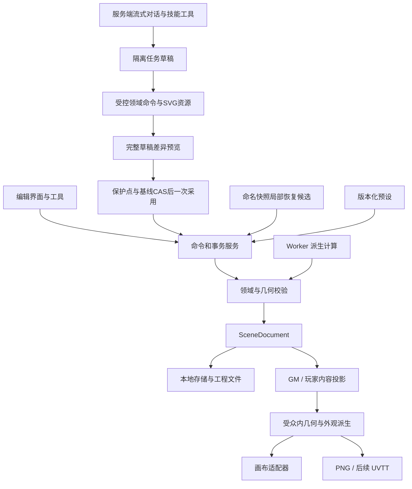

# 交互与架构参考

本文件承接原专题的独有合同和固定输入。涉及旧工作台、旧格式或当批状态的叙述保留历史语境；当前范围由[主导航](../README.md)和对应主合同确定。

- [02-editor-ux](#doc-02)
- [03-architecture](#doc-03)

## 编辑器交互设计

**2026-10-27 地形交互当前状态：** 工作区已接入T0–T7地形/区域入口、外围重生成、复杂拓扑和有明确授权的AI隔离候选。T5下钻只对几何条件满足的区域面承诺物化；T7冻结收口和正常生产复跑在当批完成，随后曾按用户要求暂停讨论；当前顺序以[路线图](../07-roadmap.md)为准。实际边界见[55第20节](../55-terrain-generation-design.md#20-t4t6实现与t7收口边界)，下方T0/T1和T2/T3记录保留原批次范围。

### 当前视觉创作交互（2026-10-25）

新空白使用完整v2；已有新标识完整v1从「视觉」明确启用并保存独立副本，先保存原工程，失败保留原会话。「工程」提供海岸、岩岛和旅舍原创样板，以及带24项原创素材的纯空白入口，仍经过候选确认、保存及新ID打开。

「视觉」分边缘、材质、环境、点光、区域雾和滤镜。曲线支持整数毫米控制点和画布控制柄；手柄只改草稿，预览列双方地形、实际附着/支撑及跨层影响，确认后一次采用。边带可选择岸线、崖面、草沿、道路或围栏；材质保持固定版本，比例/方向/原点与羽化覆盖可编辑。环境与滤镜可停用或删除，实体滤镜只影响对应图像的透明轮廓。全图环境与局部效果分开，层滤镜为持续规则；AI只冻结明确目标，不传播到后来对象。

历史面板「视觉参数」支持本会话真实快照后的连续现存效果与曲线参数恢复，先保护当前，再一次采用并保留范围外编辑；重开/导入或删后重建、绑定/控制段身份改变后拒绝，不按同ID追认。完整包仍能保留和另开历史，不代表跨会话视觉局部恢复。

AI可填制作清单、场景类型、可选风格及五类可核对目标（净空、数量/分组、高差连接、房间用途、边带），明确授权视觉/材质/公开对象/矩形范围；全图环境另勾授权。进度显示模型清单状态，标记完成仍需人工核对。公开截图每次另行选择，渠道未启用时禁用，结构诊断继续可用；实际范围、图像尺寸及任务保留边界归05/53。

以下状态段保留此前批次入口，现行格式以完整v1/v2及上述交互为准。

状态：2026-10-25，当前本地版本仍为 `0.2.0-m1-d2`。默认首页、工作台、Canvas2D和完整编辑会话已使用新标识的完整v1、工程库`sceneweave-projects`与个人库`sceneweave-library`；按用户2026-10-25决定删除旧整页工作台和首页旧版本/转换入口；当前只接受新完整v1工程及所选历史包，不提供旧格式产品支持，不修改旧库。当前交互入口见下文2.2；M2-1/2对话与保护采用、M2-3场景工具和M2-4 SVG/渐进同化已接入同一工作区，操作见第9节，合同和实际证据归[05](../05-ai-and-generation.md)。M2-5服务器容器与可信公网IP HTTPS已上线，Pages真实模型创作→保护采用→保存/导出/重载的必要联合旅程已通过，详[05第15节](../05-ai-and-generation.md)。

M1/C0–C5及U1/U2各段保留当批格式、入口和实现边界，用于解释历史，不要求继续运行六套编辑器。新完整v1交接与主路径范围分别见[47](../archive/m2-project-validation.md#doc-47)、[52](../archive/m2-project-validation.md#doc-52)，数据/存储现行合同以04/06为准。完整SCN-01/04从空白制作、主题P3、持久建筑/任意拓扑恢复及真实小团仍待；正式性能四组×三轮结果见[34](performance.md#doc-34)，100ms普通编辑门保持未通过，后续优化继续独立追踪。本文仍包含后续交互目标，不据设计推定实现，也不在此重复最终回归数字。

U1a首页/安全打开和连续会话的历史范围归[38](../archive/workspace-content-validation.md#doc-38)，U1b分栏/调宽折叠/本机偏好归[39](../archive/workspace-content-validation.md#doc-39)。U2目录/标签/颜色/收藏与完整库备份已经实现，原批次归[41](../archive/workspace-content-validation.md#doc-41)，新个人库与完整v1载体收敛归[51](../archive/m2-project-validation.md#doc-51)；37保留准备，36保留讨论。当前统一工作区沿用下表固定职责；旧严格v6档案和原历史证据保持，不作为当前主存档格式。

M0 已提供现有实体单选、家具拖动/属性编辑、共享墙与门属性、编辑锁、会话撤销重做、保存反馈、工程往返与玩家预览/PNG。B1/B2素材工坊提供完整资源工程、VIS-01样板、材质方向/替换、物件与组合属性、拆组，以及固定范围双受众PNG。结构修改从左侧「结构」选择顶点、墙或露台点后输入数值，候选画面可取消或一次采用；「组合」提供整体变换和拆分，子件仍可独立选取修改。具体操作与限制见[18](../archive/m0-m1-validation.md#doc-18)。B3新增VIS-02室外样板：从「结构」选择地形点、高程、草岩覆盖和台阶；从「组合」选择散布组，预览密度后采用/取消，成员可手移、固定、删除并保留排除区或退出组。未选择对象时可检查两处2m宽直线通路；这不搜索全图路线。实际证据见[19](../archive/m0-m1-validation.md#doc-19)。

C1a当批的新建入口生成真正空白的严格v2完整工程，左侧优先呈现「放置」目录；可用18件B2/B3固定素材，点击画布或输入坐标放置，以实际图片、外观轮廓和占地预览位置。放置后可单选修改位置/角度、普通删除、撤销重做、保存重开和导出。C0底图/选框分层是该批预览实现；C1b补选择/右键，C1c补独立v3图层，C1d补命名历史与首批局部恢复。C2在历史工坊补房间绘制、附着门窗、量尺、矩形玩家遮罩和文字注记；C3补静态素材入库，C4补用途区；M1-D补显示预设/单位/格线设置，当时尚无AI面板。旧自动快照的当批恢复与迁移边界保留，当前保全/转换及新命名历史行为以04/06/47为准。

按[路线图](../07-roadmap.md)，C1a–C1d、C2建筑/有限结构恢复、C3有限组合/外观和C4地形/散布恢复的历史证据分别归23至29/31，C5归32，M1-D混合首批归35。M2目前已将这些手工能力纳入原生完整v1，并开放有限AI场景工具、SVG和单件→组合→明确范围同化；实际授权、采用和未验边界见05第13至15节。对应PRD-006及PRD-029至PRD-033，后续目标仍按07安排。

### 1. 主页面信息结构

下表为当前沿用的固定工作区职责；U1b当批简单检查与边界见39，新原生主路径见52。旧工作台和首页旧版本/转换入口已删除；不支持的hash统一回首页，并经过当前会话离开守卫。桌面浏览器是首版主要使用环境；画布占主要空间，固定面板可调整宽度和折叠，窄窗口仍能用明确按钮、键盘和触控展开面板。面板可达不等于已支持完整触屏地图编辑。

| 区域 | 内容 | 交互目的 |
|---|---|---|
| 顶栏 | 回首页、项目名称、保存状态、撤销／重做、工程与图片导出等全局动作 | 随时理解正在编辑什么，以及是否保存成功 |
| 左侧窄工具条 | 选择、平移、建筑、地形、放置、注记、量尺等指针工具 | 明确当前指针行为；模块浏览与启用指针工具分开 |
| 左侧模块与资源面板 | 建筑/地形/素材/AI对话等模块、工具选项、搜索/筛选、素材详情与AI范围/差异 | 浏览资源不跳离工程；素材详情留在左侧，不抢场景选区；AI采用使用同一会话 |
| 中央画布 | 地图、按需格线、选中轮廓、控制点、量尺、暂态几何 | 编辑空间与预览结果 |
| 右上属性与外观 | 场景选中对象的名称、尺寸、用途、所属、公开设置及外观；无选区时为场景设置 | 始终围绕场景目标，不随左侧素材详情替换 |
| 右下场景导航 | 图层、对象、历史tab；锁、编辑隐藏/独显及恢复入口 | 切换左侧模块时仍可访问图层、对象与历史 |
| 底栏 | 缩放、适合画布、吸附、格线、单位、当前工具提示 | 缩放/选区/编辑隐藏为会话态；格线/单位沿用既有工程显示设置事务 |

“房间列表”属于场景对象导航；用户图层用于组织和调整明确的对象范围，渲染带约束合法叠放顺序。图层不是房间、组合、地面高程或Floor的同义词，改变图层顺序不能破坏门墙所属关系。首版只有一个逻辑楼层，楼层控件无需占据主要空间。属性面板将“叠放顺序”“地表高度”“阻挡移动/视线”分开，选中树冠或阴影时不会暗示其为可站立的平台。建筑、地形、素材及AI已共用一份原生工程、画布、历史和选区；旧工坊历史截图不替代当前交互证据。

分栏偏好仅存为本地、带版本的界面配置，提供恢复面板及重置布局；损坏或不兼容偏好回到可操作默认布局，不影响工程、revision、撤销或导出。调整分栏时保持画布世界位置，面板不能覆盖必要的采用/取消/错误反馈；窄窗口不能只用CSS隐藏后丢失入口。浮动窗口、自由停靠、多文档标签和完整PS像素工具不属U1b。AI面板已接入同一会话；未连接时显示配置与边界，手工工具继续可用。

### 2. 进入与新建

C1a在素材工坊提供“新建空白场景”、打开工程、最近本地场景及独立样板入口。新建弹窗填写“场景名称”“画布宽度”“画布高度”和“使用预设”，默认14,000×10,000 mm与调查预设，另可选择战术或叙事。名称去除首尾空白后须为1–120字符，每边1,000–200,000 mm且长宽比不超过20；无效输入显示原因并保留当前工程。这些是新建界面的限制，不修改既有v2格式或导入限额。

点击“创建空白场景”先保存当前编辑，准备完整资源并校验，再完整保存新工程，成功后直接打开。准备阶段显示“正在准备素材…”，弹窗“取消”或Escape可中止；进入首次保存后显示“正在保存新场景…”，取消暂时禁用，等待明确的成功或失败结果。准备取消、资源失败、当前分支保存失败或新工程事务失败均保留原工程；迟到资源不能重新打开已取消的工程。空白结果只建立一个Floor及范围/预设，场景实体为空，同时携带18个B2/B3固定物件定义、实际位图和许可；不会预放房间、地形、物件、组合或散布。

C1a新建后开放既有单件放置；C2在历史工坊开放房间绘制与附着门窗。绘地形、主题管理等入口随相应工具实现。后续室内／室外／混合模板只提供起始设置，不限制后续工具；M2提供流式创作助手，按已启用工具制作场景、SVG及素材外观，草稿完成后一次采用。

打开已有工程前必须先保全当前编辑；保存失败或冲突时保留内存分支，提供重试、导出和另存副本，不以普通离开确认静默丢弃。导入格式无法读取时保留当前工程，显示文件问题和可行操作。M1-B先支持完整资产工程；缺素材或定义时列出依赖并保留原件，不将缺图文件导入为完整工程。后续若提供带名称占位图的诊断预览，须与正式可保存状态区分。M0几何工程对外部素材直接拒绝，具体边界见[存储与导出](../06-storage-and-export.md)。

#### 2.1 U1a首页与安全打开（历史批次，验证见38）

本节保留U1a当批六仓库/v6的入口与保全设计；当前入口及新完整v1载体见2.2，U2也已实施。U1a默认入口改为首页，提供新建、打开、最近工程、继续编辑和内置示例；素材管理在U2可用后才开放，不能放置假工作按钮。示例与个人工程分别呈现，开发夹具/负载不进入日常创作列表。该批最新工作区作为规范入口；旧深链接和读取器在兼容核查前保留，不把旧UI退役或数据清理作为前置条件。

统一发现六个原生仓库中的工程，以“仓库＋sceneId”区分身份，名称只作显示；同名、同sceneId但来自不同仓库的记录不能合并。最近列表点到当前相同身份时执行“继续编辑”，只有显式“重新打开”才安装/重置当前工程。旧工程仅在明确打开/升级时建立最新格式的完整独立副本，按既有合同保留原工程、原历史、确切原件和来源链；点击素材或切换工具不能触发迁移。旧深链接或旧原生编辑入口同样经过统一离开守卫，访问另一个原生工程属于真实切换，不算保留v6结构witness的模块浏览。

只保有一个当前完整v6工程。切换工程按“处理冲突草稿/候选 → 校验并保存当前分支 → 准备及校验目标 → 必要迁移并完整保存目标 → 激活”进行；任一步取消、错误或过期都不替换当前工程，不清空当前撤销、草稿和候选。首次保存等不可取消阶段明确显示状态；迟到准备结果不能在取消或后续编辑后重新激活。

回首页前，互斥绘图/放置草稿须继续完成或明确取消，待采用候选须采用或明确取消，当前成果须按保存规则保全。处理完后回首页与继续编辑只改变展示，不关闭当前工程：选择、视口、当前层、编辑隐藏、模块搜索、撤销以及保存/错误状态继续存在，不重新open/import。打开另一工程、真正重开或导入仍遵循既有结构连续性失效规则；仅切面板或同会话回首页不应丢失本会话结构恢复证明。浏览器刷新只保证已经成功保存的内容，不承诺重启后恢复这些会话态。浏览器Back/Forward、直接hash变化、离开站点和关闭标签须有对应导航/卸载保护，不能只保护顶栏按钮；原生离开提示不等于保存已成功。

#### 2.2 当前原生入口与样板详情（2026-10-25）

当前首页提供新建、打开、最近工程、继续编辑、素材管理及六个真实样板：书房与露台、双层岩岛、海岸哨所、苔石墓园、灰烬熔脉、原创材质校样。卡片展示实际场景全图、尺寸、说明和特点；点击图片的“查看全图”或“查看详情”打开场景详情，显示主持人完整场景图及房间/地形/物件/组合数量。查看详情只浏览，不新建、打开或转换工程。弹窗可关闭、按Escape或“返回首页”，关闭后焦点返回原触发按钮。

卡片“打开为副本”和详情“用此样板创建副本”才开始真实创建：先保全当前工程，准备并完整校验样板资源，完整保存新副本后再激活。准备有即时进度及可用的取消入口；不可取消的首次保存显示实际状态。失败、取消或迟到准备不替换当前工程。样板中的房间、室外、物件、组合和散布保持其完整可编辑成员，首页全图不替代存档。

新建、当前工程保存和主编辑会话均采用新标识完整v1，工程与个人素材分别进入`sceneweave-projects`和`sceneweave-library`。首页最近工程只列当前新库；普通工程和所选历史包只接受新完整v1，旧格式/损坏文件明确拒绝且保留当前工程。浏览素材、查看详情和切模块不导入工程。安全离开、单一会话及本机布局偏好继续适用，新格式的精确身份/历史/来源链合同以04/06/47为准。

### 3. 工具模式与画布

下表为完整M1交互目标；C0视口、C1a单件放置及C2建筑的当前子集分别在本节、6.2和4.1说明。矩形拖绘、独立正交绘图模式、边拖动与折线量尺等目标不因C2的点击/数值工具存在而视为完成。

| 模式 | 主要动作 | 结束／取消 |
|---|---|---|
| 选择 | 点击对象；框选；多选；拖动允许移动的对象；通过属性精确修改 | 点击空白取消选择，Escape 结束当前暂态 |
| 平移 | 拖动画布；空格临时进入平移 | 松开空格返回之前工具 |
| 房间 | 矩形拖绘；正交或含斜边的多边形逐点绘制；选房间后调整边界 | 确认后提交；Escape 放弃当前草图 |
| 门窗 | 在有效墙上显示候选位置，点击放置，再调整宽度和状态 | 无有效墙时不生成对象；Escape 放弃候选 |
| 地形 | 绘制/刷改地表轮廓，设置台地高度；编辑岸线、悬崖、坡道/台阶及道路 | 草图或一次笔划先预览；确认后提交；Escape 取消 |
| 材质 | 选择地面/墙面材质，预览铺装方向、真实尺度和边缘效果 | 明确应用范围后提交；取消恢复原外观 |
| 物件与组合 | 选择素材或组合，预览外观与占地，放置后可移动和旋转 | Escape 取消待放置内容；一次放置一条历史 |
| 散布 | 在指定区域内预览植物/碎石等分布，调整密度、间距与避让 | 采用后成为可编辑物件；取消不保留候选 |
| 区域 | 标记危险、用途、移动代价或人工遮罩 | 确认边界后提交；不靠着色自动推断玩法 |
| 注记 | 选择锚点，输入文本与类型；默认主持人可见 | 保存后成为一个可撤销修改 |
| 量尺 | 测量两点或折线路径；按当前显示设置呈现 | 结束测量不修改地图文档 |

缩放围绕鼠标位置或当前画布中心，提供“适合地图”和百分比输入。网格显示与吸附分别控制；关闭格线不会改变世界尺寸。单位切换只影响展示。尺寸输入需显示当前单位与合法范围，内部精度遵循数据契约。

C0已实现的素材视口子集：地图上方提供选择/手形、缩小/放大、只读百分比与“全图”。倍率相对适应全图为25%–800%；滚轮以鼠标为锚点，按钮以中心缩放；手形、空格加左键或中键拖动，松开指针结束。Escape、失去捕获或窗口失焦取消在途平移并恢复开始位置。视口聚焦后支持方向键、`+`/`-`和`0`，输入框及模态弹窗不接管这些快捷键。修改/采用/撤销保留视口与世界中心，切换工程或受众回到全图；玩家可以导航但不能从画面选择秘密对象。视口不写修订、存档、撤销或PNG范围。预览底图长边1200px，放大可能显示像素；4K按完整固定范围另行渲染。该批C0不包含自由物件拖动、绘房、多选、百分比输入或触屏完整编辑；其历史回归见[22](../archive/m0-m1-validation.md#doc-22)。多选随后由C1b补齐，C2绘图见下节，其他未实现项仍按路线图安排。

C1a点击放置经视口逆变换后取整数毫米，数值输入也按整数毫米校验。C2绘房与量尺的画布点击按`units.snapMm`步长吸附；建筑数值输入仍直接校验整数毫米。物件放置不据此获得相同的网格自动吸附行为，显示格线和吸附分别表达。

#### 3.1 U1共享草稿与候选转换（U1a已实现，验证见38）

浏览模块、查看素材详情或图层/历史列表属于只读导航，不隐式改变场景选择或丢弃草稿。界面应区分尚可编辑的暂态草稿、正在准备的异步结果、已经完成校验待审阅的候选，以及正在采用/保存的事务；同一会话最多一个待审阅候选。各工具继续使用既有有限命令、依赖/锁/256预算、恢复保护点和CAS入口。

| 当前状态 | 允许的转换与反馈 | 必须保持 |
|---|---|---|
| 工具草稿或待放置 | 可切只读面板并返回继续；启用互斥指针工具或回首页前先继续当前工具或明确取消草稿 | 草稿只在会话，不因组件卸载或工具点击被静默清空；不新增序列化草稿功能 |
| 异步准备中 | 可查看只读内容、平移/缩放及明确取消；等待有明确状态 | 原会话世代、request/checkpoint与基线仍有效才接收结果；取消后丢弃迟到返回，不能在返回面板时给旧结果换新基线 |
| 已准备待审阅 | 保留画布预览及差异；只读面板和视口可用；冲突编辑/工具、回首页或切换工程先采用或明确取消 | 显示具体冲突原因和同一处采用/取消入口，不反复弹通用确认；不允许第二候选暗中覆盖第一个或把候选藏到首页 |
| 采用或保存中 | 按既有原子阶段等待明确成功/失败；提供真实可取消状态 | 不因导航卸载中断持久事务后谎报成功；保存失败/冲突保留当前内存、撤销和救援入口 |

只读导航不改变已准备候选的冻结目标，后续选择不能暗改其范围。草稿明确取消、候选明确取消及无变化采用都不增加revision或撤销项；处理完候选后，同会话回首页仍保留已有选择、视口、撤销和结构witness。取消恢复若已落盘保护快照，按既有合同保留并说明该保护点，不把“当前文档未变”写成“所有历史均未变”。

### 4. 房间、共享墙与门窗

#### 4.1 绘制房间

C2当前入口位于历史工坊左栏「建筑」。选择矩形后依次点击两个对角，或填写起点与宽高；多边形/斜边逐点点击，或按每行`x,y`输入3–128个顶点。点击「预览新房间」后查看候选、完整影响ID与图层，勾选确认后「采用结构修改」。草图、量尺、预览和取消不写修订；Escape退出在途草图。当前不是拖边、矩形拖拽或独立正交工具，未实现的目标仍在下面保留设计。

当前层决定新增房间及新独立墙/点的归属；复用的共墙/顶点保持既有身份与层，部分共边拆出的旧墙段及切点继承旧墙层。共边墙厚必须与既有墙一致。多边形方向自动规范，房间重叠、自交、穿越现存墙、切点穿过开口或不能精确保持整数毫米开口计量时明确拒绝，不自动删门或近似挪门。支撑面显式选Floor或已存在地形，地板材质仅能选工程已采用的适用固定版本；新房间不自动接管落在内部的既有物件。

「世界与导出范围」以毫米分别修改世界矩形和固定双受众输出矩形，各边1–200m、最大20:1，起点可为负。世界边界需容纳实际墙厚，缩小后仍完整检查保留实体；该操作列出整个Floor影响并检查其实体/层锁，不随秘密几何自动改变导出范围。「固定玩家遮罩」以数值建立/修改矩形；「文字与线索」建立固定坐标注记，选中建筑后也可建立附着线索。它们共用预览/确认/采用、撤销和保存流程；遮罩不足仍拒绝玩家出图，新增遮罩不表示秘密已经通过验证。

绘制时先显示草图与尺寸。鼠标移动只更新暂态预览；完成一个房间才提交一次事务。对齐既有边界时，显示吸附线与共享墙提示。草图自交、覆盖已有室内面积或形成不合法边界时，将问题边高亮并说明原因，用户可继续调整。

正交工具限制水平/垂直边，多边形工具允许斜边并提供角度与长度输入；两者产生同一类房间和共享墙。M1 不提供弧形建筑墙。墙厚以真实尺寸编辑，预览门口和室内净空影响；墙体轮廓、转角收口与地板裁剪随结构更新，不能仅把贴图描边加粗。

房间初建时通达要求为未指定（`accessExpectation=unspecified`），可以先独立存在。对象列表提示未连接，主持人可稍后添加门或通道。只有显式设为必达（`required`）的房间才执行入口结构连通硬约束；有秘密门或上锁门连接的房间仍可为 `required`。只有设计明确允许没有结构连接的房间，才标为有意隔离（`intentionalIsolation`）。结构上能否到达与门当前是否开启／上锁分别显示；指定门状态下的通行要求由独立约束表达。

相邻房间共用同一面墙。点选共享墙时同时显示两侧房间名称，避免误以为它们是可独立重叠的两条线。房间样式调整可以独立进行，共享几何的移动则按整个影响范围检查。

#### 4.2 调整与删除

C2通过建筑对象列表选房间、墙和顶点，右侧数值修改顶点、墙厚，反转墙方向或修改房间名称/可见性/连通声明；候选列出共享结构和支撑/锚点依赖。门窗和注记、矩形遮罩可明确删除；普通房间/墙删除、自由拖边、整组建筑变换与通用拓扑修复尚未开放。以下删除房间/墙流程为后续目标，不能据此推定已有入口。

拖动边或输入尺寸时，预览受影响的房间、墙和门窗。若修改会影响未选择或锁定对象，暂停提交并指出对象，提供“取消”和“查看受影响对象”；扩展选择或解除锁定由用户另行操作。

修改边界时，能合法保留的门窗保持位置语义；无法保留时明确列出冲突，不静默挤压、删除或漂移。需要拆分墙或重新挂接门窗的操作必须作为一个完整修改提交。具体几何变换约定见 [场景文档契约](../04-scene-document.md)。

删除房间或墙只属于手工功能。提交前显示受影响对象及可执行的处理方式；删除共同墙不能留下仍依赖它的房间边界，也不能留下悬空门窗。删除注记锚点时需明确同时删除注记或改挂到场景位置。无法形成合法结果时阻止删除，提示先调整关联对象。

#### 4.3 门窗编辑

C2当前先在列表选墙，再填写稳定基准端点、近端偏移、净宽和门/窗种类，预览后一次采用；选已有开口可改这些字段、门窗状态/通行锁/秘密/揭示，并显式设置外部入口。没有直接点击墙面即放门的手势，也不靠鼠标位置猜附着关系。端部间隙、真实墙长、最小门宽、重叠与入口结构连通由完整候选校验；删除仍有入口、连接或注记引用的门窗须先明确解除引用。直接重新附着另一墙的领域命令仅在最终合法时可用，当前属性面板不提供跨墙重挂选项。

候选门窗吸附到墙并显示方向、位置与宽度；进入转角、与既有开口重叠或超出墙长时提示不可放置。已放置门窗在属性面板可编辑位置与状态。门的开闭／上锁状态与对象的“禁止编辑”锁定分开呈现。

文档中的 `editLocked` 对应“锁定编辑”，门的 `locked` 对应“门已上锁”，`state` 对应开／关；`secret` 与 `revealed` 分别表示秘密门及是否已揭示。界面用完整中文标签区分这些含义，不以一个锁图标承载所有状态。

秘密门的主持人视图使用明显但克制的标识；玩家预览中，未揭示的秘密门按普通完整墙表现。主持人需主动操作“向玩家揭示”；移动门、切换预设或采用 AI 提案不隐含揭示动作。

### 5. 自然地形、边缘与高差

#### 5.1 绘制自然轮廓

选择地形后先绘制地表区域，再设材质和高度。逐点轮廓与笔刷编辑都保留可修改的结构边界；一次笔划提交一次事务，连续拖动不能产生上百条历史。预览显示受影响的岸线、悬崖和连接，错误部分可继续修正或取消。

地表、道路和玩法区域使用不同的对象提示。画蓝色地面不会自动阻挡通行；放置道路贴图也不会自动清除已有障碍。路径工具提供宽度、材质和端点调整，通行用途在属性中明确设置。形状表达与校验以04为准，不把美术噪声的每条裂纹变成路径碰撞边界。

#### 5.2 编辑台地和连接

地形面板分别显示地表高度、边缘类型和连接。选中悬崖边缘可查看两侧地表、落差及移动/视线设置；阴影方向不决定哪一侧可站立。放置坡道或台阶时选择其连接的两处地表，预览有效端点、宽度和连接方向。

修改岛岸或台地轮廓时，依附边界的外观跟随更新；需要重挂的坡道/台阶、越界物件、范围不足的玩家遮罩显示在影响清单中。默认保留手动摆放物件的位置，不自动移动整个营地。可在同一候选中明确调整依赖；无法形成合法结果时保留原文档并指出冲突。

提高一块地面的叠放顺序不会把它变成高台。M1 仅处理单逻辑楼层里的离散高差，不提供同一位置上下两层都能探索的空间。桥面图片和连接对象分别管理，是否可通过以明确连接和通行数据为准。

### 6. 材质、组件与布景

#### 6.1 铺装与主题

选中房间地板、墙面或自然地表后，可预览材质、真实铺装尺度、方向、起始对齐及适用边缘效果。地板默认按世界尺寸平铺；放大房间只增加覆盖范围，不拉长木板。材质预览显示整块选区和相邻接缝，应用范围明确到已选表面。

切换主题先展示会改变的材质与物件变体，缺少映射的内容保留原样并列出。采用只改变列明的外观，不重缩放地图或修改通行、锁定、公开设置。主题包更新也需显式采用；重开工程使用保存的版本和引用。

#### 6.2 单件与组合

C1a当前流程：左侧「放置」列出工程已采用的物件定义，空白工程带18个B2/B3内置物件。选择后，右侧「放置物件」提供X/Y/旋转和“放置表面”，画布随指针显示实际图片、外观轮廓与物理占地；此时尚未写入工程。可点击画布确认一次，也可填写数值后点击“在此放置”；成功后退出待放置并选中新物件，Escape或“取消放置”丢弃候选，不增加revision或历史。

“放置表面”显式选择Floor、Room或TerrainArea，默认支撑为当前Floor，鼠标落点不会自动改变归属。采用时验证完整占地、引用、固定版本和支撑链编辑锁；失败保留当前文档与可调整候选。新物件按素材定义进入对应系统绘制带，在同Floor同带的已有物件上方；排序不改变高程或通行，也不是用户图层。选中后通过“物件属性”输入位置/角度，或使用“删除物件”；普通删除保留组合成员关系记录，仍被注记引用的物件不能直接删除，散布成员继续使用保留排除区的专门入口。成功放置、修改、删除、撤销和重做均沿用单调revision及完整保存；重开、离线工程往返和固定范围双受众4K沿用同一工程与渲染路径，适用证据见23。

素材面板的完整目标包括用途、主题和类型筛选，可查看推荐尺寸与占地；C3当批只按其关键词/类型能力判定，后来实现的个人组织及颜色筛选见6.5。放置时提供外观轮廓和可切换的占地轮廓；透明边缘、树冠或投影不自动扩大阻挡范围。切换“完好／破损”等外观变体保持位置、尺寸和既有玩法属性；需要套用素材默认值时单独展示差异。

组合如“书桌＋椅子＋散落纸张”“营火＋帐篷＋木箱”作为一组预览、放置、移动和旋转。双击或对象树进入组内编辑；“拆开”保留子对象的世界位置、稳定身份、注记与秘密设置。整组操作遇到锁定子对象或非法占地时整组失败，不能默默跳过子对象。M1 组合不包含可自由变换的建筑墙或地形结构，结构仍通过专用工具编辑。

C1a待放置图片的临时预览同样逐次检查引用/记录、实际字节、CRC/hash、尺寸与单图预算，经过共享原生解码槽。预览未就绪不能采用，失败退出待放置并保留当前工程；取消、换素材或离开时释放本次位图，不建立长期缓存。相关验证见[23](../archive/m0-m1-validation.md#doc-23)。

#### 6.3 可控散布

用户指定区域、候选素材、密度、尺寸变化范围、最小间距及避让对象，先看到候选结果和警告，再选择采用。可保持同一组结果继续调参，也可明确“换一组”；单纯缩放、重绘或重开不会重抽。

采用后，每个结果都是可选、可移、可删的物件。用户移动、删除或锁定的结果有明确保留语义；再次调整散布默认保留人工决定，不重生已删除的同一结果。地形变化后，失去合法位置的结果被标出并交给用户处理；不会借“自动修复”搬走人工布置。整次采用、更新或取消遵守同一历史与保存规则。完整结果和人工覆盖写入工程，不能仅存一个种子后重开重算。

散布首先是手工布景工具，与 AI 是否可用无关。M2-3的AI只调用已授权且经过范围检查的同类操作，不改变人工记录与完整结果保存规则。素材和风格的制作流程见[视觉与素材体系](../14-visual-and-assets.md#doc-14)。

#### 6.4 参数变体与非破坏性外观

C3提供与AI无关的参数调整入口：先选单件、组合成员或图层中的明确对象，再预览该类型支持的外观参数。首批候选范围为材质替换、铺装尺度/方向、颜色调整及物件外观版本引用；每种参数只有实现并通过预览/PNG一致性验证后才按白名单开放，未支持的物件着色不能因材质着色已存在而被推定可用。调整前后并排或切换比较，可以关闭某次外观调整、回到原版本，或保存为新变体。

原素材与固定定义版本保留，采用结果形成可撤销的覆盖或新版本，不原地覆盖所有使用同一素材的对象。面板区分“仅此实例”“选定组合成员”“本次所选对象”“图层外观覆盖”与“另存素材变体”。图层外观覆盖是持续规则，按源版本→图层覆盖→实例/成员显式覆盖的顺序生效，移入/移出层前预览继承或失去覆盖的结果；本次对象批量修改、AI采用与局部恢复则冻结目标名单，不自动作用于后来移入或相邻的对象。

整层调整先列出支持的目标、实际属性、不支持项与锁来源；持续规则修改若改变锁定成员的有效外观，整笔拒绝，不能借改层覆盖绕过实体锁。混合类型不能用一个通用滑杆修改未知属性，也不能跳过失败项后宣称整层完成；用户可改为明确选择支持的子集执行一次批量调整。层覆盖每项可关闭或移除，实例显式覆盖与它们分别展示。

可借鉴PS的对象组织、隔离编辑、保留原内容和局部调整思路，官方参考及采用边界见[调研依据](decisions-and-research.md#doc-12)；Sceneweave的持久命名快照和实体依赖恢复属于本项目设计，不能照搬像素历史操作。首版不以完整像素编辑器为交付目标。任意混合模式、像素蒙版、滤镜栈和任意图层效果须分别评估数据、预览、双受众导出及恢复语义后才能排期。外观改变不能暗改真实尺寸、占地、通行、锁定、秘密或玩家可见性；涉及这些属性的操作使用各自独立面板和校验。

#### 6.5 U2素材目录与个人整理（已实现）

素材管理与工作区左侧浏览器共用“内置素材／我的素材／本工程”范围和搜索/筛选。三个范围是目录视图，不表示自动共享、自动联网或复制全库；浏览本工程不自动推广到个人库。条目显示缩略图、名称、实际尺寸、固定来源/版本和许可，这些目录/个人组织信息属于GM编辑数据，不进入玩家输出。查看素材详情保持场景选区与右上属性，放置/应用才进入明确目标的候选流程。未安装、资源不完整、许可不可嵌入分别显示原因；缩略图可看不代表资源已经能离线采用。

个人标签、多色描述和收藏独立于固定定义/来源保存，允许单项和明确选中项的批量整理。普通中文与自由关键词可以输入；空白、全半角和大小写按统一规则匹配去重，同时保留显示文本。发布者标签、个人补充及内部制作/保全元数据分别呈现，个人整理不修改发布者固定内容或保全字段；同ID/版本不同内容必须报冲突，不能按名称合并。

| 操作 | U2实施语义与保留边界 |
|---|---|
| 类型、场景、用途、材质/状态及颜色等筛选 | 同一维度多选取“任一”，跨维度取交集；已选条件可见、可逐项移除或全部清空 |
| 自由标签 | 明确选择“全部匹配／任一匹配”；结果和空结果说明对应范围与条件，不悄悄清除过滤器 |
| 颜色 | 人工确认多个颜色描述，色块始终配文字；自动提色后续再做。描述固定源/变体，不冒充场景经层/实例覆盖后的当前颜色 |
| 个人整理 | 只改选中的确切固定素材身份及独立组织记录，不改场景实例、占地、通行、危险、锁或秘密；实例标签另属后续范围 |
| 完整素材库备份 | 明确选择整理记录并携带所需固定定义、组合成员、源/派生链、实际字节和许可；可在空环境恢复并离线采用 |
| 仅整理数据清单 | 若提供，须明确不含完整资源及其未解析引用，不称“完整可离线素材库”，不隐式联网补齐 |
| 移除目录条目 | 明示目录影响及依赖；不能删除已采用工程、快照或源链的根，不能因当前无实例自动回收工程资源 |

工程备份仍只携带已采用的完整闭包及明确选中的历史，不自动分享个人全库整理。U2a先冻结独立目录/组织/备份的精确身份、schema、数量/字节预算、并发CAS、冲突及安装状态，再完成写入器；U2b目录与完整库备份的当批范围见41。该准备及旧v6/v3条款属于历史上下文，当前新完整v1及个人库收敛见51，数据合同分别归04/06。新库中的SVG来源使用M2-4算法2保全源/规范化/实际PNG闭包；无SVG的算法1固定身份保持。关键词、类型、标签、颜色、收藏与明确范围的完整库备份已可用，采用仍保留完整校验、原子失败及离线闭包，不能从实现状态推定任意目标筛选或未列入口均已支持。

将私密固定组合从本工程显式保存到“我的素材”时，保留模板visibility、成员来源和参数，不能只复制组合定义后重新推断为公开。把该素材放入新公开Floor或从完整素材库备份恢复后，仍须遵守原私密性和固定遮罩合同：有合法遮罩时验证正确采用与玩家过滤，无合法遮罩时整笔拒绝，不通过改公开来完成放置。

### 7. 选择、上下文操作与图层

#### 7.1 框选、多选与命中

C1b把既有“框选/多选”目标落实为可验收的交互。单选显示对象名称、类型与属性；多选显示数量、共同属性、不一致项和有效锁定情况。选择集合只属于编辑暂态，不进入工程、文档历史或PNG。

| 输入/条件 | 选择语义 |
|---|---|
| 点击对象；在选择工具下拖动空白 | 点击替换选择；拖动形成矩形框选预览，松开才确定选择。未超过拖动阈值的空白点击清空选择 |
| 默认框选与“包含相交对象” | 默认要求完整包含选择轮廓；显式切换后选相交轮廓，边界接触计相交。不靠拖动方向暗中切换规则 |
| 追加/减去 | Shift加点击或框选为追加，Alt/Option为减去；工具栏同时提供替换/追加/减去模式，避免修饰键成为唯一入口 |
| 缩放、平移与旋转物件 | 指针与框选范围经视口逆变换参与世界坐标命中；物件使用旋转后的显示矩形，结构使用对应几何轮廓。阴影和选择描边不扩大命中范围；透明图片矩形与物理占地分别提示 |
| 重叠对象 | 默认命中当前可选范围内最上方对象；右键命中列表和对象树可选择被遮挡项，顺序与画面合法叠放一致 |
| 组合与组内编辑 | 默认以整个组合为选择单位，完全包含检查全部成员轮廓，相交检查成员轮廓并集；组边界空白不算命中。双击或对象树明确进入成员模式后才逐件选择；不把组和其子件重复计入同一次批量操作 |
| 编辑器隐藏或锁定对象 | 普通框选排除暂时隐藏和有效锁定对象，并提示被排除数量；整组候选若包含这些成员，整组不进入可修改框选结果。对象树仍可显式选择以检查或解除锁定；显示可见的锁定对象允许点击查看只读属性 |
| 取消和焦点丢失 | Escape、失去指针捕获或窗口失焦取消在途框选并恢复原选择；平移模式不同时触发框选 |

选择模式还明确“所有可选图层”或“仅当前图层”；全选遵循相同范围和锁定规则，不能选入玩家投影中不存在的秘密对象。房间选中不自动选择全部室内物件，也不获得邻室修改权；显示其依赖与所需扩展范围，由用户显式调整。

多选移动、旋转、删除、属性设置先计算完整目标及依赖，再预览并一次提交/撤销。C1b先支持物件；组合关系按现有组合约束检查，建筑与地形继续经专用工具处理。混合对象不支持同一操作、存在锁定或引用冲突时整批拒绝，允许用户明确重选合法子集，不静默跳过失败对象。一次拖动仍只产生一条历史。

#### 7.2 右键上下文菜单

C1b中右键是明确操作的入口，打开菜单本身不改文档。右键已选对象时保留当前多选，并标明“当前N个对象”；右键未选对象时先替换为该对象，显示名称与类型。多个重叠对象提供“选择此处对象”的候选列表。右键空白保留已有选择但显示“此处空白”菜单；放置类动作使用打开菜单时捕获的世界位置，不误用先前选择或菜单按钮的屏幕坐标。

菜单按对象能力提供查看/编辑属性、复制可支持的物件、删除、锁定/解除锁定及C1c已支持的图层动作。C1d局部恢复从独立历史工作台发起；组合/拆组、参数外观等入口仅在对应事务实现后开放。复制生成新的稳定实体ID并通过完整引用/占地校验；复制组合或带依赖对象只有相应事务已支持时才开放。空白菜单提供取消选择、适合全图、在此放入已有素材等适用动作。新增AI入口随M2批次开放，不能以菜单可见宣称已经实现。

不可执行的已支持动作显示禁用原因，例如“包含锁定成员”“需先进入组内编辑”“此类型暂不支持整体移动”；依赖影响通过差异预览展示。尚未实现的能力不伪装为可执行按钮。各菜单动作复用工具栏/属性面板的同一事务，不绕过编辑锁、当前基线、几何或资源检查。

菜单键或Shift+F10可打开当前对象菜单，方向键/Enter操作、Escape关闭并回到原焦点；属性面板的“更多操作”按钮提供同等入口。输入框和文本编辑区保留文本菜单，画布只在有相应应用菜单时接管原生右键。

#### 7.3 用户图层与范围调整

C1c提供可创建、命名、重排的用户图层，支持将对象移入层、在对象树选择层内内容，以及合成图层锁和实体锁。图层身份、名称、对象归属、合法叠放顺序和编辑锁须按04的版本化契约持久化并接受撤销、保存重开与工程往返；它们不是C0底图/选框两张Canvas。已冻结并实现04/06的严格v3及完整副本迁移，v1/v2读者继续拒绝v3。当前层“选择此层”或图层菜单“选择图层成员”选中本层可见且未锁定的画布对象，组合/成员遵循当前选择模式；尚无画布编辑的道路/注记不加入此集合。

“眼睛”与“独显此层”用于编辑器暂时查看、隔离工作，属于会话视图设置；它们不改对象的public/gm、秘密门揭示状态、玩家遮罩或正式导出。导出预览使用实际文档与受众规则，并提示编辑器暂时隐藏不等于玩家隐藏。需要改变玩家可见性时走独立的公开设置，逐项列出影响；层名和编辑器状态不进入玩家元数据。

图层顺序只能在04/渲染器定义的合法渲染带内调整。一个管理范围跨越不同渲染带时，分别显示可调的带内顺序，不把地表拖到墙上方、用叠放改变高程，或拆掉门墙依赖。对象树区分图层、组合与对象：移层保留实体身份和引用；首版组合/散布容器与成员同层，移层以整组原子操作完成。单成员要独立移层，先明确拆组或退出散布并保留人工记录。删除图层先选择将内容移至合法目标层或明确删除内容，不能顺带无提示删除对象。

层锁、组合锁和实体锁按“任一有效锁都禁止修改”合成；解除层锁不解除成员自己的锁，批量操作显示具体锁来源。锁定仍允许查看、量尺和正式导出，也不改变秘密状态。C1c先完成组织、选择与锁定；C3的外观批量调整通过本章6.4的明确目标和属性白名单执行，不能把所有PS像素图层能力视为首版承诺。

### 8. 手工与 AI 共用历史及快照

#### 8.1 会话撤销与重做

撤销历史使用用户能理解的名称，例如“移动写字台”“调整门宽”“采用书桌外观变体”。一次拖动只有一条历史；一次 AI 采用包含它依赖的全部修改，也只有一条历史。

撤销应恢复受影响实体的几何、关联、内容、材质、组合关系、散布人工覆盖和公开设置。重做恢复相同结果；撤销后有新的文档编辑时，既有重做分支按单线历史语义作废。地图修订继续增长，不能用撤销使旧 AI 提案重新变得有效。

缩放、选择、打开面板和未采用的提案不占用文档撤销历史。保存不是撤销步骤。关闭重开后至少恢复完整文档；跨次持久化撤销栈不列入 M1 承诺，界面应明确本次会话可撤销范围。

#### 8.2 命名快照与局部恢复

C1d历史工作台可创建、改名和删除命名快照；采用局部恢复前会创建当前分支的保护快照。命名和保护快照分别最多32份，另有独立的20份滚动自动快照。命名/保护历史保存在containerVersion=4、profile=`m1-history`的独立仓库中，场景本身保持严格schemaVersion=3。旧自动快照不迁移；完整工程备份只带当前工程，历史备份须逐项勾选快照，最多64项。历史备份导入创建隔离副本；可移植包不携带本地迁移原件，细节见06和[27](../archive/m0-m1-validation.md#doc-27)。

选定快照中的独立物件列表支持按名称或完整ID搜索、虚拟浏览；快照及差异面板显示来源修订与逐字段差异。恢复范围从历史对象列表或“使用画布所选”建立，明确选1–256个稳定ID，不截断、不拆批。C1d只接受独立物件，拒绝组合/散布成员、锚定注记/路径依赖、有效实体/图层/支撑锁、无效几何/隐私、lineage或出生身份冲突及资源身份冲突。当前新增对象不会被隐式删除。

首批提供三种明确模式：`appearance`恢复`definitionRef`、`appearance`、`visualBoundsMm`、`shadowClass`和`shadowOverride`；`transform`恢复`positionMm`与`rotationDeg`；`entity`按完整独立物件恢复或重建，需审阅物理占地、支撑、图层、私密性与玩家可见性差异。既有锁始终保留，重建对象为未锁；旧快照不能解开当前锁。图层色调下恢复历史有效外观的规则属于C3外观链，不是C1d能力。

预览绑定来源检查点、scene/revision、快照ID/hash和恢复请求。采用前先flush当前工程，再验证来源；保护快照以scene、元数据和来源快照CAS成功后重新检查基线，最终在当前文档产生revision+1的单次可撤销事务。实际按钮为“保护当前并采用”。保护失败不改场景；保护成功后如采用或保存失败，已写入的保护快照可保留并删除。采用后保存失败时保留新内存文档、撤销记录、保护快照和旧持久分支。范围外编辑与未选字段继续保留。报告27记录本批适用验证和完整浏览器矩阵的实际结论。

当前场景的实体视图与历史信封严格隔离：`toCompleteProjectV3`只导出`document`、`assets`、`licenses`、`licenseBindings`四项，再交给原生v3 IO/渲染；v4历史字段不传入v3读取器。用户仍可用滚动自动快照恢复完整副本；命名历史不提供整工程“回滚覆盖”，需用隔离副本或局部事务处理。

#### 8.3 C2有限结构恢复（已实现；适用验证见28）

历史栏「恢复对象」切换为「建筑结构与注记」，从快照列表或画布所选建立1–256个明确结构ID。`geometry`显示为「位置与尺寸」：房间恢复自身边界顶点坐标，墙恢复端点坐标与墙厚，开口恢复偏移/净宽，顶点恢复坐标，固定坐标注记恢复位置。`properties`显示为「位置、尺寸与业务属性」，包含上述几何，并对所选对象加房间名称/可见性/连通要求、墙阻挡、门窗种类/状态/通行锁/秘密/揭示及注记内容等业务字段。选房间不隐式恢复所有墙厚、门窗业务字段或邻室名称，需明确另选。

先点击「检查完整结构依赖」，审阅所选、共享几何和仅作校验的依赖；完整ID/字段与当前层逐项列出，扩展依赖及跨层影响分别确认后才能预览。当前层归属、编辑锁、材质、资源、支撑、高程和拓扑保持；邻室/支撑物件/连接/锚定注记只在必要范围内检查，不隐式回滚其业务字段。有效锁、无效几何/私密覆盖、超256条预算或来源/当前修订变化均拒绝整笔采用；采用仍先落完整保护点并同事务CAS，再一次提交且保留范围外新编辑。

结构恢复只接受本次打开期间新建且持有会话连续性记录的命名/保护快照。重开、导入、另存/切换工程后，既有快照仍可查看和携带，C1d适用独立物件恢复保持，但旧结构恢复明确拒绝；请在当前会话重新建立快照。所选或必要历史结构曾删除、重建、变更连接拓扑后，同ID及最终相同JSON也不足以恢复；撤销回来不重置连续性。C2不重建已删结构，不在严格v3/v4档案增加结构身份字段。跨会话结构身份/拓扑恢复须另设新版本迁移，实际范围与验证归[28](../archive/m0-m1-validation.md#doc-28)。

### 9. 流式对话与任务草稿（M2-1至M2-4已接入）

左侧“AI对话”提供中文流式对话和独立任务草稿。先填写“自有后端地址”和“后端应用凭据”，再“连接 AI 后端”；前端凭据仅存内存，模型渠道密钥留在后端。未连接时手工创作仍可用。普通对话`completed`仅表示回复结束；草稿仍须经过`waiting_browser`本机校验、`ready`审阅和明确保护采用，`applied`才表示采用已完成，本机保存另有成功状态。

连接后，“新任务思考程度”提供“跟随服务设置”“低 · low”“高 · high”“最高 · max”，并提示“请选择模型支持的思考程度”。它同时用于普通对话和独立场景草稿，只在创建新任务时生效；页面不自动检测供应商实际支持的等级。跟随服务显示当前服务默认，未显式配置时标为模型默认，不假定低强度或关闭思考。当前任务另显示创建时固定的设置，暂停续答、服务重启和同一请求重试都保持原值；页面后来选择只用于下一任务。未提供此能力的后端禁用选择并提示更新。较高程度可能增加等待和用量，不保证质量或完成时间；设置仅留在页面和任务服务，不进入工程、历史或导出。

“AI 场景草稿”先展示任务类型、固定基线、可修改范围、操作/定义白名单和发送上下文，再填写“AI 草稿要求”。创建前必须勾选“同意向自有后端发送上述完整元数据，并向模型发送授权的公开内容”；完整元数据可能含GM信息，但不发送图片和历史快照。模型仅接收授权公开内容、必要支撑/定义及本任务新建的GM文字，不接收既有私密正文、凭据或许可全文。无选区不默认为可覆盖整张既有地图。

#### 9.1 明确场景范围与有限工具

勾选“允许建筑、室外、组合和主持人文字工具”，以整数毫米填写“明确创作范围”，再“使用选中结构及其依赖”或“仅创作新场景”。操作列表、固定物件、“授权固定组合和材质”分别授权；范围、允许引用和既有公开实体在任务创建时冻结。任务新建ID可供后续工具继续引用，不扩大地理范围、固定定义或既有实体授权。

M2-3开放房间、墙/顶点调整、附着门窗及入口；地形、高差边界、台阶/坡道、用途区和道路；固定组合、家具布置、散布及保留人工记录的再生成；以及绑定对象的主持人注记。预览列出真实影响与只读支撑/附着依赖，沿用共享墙、净宽、支撑、锁、遮罩及完整校验。独立家具仅在明确授权下可继续使用普通移动/透明度/删除；组合和散布成员不因出现在草稿而获得独立物件通用修改权。

改写既有公开文字须新建GM注记并绑定原注记，公开原文保持。`gmNoteUpdate`只可修改本任务新建的GM注记；既有私密注记既不发给模型，也不因此开放修改。生成描述、线索和互动内容不自动改变公开设置。

#### 9.2 SVG与渐进素材同化

勾选“允许 SVG 制作与所选素材风格同化”，在“素材范围”选择“单个物件”“一个组合的存活成员”或“明确范围内的所选物件”，再“使用画布选中的素材”。范围模式可用“选取范围内全部公开物件”建立确切名单；任务启动后冻结IDs，后来选择、移入或相邻物件不自动加入。可分别授权“受限 SVG（本机生成实际 PNG，保留原件、源和许可）”“配色、亮度和透明度协调”，以及本任务新建物件的外观制作。

SVG仅接受有大小/复杂度边界的静态子集，经规范化后由本机生成真实PNG并核对像素；不支持脚本、任意DOM、外链或CSS。采用生成独立不可变的源/实际图片/定义版本，保留原件、确切父源与许可；物理占地、通行、支撑、秘密及人工记录保持。参数同化仅开放配色、亮度和透明度，组合仍保留完整可编辑成员，不能压成一张图。首版不接生图API；连接能力中的SVG表示该制作链可用，本机预览不代表模型已经看图，模型视觉能力仍为未验证。

素材保存到个人库与应用到场景是分别明确的操作。完整工程、明确选择的历史及完整个人库备份按各自范围保全SVG源、规范化结果、实际PNG、固定定义与来源许可闭包；局部恢复仍按已支持的实体/属性组执行，不因SVG出现而扩展到任意建筑拓扑或依赖恢复。

#### 9.3 审阅、保护与一次采用

| 阶段 | 用户看到与操作 | 主工程边界 |
|---|---|---|
| 制作中 | 流式文字、工具进度与已验证的草稿预览；可暂停或取消 | 多步修改仅在独立任务草稿，不逐个对象确认；主工程后续修改会使旧基线失效 |
| 等待/暂停 | 保留最后有效草稿，说明客户端连接或资源问题；可“结束生成并审阅当前草稿” | 该审阅操作不新增模型请求；浏览器离线时依赖其渲染的步骤等待 |
| 检查完成 | 展示主工程与草稿差异、实际对象/依赖/资源/警告和完整采用预算 | 只有完整验证成功且当前基线有效才允许采用 |
| 采用 | 用户一次确认，先保护点、再CAS和原子事务 | 一次采用/撤销；最终256展开命令上限不能通过多轮工具绕过 |
| 过期/失败/取消 | 明确原因并保留可用草稿和输入，可重新计算或另存独立成果 | 不覆盖新编辑，不复活迟到响应，不留下主工程半成品 |

第一版主工程变化后不自动三方合并旧草稿。任务完成也不自动公开、发布或下载；技能/工具不获得解锁、改变可见性或任意删除既有对象的权限。GM文字和私密来源保持相应限制。

“AI 草稿差异”展示实际增删、字段、依赖和可展开的完整ID/前后值；可“下载完整草稿备份”。“重新绑定并校验草稿”只接受确切相同基线，不能为过期提案换新基线。确认范围和差异后，勾选“已检查范围和差异，采用前创建保护快照”，再“保护当前并一次采用 AI 草稿”。最终累计256预算包含重复/no-op及实际成员展开，不能靠多次工具或拆批绕过。

采用先保护当前，再按源/场景/revision/元数据/保护hash进行同事务CAS和一次可撤销提交；资源及实际图片重新验证，旧提案不能覆盖新修改。保存失败保留新内存、保护点、撤销及旧持久分支。30秒采用租约及服务器回执保持；claim结果未知时只允许核对后补回执或明确释放，不能重复采用。

状态、权限与实际验证边界以[05](../05-ai-and-generation.md)第11至15节为主，后续安排见07。M2-5服务器容器、受信任公网IP HTTPS及Pages后端地址配置已生效，Pages发布40113648232成功；实际Chrome中用真实grok工具按明确配方创建双房、内外门、院路、灯具/GM线索和96px SVG及风格参数，审阅后创建保护快照、一次采用到r1、本机保存、完整包/4K主持人PNG与重载再导出均通过。9次模型请求、44展开操作/5草稿步、0页面错误或失败API，完整包43条目逐hash和SVG/PNG核对见05第15节。该旅程不代表自由创作或视觉质量已签收；完整私密、两批扩围、P3、人工SCN、跨浏览器/配额/UVTT仍开放，正式性能按34后置。初次443及证书失败仍保留为历史。

### 10. 主持人／玩家导出

工程文件与地图图片是不同入口。工程导出标为“主持人工程，包含秘密与完整编辑数据”；图片导出先选择“主持人版”或“玩家版”，随后设置尺寸、范围、格线、比例尺与适用注记。

玩家导出必须进入最终效果预览。预览展示即将导出的完整范围和分辨率，并说明已隐藏的秘密数量；不得在预览图片或文件名里附带具体秘密名称。需要修正时返回编辑器调整，不能只在界面上遮住而输出完整地图。

| 对象情况 | 玩家预览与 PNG 结果 |
|---|---|
| 私密注记、线索、GM 图标 | 完全不绘制，不嵌入文本元数据 |
| 未揭示秘密门 | 用普通完整墙替代，不保留门缝、符号或阴影 |
| 隐藏房间、暗廊或私密地形 | 使用保守遮罩，连同地板、纹理、岸线、轮廓、装饰和阴影一并覆盖 |
| 私密物件、组合子项或散布结果 | 从投影中移除相应内容与派生装饰；不留下空位标记、选中框或来源信息 |
| 主持人主动揭示的对象 | 按数据契约的公开属性和内容设置生成 |
| 不确定能否正确遮蔽的结果 | 停止玩家导出，指出待处理对象，返回检查 |

“导出玩家 PNG”是最终动作；主持人先前已明确设置的公开内容不必逐条重复确认。用户首次把私密对象设为公开，或更改会暴露隐藏几何的属性时，显示具体影响供其确认。完整投影、遮罩顺序与文件行为见 [保存与导出](../06-storage-and-export.md)。

### 11. 空、不可用、错误与冲突状态

| 状态 | 界面行为 | 恢复方式 |
|---|---|---|
| 空场景 | 按已实现阶段展示放入素材、创建房间、绘制地形及可选素材生成入口 | 任一可用入口开始工作；不加载隐含示例覆盖空场景 |
| AI 未配置 | AI 面板说明连接方式，编辑工具保持可用 | 配置连接或继续手工编辑 |
| AI 断网、超时或返回无效结果 | 保留当前地图与用户输入，显示本次请求结果 | 取消或重试；旧请求的迟到返回不能应用 |
| 不合法几何 | 保留草图／暂态供修正，突出具体冲突位置 | 调整或取消；已保存地图保持完整 |
| 素材缺失 | 素材清单标出缺失项，保留当前文档；诊断占位不能被当成完整视觉结果 | 查看清单、更换或恢复资源；完整依赖恢复前不导出完整工程或成功 PNG |
| 自动保存失败 | 顶栏持续显示“保存失败，有未保存修改”，保留内存修改 | 重试或导出工程副本；不显示“已保存” |
| 多标签页写入冲突 | 显示“外部更新冲突”，保留本地图并暂停当前写入 | 打开较新版本，或把当前编辑另存为新场景；不得静默覆盖 |
| 工程版本不支持 | 提示支持范围及原文件未变 | 选择兼容版本或返回当前工程 |
| 局部恢复冲突或已过期 | 列出缺失依赖、锁定、范围外影响或当前版本变化，保留原图 | 调整明确范围并重新预览，或恢复为完整副本 |
| 导出失败或取消 | 不改变文档，保留导出设置 | 调低分辨率或重试；失败文件不冒充完成 |

B4素材工坊的完整性检查复用正式包校验：健康工程显示位图/固定定义/许可摘要，坏包显示对象与依赖清单并允许重选修复文件。多缺项聚合，字节/解码遇首错停止；256项展示上限包含明确截断说明。未通过诊断不能预览、入库或伪装为完整包。取消在途准备会释放迟到位图，当前工程/修订/历史保留；报告随工程、修订或受众切换清理。实际矩阵见[20](../archive/m0-m1-validation.md#doc-20)。

需要用户处理的错误采用持续提示，普通成功反馈采用短提示。错误消息说明哪里出了问题以及下一步，不直接显示调用栈、内部字段或原始模型输出。

正常保存状态按“未保存 → 保存中 → 已保存”变化；失败与外部冲突属于持续状态，不因关闭提示而恢复成“已保存”。打开较新版本之前，应先让用户导出或另存当前编辑，或明确放弃本地未保存内容。

### 12. 键盘与基本可用性

- 常用操作提供菜单或可聚焦按钮，不要求记住快捷键。快捷键在菜单中展示。
- 支持平台习惯的撤销／重做、保存工程动作、全选和删除；输入框正在编辑时不劫持文本快捷键。中文输入法合成期间不提交或删除地图对象。
- Escape 取消当前暂态，再退出工具或选择；不把一个 Escape 解释为删除对象。Delete／Backspace 仅在画布拥有操作焦点时处理对象删除。
- 对象树/图层支持键盘选择、追加/减去与范围查看；属性面板可输入位置、尺寸和旋转；房间草图提供数值输入入口，避免精确操作必须依赖拖动。右键菜单同步提供菜单键/Shift+F10与“更多操作”按钮。
- 焦点轮廓可见，标签包含工具名和状态；弹窗打开后焦点进入其中，关闭后返回触发位置。保存失败、校验结果和 AI 状态应能被辅助技术读取。
- 颜色以外配合线型、文字和图标区分锁定、隐藏、选中、警告及 AI 变更。小图标提供清楚的名称。

首版不承诺完整的非视觉地图绘制体验；需要记录键盘覆盖范围与辅助技术测试结果，避免把基础可聚焦等同于完整无障碍认证。验证记录要求见 [质量计划](../09-quality-plan.md)。

#### C3 组件工坊实际入口与有限外观（2026-10-22）

历史工坊「组件与外观」先保存当前修订，再确认创建独立v5副本；旧自动/命名/保护历史留原仓库，不显示为已迁移。组件工坊保留场景/图层/建筑/历史，新增素材库按名称、标签、固定ID检索，查看真实尺寸、来源和完整许可。自有PNG/JPEG/WebP导入填写图像与占地或铺装毫米、阻挡、标签、署名、许可全文与嵌入声明，规范化后预览图片、范围及许可再一次采用；取消不修改工程。

右侧可选冻结所选对象或持续当前层规则，调色、亮度、物件透明度及主题阴影类别各有独立开关和移除。同项目重新设置或启用会关闭旧启用记录，预览明确适用/不适用及组合依赖范围；采用时重查锁和256展开预算。源自定义阴影保留；严格v3表面底材须不透明，含铺装的层设opacity<1整批拒绝。外观不暗改占地、通行、支撑、Floor或秘密。

固定组合同层独立物件保存版本；放置需明确锚点、角度、图层及支撑，复制保留实际成员/人工覆盖/删除槽，拆开不重分配成员身份。成员可单独编辑、退出或预览重置；已删除槽的模板新建使用fresh ID，与历史恢复区分。命名历史增加有效外观、源/参数、位置、完整独立物件、显式整组关系和当前层规则模式；预览实际增删/字段、当前层与玩家公开变化，再保护当前并一次采用。表面仅现存房间/墙面及真实本会话证明，重开/导入/删除重建或拓扑失效拒绝；地形/散布依赖留C4。适用验证与限制见29。

### M1-D 首批当前入口（2026-10-23）

室外工坊场景库新增「海岸哨所 · 混合场景」，打开前保全当前工程，准备完整资源并首次保存成功后切换。地图各实体独立可编辑；选择房间可预览地面材质，选择墙体展开「平移整面墙」输入两轴毫米位移，检查完整依赖后一次采用或取消。未经采用的候选不写工程与历史。

取消选中后在右栏展开「单位与格线」，选择调查/战术/叙事显示习惯，或自定义米/英尺、格距与吸附，再预览并采用。世界尺寸不变，编辑坐标仍标mm，量尺和范围按显示单位表达。哨所局部通行面板列举门口、道路与台阶的当前结果，缺项或未知版本不能显示成功。它不搜索任意起终点的全图路线，完整首批范围及证据见[35](../archive/m0-m1-validation.md#doc-35)。

#### U2a/U2b（2026-10-23）

U2素材库先选范围，再用共用条件查找；每项复选框明确冻结批量范围，选择“整理所选”后标签逐行填写、多色带文字、收藏独立保存。详情留在资源面板，不选择场景对象。保存到我的素材不截取实例或图层覆盖；采用素材先生成工程候选，确认后再放置。完整库导入先显示所选范围/固定冲突/个人整理差异，再选保留本机或替换所选。库CAS冲突保留草稿，刷新基线后明确再保存；整理/导入草稿及异步操作接入统一离开守卫。取消草稿不清搜索/其他模块草稿。范围与简单检查见[41](../archive/workspace-content-validation.md#doc-41)，完整回归待通知。

#### 题材、精修对照与分步制作（2026-10-23）

首页新增“苔石墓园”“灰烬熔脉”，先检查再保存为独立可编辑工程。内置素材详情将发布者、目录补充（只读）与个人整理分开，六项精修可看原件与新版实际图片并分别选用。浏览不会替换地图素材；采用仍先候选，再明确确认。既有空白预装保持。

统一工作区左侧“工程”展开“分步制作 SCN-01 / SCN-04”，选择雾灯宅或海岸哨所，从当前真实内容推导完成/下一步/阻挡原因。雾灯宅缺七件室内家具时先通过普通目录候选采用。每步列坐标和关系，预览真实改变与依赖后一次采用；已有部分对象、锁或不同基线拒绝补写覆盖，不持久保存隐藏向导进度。该辅助入口不能代替无引导手工验收。

物件“外观变体”先形成可取消草稿，显示新源尺寸、当前映射、旋转外包范围与占地差异，再“预览外观替换”。换图不改占地、支撑、阻挡或公开状态；该草稿限制切工程/回首页/冲突操作，成功候选或明确取消后释放。旧兼容工坊继续选择即准备可取消候选。实际范围与简单检查见[43](../archive/workspace-content-validation.md#doc-43)。

### 地形生成 T0/T1 实际交互（2026-10-26）

工作区左侧「工程」新增「生成自然地形」。本批选择岩岛或海岸，以24×18m独立空白为输入；每次只有一个当前候选。「对比五份固定方案」逐份生成 `terrain-v1-0` 至 `terrain-v1-4`，也可自填种子。五份对比不是一次同时采用五张图，55所设计的多候选并列和范围笔刷仍留后续。

1. 选择题材与种子，点击「生成预览」。准备期间显示进度并允许取消，已有工程保持；切换题材或种子后须重新生成，不能把旧预览当作新设置结果采用。
2. 在画布与候选卡查看地形分区、树石、高差连接、活动空地检查和实际编辑量。未检查、失败或超预算的候选不能采用；点击「取消预览」释放候选，不消耗历史。
3. 可「导出候选」保留完整可编辑工程用于比较；「采用此方案」在当前会话基线仍有效、资源和完整内容通过检查且新工程保存成功后切换。导出或预览成功不代表已采用。
4. 采用为独立新工程后，通过现有选择、物件移动、曲线控制柄和地形属性继续修改。手工修改的差异预览同时列出生成关系、人工字段及检查状态变化，每次实际采用形成一个撤销单位；建立并切换新工程不属于原工程的撤销历史。

手工移树、删除自动结果或改岸后，受影响字段保留人工语义，相关生成规则暂停，先前通过的约束检查改为待检查。系统保存当前完整实体，不在重绘、冷读或缩放时按种子重置。T1不自动补植、重铺过渡或恢复被删物件；后续T2已提供明确范围内的有限联动候选，见下节。实体或图层锁冲突仍拒绝，不能以“生成结果”绕过锁。

已有完整 v2 工程提供「保存独立地形副本」，先保全原件并保存新工程，再切换到完整 v3。该操作只升级合同，不给已有内容追加随机地形，也不把旧历史改写成新家族的连续历史。

当前地形工程的「AI对话」仍可普通聊天；「AI场景草稿」明确显示后续开放，不允许旧写入工具修改新地形工程。近侧视树木、区域地图界面和区域选区下钻分别属于 T4/T5；本批画布使用54俯视素材，不提供这些入口。具体视觉质量及最终回归状态由[55](../55-terrain-generation-design.md)记录。

#### T2局部编辑入口（2026-10-26）

完整v3场景在「工程→局部地形编辑」提供添陆、挖水、铺草、清出空地。半径以毫米输入，拖动抬笔自动预览；键盘坐标可逐笔添加，同类最多32笔会话草稿，每笔最多512个采样点。可框定本次可写范围，选择已有共享曲线拖控制点，或输入控制点坐标后预览。结果列实际写入、保留内容、只读依赖及成本，确认影响后保护当前并一次采用；Escape或取消放弃所有未采用草稿。

添陆/挖水针对已有陆地侧岸线，保留原材质及高程，不提供孤立挖湖/跨拓扑合并。关联过渡更新现有边带；自动布景只为失去支撑的受管物件寻找同表面合法位置，不补植或复活人工删除。铺草保持地面物理与树木；清空保留人工/锁定内容。无法满足支撑、锁、范围或预算时显示具体冲突，没有可采用成功候选。首次generation1→2升级在影响面板说明，完整保护点与一次undo保全此前状态。

#### T3地貌与路线入口（2026-10-26）

工程面板新增河谷/内湖/森林/丘陵/混合。五新配方可勾选「生成指定路线」，输入毫米起终点、400–3000mm净宽及只走地面/允许浅滩；桥梁当前不支持并明确拒绝。候选显示完整转角净宽结果和真实成本，设置改变须重新生成。预览取消不改当前工程，采用仍保存独立新工程后切换。旧岩岛/海岸首批不接指定路线；入口与检查边界见55第19节。

#### T-S06及T4–T6交互（2026-10-27）

「局部地形编辑」中的外围重生成要求明确冻结矩形、同层地形曲线、种子、最大位移和是否允许重排受管存活布景；候选展示建筑/共享墙/门窗/道路/连接/路线等依赖、净空和展开成本。拓扑操作要求选择同层输入与模板、整数毫米裁切多边形、孔洞表面属性，并逐个确认物件/房间/道路/连接/注记支撑槽的新组件归属；存在覆盖或曲线绑定时需先明确处理。区域面线点和符号采用与人物通行分离；下钻生成独立场景候选，来源比较需父图在本机可用。AI地形/区域工具仅将明确获准字段送入上下文并生成隔离候选，候选不能直接改主工程。T5完整下钻浏览器流程已复验，T7冻结结果见55第20节。

## 技术架构与模块边界

**2026-10-27 地形架构当前状态：** 严格完整3已扩展到generation3外围重生成、generation4复杂布尔拓扑、appearance2固定近侧视表现、regional1区域编辑及T6隔离作者工具。各代严格语义、重放与保存合同见本文末节和[55第20节](../55-terrain-generation-design.md#20-t4t6实现与t7收口边界)；T7适用冻结验收已完成。下列M0/M2/视觉批次的旧格式描述只覆盖其原阶段。

### 当前视觉扩展（2026-10-25）

原生主路径支持严格完整v1/v2与对应场景1/2；新空白为2，独立升级副本保留原件，旧工作台和转换入口继续退役。共享 `visual` 模块定义曲线/边带/环境/光雾/滤镜及同源命令、确定性采样/依赖/预算，`platform/browser/render/visual-renderer` 从纯受众投影绘制；真实资源验证先于裁剪。编辑LOD不进入正式PNG或AI公开裁切。透明物件局部滤镜在独立透明源上处理，再合成；所有影/遮挡/光雾先过滤秘密，最终仍应用不透明遮罩。

`VisualPanel`、`VisualSurfacePanel` 和控制柄只产生会话草稿，Workspace候选审阅后一次提交。`VisualContinuitySession`仅在本次会话记录真实命名/保护快照、删除/绑定/分段身份变化；手工逐命令及AI本机逐步重放的中间失效都进入采用，不能以最终JSON相等绕过。重开/导入清空witness，现存连续参数恢复走原保护点/元数据CAS与撤销流程。

AI扩展使用同源有限视觉工具、制作清单与确定性诊断；图片端口单独采用本机实际玩家PNG、确切范围和场景/草稿修订绑定，后端只接有界字节并校验，provider能力默认未验证。三份原创样板与视觉空白使用独立源包，运行时静态SVG规范化/真实PNG及许可闭包，不改旧固定目录身份。合同/实际结果见[53](../14-visual-and-assets.md#doc-53)和05第19节。以下M2-0及M1段落保留当批版本事实，现行新增语义以上述扩展及04/06为准。

**2026-10-25 当前主路径为新完整v1，M2-3/4场景与素材工具已接通：** 默认Workspace/Canvas/Workbench/样板直接使用shared，工程/个人库为sceneweave-projects及sceneweave-library；新主路径不经旧core/io/render格式视图。按用户2026-10-25决定删除旧整页工作台、首页旧版本入口及转换UI；当前产品接受完整v1/v2当前/所选历史包。旧领域/IO/严格读者仍供底层夹具与历史验证使用，不构成产品旧版本支持。M2-0a至e历史见48至[51](../archive/m2-project-validation.md#doc-51)，f及当时必要检查见[52](../archive/m2-project-validation.md#doc-52)。M2-1本地服务/流式续答、M2-2保护采用已扩至M2-3建筑/室外/组合/散布/GM文字，以及M2-4受限SVG和明确范围同化；精确授权及结果见[05](../05-ai-and-generation.md)。M2-5服务器容器与可信公网IP HTTPS已上线，Pages真实模型创作→保护采用→保存/导出/重载的必要联合旅程已通过，实际结果见[05第15节](../05-ai-and-generation.md)。交接见[47](../archive/m2-project-validation.md#doc-47)，方向见[45](../archive/m2-project-validation.md#doc-45)，状态见07。

本地版本号仍为 `0.2.0-m1-d2`，现行格式为新标识完整v1/v2及对应原生场景v1/v2，承接identity3/appearance1已有语义。B1–C3历史见17–29，C4严格v6/有效v3当时实现见[31](../archive/m0-m1-validation.md#doc-31)，C5联合功能/原性能与资源复用见[32](../archive/m0-m1-validation.md#doc-32)、[33](../archive/m0-m1-validation.md#doc-33)，M1-D首批见[35](../archive/m0-m1-validation.md#doc-35)。现行回归结果集中在[05](../05-ai-and-generation.md)与[09](../09-quality-plan.md)；完整SCN、P3、持久建筑/任意拓扑恢复及完整M1未因此完成，完整私密/两批扩围、自由创作与视觉质量、跨浏览器/配额/UVTT仍开放，正式性能各冻结结果见[34](performance.md#doc-34)，第三冻结500普通领域提交100ms子指标通过、完整性能继续开放。

U1a首页、六仓库安全入口与连续会话的历史验证归[38](../archive/workspace-content-validation.md#doc-38)。U1b固定布局/偏好见[39](../archive/workspace-content-validation.md#doc-39)，U2原合同/实现见40/41，重构前完整自动化结果见44；37/36保留准备与讨论。M2-0f随后显式切换格式及核心，沿用既有领域、受众和有限恢复边界，不能把U1当时“不重写格式”的批次范围解释为永久保留六套写入器。

本文件定义技术选择及职责。对象字段以[场景文档](../04-scene-document.md)为准，保存协议以[存储与导出](../06-storage-and-export.md)为准，AI 协议以[AI 与生成](../05-ai-and-generation.md)为准。

### M2-0共享核心与原生主路径

新主路径采用一份完整模型和实现；旧core/v2→v3视图、v4/v5/v6身份继承只留在兼容边界。不能创建shared后长期转导出旧模块，或让新保存反复投影到旧格式。实际复用的是已经验证的几何、依赖、锁、外观和身份规则，移动时用等价输入核对，不重写出第二套稍有不同的算法。

| 目标目录 | 职责与来源 | 依赖边界 |
|---|---|---|
| `src/shared/model,validation` | 04完整v1纯JSON、严格schema、结构/引用/预算；吸收当前v3完整场景 | 无Blob/DOM/React/Dexie；未知字段/格式严格拒绝 |
| `src/shared/geometry,commands` | 现有core/v2几何/通行检查、v3建筑/层/室外与v6身份/外观命令包装的共同实现 | 整数毫米、锁/递归依赖和真实256展开保持；不扩大路径能力 |
| `src/shared/history,appearance,projection` | 完整identity3语义、外观图与有限恢复、双受众纯投影 | 从render/v3拆出纯投影；history不反向导入Canvas；C2 witness仍为会话暂态 |
| `src/shared/project,library,migration,ports` | 新IO/保全set、目录算法1及SVG算法2投影与中性内容检查、窄端口 | 纯规则与字节容器/解码分开；目录不依赖editor或内置页面 |
| `src/application/workspace` | 唯一编辑会话、候选、撤销、保存/保护点调度 | UI订阅这里；不让面板或服务直接替换主工程 |
| `src/platform/browser/{storage,library,images,render,files}` | 新主工程/个人库、字节读取、真实像素/PNG、Canvas和文件交互 | 实现shared端口，持久化/渲染仍完整校验；不把DOM类型泄入纯模型 |
| `src/compat/legacy/{v1,v2,v3,v4,v5,v6}` | 严格旧读者、六库发现/保全、独立转换 | 依赖shared输出新模型；新主路径不能反向依赖旧写入器 |
| `src/platform/browser/content` | 内置固定内容及与UI无关的浏览器provider，e实际落点 | 冻结纯内容JSON/既有资源路径，运行时无editor/旧catalog TS依赖；62项补标/6项精修键保持 |

shared在b建立37个模型/规则模块，c/d/e增至60个源码模块，实际入口为src/shared/index.ts；这些数量保留当时切片事实。ProjectData检查纯元数据，ProjectBundle另经真实字节/图片端口验证。f将application/workspace、editor/main、editor/native-canvas及platform/browser/render接入默认主路径，样板由platform/browser/content/factories直接提供原生完整v1，不由旧编辑器工厂运行时转换。application/migration保留历史保全转换的底层实现和工具夹具用途，当前App不导入该模块。services/ai提供Hono HTTP/SQLite、provider和私有SVG制品；shared/ai提供严格任务/事件协议、固定应用技能、确定性物件/场景步骤重放及静态SVG规范化，platform/browser/ai提供鉴权fetch SSE和隔离SVG栅格化。AiAuthoringPane展示单件、场景和单件/组合/明确范围同化授权，application/workspace先本机重放，再由artwork物化实际PNG/固定来源与许可，最后提供私有原子候选及保护采用。服务端不执行Canvas或持有主工程写入权。

端口按用途分开：ID/时钟注入确定的准备上下文；hash/字节端口使用Uint8Array和独立捕获；图片端口提供解码描述/像素处理/编码与显式释放；存储端口接受完整候选及expectedRevision/metadataVersion，不接收任意表写入。具体TypeScript签名随对应切片及定向检查落地，字段/容器/失败语义不能偏离04/06。

`ProjectData`可在Node或浏览器中进行纯规则检查，但`ProjectBundle`完整校验还需真实字节、编码/尺寸和派生像素核对。含非空authoringSources时还需受信SVG端口：重验原始/规范化源、确定性规范化及PNG比例，实际栅格化后逐RGBA核对PNG；缺图片或SVG适配器返回明确能力不足，不能把纯检查结果命名为完整通过。首次await前拒绝访问器/隐藏/symbol/自定义原型；跨网络/Worker/冷读不继承认证。字节从JSON抽离后，复用凭证还绑定受控不可变字节闭包/句柄代次，不能只绑定相同端口对象。

样板加载修复仅在完整验证后的内部交接复用真实凭证：`fromVerifiedBundle`要求校验器持有的确切不可变数据/字节闭包，应用私有WeakMap另绑定自己创建的冻结EditableProject；克隆、换端口或伪冻结拒绝继承。冷仓库读取本身仍完整验证，公开验证/保存/导入导出/渲染保持全验。固定内容provider最多4路读取字节，解码仍使用既有槽；内置目录仅显式浏览或制作需要时准备。取消/失败先收尾再释放准备状态，不激活迟到结果。方法与实测边界见[34](performance.md#doc-34-2026-10-24原生完整v1样板加载修复)。

M2-0b/c已通过独立无DOM编译和实际Node导入/无图片IO；普通全项目tsconfig包含DOM，不能单靠原typecheck证明可服务端运行。c的`shared/project`直接执行严格ZIP/字节/闭包验证，`platform/browser/images`提供真实静态图片解码、sRGB Canvas变换和PNG编码。完整资源认证绑定拥有的深冻结ProjectData和不可变字节端口；联合资源只保存一份字节，按各工程闭包限制读取，公开验证仍重读/解码。Node真实图片实现尚未提供，缺端口不报告完整通过；实际检查归49。

原子草稿接口由M2-2建立，M2-3/4复用同一流程：`prepareAtomicCandidate`不改主工程，`adoptAtomicCandidate`先保护点/CAS后一次采用；本机重放与真实SVG/PNG字节和像素校验后，使用短采用租约和同事务revision/metadata/保护hash CAS；append-only的previewPrepared继续不承担该职责。场景工具只操作明确授权的实体与固定内容，同化只改冻结外观目标并保留占地/通行/秘密及成员人工记录；跨步骤草稿不绕锁或256累计与最终预算。

转换发布不与纯核心混在一起：d在shared/migration实现无DOM保全set，在compat/legacy实现只读六库/旧文件捕获、严格读者及转换，在platform/browser/storage实现新主库，application/migration编排重读receipt、固定journal、preparing→冷读→ready。e另在shared/library实现中性载体/算法1/所选备份，compat/legacy/catalog捕获完整旧个人库及旧所选文件，platform/browser/library私有staging→冷读→revision CAS一次发布。转换器不写旧库；f已切换默认新写入器，旧格式读取仅在兼容边界。兼容保全/转换、原件取回和新主界面真实检查归52，50/51保留模块批次历史。

以下B1至C2等模块段保留M1当时的实现分层与证据，不是新主路径的运行时依赖；新应用不会为保存或渲染再生成多代格式视图。

B1采用并列模块：`core/v2`拥有严格新版领域、依赖和隔离迁移；`io/v2`拥有受控位图、完整资源包和独立资源仓库；`editor/v2`保留完整工程。B2的 `core/v2/commands.ts` 统一有限手工事务、候选预览和撤销；`render/v2` 先做受众投影，再用同一 Canvas 2D 管线绘制预览与PNG，支持厚墙转角、真实尺度材质、零高程露台、透明物件和主题装饰阴影，不向M0降级。为保持轮廓修改前后的纹理相位，铺装先按固定世界视图采样，再按表面裁剪。

C1a由 `editor/v2/blank-project.ts` 直接构造单Floor空白文档，并从现有B2/B3清单采用18个固定单件定义及对应PNG/许可；不生成样板几何或散布结果。完整资源校验与新工程保存成功后才切换工作区。放置幽灵是会话暂态，`core/v2/commands.ts` 的有限 `addProp` 从固定定义构造完整Prop，点击采用时执行全场景校验；移动/旋转和删除继续复用既有命令、Workspace历史和保存协议。schemaVersion仍为2，没有新增持久字段或仓库格式，具体范围与支撑选择语义归04/06。

每次绘制拥有独立位图，结束/取消后关闭；C0将底图与透明选框分成两个Canvas，选择改变仅更新选框，平移/缩放复用底图栅格，工程或受众改变则重新绘制。切换时两层同步隐藏，旧绘制通过取消信号与身份token失效，不能让GM底图或选框残留到玩家预览。当前没有持久位图缓存、纹理atlas、同尺寸paintCanvas复用或Worker。M0使用Konva，v2素材预览与PNG实际使用原生Canvas2D；历史负载与选型依据见[21](../archive/m0-m1-validation.md#doc-21)，C0对应证据归22，不能把有限样板结果外推为通用容量。B3沿同一管线加入高程、来源边缘、朝低侧的崖面、独立世界东南阴影、显式台阶和覆盖层；先过滤受众，再解析有效地形与派生边。散布使用同步有限候选和完整Prop存档，加载/绘制不重撒。后续按实测瓶颈评估优化和其他渲染引擎，B3证据见[19](../archive/m0-m1-validation.md#doc-19)，B1/B2证据见[17](../archive/m0-m1-validation.md#doc-17)和[18](../archive/m0-m1-validation.md#doc-18)。

C1a待放置图片的临时预览同样逐次检查引用/记录、实际字节、CRC/hash、尺寸与单图预算，经过共享原生解码槽。预览未就绪不能采用，失败退出待放置并保留当前工程；取消、换素材或离开时释放本次位图，不建立长期缓存。相关验证见[23](../archive/m0-m1-validation.md#doc-23)。

C1c的 `core/v3`、`io/v3`、`editor/v3` 与 `render/v3` 保留严格边界；显式v2领域视图只复用几何命令/面板，不进入v2渲染或IO。两版renderer共享schema无关的Canvas绘制与资源层。v3点选、框选、全选及选框范围使用同一按真实隐藏集合和层序生成的墙连接轮廓；仅当前层的选择范围不改该几何。

C1d的`core/v4`、`io/v4`和`editor/v4`实现历史信封及恢复事务；完整场景文档仍严格schemaVersion=3，新增containerVersion=4、profile=`m1-history`，使用独立`sceneweave-m1-history` IndexedDB。打开v4工程时先解析历史包，再将`toCompleteProjectV3`的`document`、`assets`、`licenses`、`licenseBindings`四项投影交给严格v3 IO与原生v3 renderer；历史身份、lineage和出生令牌不进入v3渲染视图。v3→v4迁移创建全新的sceneId/r0副本，精确保留v3原Blob/hash与v2/v1来源链；旧20份自动快照不迁移。可移植工程包不包含本地迁移原件。

C2复用上述严格v3文档、v4历史信封、仓库和native v3渲染，不新增持久字段或扩大限额。`core/v3/building.ts`处理绘房、唯一共墙、合法局部拆墙、门窗及入口；`annotations.ts`和`canvas-bounds.ts`处理注记、固定遮罩与世界/导出范围。统一`commands.ts`在隔离草稿执行建筑、注记及既有几何/物件命令，按展开成本累计最多256条操作，最终完整校验一次；中间草稿不暴露为已采用场景。实体、图层、父容器和共享结构/支撑/递归锚点依赖锁共同约束整笔事务，不能同批解锁后编辑。

`editor/v4/BuildingPanel.tsx`、`BuildingInspector.tsx`与`HistoryWorkbench.tsx`提供点击/数值绘房、属性、门窗、完整影响确认和候选采用；两点量尺、网格吸附草图及未采用结果只在会话。`core/v4/structure-continuity.ts`记录不序列化的会话连续性证明，`structure-restore.ts`生成有限结构候选；`StructureHistoryPanel.tsx`显示根对象、共享写入、依赖、跨层范围和字段差异，`WorkspaceV4`沿用C1d保护点/CAS采用入口。具体连续性与恢复限制见下文和04/06/28。

大量选择改用独立订阅会话、按需属性、虚拟列表、分级提示与认证精确空间索引。手势停稳后编辑LOD绘制可见范围，完整资源/解码先于裁剪和简化；正式PNG保持完整质量。具体阈值、证据和调度代理边界见25。

### U1应用壳/单一会话与U2目录边界

当前`App`以默认首页/`#home`与`#workspace`编排原生完整v1会话。`src/editor/main-shell`负责当前首页和样板详情，`src/editor/main`承载工作台及面板，`src/application/workspace`拥有工程/撤销/保存分支；非home/workspace的hash统一规范化到首页，并经过当前会话离开守卫。固定分栏继续使用WorkspaceLayout和常驻slots，目录读写接sceneweave-library。旧几何Canvas、五整页工坊、旧首页及旧导航协议已经删除；`src/editor/workspace`仅保留当前布局依赖及底层历史注册表代码。当前Workbench也不再保留非统一布局分支。

| 责任 | 拥有的数据与动作 | 必须遵守的边界 |
|---|---|---|
| 应用壳（U1a/b，f原生化） | 首页、新主库打开、完整v1当前/历史文件导入、导航守卫、全局动作、分栏及焦点恢复 | 首页与只读面板不直接写实体；未知hash回首页，当前工程失败保护与已有确切来源原件保持 |
| 当前编辑会话（f） | 唯一原生完整v1工程与字节端口、撤销/重做、保存/错误；选择、视口、当前层、编辑隐藏、模块搜索/草稿、唯一候选、异步代次 | 面板订阅同一会话，不依靠整页卸载重建；不建立第二份持久几何或多文档并行编辑 |
| 工具与面板（U1a/b） | 指针工具、建筑/地形/素材选项、场景属性、图层/对象/历史、差异预览 | 展示与提交共用已有命令/Workspace；有效锁、依赖、256展开、保护点、玩家投影和CAS不变 |
| 布局偏好（U1b） | 独立本机的版本化宽度/折叠等界面配置 | 损坏/旧版/越界配置回到可达默认；不进入工程、revision、撤销、快照或PNG |
| 目录与个人组织（U2a/b，e/f原生化） | 内置/我的/本工程检索、索引/缩略图、个人标签/多色/收藏及安装状态 | 固定内容不可改义；个人组织独立于完整工程；采用须复制完整已验证闭包，organization-only备份不虚构安装 |
| 完整IO | 新完整v1当前/所选历史保存导入导出、真实资源/许可/来源与失败保护 | 列表元数据不是完整工程认证；不支持旧格式导入；不读取或清空旧库 |

U1a先统一工程发现与安全激活，U1b在此基础上调整固定面板；e/f继承这些会话责任并切到新仓库。最近列表命中当前新主工程时走Continue，显式重开才install/reset；首页往返不重新open/import，C2 witness保持，实际切工程/导入/另存副本仍清空。未知hash回首页经同一离开守卫，打开另一个当前工程属于真实切换，不作为面板浏览。U2a/b原合同见40/41，现行新目录及备份以04/06为主，实际原生主界面结果归52；开发顺序与授权归07。

#### 会话转换与异步失效（U1a已实现，验证见38）

模块、素材详情及左右面板属于只读展示时，保留当前选择、视口、层、草稿、搜索、候选和保存/错误状态。草稿与已准备候选是不同状态：互斥指针工具或离开编辑页前，草稿须继续当前工具或明确取消；已准备候选须采用或明确取消，冲突入口显示具体内联原因。仅允许一个待采用候选，新选择不能隐式重定向它的冻结范围；平移/缩放及只读面板不因此获得提交权。

回首页前先处理未结束草稿/候选并保全当前成果；之后首页→继续编辑复用同一会话，不执行open/import，不清空undo或C2结构witness。真正重开、导入、另存副本或切换工程仍执行既有连续性失效规则。浏览器刷新只保证已落盘的完整内容，不新增草稿/选择/视口的磁盘格式，不从同ID、相同JSON或命名快照伪造会话证明。

目标工程的准备可以等待，但激活必须在当前分支已安全保存、目标完整校验及必要的新副本保存成功后发生。失败/取消保留旧内存、旧持久分支、可用撤销和草稿；保存失败或跨标签冲突阻止丢弃式离开，重试、完整导出、另存副本继续可用。浏览器Back/Forward、直接hash变化、关闭标签和自定义导航须覆盖同一离开策略；原生未保存提示不等于已完成异步保存。

异步准备在开始时绑定原工程、checkpoint、操作代次与请求；取消/替换后旧结果失效，相关临时资源释放。面板重新显示或组件重挂载不能给迟到结果换新基线；开始持久事务后的取消界限沿既有IO规则。恢复先保护当前、后CAS采用的顺序不变；已成功落盘的保护点可保留，不把取消候选误写为所有历史均不变。

#### 个人目录与固定采用（U2准备）

目录组织记录以确切固定源身份关联标签、颜色和收藏，发布者元数据保持不可变；同ID/版本而内容不同是冲突，不按名称、最新版本或相似缩略图合并。三库范围共用查询语义，匹配规范化与保留显示文本分开；场景实例标签、当前有效颜色与目录固定源描述不是同一数据。内部保全定义/制作信息不作为用户可改字段。

索引和缩略图只供浏览，不授予资源完整或可离线采用证明。采用前检查并复制固定定义、组合成员、祖先源/实际派生、字节、许可与预算；公开的准备候选入口保持纯入库限制，场景修改仍从受控有限命令登记，不能借统一壳扩大提交权。旧空白工程的全目录预装保持到U2新采用路径与兼容/离线验收成立，工程包始终自包含。

个人库备份明确选择组织记录，并携带可离线采用所需的固定闭包；可选的仅组织清单必须区分未解析引用和缺少资源。工程备份不自动携带个人全库整理，目录删除也不修改工程、快照、祖先源或已采用但暂时无实例的根。并发与失败原子性、精确容器/schema及恢复策略由U2a依04/06定稿；U2b不得先实现无可携带合同的界面缓存。

本工程浏览不自动写个人目录；显式转存固定组合也必须保留模板visibility、成员源和参数，不能只复制prefabDefinition再按新Floor推断公开。目录名称、缩略图和组织数据仅供GM编辑；玩家输出不带这些信息。私密组合跨工程采用及库备份恢复继续验证实际私密范围与合法固定遮罩，缺少遮罩时整笔拒绝，不通过改公开绕过投影。

上述整合继续保留C5内容三元认证、资源/许可三元闭包与绑定目标的迁移原件证明边界：只复用内部独立捕获且深冻结的确切对象；外部输入、公开validate、冷载入、保存/导出、当前依赖/许可/预算与派生真实像素仍按既有合同检查。统一会话不是绕过完整校验或新增长期Bitmap缓存的理由。QA-WS-01/02/03/05的U1a适用子项已运行，实际结果归38；QA-WS-04的U1b简单布局子项见39，完整矩阵、WS-06联合旅程及QA-CAT-01至06仍待后续。

### 室内与自然地形的共同目标

目标画面为二维俯视地图，用真实墙厚、材质、离散地面高度与装饰阴影表现体积。建筑与自然地形共用同一 SceneDocument、坐标、事务、资产库和导出管线；房间工具负责精确的墙门连接，地形工具负责不规则轮廓、台地、岸线及表面过渡。M1 不引入可旋转三维视角、连续地形网格或动态光照。

| 职责 | 建筑中的例子 | 自然场景中的例子 | 必须保持的边界 |
|---|---|---|---|
| 空间结构 | 斜角房间、共享厚墙、附着门窗 | 地形区域、高差边缘、坡道／台阶连接 | 材质变化不自动修改结构或通行属性 |
| 视觉外观 | 木板方向、墙顶纹理、门框、接触阴影 | 草岩沙水过渡、悬崖侧面、岸线、水纹 | 绘制顺序不代表地面高度；阴影不代表视线阻挡 |
| 物件与组合 | 钢琴、书架、餐桌组合、桌面杂物 | 树丛、石群、营火组合、区域散布 | 图片、素材定义、场景实例分别管理；占地独立于图片透明度 |
| 跑团语义 | 门状态、家具阻挡、秘密与线索 | 困难地形、不可跨越悬崖、显式跨高差连接 | 不从颜色、光照或贴图推断角色能否行动 |

同一 Floor 可以包含不同地面高度，Floor 仍表示一张编辑平面；树冠等装饰可在地面上方绘制。海水基底与岛屿可通过显式地表覆盖顺序组合，每个 XY 只解析出一个实际支撑面；该顺序不等于渲染排序或高度值。M1 不表达同一 XY 位置上两个可行走面，也不表达桥下通行、多层楼或上下层可见性。这些限制须在建模和导入时明确诊断。

### 技术决策

| 领域 | 基线选择 | 当前理由 | 需要验证或重新决策的条件 |
|---|---|---|---|
| 应用 | TypeScript 5.9.3、React 19.3.1、Vite 7.3.7 | 二维编辑器 UI 与领域模型共用语言；已锁定依赖 | 浏览器证据及后续升级兼容 |
| 画布 | M0：Konva 10.9.0、react-konva 19.3.2；v2：原生Canvas2D | M0程序符号与v2素材绘制独立，v2共用预览/PNG适配器，覆盖建筑、地形与组合的有限样板；B5观测见21 | 先区分领域校验、解码、绘图提交与编码成本；必要优化后瓶颈仍在渲染，再评估PixiJS等适配器 |
| UI 状态 | M0：Zustand 5.0.15；v2：WorkspaceV2与React会话状态 | 区分持久文档、选区、工具状态和临时视口；C0手势不提交领域事务 | 渲染订阅不能导致每次视口拖动全界面重算 |
| 结构校验 | Zod 4.6.7 + 原创几何校验；C0认证不可变快照 | 外部输入和变化事务最终状态仍完整严格校验，仅复用模块拥有的深冻结身份 | B3仅提供有限直线净宽通行与样板接入守卫；全图路径仍未实现，不能由Schema或缓存命中推定 |
| 计算 | M0/v2 主线程TypeScript；Worker尚未引入 | v2有限事务、候选与校验在主线程执行，B5分别观测支持操作的提交和显示；尚无通用布局/路径求解器 | 计算负载需要移出主线程时实现带版本与取消的协议 |
| 保存 | IndexedDB + Dexie 4.4.6；fflate 0.8.3 | M0几何仓库与v2完整资源仓库分开；同事务CAS、快照与完整ZIP | 恢复与跨标签实测见13/17，VIS-01/02往返见18/19；真实配额耗尽未测 |
| AI任务后端 | Node24.14.1 + Hono4.13.13/node-server2.1.5，node:sqlite，服务器容器与可信公网IP HTTPS已部署 | 固定provider、流式工具续答、鉴权/归属、任务/取消/事件重连；授权场景与素材步骤、私有SVG制品及采用租约 | 容器内部/生命周期与Pages真实模型必要旅程通过，见05第15节；完整QA仍分项开放，SQLite当前仍experimental |
| 测试与性能观测 | Vitest 4.1.12 + Playwright 1.56.1 | 领域、存储和投影单测；Chrome旅程及显式生产性能工具入口 | 历史范围见13/17–20，B5方法与结果见21；全交互、SCN-04、其他浏览器和完整资源峰值仍有缺口 |
| 工程组织 | 单仓库；Web/shared/application/platform与services/ai已分层 | 前后端复用类型、命令/校验；主工程仍浏览器本地 | 先按45收敛完整v1，具体目录在M2-0冻结 |

M0已建立工具链，B1–B5沿用并扩展。建议使用Node.js 24.14.1，运行命令见[贡献说明](../../CONTRIBUTING.md)，依赖以锁文件为准。静态前端通过[GitHub Pages工作流](../../.github/workflows/deploy.yml)构建部署，Node版本读取 `.nvmrc`；AI任务服务的服务器容器与可信公网IP HTTPS已上线，Pages真实模型创作→保护采用→保存/导出/重载的必要联合旅程已通过，详[05第15节](../05-ai-and-generation.md)；Worker、工程云同步或正式发行流程仍待。历史单元、Chrome与构建结果分别见13/17/18/19/20；B5技术负载与资源观测单独见21，不等于跨浏览器、完整场景或全交互已达标。

B5通过 `npm run build:performance` 生成显式工具构建，再由 `npm run perf:b5` 串行启动专属Chrome进程采集。默认每个样板/实例数组合三轮，每轮30次物件编辑、30次轮廓编辑和60次真实指针选择；正常构建不暴露性能API。OS进程树RSS采样目前仅适配macOS，目标CDP的JS堆与RSS分别记录；共享页、漏采瞬态和GPU分配的缺口在21说明。绘图阶段是Canvas调用提交区间，Canvas拷贝后的双rAF是显示调度近似值，不代表GPU/屏幕实际呈现完成。

C0保留B5从命令准备完成开始的可比计时，同时新增命令准备前的intent窗口，计入工程读取、室外克隆及浅水联动准备；精简模块入口与真实工作台输入/手势仍分开记录。实现变化不自动证明延迟或RSS下降，正式矩阵、构建指纹和剩余缺口统一归22。

### 数据与依赖方向

下图包含已实现模块与后续规划边界；C1d提供首批独立物件恢复，C2补有限同会话建筑恢复，C3/C4已扩有限组合/源链及持久室外连续身份恢复，M2-3/4接入受控场景与SVG草稿，M2-5已通过可信公网HTTPS与Pages真实模型必要旅程。Worker、持久建筑/任意拓扑恢复仍待，不能由箭头推定所有功能已开放。

领域内核不依赖 React、Konva、IndexedDB、HTTP 或具体模型。画布、存储、AI 与导出依赖领域模型；它们之间通过明确的文档与事件交互，不互相读取内部状态。绘图节点是文档的表现，可以全部重建。

历史领域/IO模块src/core/v2–v6、src/rendering、src/render/v2–v3及src/io/v2–v6和仍有底层依赖的editor/v2–v6代码保留；旧整页Workbench已删除；新主路径使用上文shared/application/platform分层。src/performance与tools/performance用于测量，B5专用构建与C5正常生产UI方法分别按21/32记录，不混用。下表按当前职责归类，旧版本名称不表示新主路径反向调用旧写入器：

| 模块 | 职责 | 不承担的职责 |
|---|---|---|
| core | 实体、单位、有限命令、修订号、有效锁、事务和结构/几何不变量；v3图层/建筑、v4历史与会话结构、v5固定组合/外观源链、v6室外出生/拓扑身份及各自有限恢复 | 画布节点、模型调用、网络密钥；持久建筑/任意拓扑恢复仍待后续 |
| editor/main与application/workspace | 原生统一会话/面板、工具模式、选择、快捷键、视口、属性、预览反馈及受控采用；历史editor/v2–v6保留原批次实现 | 单独维护另一份持久几何，或让不同入口采用不同锁/权限规则 |
| shared/projection与platform/browser/render | 新主路径双受众投影、原生Canvas绘制与PNG编码；历史M0/v2/v3 renderer保留在旧边界 | 直接修改文档、持久化画布节点、把有效视图另存成丢字段工程或省略保密规则 |
| shared/ai与application/workspace | 固定技能、受控场景/参数/SVG步骤重放、真实资源物化和原子候选准备 | 直接信任远端工程、任意执行脚本、扩大scope或放宽硬约束 |
| rules | 通用预设、比例尺显示、距离策略、版本快照 | 战斗结算、自动判定角色行动合法性 |
| services/ai | provider适配、严格工具协议、多轮任务、SQLite/私有SVG制品/事件、预算和访问控制；可信公网HTTPS与Pages必要旅程已通过（05第15节） | 任意外联/执行、改变固定源定义或公开权限、自动采用主工程；必要旅程不授予主工程云写入权或证明完整QA |
| shared/project/library与platform/browser存储 | 完整v1容器/新工程和个人库、实际字节/许可/源链/SVG、命名/保护历史及CAS；旧读取器限底层历史/工具用途，当前UI不提供旧格式支持，UVTT待后续 | 以最后写入覆盖冲突、只保存seed或远端URL、输出完整GM数据给玩家 |
| performance / tools/performance | 复用产品模块的显式负载夹具、操作观测与独立资源采样 | 替代真实工坊全部操作验收、绕过候选守卫或拥有额外提交权 |

M0 使用少量文件完成边界验证，没有引入泛化插件框架。接口稳定的判断依据是两种调用方确实需要同一能力，例如手工工具和 AI 都经由 CommandBatch。

M1-A 已明确新领域/存储规范与首批素材规格，实施切片见[设计交接](../archive/m0-m1-validation.md#doc-16)，素材制作任务见[清单](../14-visual-and-assets.md#doc-15)。M1 在这些边界内增加材质／素材目录、组合定义、地形领域操作与外观派生，不预先拆成独立服务。素材目录管理尺寸建议、分类、风格与许可；io 管理实际字节；core 保存实例引用、完整已采用结果和约束；rendering 生成纹理裁切、悬崖侧面和阴影。地形布景或散布算法只能产生待校验候选，不能绕过事务直接往画布加图。

### 工程编辑的四类状态

| 状态 | 示例 | 生命周期 |
|---|---|---|
| 持久工程 | 原生场景v1墙门/地形/比例/秘密/固定引用/图层，完整v1中的身份/外观、SVG源及实际PNG | 完整保存并有格式版本；不能以渲染视图替代完整工程，新增语义经严格契约与副本迁移 |
| 编辑会话 | 当前工具、选择集合、视口、会话操作历史、图层编辑隐藏/独显、恢复预览、结构连续性记录和当前提案 | 可重建；撤销历史与结构连续性证明仅在当前会话有效 |
| 交互暂态 | 拖动中的候选位置、框选矩形、建筑草图、两点量尺、吸附提示 | 取消即丢弃，不递增 revision |
| 派生数据 | 房间相邻、结构/通行图、渲染缓存、预览图 | 带 sourceRevision，可失效重算 |

不得把暂态数据每个鼠标事件都写入持久文档。拖动期间渲染候选几何；释放时提交一次命令，整组成功后 revision 增加一次。无变化或取消不产生空历史。

命名快照属于独立持久历史仓库的记录，捕获完整文档、资源闭包及身份令牌；名称/保护状态不是当前地图里的实体，也不混入会话撤销栈。每场景最多32个命名与32个保护快照，历史归档最多64个显式选中项；C0内存认证仍只是运行时校验优化，不提供持久身份。自动20份快照与命名/保护历史分开管理，旧自动快照不迁移。

U1b本机布局偏好与U2个人目录组织是工程外的数据，不混进上述持久工程或会话撤销：前者可以重置为默认，后者须有独立、可携带的版本化合同。不能因为它们不属于地图字段，就把个人整理误作可随时丢弃的UI缓存。

### 编辑事务

CommandBatch 包含 baseRevision、source、scope、operations 和操作标识。流程是：确认基线 → 在隔离候选状态计算 → 检查引用、单位、几何、锁与声明的硬约束 → 原子替换当前文档 → 记录可撤销历史 → 排入自动保存。失败返回具体对象与原因，原文档保持可继续编辑。

撤销与重做都形成新文档事务，revision单调递增；只恢复业务内容，不把修订号改回旧值。一次拖动、一次多对象操作、一次采用AI候选或一次局部恢复分别是一个撤销单位。C1d的历史工作台从明确快照和1–256个独立物件ID构造范围；`appearance`、`transform`和完整`entity`模式保留各自属性边界。预览基于checkpoint/scene/revision/source snapshot身份绑定。采用前flush并校验来源，通过当前场景+元数据+来源快照CAS写保护点后再次校验，最终提交一个revision+1事务。保护失败不改当前文档；采用后保存失败保留新内存文档、撤销与保护点，并保留旧持久分支。C2有限同会话结构恢复复用此流程，组合与地形依赖留C3/C4适配，不使用内部历史重放绕过锁、基线或资源校验。

C0在`core/v2/snapshots.ts`用私有WeakMap登记严格解析后、模块拥有且深冻结的文档身份。调用者自行冻结对象、复制相同字段或传入外部旧revision文档都不能跳过完整校验；普通`applyCommandsV2`继续返回独立可变候选，Workspace改用不可变快照入口。一次变化编辑仍在隔离草稿上执行严格命令、编辑锁与依赖检查，最终完整领域校验一次，随后对冻结候选执行样板守卫；revision/updatedAt通过小范围严格Schema后生成新文档头。失败、无变化和取消不消费历史或保存；撤销/重做共享已认证内容并产生当前revision+1，安全整数溢出仍拒绝。具体契约归04。

手工添加尚未连通的房间是合法草稿。连通性只有在对象声明 required 或生成请求要求时成为提交约束。算法与 UI 都必须区分结构相连和当前门状态下可通行；锁门不能触发自动打洞或开锁“修复”。

### 渲染与交互

- M0 的 React 界面与 Zustand 保存会话状态，Konva Stage 负责视口，单个批量 Shape 调用共享 Canvas 绘制器；命中与拖动由 editor 处理。拖动候选仅保存在会话中，不写入文档。按实体订阅、缓存和视口裁剪属于后续优化，是否需要以实测判断。
- v2素材工坊支持实际Canvas点击选择、属性编辑、有限结构候选与C0视口。视口倍率为适应全图的25%–800%，支持指针锚定滚轮缩放、按钮缩放、平移与适应全图；C1a空白创建与单件放置、C1b框选/多选和右键、C1c用户图层、C1d历史工作台及C2建筑/量尺均已实现，各自适用证据归23–28，不据此关闭完整交互验收。C2点击/数值工具不等于矩形拖绘、自由拖边、普通房间/墙删除或建筑整组变换已开放。
- 放置预览只更新透明覆盖层与暂态位置，采用入口核对工作区基线，有限命令携带固定定义、稳定ID与明确支撑；无效边界、锁、引用或过期基线不写入工程。支撑由用户显式选择Floor、房间或地形；Floor模式不按鼠标落点自动认领房间语义。新物件只在定义指定的系统绘制带内叠到已有同带物件之上，不跨带排序；用户图层归属及其带内顺序由独立v3契约处理。
- 地面、墙门、物件、标注批量合成为长边1200像素的底图，透明选框使用独立Canvas；网格批量绘制，格子不建立独立交互节点。CSS视口缩放不重新解码或调用场景绘制器，高倍率清晰度受该预览栅格限制。
- 缩放与平移只改临时视口变换，不更新SceneDocument、revision、撤销历史或保存队列；命中按实际变换后的底图矩形反算世界坐标与屏幕容差。PNG继续从文档固定范围独立采样，设备像素比不改变文档尺寸。
- 画面简化、纹理缓存、视口裁剪是性能优化，不可改变导出结果或实体业务状态。
- 秘密预览调用与玩家导出相同的投影策略；不维护一套只靠 UI 隐藏的规则。
- M0 使用单层；M1 仍为一个 Floor，增加同一平面内的离散地面高度。多个 floorId 或同 XY 多可行走面的文件不能默默合并为一层。

#### C1b–C3交互和图层职责（C1b/c及C3有限范围已实现）

C1b已将单一选择ID扩展为会话选择集合，框选、追加/移除选择和右键菜单使用与点击相同的世界命中转换。右键菜单根据命中对象及当前选择提供已支持动作，工具栏、快捷键和属性面板调用同一命令服务；批量操作先形成完整影响集合，再一次校验与提交。选择覆盖层继续只绘制编辑提示，图层列表和框选不能产生一份独立实体真值。

C1c新增的用户图层是同一Floor内可命名、排序、锁定的平面组织单元，实体唯一归属，组合/散布容器与成员保持同层；它与现有ground/object/canopy系统绘制带、地面高程及Floor分开。图层顺序只能在各系统带内生效；共享墙、支撑和注记依赖仍跨层统一解析。有效锁为实体锁或图层锁，修改影响到任一锁定依赖就拒绝整批。图层编辑隐藏/独显仅是会话状态，正式GM/player预览与PNG始终从完整文档和明确受众重新生成。

C3已开放受支持的非破坏性外观覆盖：固定源版本 → 图层外观覆盖 → 实例/成员覆盖，定义源件保留，覆盖可独立移除。渲染器消费经验证的有效外观，不能自行从目录最新版补值；改变覆盖后按当前成员计算实际影响，移层先显示外观变化。任意混合模式、像素蒙版、嵌套图层和完整PS兼容不属于这批架构承诺。对象语义、持久契约和迁移以04/06为准。

#### C1d与C2已实现的局部恢复及C3/C4扩展职责

io/v4读取并验证不可变命名快照及资源；core/v4按稳定ID、出生令牌和属性组构造首批独立物件候选，editor/v4展示历史对象虚拟列表、完整ID、差异、恢复模式及玩家可见性变化。命名快照和保护点各限32份；历史归档最多64项，仅显式勾选的快照随history包携带。完整包只含当前工程。当前完整文档始终是提交基线，范围外的新编辑保留。

`appearance`恢复固定定义引用与外观字段，`transform`恢复位置和旋转，`entity`恢复或重建一件完整独立物件。首批拒绝组合/散布成员、锚定注记/路径依赖、有效实体/图层/支撑锁、非法几何/隐私、lineage/出生身份或资源身份冲突；不隐式删除较新对象。历史来源预览绑定checkpoint、scene/revision、快照ID/hash和请求。flush、来源校验、保护点CAS、二次基线检查后才采用一次revision+1可撤销事务。实现范围及适用验证见27，不据此推定完整浏览器矩阵或扩展恢复类型通过。

C2只恢复当前与历史均存在的顶点、房间、墙、开口和注记。`geometry`恢复明确对象与必要共享顶点的位置/尺寸；`properties`包含几何，并恢复所选对象业务字段。相邻墙/房间、开口、地形支撑、物件及父容器、路径/连接、递归锚点注记只进入影响和校验闭包，不因此恢复其字段。预览必须明确确认全部扩展依赖和跨层影响；保留当前层、编辑锁、材质/资源、支撑、高程、拓扑和范围外新编辑，不重建已删除结构、不合并历史材质字节。最终通过完整v3几何、当前样板守卫和玩家投影，再沿保护点CAS流程一次采用。

严格v4的持久出生令牌只覆盖C1d物件，不能用于推断结构连续身份。C2为本次打开后建立的命名/保护快照记录内存连续性见证，绑定真实快照ID/hash、历史/当前完整文档和会话世代；运行时证明由私有WeakMap认证，普通JSON或同ID对象不能伪造。每次提交、撤销和重做推进记录；所选或必要历史结构曾删除重建、改变Floor/边界/支撑、墙方向端点、开口附着/基准端点或实体注记锚点后，撤销回相同JSON也不会恢复连续资格。坐标注记的位置变化不改变其身份。

重开、导入、另存副本或切换工程清空连续性记录；命名/保护快照仍落盘、可携带和查看，C1d适用独立物件恢复继续有效，旧结构恢复明确拒绝。记录不进入严格v3场景、v4信封、数据库、工程包或玩家输出。跨会话结构身份、拓扑恢复与删除重建恢复须新版本严格契约及完整副本迁移，C2不通过补JSON身份绕过此限制。具体范围及实际验证归28。

C3已扩有限组合/人工覆盖/表面与当前层规则恢复，具体新身份及边界见29；C4扩地形/连接/散布依赖。没有对应适配器的实体类型拒绝局部恢复，不按JSON片段硬贴。采用后保存失败保留新内存文档、撤销、保护点和旧持久分支；当前秘密/遮罩仍须校验。命名历史不被自动20份快照静默淘汰，完整资源闭包及历史备份规则由06定义。

#### M2流式任务、共享核心与采用（已部署，必要公网联合通过）

前后端复用不依赖DOM/React的类型、领域命令及校验，分别提供存储和渲染适配器。后端拥有任务草稿/检查点，浏览器拥有主工程；模型工具只修改已授权草稿。完整工具步骤通过验证后发出有序事件供预览，文本增量和未完成参数不进入领域状态。

最终采用在浏览器完整验证基线、范围、锁、资源与依赖，成功保护点后CAS并一次提交/撤销。任务多轮不能绕过256展开预算；手工新修改使旧基线失效，首版不自动合并。任务持久化支持查询/重连，浏览器渲染步骤在客户端离线时等待；不把服务端有任务表等同于完整后台续跑。

SVG原始/规范化源和固定PNG已进入完整资源合同，同化保留单件→组合→明确范围。首版不接生图API。具体工具、状态、隐私与预算归05；个人目录使用新完整v1中性载体，无SVG算法1旧身份保持，含SVG采用算法2，见45/04/06；中性v6载体只保留在旧目录兼容边界。

#### M1 外观与地形派生管线

B2/B3实现下述建筑/地形样板子集，B4核查双受众与依赖，B5观测其真实负载；C4已补原生道路实际带区与有限室外管线，范围见31。当前渲染器对未支持外观明确停止预览与导出，不以省略内容冒充成功。以下同时保留未来扩展须遵守的管线契约。

1. 固定文档 revision，并取得工程保存的素材、组合与主题版本快照。
2. 先进行受众投影：剔除秘密实体，补齐未揭示秘密门，重建公开边界；只把允许公开的几何及依赖交给下一步。
3. 从该投影计算厚墙连接、房间地板裁切、地形边缘、材质过渡、路径带和装饰阴影。玩家版本不得借用完整 GM 几何生成的岸线、阴影或纹理接缝。
4. 解析相同物理尺度的素材并按确定绘制顺序合成；选择框和工具提示属于编辑覆盖层，不进入地图 PNG。最后应用玩家不透明遮罩。
5. 画布与PNG共用投影、几何、外观参数和排序。C0交互视口只对已有预览栅格施加CSS变换，PNG按请求的输出尺度独立采样；两者都不能改变自然轮廓、散布结果或纹理的世界相位。

材质按世界毫米平铺，保存对齐原点和方向。world 对齐使相邻区域可共享相位；surface 对齐允许房间有独立木板方向，区域移动时按自身坐标系移动。调整区域边界不根据新包围盒重新拉伸纹理或重置原点。

地形边缘的位置来自已采用区域轮廓和显式相邻关系；用户编辑边缘的种类、材质和视觉宽度。改变岸线／悬崖位置通过修改来源轮廓完成，防止形成一份独立漂移的外观轮廓。墙厚与高差参与结构；描边、悬崖侧面宽度和装饰阴影仅负责画面，不能替代净空或通行计算。

缓存至少区分 sceneId、sourceRevision、受众、主题／素材版本及输出尺度；秘密状态、材质、依赖轮廓或组合内容改变时使相关缓存失效。GM 与玩家派生缓存不得混用。按素材内容 hash 共用解码结果，不代表可以共用含秘密几何的合成缓存。任何降采样预览都必须保留已采用几何，最终导出重新按预算绘制。

C0只对认证文档复用输入领域校验；每次render仍验证该受众所需资源的实际字节并经共享单槽解码，结束后关闭。墙体几何、排序和受众局部索引在一次投影/绘制中复用，不跨render保存，也不把GM索引交给玩家。未新增跨绘制ImageBitmap缓存，材质paint key变化仍释放旧画布并另建，B5撤回的同尺寸重用方案不重新启用。

两类可编辑样板要同时验证视觉与编辑依赖：改变带斜角书房的边界后，墙角、门窗和地板正确更新；改变岩岛轮廓后，岸线、悬崖和材质正确更新，人工调整过的树石不被重新随机布置。有限样板首轮见18/19，双受众与存档矩阵见20；真实素材解码、绘图提交、4K编码和可测资源观测见21，用于后续缓存策略及Worker决策。M0程序符号数据不能替代这些测量，技术检查也不能替代主题P3与用户美术签收。

### Worker 与异步结果

以下是后续Worker接入契约，M0/v2均尚未创建Worker。当前异步场景切换在完成持久化后再次核对场景/修订或工作区checkpoint，若期间有新编辑则保留当前场景；M0拖动也保存基线修订，撤销或其他修改使其失效。

Worker 任务至少携带 requestId、sceneId、baseRevision、taskKind 和任务参数版本。结果回到主线程时再次检查请求是否仍有效。取消、切换场景、文档更新或重新请求使旧任务失效，晚到结果只能被丢弃或作为显式重新检查的候选。

Worker 返回布局结果、诊断或派生结构，不拥有提交权。较长计算要提供合作式取消点；超出预算结束候选并返回诊断。不要为了等待 Worker 锁住整个编辑器。数据以可序列化文档/局部快照传递，避免将可变引用在异步链中当作稳定基线。

### 本地优先与 AI 网络边界

手工编辑、保存、工程文件和图片导出都在本地完成。首次页面加载仍需要获得应用资源；真正断网冷启动的 PWA 缓存在后续单独验证，不能把“本地数据”自动等同于“任何时刻都能离线启动”。

启用AI时明确展示上传到自有服务器的完整工程元数据，以及转给provider的公开授权摘要/必要上下文；完整元数据上传须单独明确许可，图片字节和历史快照不随任务上传。模型不获得GM秘密或无关目录/历史。服务已实现应用鉴权、任务归属、精确Origin白名单、预配置provider和有界预算；M2-5服务器容器与可信公网IP HTTPS已上线，Pages真实模型创作→保护采用→保存/导出/重载的必要联合旅程已通过，具体见[05第15节](../05-ai-and-generation.md)。前端只有后端公开地址，没有模型key。

主工程及个人目录继续本地优先，任务存储是有限的服务端工作副本和制品。SQLite＋制品文件初版按单实例管理，明确保留/过期/删除；日志不保存完整提示词、源图或私密正文。服务器容器沿用维护者访问控制，不引入注册、协作、主工程云同步；非root/node、只读根和私有卷的内部健康，以及经SSH的真实模型流/断线回读/幂等1请求、重启检查点/取消/备份还原和合成7日清理已通过。后续公网443及LE YE2/IP SAN证书已生效，默认信任TLS1.3，Pages后端URL变量和发布已完成；实际Pages/Chrome→HTTPS→grok在9次请求内完成明确场景/SVG/风格配方、保护采用和本机保存/导出/重载，应用凭据未进local/sessionStorage，详05第15节。证书为短期IP证书，维护与续期按实际部署检查，初次443/证书失败保留为历史。凭据/私密本地路径不进入工程、前端或共享日志。

### 验证与演进

M0验证墙门关联、事务回滚、毫米坐标、保存往返、玩家投影和程序符号负载。M1-A确定两类视觉样板及契约，M1-B完成VIS-01书房与露台、VIS-02双层岩岛的可编辑样板；M1-C/C0已实现性能与视口基础，C1a已建立空白工程和固定单件创作闭环，实际验证归23。C1b已建立选择/右键与有限原子批改，证据归24；C1c已建立用户图层，证据归26；C1d已建立命名/保护历史、显式历史备份与独立物件首批恢复，证据归27；C2已建立建筑绘制、共墙/门窗、量尺和有限同会话结构恢复，范围与验证归28。C3组件/参数及源链恢复见29，C4室外与有限持久恢复见31，C5联合功能与性能欠项见32/33，M1-D首批见35。U1a首页/统一入口与会话已实现，适用证据见38；U1b固定布局与简单检查归39，U2a/b已按授权实现，合同/简单结果归40/41，完整回归待通知；完整SCN-01、SCN-04和M1退出门槛继续验收，不能由这些子集推定已通过。任务与门槛以[路线图](../07-roadmap.md)和[质量计划](../09-quality-plan.md)为准。“双层岩岛”指一个Floor上的高低台地，不表示两层Floor。

M2按45/07已接通流式对话、技能工具、隔离草稿、场景制作与SVG同化；现行回归结果集中在05/09。真实渠道已在可信公网HTTPS与Pages中通过明确配方必要旅程，详细源/实际图片/完整包及重载核对见05第15节；该结果不证明自由创作质量、视觉签收、完整私密/两批扩围或全部QA通过。历史13及各批结果保留，正式性能不随本轮功能验收关闭。

替换M0的Konva或v2的Canvas2D适配器、从IndexedDB迁往桌面文件系统、增加UVTT或多楼层，都应保留独立文档模型并通过适配和迁移实现。B5的具体渲染决策以21为准；任何引擎替换仍需真实负载、隐私、取消和资源生命周期验证。

#### C3 原生有效场景与完整组件信封

`core/v5`定义严格identity2、appearance1、固定源图、有限组合/覆盖命令及恢复；`io/v5`保存完整v5信封和所选历史容器、真实图片处理、实际像素一致性、许可闭包、独立仓库CAS及确切v4原件链；`editor/v5`用异步准备/预览/采用持有完整不可变工程与一次撤销。入口按需加载，v3只作显式原生渲染/几何视图，不能用来存储或导出替代v5。

已采用的非活动派生及祖先源也由真实固定定义保持native-v3引用闭包；内部保全定义不进入普通放置目录，资产、许可与完整有效场景仍在完整包中。历史恢复先保全祖先源及确切许可，不能因撤销分支缺少该根而删图成功。来源/变体/模板固定身份冲突、悬空、循环、超预算或像素不符均拒绝。图层持续规则与固定目标批改分开，采用后重新求值并核对全部有效锁、玩家遮罩与资源。完整契约归04/06，实际证据归29。

U1a当时的应用壳以`#home`/默认首页与`#workspace`编排一个v6工作台，历史实现证据见[38](../archive/workspace-content-validation.md#doc-38)。首页往返保持同一React子树与Canvas，隐藏时忽略零尺寸视口测量并暂停编辑热键；五个模块保持挂载，各表单明确登记/取消草稿，预览复用Workspace现有凭证。六仓库注册表只读发现和完整准备分开；当时原生v6调用openPersisted，旧版逐级副本迁移，兼容入口离开时清除旧undo/结构witness。f已将相同会话责任接入原生主路径及新格式，不沿用逐级写入器；新检查归52，没有增加长期位图缓存。

U1b的WorkspaceLayout保有固定面板树，折叠/右导航tab/窄抽屉只隐藏，不重装画布与表单。layout-preferences严格读写独立版本1的本机宽度/折叠配置。选择/平移与缩放按钮通过Portal进入工具/底栏，ResizeObserver按实际比例保持世界中心，触达既有限额时约束。UI偏好不经过工程命令或保存队列，原历史/资源/CAS保持；完整联合回归待用户通知，不能由39简单检查推定通过。

#### U2a/U2b（2026-10-23）

U2新增独立src/catalog：content提取中性原生v6完整固定闭包、确切身份和append-only采用候选；repository/organization用独立Dexie v1和全局CAS存安装条目与个人整理；backup严格JSON封装有hash/CRC的完整原生v6载体；query负责规范化多维筛选。CatalogLibrary仅用于统一工作区，旧版CompositionLibrary保持。采用复用workspace.previewPrepared而非任意场景patch；库修改不调用工程保存队列。可见缩略图按assetID→资源SHA→实际Blob取图，URL回收；缓存有界且不存Bitmap。新库不演进工程格式；合同/实现边界见[40](../archive/workspace-content-validation.md#doc-40)/[41](../archive/workspace-content-validation.md#doc-41)。

#### 内容补标与普通阶段创作（2026-10-23）

`catalog/curation`为严格只读应用索引，精确关联完整CatalogIdentity key，独立于固定定义、DB、个人组织和库备份。生成器从真实完整内置资源提取确切身份；查询只读标签合并发布者与补标，个人语义保持独立。内置提供器append-only追加新23图与两组合，原空白工厂保持34图；精修新身份保全旧固定来源，详情按需立即加载对照实图，普通列表仍懒加载。

`themed-samples`仅用于新建独立可编辑内容小样；`authoring-recipes`则从当前真实工程推导下一组普通有限命令，通过现有building/outdoor/composition/display候选和工作区采用，没有场景替换、隐藏进度、任意patch或资源跳检。选中物件换图使用独立表单守卫；C2 witness、保护点、256预算、资源和CAS边界保持。实现与简单检查见[43](../archive/workspace-content-validation.md#doc-43)。

### 地形生成 T0/T1 模块与异步合同（2026-10-26）

新路径采用严格完整 v3 / SceneDocument3 / visual2 / identity2 / appearance2。SceneDocument3保存地图模式、完整生成结果、配方/输入/规则/所有权/约束/来源及区域分区；visual2显式包住既有visual1并允许物化边缘，不能把新工程降为v2后丢字段保存。持久化与副本迁移主合同见[04](../04-scene-document.md)、[06](../06-storage-and-export.md)。

| 模块 | 本批职责 |
|---|---|
| `shared/terrain-generation` | 严格合同、确定性场/轮廓和岩岛/海岸生成、关系hash、人工编辑生命周期、完整成本、扩展身份、差异与区域技术向量；不依赖DOM |
| `platform/browser/terrain-generation` | 短生命周期Worker执行同一纯核心，严格输入/输出信封、取消/超时/替换与迟到结果拒绝；没有服务器生成任务或模型调用 |
| `application/workspace/terrain`及主工作区 | 捕获基线、主机确定性重放、完整资源/许可验证、独立候选、原件保全和保存成功后切换 |
| `editor/main/TerrainGenerationPanel` | 题材/种子、单候选摘要/检查/成本、取消/导出/采用；不直接修改工程或授予资源凭证 |
| 共享投影与原生Canvas2D | 先过滤受众/支撑/图层，再按确定顺序绘制；物化边缘只绘保存的多边形/笔触，不重新随机计算 |

Worker结果必须同时匹配 `requestId`、当前工作区 `sceneId`、`checkpoint`、`operationEpoch`、`inputHash` 与 `baseHash`，结果另有规范化hash。当前工作区身份与独立候选工程身份分别绑定。任一新请求、取消、超时、协议错误或完成均结束对应Worker；即使消息合法，主机仍须拒绝过期基线并重放验证，不能因Worker返回成功就跳过资源字节/像素、许可、锁或预算。

identity2把生成记录、区域实体、覆盖和物化表现的出生/拓扑记录并入原有身份总量；嵌套骨架、来源特征、区域控制点与笔触也有身份，存活与墓碑合计上限仍65536。普通命令和组合操作逐步观察拓扑，即使同批改回原JSON也不回退连续令牌。新旧身份池不得复用ID或令牌，历史合并保留当前拓扑证据。

手工修改通过相同有限命令入口更新人工字段、暂停受影响规则并使检查失效；生成关系改动也计入256累计展开。数据加载只验证已存结果与hash，不后台执行规则；取消与失败不安装半个候选。此为T1冻结；后续T2有限联动见下节。

浏览器Worker与Node已完成固定输入一致性检查，本批已有浏览器流程检查结果。它们验证合同与通路，不证明画面达到P3或性能目标。10×8km区域技术向量仅验证严格表示和预算；T4近侧视运行语义、T5区域创作UI、T6 AI写入仍未开放，最终冻结和检查结果集中在[55](../55-terrain-generation-design.md)/[09](../09-quality-plan.md)。

#### T2局部地形候选（2026-10-26）

纯核心`shared/terrain-generation/edit.ts`读取当前严格v3实体，规范化笔画、有限变形共享曲线、检查支撑/人工/锁/冻结范围并累计逐笔实际成本。`edit-client.ts`/`edit-worker.ts`采用独立短生命周期协议，关联sceneId/checkpoint/epoch/输入hash/基线hash，取消与超时终止Worker；迟到结果不能取得新的采用权。主机仍独立重放，不把传输hash当作编辑授权。

`application/workspace/terrain-edit.ts`同步本次表面几何到固定派生源，保留原源参数及持续覆盖，再完整物化。Workspace持有不可克隆候选凭证，保护/互斥/CAS后原子采用。UI和Canvas只产世界坐标草稿；取消不消费revision/undo。当前完整支撑验证会读取全Floor及全图依赖，预览如实列只读集合；这不是局部读取性能优化。更大自然地形与AI写入仍按后续阶段开放。

#### T3路线与配方扩展（2026-10-26）

五新配方使用`terrain-scene-t3@1`，复用同一纯核心/Worker/主机重放/完整候选管线；T1身份保持。路线模块提供完整Path带区验证与确定性有界搜索，生成先路线后布景。compose保存真实Path/支撑、route约束及`terrain-route@1`或`terrain-route-ground@1`检查；完整加载对已知非unchecked回执重新运行物理验证，不运行生成器或搜索。局部编辑支持两代已知地形算法并重验原硬路线；不重选路线绕过范围授权，未知算法/硬端口仍保守拒绝。实际模块、限额及证据归55第19节。

#### T-S06、复杂拓扑与T4–T6模块（2026-10-27）

`shared/terrain-generation/surroundings.ts`按冻结矩形计算外围候选，完整读取建筑、共享墙、开口、道路、连接、活动区、路线和布景依赖；`generation.version:3`作为新严格记录，generation1/2仍按各自解析语义保留。`topology.ts`保留布尔运算的所有组件与孔洞，`generation.version:4`记录请求、输入/输出、逐槽支撑重绑和算法版本；不兼容输入属性、范围、覆盖/绑定、锁或预算整笔拒绝。

T4表现存在`appearance.version:2`固定素材闭包，不升级工程schema；世界轴占地、图像根锚、固定朝向与独立地影共同参与实际投影、命中和资源许可校验。T5 `regional.version:1`由`regional-workspace`及原生Canvas2D渲染器提供区域实体编辑，子图准备只物化明确支持的实体并保留来源快照。`terrain-authoring`与`services/ai/terrain-tools`复用同一生成/编辑/区域纯合同，服务端只形成隔离候选，本机仍执行完整重放和CAS采用。shared T5单测3/3通过；下钻真实UI、离线包及双4K复跑通过，适用冻结T7结果按55第20节登记。
