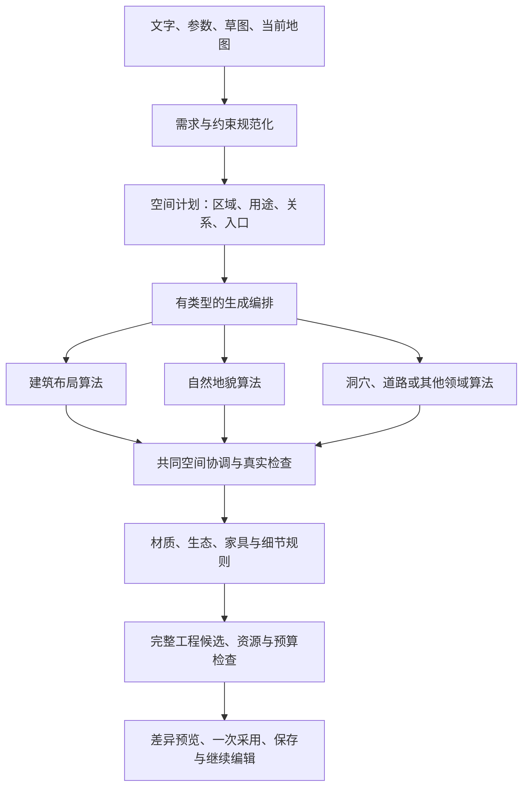
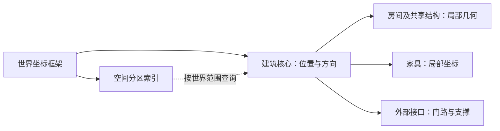

# 通用地图生成器总体设计

状态：**A 架构与边界、B 能力/版本映射已完成；C 工程归一与通用编排薄层已实现并完成本轮必要自检**。2026-11-04用户进一步确认开发期只维护一个完整工程v1，并保留一次性本机数据迁入。格式主定义归[04](../04-scene-document.md#development-single-v1)，迁入归[06](../06-storage-and-export.md#development-single-v1-import)，具体能力映射见[第10节](#capability-version-map)。执行顺序只在[开发路线图](../07-roadmap.md#general-map-generation-priority)维护，正式验收只在[质量计划](../09-quality-plan.md#acceptance)维护。

## 1. 目标与边界

Sceneweave 要沉淀的是一个通用地图生成器。用户可能制作室内、森林、海岸、河谷、火山、洞穴、废墟或这些环境的混合场景；岩岛只是一个自然地貌配方和视觉验证样例，不是产品的顶层模型。

通用的部分应当负责需求、约束、生成编排、真实空间检查、候选生命周期、完整工程物化、保存与采用。建筑布局、自然地貌、洞穴网络、道路路由等保留各自的领域算法。新增题材时，应新增领域算法、环境规则或配方，而不是重写保存、编辑器、AI、导出和事务链路。

当前不承诺“一个算法自动生成所有地图”。通用性来自稳定的组合协议和共同质量边界，而不是一个包办一切的万能算法。

## 2. 用户输入模型

用户意图需要拆成相互独立的维度，不能继续由一个 `terrainKind` 同时表达：

| 维度 | 示例 | 主要影响 |
|---|---|---|
| 地图模式与尺度 | 战术场景、区域地图 | 实体精度、物理检查、细节密度 |
| 空间结构 | 建筑、开放地形、洞穴、混合 | 使用哪些布局和连接算法 |
| 环境/地貌 | 森林、海岸、火山、雪地 | 地貌场、材质和生态分布 |
| 场所用途 | 旅馆、神庙、营地、废墟 | 房间关系、功能区域和物件需求 |
| 状态与事件 | 淹水、坍塌、熔岩、遗弃 | 可表达的领域语义与约束 |
| 美术风格 | 手绘、写实、像素 | 固定素材、材质和表现配方 |

用户可以从文字、参数、草图或现有工程开始。输入必须规范化为范围、锚点、硬约束、软目标、保留对象、允许修改范围、素材/许可集合、算法/配方版本、预算档位和确定性种子。没有明确授权的对象、私密内容和只读依赖不能因生成请求自动变成可编辑目标。

场景地图与区域地图共用需求、编排和候选基础，但实体语义不同：区域道路和图符不能靠缩放或切换开关变成人物通行、碰撞或单株物件。跨模式下钻须建立独立工程并保留来源及可物化/不可物化边界。

## 3. 统一生成管线



### 3.1 需求与约束

需求层表达地图范围、用途、必达关系、入口、活动区、净空、保留范围和允许修改的内容。硬约束冲突时拒绝候选并说明冲突；不能通过悄悄放宽另一个硬要求取得“成功”。软目标用于候选排序，不能覆盖人工保留、锁、秘密、现有合法连接或完整工程规则。

### 3.2 空间计划

空间计划先解决关系，再解决细节。室内先确定房间用途、面积、邻接、入口和门窗需求；森林先确定林区、空地、路线和支撑面；火山先确定火口、高地、流道、危险区和可活动区域。计划中的对象有类型、有稳定标识和明确依赖，但最终工程仍以完整 `SceneDocument` 为权威，不能保存一份与工程平行且可能失真的“第二世界模型”。

### 3.3 有类型的生成编排

编排器只在一次生成会话内建立依赖图，执行器接收不可变请求和已验证的只读上下文，调用静态受信注册的领域算子。计划、区域、端口、连接和待生成实体都是临时强类型产物，不是新的持久地图模型。算子不得直接修改 `SceneDocument`、存储、资源目录或工作区状态。

实现时采用判别联合和显式版本，不以任意 JSON、字符串 kind 或调用者自报成本作为可信输入。下列结构是设计契约示意，不表示当前已经存在这些 TypeScript API：

```ts
type GenerationRequest = {
  requestVersion: number;
  target: { kind: 'new-project' } | { kind: 'current-project'; scope: EditScope };
  coordinateFrame: 'scene-mm' | 'region-mm';
  intent: NormalizedIntent;
  intentSource: { kind: 'manual' | 'text' | 'sketch' | 'current-project' | 'ai-suggestion'; contentHash: string };
  normalizationVersion: number;
  hardConstraints: HardConstraint[];
  softGoals: SoftGoal[];
  seed: string;
  budgetProfile: RegisteredBudgetProfileRef;
  recipe: VersionedRecipeRef;
  allowedAssets: readonly FixedAssetRef[];
};

type GenerationOperatorDescriptor = {
  id: string;
  version: number;
  phase: 'structure' | 'connectivity' | 'content' | 'presentation';
  consumes: readonly ArtifactKind[];
  produces: readonly ArtifactKind[];
  reads: readonly ReadSelector[];
  writes: readonly ArtifactKind[];
  requires: readonly OperatorRef[];
  impact: ImpactPolicy;
  determinism: { seedDerivation: string; replayVersion: number };
};

type OperatorResult = {
  outputs: readonly GenerationArtifact[];
  diagnostics: readonly GenerationDiagnostic[];
  usage: MeasuredUsage;
};
```

请求绑定目标和可编辑范围、坐标框架、规范化意图及其来源指纹/规范化器版本、硬/软约束、固定种子、配方与算子精确版本、已注册预算档位和允许使用的固定素材。文字、草图或AI可给出意图候选，但解析含糊时只能作为待确认的软建议；硬约束须由用户明确提供或确认，规范化器不得从图像阴影、地名或模型臆测中生成物理事实。原始文本和隐藏推理不自动写入完整工程。执行上下文另绑定当前工程身份/修订/checkpoint、只读工程视图、真实资源与许可闭包、取消信号及阶段所需只读事实。开始执行前拒绝未知版本、类型不匹配、越权写入、缺失依赖/循环和未注册预算档位。

每个算子合同必须声明：

| 契约字段 | 要求 |
|---|---|
| 身份 | 稳定算子 ID 和不可变实现版本；改变输出含义须发布新版本。 |
| 输入/输出 | 强类型产物种类、基数、引用和前置条件；下游接收前重新验证。 |
| 所有权 | 只读选择器与允许产出的领域/产物类型；不可覆盖其他模块拥有的输出。 |
| 依赖 | 显式前置算子/产物引用；拒绝循环，按稳定拓扑序和稳定平局键执行。 |
| 确定性 | 种子派生规则及重放版本。新协议从请求种子、配方步骤、算子ID/版本和稳定空间键派生独立随机流；调度顺序或无关区域变化不能扰动另一稳定区域。此规则不改写旧seed语义。 |
| 局部影响 | 预览、依赖闭包、重生成及对比范围的声明；它是上界提示，不能替代完整差异和实际依赖计算。 |
| 预算 | 使用已注册档位并报告分维度实际工作量；可信执行器重算产物、引用、字节、像素、依赖与执行量，算子估算值不能授权超限。 |
| 失败 | 稳定失败类别及相关对象/产物引用；标明必需步骤，或由配方明确标成可选软目标。失败算子不得发布部分输出。 |

配方是不可变、版本化的组合数据：算子引用、参数、依赖边、必需性和预算档位引用。只有明确登记为软目标的可选步骤，才可跳过并产生降级诊断；不得降低硬约束、静默切换算法、为适配预算暗降密度/质量或吞掉必需步骤失败。执行顺序由依赖图和明确的稳定平局规则决定，不由运行时偶然的对象遍历顺序决定。

首批阶段为结构、连接、内容、表现。结构算子提出房间/地貌/洞穴等领域几何；连接算子提出端口与路径关系；内容算子提出家具、植被或装饰；表现算子只针对已建立的真实表面提出材质/风格绑定。跨阶段依赖必须显式声明，表现算子不能产生支撑、碰撞、危险、通行或连通事实。领域算子可以复用现有房间、墙门、地貌、河道/火山流道、洞穴、道路、家具、植被和装饰算法；任何输出仍要通过完整候选校验。

### 3.4 共同空间服务

共同服务统一处理整数毫米坐标、支撑面、高程、真实占地、碰撞、门口与连接净宽、活动区净空、锁和保留范围、跨层依赖以及结构/通行检查。它读取真实几何和语义，不能从图片、阴影、材质颜色或ID命名推断物理含义。

建筑仍使用共享墙、门窗和房间身份；自然连接仍使用真实上下端支撑、宽度和落地；树木、家具和完整物件必须拥有真实支撑和物理足迹；轻量装饰不能暗改通行。视觉表现可以由同一服务提供几何输入，但不能反向授予物理能力。

共同服务读取真实几何和语义，不会代替领域求解器：它负责跨领域可比较事实的协调与完整候选检查；房间排布、侵蚀/水文、洞穴拓扑等领域内部结构仍由领域算法拥有。不得仅凭产物类型检查声称几何合法，也不复制一套和既有领域校验漂移的平行几何引擎。

### 3.5 空间计划与跨领域协调契约

领域计划在生成期间暂存，最终仍须映射到既有完整 `SceneDocument` 字段。首批临时事实至少包括：

| 临时事实 | 内容与校验责任 |
|---|---|
| `PlanRegion` | 会话内稳定引用、领域/用途、范围、Floor或区域层级、硬/软目标和可修改策略；边界几何由负责领域拥有。 |
| `SupportSurface` | 精确来源或计划内表面引用、坐标框架、Floor、高程/高度场、可承载类型和有效多边形。支撑必须来自已验证的现存表面或本次候选中的已验证计划表面。 |
| `Footprint` / `ClearanceVolume` | 实际占地与需保留的空间净空；纹理透明区不自动成为物理占地，图像不代替真实足迹。 |
| `Port` | 有类型的入口/出口，含位置、方向、有效宽度、高程、Floor、支撑引用及连接角色。门、道路、洞口、桥头、楼梯端不能只凭图像相邻就视为连接。 |
| `ConnectionProposal` | 两端口间的有向关系、净宽、坡度/高差能力、实际路径和通行语义；外观相接不等于结构或通行成立。 |
| `AccessZone` / `ReservedZone` | 活动区、危险区或保留/禁止区域及其语义来源和受众；领域字段未声明危险时不得从材质或颜色推断。 |

事实必须携带坐标框架。场景图世界几何按工程整数毫米执行；区域图即使使用毫米作为内部标尺，仍保留区域语义类型，不能把道路宽度、地图图符或高度直接解释为角色净宽、碰撞或可通行高差。`scene-mm` 与 `region-mm` 之间只允许显式有界适配器转换；转换后重新执行目标模式全部几何、语义和预算检查。

协调次序是：领域声明表面、端口、占地、活动区与保留区需求；协调器提出可解释的连接关系和冲突，不重绑稳定附着或用户编辑；共同检查器读取完整候选几何及支撑依赖，给出通过、软目标偏差或硬失败。冲突诊断指向具体对象和依赖，用户可调整范围、锚点或软目标后重新预览。系统不自动挪动锁定/保留对象，不把硬约束降为软目标。除配方显式列有确定的修正算子及次数外，不在后台循环“自动修到成功”。

### 3.6 各层职责边界

| 层 | 负责 | 不负责 |
|---|---|---|
| 请求规范化/预算准入 | 绑定目标、范围、约束、配方、固定资源和注册档位；拒绝未知能力 | 推断授权范围、凭文本改变秘密/物理语义、拆批绕限 |
| 编排器 | 静态算子注册、依赖排序、确定性执行、实际计量、诊断与候选状态 | 领域几何算法、存储写入、绕过最终完整验证 |
| 领域模块 | 在本领域求结构、内容或表现，提供版本化算子与严格局部校验 | 覆写他领域输出或复制通用事务/资源合同 |
| 共同空间服务 | 从完整候选派生并核对支撑、足迹、净空、端口、连接、锁/依赖与声明的连通性 | 取代领域拓扑求解、从像素猜语义、放宽工程规则 |
| 候选物化/工作区 | 把经验证产物映射为既有完整工程字段/受支持命令，执行资源、许可、身份和玩家投影验证 | 另存一份“生成地图”作为工程权威、信任算子提交的完整工程 |
| 存储/历史/导出 | 保持严格格式、完整字节、迁移保全、CAS/撤销、冷读及双受众输出 | 由生成器重定义格式或用seed取代实际保存结果 |

混合配方通过同一批可验证的支撑面、端口、占地、高程、连接路径、入口、活动区和可调整范围协调；各模块只写自己拥有的候选字段。新增领域通常新增其算子实现、严格局部验证、固定配方和样例。若要求修改共同请求/空间/事务协议，须证明改变的是共享不变量并发布明确协议版本。

### 3.7 表现与内容规则

环境规则决定材质、边缘、植被、家具和细节在何种条件下出现。规则必须声明适用表面、目标分布、素材版本、支撑要求、净空要求和人工覆盖语义。预期数量不等于实际成员；若无法放置，候选必须报告缺项或冲突。

材质、崖缘、墙面、地表过渡和阴影表现基于真实表面与邻接关系派生。换风格只能改变兼容的外观字段；若素材改变物理占地、支撑或通行，应产生明确的新候选并重新验证。滤镜不能修复基础几何，也不能改变玩家输出、秘密或通行。

共享renderer可改善已有表现类别的绘制：草沿/崖面使用完整世界边界及有界转角，连接只使用已过滤的真实走廊/端点支撑，不以领域名称或边界ID决定共用渲染行为。生成算法与配方重放保证保存结果数据，renderer改进不承诺历史PNG逐像素相同；需要冻结某一画面的场景须同时冻结渲染代码与素材闭包。当前实现边界见[14共享表面与连接表现](../14-visual-and-assets.md#surface-connection-rendering)。

<a id="aggregate-spatial-capacity"></a>
### 3.8 层级坐标、聚合体封装与分区存储（已确认设计）

2026-11-05用户确认以组合封装降低大地图耦合：外部操作组的核心，内部元素使用相对核心的坐标；结合区块按需加载、完整基底复用和局部修改记录，减少重复计算与重复存储。这是通用地图生成器及编辑器共同的扩展性主线，适用于建筑、营地、森林、地貌和混合场景，不按题材另建全局架构。实施顺序只在[07的大步骤及子步骤表](../07-roadmap.md#t2-implementation)维护；现有Prefab、临时生成端口和预算初版均不等于本节已经实现。

#### 3.8.1 收益目标与适用条件

总实体数为N、本次实际改变的内部内容为K、跨界依赖与空间相邻候选为B。目标是在已验证基底和索引可复用时，让局部操作主要处理K与B，减少对N的重复遍历。内部细节增加而K、B保持较小时，可避免的工作通常更多；新增长距离依赖、整体重生、全图导出或大量区块同时修改时，收益会降低。首次建立索引/证明、失效后重建和完整导出仍可能处理全部内容，不承诺任意操作恒定耗时或地图越大必然越快。

分别测量交互计算、内存驻留、持久字节和完整交付成本。层级变换可以减少坐标写入，分区加载可以减少驻留内存，完整基底加修改记录可以减少重复存储；三者不能互相冒充证据。区块思路借鉴沙盒世界按区域处理的方式，本设计不把“Minecraft未修改区块不占存储”当作经核实的外部事实或产品前提，也不把尚未生成与已生成但未修改混为一类。

#### 3.8.2 核心、局部坐标与两类划分

世界有统一坐标框架；聚合体拥有局部原点和相对父级的变换；成员拥有局部坐标。核心是稳定的逻辑原点，不随成员增删自动改成新重心。存在旋转时必须按顺序组合变换，不能直接把坐标相加：

```text
p_world = T_parent × T_group × p_local
```



**语义聚合体与空间区块是两个维度。** 建筑/营地按共同变换和所有权成组，区块按空间范围负责加载、索引和存储。一栋建筑可以跨多个区块，一个区块也可以包含多个组；区块索引引用实体，不复制实体或产生双重所有权。只有有明确需要时才增加子组/局部区块坐标，不能强制所有实体经过“地图→建筑→区块→元素”同一层级。

变换父级须唯一、无环且有界深度；图层、Floor、高程、支撑和生成归属是独立关系。共享墙只有一个真实实体，由共同所有者持有，两个房间引用它；不能为降低耦合复制共墙。固定素材定义可被多组共享，不随实例变换而复制或改义。跨Floor移动、高程变化、缩放/剪切不是普通平移的副作用。

首个快速路径限定整数毫米平移和能精确保留整数毫米的四分之一圈旋转。自由角旋转、缩放、剪切、世界对齐材质、近侧视直立物件等按各自能力求值；不能因几何刚体变换就宣称所有显示或物理语义都不变。

当前v1在运行时提供完整世界视图，含聚合成员的包/数据库/历史保存唯一local坐标及父帧；没有聚合字段的既有工程仍逐字段等价。编辑、渲染、命中、领域校验和玩家投影读取转换后的world文档；严格IO在边界独立解码并全验。b提供的创建/换父级/解组只改表示，保持世界几何；d/e提供有限整体移动，c的有限内部几何复用见下节。普通成员编辑目前仍更新物化world视图，保存时按当前帧重编码对应成员，因此局部修改尚不承诺只写小型差异。局部坐标本身不证明快速移动或容量收益；当前有限变换及内容块保存分别按04/06执行。

#### 3.8.3 所有权、外部接口与空间边界

| 内容 | 对外提供什么 | 必须保持的事实 |
|---|---|---|
| 成员与所有权 | 组根、成员/子组引用及管理范围 | 真实成员唯一、未归组实体仍可编辑；手工组和生成组使用同一合同，不按位置猜测自动收编 |
| 有类型的端口 | 门、路端、楼梯端、桥头的位置、方向、宽度、Floor、高程及连接角色 | 绑定真实实体及其代次；删除、改宽、关门等更新相应摘要，不能把结构连通当当前可通行 |
| 支撑接口 | 组所需的地面覆盖、高程及来源引用 | 检查完整受支撑范围，不能只检查核心或外轮廓顶点 |
| 空间包络 | 实际占地、碰撞、净空、遮挡/危险、视觉范围的分别摘要 | 粗包围盒用于筛选，有孔洞和凹形时按需要进入真实几何；内部空地不能被一张外接矩形替代 |
| 跨界引用 | 双向依赖索引，明确读/写、字段类型及影响范围 | 门路以外还包括注记、共墙、层规则、材质、资源与秘密依赖；外部既有实体引用完整纳入，不因未包装成端口而遗漏 |

组树管理所有权，依赖图管理跨组关系。领域适配器通过接口协调外部操作；内部真实ID仍用于身份、历史和精确诊断，不为封装而删除它们。无法闭合的跨组关系明确上移到共同协调者，或作为外部依赖处理。

整体移动须查询**新位置可能接触的外部对象和支撑**，也须更新旧位置的空间索引与派生影响；不能只检查移动前已有的几个门路连接。原本在建筑内部空地中的外部岩石、跨越建筑的道路等，也必须由完整空间查询发现。直接放置只要求最终位置合法；除非产品另有明确连续运动要求，不把编辑器拖动默认为角色沿途碰撞模拟。

#### 3.8.4 内部证明复用与失效传播

可复用的是已验证内容在特定操作下仍成立的性质，不是无条件跳过内部校验。几何刚体平移保持内部长度、面积、相对位置及拓扑；只有成员跟随策略、支撑和约束均满足条件时才使用快速路径。证明由校验器绑定确切内容/成员代次、局部变换、约束和算法合同；调用方自报hash、`valid=true`或同ID不足以获得信任。

内部结构、成员增删、锁、层覆盖、共享资源、秘密状态、外部支撑或端口变化，按依赖字段使相关证明失效。内层局部更新沿依赖图传播，仅更新真实受影响的边界；路径、支撑、生成规则可以连接远处区块，邻接范围不能硬编码为紧邻八格。无法证明的情况回退完整检查或给出受限拒绝，不能继续使用过期摘要。

当前c的消费者已覆盖持久归组物件的单/多目标位置与角度预览，以及既有建筑结构命令预览。`createAggregateBoundaryInspector`独立捕获完整只读基线，组归属必须等于工程持久表示；`createAggregateSpatialSnapshot`只查询该捕获来源。应用层仅为确切已认证工程包装复用有界上下文，旧/新范围由候选前后真实占地及旋转图像范围向外取整得到，实际实体差异与入口约束形成根。前后依赖闭包合并；建筑附着上下文另纳入既有墙、房间、门窗与递归注记，不能把只读上下文冒充写集。`deriveAggregateEntityEnvelopes`只提取明确引用的包络与所需支撑，既不认证场景也不授予编辑权限；墙/门窗消费真实厚度及miter/bevel领域几何，玩家先过滤隐藏邻墙。next查询排除全部失效的旧索引行，再补入候选包络，覆盖两个组同时移到同一新位置。vertex/note/prefab/scatter无独立包络，decoration仅有锚点，这些情况明确保守回退并保留完整校验。`baselineProofValid`只说明原基线证明有效，`supplied-bounds`只覆盖明确查询范围；其他领域命令仍走完整几何；候选的有限内部求解复用另由下一段的私有场景认证负责，不能凭本基线报告获得权限或声明容量收益。


当前c提供受约束的`aggregate-prop-move-geometry@1`候选路径：只接受场景校验器自行严格解析/深冻结的确切基线，候选再次完整严格解析，逐字段和记录顺序证明仅既有持久归组物件的位置/角度变化，其他字段、成员集、聚合表示、资源元数据、锁、秘密、约束和Floor均不变。Prefab/scatter/decorationCluster任何记录引用的变化物件均退出此路径。满足条件时复用未变建筑、地形、道路、注记及未变物件的几何结论；变化物件的旋转占地/偏移、显示范围、真实支撑和全部高差连接的真实曲线带区碰撞仍重算。严格依赖、visual、生成/组合回执、装饰、地表规则、聚合/坐标往返，以及身份/外观/许可和现有字节闭包验证仍按各自原流程执行。

该路径接入普通单/多`updateProp`的snapshot及最终composition draft，结构或其他字段变化自动回退完整几何。`SceneDerivationEvidence`仅是确切认证结果的私有WeakMap诊断，不是可提交凭证，不进入工程、历史或玩家输出；旧`baselineProofValid`仍只认证基线。公开`validateSceneDocument`、冷读和包边界继续完整几何。完整比较和其他域扫描仍随总量增长，仅证明避免了这些已证不变几何的重复求解，尚无跨规模耗时/内存收益结论；d的建筑组整体操作继续完整几何，尚未扩大该候选证明的支持条件。

所有成员锁及外部依赖锁仍生效；允许用随成员变化正确失效的锁摘要快速拒绝，不能用组锁覆盖成员锁。玩家投影先过滤秘密，再生成该受众的边界、索引和可见派生；不得共享GM包络/空洞/摘要泄露隐藏内容。初次生成的门路和家具建议仍为软建议，封装不会把它们升级为永久必达要求。

#### 3.8.5 移动、内部编辑、拆分和迁移

d当前提供[完整建筑组的有限操作合同](../04-scene-document.md#aggregate-building-transform)：现存房间明确创建共墙连通建筑及真实随动成员组；选中组子树必须恰好覆盖完整闭包，按位置猜测的Floor物件仍是外部对象。根frame与实际几何在同一候选更新，材质固定源同步派生，整体移动/四分之一圈旋转、成员单独编辑及保存冷开复用原事务。新位置以真实墙厚/门洞/miter、物理足迹、完整道路带区和有限门前带检查外部冲突；跨组共享结构、后增未归组依赖、额外成员及单端外接高差连接明确拒绝。内部仍全量物化求解，分区/容量收益及自然多领域适配尚未由d提供。

| 操作 | 复用范围 | 改变和重新检查 |
|---|---|---|
| 整体平移/允许的旋转 | 未变局部实体和对应内部不变量 | 核心变换、完整支撑与新旧空间影响、跨界接口；共享墙和不随组移动的依赖不能漏掉 |
| 单成员/局部结构编辑 | 未受影响的子结构和区块 | 真实写集、相关内部几何、接口摘要及依赖传播；成员可继续选择、移动、删除、退出和撤销 |
| 解组或重新归组 | 原实体及未改的世界几何 | 换父级时反算局部坐标，保持世界结果；普通重新归组不凭空更换成员出生身份 |
| 组拆分/合并 | 可保留的内部实体和来源 | 新容器按身份合同分配身份，保留实体ID；实际拓扑变化更新相关令牌，跨界关系重建；一次采用/撤销 |
| 几何切割 | 切割带外可证明不变的结构 | 切割带内新墙/开口/地形片等分配新实体身份，重查支撑、通路、注记和连接；先列领域支持范围，不承诺任意曲线/建筑通用布尔切割 |
| 复制/跨工程迁移 | 可共享的不可变定义、资源及局部内容 | 新实例身份、明确外部引用映射、完整资源许可闭包；同工程移动不冒充复制，不重跑seed替代人工内容 |

表示转换、成员重绑、实际拓扑变化和跨工程复制是不同身份事件，不能一律“原ID全部结束”，也不能以ID相同假装拓扑连续。保护点、基线、CAS、单调revision和整笔撤销沿当前合同执行；失败保留原组和持久成果。

#### 3.8.6 区块加载、生成与人工修改

区块先有稳定空间键与内容清单，再有按需加载。内容状态与驻留状态分别记录：

| 维度 | 状态及意义 |
|---|---|
| 内容 | 未生成区域是明确的计划/空区域，不冒充已完成地图；已生成未修改区域有实际基底；人工修改区域有实际修改、删除、退出与锁记录 |
| 驻留 | 未驻留、正在读取/物化、已驻留、失败；已修改区块也可在安全保存后卸载，未修改区块也可已驻留 |
| 证明 | 内容代次、边界摘要与验证有效性；驻留不代表已验证，卸载不丢弃真实内容 |

新分区生成的随机流由固定seed、确切算法/配方、稳定逻辑区域键和区块坐标派生；不能使用会话临时ID或复制时变化的实例ID，使单纯复制/移动重撒内容。既有算法仍按原输入重放；新分区生成若改变采样含义，使用独立算法身份，不修改旧向量。边缘使用必要的邻接带、跨区块约束和稳定归属规则，防止道路断口、重复成员、树木越界和执行顺序差异。

当前f已将稳定区块清单接入正常命中/显式选择的精确形状派生，并延迟屏外物件的绘制位图解码；JSON、完整验证及投影仍全量，不声明冷读/实体内存收益。独立分区采样器使用`aggregate-partition-stream@1`，不改旧领域重放。缺失实际区块或派生失败明确拒绝，不输出删掉内容的成功地图。具体有限合同见[04](../04-scene-document.md#aggregate-derived-loading)。

#### 3.8.7 完整存储、共享基底与局部覆盖

存储目标是**不可变完整基底/内容块＋本次实际变更**，复用已有增量历史、固定素材及内容hash，避免重复保存未变部分。未改内容仍占基底存储；节省来自共享和去重，不能称为零存储。保存不需要每次重跑生成器；删除/退出记录、人工位置/外观、身份/墓碑和原始资源继续完整保留。

完整工程是逻辑上的完整数据和可独立读取的闭包，不要求每个版本重复一份相同大JSON。采用分区后，清单所引用的实际区块、基底、覆盖、资源与许可须全部可取回且可核验，历史分支的引用阻止垃圾回收；写入完成并验证后才在同一CAS保护下发布头。完整备份/所选历史包必须能在空存储离线恢复全部实际结果。检查点与有界增量链限制重建成本，不能把保存节省全部转成无法控制的冷读代价。

开发继续演进同一完整v1，不为每一步另开工程版本兼容分支；必要的数据库结构调整按实际表演进，源数据保全。h已接入严格内容清单及不可变实际字节块，稳定记录key分桶而非空间JSON卸载；原子发布、完整历史与故障边界以[06](../06-storage-and-export.md#aggregate-chunk-storage)为准。仅保存配方/seed而省去已生成实际内容的形式，需要另行改变完整存档合同并解决算法长期可得性、真实资源和身份重建，当前不作为本大步骤的默认交付。

#### 3.8.8 公共接口、预算和实施衔接

公共职责是解析聚合视图、转换坐标、导出边界/端口、查询空间影响、判定内部证明可复用性、传播失效、准备候选及物化完整视图。建筑与室外领域提供适配器，继续复用已有几何/身份规则；共享层不按“房子/火山/岩岛”名称执行物理分支。当前生成端口只在生成期间生效，不能未经持续失效维护就用作长期编辑证明。

预算分别列出用户操作根、实际影响成员、实际写入/计算、跨界依赖及资源成本。纯核心刚体变换经真实前后局部不变量核对后，编辑目标计一个核心，完整成员/子组计入独立有界的组内影响；成员编辑、归属拆合和复制仍按实际目标计。此为[04的manual准入分类](../04-scene-document.md#manual-transaction-budget)，结构/自然物化求解及成员锁、秘密、支撑、几何和资源检查仍完整，不能推导执行为常数时间；预览展示完整影响与只读依赖，操作前选择冻结档位，采用时使用同一策略。没有聚合能力的普通独立实体继续原路径。

普通事务保持256/512/1024编辑目标，纯核心变换的组内影响分别受4096/16384/65536保护；准备前展开请求并固定档位，预览/采用核对同一策略及真实几何与依赖成本。新预算不改写旧生成/AI任务公式或授权。字段责任归[04](../04-scene-document.md#aggregate-coordinate-contract)，保存责任归[06](../06-storage-and-export.md#aggregate-chunk-storage)，完整验收归[09](../09-quality-plan.md#aggregate-capacity-acceptance)；每个开发子步骤只做对应必要自检。

<a id="aggregate-consumer-map"></a>
#### 3.8.9 合同使用方与接线责任

a提供`shared/model/aggregate.ts`及`shared/aggregates/contracts.ts`的严格只读合同、来源核对和GM诊断，字段与拒绝范围只在[04](../04-scene-document.md#aggregate-coordinate-contract)定义；b的严格完整v1表示则由`aggregateCoordinates`字段定义。组诊断不是几何证明或编辑权限。以下映射记录后续c–i责任，实施状态只在07维护。

| 使用路径 | 当前入口 | 后续必须同步的责任 |
|---|---|---|
| 完整v1模型、解析、构造及内容hash | `shared/model/scene.ts`、`model/current-scene.ts`、`validation/scene.ts`、`aggregates/scene-coordinates.ts`、`project/validate.ts` | b的world运行时视图与local持久表示由同一严格转换器提供；当前无聚合字段工程保持原形。 |
| 原子命令、外观与工作区候选 | `shared/commands/commands.ts`、`aggregates/commands.ts`、`commands/building.ts`、`appearance/commands.ts`、`application/workspace/prepare.ts`、`workspace.ts` | b提供创建归属/换父级/解组表示事务；d通过transformAggregateBuilding接入完整建筑及随动闭包，根frame按世界刚体变换后反算父级局部帧，子frame保持。建筑工具可创建/选择组和进入成员，仍逐实体物化及完整校验，不当作只改核心。 |
| 几何、引用及空间事实 | `shared/commands/dependencies.ts`、`commands/domain.ts`、`geometry/geometry.ts`、`generation/space.ts`、`aggregates/{spatial,relations,proofs,boundary}.ts`、`application/workspace/aggregate-boundary.ts` | c提供受众隔离的宽相索引/新旧范围、反向依赖及完整元数据绑定证明；单/多物件及建筑结构预览已复用捕获基线，合并前后依赖、以候选包络替换失效旧行并展示附近/关联对象；缺失包络保守回退。公开查询仍完整核源；普通归组物件位置/角度可按私有完整差异证明复用不变几何，真实新位置/连接碰撞及其他域/资源/锁/CAS继续检查。结构与其他领域保持完整几何，后续按d/e扩展。 |
| 领域端口与混合 | `shared/generation/building-port.ts`、`aggregates/ports.ts`、`generation/domains/mixed/index.ts` | c从实际opening/path/terrainConnection及支撑派生净宽、Floor、高程和局部通行，并由合同检查器重新计算摘要；e的`domain-adapters/natural-transform`已沿真实支撑/容器/注记适配自然与混合内容，不把初次建议变为永久硬要求。 |
| 玩家投影、命中与绘制 | `shared/projection/projection.ts`、`editor/native-canvas/selection.ts`、`platform/browser/render/renderer.ts`、`canvas-renderer.ts` | b让现有消费者继续读取完整world视图；projection显式投影受众字段，组树不进入玩家结果。c负责边界摘要；f的`aggregates/chunks`及`render/aggregate-residency`按需派生命中形状和屏外绘制位图，仍全量JSON/投影。 |
| 身份、撤销与局部恢复 | `shared/history/identity.ts`、`history/restore.ts`、`history/structure-restore.ts` | g的严格拆合/有限复制与`aggregateTokens`区分容器出生、表示转换、真实拓扑变化及复制，退休ID不复用，保全未变身份/人工记录；a不补造持久建筑连续性。 |
| 存储、完整包与历史差异 | `platform/browser/storage/database.ts`、`repository.ts`、`storage/incremental-history.ts`、`shared/project/delta.ts`、`project/file.ts` | b包与IDB使用唯一local落盘、完整读取转world、local规范hash/增量。h的`storage/content-blocks`及middleware在同一CAS事务共享不可变实际内容块，完整读取/全分支及空库完整包仍全验；不做空间JSON按需冷读。 |
| 预算与选择/填充/恢复 | `shared/budget/command-budget.ts`、`application/workspace/prepare.ts`、`editor/native-canvas/selection-actions.ts` | i准备前按请求展开选择manual档位；纯核心变换分别计编辑目标/组内影响/组外依赖，完整工作与资源另限。成员/归属变化与复制按真实目标，采用重查冻结策略。 |
| AI与生成重放 | `shared/ai/current-authoring-capability.ts`、`current-authoring.ts`、`shared/generation/execution.ts`、领域适配器 | 保持精确工具白名单、scope、旧算法向量和计价；新增聚合类型不自动授予AI操作或改写旧账本。 |

## 4. 混合场景协调

混合场景不是把几个已经完成的小图贴在一起。以“火山坡上的研究站”为例：自然地貌模块提供可建造支撑和高程；建筑模块提出占地、入口和室外落地点；道路模块连接外部入口、研究站和观察点；布景模块遵守这些区域及净空。所有模块通过支撑面、占地、入口、方向、高程、最小净宽、固定锚点和可调整范围协调。

混合协调以真实支撑面、入口端口、足迹、高程、连接路径和净空为交换内容，不以几张已经渲染的小图贴合。建筑对地形的支撑要求必须指向稳定地形面或本次计划面；连接端口需对齐位置、朝向、Floor、高程及有效净宽。区域地图路网连接和战术地图的角色通行关系是不同类型，模式转换须单独适配并复验。

冲突诊断列出对象与依赖，并区分硬冲突、可调软目标、缺失素材和预算拒绝。用户可收窄编辑范围、改锚点、显式移动授权对象、改变软目标或取消；不能按最近点暗中重绑门、房间、连接、地形边界或人工成员。连接、支撑或危险语义没有领域事实证明时，应报告未建立，不用视觉相接补足。

## 5. 版本、确定性和旧成果

开发期只维护[唯一完整工程v1](../04-scene-document.md#development-single-v1)，后续功能直接修改当前完整schema，不要求保持各开发快照工程格式兼容。算法/配方、固定素材、生成/AI任务协议和预算档位仍有独立身份，不能用一个generatorVersion或全仓改成1代替。候选回执至少绑定规范请求hash、当前完整合同指纹、基线身份、精确配方/算子版本、profileHash、资源及许可闭包hash、执行器版本、实际用量、输出hash和约束报告；回执不是持久工程字段。

当前`generationMetadata`仅承载有限来源摘要，不可冒充完整依赖图或重放证明。已经采用的几何、内容、规则、出生身份和真实资源必须物化于完整`SceneDocument`；重开读取实际结果，不重新运行seed。跨会话完整编排清单若进入产品范围，开发期直接更新这套v1及其严格编辑/资源/冷读合同，不建立第二个工程权威或另一工程格式分支。

普通及组合算法/配方6继续按`terrain-scene-v6 / terrain-compose-v6`的领域含义确定性重放，算法7独立。旧请求缺省和旧领域结果hash保持；旧DTO只留在算法适配边界，新v1物化内容重新计算工程hash。旧工程本机数据经[独立一次性迁入](../06-storage-and-export.md#development-single-v1-import)保全，日常入口不继续接受旧schema；不能把“不兼容旧工程文件”解释为删除旧数据或改变算法种子。

算法7的底图selector/profile协商不授予新AI写权限。工程统一v1后仍按明确操作、scope、真实资源、预算、重放和玩家输出授权；当前缺少的规则AI命令继续拒绝，不能凭新v1编号扩大能力。旧任务若绑定旧工程hash，不改头数字重用原来源/账本/租约，也不清零额度或自动重发未知计费。

岩岛 v7 算法的专用生成/视觉规则属于自然地貌配方，不作为通用层的模式判断。新规则按明确表面、边界、连接、支撑和环境关系工作，不能按 `island`、实体 ID 子串或材质显示名决定行为。

## 6. 候选、采用与人工保护

生成候选和 AI 草稿共用非变更预览、严格本机重放、实际资源/许可/像素校验、完整差异与冲突审阅。候选保存它的临时产物和诊断，只有通过完整文档验证后才允许进入采用；不信任远端自报文档、成本、hash或候选状态。普通手工命令复用领域校验、锁/依赖、原子事务、单调revision和撤销语义；不要求每次手工编辑重走整图生成流程。

修改已有工程时，采用前保护当前已保存版本及所需保护点，重新核对sceneId/revision/checkpoint/operation epoch、编辑范围、完整依赖、层/实体/支撑锁、多维实际预算及资源许可；在最终原子事务中做CAS、产生单调revision+1和一个撤销单位。范围外的新改动、锁定/保留对象、人工移动/删除/脱离、有效私密性及仍有效连接优先保留；若无法在授权范围内合并，整笔拒绝，不自动挪动来凑图。保存失败沿现有存储合同保全可恢复的内存和持久分支。

创建新地图时使用独立sceneId和完整空白基线，先完整验证来源/定义与候选，再原子保存独立新工程并冷读、检查实际hash/资源；成功后才切换工作区。失败、取消或冷读不一致时保留当前工程。新工程自己的撤销单位不伪称回退原工程。两种采用都拒绝旧基线、迟到结果、无效素材许可、超预算和部分候选。

普通手工命令由其现有有限命令入口生成预览并一次原子提交；它复用相同的完整领域校验和锁/依赖合同，但不强制套用生成器编排。AI仍只使用05当前精确声明的协议、scope和命令：生成器接口不授予模型新算子调用权、连续规则写权限、私密素材访问权或新的输出授权。新AI能力须同时有能力协商、本机完整重放、预算/资源检查和正式验收条件。

局部重生成读取当前完整工程中受影响对象的真实几何、人工移动/删除/锁定/脱离、规则覆盖及支撑/连接依赖，只在授权范围和依赖闭包内替换自动管理的内容。不能以旧seed重建整图再裁切覆盖。实际影响超出声明、触及只读依赖或需改动范围外对象时必须列出并拒绝或请求显式扩展范围。新旧规则成员可以按其规则增删，不能复活用户删除/退出的内容；规则以外人工结果优先。重生成完成仍需形成完整候选并重新验证全工程。

候选状态只存在会话中：`prepared -> validated -> reviewable -> adopted`，或结束为 `rejected | cancelled | stale`。每次异步回执绑定请求ID、工程/空白基线、代次、精确版本和输出hash；迟到、取消后回调或替代基线均不能提升为可采用状态。AI负责理解意图、选择已授权配方、提议修改和解释缺项，不能绕过领域算法、真实资源/许可、支撑、锁、预算、工程完整验证或采用流程。无AI时手工与本地确定性生成仍可用。

## 7. 领域接入示例

| 场景 | 需要的领域模块 | 共用的能力 |
|---|---|---|
| 旅馆室内 | 房间关系、共墙/门窗、功能家具布置 | 支撑、净空、事务、资源、候选与保存 |
| 森林营地 | 地貌、林区/空地、路线、条件植被 | 高程、真实支撑、道路连接、人工保护 |
| 火山场景 | 火山锥、火口、流道、危险/活动区 | 地貌物化、连接、材质、预算、玩家投影 |
| 火山上的建筑 | 火山模块＋建筑模块＋道路模块 | 端口协调、冲突解释、局部重生成 |
| 林中遗迹/洞穴 | 地貌模块＋建筑或洞穴网络模块 | 入口、支撑、高程、门/连接与候选采用 |

火山熔岩的颜色不能自动等同于危险或阻挡。若要表达灼伤、不可站立、特殊移动代价等新语义，必须定义领域字段、编辑规则、玩家投影和验收范围；开发期间直接修改唯一完整v1，不为每个新字段建立新工程版本。

## 8. 现有实现如何迁移

### 8.1 可复用底座与领域差异

当前已有可复用的工程/执行基础，但这不表示通用多领域生成器已经存在：

| 已有基础 | 可复用边界 | 当前不能据此声称 |
|---|---|---|
| 当前多版本`SceneDocument`、领域命令、历史/身份、资源许可与完整冷读 | 复用完整能力并合并成唯一v1；开发期新增字段直接同步当前严格schema与所有使用方 | 用旧v1字段代替当前完整能力，或让运行时计划/seed取代已物化工程 |
| 底图协议 `sceneweave-base-map@1..3` 与 `prepareBaseMapProject` | 继续作为普通/组合地形路径的版本化适配入口；在完整文档、素材、领域结果上重放、物化及复核实际成本 | 当前传输器已编排任意多个领域，或算法/配方7就是通用地图协议 |
| 普通/组合地形生成分派，精确 v6/v7 selector/profile 协商，Worker/服务端共用纯执行器 | 旧算法/配方通过适配器保持原执行义；新自然地貌算法继续独立版本与确定性重放 | 新协议可以重算旧工程、替换旧seed公式、或把岩岛后处理变为通用判断 |
| 原生几何、建筑/地形/连接校验，支撑诊断、锁/依赖和有限候选检查 | 提取只读事实并组合既有校验；遇到未覆盖的关系时明确报告当前不支持 | 这些领域检查已经共享同一个跨领域空间API或覆盖所有几何关系 |
| AI候选与有限室内五房间layout工具 | 旧AI任务与候选继续按05中精确版本/scope/预算/资源许可复放；作为受限旧配方适配器 | 固定五房间样板是通用室内布局器，或底图能力自动扩展AI写权限 |
| 固定资源、材质、appearance与受众投影 | 复用不可变定义、真实图像/许可/像素验证及GM/player投影 | 外观、图片alpha或滤镜可替代占地、支撑、危险或连接语义 |

这些事实对应的现行代码合同在[04工程/版本](../04-scene-document.md#当前完整工程与版本分派)、[04底图协议](../04-scene-document.md#program-base-map-protocol)、[05创作能力](../05-ai-and-generation.md#current-authoring-contract)和[地形能力范围](terrain-generation.md#terrain-capabilities)；开发期目标优先遵循04单一v1节。目前代码入口包括`src/application/workspace/base-map.ts`、`terrain.ts`、`terrain-composition.ts`、`src/shared/terrain-generation/`与`src/shared/ai/composition-candidates.ts`。B的具体归属和使用方映射已固定在第10节。

### 8.2 逐步适配路线

不推倒重做，采用逐步收拢的适配路线：

1. 保留完整工程、历史、资源、保存/CAS、撤销、候选、采用、渲染和导出所有权，不复制其实现链路。
2. 将普通/组合底图及地表、树冠规则标作自然环境领域的不同版本。算法/配方6及更早继续走原确定性执行路径；算法/配方7由精确selector/profile hash协商，仍是自然地貌专项，不代表通用协议已实现。
3. 将当前有限室内候选视为旧配方适配器。它生成固定五房间布局和门树，但不是任意室内布局器；接入编排不能伪称支持未实现的空间关系。
4. 从现有建筑、室外、物件、连接、支撑、占地、净空和依赖校验提取只读事实或复用纯校验；先证明复用，不复制一套易漂移的平行几何引擎。
5. 所有新产物最终经单一受控适配器投影到既有完整文档字段/有限命令，再进入已有全量校验、预算、资源许可、保护/CAS、撤销、保存和冷读路径。
6. 以旅馆室内、森林营地、火山自然图和至少一个火山建筑/林中建筑混合图验证扩展边界；这些是实现与验收的证明样例，当前有限能力以第11节和07为准，不能据此宣称任意同题材地图均已支持。

新增题材只应新增领域算法、内容规则、素材目录或组合配方。若必须修改通用保存、候选、事务或采用流程，先证明是共用不变量变化，并同步唯一当前schema、数据保全、权限与验收合同。开发期不再因为新增持久语义而建立并行工程版本。

### 8.3 事务与失败边界

| 工作流 | 预览候选 | 采用 | 失败/取消 |
|---|---|---|---|
| 新生成 | 绑定独立seed、请求hash和新工程目标；先执行完整验证，候选不写工程 | 明确选择后走“修改现有工程”或“创建新地图”其中一条路径 | 丢弃临时产物，现有工程不变 |
| 修改当前图 | 绑定sceneId、revision、checkpoint、操作代次和授权scope；只读核对人工记录/锁/依赖 | 保护当前已保存版本，同事务CAS成单次revision+1事务，更新一次撤销栈 | 旧基线、锁、范围、预算、资源、CAS任何一个失败整笔拒绝 |
| 创建新图 | 独立sceneId、空白基线与完整新工程候选 | 原子保存和冷读成功之后切换工作区 | 失败/取消/读回不一致保留原工程与其会话 |
| 普通手工命令 | 走既有有限命令预览；按需预览影响 | 现有原子事务、完整领域校验、单调revision和撤销 | 不强制整图编排，也不绕过实体/层/支撑锁 |
| AI创作 | 仅能力声明过的请求/schema/操作；隔离草稿并绑定完整基线 | 沿05保护、授权、CAS和一次采用路径 | 未知版本/能力、无效回执、超预算、取消或迟到均拒绝；不自动重发未知计费 |

只有确定性且明确必需的步骤成功后才能产生可审阅候选；明确标记为软目标的可选步骤可跳过，但必须保留诊断，不得掩盖结果降级。完整资源字节、许可主体/嵌入权限、实际像素、累计预算和GM/player投影仍由现有权威边界最终验证；算子内部校验不能替代完整工作区合同。

### 8.4 最小实现切片和 A 完成条件

A 只冻结设计，不创建运行时代码、工程schema、数据库结构或新AI工具。后续最小切片按路线图B–E推进：

1. **B：事实盘点。** 第10节已经将实际生成入口、领域算法、工程/AI版本、固定资源及表现、空间校验、预算和采用链路映射到本设计；逐项标明直接复用、纯适配、保留算法原路或不支持。工程格式长期兼容由用户新决策取消，独立本机迁入保持。
2. **C：先归一工程，再建薄层。** 先完成04/06的单一完整v1模型、使用方和一次性迁入；日常路径去掉工程版本阈值。再在不持久化空间计划的前提下实现请求/产物判别联合、静态注册、依赖排序/循环拒绝、稳定种子派生、实际计量与诊断。旧算法领域结果须保持，目标v1完整工程hash重新计算。
3. **C：空间协调。** 复用现有原生几何和场景guard，以只读事实形式检查支撑、足迹、净空、端口和连接；让建筑、室外连接、物件三个代表检查共享接口，未解决的物理事实照实拒绝。不重写领域求解器，也不只靠类型检查证明几何正确。
4. **C：候选物化。** 只通过一个受控适配器生成完整领域候选，进入现有全量验证、真实资源/许可、差异、保护/CAS、单次采用/撤销或新工程保存冷读。取消、过期、旧基线、锁冲突、超预算、资源失败和冷读失败都必须保持无部分采用。
5. **D/E：多领域和混合图。** 上述边界稳定后再接室内、自然环境、火山/洞穴等独立版本配方，逐项声明支持与拒绝范围；最后验证旅馆、森林、火山和混合场景。

这些切片按第10节真实所有权安排 shared/application/workspace/platform；纯模型不得依赖 DOM、React、IndexedDB、HTTP 或特定渲染引擎。工程v1归一属于用户已确认的合同调整；之后若领域接入还要求改写保存/事务，须证明共享不变量变化，不能为每个题材复制工作流。

## 9. 当前设计完成条件

以下设计合同已为 A 明确冻结；代码实现正确性仍由 B–E 和09正式验收证明：

- 任意生成算子的输入、输出、所有权、局部影响和失败边界是什么；
- 室内、自然、洞穴和混合模块如何通过支撑面、端口、连接和净空协作；
- 如何保留手工移动、删除、锁、脱离、范围外修改、跨受众隐私和有效人工记录；
- 算法/配方6及更早领域结果如何精确重放，工程如何独立一次性迁入单一当前v1；
- 如何区分请求/候选协议、算子、配方、profile、素材/表现与完整工程版本，避免只存seed；
- 新地图、当前图编辑、普通手工命令和AI创作各自如何预览、授权、采用及失败保全；
- B 如何用真实模块图确认具体扩展点，并由E/09用冷读、Worker/服务端一致性、玩家/GM投影、取消/冲突/预算和四类代表场景验证实现。

新增题材原则上只增加领域算法、局部严格校验、固定配方和样例。算法/任务/固定来源版本与唯一工程格式分开；开发工程schema直接演进，旧本机数据经独立迁入保全。A/B是已完成的设计基线，C的当前实现与验证见下一节；正式验收和发布仍独立。岩岛仍是自然地貌配方和后续视觉验收样例；其视觉收口继续按路线图排序。

## C 的当前实现与边界（2026-11-05）

`src/shared/generation/contracts.ts` 定义临时强类型请求、约束和产物；`orchestrator.ts` 负责精确算子/配方版本登记、不可变捕获、稳定依赖和种子、多维注册预算、取消及硬约束拒绝。返回值明确为 `prepared / materializationRequired`，不代表已通过资源、权限、身份、玩家投影或事务采用校验，也不持久化第二套地图。

`space.ts::createSpaceContext` 从完整严格SceneDocument建立只读事实，复用实际支撑、多边形占地、旋转物件、墙厚和门当前状态。区域地图不授予战术支撑/通行能力。当前查询仍是单Floor的二维有限检查；不声称通用三维净空、跨Floor寻路或任意高差求解。本薄层本身不提供领域布局，有限领域实现另见第11节。

`natural-adapter.ts::runNaturalGeneration` 精确调用既有 `executeBaseMapRequestV3`，保留原seed、算法/配方版本及完整响应，再按结构、连接、内容、表现提取临时事实。底图Worker仅传回原响应，后续仍走原有完整物化、真实资源/许可/像素、本机重放、保护/CAS和一次采用链。旧v1/v2底图协议仍走其精确原路。

唯一完整v1及独立迁入实现见04/06；通用层定向自检覆盖精确版本、依赖循环、访问器/可变输入、未声明产物、预算、取消、完整支撑、真实占地和自然算法6全响应一致。C必要自检已按07收口；D的独立领域和E的有限混合实现分别见[11.1–11.7](#d-domain-design)与[11.8](#e-mixed-delivery)，当前状态只维护在07，完整回归与验收留开发完成后统一执行。

<a id="capability-version-map"></a>
## 10. B：现有能力、版本与收束映射

本节是2026-11-04对当前代码的静态盘点与实施边界；没有以本轮文档工作冒充运行自检。下表的“直接复用”指保留职责/算法/验证语义，仍可能需要机械的类型适配；“纯适配”指增加无副作用的输入/输出/事实转换；“保留原路”只用于明确的算法/任务重放，不继续维持八种日常工程格式。

### 10.1 从现有模块到通用架构

| A中的职责 | 当前唯一责任方与输入→输出 | 处置及边界 |
|---|---|---|
| 用户意图→空间计划 | `src/shared/terrain-generation/contracts.ts::generationRecipeSchema` 的terrainKind/地貌参数；`src/shared/ai/composition-candidates.ts::layout` 的有限样板 | **纯适配＋补缺口**：现有自然配方保留领域内部含义，固定五房间及门树是有限旧配方；没有通用意图schema、任意室内布局器、火山/洞穴生成或跨领域计划器。 |
| 普通/组合领域求解 | `generate.ts::generateTerrainDocument`、`composition-field.ts`、`composition-presets.ts::compositionPreset`、`composition-materialize.ts::materializeTerrainComposition`及其4–7版本 | **纯适配，保留算法原路**：接收精确地貌输入/固定基底，产生领域结果/计划；各版本适用范围见10.2，不拿terrain/composition二分充当通用协议。 |
| 请求/完整重放与物化准备 | `src/application/workspace/base-map.ts::prepareBaseMapProject`，`terrain.ts::prepareTerrainProject`，`terrain-composition.ts::prepareTerrainComposition` | **复用验证链，适配单一文档**：独立捕获请求/结果、精确基底/素材、本机重放、身份分配、物化和实际成本复核；当前只分terrain/composition，工程编号门须移除。 |
| 支撑、足迹、净空和连接事实 | `src/shared/geometry/geometry.ts` 中`propFootprint/openingEndpoints/supportedPolygon/pathPolygon/connectionFootprint/polygonInside/polygonDistance/polygonsOverlap/validateGeometry` | **直接复用纯检查＋事实适配**：尚无统一`Port/SupportSurface`API；现有单Floor、有限路径检查不等于通用寻路、多Floor或任意高差求解。 |
| 真实影响/依赖闭包 | `src/shared/commands/building.ts::inspectBuildingChanges`；`commands/outdoor.ts::inspectOutdoorChanges`；`commands/dependencies.ts::inspectDependencies` | **直接复用＋统一报告**：输出真实写影响及只读/跨层依赖，保留共墙、门附着、稳定支撑和人工记录；不可只靠JSON差异或最近点重绑。 |
| 内容/人工状态 | `src/shared/decorations/generate.ts::buildDecorationRegeneration`，`decorations/commands.ts`；`surface-rules/commands.ts/resolve.ts/validation.ts` | **复用规则并去格式门**：明确支撑/固定palette→完整Prop/Decoration与人工成员记录；保存实际结果、不重撒、不复活删除/退出。预计64件不保证合法落满。 |
| 材质/表现规则 | `surface-generation.ts`、`surface-rule-generation.ts`、`surface-rule-generation-v7.ts`、`surface-rules/automatic*.ts`、`visual/terrain-variant-presentations.ts` | **领域化适配**：岸面、紧凑树及岩岛专项保留配方身份；材质、命名/ID/标签推断不进入共用空间事实。 |
| 完整候选/原子采用 | `src/application/workspace/prepare.ts::materializeProject`，`atomic.ts::captureAtomicDraft`，`workspace.ts::prepareAtomicCandidate/adoptAtomicCandidate` | **直接复用**：真实资源/像素、完整差异、范围/锁/预算、checkpoint/代次、保护/CAS、revision+1和一次撤销继续由此负责。 |
| 新工程/打开/归档 | `workspace.ts::adoptNew/adoptArchive/openPersisted`，`src/platform/browser/content/factories.ts::createBlankProject/createSampleProject`，`src/App.tsx::handleFile` | **单模型适配**：工厂、样板、生成基底直接创建完整v1；取消/失败保留当前，保存冷读成功才切换，退役普通编辑中的逐版启用按钮。 |
| 真实资源、文件与个人素材 | `src/shared/project/{validate,resources,file,history}.ts`；`src/shared/library/content.ts`及浏览器content目录 | **直接复用闭包语义，更新格式使用方**：真实CRC/hash/像素/SVG/许可/固定版本和目录精确身份不省；所有素材胶囊、样板和所选历史也统一当前完整模型。 |
| 存储和历史图 | `src/platform/browser/storage/{database,repository,incremental-history,history-maintenance,development-import}.ts` | **复用保存/历史，隔离一次性迁入**：源库只读、全分支重建转换、目标重新hash/增量/head/pin后冷读发布；日常相邻升级器已退役，独立迁入保全全部旧记录并重新验证目标。 |
| AI意图/有限创作 | `src/shared/ai/{authoring-protocol,current-authoring,current-authoring-capability,scene-authoring}.ts`，`services/ai/app.ts`，`src/platform/browser/ai/client.ts` | **保持协议/授权，改为显式操作能力**：目前完整3–7矩阵不能改一个数字便覆盖全部v1能力；规则写入仍有真实缺口，见10.4。 |

### 10.2 普通与组合算法/配方分派

| 算法/配方版本 | 普通路径 | 组合路径 |
|---|---|---|
| 1（旧缺省） | `generateTerrainDocument`；岛/海岸及有限river/lake/forest/hill/mixed | `compositionPreset`＋`materializeTerrainComposition`；群岛/森林河谷/草脊/浅湾 |
| 2 | 同入口，仅island/coast，岸线改进 | 同入口，仅archipelago/tidalCoast；浅湾具有明确基底和真实浅滩 |
| 3 | 同入口，仅island，非径向主陆块/凹湾/碎礁 | 同入口，仅archipelago，主次陆块与弯水道 |
| 4 | `generateTerrainDocumentV4`；注册profile/质量与分维预算 | `compositionPresetV4`＋原materializer的recipe4，注册预算/质量 |
| 5 | `surface-generation.ts::generateTerrainDocumentV5`；复用4物理构图，岸面固定材质/覆盖 | 同模块`materializeTerrainCompositionV5`；复用4物理构图及独立岸面外观 |
| 6 | `surface-rule-generation.ts::generateTerrainDocumentV6`；基于5物理结果生成连续规则与实际成员 | `compositionPresetV6/materializeTerrainCompositionV6`；基于5物理结果进入6规则 |
| 7 | `surface-rule-generation-v7.ts::generateTerrainDocumentV7`；独立规则/紧凑树；普通island另有专用视觉派生 | `compositionPresetV7/materializeTerrainCompositionV7`；独立7规则，不调用普通岛专用后处理 |

当前常规生成范围24–120m×18–90m、宽高比1–1.8等保护仍按实际合同检查，不因通用设计而放开。桥梁生成目前拒绝；有限显式路线不覆盖普通岛/海岸。有限地形笔刷目前要求scene3，局部联动要求scene4/generation5/visual3；这些**工程格式门**要改为单一v1中真实前置条件，不能当作算法能力本身。

保留算法6及更早的精确输入/seed/领域输出含义；算法7也是独立配方版本。现执行器内的旧场景DTO可保留在算法适配边界，正常工程解析器不接收它们。重放分两项证明：旧算法执行器同输入给出同一领域结果；物化适配器把结果完整转成新v1并重新计算候选/工程hash。旧工程hash与新v1 hash预期不同，不能用改号后的旧source3继续声称原来源证明有效。

### 10.3 工程归一对所有使用方的影响

| 责任方 | 当前耦合 | 唯一v1实现要求 |
|---|---|---|
| `shared/model/project.ts`、`model/scene.ts`、`validation/scene.ts`、`project/validate.ts` | 工程1–8联合与逐版可选字段/严格schema | 合并到当前v8完整能力的一套类型/schema；1固定值，必需集合明确存在；正常读者拒绝旧结构。 |
| `history/identity.ts`、`validation/content.ts`、`appearance/{graph,commands,presentation}.ts` | 工程编号映射identity/appearance并决定身份推进/表现 | 始终使用全量身份/外观合同；保留出生、拓扑、墓碑、固定祖先和表现验证，不因编号变1丢记录或计价。 |
| `commands/{commands,outdoor}.ts`、`history/restore.ts`、`visual/{commands,diagnostics,derived-transitions}.ts` | `>=3/4/5/6/8`门控制功能、预算和恢复字段 | 删除工程版本能力门，检查真实模型/操作前置条件；不扩张有限恢复或空间能力；仍真实展开与计量。 |
| `projection/projection.ts`、`geometry/{visibility,dependencies}.ts`、`surface-rules/*`、`decorations/*` | 版本判断是否过滤/投影区域、灯光、装饰、规则 | 按模式与完整字段执行现行过滤/依赖；确保公开生成不受GM规则影响，不因schema1静默漏绘或泄密。 |
| `terrain-generation/{compose,composition-materialize,composition-contracts,composition-integrity,identities,local}.ts` | 空白scene2→scene3/4及`legacyTerrainView`视图路径 | 算法DTO隔离，正式生成输入/输出直接完整v1；旧领域投影若保留只作内部转换，不保存删字段视图。 |
| `project/{file,delta,history}.ts`与存储repository/history图 | manifest/current/历史/双向delta共同带多版本及hash | 全链单一目标格式；迁入重新构建内容hash、记录hash、delta与引用；不原地篡改原图。 |
| `library/content.ts`、content工厂/固定样板及编辑器面板 | 素材胶囊、空白硬编码v1/v2/v3；面板逐版升级 | 胶囊/样板/新建/底图都输出当前完整v1，保留定义身份；删除正常路径的逐版能力升级入口。 |

工程内部保留唯一全量identity5/appearance2/visual3/generation5语义，不再维持多组合分派。generation中的历史来源记录按算法数据处理，不以其版本给主工程选择另一schema。固定源/父源/素材版本继续不可原地改义；“开发格式可直接改”不等于可以覆盖已采用的固定资产。

### 10.4 AI、预算和网络协议独立处理

| 独立轴 | 现状与目标处置 |
|---|---|
| 完整工程 | 当前1–8；目标唯一当前v1。旧文件不走普通入口；本机一次性迁入见06。 |
| 算法/配方 | 普通/组合1–7各自分派，6确定性重放保留；与工程schema归一分开。 |
| 底图传输 | `base-map.ts/base-map-v2.ts/base-map-v3.ts`定义@1–3；精确selector/profileHash和真实请求/结果回放继续约束，不能因新工程v1剥字段降级。 |
| AI任务 | `authoring-protocol.ts`分派1–4，创作4当前支持工程3–7。schema/客户端`supportsCurrentAuthoring`/服务`ConnectionInfoSchema`与app capabilities须成套适配；协议/旧账本不改号。 |
| 真实操作缺口 | `authoring-protocol-v4.ts`无surfaceRule/树冠画区操作，`scene-authoring.ts`无完整对应scope/公开上下文/影响计量/重放；统一v1后仍不开放这些写入。地形/local/曲线/装饰改用明确操作能力，不能继续按schema数字判断。 |
| 授权与来源 | 起始固定素材/许可、公开scope、真实G/A、任务/代次/四hash、PNG图片授权、claim/lease仍独立；旧凭证不改头数字续用，不因格式归一清零或继承额度。 |
| 预算 | 普通事务/当前AI任务256实际展开；新底图source3保持已注册512/1024/2048和分维预算；16请求/64工具/300秒及unknown不自动重发保持。格式变1不能退回错误计价公式或扩大额度。 |
| 资源、历史与库结构 | 固定定义/素材版本、增量历史记录版本、Dexie/native IDB schema各有语义；只改工程格式轴，不做全仓数字替换。 |

### 10.5 C首项的实现交接与可检查出口

本轮B交付映射与整合设计，**未执行格式代码重构、迁入用户数据或启动C**。C先落实唯一完整v1和迁入，再建立共用编排；具体顺序只在07维护。代码切片接口如下：

| 切片/负责文件 | 消费 | 产出 | 可观察完成条件 |
|---|---|---|---|
| 完整模型与严格I/O：`shared/model`、`validation`、`history/identity.ts`、`project/{validate,file,delta,history}.ts` | 04目标字段与06包/迁入边界 | 一套完整类型/schema、当前空集合、完整包/所选历史包读写 | 全能力样例往返不丢规则/成员/身份/外观；伪装1的旧结构、缺资源/许可和坏引用拒绝；当前目标hash可重复计算。 |
| 使用方归一：`commands/appearance/projection/geometry/terrain-generation`、workspace、content工厂/库、编辑器及AI client/service | 目标模型、10.1–10.4能力表 | 无工程版本阈值的现行编辑/候选/生成/保存/投影链路；明确AI操作拒绝 | 手工代表命令、局部恢复、规则/装饰及双受众输出不退化；算法6领域重放与Worker/服务端一致；v1不隐式授予规则AI写入。 |
| 独立迁入：`platform/browser/storage`及隔离旧格式解析/迁入入口 | 源工程/个人库全图、真实字节/许可/原件及源指纹 | 私有目标内容、全分支/引用映射、幂等状态、完整冷读后ready | 源只读；分支/pin/人工记录/素材组织不丢；坏源/取消/配额/CAS/源变化不发布半成品；重复迁入不覆盖或复制目标。 |
| 正常入口切换与开发自检：workspace、`App.tsx`、固定样板和定向测试 | 上述三项已验证产物 | 仅当前v1正常路径＋独立迁入入口，所属合同同步 | 新建/打开/导入/编辑/一次采用撤销/保存重开/完整导出/空目标冷读可完成；不存在逐版启用功能或把旧文件交旧读者试读的正常入口。 |

本轮检查只证明文档与静态代码映射；格式收束后的定向运行自检必须另取新证据。最终验收仍归09，重点改为**单一当前格式的完整性、独立一次性迁入和算法重放**，不继续要求长期多工程版本兼容矩阵，也不拼接旧冻结通过数字。

<a id="d-domain-design"></a>
## 11. D：多领域接入实施设计（2026-11-05）

本节承接01已确认的通用生成器目标与A的架构，保留C完成后的源码研究基线，并记录D1落地的接口与边界。下列领域方案仍按各子项实施，不能据此宣称D整体或正式验收通过。实施顺序、当前子项和状态只维护在[07的D1–D7表](../07-roadmap.md#d-domain-implementation)，全部正式验收仍归[09](../09-quality-plan.md#d-domain-acceptance)。

D要交付三类可参数化、可编辑、可保存、可继续修改的领域生成能力，证明领域差异能够由独立算法承接。室内先行，因为房间关系、唯一共墙和附墙门会最早暴露自然地形适配中的假设；森林检验结构、路线与大量内容的协调；火山检验不同地貌与明确通行语义。每类都从同一个当前完整v1和候选生命周期出发。题材预设配置用途、参数与固定素材；领域模块负责求解，通用层负责编排和跨领域检查。

### 11.1 C完成时的研究基线与领域差距

下表保留2026-11-05实施D1前的静态源码事实，定位链接用于追溯；其中共用编排差距的实际处理见11.2。其他领域仍按各子项实施，没有把旧样板或已有单测解释成新领域通过。

| 边界 | 当前代码事实 | D需要补齐 |
|---|---|---|
| 共用编排 | [contracts](../../src/shared/generation/contracts.ts)已有11类临时产物、5类有限约束；[orchestrator](../../src/shared/generation/orchestrator.ts)按算子版本建立依赖，算子空间查询仍指向原始source；[自然适配](../../src/shared/generation/natural-adapter.ts)先执行整套旧算法，再按阶段提取事实 | 明确步骤实例及输入产物引用、领域严格参数、阶段候选空间快照与最终物化绑定；建筑轮廓/开口等不能塞入自由文本或假装已经存在的支撑面 |
| 当前交付链 | [prepareBaseMapProject](../../src/application/workspace/base-map.ts)与Worker/client只分terrain/composition；自然服务直接执行领域协议 | 增加共用领域分派和完整候选准备入口，复用资源、身份、保护/CAS与保存，不把室内伪装成terrain结果 |
| 室内 | [composition-candidates](../../src/shared/ai/composition-candidates.ts)的`layout`是固定五房间比例、180mm墙；`connectCompositionRooms`创建固定1100mm门树 | 参数化房间数/用途/面积/邻接/入口，实际墙门物化、指定通路及功能布景；旧五房间保留为精确旧配方 |
| 建筑与通路 | [building](../../src/shared/commands/building.ts)的`createRoom`已处理共点、部分共墙和开口计量；[geometry](../../src/shared/geometry/geometry.ts)的required只检查房间图，仍拒绝全局pathChecks/minPathWidthMm；[terrain-travel](../../src/shared/geometry/terrain-travel.ts)已有有限确定性寻路与完整带区检查 | 复用路线核，补室内允许域、房间支撑、门及两侧锚点；分别报告结构连通、当前门状态和指定净宽路线，避免另写一套平行几何引擎 |
| 森林 | [generate](../../src/shared/terrain-generation/generate.ts)的forest为有限林缘样板；[compositionPreset](../../src/shared/terrain-generation/composition-presets.ts)的forestValley为固定河道与森林/空地椭圆组合 | 接收独立林区、营地空地、入口和路线需求；先保留空间，再用现有地表/成员规则生成真实植物 |
| 自然物化假设 | [composition-materialize](../../src/shared/terrain-generation/composition-materialize.ts)把孔洞物化为水，并固定引用岩岛材质；[automatic-v7](../../src/shared/surface-rules/automatic-v7.ts)按材质标签识别草/水，且只适用于新候选 | 新领域明确声明表面用途、物理属性、适植范围及素材绑定；火口/干燥盆地独立物化，旧算法6/7原路不改义 |
| 火山 | [固定工厂](../../src/platform/browser/content/factories.ts)加载volcano样板；[样板数据](../../src/platform/browser/content/scenes-data.json)已有玄武岩/灰/熔岩材质、地形/连接及独立hazard区域，没有火山生成记录；[Region](../../src/shared/model/scene.ts)已有危险标记、阻挡和移动代价 | 新增火山结构算法，复用素材和显式通行字段；温度、伤害、喷发模拟没有产品合同，不从熔岩贴图推断 |
| 生成归属 | [generation合同](../../src/shared/terrain-generation/contracts.ts)已有字段所有权和manual/deleted/detached，但引用种类及配方参数以地形为主，不含完整建筑生成关系 | 在当前v1内扩展严格领域来源与归属；从第一份新领域候选记录完整结果、稳定输出键和人工状态，为局部重生成提供真实依据 |

<a id="d-foundation"></a>
### 11.2 共用接口补齐：让后续步骤读取真实候选

选择**领域求解器＋受控物化＋只读候选快照**。不先建设任意插件系统或全能约束求解器；只提炼室内、森林和火山实际共用的接口。新增文件名可在实施时细化，职责落在`shared/generation`、独立领域模块和既有application候选链内。

1. **输入可检查。** 在已注册配方内使用严格领域参数联合：建筑的房间/关系，森林的区域/空地，火山的火口/流道分别有结构化字段。环境、结构、用途可以组合，不把三者定义成互斥地图类型。用户明确的数量、净宽、必达和保护区为硬要求；紧凑度、比例偏好和可选装饰单列软目标。模糊文本只能形成建议；D先具备无模型的参数入口，文字/草图解析不阻塞领域实现。
2. **输入引用精确。** 配方步骤用稳定stepId引用前序产物及所需版本，校验基数、Floor、坐标框架和读写所有权；仅声明“消费support-surface”不足以选定真实支撑。通用请求绑定允许素材、目标范围和基线；`scopeId`或purpose字符串本身不提供编辑权限或物理证明。
3. **计划与事实分开。** 室内布局先产严格房间多边形/关系提案，开口提案引用真实墙段；领域物化器在会话私有副本中调用原生纯命令，形成经校验的阶段SceneDocument。后续门、通路、家具读取该快照提取的空间事实。算子不直接写主工程、历史或资源库；整套候选失败时丢弃私有结果。
4. **几何逐阶段核实。** 新空间快照包含此前已物化的房间、地形、墙门、路线和成员，避免家具仍查询空白source。修改上游结构会使下游事实和检查失效，必须按依赖重新生成。最终所有产物与同一份完整候选对应，不能以算子自报的端口/占地代替实体，也不能把`prepared`直接提升为可采用。
5. **领域约束独立复核。** 新增房间数量/面积/关系、指定端点通路、林区/空地与火口等有限检查；领域算法产结果，独立检查器从物化后实体和实际几何判断。路线带、支撑、占地、保护范围等共有检查复用几何层。硬约束与初次建议分别报告：室内门路/家具按11.3只作首次建议，缺项不阻止合法布局采用；候选排序及降级不得绕过工程合法性或其他显式硬约束。
6. **确定性与成本有界。** 按稳定需求ID和空间键派生seed、输出ID与平局顺序；候选分支、采样、求交、回溯和下游重算均计实际预算。搜索步数和候选上限由冻结的配置/注册档位决定，墙钟超时只终止，不按机器速度挑选不同的“当前最佳”。明确区分输入矛盾、未支持、有限搜索未找到、预算耗尽和取消；只有可证明矛盾才称不可行。

完整请求、算法/配方精确版本、固定素材引用、基线及领域结果摘要必须贯穿执行、重放和物化；新工程ID、实际采用时间等会话分配字段与确定性领域结果分别核对。Worker和服务端使用同一纯共享入口，本机仍独立校验远端结果。原`terrain/composition`及算法6重放继续由兼容适配器承担，不重写旧种子或旧材质含义。

<a id="d1-stage-contract"></a>
#### D1落地接口与限制

[contracts](../../src/shared/generation/contracts.ts)现有13类临时产物，新增真实`wall/opening`；[编排器](../../src/shared/generation/orchestrator.ts)和[物化范围检查](../../src/shared/generation/materialization.ts)共同约束执行。它们是会话内接口，当前完整v1的持久字段未因D1增加。

| 接口 | 当前行为 |
|---|---|
| `RecipeStep.dependsOn / inputs` | 依赖绑定具体步骤实例；每个输入声明来源source或精确stepId＋算子ID/版本、产物种类、基数及可选确切artifactIds/Floor/坐标框架。同一算子多次执行不会自动混合产物；缺失、歧义、循环及反向阶段依赖在运行前拒绝 |
| `context.inputs / artifacts / space` | 前两者只暴露显式选定且独立冻结的输入；`space`是当前完整候选提取的只读查询快照。source绑定仍指原始快照，读取前与当前事实重新核对；原始source及过去快照不被后续物化改变 |
| `materialize / publishFacts` | 可信纯回调接收冻结文档，在会话私有副本调用原生领域命令；完整场景与实际预算通过后才换新快照。`publishFacts`只提取声明种类中新建/改变的实际事实，解决原生命令生成墙ID后才能发布的问题；基线sceneId/revision、Floor及坐标模式不可改 |
| 阶段写入 | 结构拥有房间/墙/地貌，连接拥有门窗/路线/连接，内容拥有物件/组合/成员规则。表现只能调整现存表面样式和视觉字段，不能创建或改写物理实体；图层归属限定本阶段实体，固定资源定义只可增补，不能原地改义。未发布产物也须接受完整文档写域、复杂度和边界检查 |
| 实际几何与预算 | 墙/开口来自真实端点、墙厚、门状态和有效层锁；边界使用全厚度及miter/bevel转角，开口计入父墙厚度。实际产物、物化文档差异、引用、捕获字节和阶段回执累计计量，后续撤回不会退还已耗工作 |
| `GenerationCandidate.document / documentHash / stages` | 返回完整冻结的私有SceneDocument和逐步before/after/input/output hash链。仍为`prepared`且`materializationRequired:true`，后续完整工程身份、真实资源/许可/像素、权限、保护/CAS与一次采用检查全部保留 |
| 事实失效与失败 | 每阶段重新核对已发布事实；上游几何/状态已变而旧产物仍存在时整套拒绝，后续算子不执行。当前没有增量缓存或自动修补调度，修改参数后从新请求按依赖重算。取消、物化错误及硬约束失败丢弃整套私有候选，不写主工程/历史/数据库 |

旧自然算法保留完整原调用：静态注册的`registerNaturalReplayBridge`仅让结构阶段接收原协议一次产生的完整自然文档，后续从候选快照提取事实；普通注册不享有跨阶段物化权。该桥明确承担旧协议兼容，**没有把旧算法内部改造成四段求解器**。原响应、seed及resultHash保持精确重放，D2以后新增领域按真实阶段物化，不能复用桥来跳过所有权。

归属与身份的持久责任见[11.6](#d-regeneration)和[04](../04-scene-document.md#generation-staging)：D2–D5从第一份结果同时实现严格领域来源/参数、固定资源、稳定需求/输出键、管理字段、出生及人工/删除/拓扑失效挂钩。D1回执不充当这些凭据，也不扩张历史恢复或局部重生成权限。


<a id="d-interior"></a>
### 11.3 室内：先完成第一条可用领域链

**用户补充（2026-11-05）**：门、入口、通路和用途家具属于初次生成建议。根据房间大小、用途、墙段和实际空间尽量安排，放不下或建议素材不足时给缺项说明，合法布局仍可采用；不是存档后持续强制的必达/必需家具规则。用户之后移动、关闭或删除内容不自动补回，也不因这份初次建议阻止合法编辑。几何、真实资源、支撑、锁、预算和保存安全仍为工程合法性要求。

**首个实现范围**为单Floor、矩形建筑范围、矩形房间与正交通道；不同房间数量、面积和关系应真实影响布局。后续可增加轮廓类型和拓扑家族，当前范围外输入给出明确不支持。保护值由预算及实际展开成本确定，不先承诺任意房间数或任意邻接图。旧12×12m、五房间、固定门宽不能成为新接口的隐含限制。

D2/D3的现行实现位于[`shared/generation/domains/interior`](../../src/shared/generation/domains/interior/index.ts)：`normalizeInteriorInput`严格捕获/解析，按需求ID与规范关系顺序归一；`runInteriorGeneration`返回规范输入、实际布局、三阶段完整候选、初次布置报告及确定性resultHash。请求为`version:1 / algorithmVersion:2`，单Floor空白工程，1–24个需求房间，毫米/平方毫米，矩形范围最长1000m、墙厚至2m；当前表单范围1–200m，均为开发保护值，不是容量承诺。已有编辑工程的房间家具局部修改见D6；建筑拓扑重写尚不支持。

布局使用稳定seed排序、邻接引导、矩形递归切分及有限回溯；切分点来自面积权重、中点、单房面积/净边长阈值，尝试正反两种顺序。独立走廊可横向或纵向并成为真实Room，净宽另加墙厚物化。搜索最多`min(8192,profile.gridNodes)`个分支，完整方案最多`profile.candidateAttempts`（当前注册profile为4）；分支、关系检查和候选尝试按实际计量，完整实体/元数据/资源成本继续由统一预算核对。此范围只覆盖有限矩形切分族，不能保证任意合法邻接图都找到结果。

实际房间由原生`createRoom`按稳定顺序建立，部分共墙自动拆分、共点和墙唯一性沿原合同；独立检查真实边界的正交矩形形状、精确环面积、非重叠、净面积/净边长、共墙/分离、完整墙厚边界和走廊净宽，再完整校验场景。`no-direct-connection`禁止为该对房间自动加门。当前请求使用`arrangement`明确自动门、入口、用途家具开关、建议门宽/净宽及授权固定palette；不再提供`requiredFurniture/entranceRequired`或强制door/reachable关系字段。用途文本只用于有限家具建议，不成为永久约束。错误区分invalid-input、unsupported、contradiction、search-exhausted、budget-exceeded和cancelled；有限搜索未找到不能报告需求数学不可行。

门路由[`connectivity`](../../src/shared/generation/domains/interior/connectivity.ts)读取真实共墙，按足长墙段稳定排序建立生成森林，并从真实外墙选单入口；每扇门复用`addOpening`，保留原端点距离、墙厚/端部间隙，初始为打开且未锁。路径只尝试门两侧房间中心/门锚点的三类有限折线，复用`checkTerrainRoute`检查实际全宽/转角/当前门状态与旋转家具，并限制完整带区留在对应实际房间及明确入口短预留带。报告clear只证明这组指定端点，不承诺全图或任意绕行；外墙紧贴Floor边界、缺外部支撑、门窄或找不到足长墙段均如实列未完成建议。室内建议通路不作为可见路面创建Path。

家具由[`furnishing`](../../src/shared/generation/domains/interior/furnishing.ts)按卧室/书房/厨房/储藏/通用用途和净面积的有限阈值给出床、座椅、桌子、储物、工作台、炉台、书架建议，未知用途使用通用桌椅。小于4平方米及走廊不建议家具；每房至多6件，总至多64件。实际摆位消费显式授权角色palette，固定0°、不缩放占地/图片，每件在墙边/角点/有限内点中稳定排序尝试；完整支撑、墙和其他家具100mm间隔、门前预留带及已通过路线共同检查，每次原生`addProp`后重新核对路线。缺角色/摆位不足给notes；显式坏版本、非法图、预算和取消不被吞成软成功。原始固定定义不会因用途同化或摆位而改义。

持久配方和真实建筑身份归[04](../04-scene-document.md#generation-staging)，没有另开工程版本或身份账本。实际入口为工程面板“室内布局”，应用接口`previewInteriorGeneration / cancelInteriorGeneration / adoptInteriorGeneration`见[`workspace/interior`](../../src/application/workspace/interior.ts)。完整资源准备后预览，参数变化/取消/基线变化使旧候选失效；按原时间/ID序列重放并核对后，先保存当前，再保存独立新工程、冷读全验、成功才打开，详见[06](../06-storage-and-export.md#interior-generation-storage)。三领域Worker/服务端与公共生命周期统一接线见[11.7](#d-delivery)，不增加AI授权。

下表区分结构布局和初次门路/布景建议，实际实施状态只看07：

| 模块（责任目录`shared/generation/domains/interior`） | 消费 | 产出与算法选择 |
|---|---|---|
| contracts / normalize | 房间稳定需求ID、用途、面积区间/最小净边长；邻接/分离、禁止直接相通；自动门/入口开关、墙厚、建议门/通路净宽、授权固定素材 | 规范化且有单位的关系图和初次布置建议；相邻、有门、实际净宽分别报告；角色标签不等于家具已完成 |
| layout | 关系图、建筑范围、预算、seed | 采用受约束的矩形分区/走廊拓扑枚举与有限回溯；分区可用BSP生成候选，再按实际面积与关系验证，不能把BSP当任意邻接求解器。按硬约束筛选、软目标稳定排序，产房间及通道轮廓 |
| materialize / openings | 布局、稳定需求键、入口/开口规则 | 按稳定顺序复用`createRoom`和原生命令建立唯一共享墙，再从真实共墙/外墙找合法门区间，保留端点计量；门位置/墙厚无法满足时给未完成建议，不猜墙ID、强行移动开口或把建议变成永久必达 |
| circulation | 物化后房间/墙门、允许通行域、指定起终点与净宽 | 从现有有限路线核提炼共有带区检查，补门中心/两侧锚点与房间支撑。显式使用结构可连接或当前可通行模式；实际墙厚、转角、门状态和旋转家具均参与。路线只证明指定端点与净宽，不启用尚未支持的全图路径声明 |
| furnishing | 实际房间、通路/活动区、固定角色→素材定义、按面积计算的建议数量 | 提炼现有放置探针的纯几何能力，按用途/面积及完整固定占地安排家具，先主要用途再补充。放置后复核已通过的实际路线，缺角色素材或有限摆位放不下时列缺项；不缩放固定定义或挤占路线，不落持久必需数量 |

选择这一方案的原因是现有建筑命令已经拥有共享墙、支撑和事务合同，有限路线核也能检查实际障碍。领域层新增关系布局及室内适配，比复制建筑/通路系统更容易保持一致。纯缩放固定五房间无法覆盖可变需求；引入通用优化器或学习模型目前缺少必要性和运行成本证据。

布局、门路与家具经过同一完整v1候选入口。所有“已布置/净空通过”状态来自实际输出；未完成的建议逐项报告，不将结构图连通当成实际可走证明。建议路线为会话只读证据，不物化为可见室内路面或写入`constraints.pathChecks/entranceOpeningIds`；完整结果和人工/删除归属持久保存，冷读不重新运行生成器。最小反例包括关闭门/家具封路后净空检查失败，以及正常删除家具后保存冷读不补回。

<a id="d-forest"></a>
### 11.4 森林：先安排活动空间与通路，再生成植物

森林领域实现位于[`shared/generation/domains/forest`](../../src/shared/generation/domains/forest/index.ts)，精确配方为`forest-layout@1`，算法1。输入显式范围/Floor/未锁图层、林区多边形、支撑、营地空地及内部锚点、入口/方向/宽度、指定路线折点，以及树/灌木/草的覆盖目标、间距与固定palette。可新建独立平地，或使用明确选定的已有公开、可步行TerrainArea；不从草、苔藓材质或实体名字推断适植表面。森林不强制河流，也不自动增加建筑。

| 阶段 | 实际输出与边界 |
|---|---|
| `forest-ground`结构 | 新建真实地面或检查已有选定支撑，核对林区/空地完整支撑；冻结显式林区与空地预留产物，保存空地软activityArea记录 |
| `forest-routes`连接 | 入口须完整受支撑；保存软port及真实入口空间事实。按入口→显式折点→空地锚点创建原生Path，复用`checkTerrainRoute`检查实际全宽、转角、阻挡及高差连接；不是自动寻路器，未提供合法连接的跨高差与桥梁拒绝，不靠图片授予通行 |
| `forest-vegetation`内容 | 精确消费前两阶段的林区/端口/完整通路事实。布尔裁去整数空地，保留原生道路完整带区；复用SurfaceRule/DecorationCluster与确定性有界簇采样生成实际树Prop和轻量灌草Decoration，再复核完整足迹、真实支撑和完整绘制范围对道路/入口/活动区的避让；完整原生图像边界与固定根锚表现也须留在Floor内 |

树角色当前只用单一固定Prop定义；草/灌角色只用不含隐含阻挡的轻量定义。三通道分别保存规则和真实成员，目标数量按区域面积、覆盖率和确切素材尺寸换算；实际受间距/固定尺寸/支撑/保留区/有限搜索影响，落不满时列目标与实际，不偷降覆盖输入。空地与入口为首次生成的软保留，之后用户手工移动/删除沿原有人工/删除/锁/退出记录，不自动补回或强制保持初始建议。完整实体及规则随工程保存，打开不按seed重撒。

每个实际产出使用独立稳定输出键和有限forest规则，共享同一持久配方，避免单树修改展开整林的输出引用；SurfaceRule/DecorationCluster/Decoration引用仅增加各自真实字段投影，不改旧自然引用hash。已有规则和人工成员完整保留；新增内容使旧约束检查失效。重叠的同支撑同通道新林区、覆盖已有同通道规则，以及重复同seed配方明确拒绝，避免隐式替换人工结果；范围有限的局部修改入口见D6。

共享接口当前支持单Floor、最多8林区，每林区1–3通道，空地/入口/路线各16条，每路线最多16个中间折点，多边形最多128点；单通道目标超过64件拒绝，总体仍受既有64簇、256条生成规则及注册profile真实预算约束，不能拆批绕过。已有离散台地可显式选择；林区本身必须完整在所选表面，跨台地路线须已有合法连接。工程面板“森林与营地”当前提供新平地、1–4处矩形空地、四侧单入口、直达各空地的路线和树灌草覆盖目标；共享API范围比首个表单更宽，不把API能力写成UI已提供。

应用准备见[`workspace/forest`](../../src/application/workspace/forest.ts)，`previewForestGeneration / cancelForestGeneration / adoptForestGeneration`复用完整资源/身份/固定表现/许可与私有凭据重放、保存冷读后切换的候选链，详见[06](../06-storage-and-export.md#forest-generation-storage)。固定素材直接复用已有原创草地/干沙与树/灌/草定义，没有新增素材。独立入口不扩大AI权限；Worker/服务端统一领域分派见[11.7](#d-delivery)。

最小开发自检覆盖不同空地/入口的真实路径与植被变化、已有选定支撑、阻挡/缺高差连接拒绝、有限密度缺项，以及正常移动/删除、撤销重做、完整包和冷读不复活成员。多种子/跨浏览器/完整故障/正式容量与视觉签收统一留09。

<a id="d-volcano"></a>
### 11.5 火山：独立结构物化，复用明确表面与通行语义

首个配方处理单火口、有限离散高程面的火山场景；参数包含山体范围、火口位置/轮廓与高程、活动平台、入口/必要路线、可选流道控制线及显式通行策略。多火口、连续三维山体、实时熔岩与喷发模拟不属于这一切片，输入范围在能力清单中说明。

| 层 | 实施方式与边界 |
|---|---|
| 结构场 | 复用稳定场采样/轮廓与布尔工具，增加独立火山特征及领域检查；山体、火口、平台、流道来自参数和约束，不复制或缩放现有volcano样板 |
| 物化 | 直接生成合法简单闭环的TerrainArea及明确覆盖优先级/高程，形成低洼火口与高地。需要环形区域时采用经校验的分区或显式覆盖结构；不能套用旧“孔洞填水”约定，也不能把低于基底的火口塞进只支持正向台地的旧分支 |
| 连接与活动 | 先留活动区并生成实际阶梯/坡道及道路，检查上下端支撑、完整净宽、路线和阻挡区。火山配方输出外部端口，供E连接建筑/营地；D不提前承诺自动安置建筑 |
| 危险与移动 | 复用Region的hazard标记、blocksMovement和movementCostMultiplier，值由明确参数/配方策略给出。熔岩表面与危险区域独立保存和编辑；危险标记不自动等于阻挡，移动代价也不代表寻路已按该值优化。灼伤、温度等新增玩法需另有产品定义 |
| 表现与素材 | 复用已有玄武岩、火山灰、冷壳/热裂熔岩和岩块固定资源，按精确ID/版本绑定；缺失适用素材只补最小原创/许可闭包并登记14。更换材质只改变表现，不暗改地面高程、支撑、阻挡或代价 |

现行实现位于[`shared/generation/domains/volcano`](../../src/shared/generation/domains/volcano/index.ts)，请求为`version:1 / algorithmVersion:1`，独立`volcano-layout@1`，不调用或缩放现有volcano样板。结构算子建立完整基底→严格内嵌的高地山体→更高优先级的低火口及同高程活动平台，火口/山体边缘以真实source段生成cliff；连接算子读取真实支撑，建立上山及下火口两处stairs/ramp和两条实际Path。首版以参数直接定义闭环和有限路线，不进行噪声塑形或全图寻路；seed用于稳定输出身份及确定性重放，形状差异由明确输入产生。

平台完整支撑、当前阻挡、路线方端帽/miter2/bevel全宽及连接两端各净宽三分之一的直线接入深度均检查。两条路线精确为“入口→上山连接两端→可选折点→平台锚点”及“平台锚点→可选折点→下火口连接两端”，不支持的转角/第三支撑/净空冲突明确拒绝。外部入口以保存的soft port与确切基底绑定提取，不从图像或范围猜端口；E可消费此事实。平台、入口和路线是首次建议，之后手工删改不强制保持。

可选流道复用控制折线的完整方端帽/miter2/bevel带区，舍入到整数毫米后重新验证实际闭环；只能严格位于火口内，物化为同高程、更高覆盖优先级TerrainArea，完整结果随工程保存。流道独立Region与火口Region各按明确参数保存hazard/terrain、blocksMovement及1–100移动代价，材质绑定只影响SurfaceStyle；显式阻挡不可覆盖必要路线或活动平台。当前拒绝跨高差流道；不以视觉Path授予通行。移动代价被真实保存，但本配方不声明按代价求最优路线。

共享接口当前支持单Floor空白基底、一个山体/火口/平台闭环（各3–64点），两条路线各最多16个中间点，可选流道2–16控制点及最多8个显式区域；最长范围1000m、宽度上限10m及高程±100m均为开发保护值，仍受注册profile实际几何/关系/资源预算约束，不是容量承诺。每个实际实体独立有限volcano规则，保存真实出生、受管字段与人工/删除状态，旧自然规则投影和v6重放不改。Region不借新增引用获得结构恢复权限，见[04](../04-scene-document.md#generation-staging)。

工程面板“火山生成”提供1–200m范围（默认40×32m）、矩形火口宽高/纵向位置、山体与火口高程、路线净宽/连接类型、火口东侧流道的宽度与冷壳/热裂外观，以及火口/流道独立危险/阻挡/代价。表单无任意闭环或任意控制点编辑器；共享API范围不冒充UI能力。完整资源候选→精确重放→独立保存→全量冷读成功才切换，入口见[`workspace/volcano`](../../src/application/workspace/volcano.ts)和[06](../06-storage-and-export.md#volcano-generation-storage)。已有场景局部改动见下节D6；统一Worker与服务端分派见[11.7](#d-delivery)。

最小自检核对真实低洼火口、足宽连接与平台；火口/流道改参改变真实几何；显式阻挡或第三支撑冲突拒绝；仅换熔岩材质物理字段不变；危险人工修改/删除和冷开保持。证据归[开发台账](../archive/workspace-content-validation.md#d5-volcano-20261105)，正式形态多样性、跨端、完整故障矩阵和视觉质量仍留09。

<a id="d-regeneration"></a>
### 11.6 从首个结果记录归属，D6接通局部重生成

完整工程保存实际房间、墙门、地形、道路、物件和装饰；临时空间图不成为第二份权威地图。D1先定义持久化责任，D2–D5产出时就记录领域/配方与算法版本、规范化参数、固定资源、稳定需求/输出键、受管理字段和人工覆盖。出生/代次凭据及手改、删除、拓扑变化的失效挂钩必须随首份持久结果实现，不能等D6再补；缺少真实凭据的先前结果保留完整可编辑数据，但拒绝依赖连续性的结构重生成。稳定输出键用于对应需求，不等于删除后可复用出生身份。沿现有generation数据域扩展严格领域联合和引用种类，复用现有规则/成员记录；不建立另一套竞争的所有权账本。实际字段进入实现前同步04，文件/保存/导入边界同步06，直接演进唯一完整v1。

局部操作先区分**外观、内容、结构**：换材质不重排房间；调植被密度不重造地形；改火口或房间边界必须重新求相关连接、支撑和内容。根据已保存归属与当前实际几何生成依赖闭包，预览真实写集和只读依赖。只替换当前授权范围内仍受生成规则管理的字段，人工移动/删除/锁定/退出及范围外对象优先；无法满足硬要求就拒绝并解释，不能重生整图后裁切盖回。

建筑目前没有足够的跨会话结构连续性证明，扩展时要为生成房间/墙门明确出生、拆分/合并和拓扑变化的归属规则。复用同ID、删除后撤销或一次拓扑改回都不能伪造连续性；身份语义未具备前，相关结构重生成明确拒绝。该生成归属能力不自动扩大历史局部恢复权限，历史恢复仍遵守原合同。

首个可用局部范围是选定房间的家具、选定林区的密度/成员、选定火山表面的材质；结构改动随后在明确依赖闭包内接入。第一条结构切片限定为生成对象的同拓扑边界调整，优先选择已有室外身份支持的火口/台地轮廓，保留真实入口锚点和支撑引用；新增/删除房间、墙分合等拓扑重写须先具备相应身份语义，否则明确拒绝。D6至少形成一条受限结构修改路径并覆盖依赖冲突拒绝，不能只靠换色关闭整项。每种新的操作只补直接相关成功与失败保全证据；代表性混合实现留E，完整矩阵留09。

D6的共享入口[`runLocalGeneration`](../../src/shared/generation/local.ts)接收严格的四类请求，直接从当前完整工程求值，不重跑整图：

| 操作 | 当前实现范围与人工保护 |
|---|---|
| 选定房间家具 | 读取真实矩形房间、当前用途/净面积、实际墙门与仍可用通路，复用初次建议摆位。仅重排仍完全受管的槽位，现存家具保留ID和位置以外字段；首次未落下的建议可分配fresh身份，已删除、移动、退出、锁定或人工外观的槽位保留。找不到保全现存受管成员的摆位则整笔拒绝；不重建门或建筑结构。 |
| 选定林区通道密度 | 精确选择已保存林区及树/灌/草通道，复用现有SurfaceRule与成员簇。槽位人工移动/删除/退出/锁定和附注成员保持；只增删可管理成员，重新检查实际占地/绘制范围、支撑和净空，目标未落满如实报告；其他通道不重撒。 |
| 火山表面材质 | 只改选定受管TerrainArea的底材，保留覆盖、纹理参数、几何/高程及独立Region策略。固定材质必须存在且版本精确；已有实例或图层外观覆盖时拒绝覆盖。 |
| 火口同拓扑轮廓 | 仅调整生成火口现有点的坐标，保留点/段顺序与真实出生/拓扑身份；仍受管且同旧轮廓的火口Region只随动几何，人工危险/代价保留，已删Region不重建。山体、活动平台、流道、道路、连接端点及支撑不重映射；破坏完整净宽、支撑或接入时拒绝。 |

原生撤销/重做会比较候选保存身份与当前推进后的室外身份：删除重建或拓扑变化留下的新令牌使火山表面的几何字段继续脱管；撤销回原坐标/点序不重新授予结构生成权限，其他字段仍按原合同处理。

原配方保存首次输入，局部结果与当前值保存在实际实体、SurfaceRule/成员槽位和同一归属中，不回写共享原配方来触发整图重算；用户读当前几何/规则获得现状。新成员绑定原配方及独立有限规则，既有人工字段不能重新认领。局部采用仍受普通256实际展开上限约束，task profile只能附加限制，不能扩容或拆批绕过；室内初始聚合规则等元数据较大时允许明确拒绝。

应用候选与保存见[06](../06-storage-and-export.md#local-generation-storage)：完整资源/许可/像素准备、确定性重放、真实写集及只读依赖、保护快照、CAS与一次撤销复用现有工作区。会话私有请求/hash/诊断不增持久字段；参数面板只提供当前四类操作，局部操作只声明主线程支持，三领域新建Worker/服务端和AI保留范围见[11.7](#d-delivery)。


<a id="d-delivery"></a>
### 11.7 统一入口、模块交接与D结束边界

三领域与D6局部操作经公共`Workspace.previewGeneration / cancelGeneration / adoptGeneration`进入同一参数→预览→诊断→采用生命周期，目标显式区分新工程与当前工程。用户看到支持的布局、要求、未满足项与预计/实际数量；算子版本、内部类型与哈希保留在工程/诊断中，不作为普通制作步骤。新建与局部修改分别沿原新工程保存冷读/切换、保护/CAS/一次撤销路径。

| 责任位置（已有目录或拟议子目录） | 消费 | 产出/交接 |
|---|---|---|
| `shared/generation/contracts`、`orchestrator`、`space`与物化协调模块 | 规范化请求、领域产物、当前完整工程 | 严格步骤依赖、阶段快照、实际预算与完整候选材料；不拥有持久存储 |
| `shared/generation/domains/interior`（拟议）＋现有building/geometry | 房间关系、范围、固定素材 | 可参数化布局、真实墙门、指定通路、功能家具及稳定归属 |
| 自然领域适配模块＋现有terrain-generation/surface-rules/decorations | 显式地形/林区/火口参数及素材角色 | 森林/火山领域结果、实际通路与成员、外部端口；旧算法原路保留 |
| `application/workspace`＋browser Worker/client＋服务适配 | 同一精确请求和可重放结果、真实资源闭包 | 完整验证的可审阅候选；迟到/取消/旧基线拒绝，新建或当前工程一次采用 |
| 编辑器生成入口＋AI能力适配 | 已注册能力/参数与授权范围 | 无模型参数生成；AI仅能调用已显式协商且可本机完整重放的能力，未支持项明确拒绝，不因新增领域自动获得规则写入权限 |
| 04/05/06/14与09 | 最终实现的字段/授权/存储/素材变更 | 对应唯一合同、许可和待验收映射；实现状态仍只写07 |

实际共享分派见[`generation/execution`](../../src/shared/generation/execution.ts)，主机准备见[`workspace/generation`](../../src/application/workspace/generation.ts)，传输见[`browser/generation/client`](../../src/platform/browser/generation/client.ts)与[`services/ai/generation`](../../services/ai/generation.ts)。能力表精确列`interior-layout@2 / forest-layout@1 / volcano-layout@1`，三执行端直接调用相同函数；强类型产物、阶段文档hash/依赖、端口/支撑/保留区与完整场景原样交给后续消费者。D6四类局部操作需要当前完整工程及会话事务，只声明`direct`，不发送远端；`aiTools`为空。

编辑器“参数地图生成方式”默认本机Worker；服务端须显式填写地址/应用凭据并先协商独立`/v1/generation/capabilities`，不扩旧AI或自然底图响应。请求与响应严格绑定工作区/基线/代次、完整候选基底、规范输入、profile及hash；计时不进入领域摘要。旧基线/迟到/取消/超时/未知能力明确拒绝，不回退或自动重发。Worker无效输入拒绝，服务输入/结果/并发/期限有界，同步服务执行为协作取消。资源字节/许可/像素始终在主机全验，网络摘要不能成为采用凭证；采用前本机完整重放，接续原私有凭据/保存冷读或保护/CAS/撤销。详见[04会话协议](../04-scene-document.md#domain-generation-protocol)、[05权限](../05-ai-and-generation.md#domain-generation-authority)及[06存储](../06-storage-and-export.md#domain-generation-storage)。

本地参数生成是D必需交付。Worker与服务端使用同一共享实现，按声明支持范围接通并做小样本结果核对；AI若新增工具或权限，必须同时完成05的协商、scope、完整重放和预算合同后才暴露，真实付费模型测试留统一验收。尚未接通的AI调用明确登记，不能阻断本地领域开发，也不能宣称已经可用。

D结束时，三类领域分别能产出完整可编辑工程、真实参数影响结果、有限失败可解释、局部修改保留人工成果，公共调用链没有按旅馆/森林/火山名称编写的隐式物理分支。交给E的是可组合支撑、端口、预留区、依赖与完整候选能力。火山建筑/林中遗迹的联合约束求解、混合重生成与跨领域完整交付在E完成；全量回归、多种子/故障矩阵、真实AI、视觉/P3、性能和VTT在开发全部完成后从09统一执行。

<a id="e-mixed-delivery"></a>
### 11.8 有限混合组合与完整交付

`mixed-layout@1`在一个独立单Floor空白候选中组合一个建筑模块与一个森林或火山模块。严格输入保存室外规范参数、完整房间需求和一条显式接入路线的起点、折点、净宽及固定材质；全部尺寸、用途、房间关系和植被密度仍为参数。编辑器提供题材、范围、种子、房间数量/用途、家具建议及森林密度；共享接口可以表达完整子模块参数。默认值只是参数模板，由算法物化实体，不复制样图或预制几何。多建筑联合搜索、任意建筑拓扑重生成、跨Floor混合及跨高差门前通道不在此有限范围。

| 组合 | 实际执行顺序与跨模块责任 |
|---|---|
| 林中建筑/营地 | 组合结构算子建立真实地面；`supported-interior@1`在明确地形支撑上生成房间/厚墙/门/家具；组合连接算子从真实外门连接明确森林入口；最后由原`forest-layout@1`的existing模式读取当前完整建筑和路径，生成避让后的真实成员。营地空地保留活动用途，不用它假冒建筑占地。 |
| 火山平台建筑 | 原`volcano-layout@1`先生成山体、低火口、平台、路线与高差连接；建筑在明确平台上物化并从平台已有路线锚点接入真实外门；最后重新检查所有原火山路径与连接端部，建筑不得切断原净空。 |

`supported-interior@1`复用室内布局、连接和家具三阶段，但使用独立严格输入/算法/配方。房间通过原生`createRoom`显式绑定terrainArea并继承实际高程；完整建筑范围避开已有房间、墙、物件、道路、连接和危险区，不能只检查中心点。该模块仅归属自己新增的实体，保留原室内算法2与旧自然算法6的输入、确定性结果和重放语义。真实外门由恰好相邻一个实际房间的附墙门推导外法向、中点、内外锚点、墙厚和同高程支撑；非正交、半毫米锚点、门关闭/上锁/不可见、净宽/支撑不足明确拒绝。

接入路线使用显式折点；未提供折点时只做有界直线、正交和绕建筑边界候选搜索。全宽方端帽及miter2/bevel转角连同实际穿门段一起检查，再在后续植被之后复检。初次生成需有可用接入，但持久记录不增加永久必达硬约束，之后删门、关门或删路只使相应归属/依赖失效，不会自动补回。

组合层按顺序消费每个完整前序候选，保留内部阶段写域与前后hash链，不使用自然兼容桥扩大写权限。计算、依赖、几何、元数据等工作量累计；单个组合地图候选只记一次候选基数，子模块额外搜索仍累计计量，各模块及整条链均受注册预算、总时钟与取消约束。完整结果未通过前不发布部分候选。

持久数据复用同一generation账本：建筑与森林/火山分别保存原子配方和归属，组合配方仅管理自己的地面与接入路径；接入规则读取真实房间、墙、门和支撑的几何/业务字段。D6仍只允许明确选择家具、林区密度、火山材质或同拓扑火口，不向组合配方授予整图重建权；家具读取当前支撑/室外路径，火口调整列出实际建筑、墙门与支撑闭包，人工删除、移动、锁和范围外内容保持。

`mixed`经11.7同一公共入口及direct/Worker/显式HTTP运行；主机校验真实字节、像素、许可和完整预算，采用前本机重放，独立保存与全量冷读成功才切换。混合素材空白工厂消费独立校验后的室内/室外固定定义及真实资源；室内建立独立`mixed-interior-v1`固定副本身份和目录，全部引用一起绑定，许可引用按原始全文hash隔离，保留原署名、来源快照ID、确切全文与图片/SVG字节，不原地改义旧素材或合并不同MIT正文。重复身份/许可/字节仍须精确相同，合并后重新完整验证；不转移样板几何、实例身份或历史。工程继续为完整v1，具体合同归[04](../04-scene-document.md#generation-staging)、[05](../05-ai-and-generation.md#domain-generation-authority)、[06](../06-storage-and-export.md#domain-generation-storage)；正式混合矩阵留[09](../09-quality-plan.md#d-domain-acceptance)。
