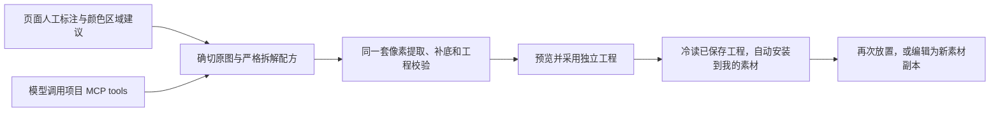
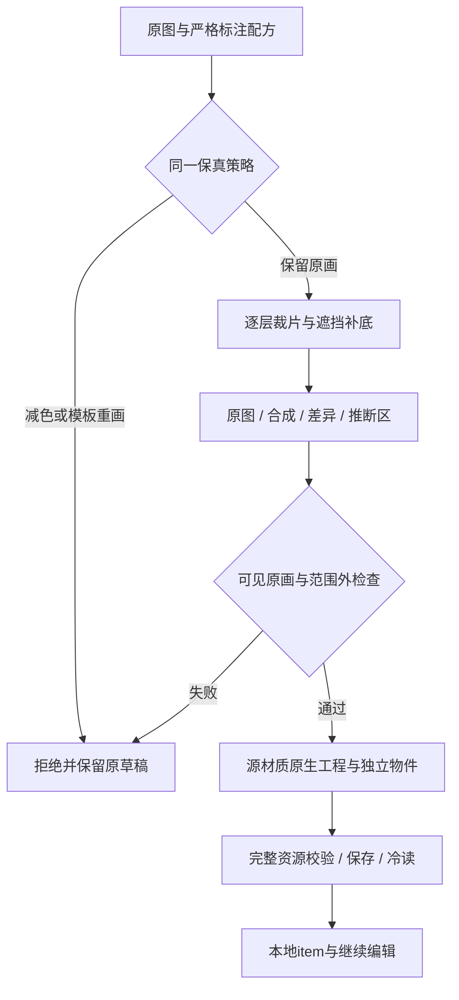
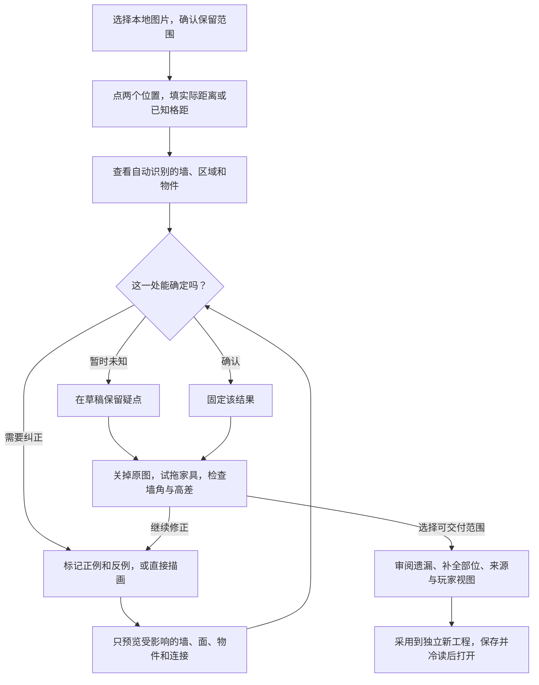
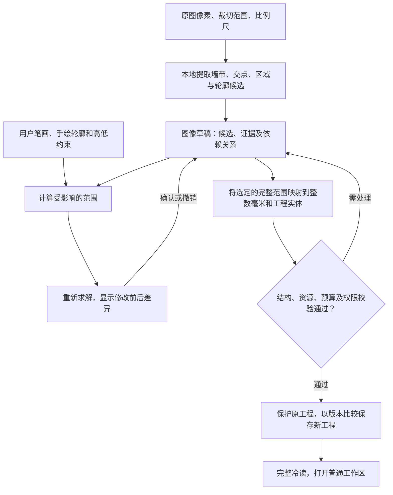

# 从图片新建可编辑场景

主持人导入一张俯视地图，用少量点选和笔画告诉系统哪里是墙、哪些像素属于同一件家具、哪块地面较高。系统给出可修改的候选。用户能在原图上校正，也能关掉原图，在重建结果里拖动物件、检查墙角和通路。确认后，产物是可以在普通工作区继续编辑的完整 `.sceneweave` 工程。

本阶段的目标是持续改进可复用算法和交互设计。右上琴房是暴露边缘、遮挡和纹理问题的诊断案例；逐点手修这张图不能作为通用能力提升。实验须说明改变了哪条共同算法、在哪些正反例上有效、哪些情况仍失败，再决定是否进入共同工具。

首个样板取木地板室内图右上房间。把钢琴移开，原位应露出蓝毯；再把蓝毯移开，原位应露出木板。这个动作能发现整图对照容易掩盖的重影、挖空、重复阴影和错误的支撑关系。本文记录设计；开发顺序与状态见[实施计划](../07-roadmap.md#image-to-project-plan)，正式检查见[验收矩阵](../09-quality-plan.md#image-to-project-acceptance)。

## 原图颜色与风格保真（2026-11-10用户纠正，硬约束）

图片转工程必须保留原图的颜色、手绘风格、可见纹理、描边和造型。提高输出分辨率、拆成独立item或转换矢量均不授予调色、换材质、规则化木板、重绘家具或简化笔触的权限。矢量化服从保真；当前算法不能忠实表达的外观保留原图纹理，不为追求纯矢量而改变画面。源图低分辨率不构成改变风格的理由。

本轮程序木板加有限调色板描摹的右上房间样板不符合此要求。地板的原手绘接缝/木纹被模板替换、家具出现分色色块、原黑色粗墙变成灰绿细边，整体色阶发生偏移。此前完整保存、SVG来源、item和冷读结果仅证明数据链可运行，不能作为该样板的视觉合格或交付依据。旧产物保留作失败对照，停止沿用为目标样板。

程序已加入同坐标原图、合成图、差异图和推断区视图。实际样板的比较数据和页面回归见[开发自检](../archive/workspace-content-validation.md#image-room-source-fidelity-20261111)。拆层保全可见颜色与笔触；补底只在遮挡区延续同图同材质的纹理与接缝，不能替换整面可见地板。原生墙和语义几何不得以默认主题覆盖原有外观。高清化另行验证，缩回原比例检查颜色、边缘和纹理结构，再审阅大倍率细节；不能以成品自我冷读像素一致代替与原图的保真对照。程序、人工和模型使用同一规则，任何风格重制均不属于本次图片导入。

## 页面与模型共用的项目工具

首页和工作区文件菜单提供“从图片新建场景”，场景面板也提供同一入口。用户上传PNG/JPEG/WebP，画房间闭环、用两点输入实际毫米距离，然后按遮挡顺序圈选物件并指定露出的下层纹理取样。可先点选相似颜色得到连通轮廓，再手工修正。孔洞或复杂边缘需要明确修正。预览提供原图、分层合成、补底及逐层显隐，采用时生成独立完整工程。

原图、标定和圈选属于未采用的会话草稿，不随工程保存或备份落盘。收起图片面板后可从同一入口继续，离开工程及刷新前须有草稿保护；工程已保存时仍显示“图片草稿未采用”。准备失败或取消工程候选保留草稿，成功保存并采用对应工程后才清除。另提供明确“丢弃图片草稿”，丢弃后才能换图；会话草稿不提供自动冷开恢复，强制离开仍可能丢失。

当前程序逐层提取原图像素，根据取样纹理重建被移除的区域。用户先拆钢琴，取蓝毯补底，再拆蓝毯，取木板补底。选区外像素保全，补底包含推断，复杂纹理、阴影和遮挡边界需要人工选区与取样校正。处理由项目的纯RGBA算法、浏览器图片端口和通用工程工厂执行。

### 近景精修与分区补底

原图标注可选择适应宽度、100%、200%或400%，用滚动和平移保持近景。当前轮廓顶点支持拖动与撤销，已拆图层可回到“精修轮廓”，重新计算该层及其后续遮挡层。原图、补底和合成视图共用同一近景位置。

**磁性套索与加减画笔。** 在“物件选区工具”选择磁性套索，沿物件外沿拖画，松手后闭合。贴边仅在笔迹附近寻找颜色梯度，同时考虑与笔迹的距离及实际线段连续性。转角无法稳定贴边时保留附近的人工笔迹，避免吸附产生倒折；遇到内部黑线、木板缝或弱边界时仍需人工核对。可关闭吸附自由圈选，再用“保留画笔”补回漏选、“排除画笔”擦掉背景或孔洞。半径按原图像素计算，改变查看倍率不改变笔迹范围。一笔套索、连续画笔或顶点拖动可整体撤销；取消、失焦、切工具、缩放、换图或关闭时，未完成笔迹回滚。采用前须先拆出当前物件或应用修正。

“检查物件边缘”将当前裁片放在棋盘、白色或黑色背景上，支持试移、试转和复位，仅改变查看位置。检查琴沿蓝边、地毯穗、植物叶尖和孔洞；这些动作不改变配方或物理占地。画笔修改选区透明度，保留裁片原RGB；原图边缘已经混入背景的颜色不会由贴边自动恢复。采用后可在统一素材编辑页选择“减轻背景色边”，或显式使用下文的[模型补画](#asset-refinement-routes)生成派生候选；真实模型效果尚未验证。

精细选区保存在图层的可选 `selectionMask:{x,y,width,height,runs}` 中，`runs` 按原图行序交替记录段长与0–255覆盖度。该蒙版是裁片外观的依据，保留孔洞、分离部分及细枝，不受供定位的粗多边形截断；物理占地继续独立填写。每个蒙版最多100万像素及10万段，整份配方累计最多800万像素及25万段，JSON最多8MiB，超限明确拒绝，不简化丢细节。旧提案缺蒙版时仍按原多边形重放。蒙版只表达选区，不能授权任意像素免于原图保真检查。

模型可通过 `image_import_refine_selection` 提交目标图层、磁性粗轮廓及有限的保留／排除笔迹，与页面使用相同的贴边和画笔算法，重放后续遮挡层成功后才一次更新草稿。原图授权、代次、取消与未知参数检查保持。此入口供宿主视觉模型提出候选，本轮未新增自动外发原图或内置云端分割服务；模型建议仍须经过相同选区审阅。

新拆层默认采用无缝纹理衔接与0像素外沿清理，避免未经选择就改动可见原画。用户可把清理范围调为0–8像素，原图显示额外修补外沿。物件裁片保留精确轮廓，外沿只用于去除背景中的阴影和漏边。无缝补底使用同材质未遮像素的稳健颜色差值、多尺度校正和有限传播，保留取样纹理。显式修补范围之外像素保持。

一件物体可能跨多种底材。原图钢琴左侧压窄蓝毯，右侧压木板，需在默认蓝毯取样之外，画出琴下木板分区并选择木板取样。每层最多8个分区，后加入的分区优先。程序自动将物件内的材质分区延续到清理外沿，避免融合时串色。较宽且与木板方向/行位置相近的取样可减少重复暗带，接头仍需目视审阅。

物件可另外填写原图坐标中的 `footprintPx:{x,y,width,height}`，映射既有占地尺寸及相对图像中心的占地偏移。叶片伸到墙上而花盆落在房间内时，应保全完整叶片并标出花盆本体，不能裁掉画面来迁就占地。缺省保留原80%图像矩形建议，采用仍执行真实支撑检查。

配方每层可显式保存 `repair: 'tile' | 'seamless' | 'aligned'`、`cleanupPx` 和 `fills: [{polygon, donor}]`。旧配方缺省时按原平铺与0清理重放。新设置由页面与MCP共用。最初模型重绘的样板扩大了蓝毯并重画高清细节，当前原像素路线保留参考图的窄毯和源分辨率，视觉比较需同时审阅布局保真与重建细节。

需要延续板缝时，可将“补底方式”改为“对齐纹理接缝”（`repair:'aligned'`）。程序从已选同材质取样的有限平移中寻找更贴合修补边界的位置，再执行纹理衔接；多材质分区各自匹配，不旋转、模板化或改动范围外原画。默认仍为“纹理衔接”，旧两种方式保持原样重放。遮挡区缺少真实纹理，找到较好接头也不证明隐藏细节正确；移开物件后仍要检查重复纹理与接缝。

### 拆层来源证据与算法改进边界

页面预览、MCP和工程重建共用顺序重放器。每层都区分裁片中的原图像素与前序补底像素，检查默认及分区取样矩形是否与前序推断区相交；后层不能把先前生成的底材当成新的原图证据。只要进入真实修补覆盖，即使RGBA数值恰好相同，也仍记为推断；孔洞和未修补区保留原图身份。来源图只保存最后修补者，重复修补累计量与最终推断面积分别报告。 图片导入的原色PNG使用共享软件编码保全半透明像素RGB，保持原有8192边长、3200万像素及20MiB上限；固定SVG的4096／1600万预算不变。编码文件字节会改变，旧补底算法的RGBA重放保持。

页面“拆层来源检查”和MCP的保真评估／构建报告使用相同的 `sourceReport`。`declaredDonorPriorInferencePixels` 是各声明矩形交集的累计量，矩形之间可能重复；`extractedInferencePixels` 是各裁片覆盖中来自前序补底的累计量。它们都不是算法实际取样计数，`actualSampledInferencePixels` 和 `boundaryInferencePixels` 明确为 `notMeasured`。该检查不判断轮廓正确性、木纹自然程度或质量收益，也不改配方与像素。

钢琴案例同时暴露了两类问题：粗选区包含真实地毯／木板，与抗锯齿混色应分别处理；不规则板缝和阴影无法仅靠单个镜像取样位置消除。后续先发展显式前景／背景引导的局部选区候选，与直接保留／排除画笔分开，模糊区保留现选区；采用仍走同一RLE及原子重放。补底另需衡量材质方向、接缝连续性与阴影重复，不能用平滑分数或来源交集替代目视质量。开发对照优先使用有许可、已知前景与alpha的多背景组合，并保留未参与调参的组合；真实琴房保留为含歧义的挑战案例，人工遮罩不作算法真值。

模型入口为项目自带的stdio MCP服务 `tools/image-import/server.mjs`。宿主启动时指定一张本地原图、许可文件、署名及输出目录；tools仅能处理该图。可调用inspect、set_scale、set_room、set_source_boundary、set_output_scale、suggest_region、extract_item、set_vector（只允许清除旧设置）、vector_source、assess_fidelity、undo、apply_recipe、preview和build_project。修改工具要求当前generation，预览和构建在处理期间也检查代次。权限和文件路径由宿主提供，模型只提交有限参数。调用方式归[贡献说明](../../CONTRIBUTING.md#image-import-mcp)。

页面和MCP使用同一 `sceneweave-image-import-recipe@1`，绑定规范化原图SHA-256及像素尺寸，记录标尺、房间点、按上层优先排序的拆层轮廓和取样区。模型产出的recipe.json可在页面“模型拆解提案 JSON”载入，再人工修改与预览。该配方属于导入操作，工程继续使用当前完整v1。MCP宿主输出完整候选文件供普通页面打开，页面采用负责本机工程与素材的持久化。

### 原图外观与矢量结构的边界

当前保真导入使用原生整数毫米墙/房间、原图地板材质及独立裁片Prop。新增 `sourceBoundaryPx` 保存原画外框（包含粗黑墙沿），与真实房间轮廓分开。房间与墙面使用同坐标、同物理尺寸的源材质；专用被动主题关闭新增描边、投影和调色。房间外的原画墙沿由房间关联、默认锁定的固定外观保全，室内像素透明，不能把完整家具画面压回底图。它不增加墙厚、阻挡或通行，私密房间过滤同时覆盖关联外观。移动家具不受该外观层影响；大幅修改墙体几何后，原画墙沿仍需重新标注/制作，尚未实现随任意墙网自动重绘。

旧有限调色板描摹、程序木板和程序地毯已被保真入口禁止，不能采用旧矢量提案来覆盖原画。纯算法与既有SVG素材编辑仍可用于独立美术创作；这些能力不等于图片保真转换。未来矢量外观需要通过同坐标原图对照，不能以SVG路径存在或分辨率较大替代此门槛。

配方 `outputScale` 允许1、2、4倍整数原色采样，物理尺寸不变，RGBA逐源像素复制，不增加调色板。这只提高输出像素尺寸，不能声称恢复原图缺失细节。地板材质与拆出的物件自动安装本地item；建筑墙沿仅为工程结构外观，不混入独立家具目录。合计地板与拆出物件最多64项。

### 图片导入工作台

上传后在同一工作台完成“原图与标定 → 结构与比例 → 物件与补底 → 总览与采用”。左侧始终提供阶段、真实对象清单和待处理/复核问题，中间保留同一个可缩放、平移的标注画布，右侧只呈现当前阶段的真实字段。阶段切换不重建画布或清空输入；已有物件修正未处理时，不能切到另一物件覆盖草稿。可点击统计或问题定位到对应编辑字段。总览同时核对像素保真、推断与前序补底来源、实际比例、许可和采用条件，最后预览独立完整工程。

这些统计是操作依据，不能证明轮廓准确或木纹自然。真实钢琴蓝边、木纹接缝和暗带仍是算法整改目标，不能靠拆分更多页面或修好样板宣布解决。

### 统一素材编辑与图像处理

内置、自定义、导入和拆出的item统一从“编辑素材副本”进入，名称与尺寸、占地与阻挡、图像处理及来源许可在同页。物件、材质与组合按真实能力显示字段，组合可查看实际成员并前往成员副本编辑。图像候选先“放入编辑草稿”，字段仍保留，最后一次保存为个人素材新固定条目，原素材和已放置实例保持。来源和许可只读。

场景选中物件、房间地板、地形或墙面后，在详情打开“编辑素材”。编辑页明确当前场景实例范围；属性与图像候选切页、收起均保留，关闭有未采用编辑时需明确丢弃，目标变化后候选保留对照但不得覆盖新目标。图像处理是其中一个标签，可选择方向和2/3个候选；可处理整件图片，或用涂入/擦除画笔限定范围。一笔撤销、取消回滚、棋盘/黑/白背景和100/200/400%同步对照用于审阅，检查状态不进入工程。点击“在场景中预览”显示实际场景效果，再采用或取消；“都不采用”丢弃临时候选。

| 方向 | 当前固定本机算法与边界 |
|---|---|
| 插值放大 | 2倍受限双三次，在线性光和预乘alpha下插值并限制过冲；透明背景颜色不混入物件。三种强度提供不同平滑程度，不增加细节。 |
| 边缘更干净 | 只调整已有半透明边带的alpha，保留原RGB、确定透明孔洞及不透明细节；不自动移除蓝毯混色，不重新识别轮廓。 |
| 减少噪点 | 弱保边去噪，强度不同；可能损失细小笔触，须和原图对照后选择。 |
| 减轻背景色边 | 仅在窄边带依据稳定内侧颜色减弱异常色度，保留亮度、alpha、孔洞与内部像素；没有可靠依据时不变。属于估计，真实彩色边饰也要换底检查，可用画笔收窄范围。 |

去色边优先读取规范RGBA8 PNG的确切像素；其余合法格式沿现有图片解码器。页面、采用和完整资源重放使用同一规则，避免把浏览器半透明RGB舍入造成的变化当作改善。旧三方向的解码和配方语义保持。部分原图没有足够证据，三个候选可能都不变，此时不能采用一个没有实际变化的结果。

候选从同一本轮输入生成，若结果相同或没有变化会明确标示，像素变化数不是质量评分。原件始终保留；采用新固定结果后仍能移动、旋转、改外观并再次增强，可选“当前结果”继续或“保留原图”重新开始。范围外按输出倍率原RGBA复制，局部处理不暗改其他像素。保持原色是默认审阅目标，缩放和去噪会改变派生RGB，不能宣称逐像素仍等于原图；原图保真导入门继续约束原件和拆层。

基础处理使用可中断的一次性Worker，允许继续编辑。目标、来源、外观覆盖或锁变化使旧候选不可预览；无关编辑保留。预览及采用仍用普通事务、完整验证和一次撤销；取消、失败和迟到结果不写工程。资源/许可、来源链和真实配方重放归[04](../04-scene-document.md#image-enhancement-model)及[06](../06-storage-and-export.md#image-to-project-save)。基础处理输入最多400万像素、输出单张800万/整组1600万像素，PNG边长最多4096；局部RLE沿已有蒙版预算。

#### 矢量重建与模型补画

同一图像页提供两条精修路线，默认依据保留原图；各自保留参数、补画要求和候选，切换不丢草稿。原图与结果使用相同显示尺度，可换黑白/棋盘底。修改参数后旧结果仍可对照，重新生成后再采用；显式重读基线会先确认丢弃旧候选。基本插值、降噪与边缘处理收在“基础处理”，不再用“更清晰”暗示插值增加细节。

两条路线独立：SVG的生成、继续编辑、采用、保存和冷读均在本机完成，不需要图片编辑模型、服务地址或API凭据。图片编辑服务配置仅属于“模型补画”；其缺失不阻塞SVG算法的开发、运行与质量整改。

- **矢量结构重绘**：默认SVG方式，接收人工或视觉助手分析得到的完整结构稿，在本机用连续曲线、规则重复形元、描边和渐变重新绘制。结构稿绑定确切源hash和源坐标框，每部件声明依据原图或含推断及理由；允许修正轮廓、背景混色与透明区，不套回原alpha。页面载入稿件后审阅部件/推断，生成、SVG下载、普通预览采用、保存与冷读复用同一编译器；当前没有自动识别图片，不能把人工视觉钢琴稿宣传成自动识别算法。结构稿为严格v1，最多96元素/32渐变，每渐变2–16有序stop；仅受限绝对M/L/Q/C/Z路径及重复矩形，源最多100万像素/8192边，累计SVG仍受256路径/16384指令/1MiB文本预算约束，未知字段、错误来源/越框/危险引用均拒绝。采用保留完整稿件、原始/规范SVG、PNG、原件与许可；重开可选择「已保存结构稿来源」读取确切直接父源，再载入原稿继续编辑；混合处理链不将稿件hash改绑到根原图或最终结果。声明观察/推断不证明准确，需要实际视觉复查。
- **像素描摹**：保留作对照的SVG方式，本机按实际像素距离分色，建立相邻连通区域；只合并可由同一低误差明暗渐变解释的区域，细小/细窄区域不参与合并，未通过渐变检查的区域保留原分色。填色再与共享边界链的有限二次曲线拟合组合，同一内界正反复用，保护细小闭环与直角。8–48色，曲线容差0–0.49源像素，默认24色/0.45；最多100万源像素、8192边长、65536颜色采样格、16384连通区域与20万次合并尝试，每区至多64次合并、最多96个渐变，SVG仍受256路径/16384指令限制，超预算拒绝，不自动丢区域。渐变在实际源采样处每通道RMSE≤4、最大通道偏差≤12（0–255），总平方误差比原平色至少低10%；端点限制在观察到的通道范围。这些是填色拟合门槛，不能当作曲线渲染后的全图误差或画质评分。保留真实受限SVG源码，可查看/下载；采用后SVG原文、规范源与固定PNG一同保存，并可在素材副本编辑页继续改SVG。新候选固定 `regional-tones-v1`，既有 `shared-boundary-curves-v1` 原样重放。算法仍不理解琴键数量、黑键分组或琴体结构；不会自动消除蓝边，减色可能损失笔触。
- **模型补画**：应用服务使用独立配置的图片编辑模型，不复用聊天/看图模型。检查连接不上传图片；用户填写补画要求、检查服务并同意本次图片上传及可能计费后，才发送一次完整图片与要求。每次一张候选，保留真实PNG透明度，不自动裁剪或套原alpha；比例漂移超过2%、全透明、透明原图返回全不透明、完全相同像素及非法/超预算结果拒绝。返回图需要人工核对琴形、琴键、描边、材质与新增错误，推断细节不称真实恢复。

模型输出最多800万像素，协议要求显式尺寸与透明PNG；供应商支持标为 `configured-unverified`，配置成功不等于真实效果/透明输出实测。服务连接与应用访问凭据只留编辑器内存；供应商密钥只在服务端。POST开始前先在编辑器登记请求ID，之后区分结果未确认、服务已返回和服务拒绝未发送到模型；返回后取消、解码失败或像素拒绝也保留已完成ID。请求记录跨路线、草稿清理和个人素材图像面板重挂载保留，但不作为未采用图像草稿阻止保存；关闭编辑页须显式确认并自行保全所需ID。取消/断网可能仍计费，禁止自动重发。专用配置与接口见[贡献说明](../../CONTRIBUTING.md#image-edit-service)。

两条路线都通过既有草稿/场景审阅和一次采用/撤销，保持物理尺寸、占地、支撑、通行和秘密，保留原件与许可链；不能将精修候选混入原图保真导入免检。钢琴仅作算法对照，真实缺陷是否改善及其他画风收益仍待[09](../09-quality-plan.md#image-to-project-acceptance)审阅。

### 失败经验如何进入程序

共享 `IMAGE_IMPORT_FIDELITY_RULES` 同时提供给页面与MCP inspect。规则不只是提示：配方重放、单物件提取、旧提案载入和工程构建均执行相同策略；不通过时保全原草稿与代次。MCP保留稳定错误码，宿主不能通过提交一个“已验证”字段免检。

| 失败经验 | 程序执行与诊断 |
|---|---|
| 木纹被规则木板替换 | `material-replacement` 拒绝wood/rug模板；当前可见源像素不重画 |
| 颜色减少、笔触变成色块 | `palette-loss` 拒绝当前trace；同坐标RGBA比较报告改变数量与最大误差 |
| 原黑墙被默认灰绿墙覆盖 | `theme-override` 检查原生墙材质、原点和比例。渲染器在描边宽度为0时跳过轮廓底色与二次遮罩，避免边缘变深 |
| 为了补底改到可见区域 | 比较原图和剩余底图，推断遮罩仅由真实修补算法产生；范围外变化直接失败 |
| 整幅图都标成推断而获得通过 | 无可比较参考像素返回unverified；推断区单列，不证明真实细节 |
| 保存重开相同就当保真 | `comparisonKind: roundtrip` 无法签为原图保真；报告将sourceFidelity与存取verification分开 |
| 放大图片被称为恢复细节 | 仅允许明确原色采样，说明倍率与未知细节；不借高清化授权重绘 |

页面提供原图、分层合成、差异和推断区视图；关闭标注可检查真实像素。`image_import_assess_fidelity` 使用宿主确切原图与当前配方现场重算，可见合成和推断补底分别出报告。部分轮廓抗锯齿边缘单列，不能把家具内部全当豁免。完整资源、许可、原子采用、保存与冷读检查继续执行。规则回归包括实际细线/不规则木纹/颜色/透明度改变、范围外修补、全推断、旧矢量提案以及存取一致误判。

### 自动进入本地 item 与有限编辑

工程采用并保存后，从真实冷读结果生成每个拆出物件的固定素材载体，自动写入IndexedDB“我的素材”。相同固定内容幂等复用。工程和个人库分别提交，素材写入失败时展示已保存的工程及重试入口，重开也可重试同步。

用户从“素材与布景”选中任意来源的item，可整理个人标签、颜色与收藏；统一“编辑素材副本”可按类型改名称、图像或平铺宽高、占地、偏移与阻挡，保存为新的固定条目，携带原像素、外观源图与实际来源许可。画布中的实例可移动、旋转、复制及删除，跨工程放置继续消费固定素材定义。

## 用户怎样从图片得到工程

导入界面提供原图、重建图和同坐标叠加三种视图，缩放与平移同步。优先列出会改变房间连通、世界尺度、支撑和秘密输出的疑点。用户可直接确认一组候选，逐项修改或撤销；也可在待处理列表中返回原位置。采用前列出尚未解决的事项及其依赖，用户可以收窄到完整可交付的房间。凡涉及该范围的未定尺度、未闭合房间、无效依赖或未审阅的保密风险，须先解决。

### 四种标注与反馈

| 标注动作 | 系统给出的局部反馈 | 用户怎样纠错 |
|---|---|---|
| 沿厚墙划正笔，在木板缝或桌边划负笔；点墙上的开口 | 高亮墙带、建议中心线与厚度，在斜角、交点、缺口处给出候选；显示共享这堵墙的房间 | 拖动端点、合并误拆的墙、补画裁切边；选择门、窗或连续墙，检查附着与宽度 |
| 在房间或材质内部点种子，在边界外点排除点 | 沿已确认墙网扩展房间，沿像素轮廓扩展地毯等局部区域；叠加显示选中的面 | 切开误合并区域，连接被家具挡断的同一张地毯，或手描轮廓 |
| 框选物件，点要保留和去掉的部分 | 给出透明轮廓、可见边、候选根锚和所属区域；试拖时显示需补底的范围 | 修边、调根锚与占地；明确拆出餐椅，或把桌面与小饰物暂作一组 |
| 依次点低面、高面；另画上行箭头 | 草稿记录相对关系。可输入实际高差、选择基准面；箭头另询问连接类型、两端与宽度 | 矛盾关系在原图定位；用户可改正、暂缓，或确认仅有阻挡高差。标记楼梯或坡道后仍要检查净宽和落点 |

标注默认作用于当前区域。相似墙线或同类座椅可以列为建议，让用户选择传播范围。单笔标注、接受传播和解除确认均可独立撤销。用户确认的墙角、手描轮廓和人工排除优先于自动推断；发生冲突时显示两项约束及波及对象，等待用户决定。用户在草稿中“确认”约束与普通工程中的“编辑锁”各自独立。

## 识别、校正与工程生成

**草稿记录。** 原图以内容摘要标识；点、线、圈选及遮罩均使用原始像素坐标，保留裁切偏移、朝向、标定点和实际距离。每个候选带稳定的草稿身份、证据区域、来源（自动、手工或遮挡补全）、依赖项和状态（待确认、已确认、已排除）。更改显示缩放不改标注；重标比例会重新计算全部受影响的毫米值、厚度、开口宽度与占地，并在采用前重查。首版草稿限本次导入会话，退出前提示未采用的标注会丢失。

**局部重算。** 一笔反例落在餐桌黑边，先更新与它相交的墙候选，再沿依赖检查相邻交点、房间闭环和附着开口。只有依赖确实变化才扩展范围。用户先看差异，再接受；拒绝或撤销回到上一草稿。后台结果绑定原图摘要、标定、标注和草稿代次，旧计算迟到时丢弃。模型离线时，用户仍可用点线面工具完成相同语义的草稿。

**建筑与标高。** 先按墙宽连续性和交点构建墙网，再由闭环构成房间；相邻房间复用同一墙与顶点。门窗从已确认开口映射到墙端点、沿墙距离及宽度。裁切到画框的外墙留缺口，提供“手画边界”与“沿裁切边收口”的预览。分清物件遮挡、单个 Floor 上地面的相对高低与独立楼层：钢琴盖住地毯只涉及绘制；面高于另一面只给出不等式；可行走高差还需已确认的标高、支撑、边界和合法连接。循环矛盾或只有相对值时保留草稿，允许用户明确选择同层平面交付并看到简化范围。

**物件与像素。** 保留已授权的可见笔触，按遮罩生成带透明边缘的素材；可见外观、物理占地、阻挡、受众分别审阅。补底优先采样同一房间、同方向的可见纹理，保存固定派生资源，界面用单独遮罩指出推断区域。钢琴下先补毯，毯下再补木板。烘焙阴影与物件一并拆除或经用户修正，避免残影或二次投影。可移动、可隐藏或涉密内容必须从下层像素中清除；无法可靠分离时保留待处理，或由用户整体收为同受众、同移动行为的组合并明确粒度。

**运行边界。** 首版优先试用本地几何规则和人工修正，保留可替换的分割接口。视觉模型若接入，仅返回带证据的候选；发送任何选区前明确展示范围并取得该次外发授权，未知计费结果不自动重试。整图参考底稿、负例和审阅遮罩只供校对。普通工作区接收通过校验的实体与固定资源，保存、冷开与导出均可脱离原始输入文件。数据边界见[04](../04-scene-document.md#image-to-project-model)，保存与输出见[06](../06-storage-and-export.md#image-to-project-save)，模型权限归[05](../05-ai-and-generation.md)。

## 固定样图与取舍

用户提交的 1280 × 840 JPEG 没有透明通道。图外棋盘格属于像素，上下建筑被画框截断，左下餐桌右侧可见鼠标指针。初次标注应排除棋盘格与指针，记录裁切边；图中没有可靠比例或高差证据，几何标尺及高程试验另用明确标定值。右上房间覆盖斜墙、木纹、蓝毯与钢琴；扩到整图时用中央大厅测共享墙与开口，用左下餐区测密集家具和成组细节。

本机开发输入归被 Git 忽略的 `work/image-to-project/inputs/interior-reference.jpg`，SHA-256 为 `bbed73cfd49a7360f43c26bc899f9cdb84d4fa983e683bed1e20442b478396ac`。取得该图的机器可据此复核输入；共享测试应配可再分发的独立样图。样图可作为人工标注、算法调试和画面目标；模型训练、服务外发、派生像素嵌入与公开分发分别核对用途和许可。可用原创替代材质完成同一编辑流程，并在审阅中显示外观差异。素材权利按[10](../10-rules-assets-and-licensing.md#asset-review-and-rights)。

## 本机样板的交接方式

在首页选择“打开工程文件”，导入本机 `work/image-to-project/room-sample-v4/map.sceneweave`。从“场景”的对象列表选择“钢琴 · 可独立移动”或“蓝地毯 · 可独立移动”，可在画布拖动，或在详情修改“物件 X/Y”。工程沿普通自动保存，退出后在首页最近工程中重新打开。目录内 `ui-final/` 保存实际页面的移动前后图、下载包及冷开后继续编辑的记录。

样板使用声明比例25mm/px，原点为原图(710,85)，世界尺度待用户实际标定。房间几何使用人工给定的8角闭环；地板中其余桌椅、装饰与部分墙面描边保留为固定像素，只有钢琴和小蓝毯逐件编辑。原生墙顶采用当前默认外观。图像模型对琴、毯和去除两者后的底板进行了重绘与补全，笔触和局部细节存在差异，后续可用保留原图像素的分割结果替换对应固定素材。

本机素材清单与三层PNG可用 `tools/image-import/build-room-sample.mjs` 重新构建到新的输出目录。清单中每层填写本地 `path` 和原图坐标 `boundsPx`，另填写实际 `licenseText` 与 `attribution`。工具复用普通图片规范化、完整资源校验和完整包导出，另一空白页面冷读落盘包并与2048预览对照。调用方式见[贡献说明](../../CONTRIBUTING.md#image-room-sample-tool)。专用导入标注界面的接续仍按[07](../07-roadmap.md#image-to-project-plan)。

算法原型可分别评估墙交点组合和点框提示分割。前者提供墙网约束的参考，后者可检验正负点修边的成本；两者在本图上的质量均待实测。先用人工样板定位损失发生在识别、实体映射还是渲染，再用未参与调参的独立图片决定是否需要训练专用模型。[平面图矢量化研究](https://openaccess.thecvf.com/content_ICCV_2017/html/Liu_Raster-To-Vector_Revisiting_Floorplan_ICCV_2017_paper.html) · [交互分割方法](https://ai.meta.com/blog/segment-anything-foundation-model-image-segmentation/)
